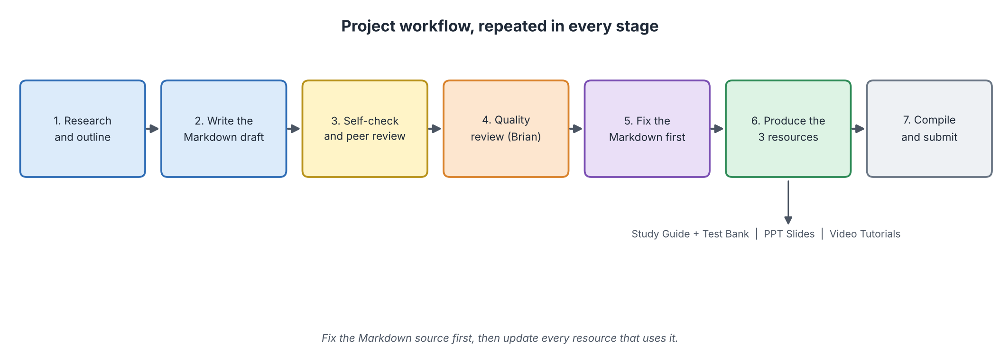
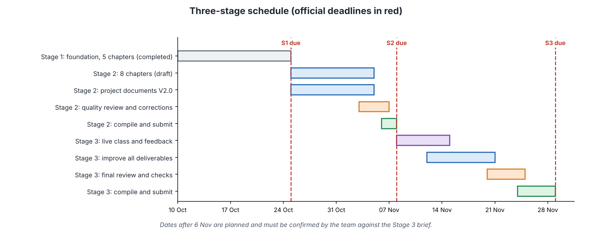

# BABI GULING — AI OVERVIEW

**Document author:** Brian Djoni Suzanna (Quality Lead)  
**Revised by:** Benedict Subhata, after Quality Review QR-V2-009-I01  
**Version:** V2.0, Revision 2 (Stage 2)  
**Last updated:** 6 November 2026

> **🎮 Play the quiz game:** <https://babigulingcsai.netlify.app>  
> *Escape the Spit* is a card-battle quiz through the AI Overview module. You are a pig chef climbing a Kitchen Tower and defeating question monsters with what you know about AI. It works in any browser and offline once loaded. It supports the Study Guide and Test Bank.

## 1. Team Information

**Module:** AI Overview  
**Team Name:** BABI GULING  
**Project:** Introduction to Computer Science and Artificial Intelligence  
**Stage:** Stage 2 — Content Development and Learning Resource Production

### Team Members

| No. | Name                      | Chinese Name | GitHub Username  | Student ID | Role               |
| :-: | ------------------------- | ------------ | ---------------- | :--------: | ------------------ |
|  1  | Benedict Subhata          | 王志伟          | benngiiii        | 1820262181 | Visual Design Lead |
|  2  | Brian Djoni Suzanna       | 吴梓诚          | brizz0-0         | 1820262162 | Quality Lead       |
|  3  | Gandhi Bestin Dhammananda | 熊特友          | bestinsiuuu77    | 1820262168 | Video Lead         |
|  4  | Jonathan Sugianto         | 蔡德辉          | JonathanSugianto | 1820262245 | CIO                |
|  5  | Joseph Lokman             | 骆韦铨          | JosephLokman     | 1820262233 | CEO                |

---

## 2. Project Overview

### Project Purpose

This project introduces **Artificial Intelligence (AI)** to beginners who have little or no knowledge of AI or programming. The materials explain AI in a simple, organised way: what AI is, its types, how it works, the three classic approaches (symbolic, connectionist and behaviorist), real applications, and ethical limits.

The project is built on one shared Markdown content base. It supports the learning resources below.

| Resource                    | Purpose                                                                                                          |
| --------------------------- | ---------------------------------------------------------------------------------------------------------------- |
| **Study Guide + Test Bank** | Structured reading, worked examples, interactive missions and practice questions for independent learning.       |
| **Quiz game** *(supplementary)* | *Escape the Spit*, a card-battle quiz for practice by playing: <https://babigulingcsai.netlify.app>         |
| **PPT Slides**              | Presents the key concepts visually through diagrams, examples and short explanations.                            |
| **Video Tutorials**         | Explains selected concepts through narration, visual demonstrations and examples.                                |
| **Live mini lecture**       | A short class lecture that compares supervised, unsupervised and reinforcement learning.                         |

### Intended Learners

Beginners with no prior background in AI or programming. Learners are expected to have basic computer and internet literacy. Every technical term is explained in one plain sentence before its official definition.

### Learning Outcomes

After completing this module, learners should be able to:

1. Explain what AI is and how it differs from traditional programming.
2. Distinguish AI by capability and by approach, including the **three classic approaches: symbolic, connectionist and behaviorist AI**.
3. Describe the AI workflow (data, algorithm, training and inference), compare supervised, unsupervised and reinforcement learning, and evaluate a model with simple measures.
4. Explain symbolic AI (rules and logic), connectionist AI (neural networks and Big Data) and behaviorist AI (learning from rewards), and give an example of each.
5. Identify real-world applications of AI and the human oversight they need.
6. Recognise limitations and ethical concerns, including bias, privacy, transparency, hallucination and regulation.

These outcomes are identical in the [Module Outline](module-outline.md) and the [Project Plan](project-plan.md).

### What Changed in Stage 2

| Area | Stage 1 (V1.0) | Stage 2 (V2.0) |
| ---- | -------------- | -------------- |
| Chapters | 5 | **8** (3 new chapters from the lecturer's materials) |
| Chapter style | Reading text with examples | Reading text plus **two guided missions per chapter**, answer keys and glossaries |
| Diagrams | Mixed | Image files for every diagram; **no Mermaid** |
| References | List at chapter end | Numbered references with links at the end of each chapter |
| Output formats | GitHub Markdown | Markdown that also converts cleanly to PDF |
| Stage 1 files | — | **Kept unchanged** in `Main/study-guide/v1.0/` |

### Current Progress (6 November 2026)

| Area | Status | Evidence |
| ---- | ------ | -------- |
| Stage 1 | ✅ Completed; scored 100/100 | `Main/study-guide/v1.0/`, `Main/stage1_Content.md` |
| Eight V2.0 chapters | ✅ All reviewed and approved (64/64 each) | `quality/reviews/detailed review V2.0/QR-V2-001-I01.md` to `QR-V2-008-I01.md` |
| Module Outline | ✅ Approved (64/64) | `QR-V2-010-I01.md` |
| Master Task List | ✅ Approved (64/64) | `QR-V2-012-I01.md` |
| README and Project Plan | ✅ Revised after review; recheck requested | `QR-V2-009-I01.md`, `QR-V2-011-I01.md` |
| Study Guide and Test Bank | ✅ Prepared | Stage 2 package |
| Quiz game | ✅ Published (Version 1.2) | <https://babigulingcsai.netlify.app> |
| PPT Slides | ✅ Prepared | Stage 2 package |
| Video Tutorials | To be confirmed by Gandhi | MP4 files and Video Guide |
| Logs and previous-year project review | ✅ Prepared | `logs/`; Project Plan, section 2.4 |

The numbers above agree with the [Master Task List](master-task-list.md) and the [Project Plan](project-plan.md).

---

## 3. Module Content

The AI Overview module has **eight chapters**. The progression is: what AI is → what kinds exist → how it learns → three ways to build it → where it is used → what can go wrong.

| Chapter | Topic                                   | Main Content                                                                                              | Chapter Author            |
| :-----: | --------------------------------------- | --------------------------------------------------------------------------------------------------------- | ------------------------- |
|    1    | **Introduction to Artificial Intelligence** | Definition of AI, history, AI vs traditional programming, the machine learning idea, a spam-filter example. | Jonathan Sugianto         |
|    2    | **Types of Artificial Intelligence**    | Capability levels, functionality types, AI / ML / DL / generative AI.                                     | Gandhi Bestin Dhammananda |
|    3    | **How Artificial Intelligence Works**   | Workflow (§3.1), data (§3.2), algorithms and models (§3.3), machine learning with supervised, unsupervised and reinforcement learning (§3.4), neural networks (§3.5), language AI (§3.6), training vs inference (§3.7), evaluation (§3.8). | Benedict Subhata          |
|    4    | **Symbolic AI: Intelligence from Rules and Logic** *(new)* | Logic, knowledge representation, expert systems, search, minimax.                              | Gandhi Bestin Dhammananda |
|    5    | **Connectionist AI and Big Data** *(new)* | Neurons, activation functions, network designs, Big Data (5 Vs), pipelines, charts.                     | Jonathan Sugianto         |
|    6    | **Behaviorist AI: Learning by Acting and Getting Feedback** *(new)* | Reinforcement learning, Q-learning, behaviour-based robots, reward hacking.                 | Joseph Lokman             |
|    7    | **Applications of Artificial Intelligence** | Healthcare, finance, transport, education, robotics, human in the loop.                               | Brian Djoni Suzanna       |
|    8    | **AI Ethics, Risks and Limitations**    | Bias, privacy, transparency, hallucination, EU AI Act, NIST AI RMF, responsible use.                      | Joseph Lokman             |

The three classic approaches, which were summarised inside one chapter in earlier drafts, now have their own chapters: **Chapter 4 (symbolic), Chapter 5 (connectionist) and Chapter 6 (behaviorist)**. Chapter 3 introduces the general learning loop that leads to them. Chapters 4 to 6 follow the lecturer's course slides (*Symbolic AI*, *Connectionist AI and Big Data Overview*, *Behaviorist AI*). Chapter titles and authors match the files in `Main/study-guide/V2.0/`. Detailed information is in the [Module Outline](module-outline.md).

---

## 4. Team Roles and Responsibilities

| Team Member                   | Role               | Main Responsibilities                                                                                                                      |
| ----------------------------- | ------------------ | ------------------------------------------------------------------------------------------------------------------------------------------ |
| **Joseph Lokman**             | CEO                | Coordinates overall progress, records activities and decisions, monitors deadlines, supports final submission.                             |
| **Jonathan Sugianto**         | CIO                | Repository organisation, technical documentation, GitHub workflow, compiling each submission folder.                                       |
| **Benedict Subhata**          | Visual Design Lead | Visual consistency, diagrams, Study Guide and Test Bank, quiz game, slides and the readable PDF.                                           |
| **Gandhi Bestin Dhammananda** | Video Lead         | Video tutorial development, narration planning, and live teaching preparation.                                                             |
| **Brian Djoni Suzanna**       | Quality Lead       | Reviews learning content and documents, checks consistency, records quality issues and monitors corrections. Authors the project documents. |

Task assignments, deadlines and status are tracked in the [Master Task List](master-task-list.md).

---

## 5. Project Documents and Stage 2 Deliverables

### Stage 2 deliverable groups

| Group | Deliverable | Where to find it | Status |
| :---: | ----------- | ---------------- | :----: |
| A | Markdown Content V2.0 ZIP (snapshot, readable PDF, submission report) | Stage 2 package; source in `Main/` | ✅ Prepared |
| B | Study Guide and Test Bank, plus the quiz game | Stage 2 package; <https://babigulingcsai.netlify.app> | ✅ Prepared |
| C | PPT Slides | Stage 2 package | ✅ Prepared |
| D | Video Tutorials and Video Guide | Stage 2 package | To be confirmed |
| E | Project Log and Meeting Summaries | `logs/` | ✅ Prepared |
| F | Personal Learning and Work Logs | Each member's log | ✅ Prepared |

Items marked "To be confirmed" or "To be completed" are not presented as finished.

### Repository documents

| Document                    | Purpose                                                                                      | Link                                                                                  |
| --------------------------- | -------------------------------------------------------------------------------------------- | ------------------------------------------------------------------------------------- |
| **Project Plan**            | Objectives, course alignment, deliverables, schedule for all three stages, risks.            | [project-plan.md](project-plan.md)                                                    |
| **Master Task List**        | Every task of Stages 1 to 3, owner, deadline, status and evidence.                           | [master-task-list.md](master-task-list.md)                                            |
| **Module Outline**          | Module structure, chapter outlines and development status.                                   | [module-outline.md](module-outline.md)                                                |
| **Stage 1 Content**         | All Stage 1 chapters in one file (unchanged).                                                | [stage1_Content.md](stage1_Content.md)                                                |
| **Stage 2 Content**         | All eight Stage 2 chapters in one file.                                                      | [stage2_Content.md](stage2_Content.md)                                                |
| **Study Guide V2.0 (Markdown)** | The eight chapter files with figures.                                                    | [study-guide/V2.0/](study-guide/V2.0/)                                                |
| **Stage 1 AI Use Log**      | AI use during Stage 1.                                                                       | [stage1-ai-use-log.md](../logs/stage1-ai-use-log.md)                                  |
| **Stage 2 Activity and AI-Use Records** | Activities and AI use during Stage 2.                                            | [Stage 2 activity and AI-use records.md](../logs/Stage%202%20activity%20and%20AI-use%20records.md) |
| **Quality Review Register** | Tracks review reports, issues and progress.                                                  | [review-register.md](../quality/reviews/review-register.md)                           |
| **Quality Standards V2.0**  | Criteria used to review the Stage 2 materials.                                               | [quality-standards-V2.0.md](../quality/reviews/quality-standards-V2.0.md)             |
| **Final Submission Audit V2.0** | Final checks before the Stage 2 submission.                                              | [final-submission-audit-V2.0.md](../quality/reviews/final-submission-audit-V2.0.md)  |

---

## 6. Repository Structure

```text
BABI-GULING/
│
├── Main/
│   ├── README.md
│   ├── project-plan.md
│   ├── master-task-list.md
│   ├── module-outline.md
│   ├── stage1_Content.md
│   ├── stage2_Content.md
│   ├── assets/                           (planning figures)
│   │   ├── fig-plan-1-workflow.png
│   │   └── fig-plan-2-schedule.png
│   └── study-guide/
│       ├── v1.0/                         (Stage 1, unchanged)
│       └── V2.0/
│           ├── chapter-1-introduction-to-artificial-Intelligence/
│           ├── chapter-2-types-of-artificial-intelligence/
│           ├── chapter-3-how-artificial-intelligence-works/
│           ├── chapter-4-symbolic-ai/
│           ├── chapter-5-connectionist-ai-and-big-data/
│           ├── chapter-6-behaviorist-ai/
│           ├── chapter-7-applications-of-aI/
│           └── chapter-8-ai-ethics-and-limitations/
│               (each folder: one .md file and an assets/ folder)
│
├── logs/
│   ├── stage1-ai-use-log.md
│   ├── Stage 2 activity and AI-use records.md
│   └── assets/                           (log screenshots)
│
└── quality/
    └── reviews/
        ├── quality-standards-V1.0.md
        ├── quality-standards-V2.0.md
        ├── final-submission-audit-V1.0.md
        ├── final-submission-audit-V2.0.md
        ├── review-register.md
        ├── detailed review V1.0/
        └── detailed review V2.0/
```

The folder names above are the real names in the repository, including capital letters (for example `chapter-1-introduction-to-artificial-Intelligence` and `chapter-7-applications-of-aI`). Do not retype them in lowercase, because links on GitHub are case-sensitive.

**Image rule:** every chapter folder keeps its own `assets/` folder, and the chapter file refers to images with relative paths such as `assets/fig-4-3-bfs-vs-dfs.png`. Do not move images out of their folder.

---

## 7. Project Workflow


*Figure 1: Project workflow, repeated in every stage. Source: created by our team.*

The production sequence is: **Markdown content → Study Guide and Test Bank (with the quiz game) → PPT Slides → Video Tutorials**, with **quality review, revision and evidence collection** before final compilation.

| Step | What happens | Owner |
| :--: | ------------ | ----- |
| 1 | Research and outline the chapter using reliable sources and the lecturer's slides | Chapter author |
| 2 | Write the Markdown draft in the agreed chapter template | Chapter author |
| 3 | Self-check and peer review (check calculations, answers, links) | Author and one peer |
| 4 | Quality review against the Quality Standards V2.0; result recorded in the Review Register | Brian |
| 5 | Fix the Markdown **first**, then rerun the review | Chapter author; Brian |
| 6 | Update the Study Guide, Test Bank, quiz game, PPT Slides and Video Tutorials from the fixed Markdown | Resource owners |
| 7 | Collect evidence (logs, screenshots, commits); compile, run the final audit, submit | Jonathan |

---

## 8. Stage 2 and Stage 3 at a Glance


*Figure 2: Three-stage schedule. Source: created by our team.*

| Stage | Deadline | Status |
| ----- | -------- | ------ |
| Stage 1 | 24 Oct 2026 | ✅ Completed (100/100) |
| Stage 2 | 7 Nov 2026, 23:59 Beijing time | ✅ Resources prepared; final checks and logs in progress (see Section 2, Current Progress) |
| Stage 3 | 28 Nov 2026 | Planned in detail: live mini lecture, feedback, fixes, final review, submission |

The full schedule, with tasks, owners, reviewers, milestones and evidence, is in the [Project Plan](project-plan.md), section 10, and the [Master Task List](master-task-list.md).

---

## 9. How to Read This Repository

| If you want to... | Open |
| ----------------- | ---- |
| Read the whole module in one file | [stage2_Content.md](stage2_Content.md) |
| Read one chapter | `Main/study-guide/V2.0/<chapter folder>/` |
| Practise by playing | <https://babigulingcsai.netlify.app> |
| See Stage 1 as submitted | `Main/study-guide/v1.0/` and [stage1_Content.md](stage1_Content.md) |
| See the plan and schedule | [project-plan.md](project-plan.md) |
| See who does what | [master-task-list.md](master-task-list.md) |
| Check quality evidence | `quality/reviews/` |
| Check AI use | `logs/` |
