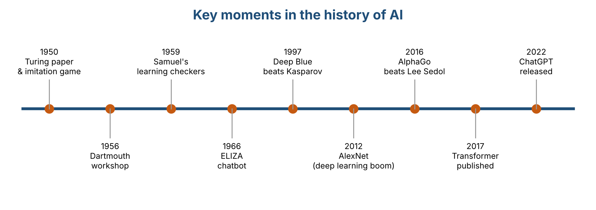
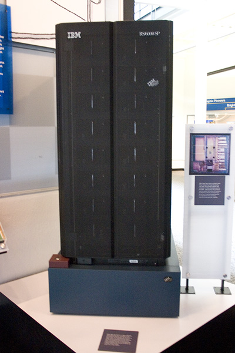
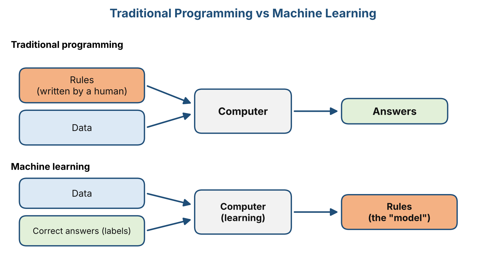

# Chapter 1: Introduction to Artificial Intelligence

> **Status:** Drafted (V1.0), awaiting peer review
> **Author:** Jonathan Sugianto | **Reviewer:** Brian Djoni Suzanna
> **Audience:** Complete beginners. No programming or AI background needed.

---

## Learning Outcomes

After this chapter, you should be able to:

1. Explain in your own words what Artificial Intelligence (AI) is.
2. Describe five key moments in the history of AI.
3. Explain the difference between traditional programming and AI that learns from data.
4. Use eight basic AI terms correctly: data, algorithm, model, machine learning, training, inference, neural network, deep learning.
5. Walk through a simple example of a program that learns from examples, and explain why it works and where it fails.

## Chapter Map

| Section | Topic |
|:-------:|-------|
| 1.1 | What is AI? |
| 1.2 | A Brief History of AI |
| 1.3 | AI vs Traditional Programming |
| 1.4 | Basic AI Terminology |
| 1.5 | Worked Example: A Spam Filter That Learns |
| 1.6 | Practice Questions and Answers |
| 1.7 | Summary, Reuse Plan, and References |

---

## 1.1 What is AI?

### A simple definition

**Artificial Intelligence (AI)** is the part of computer science that tries to make computers do tasks that normally need human intelligence. Examples are recognizing faces, understanding speech, translating languages, and making decisions.

Three things to keep in mind:

- **AI is a field of study**, just like biology or physics. People also say "an AI" for a specific system built using that field, such as a chatbot.
- **There is no single official definition.** Different textbooks describe AI in slightly different ways. For example, Russell and Norvig (2021) organize the field around building systems that *act rationally*, meaning they choose actions that are likely to reach a goal. In this module, we use the simple definition above.
- **AI is usually built for one specific job.** A system that is very good at chess cannot cook rice or drive a car. We will come back to this in Chapter 2.

### AI around you

You probably used AI several times today without noticing.

| Situation | What the AI is doing |
|-----------|----------------------|
| Unlocking your phone with your face | Checking if the face matches the owner |
| Watching a video app | Predicting which videos you may like next |
| Typing a message | Suggesting the next word |
| Pointing your camera at a foreign sign | Reading the text and translating it |
| Checking your email | Moving suspicious emails to the spam folder |
| Using a chatbot | Writing a reply to your question |

### Three common myths

| Myth | What is actually true |
|------|-----------------------|
| "AI is a robot." | Most AI is just software with no body. A robot is a machine, and AI can act as its "brain," but they are not the same thing. |
| "AI thinks like a human." | Today's AI finds patterns in data. Scientists still debate what "understanding" means for a machine, but AI does not work like a human brain. |
| "AI is always right." | AI makes mistakes, sometimes confident ones. We cover this in Chapter 5. |

---

## 1.2 A Brief History of AI

The history of AI has exciting breakthroughs and also long periods of disappointment. Here are some important moments.

*Figure 1.1: Timeline of key moments in AI history. Source: created by our team, based on the references in Section 1.7.*

| Year | Event | Why it matters |
|:----:|-------|----------------|
| 1950 | Alan Turing publishes the paper *Computing Machinery and Intelligence*. He suggests the "imitation game" (later called the **Turing Test**): if a person chatting with a machine cannot tell it apart from a human, can we say the machine is intelligent? | He turned the question "Can machines think?" into something that can be tested. |
| 1955–1956 | John McCarthy, Marvin Minsky, Nathaniel Rochester, and Claude Shannon write a proposal in 1955 for a summer workshop at Dartmouth College. The proposal uses the term "artificial intelligence." The workshop takes place in summer 1956. | Many people see this as the start of AI as a research field. |
| 1959 | Arthur Samuel describes a checkers program that improves by playing and learning from experience. | One of the first examples of a computer **learning** instead of only following fixed instructions. |
| 1966 | Joseph Weizenbaum creates **ELIZA**, a program that chats using simple keyword rules. | An early chatbot. Many users felt that ELIZA understood them, even though it did not. |
| 1997 | IBM's **Deep Blue** beats world chess champion Garry Kasparov in a six-game match (3½ to 2½). | A machine beat the best human at a game people linked with intelligence. |
| 2012 | A neural network called **AlexNet** wins the ImageNet image recognition competition by a large margin. | Started the modern boom of **deep learning**. |
| 2016 | **AlphaGo** (made by Google DeepMind) beats Lee Sedol, a top Go player, 4 games to 1. | Go is much harder for computers than chess. AlphaGo learned from many human games and then improved by playing against itself. |
| 2017 | Google researchers publish the **Transformer**, a new design for neural networks. | It is the base of today's large language models. |
| 2022 | OpenAI releases **ChatGPT** to the public (30 November). | Made generative AI available to millions of ordinary users. |

### Two famous moments in pictures

*Figure 1.2: Alan Turing as a teenager. Source: Wikimedia Commons, "File:Alan Turing Aged 16.jpg" (https://commons.wikimedia.org/wiki/File:Alan_Turing_Aged_16.jpg). License: TO BE CONFIRMED on the Commons page before submission.*

*Figure 1.3: A computer similar to Deep Blue, displayed at the Computer History Museum. Source: Wikipedia article "Deep Blue (chess computer)" (https://en.wikipedia.org/wiki/Deep_Blue_(chess_computer)). Photographer and license: TO BE CONFIRMED on the image's file page.*

### Booms and "AI winters"

In the early years, researchers expected fast progress. But computers were slow, and there was little data, so many promises were not kept. Funding and interest dropped, first in the 1970s and again from the late 1980s into the early 1990s. These quiet periods are called **AI winters**.

Progress became fast again when three things came together: **much more data** (from the internet), **much faster computers**, and **better learning methods**.

---

## 1.3 AI vs Traditional Programming

### Traditional programming: a human writes the rules

Think of a **recipe**. It gives exact steps, and if you follow them, you get the same dish every time.

Traditional programming works the same way. The programmer writes exact instructions, called **rules**. The computer takes the **rules** and the **data**, and gives **answers**.

*Example:* A program that changes Celsius to Fahrenheit uses the fixed rule `F = C × 9/5 + 32`. The rule is clear and always correct.

### Machine learning: the computer finds the rules

Now imagine you must write exact rules to decide "Is this mango ripe?" You would need to describe color, smell, softness, and more, and every mango is a little different. It is very hard to write rules for this.

Instead, a person learns from experience: after seeing and touching many mangoes, you can tell if one is ripe, even if you cannot explain every rule. **Machine learning** does something similar. We give the computer many **examples with the correct answers**, and it finds the patterns by itself.

*Figure 1.4: Traditional programming vs machine learning. Source: created by our team.*

### Side-by-side comparison

| | Traditional Programming | Machine Learning |
|---|------------------------|------------------|
| Who creates the rules? | The programmer | The computer, from examples |
| What goes in? | Data + rules | Data + correct answers |
| What comes out? | Answers | Rules (a **model**) that can give answers for new data |
| Works best when | Rules are clear and exact (calculating tax, sorting names) | Rules are hard to write (recognizing faces, understanding speech) |
| Main weakness | Fails on cases the programmer did not think of | Needs a lot of good data, and learns mistakes if the data is bad |

> **Important note:** Not all AI learns from data. Some early AI systems, such as *expert systems*, used rules written by human experts. We focus on learning-based AI because it powers most modern tools, but the two ideas are not the same thing.

---

## 1.4 Basic AI Terminology

These terms appear again in the rest of the module.

| Term | Simple meaning | Example |
|------|----------------|---------|
| **Data** | Information a computer can process, like numbers, text, images, or sound. | A collection of 1,000 emails |
| **Algorithm** | A step-by-step method for solving a problem. | The steps for sorting names from A to Z |
| **Label** | The correct answer attached to an example. | "Spam" or "Not spam" |
| **Machine Learning (ML)** | A way of building AI where the computer learns patterns from data instead of being given exact rules. | A system that learns to detect spam from examples |
| **Model** | What the computer has learned: patterns used to make predictions on new data. | A spam filter after it has studied many emails |
| **Training** | Showing data to a learning algorithm so it can build a model. | Studying 10,000 labelled emails |
| **Inference** | Using a trained model on new data to get a result. | Checking a brand-new email |
| **Neural network** | A model made of many simple connected units. It is loosely inspired by the brain, and it learns by adjusting how strong each connection is. | A network that recognizes handwritten digits |
| **Deep learning** | Machine learning that uses neural networks with many layers. | Speech recognition and image recognition |

### Training vs inference: an everyday comparison

Think of studying for an exam and taking the exam.

- **Training** is like studying many past questions. It takes a long time, and you do it before the exam.
- **Inference** is like answering questions in the real exam. You use what you learned on questions you have not seen before.

*Figure 1.5: Training vs inference. Source: created by our team.*

### How the fields fit together

*Figure 1.6: How AI, machine learning, and deep learning fit together. Source: created by our team.*

Deep learning is a part of machine learning, and machine learning is a part of AI.

---

## 1.5 Worked Example: A Spam Filter That Learns

Let's build a very small spam filter by hand. Real filters are much more advanced, but this shows the full cycle: **data → training → model → inference**.

### Step 1: Collect labelled data

We have six short emails with labels.

| # | Email text | Label |
|:-:|-----------|:-----:|
| 1 | win free prize now | Spam |
| 2 | free money offer | Spam |
| 3 | meeting at noon | Not spam |
| 4 | project report due | Not spam |
| 5 | claim your free prize | Spam |
| 6 | lunch at noon tomorrow | Not spam |

### Step 2: Train by counting

For each word, count how many spam emails contain it, and how many not-spam emails contain it. Then calculate the word's **score**:

> **score = (number of spam emails with the word) − (number of not-spam emails with the word)**

| Word | In spam | In not spam | Score |
|------|:-------:|:-----------:|:-----:|
| free | 3 | 0 | **+3** |
| prize | 2 | 0 | **+2** |
| win, now, money, offer, claim, your | 1 each | 0 | **+1** each |
| meeting, project, report, due, lunch, tomorrow | 0 | 1 each | **−1** each |
| at | 0 | 2 | **−2** |
| noon | 0 | 2 | **−2** |

This score table is our **model**. We never wrote a rule like "the word *free* means spam." The scores came from the examples.

### Step 3: Make a decision rule

> Add up the scores of all the words in an email. If the total is **greater than 0**, predict **Spam**. Otherwise, predict **Not spam**. A word that is not in the table scores 0.

### Step 4: Inference on a new email

New email: **"free offer tomorrow"**

| Word | Score |
|------|:-----:|
| free | +3 |
| offer | +1 |
| tomorrow | −1 |
| **Total** | **+3** |

The total is above 0, so the prediction is **Spam**.

### Step 5: See where it struggles

New email: **"free lunch at noon"** (a friend inviting you to eat)

| Word | Score |
|------|:-----:|
| free | +3 |
| lunch | −1 |
| at | −2 |
| noon | −2 |
| **Total** | **−2** |

The prediction is **Not spam**, which is correct here. But look at how it happened: the harmless words "at" and "noon" pulled the score down. Now try **"free prize at noon"**: +3 +2 −2 −2 = **+1**, so the filter says **Spam**. Is it really spam? The filter cannot know, because it only counts words.

### What this example teaches

- **A model depends on its training data.** The words "at" and "noon" look "safe" only because our six emails happened to include them in not-spam messages.
- **More and varied data makes a better model.** Six emails is far too few. Real filters learn from millions.
- **Models make mistakes.** Even good filters sometimes block real emails or let spam through.
- **Training and inference are separate.** We counted once (training), then used the same table for any number of new emails (inference).

> **Note:** This word-scoring method is a simplified teaching version. Real spam filters use more advanced statistical or neural network methods, and they look at much more than single words.

---

## 1.6 Practice Questions and Answers

### Part A: Check your understanding

**Q1.** Which statement describes AI best?

- A. A robot that looks like a human
- B. Computer systems that do tasks that normally need human intelligence
- C. Any program that connects to the internet
- D. A computer that thinks exactly like a human brain

**Q2.** In traditional programming, who writes the rules? In machine learning, where do the rules come from?

**Q3.** Put these steps in the correct order:

- A. Use the model to check a new email
- B. Train the model
- C. Collect emails with labels

Which step is **inference**?

**Q4.** What is the difference between **data** and a **model**?

**Q5.** True or False: "All AI systems learn from data." Explain your answer.

**Q6.** Give one reason why it is hard to recognize a cat in a photo using hand-written rules.

### Part B: Apply the idea

Use the model from Section 1.5 (the score table and the rule "total > 0 means spam").

**Q7.** Classify the email **"win money now"**. Show the total.

**Q8.** Classify the email **"project meeting tomorrow"**. Show the total.

**Q9.** Classify the email **"claim free money at noon"**. Show the total, then explain in one sentence why this result is uncertain.

**Q10.** Classify the email **"hello friend"**. What does the result tell you about the model's limits?

**Q11 (Think).** Our filter was trained on only six emails. Name **two** ways to improve it.

### Answers and Explanations

**A1. B.** AI is about systems that do tasks needing human-like intelligence. A is wrong because most AI has no body. C is wrong because AI and the internet are different things. D is wrong because AI does not work like a human brain.

**A2.** In traditional programming, the **programmer** writes the rules. In machine learning, the **computer finds the rules** by studying examples with correct answers.

**A3.** The order is **C → B → A**. Step **A** is **inference**, because it uses the trained model on a new email. Step B is training.

**A4.** **Data** is the information the computer receives (for example, emails). A **model** is what the computer learns from that data: patterns used to make predictions.

**A5. False.** Many modern AI systems learn from data, but not all. Some early systems, such as expert systems, used rules written by people.

**A6.** Any one of these: cats come in many colors, sizes, and poses; photos have different lighting and angles; a cat may be partly hidden. It is almost impossible to write exact rules for every case.

**A7.** win (+1) + money (+1) + now (+1) = **+3**, so **Spam**.

**A8.** project (−1) + meeting (−1) + tomorrow (−1) = **−3**, so **Not spam**.

**A9.** claim (+1) + free (+3) + money (+1) + at (−2) + noon (−2) = **+1**, so **Spam**. The total is barely above 0, and harmless words ("at", "noon") pulled the score down, so a small change in the training data could flip the result.

**A10.** Both words are not in the table, so each scores 0. The total is **0**, which is not greater than 0, so the prediction is **Not spam**. The model has no knowledge about words it never saw during training, so it may be wrong on new kinds of emails.

**A11.** Any two of these: add many more training emails; include more varied examples (different senders and topics); ignore very common words such as "at"; check the mistakes it makes and add them as new training examples; use a smarter scoring method.

---

## 1.7 Summary, Reuse Plan, and References

### Key takeaways

- AI is the field of making computers do tasks that normally need human intelligence.
- AI has a history of breakthroughs and "winters." The recent boom came from more data, faster computers, and better methods.
- Traditional programming uses rules written by humans. Machine learning lets the computer find rules from examples.
- **Training** builds a model from data. **Inference** uses the model on new data.
- A model depends on its data, and it can make mistakes.

### How this chapter will be reused

| Resource | Planned use |
|----------|-------------|
| **Study Guide** | Sections 1.1–1.4 become the reading text. The terminology table becomes a glossary. Questions Q1–Q11 go into the Test Bank with the explained answers. |
| **PPT Slides** | The timeline (1.2), the two flow diagrams (1.3), and the nested diagram (1.4) become full-slide visuals. The spam filter (1.5) becomes a step-by-step slide sequence that builds the score table. |
| **Video Tutorial** | A short video that follows Section 1.5: show the six emails, build the score table on screen, then test new emails while narrating each step. |

### Development status of this chapter

| Section | Status | Notes |
|---------|:------:|-------|
| 1.1 What is AI? | Drafted | Needs peer review |
| 1.2 Brief History | Drafted | Key dates cross-checked once against online sources; reviewer should re-check against the references |
| 1.3 AI vs Traditional Programming | Drafted | Diagrams to be redrawn as images by the Visual Design Lead |
| 1.4 Terminology | Drafted | Needs peer review |
| 1.5 Worked Example | Drafted | All scores recalculated by hand; needs independent check |
| 1.6 Practice Questions | Drafted | Should be tested by a member who has not seen the answers |
| 1.7 References | Drafted | All entries need to be verified by the Quality Lead |

### References

1. Turing, A. M. (1950). Computing machinery and intelligence. *Mind*, 59(236), 433–460. https://doi.org/10.1093/mind/LIX.236.433
2. McCarthy, J., Minsky, M. L., Rochester, N., & Shannon, C. E. (2006). A proposal for the Dartmouth summer research project on artificial intelligence, August 31, 1955. *AI Magazine*, 27(4), 12–14. https://doi.org/10.1609/aimag.v27i4.1904
3. Samuel, A. L. (1959). Some studies in machine learning using the game of checkers. *IBM Journal of Research and Development*, 3(3), 210–229. https://doi.org/10.1147/rd.33.0210
4. Weizenbaum, J. (1966). ELIZA: A computer program for the study of natural language communication between man and machine. *Communications of the ACM*, 9(1), 36–45. https://doi.org/10.1145/365153.365168
5. Campbell, M., Hoane, A. J., & Hsu, F.-h. (2002). Deep Blue. *Artificial Intelligence*, 134(1–2), 57–83. https://doi.org/10.1016/S0004-3702(01)00129-1
6. Krizhevsky, A., Sutskever, I., & Hinton, G. E. (2012). ImageNet classification with deep convolutional neural networks. *Advances in Neural Information Processing Systems*, 25. https://papers.nips.cc/paper/4824-imagenet-classification-with-deep-convolutional-neural-networks
7. Silver, D., et al. (2016). Mastering the game of Go with deep neural networks and tree search. *Nature*, 529, 484–489. https://doi.org/10.1038/nature16961
8. Vaswani, A., et al. (2017). Attention is all you need. *Advances in Neural Information Processing Systems*, 30. https://arxiv.org/abs/1706.03762
9. OpenAI. (2022, November 30). *Introducing ChatGPT*. https://openai.com/index/chatgpt/
10. Russell, S., & Norvig, P. (2021). *Artificial Intelligence: A Modern Approach* (4th ed.). Pearson.

> The spam filter in Section 1.5 is the team's own simplified teaching example, inspired by word-counting spam filters. It does not copy a specific source.
