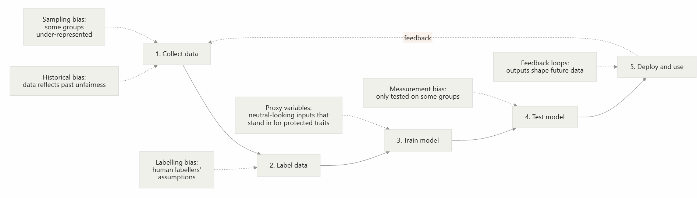

# AI Ethics and Limitations

**Audience:** Learners with no technical background in AI
**Estimated time:** 3 to 4 hours (including activities)
**Format:** Read, work through the examples, complete the activities, then check the answer keys.

---

## Table of Contents

1. [Learning Outcomes](#learning-outcomes)
2. [Module Map](#module-map)
3. [Prerequisites and Framing](#prerequisites-and-framing)
4. [Topic 1: Bias (fully developed)](#topic-1-bias)
5. [Topic 2: Privacy](#topic-2-privacy)
6. [Topic 3: Hallucinations](#topic-3-hallucinations)
7. [Topic 4: Responsible AI](#topic-4-responsible-ai)
8. [Topic 5: Discussion Scenario](#topic-5-discussion-scenario-bias-or-hallucination)
9. [Glossary](#glossary)
10. [References](#references)

---

## Learning Outcomes

By the end of this module, learners will be able to:

- **Explain** what bias, privacy risk, and hallucination mean in an AI context.
- **Identify** where in an AI system's life cycle bias can enter.
- **Calculate** a simple fairness check (selection rate and the four-fifths rule) and interpret the result.
- **Verify** an AI-generated claim using a short checking routine.
- **Apply** responsible AI principles to a realistic scenario and justify a decision.

## Module Map

| Topic | What is included |
|---|---|
| 1. Bias | Explanations, terms, diagram, worked example with code, activity, answer key |
| 2. Privacy | Explanation, table, short activity with answer |
| 3. Hallucinations | Explanation, verification routine, short activity with answer |
| 4. Responsible AI | Principles table, checklist |
| 5. Discussion scenario | Real case, guided questions, teacher notes |

---

## Prerequisites and Framing

This module is one branch of the wider **AI Overview** course. It assumes learners have already met the basic vocabulary from the earlier chapters, so those definitions are not repeated here:

- artificial intelligence, machine learning, model, and training data (see the *What is AI?* and *How machines learn* chapters)

Terms that are **specific to ethics and limitations** (for example *proxy variable*, *impact ratio*, *hallucination*) are defined where they first appear and collected in the [Glossary](#glossary).

> **Core idea of this module:** AI systems do not have opinions or intentions. They reflect the data, goals, and choices of the people who build and use them. Ethics is about those choices.

---

## Topic 1: Bias

### 1.1 What is bias?

In everyday language, *bias* means unfair preference. In AI, **bias** means that a system produces results that are **systematically** less accurate or less favourable for some people or groups than for others.

Two words in that definition matter:

- **Systematically:** the unfairness follows a pattern. It is not random bad luck.
- **Groups:** bias is usually discovered by comparing results across groups (for example by gender, age, skin tone, language, or region).

Bias is not always intentional. Most harmful AI bias happens even when the builders had good intentions.

### 1.2 Where does bias come from?

Bias can enter at several stages of an AI system's life cycle:



If the diagram does not render in your viewer, use this table instead:

| Stage | Type of bias | Plain-language meaning | Example |
|---|---|---|---|
| Collect data | **Historical bias** | The world was unfair, so the data is too | Past hiring records favour one gender |
| Collect data | **Sampling bias** | Some groups are barely in the data | A face dataset with mostly light-skinned faces |
| Label data | **Labelling bias** | Human labellers add their own assumptions | Labelling certain dialects as "rude" |
| Train model | **Proxy variable** | A harmless-looking input correlates with a protected trait | Postcode standing in for ethnicity |
| Test model | **Measurement bias** | Success is only checked on a convenient group | Testing accuracy overall, not per group |
| Use model | **Feedback loop** | Biased outputs create new biased data | Police sent to a "high-crime" area record more crime there |

**Terms defined:**

- **Protected characteristic:** a trait that laws or ethics say should not be used to treat people unfairly, such as race, sex, religion, age, or disability.
- **Proxy variable:** an input that is not itself a protected characteristic but is strongly linked to one.
- **Feedback loop:** when a system's outputs influence the data it later learns from, which can amplify an original error.

### 1.3 Real-world evidence

| Case | What happened | Lesson |
|---|---|---|
| **Gender Shades (2018)** | Researchers tested commercial facial-analysis systems and found much higher error rates for darker-skinned women than for lighter-skinned men (Buolamwini & Gebru, 2018). | Overall accuracy can hide large gaps between groups. |
| **Healthcare risk algorithm (2019)** | An algorithm used to decide who gets extra care used past healthcare *spending* as a stand-in for health *need*. Because less money had been spent on Black patients with the same level of illness, it under-estimated their needs (Obermeyer et al., 2019). | A proxy variable (cost) quietly encoded unequal access to care. |
| **Recruiting tool (reported 2018)** | Reuters reported that Amazon abandoned an experimental hiring tool that learned to downgrade résumés associated with women, because it was trained on past, male-dominated hiring (Dastin, 2018). | Historical bias in training data is reproduced by the model. |

### 1.4 Worked example: checking a hiring tool for unequal outcomes

**Scenario.** A company uses an AI tool to shortlist job applicants. You are asked to check whether it treats two groups, Group A and Group B, fairly. (The numbers below are invented for teaching.)

| | Applicants | Shortlisted by the tool |
|---|---|---|
| Group A | 100 | 60 |
| Group B | 100 | 30 |

We will use a common screening measure called the **four-fifths rule**.

**Terms defined:**

- **Selection rate:** the share of a group that receives the favourable outcome. Formula: `shortlisted ÷ applicants`.
- **Four-fifths (80%) rule:** a rule of thumb from US employment guidance. If one group's selection rate is **less than 80% (4/5)** of the highest group's rate, this is treated as a warning sign of possible adverse impact (US EEOC, 1978). It is a **screening signal, not proof** of discrimination.

**Step 1: Calculate each group's selection rate.**

- Group A: 60 ÷ 100 = **0.60** (60%)
- Group B: 30 ÷ 100 = **0.30** (30%)

**Step 2: Identify the highest rate.** Group A, at 0.60.

**Step 3: Divide each other group's rate by the highest rate.** This is the **impact ratio**.

- Group B: 0.30 ÷ 0.60 = **0.50**

**Step 4: Compare to the threshold of 0.80.**

- 0.50 is less than 0.80, so the tool **fails** the screening check. Group B is shortlisted at half the rate of Group A.

**Step 5: Decide what to do next.** The result is a warning, not a verdict. A sensible next step is to investigate: Which inputs does the model use? Are any of them proxies? Was it trained on biased historical hiring decisions? Do qualified applicants in Group B get rejected more often?

You can reproduce the calculation with this short Python script:

```python
# Fairness check: selection rates and the four-fifths rule
groups = {
    "Group A": {"applicants": 100, "shortlisted": 60},
    "Group B": {"applicants": 100, "shortlisted": 30},
}

# Step 1: selection rate for each group
rates = {name: g["shortlisted"] / g["applicants"] for name, g in groups.items()}

# Step 2: highest rate
highest = max(rates.values())

# Steps 3 and 4: impact ratio and comparison with 0.8
for name, rate in rates.items():
    ratio = rate / highest
    status = "PASS" if ratio >= 0.8 else "FLAG for review"
    print(f"{name}: selection rate = {rate:.2f}, impact ratio = {ratio:.2f} -> {status}")
```

**Expected output:**

```text
Group A: selection rate = 0.60, impact ratio = 1.00 -> PASS
Group B: selection rate = 0.30, impact ratio = 0.50 -> FLAG for review
```

> **Limitation of this check.** The four-fifths rule only compares outcome rates. It does not tell you *why* the gap exists, and a tool can pass this check while still making more *mistakes* for one group. There are several competing definitions of fairness, and they cannot all be satisfied at once (Chouldechova, 2017). Real audits use several measures plus human judgment.

### 1.5 Learner activity

**Part A: Calculation (10 minutes).** A different company's tool produces these results:

| | Applicants | Shortlisted |
|---|---|---|
| Group C | 50 | 20 |
| Group D | 80 | 36 |

1. Calculate the selection rate for each group.
2. Calculate the impact ratio.
3. Does the tool pass the four-fifths rule? Explain in one sentence.

**Part B: Spot the proxy (10 minutes).** A bank builds a loan-approval model. It is **not** given any information about race or gender, but it **is** given the applicant's postcode, first language, and job title.

1. Which input might act as a proxy variable? Why?
2. Name one way the team could check whether the proxy is causing unfair results.

**Part C: Reflection (5 minutes).** In 3 to 4 sentences, explain why "we removed the sensitive column from the data" does not guarantee a fair model.

### 1.6 Answer key and expected outcomes

**Part A**

1. Group C: 20 ÷ 50 = **0.40**. Group D: 36 ÷ 80 = **0.45**.
2. Highest rate is Group D (0.45). Impact ratio for Group C = 0.40 ÷ 0.45 ≈ **0.89**.
3. 0.89 is above 0.80, so the tool **passes** this screening check; the gap is small enough that this rule does not flag it. (A good answer also notes that passing does not prove the tool is fair, as it ignores error rates and the reasons for the gap.)

**Part B**

1. **Postcode** is the strongest candidate, because neighbourhoods are often strongly linked to ethnicity and income due to historical patterns (a proxy). First language can also act as a proxy for national origin. Job title may be a weaker proxy for gender in some fields. *Accept any well-reasoned answer.*
2. Acceptable checks: compare approval rates and error rates across groups (using group information held *only for auditing*); remove or test the model without the suspected proxy and see whether outcomes change; review whether the input is truly relevant to repayment ability.

**Part C** *(Model answer)*: Other inputs can still carry the same information (proxy variables), and the historical data may already reflect unfair past decisions. Removing the column also makes it impossible to measure whether groups are treated differently, so unfairness can become harder to detect, not easier.

**Teacher check:** Learners demonstrate understanding if they (a) compute rates correctly, (b) interpret the ratio relative to 0.8, and (c) recognise that fairness requires investigating causes, not only removing columns.

### 1.7 Ways to reduce bias (overview)

| Approach | What it means | Example |
|---|---|---|
| Better data | Collect more representative data | Add faces with a wider range of skin tones |
| Per-group testing | Report accuracy for each group, not just overall | Publish results by gender and skin tone |
| Documentation | Describe a model's intended use and limits | **Model cards** (Mitchell et al., 2019); **datasheets for datasets** (Gebru et al., 2021) |
| Human oversight | A person can review and override decisions | Manager reviews all automated rejections |
| Ongoing monitoring | Re-check after launch | Re-run the fairness check every quarter |

---

## Topic 2: Privacy

### 2.1 What is privacy in AI?

**Privacy** is a person's ability to control information about themselves. **Personal data** (also called **personally identifiable information, PII**) is any information that can identify a person, directly (name, ID number, face) or indirectly (a combination of age, postcode, and job).

AI raises privacy concerns because it:

1. **Is trained on large amounts of data**, which may include personal information collected without clear consent.
2. **Can memorise** parts of its training data. Researchers have shown that large language models can sometimes be prompted to reproduce text from their training sets, including personal details (Carlini et al., 2021).
3. **Can infer sensitive facts** (such as health conditions) from innocent-looking data.
4. **Receives user input.** Anything typed into an AI tool may be stored or used according to that service's policy.

### 2.2 Risks and protections

| Risk | Plain-language description | Protection |
|---|---|---|
| Data collection without consent | Data gathered for one purpose is reused for another | Collect only what is needed (**data minimisation**); get clear consent |
| Memorisation / leakage | The model repeats private training text | Remove personal data before training; test for leakage |
| Re-identification | "Anonymous" data is matched with other data to find the person | Aggregate or add noise (**differential privacy**) |
| Oversharing by users | A user pastes confidential text into a chatbot | Read the tool's data policy; never paste secrets or personal data |

**Terms defined:**

- **Data minimisation:** collecting and keeping only the data that is necessary for a stated purpose.
- **Anonymisation:** removing identifying details. It is hard to do perfectly, which is why re-identification is a risk.
- **Differential privacy:** a technique that adds carefully measured random noise so that results reveal patterns about a group without revealing facts about any one individual.

**Legal context:** Laws such as the EU's General Data Protection Regulation (GDPR) give people rights over their personal data, including rights of access and erasure, and require a lawful basis for processing (European Union, 2016).

### 2.3 Learner activity

You work for a clinic. A colleague wants to paste a patient's full name, date of birth, and symptoms into a public AI chatbot to "help draft a letter faster."

1. Identify two privacy risks.
2. Suggest a safer way to get help with the letter.

**Answer key.**
1. Possible risks: the data may be stored or used for training under the provider's terms; it may be exposed to people without authorisation; it may breach the clinic's policies or health-privacy law; the patient did not consent to this use.
2. Safer options: remove all identifying details and use placeholders such as "[Patient]"; use an approved tool covered by the clinic's data agreement; or write the sensitive parts manually.

---

## Topic 3: Hallucinations

### 3.1 What is a hallucination?

In AI, a **hallucination** is an output that is **fluent and confident but false, made up, or unsupported** by the source it should rely on (Ji et al., 2023).

**Why does it happen?** A **large language model (LLM)** is trained to predict which words are likely to come next. It is optimised to produce **plausible** text, not to check **truth**. When it lacks information, it may still generate something that *sounds* right.

**Terms defined:**

- **Large language model (LLM):** an AI model trained on very large amounts of text that generates text by predicting likely next words.
- **Grounding:** connecting a model's answer to trusted sources, for example by letting it retrieve documents and cite them.
- **Fabricated citation:** a reference that looks real (author, title, journal) but does not exist.

### 3.2 Common types

| Type | Example |
|---|---|
| Made-up facts | Stating a wrong date or statistic with confidence |
| Fabricated sources | Inventing a court case, paper, or URL |
| Wrong reasoning | A maths or logic answer that looks neat but is incorrect |
| Unfaithful summary | A summary that adds details not in the original document |

### 3.3 Worked example: verifying an AI-generated claim

**Scenario.** You ask an AI assistant for a source on a claim, and it replies:

> "According to Henderson & Zhou (2019), published in the *Journal of Applied Cognitive Ethics*, 87% of students prefer AI tutors."

**Step 1: Flag it.** It contains specific details (names, year, journal, percentage). Specific does not mean true.

**Step 2: Search the exact title and authors** in a scholarly database or a search engine.

**Step 3: Check the journal exists** and whether that article, volume, and page are listed.

**Step 4: Check the claim inside the source** (if found). Does the paper actually report 87%?

**Step 5: Decide and record.**

- *Not found anywhere* → treat as **likely fabricated**; do not cite or use it.
- *Found but says something different* → use what the real source says.
- *Found and matches* → cite the **original source**, not the AI.

**Rule of thumb:** *Trust, but verify; the more important the decision, the more you verify.*

### 3.4 Reducing the risk

- Ask the AI to **cite sources, then check them yourself.**
- Ask for **uncertainty**: "If you are unsure, say so."
- Provide the source text and ask the AI to answer **only from that text.**
- Cross-check with a second, independent source.
- Keep a **human in the loop** for high-stakes uses (legal, medical, financial).

### 3.5 Learner activity

An AI summary of a news article says: "The mayor announced a 20% tax cut." You have the original article, and it never mentions a tax cut.

1. What type of hallucination is this?
2. List two steps you would take before sharing the summary.

**Answer key.**
1. An **unfaithful summary** (an unsupported added detail).
2. Re-read the original article and compare; re-run the summary with the instruction "only use facts stated in the article"; check another news source; do not share until verified.

---

## Topic 4: Responsible AI

### 4.1 What is responsible AI?

**Responsible AI** means designing, building, and using AI in ways that are safe, fair, transparent, and accountable, and that respect human rights. It turns the concerns in Topics 1 to 3 into practical commitments.

Many organisations have published similar principles. The OECD AI Principles (2019) and the NIST AI Risk Management Framework (2023) are widely referenced starting points.

### 4.2 Core principles

| Principle | Meaning | Question to ask |
|---|---|---|
| **Fairness** | Treat people and groups equitably | Have we tested results across groups? |
| **Transparency** | Be open about when and how AI is used | Do users know AI is involved? |
| **Explainability** | Be able to give understandable reasons for outputs | Can we explain why this decision was made? |
| **Privacy and security** | Protect data and systems | Do we collect only what we need? |
| **Accountability** | A person or organisation is answerable for outcomes | Who is responsible if it goes wrong? |
| **Reliability and safety** | The system works as intended, including in unusual cases | What happens when it fails? |
| **Human oversight** | People can review, challenge, and override | Can a human step in? |

**Term defined:**

- **Accountability:** the idea that humans and organisations, not "the algorithm," are responsible for outcomes.

### 4.3 A simple pre-use checklist

```text
Before using AI for a task, ask:
[ ] What is the purpose, and is AI appropriate for it?
[ ] What could go wrong, and who could be harmed?
[ ] Is any personal or confidential data involved?
[ ] Have outputs been checked for accuracy and bias?
[ ] Is a human reviewing high-stakes outputs?
[ ] Is it clear to others that AI was used?
[ ] Who is accountable, and how can someone appeal a decision?
```

### 4.4 Regulation snapshot

Governments are introducing rules. For example, the EU AI Act (Regulation (EU) 2024/1689) takes a **risk-based approach**: stricter requirements for higher-risk uses (such as hiring or credit decisions) and lighter requirements for low-risk uses (European Union, 2024). Learners should check the rules that apply in their own country and sector, as these are changing.

---

## Topic 5: Discussion Scenario (Bias or Hallucination)

### 5.1 Case: Fabricated court cases (hallucination)

In 2023, in the US case *Mata v. Avianca, Inc.*, lawyers submitted a legal brief that cited several court decisions. The decisions had been produced by an AI chatbot and **did not exist**. The court later sanctioned the lawyers and their firm, noting that they continued to stand by the citations after questions were raised (*Mata v. Avianca, Inc.*, 2023).

### 5.2 Guided discussion questions

1. **Identify:** Which type of hallucination is this (see Section 3.2)?
2. **Process:** At what step could the error have been caught? Use the verification steps in Section 3.3.
3. **Responsibility:** Who was accountable, the AI, the tool's maker, or the lawyers? Why?
4. **Principles:** Which responsible AI principles (Section 4.2) were not followed?
5. **Prevention:** Write three rules a law firm should adopt for AI use.
6. **Compare:** How is this different from a *bias* problem? Could a tool be free of hallucination and still biased? Give an example.

### 5.3 Alternative scenario: a biased résumé screener (bias)

A company's screener rejects many applicants who have career gaps. Data shows women, who more often take caregiving breaks, are rejected at a much higher rate. Discuss: Is "career gap" a proxy? Is it job-relevant? Who should decide, and how should the company monitor outcomes?

### 5.4 Teacher notes and expected discussion points

- **Q1:** Fabricated sources (invented court cases).
- **Q2:** Step 2 or 3 of the verification routine: looking up the case in an official legal database would have shown the cases did not exist.
- **Q3:** Accountability rests with the **professionals who signed and submitted** the brief. Tool makers may share responsibility for communicating limits, but users cannot hand off professional duties to a tool.
- **Q4:** Accountability, human oversight, reliability, transparency.
- **Q5:** Acceptable rules include: all citations independently verified; AI use disclosed internally; no confidential client data in public tools; a named reviewer signs off.
- **Q6:** Hallucination is about **truth**; bias is about **fair treatment across groups**. A system can give accurate answers yet systematically serve one group worse.
- **Section 5.3:** Strong answers recognise that the gap may be a proxy for sex, question its relevance to the job, and propose outcome monitoring by group plus human review.

---

## Glossary

| Term | Definition |
|---|---|
| **Accountability** | Humans and organisations are responsible for AI outcomes. |
| **Anonymisation** | Removing identifying details from data. |
| **Bias (AI)** | Systematically less accurate or less favourable results for some groups. |
| **Data minimisation** | Collecting only the data needed for a purpose. |
| **Differential privacy** | Adding measured noise so group patterns are visible but individuals are not. |
| **Feedback loop** | Outputs that influence future data, possibly amplifying errors. |
| **Four-fifths rule** | Screening rule: a group's selection rate below 80% of the highest group's rate is a warning sign. |
| **Grounding** | Tying AI answers to trusted, citable sources. |
| **Hallucination** | A confident but false or unsupported AI output. |
| **Impact ratio** | A group's selection rate divided by the highest group's selection rate. |
| **Large language model (LLM)** | A model that generates text by predicting likely next words. |
| **Personal data / PII** | Information that can identify a person. |
| **Protected characteristic** | A trait (e.g. race, sex, age) that should not be a basis for unfair treatment. |
| **Proxy variable** | An input that stands in for a protected characteristic. |
| **Responsible AI** | Building and using AI safely, fairly, transparently, and accountably. |
| **Selection rate** | The share of a group receiving the favourable outcome. |

---

## References

Buolamwini, J. and Gebru, T. (2018) 'Gender Shades: Intersectional accuracy disparities in commercial gender classification', *Proceedings of Machine Learning Research*, 81, pp. 77-91. Conference on Fairness, Accountability and Transparency.

Carlini, N. et al. (2021) 'Extracting training data from large language models', *30th USENIX Security Symposium*.

Chouldechova, A. (2017) 'Fair prediction with disparate impact: A study of bias in recidivism prediction instruments', *Big Data*, 5(2), pp. 153-163.

Dastin, J. (2018) 'Amazon scraps secret AI recruiting tool that showed bias against women', *Reuters*, 10 October.

European Union (2016) *Regulation (EU) 2016/679 (General Data Protection Regulation)*.

European Union (2024) *Regulation (EU) 2024/1689 laying down harmonised rules on artificial intelligence (Artificial Intelligence Act)*.

Gebru, T. et al. (2021) 'Datasheets for datasets', *Communications of the ACM*, 64(12), pp. 86-92.

Ji, Z. et al. (2023) 'Survey of hallucination in natural language generation', *ACM Computing Surveys*, 55(12), Article 248.

*Mata v. Avianca, Inc.* (2023) No. 22-cv-1461 (PKC) (S.D.N.Y.).

Mitchell, M. et al. (2019) 'Model cards for model reporting', *Proceedings of the Conference on Fairness, Accountability, and Transparency*, pp. 220-229.

National Institute of Standards and Technology (NIST) (2023) *Artificial Intelligence Risk Management Framework (AI RMF 1.0)*. NIST AI 100-1.

Obermeyer, Z. et al. (2019) 'Dissecting racial bias in an algorithm used to manage the health of populations', *Science*, 366(6464), pp. 447-453.

OECD (2019) *Recommendation of the Council on Artificial Intelligence*. OECD/LEGAL/0449.

US Equal Employment Opportunity Commission et al. (1978) *Uniform Guidelines on Employee Selection Procedures*, 29 CFR Part 1607.
