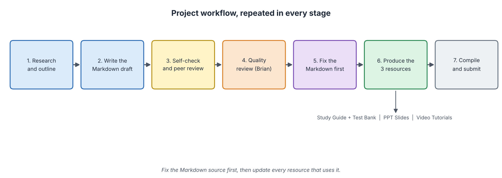
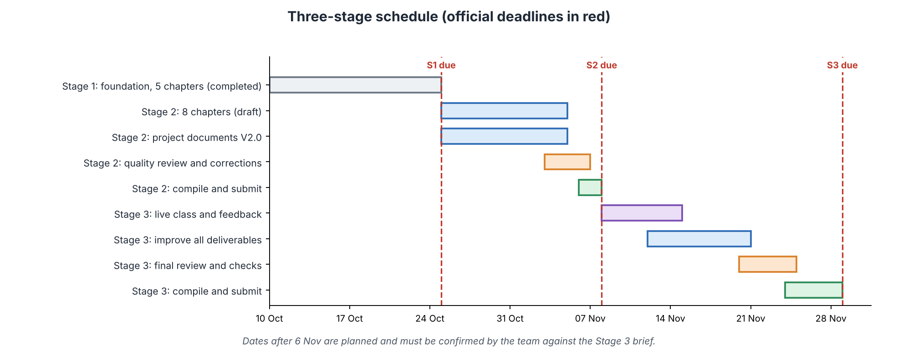

# Team Project Plan and Master Task List V2.0

**Document author:** Joseph Lokman(CEO)  
**Version:** V2.0 (Stage 2)  
**Last updated:** 6 November 2026

## Table of Contents

- [1. Team Members](#1-team-members)
- [2. Strengths](#2-strengths)
- [3. Responsibilities Based on Roles](#3-responsibilities-based-on-roles)
- [4. Deliverable Ownership](#4-deliverable-ownership)
- [5. Status Labels](#5-status-labels)
- [6. Master Task List](#6-master-task-list)
- [7. How This List Is Maintained](#7-how-this-list-is-maintained)
- [8. Project Purpose](#8-project-purpose)
- [9. Workflow and Schedule](#9-workflow-and-schedule)
- [Revision History](#revision-history)

---

## 1. Team Members

| # | Name | Chinese Name | Student ID | Role |
|:-:|------|--------------|:----------:|------|
| 1 | Benedict Subhata | 王志伟 | 1820262181 | Visual Design Lead |
| 2 | Brian Djoni Suzanna | 吴梓诚 | 1820262162 | Quality Lead |
| 3 | Gandhi Bestin Dhammananda | 熊特友 | 1820262168 | Video Lead |
| 4 | Jonathan Sugianto | 蔡德辉 | 1820262245 | CIO and Content Lead |
| 5 | Joseph Lokman | 骆韦铨 | 1820262233 | CEO |

## 2. Strengths

| Member | Strengths |
|--------|-----------|
| Benedict | Problem solving, works under pressure, motivates the team, open-minded |
| Brian | Programming, experienced with AI tools, spots inaccurate details, reliable |
| Gandhi | Cooperative, eager to learn, creative problem solving, motivator |
| Jonathan | Reliable, good time management, detail-oriented, structured |
| Joseph | Patient, strong in programming and CS, responsible, leadership, logical |

## 3. Responsibilities Based on Roles

| Member | Responsibilities |
|--------|------------------|
| Benedict | Visual design, figures, study module, PPT slides, readable PDF |
| Brian | Quality review of every deliverable; decides whether a deliverable needs revision; project documents |
| Gandhi | Video content and flow; live teaching |
| Jonathan | Whole-project progress; compiling and submitting each stage |
| Joseph | Activity records; speaking for the team; guidance and support to members |

## 4. Deliverable Ownership

One member prepares, one reviews and one compiles each deliverable.

| Deliverable | Prepared by | Reviewed by | Compiled by |
|-------------|-------------|-------------|-------------|
| README | Brian | Brian | Jonathan |
| Master Task List | Joseph | Brian | Jonathan |
| Module Outline | Jonathan | Brian | Jonathan |
| Project Plan | Joseph | Brian | Jonathan |
| Stage 1 Content | Brian | Brian | Jonathan |
| Stage 2 Content | Brian | Brian | Jonathan |
| Chapter 1: Introduction to AI | Jonathan | Brian | Jonathan |
| Chapter 2: Types of AI | Gandhi | Brian | Jonathan |
| Chapter 3: How AI Works | Benedict | Brian | Jonathan |
| Chapter 4: Symbolic AI | Gandhi | Brian | Jonathan |
| Chapter 5: Connectionist AI and Big Data | Jonathan | Brian | Jonathan |
| Chapter 6: Behaviorist AI | Joseph | Brian | Jonathan |
| Chapter 7: Applications of AI | Brian | Brian | Jonathan |
| Chapter 8: AI Ethics, Risks and Limitations | Joseph | Brian | Jonathan |
| Study Guide + Test Bank | Benedict (with chapter authors) | Brian | Jonathan |
| PPT Slides | Benedict | Brian | Jonathan |
| Video Tutorials | Gandhi | Brian | Jonathan |
| Live teaching | Gandhi (with the whole team) | Brian | Not applicable |
| Repository structure, branches, Issues | Joseph | Brian | Jonathan |
| Project log and meeting summaries | Jonathan | Joseph | Joseph |
| Personal learning and work logs | Each member | Joseph | Jonathan |
| Project and personal AI-use records | Joseph (project); each member (own) | Brian | Jonathan |
| Stage submission folder | Jonathan | Brian | Jonathan |

## 5. Status Labels

| Label | Meaning |
|-------|---------|
| ⬜ Not Started | Assigned but not begun |
| 🔄 In Progress | Work has started |
| 📝 Draft Ready | A full draft exists; it still needs the author's check and Brian's review |
| ✅ Completed | Finished **and** evidence is available |
| ✏️ Needs Revision | Review found problems |
| ⛔ Blocked | Cannot continue until another issue is solved |
| ❓ To confirm | Status not verified. The owner must replace it with another label |

---

## 6. Master Task List

### 6.1 Stage 1 Tasks (due 24 Oct 2026): Completed

Stage 1 was submitted and scored 100/100. The Stage 1 files are kept unchanged in `study-guide/v1.0/` and `stage1_Content.md`.

| ID | Task | Owner | Deadline | Status | Evidence |
|----|------|-------|----------|:------:|----------|
| S1-01 | Project plan sections: team, roles, purpose, workflow | Benedict | 23 Oct | ✅ | Stage 1 `master-task-list.md` |
| S1-02 | Revise Master Task List v1.1 to v1.2 after review | Benedict | 23 Oct | ✅ | Review QR-006 |
| S1-03 | Review of the Master Task List | Brian | 23 Oct | ✅ | `QR-006-I01.md` |
| S1-04 | Confirm owners, deadlines and statuses | Jonathan | 23 Oct | ✅ | Task list |
| S1-05 | Recheck the revised list | Brian | 23 Oct | ✅ | `QR-006-I02.md` |
| S1-06 | Set up GitHub repository, branches, Issues | Joseph | 23 Oct | ✅ | Repository |
| S1-07 | Markdown template and sample section | Jonathan | 23 Oct | ✅ | Chapter 1 v1.0 |
| S1-08 | Draft Chapter 1 | Jonathan | 23 Oct | ✅ | Chapter 1 v1.0 |
| S1-09 | Draft Chapter 2 | Gandhi | 23 Oct | ✅ | Chapter 2 v1.0 |
| S1-10 | Draft Chapter 3 | Benedict | 23 Oct | ✅ | Chapter 3 v1.0 |
| S1-11 | Outline Chapters 4 and 5 (Applications, Ethics) | Brian, Joseph | 23 Oct | ✅ | Chapters 4 and 5 v1.0 |
| S1-12 | Quality review of Stage 1 drafts | Brian | 23 Oct | ✅ | Review register |
| S1-13 | Apply corrections | Each author | 23 Oct | ✅ | Review register |
| S1-14 | Record activities and meeting notes | Joseph | 23 Oct | ✅ | Project logs |
| S1-15 | Stage 1 Submission Report | Jonathan | 23 Oct | ✅ | Stage 1 task list |
| S1-16 | Markdown source snapshot with assets | Jonathan | 24 Oct | ✅ | `v1.0/` assets |
| S1-17 | Readable PDF of Stage 1 Markdown | Benedict | 24 Oct | ✅ | Stage 1 package |
| S1-18 | Repository evidence | Joseph | 23 Oct | ✅ | Commit log |
| S1-19 | Project and personal AI-use records | Joseph; each member | 23 Oct | ✅ | `stage1-ai-use-log.md` |
| S1-20 | Compile Stage 1 folder and final check | Jonathan | 24 Oct | ✅ | `final-submission-audit-V1.0.md` |
| S1-21 | Package the Stage 1 ZIP | Jonathan | 24 Oct | ✅ | Stage 1 package |
| S1-22 | Extract the ZIP and test files and links | Brian | 24 Oct | ✅ | Extraction record |
| S1-23 | Submit Stage 1 | Jonathan | 24 Oct | ✅ | Submission |

*Note for the team: the statuses of S1-17 and S1-20 to S1-23 follow the fact that Stage 1 was submitted and scored. Update the Evidence cell with your own file links if you keep records.*

### 6.2 Stage 2 Tasks (due 7 Nov 2026, 23:59 Beijing time; internal deadline 4 Nov)

#### A. Chapters

| ID | Task | Owner | Reviewer | Deadline | Status | Evidence |
|----|------|-------|----------|----------|:------:|----------|
| S2-01 | Develop Chapter 1 (V2.0) | Jonathan | Brian | 4 Nov | 📝 | `chapter-1-introduction-to-artificial-intelligence/` |
| S2-02 | Develop Chapter 2 (V2.0) | Gandhi | Brian | 4 Nov | 📝 | `chapter-2-types-of-artificial-intelligence/` |
| S2-03 | Develop Chapter 3 (V2.0) | Benedict | Brian | 4 Nov | 📝 | `chapter-3-how-artificial-intelligence-works/` |
| S2-04 | Write new Chapter 4: Symbolic AI | Gandhi | Brian | 4 Nov | 📝 | `chapter-4-symbolic-ai/` |
| S2-05 | Write new Chapter 5: Connectionist AI and Big Data | Jonathan | Brian | 4 Nov | 📝 | `chapter-5-connectionist-ai-and-big-data/` |
| S2-06 | Write new Chapter 6: Behaviorist AI | Joseph | Brian | 4 Nov | 📝 | `chapter-6-behaviorist-ai/` |
| S2-07 | Develop Chapter 7: Applications of AI (was Ch. 4) | Brian | Joseph | 4 Nov | 📝 | `chapter-7-applications-of-ai/` |
| S2-08 | Develop Chapter 8: AI Ethics, Risks and Limitations (was Ch. 5) | Joseph | Brian | 4 Nov | 📝 | `chapter-8-ai-ethics-and-limitations/` |
| S2-09 | Author check of own chapter: read once, recompute every mission and answer key, open every reference link | Each author | Peer | 5 Nov | ⬜ | Author check note |
| S2-10 | Compare Chapters 4 to 6 with the lecturer's slides and list missing slide topics | Gandhi, Jonathan, Joseph | Brian | 5 Nov | ⬜ | Comparison note |

#### B. Project Documents

| ID | Task | Owner | Reviewer | Deadline | Status | Evidence |
|----|------|-------|----------|----------|:------:|----------|
| S2-11 | README V2.0 | Brian | Brian | 4 Nov | 📝 | `README.md` |
| S2-12 | Module Outline V2.0 | Jonathan | Brian | 4 Nov | 📝 | `module-outline.md` |
| S2-13 | Project Plan V2.0 | Joseph | Brian | 4 Nov | 📝 | `project-plan.md` |
| S2-14 | Master Task List V2.0 (this file) | Joseph | Brian | 4 Nov | 📝 | `master-task-list.md` |
| S2-15 | Quality Standards V2.0 | Brian | Brian | 4 Nov | 📝 | `quality-standards-V2.0.md` |
| S2-16 | Stage 2 Content file (all eight chapters in one file) | Brian | Brian | 5 Nov | 📝 | `stage2_Content.md` |

#### C. Learning Resources

| ID | Task | Owner | Reviewer | Deadline | Status | Evidence |
|----|------|-------|----------|----------|:------:|----------|
| S2-17 | Study Guide + Test Bank, version for V2.0 | Benedict (with authors) | Brian | 5 Nov | ❓ | Confirm with owner |
| S2-18 | PPT Slides covering Chapters 1 to 8 | Benedict | Brian | 5 Nov | ❓ | Confirm with owner |
| S2-19 | Video Tutorials (script, narration, editing) | Gandhi | Brian | 5 Nov | ❓ | Confirm with owner |
| S2-20 | Trial the test-bank questions with someone outside the team | Joseph | Brian | 5 Nov | ❓ | Trial notes |
| S2-21 | Prepare live teaching; hold at least two rehearsals with feedback | Gandhi (with team) | Brian | Before the live class | ❓ | Rehearsal notes |
| S2-22 | Review previous-year projects (at least three: symbolic, connectionist, behaviorist) and fill the table in the Project Plan, section 7 | Gandhi, Jonathan, Joseph | Brian | 6 Nov | ⬜ | Project Plan section 7 |

#### D. Quality and Review

| ID | Task | Owner | Reviewer | Deadline | Status | Evidence |
|----|------|-------|----------|----------|:------:|----------|
| S2-23 | Quality review of all eight chapters against Quality Standards V2.0 | Brian | Brian | 6 Nov | ⬜ | `detailed review V2.0/` |
| S2-24 | Quality review of project documents | Joseph | Brian | 6 Nov | ⬜ | `detailed review V2.0/` |
| S2-25 | Apply corrections to the Markdown first, then to all affected resources | Each owner | Brian | 6 Nov | ⬜ | Revision notes |
| S2-26 | Recheck corrected items and update the Review Register | Brian | Joseph | 6 Nov | ⬜ | `review-register.md` |
| S2-27 | Source verification: open every reference link and confirm that it supports the sentence | Each author | Brian | 6 Nov | ⬜ | Outline, Source Verification table |

#### E. Logs and Evidence

| ID | Task | Owner | Reviewer | Deadline | Status | Evidence |
|----|------|-------|----------|----------|:------:|----------|
| S2-28 | Project log and meeting summaries for Stage 2 (date, attendees, decisions, actions) | Joseph | Jonathan | 6 Nov | ❓ | `logs/` |
| S2-29 | Personal learning and work log of each member for Stage 2 | Each member | Joseph | 6 Nov | ❓ | Personal logs |
| S2-30 | Stage 2 AI-use records: project record and each member's own record, with light-theme screenshots | Joseph; each member | Brian | 6 Nov | ❓ | `logs/Stage 2 activity and AI-use records.md` |
| S2-31 | Repository evidence: branches, commits, pull requests, Issues | Joseph | Jonathan | 6 Nov | ❓ | GitHub |

#### F. Compile and Submit

| ID | Task | Owner | Reviewer | Deadline | Status | Evidence |
|----|------|-------|----------|----------|:------:|----------|
| S2-32 | Build the readable PDF from the Markdown; check pages, images and tables | Benedict | Brian | 6 Nov | ⬜ | Stage 2 PDF |
| S2-33 | Final Submission Audit V2.0 | Brian | Joseph | 6 Nov | ⬜ | `final-submission-audit-V2.0.md` |
| S2-34 | Compile the Stage 2 folder with only corrected versions | Jonathan | Brian | 7 Nov (morning) | ⬜ | Stage 2 folder |
| S2-35 | Package the required ZIP; extract it in a new folder and check files, links, images | Jonathan; Brian | Joseph | 7 Nov | ⬜ | Extraction record |
| S2-36 | Submit Stage 2 | Jonathan | Joseph | 7 Nov, before 23:59 Beijing time | ⬜ | Submission |

### 6.3 Stage 3 Tasks (due 28 Nov 2026; internal deadline 24 Nov)

The Stage 3 assignment brief decides the exact deliverables. Check each row against the brief and mark changes in the Revision History.

| ID | Task | Owner | Reviewer | Deadline | Status |
|----|------|-------|----------|----------|:------:|
| S3-01 | Hold the live class; collect feedback from classmates and the lecturer | Gandhi (lead); Joseph (records) | Jonathan | Live class date | ⬜ |
| S3-02 | List improvements from the feedback within 3 days | Joseph | Jonathan | 3 days after the live class | ⬜ |
| S3-03 | Fix the Markdown first, then update Study Guide, Test Bank, PPT and Videos | Each owner | Brian | 20 Nov | ⬜ |
| S3-04 | Final versions of all eight chapters (links checked, answer keys checked) | Chapter authors | Brian | 20 Nov | ⬜ |
| S3-05 | Final Study Guide + Test Bank | Benedict | Brian | 20 Nov | ⬜ |
| S3-06 | Final PPT Slides | Benedict | Brian | 20 Nov | ⬜ |
| S3-07 | Final Video Tutorials | Gandhi | Brian | 20 Nov | ⬜ |
| S3-08 | Final quality review of all deliverables | Brian | Joseph | 22 Nov | ⬜ |
| S3-09 | Final consistency check: style, links, formatting, corrected versions only | Brian | Joseph | 24 Nov | ⬜ |
| S3-10 | Final project log, meeting summaries and personal logs | Joseph; each member | Jonathan | 24 Nov | ⬜ |
| S3-11 | Final project and personal AI-use records | Joseph; each member | Brian | 24 Nov | ⬜ |
| S3-12 | Final Submission Audit and Stage 3 report | Brian; Jonathan | Joseph | 26 Nov | ⬜ |
| S3-13 | Compile the final folder, package the ZIP, test extraction | Jonathan | Brian | 26 Nov | ⬜ |
| S3-14 | Submit Stage 3 | Jonathan | Joseph | 28 Nov | ⬜ |

### 6.4 Ongoing Tasks

| ID | Task | Owner | Reviewer | Frequency | Status |
|----|------|-------|----------|-----------|:------:|
| OG-01 | Update task statuses after each check-in | Jonathan | Joseph | Twice a week | 🔄 |
| OG-02 | Record activities, decisions and meeting notes | Joseph | Jonathan | Each check-in | 🔄 |
| OG-03 | Review at least one other member's work and leave comments | All members | Brian | After each draft | 🔄 |
| OG-04 | Record every AI use as it happens | Each member | Joseph | Each time | 🔄 |

---

## 7. How This List Is Maintained

- Jonathan updates statuses after each check-in; each owner confirms their own row.
- A task is ✅ only when its outcome is achieved **and** the evidence is available.
- 📝 means "a draft exists". It is **not** the same as reviewed or approved.
- Every ❓ must be replaced by the owner with a real status.
- Each change is written in the Revision History.

## 8. Project Purpose

This project teaches AI Overview to complete beginners. One shared Markdown content base becomes three connected resources.

| Resource | Purpose |
|----------|---------|
| Study Guide + Test Bank | Self-paced reading, practice and self-checking |
| PPT Slides | Visual explanation with diagrams and worked examples |
| Video Tutorials | Narrated explanations and demonstrations |

### Learning Outcomes

- [ ] Explain what AI is and how it differs from traditional programming.
- [ ] Distinguish AI by capability and by approach.
- [ ] Describe the AI workflow and evaluate a model with simple measures.
- [ ] Explain symbolic, connectionist and behaviorist AI.
- [ ] Identify applications of AI and the human oversight they need.
- [ ] Recognise limitations and ethical concerns.

## 9. Workflow and Schedule

*Figure 1: Project workflow. Source: created by our team.*

*Figure 2: Three-stage schedule. Source: created by our team.*

| Area | Plan |
|------|------|
| Schedule | Internal deadlines are 2 to 3 days before each official one: Stage 1: 23 Oct (due 24 Oct), Stage 2: 4 Nov (due 7 Nov), Stage 3: 24 Nov (due 28 Nov) |
| Content | Use reliable sources and the lecturer's slides; explain every term at first use |
| Markdown | Outline, draft, self-check, peer check, review; Markdown is the single source |
| GitHub | One repository; each member works on their own branch; pull requests are reviewed before merging |
| Communication | Reply within 24 hours; two check-ins per week; one longer meeting before each deadline |
| Corrections | Fix the Markdown first, update every resource, recheck |
| Risks | See the Project Plan, section 8 |

## Revision History

| Date | Version | Change | Related review | Result |
|------|---------|--------|----------------|--------|
| Stage 1 | v1.0 to v1.2 | Stage 1 list and ownership | QR-006-I01, QR-006-I02 | Stage 1 complete |
| 2026-11-06 | V2.0 | Rebuilt for eight chapters; tasks for Stages 1 to 3; logs, evidence and reference-project tasks added; shorter, more readable tables; Mermaid workflow replaced by image | Pending | Pending Review |
