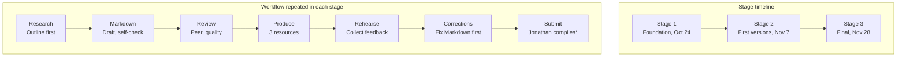

# Team Project Plan and Task List

**Babi Guling – AI Overview**

> **Version:** v2.1 (rebuilt on the lecturer's four course chapters; covers Stages 1, 2, and 3)
> **Last updated:** 2026-11-05

## Table of Contents

* [Team Members](#team-members)
* [Strengths](#strengths)
* [Responsibilities Based on Roles](#responsibilities-based-on-roles)
* [Five Content Parts of the Project](#five-content-parts-of-the-project)
* [Deliverable Ownership](#deliverable-ownership)
* [Detailed Schedule](#detailed-schedule)
* [Master Task List](#master-task-list)

  * [Status Labels](#status-labels)
  * [Stage 1 Tasks](#stage-1-tasks-due-oct-24-internal-oct-23)
  * [Stage 1 Fix Tasks](#stage-1-fix-tasks-rebuild-on-the-lecturers-four-course-chapters)
  * [Stage 2 Tasks](#stage-2-tasks-due-nov-7-2359-beijing-internal-nov-7-1800)
  * [Stage 3 Tasks](#stage-3-tasks-due-nov-28-internal-nov-24)
  * [Ongoing Tasks](#ongoing-tasks)
  * [How This List Is Maintained](#how-this-list-is-maintained)
* [Project Purpose](#project-purpose)
* [Workflow](#workflow)
* [Rough Plan](#rough-plan)
* [Revision History](#revision-history)

## Team Members

| # | Name                      | Chinese Name | Student ID | Role                 |
| - | ------------------------- | ------------ | ---------- | -------------------- |
| 1 | Benedict Subhata          | 王志伟          | 1820262181 | Visual Design Lead   |
| 2 | Brian Djoni Suzanna       | 吴梓诚          | 1820262162 | Quality Lead         |
| 3 | Gandhi Bestin Dhammananda | 熊特友          | 1820262168 | Video Lead           |
| 4 | Jonathan Sugianto         | 蔡德辉          | 1820262245 | CIO and Content Lead |
| 5 | Joseph Lokman             | 骆韦铨          | 1820262233 | CEO                  |

## Strengths

| Member                    | Strengths                                                                                          |
| ------------------------- | -------------------------------------------------------------------------------------------------- |
| Benedict Subhata          | Strong in problem solving, able to work under pressure, motivating the team, open-minded.          |
| Brian Djoni Suzanna       | Familiar in programming, experienced in using AI, able to detect inaccurate details, and reliable. |
| Gandhi Bestin Dhammananda | Cooperative, eager to learn, magnificent problem solving, creative-minded, motivator.              |
| Jonathan Sugianto         | Reliable person, good time management, detail-oriented, structured in any form of task.            |
| Joseph Lokman             | Patient, familiar with programming and CS, high responsibility and leadership, logical person.     |

## Responsibilities Based on Roles

This section gives the general overview of each role. Specific tasks, deliverables, and deadlines are tracked in the [Master Task List](#master-task-list).

| Member                    | Responsibilities                                                                                                                 |
| ------------------------- | -------------------------------------------------------------------------------------------------------------------------------- |
| Benedict Subhata          | Visual design product, word documents, study module, and powerpoint slides.                                                      |
| Brian Djoni Suzanna       | Independent quality review of every chapter and deliverable; keeps the Quality Standards, Review Register, README, Module Outline, and Project Plan up to date; determines whether a product needs to be revised.      |
| Gandhi Bestin Dhammananda | Live teaching product, video content, ideas, editing, and flow of how the video should be delivered.                             |
| Jonathan Sugianto         | Progress of the whole project, submission of the project, and compiling all types of material into a finalized format or folder. |
| Joseph Lokman             | Recording all activities and progress, speaking on behalf of the members, and providing guidance to all members who need it.     |

## Five Content Parts of the Project

The project produces five content parts. Each part has its own owner, reviewer, and tasks in the [Master Task List](#master-task-list). The Markdown content is the single source for the other four parts.

> **Note for the team:** This list follows the structure in the Project Plan (Sections 2 and 4–7). Compare it with the exact wording of the lecturer's assignment before submission and correct the names here if they differ.

| # | Content part | Main owner | Reviewer | Stage 2 form | Task IDs |
|--:|---|---|---|---|---|
| 1 | Shared Markdown content (Chapters 1–4) | Chapter authors; compiled by Jonathan | Brian | Markdown V2.0 ZIP + Submission Report | F-01 to F-08, S2-01 to S2-07 |
| 2 | Study Guide + Test Bank | Benedict | Brian | Study Guide + Test Bank (≥20 true/false, ≥20 multiple-choice, ≥6 open-ended) | S2-08, S2-09 |
| 3 | PPT Slides | Benedict | Brian | PPT with presenter notes | S2-10 |
| 4 | Video Tutorials | Gandhi | Brian | 1–8 MP4 videos, each ≤250 MB, plus the VideoGuide | S2-11, S2-12 |
| 5 | Live Mini Lecture | Gandhi (whole team) | Brian | Lecture plan, two rehearsals, feedback record | S2-16 |

## Deliverable Ownership

Each deliverable has one member who prepares it, one who reviews it, and one who compiles it. This separates the person doing the work from the person checking it. **Brian does not write a chapter, so he can review all of them independently.** Brian's own deliverables are reviewed by Joseph.

| Deliverable | Prepared by | Reviewed by | Compiled by |
|---|---|---|---|
| Project Plan and Master Task List | Brian Djoni Suzanna (v2.0 update) | Joseph Lokman | Jonathan Sugianto |
| Module Outline and README | Brian Djoni Suzanna (v2.0 update) | Joseph Lokman | Jonathan Sugianto |
| Quality standards and review register | Brian Djoni Suzanna | Joseph Lokman | Jonathan Sugianto |
| Chapter 1: Introduction to CS and AI | Jonathan Sugianto | Brian Djoni Suzanna | Jonathan Sugianto |
| Chapter 2: Symbolic AI | Gandhi Bestin Dhammananda | Brian Djoni Suzanna | Jonathan Sugianto |
| Chapter 3: Connectionist AI and Big Data | Benedict Subhata | Brian Djoni Suzanna | Jonathan Sugianto |
| Chapter 4: Behaviorist AI | Joseph Lokman | Brian Djoni Suzanna | Jonathan Sugianto |
| Study Guide + Test Bank | Benedict Subhata (with chapter authors) | Brian Djoni Suzanna | Jonathan Sugianto |
| PPT Slides (with presenter notes) | Benedict Subhata | Brian Djoni Suzanna | Jonathan Sugianto |
| Video Tutorials and VideoGuide | Gandhi Bestin Dhammananda | Brian Djoni Suzanna | Jonathan Sugianto |
| Live teaching presentation | Gandhi Bestin Dhammananda (with the whole team) | Brian Djoni Suzanna | Not applicable |
| GitHub repository, branches, Issues | Joseph Lokman | Brian Djoni Suzanna | Jonathan Sugianto |
| Project Log and meeting notes | Joseph Lokman | Jonathan Sugianto | Joseph Lokman |
| Personal Logs | Each member | Joseph Lokman | Jonathan Sugianto |
| Project and personal AI-use records | Joseph Lokman (project); each member (personal) | Brian Djoni Suzanna | Jonathan Sugianto |
| Submission folder, ZIP, and Submission Report for each stage | Jonathan Sugianto | Brian Djoni Suzanna | Jonathan Sugianto |

Jonathan is both preparer and compiler of Chapter 1, so Brian's review is the independent check on it. The chapter owners are proposals and can be changed by the team.

## Detailed Schedule

Times are Beijing time. Stage 2 is due **Saturday 7 November 2026, 23:59**; the internal deadline is 18:00 the same day so there is time to fix a failed upload. The Stage 2 log period is 25 October – 7 November.

### Stage 2: day by day

| Date | Who | Work | Output |
|---|---|---|---|
| Thu 5 Nov | Chapter authors | Read the rebuilt chapter, check its facts, copy it to their GitHub branch, and open a pull request | 4 pull requests |
| Thu 5 Nov | Brian | Start the Quality Review of Chapters 1–4 (version 1.1) with the Quality Standards V2.1 checklist; merge the updated README, Module Outline, Project Plan, and this list | Review reports signed by Brian |
| Thu 5 Nov | Benedict | Study Guide + Test Bank first version; PPT outline | Test-bank draft |
| Thu 5 Nov | Gandhi | Video scripts (1–8 videos), VideoGuide outline | Scripts |
| Fri 6 Nov | Brian | Finish chapter reviews; record findings in the Review Register | Review reports, register |
| Fri 6 Nov | Chapter authors | Fix every Major and Minor finding in the Markdown | Corrected chapters |
| Fri 6 Nov | Benedict, Gandhi | PPT with presenter notes; record and compress videos (each ≤250 MB) | PPT, MP4 files |
| Fri 6 Nov | Joseph | Project Log with light-theme screenshots; collect Personal Logs | Project Log, Personal Logs |
| Sat 7 Nov, by 12:00 | Brian | Re-review corrected chapters; check Study Guide + Test Bank counts and answer keys | Re-review records |
| Sat 7 Nov, by 15:00 | Jonathan | Compile Markdown V2.0 ZIP, Study Guide + Test Bank, PPT, videos, VideoGuide, logs, Submission Report | Stage 2 folder |
| Sat 7 Nov, by 17:00 | Brian | Extract the ZIP in a clean folder; check links, images, file sizes | Extraction test record |
| Sat 7 Nov, 18:00 | Jonathan, Joseph | Submit; Joseph confirms the receipt | Stage 2 submission |

### Stage 3: week by week

| Dates | Work | Owner |
|---|---|---|
| 8–10 Nov | Plan the live class; collect the Stage 2 score and lecturer feedback; decide whether a resubmission is needed (see S2-18) | Joseph, Jonathan |
| 9–14 Nov | Two live-teaching rehearsals with feedback; run learner testing of the test bank with someone outside the team | Gandhi, Joseph |
| By 3 days after the live class | Collect class and lecturer feedback; list improvements | Joseph |
| 15–20 Nov | Apply improvements to the Markdown first, then to every affected deliverable | Each deliverable owner |
| 21–22 Nov | Final quality review of all deliverables | Brian |
| 23–24 Nov | Final consistency check; internal deadline Nov 24 | Brian, Joseph |
| 25–26 Nov | Compile the final folder and ZIP; extraction test | Jonathan, Brian |
| Sat 28 Nov | Submit Stage 3 | Jonathan, Joseph |

## Master Task List

### Status Labels

| Label | Meaning |
|---|---|
| ⬜ Not Started | The task has been assigned but work has not begun. |
| 🔄 In Progress | Work has started but is not yet complete. |
| 🔍 Awaiting Review | The task output is finished and waits for the reviewer's signed review. |
| ✅ Completed | The outcome is achieved and the evidence is in the Evidence column. |
| ✏️ Needs Revision | The output requires corrections or improvements. |
| ⛔ Blocked | The task cannot continue until another issue is resolved. |
| ❓ To confirm | Status not yet verified. The owner must replace it with another label. |

### Stage 1 Tasks (due Oct 24, internal Oct 23)

> **History.** These tasks record the first Stage 1 build, which used five chapters. The rebuilt four-chapter structure is tracked in the Stage 1 Fix Tasks below.

Stage 1 has been completed. All tasks below are marked as completed following the completion of the Stage 1 work and submission process.

| Task ID | Task                                                                                                                                                                                | Responsible                                            | Reviewer / Compiler | Expected Deliverable                                                | Deadline         | Status      | Evidence                                                                                                                                                                                     |
| ------- | ----------------------------------------------------------------------------------------------------------------------------------------------------------------------------------- | ------------------------------------------------------ | ------------------- | ------------------------------------------------------------------- | ---------------- | ----------- | -------------------------------------------------------------------------------------------------------------------------------------------------------------------------------------------- |
| S1-01   | Write the project plan sections: team members, strengths, roles, project purpose, workflow, and rough plan                                                                          | Benedict                                               | Review: Brian       | Sections of `master-task-list.md`                                   | Oct 23           | ✅ Completed | [master-task-list.md](master-task-list.md)                                                                                                                                                   |
| S1-02   | Revise Master Task List (v1.1 → v1.2) to address the findings of QR-006-I01: add explicit Stage 1 submission tasks, confirm ownership, fix evidence, review history, and navigation | Benedict                                               | Review: Brian       | Revised `master-task-list.md` (v1.2)                                | Oct 23           | ✅ Completed | [Master Task List](master-task-list.md)                                                                                                                                                      |
| S1-03   | Initial quality review of the Master Task List v1.1 (QR-006-I01)                                                                                                                    | Brian                                                  | Compile: Jonathan   | Quality review report `QR-006-I01.md`                               | Oct 23           | ✅ Completed | [QR-006-I01.md](../quality/reviews/detailed%20reviews/QR-006-I01.md)                                                                                                                         |
| S1-04   | Confirm task owners, deadlines, and current statuses with each responsible member                                                                                                   | Jonathan                                               | Review: Joseph      | Confirmed statuses in this table                                    | Oct 23           | ✅ Completed | [master-task-list](master-task-list.md)                                                                                                                                                      |
| S1-05   | Recheck the revised Master Task List (v1.2) against the QR-006-I01 findings                                                                                                         | Brian                                                  | Compile: Jonathan   | Recheck record and updated review history                           | Oct 23 (evening) | ✅ Completed | [QR-006-I02.md](../quality/reviews/detailed%20reviews/QR-006-I02.md)                                                                                                                         |
| S1-06   | Set up the GitHub repository: folder per part, branch rules, pull request process, and Issues                                                                                       | Joseph                                                 | Review: Brian       | Repository structure and Issues                                     | Oct 23           | ✅ Completed | [GitHub repository: BABI-GULING](https://github.com/benngiiii/BABI-GULING); folders `Main/`, `quality/`, `logs/`                                                                             |
| S1-07   | Prepare the Markdown template and one sample section to set the writing style                                                                                                       | Jonathan                                               | Review: Brian       | Template file and sample section                                    | Oct 23           | ✅ Completed | [Chapter 1 draft](study-guide/v1.0/chapter-1-introduction-to-artificial-Intelligence/introduction-to-artificial-Intelligence.md)                                                             |
| S1-08   | Draft Chapter 1: Introduction to AI                                                                                                                                                 | Jonathan                                               | Review: Brian       | Chapter 1 draft (Markdown)                                          | Oct 23           | ✅ Completed | [Chapter 1 draft](study-guide/v1.0/chapter-1-introduction-to-artificial-Intelligence/introduction-to-artificial-Intelligence.md)                                                             |
| S1-09   | Draft Chapter 2: Types of AI                                                                                                                                                        | Gandhi                                                 | Review: Brian       | Chapter 2 draft (Markdown)                                          | Oct 23           | ✅ Completed | [Chapter 2 draft](study-guide/v1.0/chapter-2-types-of-artificial-intelligence/types-of-artificial-intelligence.md)                                                                           |
| S1-10   | Draft Chapter 3: How Artificial Intelligence Works (data, algorithms, machine learning, training and inference, workflow diagram)                                                   | Benedict                                               | Review: Brian       | Chapter 3 draft (Markdown)                                          | Oct 23           | ✅ Completed | [Chapter 3 draft](study-guide/v1.0/chapter-3-how-artificial-intelligence-works/how-artificial-intelligence-works.md)                                                                         |
| S1-11   | Outline Chapter 4: Applications of AI, and Chapter 5: AI Ethics and Limitations                                                                                                     | Brian, Joseph                                          | Review: Brian       | Chapter 4 and 5 outlines (Markdown)                                 | Oct 23           | ✅ Completed | [Chapter 4 draft](study-guide/v1.0/chapter-4-applications-of-aI/applications-of-aI.md), [Chapter 5 draft](study-guide/v1.0/chapter-5-aI-ethics-and-limitations/aI-ethics-and-limitations.md) |
| S1-12   | Quality review of all Stage 1 drafts and outlines                                                                                                                                   | Brian                                                  | Compile: Jonathan   | Review reports with approved or needs revision result for each item | Oct 23           | ✅ Completed | [review-register.md](../quality/reviews/review-register.md)                                                                                                                                  |
| S1-13   | Apply corrections from the quality review                                                                                                                                           | Each chapter author                                    | Review: Brian       | Corrected drafts and outlines                                       | Oct 23 (evening) | ✅ Completed | [Revision Logs](../quality/reviews/review-register.md)                                                                                                                                       |
| S1-14   | Record team activities, meeting notes, and progress for Stage 1                                                                                                                     | Joseph                                                 | Review: Jonathan    | Activity record                                                     | Oct 23           | ✅ Completed | [Project logs](https://github.com/benngiiii/BABI-GULING/blob/AI-Overview/Main/project-plan.md)                                                                                               |
| S1-15   | Prepare the Stage 1 Submission Report                                                                                                                                               | Jonathan                                               | Review: Brian       | Submission Report                                                   | Oct 23 (evening) | ✅ Completed | [Master Task List](../master-task-list.md)                                                                                                                                                   |
| S1-16   | Prepare the Markdown source snapshot with its supporting assets (images, diagrams, linked files)                                                                                    | Jonathan                                               | Review: Brian       | Markdown source snapshot folder with assets                         | Oct 24 (morning) | ✅ Completed | [Assets in Chapter](study-guide/v1.0/chapter-1-introduction-to-artificial-Intelligence/assets/)                                                                                              |
| S1-17   | Export the readable PDF of the Markdown content and check layout, images, and links                                                                                                 | Benedict                                               | Review: Brian       | Readable PDF                                                        | Oct 24 (morning) | ✅ Completed | Stage 1 submission package                                                                                                                                                                   |
| S1-18   | Collect and organize Repository Evidence (structure, branches, pull requests, Issues, commits)                                                                                      | Joseph                                                 | Review: Jonathan    | Repository Evidence file or folder                                  | Oct 23 (evening) | ✅ Completed | [Commits Log](https://github.com/benngiiii/BABI-GULING/commits/AI-Overview/)                                                                                                                 |
| S1-19   | Prepare the required project AI-use record and each member's personal AI-use record according to the assignment rules                                                               | Joseph (project record); each member (personal record) | Review: Brian       | Project and personal AI-use records                                 | Oct 23 (evening) | ✅ Completed | [stage1-ai-use-log.md](../logs/stage1-ai-use-log.md)                                                                                                                                         |
| S1-20   | Compile the Stage 1 submission folder and run a final check                                                                                                                         | Jonathan                                               | Review: Brian       | Final Stage 1 folder with only corrected versions                   | Oct 24 (morning) | ✅ Completed | Stage 1 final submission package                                                                                                                                                             |
| S1-21   | Package the required files into the specified ZIP                                                                                                                                   | Jonathan                                               | Review: Brian       | Stage 1 ZIP file                                                    | Oct 24 (morning) | ✅ Completed | Stage 1 ZIP submission                                                                                                                                                                       |
| S1-22   | Extract the ZIP into a separate folder and check that all files, links, and assets work                                                                                             | Brian                                                  | Confirm: Joseph     | Extraction test record                                              | Oct 24 (morning) | ✅ Completed | Stage 1 extraction test                                                                                                                                                                      |
| S1-23   | Submit Stage 1                                                                                                                                                                      | Jonathan                                               | Confirm: Joseph     | Stage 1 submission                                                  | Oct 24           | ✅ Completed | Stage 1 submission                                                                                                                                                                           |

### Stage 1 Fix Tasks (rebuild on the lecturer's four course chapters)

| ID | Task | Owner | Reviewer | Deadline | Status | Evidence |
|---|---|---|---|---|---|---|
| F-01 | Read and fact-check Chapter 1 (Introduction to CS and AI), then place it in `Main/study-guide/v1.0/` | Jonathan | Brian | Nov 5 | 🔍 Awaiting Review | Chapter 1 file |
| F-02 | Read and fact-check Chapter 2 (Symbolic AI), then place it in the repository | Gandhi | Brian | Nov 5 | 🔍 Awaiting Review | Chapter 2 file |
| F-03 | Read and fact-check Chapter 3 (Connectionist AI and Big Data), then place it in the repository | Benedict | Brian | Nov 5 | 🔍 Awaiting Review | Chapter 3 file |
| F-04 | Read and fact-check Chapter 4 (Behaviorist AI), then place it in the repository | Joseph | Brian | Nov 5 | 🔍 Awaiting Review | Chapter 4 file |
| F-05 | Merge README, Module Outline, Project Plan, Master Task List, and Quality Standards V2.1 | Brian | Joseph | Nov 5 | 🔍 Awaiting Review | Project documents |
| F-06 | Signed Quality Review of Chapters 1–4: QR-121-I01 to QR-124-I01 | Brian | Joseph | Nov 6 | ⬜ Not Started | Signed reports; Review Register |
| F-07 | Joseph's review of the project documents: QR-125-I01 | Joseph | Jonathan | Nov 6 | ⬜ Not Started | Signed report |
| F-08 | Regenerate `stage1_Content.md` from the final chapters | Jonathan | Brian | Nov 6 | ⬜ Not Started | `stage1_Content.md` |

### Stage 2 Tasks (due Nov 7, 23:59 Beijing; internal Nov 7, 18:00)

| ID | Task | Owner | Reviewer | Deadline | Status | Evidence |
|---|---|---|---|---|---|---|
| S2-01 | Expand Chapter 1 to V2.0: more worked examples and a longer practice set | Jonathan | Brian | Nov 6 | ⬜ Not Started | Chapter 1 V2.0 |
| S2-02 | Expand Chapter 2 to V2.0: more logic and search practice, a second worked example per topic | Gandhi | Brian | Nov 6 | ⬜ Not Started | Chapter 2 V2.0 |
| S2-03 | Expand Chapter 3 to V2.0: a worked network example, more Big Data cases | Benedict | Brian | Nov 6 | ⬜ Not Started | Chapter 3 V2.0 |
| S2-04 | Expand Chapter 4 to V2.0: a second MDP example, a deeper robotics and games section | Joseph | Brian | Nov 6 | ⬜ Not Started | Chapter 4 V2.0 |
| S2-05 | Verify every reference marked "Not opened" and update the labels | Chapter authors | Brian | Nov 6 | ⬜ Not Started | Updated references |
| S2-06 | Quality Review of the Stage 2 versions with signed reports | Brian | Joseph | Nov 6 | ⬜ Not Started | Signed QR-2xx reports; Review Register |
| S2-07 | Fix every finding from S2-06 in the Markdown | Chapter authors | Brian | Nov 7, 12:00 | ⬜ Not Started | Commits; re-review records |
| S2-08 | Study Guide: summaries, key terms, and practice per chapter | Benedict | Brian | Nov 6 | ⬜ Not Started | Study Guide file |
| S2-09 | Test Bank: ≥20 true/false, ≥20 multiple-choice, ≥6 open-ended, with answer keys | Benedict | Brian | Nov 6 | ⬜ Not Started | Test Bank file |
| S2-10 | PPT Slides with presenter notes for all chapters | Benedict | Brian | Nov 6 | ⬜ Not Started | .pptx file |
| S2-11 | Video scripts, recording, and editing (1–8 MP4 files, each ≤250 MB) | Gandhi | Brian | Nov 6 | ⬜ Not Started | MP4 files; file-size check |
| S2-12 | VideoGuide document for the videos | Gandhi | Brian | Nov 6 | ⬜ Not Started | VideoGuide file |
| S2-13 | Project Log with detailed entries and light-theme screenshots (25 Oct – 7 Nov) | Joseph | Jonathan | Nov 6 | 🔄 In Progress | Project Log file |
| S2-14 | Personal Logs from each member with light-theme screenshots | Each member | Joseph | Nov 6 | ⬜ Not Started | Five Personal Logs |
| S2-15 | Stage 2 AI-use records (project and personal) | Joseph; each member | Brian | Nov 6 | ⬜ Not Started | AI-use records |
| S2-16 | Prepare the live teaching session and hold two rehearsals with feedback | Gandhi (whole team) | Brian | Before the live class | ⬜ Not Started | Rehearsal notes |
| S2-17 | Review three previous-year projects (symbolic, connectionist, behaviorist) and record what the team adopted | Benedict, Gandhi, Joseph | Brian | Nov 6 | ⬜ Not Started | Notes in the Project Log |
| S2-18 | If the Stage 1 score is below 80%: decide on the one allowed resubmission and prepare its report (score capped at 80%) | Joseph | Jonathan | When the score is released | ❓ To confirm | Decision record |
| S2-19 | Compile Markdown V2.0 ZIP, Submission Report, and the Stage 2 folder | Jonathan | Brian | Nov 7, 15:00 | ⬜ Not Started | Stage 2 folder |
| S2-20 | Extract the ZIP in a clean folder; check links, images, and sizes | Brian | Joseph | Nov 7, 17:00 | ⬜ Not Started | Extraction record |
| S2-21 | Submit Stage 2 and confirm the receipt | Jonathan | Joseph | Nov 7, 18:00 | ⬜ Not Started | Submission receipt |

### Stage 3 Tasks (due Nov 28, internal Nov 24)

The Stage 3 requirements must be checked against the assignment text. The tasks below follow the project workflow.

| ID | Task | Owner | Reviewer | Deadline | Status | Evidence |
|---|---|---|---|---|---|---|
| S3-01 | Plan the live class and prepare the teaching materials | Gandhi | Brian | Nov 10 | ⬜ Not Started | Lecture plan |
| S3-02 | Two live-teaching rehearsals with feedback | Gandhi (whole team) | Brian | Nov 14 | ⬜ Not Started | Rehearsal notes |
| S3-03 | Learner testing of the Test Bank with someone outside the team | Joseph | Brian | Nov 14 | ⬜ Not Started | Trial feedback notes |
| S3-04 | Collect feedback from the live class and the lecturer; list improvements | Joseph | Jonathan | 3 days after the live class | ⬜ Not Started | Improvement list |
| S3-05 | Apply improvements to the Markdown first, then to every affected deliverable | Each owner | Brian | Nov 20 | ⬜ Not Started | Revised deliverables |
| S3-06 | Verify every reference marked "(Not verified)" and update the source tables | Chapter authors | Brian | Nov 20 | ⬜ Not Started | Updated references |
| S3-07 | Final quality review of all deliverables | Brian | Joseph | Nov 22 | ⬜ Not Started | Final review reports |
| S3-08 | Final consistency check: style, links, formatting, corrected versions only | Brian | Joseph | Nov 24 | ⬜ Not Started | Consistency record |
| S3-09 | Compile the final folder and ZIP; extraction test | Jonathan | Brian | Nov 26 | ⬜ Not Started | Final folder |
| S3-10 | Submit Stage 3 and confirm the receipt | Jonathan | Joseph | Nov 28 | ⬜ Not Started | Submission receipt |

### Ongoing Tasks

| ID | Task | Owner | Reviewer | Frequency | Status |
|---|---|---|---|---|---|
| OG-01 | Update task statuses in this list after each check-in | Jonathan | Joseph | Twice a week | 🔄 In Progress |
| OG-02 | Record activities, decisions, and meeting notes | Joseph | Jonathan | Each check-in | 🔄 In Progress |
| OG-03 | Review at least one other member's work and leave comments | All members | Brian | After each draft | ⬜ Not Started |

### How This List Is Maintained

* Jonathan updates task statuses after each check-in (twice a week, see OG-01); each owner confirms their own status.
* A task is marked ✅ Completed only when its outcome is achieved and its evidence (file, commit, pull request, Issue, or signed record) is available in the Evidence column.
* A review task is marked ✅ Completed only after the reviewer has signed the report. Do not mark it before the review has taken place.
* Any ❓ To confirm status must be replaced by the owner with another label.
* Every change to this file is recorded in the [Revision History](#revision-history).

## Project Purpose

This project teaches AI Overview to complete beginners. We turn one shared Markdown content base into three connected learning resources:

| Resource                | Purpose                                                           |
| ----------------------- | ----------------------------------------------------------------- |
| Study Guide + Test Bank | Self-paced reading, practice, and self-checking                   |
| PPT Slides              | Visual explanation of key ideas with diagrams and worked examples |
| Video Tutorials         | Narrated explanations and demonstrations of key processes         |

### Intended Learners

Beginners with no background in AI or programming. Learners only need basic computer and internet literacy. Every technical term is defined when it first appears.

### Learning Outcomes

After completing this module, learners should be able to:

* [ ] Explain in simple words what Artificial Intelligence is and how it differs from traditional programming.
* [ ] Distinguish AI by capability (Narrow AI, General AI) and by technique (Machine Learning, Generative AI).
* [ ] Describe the basic AI workflow: data, algorithm, training, and inference.
* [ ] Give examples of AI in healthcare, education, transportation, and everyday life.
* [ ] Identify key limitations and risks of AI: bias, privacy, and hallucinations.

## Workflow

*Jonathan compiles as CIO.

## Rough Plan

| Area          | Plan                                                                                                                                                                                                                               | Date (When)                                                                                |
| ------------- | ---------------------------------------------------------------------------------------------------------------------------------------------------------------------------------------------------------------------------------- | ------------------------------------------------------------------------------------------ |
| Schedule      | Internal deadlines come 2 to 3 days before each official one, so we have time to review and correct. Task-level deadlines are in the [Master Task List](#master-task-list).                                                        | Stage 1: Oct 23 (due Oct 24) Stage 2: Nov 4 (due Nov 7) Stage 3: Nov 24 (due Nov 28) |
| Study Content | We research from reliable sources, define every term at first use, and share short summaries. We ask the group first when something is hard, then the lecturer.                                                                    | Before and during drafting                                                                 |
| Markdown      | We outline first, write one sample section to set the style, then write the full draft. Each draft gets a self-check and a team review before it becomes the single source for all resources.                                      | Each stage                                                                                 |
| GitHub        | We use one repository with a folder for each part. Everyone works on their own branch, pull requests are reviewed before merging, and Issues track tasks and contributions.                                                        | Throughout                                                                                 |
| Communication | We use a group chat with replies within 24 hours, short check-ins twice a week, and a longer meeting before each deadline. Everyone reviews at least one other member's work.                                                      | Ongoing                                                                                    |
| Corrections   | We fix the Markdown source first, update every affected resource, re-check, and confirm the final folder has only corrected versions.                                                                                              | When an error is found                                                                     |
| Risks         | Practice on the sample chapter and help each other. Break difficult contents into small parts and verify together. Check uneven workload at every meeting and share tasks. Maximize and set internal deadlines to minimize delays. | Ongoing                                                                                    |

## Revision History

| Date              | Version | Change                                                                                                                                                                                                                                                                                                                                                                                                                                                                                                                                                      | Related Review                                                                     | Result                                                                                          |
| ----------------- | ------- | ----------------------------------------------------------------------------------------------------------------------------------------------------------------------------------------------------------------------------------------------------------------------------------------------------------------------------------------------------------------------------------------------------------------------------------------------------------------------------------------------------------------------------------------------------------- | ---------------------------------------------------------------------------------- | ----------------------------------------------------------------------------------------------- |
| Before 2026-10-23 | v1.0    | Initial version: team, roles, purpose, workflow, and rough plan                                                                                                                                                                                                                                                                                                                                                                                                                                                                                             | None recorded (to be confirmed)                                                    | Superseded by v1.1                                                                              |
| 2026-10-23        | v1.1    | Added Deliverable Ownership, Master Task List (with status labels and task-level deadlines), and a maintenance process                                                                                                                                                                                                                                                                                                                                                                                                                                      | None recorded (to be confirmed)                                                    | Reviewed in [QR-006-I01](../quality/reviews/detailed%20reviews/QR-006-I01.md); changes required |
| 2026-10-23        | v1.2    | Added explicit Stage 1 submission tasks (S1-15 to S1-22); split Chapter 4 and Chapter 5 drafts and assigned owners; confirmed Brian as Chapter 4 reviewer (as well as author) at the team's decision; added the repository link as S1-06 evidence; corrected evidence links to the actual repository paths; updated S1-12, S1-19, S1-20, S2-01 and S2-02 to match the repository contents; corrected the review references, the Table of Contents, the "Master Task List" typo, and heading levels; added the missing "How This List Is Maintained" section | [QR-006-I01](../quality/reviews/detailed%20reviews/QR-006-I01.md), Findings 1 to 6 | Pending recheck (S1-05)                                                                         |
| 2026-11-04        | v1.3    | Updated all Stage 1 task statuses to Completed following the completion of Stage 1; retained the existing project structure, responsibilities, workflow, and task assignments; updated the document to reflect the current Stage 2 progress.                                                                                                                                                                                                                                                                                                                | Stage 1 completion update                                                          | Completed                                                                                       |
| 2026-11-05        | v2.1    | Rebuilt after the Stage 1 lecturer feedback and the move to the lecturer's four course chapters: added Five Content Parts, a Detailed Schedule (Nov 5 – Nov 28), Stage 1 Fix tasks F-01 to F-08, and every Stage 2 and Stage 3 deliverable with task IDs, owners, reviewers, deadlines, and evidence; four chapter owners; Brian is the independent reviewer of all chapters; added the 🔍 Awaiting Review status; stopped marking review tasks as completed before a signed review exists; shortened tables for readable column widths | Stage 1 lecturer feedback; QR-101 series | Pending review by Joseph (QR-125-I01) |
