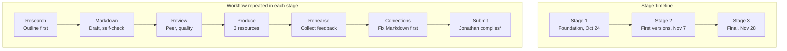

# Team Project Plan and Task List

**Babi Guling – AI Overview**

## Table of Contents

- [Team Members](#team-members)
- [Strengths](#strengths)
- [Responsibilities Based on Roles](#responsibilities-based-on-roles)
- [Project Purpose](#project-purpose)
- [Workflow](#workflow)
- [Rough Plan](#rough-plan)

## Team Members

| # | Name | Chinese Name | Student ID | Role |
|---|------|--------------|------------|------|
| 1 | Benedict Subhata | 王志伟 | 1820262181 | Visual Design Lead |
| 2 | Brian Djoni Suzanna | 吴梓诚 | 1820262162 | Quality Lead |
| 3 | Gandhi Bestin Dhammananda | 熊特友 | 1820262168 | Video Lead |
| 4 | Jonathan Sugianto | 蔡德辉 | 1820262245 | CIO and Content Lead |
| 5 | Joseph Lokman | 骆韦铨 | 1820262233 | CEO |

## Strengths

| Member | Strengths |
|--------|-----------|
| Benedict Subhata | Strong in problem solving, able to work under pressure, motivating the team, open-minded. |
| Brian Djoni Suzanna | Familiar in programming, experienced in using AI, able to detect inaccurate details, and reliable. |
| Gandhi Bestin Dhammananda | Cooperative, eager to learn, magnificent problem solving, creative-minded, motivator. |
| Jonathan Sugianto | Reliable person, good time management, detail-oriented, structured in any form of task. |
| Joseph Lokman | Patient, familiar with programming and CS, high responsibility and leadership, logical person. |

## Responsibilities Based on Roles

| Member | Responsibilities |
|--------|------------------|
| Benedict Subhata | Visual design product, Word documents, study module, and PowerPoint slides. |
| Brian Djoni Suzanna | Quality checks of each material uploaded by team members; determines whether one's product or material needs to be revised. |
| Gandhi Bestin Dhammananda | Live teaching product, video content, ideas, editing, and flow of how the video should be delivered. |
| Jonathan Sugianto | Progress of the whole project, submission of the project, and compiling all types of material into a finalized format or folder. |
| Joseph Lokman | Recording all activities and progress, speaking on behalf of the members, and providing guidance to all members who need it. |

## Project Purpose

This project teaches AI Overview to complete beginners. We turn one shared Markdown content base into three connected learning resources:

| Resource | Purpose |
|----------|---------|
| Study Guide + Test Bank | Self-paced reading, practice, and self-checking |
| PPT Slides | Visual explanation of key ideas with diagrams and worked examples |
| Video Tutorials | Narrated explanations and demonstrations of key processes |

### Intended Learners

Beginners with no background in AI or programming. Learners only need basic computer and internet literacy. Every technical term is defined when it first appears.

### Learning Outcomes

After completing this module, learners should be able to:

- [ ] Explain in simple words what Artificial Intelligence is and how it differs from traditional programming.
- [ ] Distinguish AI by capability (Narrow AI, General AI) and by technique (Machine Learning, Generative AI).
- [ ] Describe the basic AI workflow: data, algorithm, training, and inference.
- [ ] Give examples of AI in healthcare, education, transportation, and everyday life.
- [ ] Identify key limitations and risks of AI: bias, privacy, and hallucinations.

## Workflow

\*Jonathan compiles as CIO.

## Rough Plan

| Area | Plan | Date (When) |
|------|------|-------------|
| Schedule | Internal deadlines come 2 to 3 days before each official one, so we have time to review and correct. | Stage 1: Oct 23 (due Oct 24) Stage 2: Nov 4 (due Nov 7) Stage 3: Nov 24 (due Nov 28) |
| Study Content | We research from reliable sources, define every term at first use, and share short summaries. We ask the group first when something is hard, then the lecturer. | Before and during drafting |
| Markdown | We outline first, write one sample section to set the style, then write the full draft. Each draft gets a self-check and a team review before it becomes the single source for all resources. | Each stage |
| GitHub | We use one repository with a folder for each part. Everyone works on their own branch, pull requests are reviewed before merging, and Issues track tasks and contributions. | Throughout |
| Communication | We use a group chat with replies within 24 hours, short check-ins twice a week, and a longer meeting before each deadline. Everyone reviews at least one other member's work. | Ongoing |
| Corrections | We fix the Markdown source first, update every affected resource, re-check, and confirm the final folder has only corrected versions. | When an error is found |
| Risks | Practice on the sample chapter and help each other. Break difficult contents into small parts and verify together. Check uneven workload at every meeting and share tasks. Maximize and set internal deadlines to minimize delays. | Ongoing |
