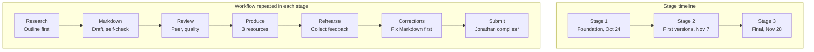

# Team Project Plan and Task List

**Babi Guling – AI Overview**

> **Version:** v1.2 (revised in response to the findings of [QR-006-I01](../quality/reviews/detailed%20reviews/QR-006-I01.md), the initial review of v1.1)
> **Last updated:** 2026-10-23

## Table of Contents

- [Team Members](#team-members)
- [Strengths](#strengths)
- [Responsibilities Based on Roles](#responsibilities-based-on-roles)
- [Deliverable Ownership](#deliverable-ownership)
- [Master Task List](#master-task-list)
  - [Status Labels](#status-labels)
  - [Stage 1 Tasks](#stage-1-tasks-due-oct-24-internal-oct-23)
  - [Stage 2 Tasks](#stage-2-tasks-due-nov-7-internal-nov-4)
  - [Stage 3 Tasks](#stage-3-tasks-due-nov-28-internal-nov-24)
  - [Ongoing Tasks](#ongoing-tasks)
  - [How This List Is Maintained](#how-this-list-is-maintained)
- [Project Purpose](#project-purpose)
- [Workflow](#workflow)
- [Rough Plan](#rough-plan)
- [Revision History](#revision-history)

## Team Members

| # | Name | Chinese Name | Student ID | Role |
|---|------|--------------|------------|------|
| 1 | Benedict Subhata | 王志伟 | 1820262181 | Visual Design Lead |
| 2 | Brian Djoni Suzanna | 吴梓诚 | 1820262162 | Quality Lead |
| 3 | Gandhi Bestin Dhammananda | 熊特友 | 1820262168 | Video Lead |
| 4 | Jonathan Sugianto | 蔡德辉 | 1820262245 | CIO and Content Lead |
| 5 | Joseph Lokman | 骆韦铨 | 1820262233 | CEO |

## Strengths

| Member | Strengths |
|--------|-----------|
| Benedict Subhata | Strong in problem solving, able to work under pressure, motivating the team, open-minded. |
| Brian Djoni Suzanna | Familiar in programming, experienced in using AI, able to detect inaccurate details, and reliable. |
| Gandhi Bestin Dhammananda | Cooperative, eager to learn, magnificent problem solving, creative-minded, motivator. |
| Jonathan Sugianto | Reliable person, good time management, detail-oriented, structured in any form of task. |
| Joseph Lokman | Patient, familiar with programming and CS, high responsibility and leadership, logical person. |

## Responsibilities Based on Roles

This section gives the general overview of each role. Specific tasks, deliverables, and deadlines are tracked in the [Master Task List](#master-task-list).

| Member | Responsibilities |
|--------|------------------|
| Benedict Subhata | Visual design product, word documents, study module, and powerpoint slides. |
| Brian Djoni Suzanna | Quality checks of each material uploaded by team members; determines whether one's product or material needs to be revised. |
| Gandhi Bestin Dhammananda | Live teaching product, video content, ideas, editing, and flow of how the video should be delivered. |
| Jonathan Sugianto | Progress of the whole project, submission of the project, and compiling all types of material into a finalized format or folder. |
| Joseph Lokman | Recording all activities and progress, speaking on behalf of the members, and providing guidance to all members who need it. |

## Deliverable Ownership

Each deliverable has one member who prepares it, one who reviews it, and one who compiles it. This separates the person doing the work from the person checking it.

| Deliverable | Prepared by | Reviewed by | Compiled by |
|-------------|-------------|-------------|-------------|
| Master Task List | Benedict Subhata | Brian Djoni Suzanna | Jonathan Sugianto |
| Chapter 1: Introduction to AI | Jonathan Sugianto | Brian Djoni Suzanna | Jonathan Sugianto |
| Chapter 2: Types of AI | Gandhi Bestin Dhammananda | Brian Djoni Suzanna | Jonathan Sugianto |
| Chapter 3: How Artificial Intelligence Works | Benedict Subhata | Brian Djoni Suzanna | Jonathan Sugianto |
| Chapter 4: Applications of AI | Brian Djoni Suzanna | Brian Djoni Suzanna | Jonathan Sugianto |
| Chapter 5: AI Ethics and Limitations | Joseph Lokman | Brian Djoni Suzanna | Jonathan Sugianto |
| Study Guide + Test Bank (Markdown base) | Benedict Subhata (study module); chapter authors (content) | Brian Djoni Suzanna | Jonathan Sugianto |
| PPT Slides | Benedict Subhata | Brian Djoni Suzanna | Jonathan Sugianto |
| Video Tutorials (script, narration, editing) | Gandhi Bestin Dhammananda | Brian Djoni Suzanna | Jonathan Sugianto |
| Live teaching presentation | Gandhi Bestin Dhammananda (with the whole team) | Brian Djoni Suzanna | Not applicable |
| GitHub repository structure, branches, and Issues | Joseph Lokman | Brian Djoni Suzanna | Jonathan Sugianto |
| Activity and progress records, meeting notes | Joseph Lokman | Jonathan Sugianto | Joseph Lokman |
| Final submission folder for each stage | Jonathan Sugianto | Brian Djoni Suzanna | Jonathan Sugianto |

Brian reviews every deliverable, including Chapter 4, which he also prepares. The team confirmed this arrangement.

## Master Task List

### Status Labels

| Label | Meaning |
|-------|---------|
| ⬜ Not Started | The task has been assigned but work has not begun. |
| 🔄 In Progress | Work has started but is not yet complete. |
| ✅ Completed | The assigned task has been completed. |
| ✏️ Needs Revision | The task output requires corrections or improvements. |
| ⛔ Blocked | The task cannot continue until another issue is resolved. |
| ❓ To confirm | Current status has not yet been verified. The responsible member must replace this with one of the five labels above. |

### Stage 1 Tasks (due Oct 24, internal Oct 23)

Content tasks (drafting, review, revision) are scheduled to finish by the internal deadline on Oct 23. Compiling and submission use the remaining time before the official deadline on Oct 24.

| Task ID | Task | Responsible | Reviewer / Compiler | Expected Deliverable | Deadline | Status | Evidence |
|---------|------|-------------|---------------------|----------------------|----------|--------|----------|
| S1-01 | Write the project plan sections: team members, strengths, roles, project purpose, workflow, and rough plan | Benedict | Review: Brian | Sections of `master-task-list.md` | Oct 23 | ✅ Completed | [master-task-list.md](master-task-list.md) |
| S1-02 | Revise Master Task List (v1.1 → v1.2) to address the findings of QR-006-I01: add explicit Stage 1 submission tasks, confirm ownership, fix evidence, review history, and navigation | Benedict | Review: Brian | Revised `master-task-list.md` (v1.2) | Oct 23 | ✅ Completed | [Master Task List](/master-task-list.md) |
| S1-03 | Initial quality review of the Master Task List v1.1 (QR-006-I01) | Brian | Compile: Jonathan | Quality review report `QR-006-I01.md` | Oct 23 | ✅ Completed | [QR-006-I01.md](../quality/reviews/detailed%20reviews/QR-006-I01.md) |
| S1-04 | Confirm task owners, deadlines, and current statuses with each responsible member | Jonathan | Review: Joseph | Confirmed statuses in this table | Oct 23 | ✅ Completed  | [master-task-list](master-task-list.md) |
| S1-05 | Recheck the revised Master Task List (v1.2) against the QR-006-I01 findings | Brian | Compile: Jonathan | Recheck record and updated review history | Oct 23 (evening) | ✅ Completed | [Revised Master Plan List](../quality/reviews/detailed%20reviews/QR-006-I02.md) |
| S1-06 | Set up the GitHub repository: folder per part, branch rules, pull request process, and Issues | Joseph | Review: Brian | Repository structure and Issues | Oct 23 | ✅ Completed | [GitHub repository: BABI-GULING](https://github.com/benngiiii/BABI-GULING); folders `Main/`, `quality/`, `logs/` |
| S1-07 | Prepare the Markdown template and one sample section to set the writing style | Jonathan | Review: Brian | Template file and sample section | Oct 23 | ✅ Completed | [Chapter 1 draft](study-guide/v1.0/chapter-1-introduction-to-artificial-Intelligence/introduction-to-artificial-Intelligence.md) |
| S1-08 | Draft Chapter 1: Introduction to AI | Jonathan | Review: Brian | Chapter 1 draft (Markdown) | Oct 23 | ✅ Completed | [Chapter 1 draft](study-guide/v1.0/chapter-1-introduction-to-artificial-Intelligence/introduction-to-artificial-Intelligence.md) |
| S1-09 | Draft Chapter 2: Types of AI | Gandhi | Review: Brian | Chapter 2 draft (Markdown) | Oct 23 | ✅ Completed | [Chapter 2 draft](study-guide/v1.0/chapter-2-types-of-artificial-intelligence/types-of-artificial-intelligence.md) |
| S1-10 | Draft Chapter 3: How Artificial Intelligence Works (data, algorithms, machine learning, training and inference, workflow diagram) | Benedict | Review: Brian | Chapter 3 draft (Markdown) | Oct 23 | ✅ Completed | [Chapter 3 draft](study-guide/v1.0/chapter-3-how-artificial-intelligence-works/how-artificial-intelligence-works.md) |
| S1-11 | Outline Chapter 4: Applications of AI, and Chapter 5: AI Ethics and Limitations | Brian, Joseph | Review: Brian | Chapter 4 and 5 outlines (Markdown) | Oct 23 | ✅ Completed | [Chapter 4 draft](study-guide/v1.0/chapter-4-applications-of-aI/applications-of-aI.md), [Chapter 5 draft](study-guide/v1.0/chapter-5-aI-ethics-and-limitations/aI-ethics-and-limitations.md) |
| S1-12 | Quality review of all Stage 1 drafts and outlines | Brian | Compile: Jonathan | Review reports with approved or needs revision result for each item | Oct 23 | ✅ Completed | [review-register.md](../quality/reviews/review-register.md) |
| S1-13 | Apply corrections from the quality review | Each chapter author | Review: Brian | Corrected drafts and outlines | Oct 23 (evening) | ✅ Completed | [Revision Logs](../quality/reviews/review-register.md) |
| S1-14 | Record team activities, meeting notes, and progress for Stage 1 | Joseph | Review: Jonathan | Activity record | Oct 23 | ✅ Completed | [Project-logs](https://github.com/benngiiii/BABI-GULING/blob/AI-Overview/Main/project-plan.md) |
| S1-15 | Prepare the Stage 1 Submission Report | Jonathan | Review: Brian | Submission Report | Oct 23 (evening) | ✅ Completed | [In Master Task List](https://github.com/benngiiii/BABI-GULING/blob/AI-Overview/Main/master-task-list.md) |
| S1-16 | Prepare the Markdown source snapshot with its supporting assets (images, diagrams, linked files) | Jonathan | Review: Brian | Markdown source snapshot folder with assets | Oct 24 (morning) | ✅ Completed | [Assets in Chapter](/BABI-GULING/tree/AI-Overview/Main/study-guide/v1.0/chapter-1-introduction-to-artificial-Intelligence/assets) |
| S1-17 | Export the readable PDF of the Markdown content and check layout, images, and links | Benedict | Review: Brian | Readable PDF | Oct 24 (morning) | 🔄 In Progress | — |
| S1-18 | Collect and organize Repository Evidence (structure, branches, pull requests, Issues, commits) | Joseph | Review: Jonathan | Repository Evidence file or folder | Oct 23 (evening) | ✅ Completed | [Commits Log](https://github.com/benngiiii/BABI-GULING/commits/AI-Overview/) |
| S1-19 | Prepare the required project AI-use record and each member's personal AI-use record according to the assignment rules | Joseph (project record); each member (personal record) | Review: Brian | Project and personal AI-use records | Oct 23 (evening) | ✅ Completed | [stage1-ai-use-log.md](../logs/stage1-ai-use-log.md) (team log exists; member confirmation pending) |
| S1-20 | Compile the Stage 1 submission folder and run a final check | Jonathan | Review: Brian | Final Stage 1 folder with only corrected versions | Oct 24 (morning) | 🔄 In Progress | [final-submission-audit.md](../quality/reviews/final-submission-audit.md) (audit in progress) |
| S1-21 | Package the required files into the specified ZIP | Jonathan | Review: Brian | Stage 1 ZIP file | Oct 24 (morning) | 🔄 In Progress | — |
| S1-22 | Extract the ZIP into a separate folder and check that all files, links, and assets work | Brian | Confirm: Joseph | Extraction test record | Oct 24 (morning) | 🔄 In Progress | — |
| S1-23 | Submit Stage 1 | Jonathan | Confirm: Joseph | Stage 1 submission | Oct 24 | ⬜ Not Started | — |

# Stage 1 Submission Report

| Item | Details |
|------|---------|
| Team | Babi Guling |
| Module | AI Overview |
| Stage | Stage 1 (official deadline: 24 October 2026) |
| Report date | 23 October 2026 |
| Prepared by | Jonathan Sugianto (CIO and Content Lead) |
| Reviewed by | Brian Djoni Suzanna (Quality Lead) — [TO CONFIRM after review] |
| GitHub repository | https://github.com/benngiiii/BABI-GULING |
| Submitted branch | [AI-Overview](https://github.com/benngiiii/BABI-GULING/blob/AI-Overview) |

---

## 1. Project and Team Information

The project teaches AI Overview to complete beginners. One shared Markdown content base is turned into three connected learning resources: a Study Guide with Test Bank, PPT Slides, and Video Tutorials. Corrections are made in the Markdown first, so they carry into every resource.

| No. | Name | Student ID | GitHub Username | Role |
|:---:|------|:----------:|-----------------|------|
| 1 | Benedict Subhata | 1820262181 | benngiiii | Visual Design Lead |
| 2 | Brian Djoni Suzanna | 1820262162 | brizz0-0 | Quality Lead |
| 3 | Gandhi Bestin Dhammananda | 1820262168 | bestinsiuuu77 | Video Lead |
| 4 | Jonathan Sugianto | 1820262245 | JonathanSugianto | CIO and Content Lead |
| 5 | Joseph Lokman | 1820262233 | JosephLokman | CEO |

## 2. Stage 1 Objectives

Stage 1 builds the foundation of the project:

- Set up the shared GitHub repository and the team's working process.
- Write the planning documents: README, Project Plan, Master Task List, and Module Outline.
- Develop the Markdown learning content, with at least one topic developed in depth.
- Record quality reviews and AI-tool use.
- Prepare the submission package for review.

## 3. Work Completed

| Area | Work completed | Location in the repository |
|------|----------------|----------------------------|
| Repository | Shared repository with folders for documents, learning content, quality records, and logs | `Main/`, `quality/`, `logs/` |
| Planning documents | README, Project Plan, Master Task List (v1.2), Module Outline | `Main/` |
| Learning content | Chapter drafts 1 to 5 in Markdown, with images in `assets/` folders | `Main/study-guide/v1.0/` |
| Quality records | Quality standards, review register, detailed review reports, final submission audit | `quality/reviews/` |
| AI-use record | Stage 1 team AI-use log | `logs/stage1-ai-use-log.md` |

## 4. Developed Learning Topic

**Chapter 1: Introduction to Artificial Intelligence** is the developed topic for Stage 1. It was reviewed over four rounds, and the fourth review (QR-001-I04) approved it.

- Author: Jonathan Sugianto
- File: [study-guide/v1.0/chapter-1-introduction-to-artificial-Intelligence](study-guide/v1.0/chapter-1-introduction-to-artificial-Intelligence)
- Supporting images: [chapter-1-introduction-to-artificial-Intelligence/assets](study-guide/v1.0/chapter-1-introduction-to-artificial-Intelligence/assets)

## 5. Team Contributions

Responsibilities follow the Deliverable Ownership table in the Master Task List.

| Member | Stage 1 responsibilities |
|--------|--------------------------|
| Benedict Subhata | Master Task List; Chapter 3 draft |
| Brian Djoni Suzanna | Quality reviews and final audit; Chapter 4 draft and outline; AI-use log |
| Gandhi Bestin Dhammananda | Chapter 2 draft |
| Jonathan Sugianto | Chapter 1 draft; Markdown template; Stage 1 package compilation |
| Joseph Lokman | GitHub repository setup; Chapter 5 draft; activity records |

## 6. Quality Review Summary

Quality reviews were carried out by the Quality Lead. Latest registered result for each document:

| Document | Latest review | Latest registered result |
|----------|---------------|--------------------------|
| Chapter 1 | QR-001-I04 | Pass |
| Chapter 2 | QR-002-I03 | Pass |
| Chapter 3 | QR-003-I05 | Pass |
| Chapter 4 | QR-004-I01 | Pass |
| Chapter 5 | QR-005-I02 | Pass |
| Master Task List | QR-006-I01 | Changes Required; revised in v1.2, recheck pending |
| Project Plan | QR-007-I03 | Changes Required |
| README | QR-008-I02 | Minor Revisions Recommended |
| Module Outline | QR-009-I03 | Minor Revisions Recommended |

## 7. AI Tools Usage Summary

The team used ChatGPT. The Stage 1 AI-use log (logs/stage1-ai-use-log.md) records eight activities: study guide planning, concept explanation, slide development, video script planning, practice questions, two quality-review activities, and project planning. Each member checks the entries for their own work against their actual AI interactions.

## 8. GitHub Repository Information

- Repository: https://github.com/benngiiii/BABI-GULING
- Main folders: `Main` (documents and study guide), `quality/reviews` (review records), `logs` (AI-use log)
- Contribution evidence: GitHub commit history, pull requests, and Issues. [Contribution evidence](https://github.com/benngiiii/BABI-GULING/commits/AI-Overview/)

## 9. Remaining Work and Next Steps

- **Stage 2 (due 7 November):** full drafts of Chapters 4 and 5; first versions of the Study Guide and Test Bank, PPT Slides, and Video Tutorials; trial of the test-bank questions with someone outside the team; quality review and corrections; live teaching rehearsals.
- **Stage 3 (due 28 November):** improvements from live-class and lecturer feedback, final quality review, final consistency check, and final submission.
- Open Stage 1 corrections are tracked in the Master Task List.

## 10. Submission Package Contents

| Item | File or location | Status |
|------|------------------|--------|
| GitHub repository link | https://github.com/benngiiii/BABI-GULING | Available |
| Markdown source snapshot | `Main/`, `quality/`, `logs/` | Available |
| Submission Report | Part of this document | Draft |
| Readable PDF of learning content | [TO CONFIRM] | Not yet produced |
| AI-use records | `logs/stage1-ai-use-log.md` | Available |
| Complete ZIP package | [TO CONFIRM] | Not yet produced |

### Stage 2 Tasks (due Nov 7, internal Nov 4)

| Task ID | Task | Responsible | Reviewer / Compiler | Expected Deliverable | Deadline | Status | Evidence |
|---------|------|-------------|---------------------|----------------------|----------|--------|----------|
| S2-01 | Write full draft of Chapter 4: Applications of AI | Brian | Review: Brian | Chapter 4 full draft (Markdown) | Oct 30 | 🔄 In Progress | [Chapter 4 draft](study-guide/v1.0/chapter-4-applications-of-aI/applications-of-aI.md) |
| S2-02 | Write full draft of Chapter 5: AI Ethics and Limitations | Joseph | Review: Brian | Chapter 5 full draft (Markdown) | Oct 30 | 🔄 In Progress | [Chapter 5 draft](study-guide/v1.0/chapter-5-aI-ethics-and-limitations/aI-ethics-and-limitations.md) |
| S2-03 | Study Guide + Test Bank, first version | Benedict (with chapter authors) | Review: Brian | Study Guide and Test Bank (Markdown) | Nov 1 | ⬜ Not Started | — |
| S2-04 | PPT Slides, first version | Benedict | Review: Brian | Slide deck covering all chapters | Nov 2 | ⬜ Not Started | — |
| S2-05 | Video Tutorials, first version (script, narration, editing) | Gandhi | Review: Brian | Video files and script | Nov 2 | ⬜ Not Started | — |
| S2-06 | Trial the test-bank questions with someone outside the team | Joseph | Review: Brian | Trial feedback notes | Nov 3 | ⬜ Not Started | — |
| S2-07 | Quality review of all first versions | Brian | Compile: Jonathan | Review reports for each deliverable | Nov 3 | ⬜ Not Started | — |
| S2-08 | Apply corrections to the Markdown source and all affected deliverables | Each deliverable owner | Review: Brian | Corrected deliverables | Nov 4 | ⬜ Not Started | — |
| S2-09 | Prepare live teaching and hold at least two rehearsals with feedback | Gandhi (with the whole team) | Review: Brian | Rehearsal notes and feedback record | Before the live class date (follows class schedule) | ⬜ Not Started | — |
| S2-10 | Compile and submit Stage 2 | Jonathan | Confirm: Joseph | Stage 2 submission | Nov 7 | ⬜ Not Started | — |

### Stage 3 Tasks (due Nov 28, internal Nov 24)

| Task ID | Task | Responsible | Reviewer / Compiler | Expected Deliverable | Deadline | Status | Evidence |
|---------|------|-------------|---------------------|----------------------|----------|--------|----------|
| S3-01 | Collect feedback from the live class and the lecturer, and list improvements | Joseph | Review: Jonathan | Feedback and improvement list | Within 3 days after the live class | ⬜ Not Started | — |
| S3-02 | Apply improvements to the Markdown source first, then to every affected deliverable | Each deliverable owner | Review: Brian | Revised deliverables | Nov 20 | ⬜ Not Started | — |
| S3-03 | Final quality review of all deliverables | Brian | Compile: Jonathan | Final review reports | Nov 22 | ⬜ Not Started | — |
| S3-04 | Final consistency check: style, links, formatting, and corrected versions only | Brian | Review: Joseph | Consistency check record | Nov 24 | ⬜ Not Started | — |
| S3-05 | Compile the final folder and submit | Jonathan | Confirm: Joseph | Final submission | Nov 28 (compile by Nov 26) | ⬜ Not Started | — |

### Ongoing Tasks

| Task ID | Task | Responsible | Reviewer / Compiler | Expected Deliverable | Frequency | Status | 
|---------|------|-------------|---------------------|----------------------|-----------|--------|
| OG-01 | Update task statuses in this list after each check-in | Jonathan | Review: Joseph | Up-to-date Master Task List | Twice a week | 🔄 In Progress |
| OG-02 | Record activities, decisions, and meeting notes | Joseph | Review: Jonathan | Activity record | Each check-in | 🔄 In Progress |
| OG-03 | Review at least one other member's work and leave comments | All members | Review: Brian | Review comments on pull requests | After each draft | ⬜ Not Started |

### How This List Is Maintained

- Jonathan updates task statuses after each check-in (twice a week, see OG-01); each responsible member confirms their own status.
- A task is marked ✅ Completed only when its defined outcome is achieved and its evidence (file, commit, pull request, Issue, or record) is available in the Evidence column.
- Any ❓ To confirm status must be replaced by the responsible member with one of the other five labels.
- Every change to this file is recorded in the [Revision History](#revision-history).

## Project Purpose

This project teaches AI Overview to complete beginners. We turn one shared Markdown content base into three connected learning resources:

| Resource | Purpose |
|----------|---------|
| Study Guide + Test Bank | Self-paced reading, practice, and self-checking |
| PPT Slides | Visual explanation of key ideas with diagrams and worked examples |
| Video Tutorials | Narrated explanations and demonstrations of key processes |

### Intended Learners

Beginners with no background in AI or programming. Learners only need basic computer and internet literacy. Every technical term is defined when it first appears.

### Learning Outcomes

After completing this module, learners should be able to:

- [ ] Explain in simple words what Artificial Intelligence is and how it differs from traditional programming.
- [ ] Distinguish AI by capability (Narrow AI, General AI) and by technique (Machine Learning, Generative AI).
- [ ] Describe the basic AI workflow: data, algorithm, training, and inference.
- [ ] Give examples of AI in healthcare, education, transportation, and everyday life.
- [ ] Identify key limitations and risks of AI: bias, privacy, and hallucinations.

## Workflow

\*Jonathan compiles as CIO.

## Rough Plan

| Area | Plan | Date (When) |
|------|------|-------------|
| Schedule | Internal deadlines come 2 to 3 days before each official one, so we have time to review and correct. Task-level deadlines are in the [Master Task List](#master-task-list). | Stage 1: Oct 23 (due Oct 24) Stage 2: Nov 4 (due Nov 7) Stage 3: Nov 24 (due Nov 28) |
| Study Content | We research from reliable sources, define every term at first use, and share short summaries. We ask the group first when something is hard, then the lecturer. | Before and during drafting |
| Markdown | We outline first, write one sample section to set the style, then write the full draft. Each draft gets a self-check and a team review before it becomes the single source for all resources. | Each stage |
| GitHub | We use one repository with a folder for each part. Everyone works on their own branch, pull requests are reviewed before merging, and Issues track tasks and contributions. | Throughout |
| Communication | We use a group chat with replies within 24 hours, short check-ins twice a week, and a longer meeting before each deadline. Everyone reviews at least one other member's work. | Ongoing |
| Corrections | We fix the Markdown source first, update every affected resource, re-check, and confirm the final folder has only corrected versions. | When an error is found |
| Risks | Practice on the sample chapter and help each other. Break difficult contents into small parts and verify together. Check uneven workload at every meeting and share tasks. Maximize and set internal deadlines to minimize delays. | Ongoing |

## Revision History

| Date | Version | Change | Related Review | Result |
|------|---------|--------|----------------|--------|
| Before 2026-10-23 | v1.0 | Initial version: team, roles, purpose, workflow, and rough plan | None recorded (to be confirmed) | Superseded by v1.1 |
| 2026-10-23 | v1.1 | Added Deliverable Ownership, Master Task List (with status labels and task-level deadlines), and a maintenance process | None recorded (to be confirmed) | Reviewed in [QR-006-I01](../quality/reviews/detailed%20reviews/QR-006-I01.md); changes required |
| 2026-10-23 | v1.2 | Added explicit Stage 1 submission tasks (S1-15 to S1-22); split Chapter 4 and Chapter 5 drafts and assigned owners; confirmed Brian as Chapter 4 reviewer (as well as author) at the team's decision; added the repository link as S1-06 evidence; corrected evidence links to the actual repository paths; updated S1-12, S1-19, S1-20, S2-01 and S2-02 to match the repository contents; corrected the review references, the Table of Contents, the "Master Task List" typo, and heading levels; added the missing "How This List Is Maintained" section | [QR-006-I01](../quality/reviews/detailed%20reviews/QR-006-I01.md), Findings 1 to 6 | Pending recheck (S1-05) |
