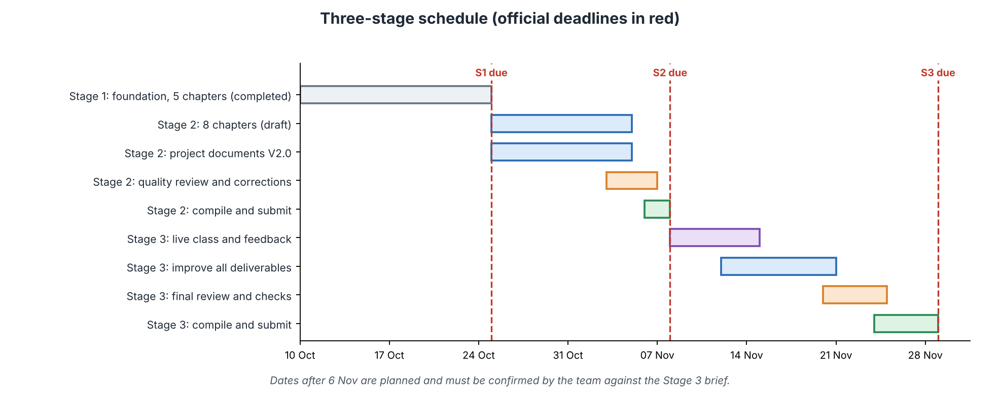
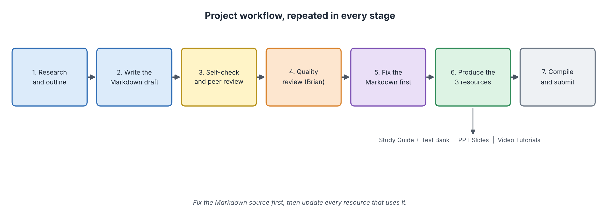

# Project Plan V2.0

## BABI GULING — AI Overview

**Document author:** Joseph Lokman (CEO) 
**Version:** V2.0 (Stage 2)  
**Last updated:** 6 November 2026

| Item | Detail |
| ---- | ------ |
| Project | Introduction to Computer Science and Artificial Intelligence |
| Module | AI Overview |
| Team | BABI GULING |
| Stage covered | Stage 2 in detail; Stages 1 and 3 in summary |
| Official deadlines | Stage 1: 24 Oct 2026 (done) · Stage 2: 7 Nov 2026, 23:59 Beijing time · Stage 3: 28 Nov 2026 |

## Table of Contents

- [BABI GULING — AI Overview](#babi-guling--ai-overview)
- [1. Project Overview](#1-project-overview)
- [2. Shared Markdown Content: The Eight Chapters](#2-shared-markdown-content-the-eight-chapters)
- [3. Learning Resources](#3-learning-resources)
- [4. Responsibilities and Review Arrangement](#4-responsibilities-and-review-arrangement)
- [5. Repository Evidence and Individual Contributions](#5-repository-evidence-and-individual-contributions)
- [6. Schedule and Workflow](#6-schedule-and-workflow)
- [7. Reference Projects and Course Slides](#7-reference-projects-and-course-slides)
- [8. Risks and Quality Assurance](#8-risks-and-quality-assurance)
- [9. AI-Use Documentation](#9-ai-use-documentation)
- [10. Expected Outcome](#10-expected-outcome)
- [Revision History](#revision-history)

---

## 1. Project Overview

We teach AI to complete beginners. One shared Markdown content base is turned into three connected learning resources: a Study Guide with Test Bank, PPT Slides and Video Tutorials. Fixing the Markdown first keeps all three resources consistent.

**Intended learners:** beginners with no AI or programming background and basic computer literacy.

**Learning outcomes:** see the [Module Outline](module-outline.md).

### Team and Roles

| Member | Role | Stage 2 responsibilities |
| ------ | ---- | ------------------------ |
| Joseph Lokman | CEO | Chapters 6 and 8; project documents; activity records and meeting notes; repository evidence; test-bank trial |
| Jonathan Sugianto | CIO | Chapters 1 and 5; project documents; compile each submission folder; maintain task statuses |
| Benedict Subhata | Visual Design Lead | Chapter 3; figures; Study Guide + Test Bank; PPT Slides; readable PDF |
| Gandhi Bestin Dhammananda | Video Lead | Chapters 2 and 4; Video Tutorials; live teaching and rehearsals |
| Brian Djoni Suzanna | Quality Lead | Chapter 7; project documents; all quality reviews; review register |

---

## 2. Shared Markdown Content: The Eight Chapters

| Ch. | Title | Author | Main idea | Two missions |
| :-: | ----- | ------ | --------- | ------------ |
| 1 | Introduction to AI | Jonathan | What AI is; rules vs learning | Rule or Learn?; Teach the Filter a Lesson |
| 2 | Types of AI | Gandhi | Capability, functionality, ML and generative AI | Classify the Systems; Spot the Hype |
| 3 | How AI Works | Benedict | Workflow, data, learning loop, evaluation | Be the Learner; Judge the Filter |
| 4 | Symbolic AI | Gandhi | Rules, logic, expert systems, search, minimax | Be the Inference Engine; Search and Minimax |
| 5 | Connectionist AI and Big Data | Jonathan | Neurons, networks, Big Data, pipeline | Be a Neuron; Read the Data |
| 6 | Behaviorist AI | Joseph | Reinforcement learning, subsumption, reward hacking | Spread the Reward; Reward Designer and Layer Checker |
| 7 | Applications of AI | Brian | Where AI is used; human in the loop | Match the Method; Set the Threshold |
| 8 | AI Ethics, Risks and Limitations | Joseph | Bias, privacy, hallucination, regulation | Audit a Hiring Tool; Verify the Claims |

### How Chapters Connect

| From | To | Link |
| ---- | -- | ---- |
| 1 | 2 | The "rule or learn?" idea is split into types of AI |
| 2 | 3 | "Learning from data" is opened up step by step |
| 3 | 4, 5, 6 | The general learning loop; then three schools: rules, networks, rewards |
| 4, 5, 6 | 7 | Each school appears in real applications |
| 7 | 8 | Every application brings risks that Chapter 8 studies |
| 3 | 8 | Metrics and hallucination return as limits and checks |

### Lecturer's Feedback and Our Response

| Lecturer's feedback | What we did in Stage 2 | Where to see it |
| ------------------- | ---------------------- | --------------- |
| Add three chapters from the course slides | Added Symbolic AI, Connectionist AI and Big Data, and Behaviorist AI | Chapters 4 to 6 |
| Make a comprehensive plan and schedule | Added the three-stage schedule, weekly steps and risks | Section 6 and Figure 1 |
| Task list must cover the assignments of all three stages | Rebuilt the Master Task List for Stages 1 to 3 plus deliverable and log tasks | [master-task-list.md](master-task-list.md) |
| Tables must be readable | Short columns, one idea per cell, shorter text in tables | All documents |
| Refer to the lecturer's PPT and at least three previous-year projects | Chapters 4 to 6 follow the slides; previous-project review template added | Section 7 |
| Detailed logs | Stage 2 activity and AI-use records, review register, audit | `logs/`, `quality/reviews/` |
| Use light-theme screenshots | Rule added to the audit checklist | Final Submission Audit V2.0 |

---

## 3. Learning Resources

### 3.1 Study Guide + Test Bank

| Item | Plan |
| ---- | ---- |
| Study Guide | The eight V2.0 chapters are the base text, plus a readable PDF built from the same Markdown |
| Test Bank | Questions come from each chapter's Quick Check, mission calculations and misconceptions; mix of true/false, multiple choice and short answer, each with an answer and explanation |
| Owner | Benedict (with chapter authors) |
| Reviewer | Brian |

### 3.2 PPT Slides

| Chapter | Key slides |
| :-----: | ---------- |
| 1 | Definition; rule vs learn; spam-filter cycle |
| 2 | Capability levels; functionality types; AI / ML / DL / GenAI |
| 3 | Workflow; training/validation/test split; gradient descent; confusion matrix |
| 4 | Expert-system parts; forward-chaining trace; BFS vs DFS; minimax |
| 5 | Single neuron; activation functions; network designs; 5 Vs; pipeline |
| 6 | RL loop; corridor Q-values; layered robot; reward hacking |
| 7 | Method matrix; driving levels; human in the loop |
| 8 | Bias sources; four-fifths audit; claim check; EU AI Act pyramid |

Owner: Benedict. Reviewer: Brian. All slide figures reuse the chapter figures so that the visual style is consistent.

### 3.3 Video Tutorials

| Chapter | Video idea |
| :-----: | ---------- |
| 1 | Rules vs learning with the spam filter |
| 2 | The four ways to classify AI |
| 3 | Gradient descent and the confusion matrix, step by step |
| 4 | A forward-chaining trace and a minimax calculation |
| 5 | One neuron calculation and one Big Data pipeline |
| 6 | The corridor Q-learning update and a reward-hacking story |
| 7 | The screening-tool threshold example |
| 8 | A bias audit and the four-step claim check |

Owner: Gandhi. Reviewer: Brian. Each video script is taken from the chapter's worked example so that the video, slide and text agree.

### 3.4 Live Mini Lecture

| Item | Plan |
| ---- | ---- |
| Structure | Opening question, one worked example, one mission done live, summary and questions |
| Rehearsals | At least two, with written feedback |
| Owner | Gandhi, with the whole team |

### 3.5 How the Resources Support One Another

| Resource | Role | Depends on |
| -------- | ---- | ---------- |
| Markdown chapters | Single source of truth | Sources and lecturer slides |
| Study Guide + Test Bank | Reading and practice | Markdown |
| PPT Slides | Visual summary | Markdown figures |
| Videos | Narrated walk-through | Markdown examples |
| Live lecture | Teaching and feedback | All of the above |

---

## 4. Responsibilities and Review Arrangement

| Deliverable | Prepared by | Reviewed by | Compiled by |
| ----------- | ----------- | ----------- | ----------- |
| Chapters 1 and 5 | Jonathan | Brian | Jonathan |
| Chapters 2 and 4 | Gandhi | Brian | Jonathan |
| Chapter 3 | Benedict | Brian | Jonathan |
| Chapters 6 and 8 | Joseph | Brian | Jonathan |
| Chapter 7 | Brian | Brian | Jonathan |
| README | Brian | Brian | Jonathan |
| Master Task List | Joseph | Brian | Jonathan |
| Module Outline | Jonathan | Brian | Jonathan |
| Project Plan | Joseph | Brian | Jonathan |
| Stage 1 Content | Brian | Brian | Jonathan |
| Stage 2 Content | Brian | Brian | Jonathan |
| Study Guide + Test Bank, PPT | Benedict | Brian | Jonathan |
| Video Tutorials | Gandhi | Brian | Jonathan |
| Repository, activity records | Joseph | Brian | Jonathan |
| Stage submission folder | Jonathan | Brian | Jonathan |

---

## 5. Repository Evidence and Individual Contributions

| Evidence | Where |
| -------- | ----- |
| Commits, branches, pull requests | GitHub repository `benngiiii/BABI-GULING`, branch `AI-Overview` |
| Review reports | `quality/reviews/detailed review V2.0/` |
| Activity and AI-use records | `logs/Stage 2 activity and AI-use records.md` |

Each member must be able to point to commits and pull requests for their own chapter. The contribution map is kept in the Master Task List.

---

## 6. Schedule and Workflow

*Figure 1: Three-stage schedule. Dates after 6 November are planned and must be confirmed against the Stage 3 brief. Source: created by our team.*

### 6.1 Workflow Repeated in Every Stage

*Figure 2: Project workflow. Source: created by our team.*

### 6.2 Stage 2 Timeline

| Date | Step | Owner | Output |
| ---- | ---- | ----- | ------ |
| 25 Oct to 31 Oct | Study lecturer slides for Chapters 4 to 6; outline new chapters | Gandhi, Jonathan, Joseph | Outlines |
| 1 Nov to 3 Nov | Write full V2.0 drafts | Chapter authors | Eight chapter drafts |
| 3 Nov to 4 Nov | Self-check, peer check, link check | Authors and peers | Check notes |
| 4 Nov (internal deadline) | Drafts ready for review | Authors | Drafts in repository |
| 4 Nov to 6 Nov | Quality review and corrections | Brian; authors | Review reports; corrected chapters |
| 6 Nov | Run the Final Submission Audit; build Stage 2 Content and PDF | Jonathan, Benedict, Brian | Audit; PDF |
| 7 Nov (deadline) | Compile and submit | Jonathan | Stage 2 submission |

### 6.3 Stage 3 Plan (to be confirmed with the Stage 3 brief)

| Dates | Step | Owner |
| ----- | ---- | ----- |
| 8 Nov to 14 Nov | Live class; collect feedback from class and lecturer | Joseph |
| 12 Nov to 20 Nov | Fix the Markdown first, then every affected resource | Each owner |
| 20 Nov to 24 Nov | Final quality review and consistency check | Brian |
| 24 Nov to 28 Nov | Compile final folder and submit | Jonathan |

### 6.4 Communication

| Item | Rule |
| ---- | ---- |
| Group chat | Reply within 24 hours |
| Check-ins | Twice a week; Jonathan updates task statuses |
| Before each deadline | One longer meeting |
| Peer review | Each member reviews at least one other member's work |

---

## 7. Reference Projects and Course Slides

The lecturer asked us to refer to the course slides and **at least three previous-year projects** about symbolic, connectionist and behaviorist AI. The course slides are already used for Chapters 4 to 6. The previous-year projects must be named and reviewed by the team.

| # | Project (name and link) | Topic area | What it does well | What we do differently | Reviewer |
| :-: | ----------------------- | ---------- | ----------------- | ---------------------- | -------- |
| 1 | [TO FILL: name and link] | Symbolic AI | [TO FILL] | [TO FILL] | Gandhi |
| 2 | [TO FILL: name and link] | Connectionist AI and Big Data | [TO FILL] | [TO FILL] | Jonathan |
| 3 | [TO FILL: name and link] | Behaviorist AI | [TO FILL] | [TO FILL] | Joseph |

---

## 8. Risks and Quality Assurance

| Risk | Effect | Response |
| ---- | ------ | -------- |
| Dead or wrong reference links | Lower accuracy score | Every author opens every link before submission (see Source Verification in the outline) |
| Wrong calculations in missions | Learners lose trust | Peer re-calculates every mission and answer key |
| Resources (PPT, video, test bank) differ from the chapters | Inconsistency | Fix Markdown first; update all resources afterwards |
| Uneven workload | Delays | Check workload at each meeting; share tasks |
| Late submission | Penalty | Internal deadline three days before the official one |
| Images missing after copying to GitHub | Broken pages | Keep each `assets/` folder next to its chapter; run the audit's image check |
| AI-use records inaccurate | Integrity issue | Record only what really happened; each member confirms own entries |

### Quality Assurance Steps

1. Author self-check against the chapter template.
2. Peer check of calculations and answers.
3. Brian's review against the [Quality Standards V2.0](../quality/reviews/quality-standards-V2.0.md); result recorded in the [Review Register](../quality/reviews/review-register.md).
4. Author corrections; Brian rechecks.
5. [Final Submission Audit V2.0](../quality/reviews/final-submission-audit-V2.0.md).

---

## 9. AI-Use Documentation

Our team uses AI tools as assistants, not as authorities. Every use is recorded in the logs.

| Rule | Detail |
| ---- | ------ |
| Record | Who, when, which tool, purpose, how the output was used |
| Evidence | Screenshots in **light theme**, with the date visible |
| Verification | Facts, numbers and references are checked against real sources |
| Honesty | Only what really happened is recorded; nothing is added afterwards |

See `logs/stage1-ai-use-log.md` and `logs/Stage 2 activity and AI-use records.md`.

---

## 10. Expected Outcome

By the end of Stage 3 the team will have eight clear chapters, a Study Guide with Test Bank, PPT Slides, Video Tutorials and a live lesson. They will be consistent with each other, supported by reliable sources, reviewed against written standards, and documented with honest logs.

---

## Revision History

| Date | Version | Change | Review | Result |
| ---- | ------- | ------ | ------ | ------ |
| Stage 1 | v1.0 and later | Five-chapter plan | See Stage 1 register | Stage 1 scored 100/100 |
| 2026-11-06 | V2.0 | Eight-chapter plan; three-stage schedule; lecturer-feedback response; reference-project review; resource plans for all chapters; independence rule | Pending | Pending Review |
