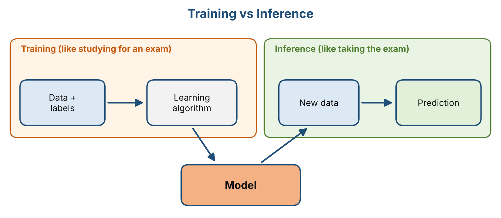
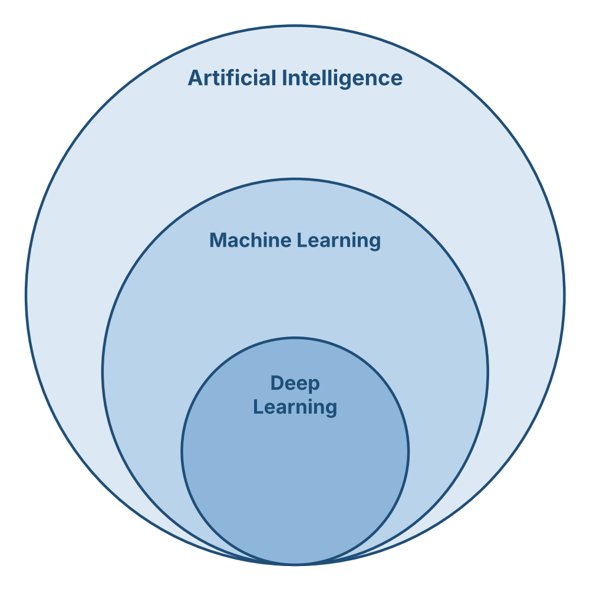
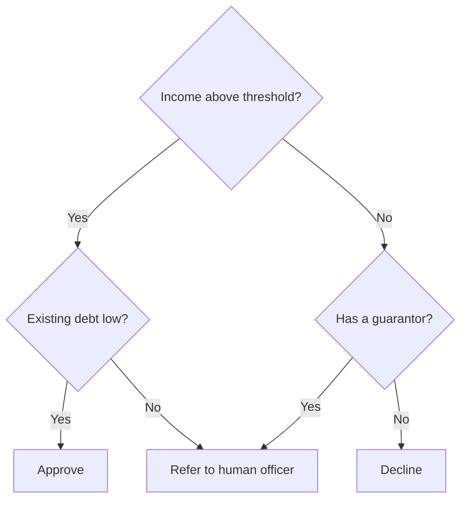
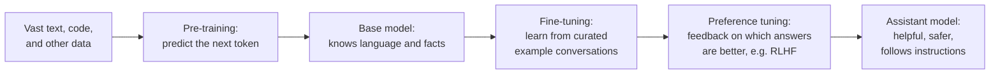
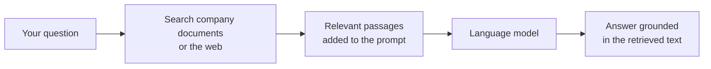
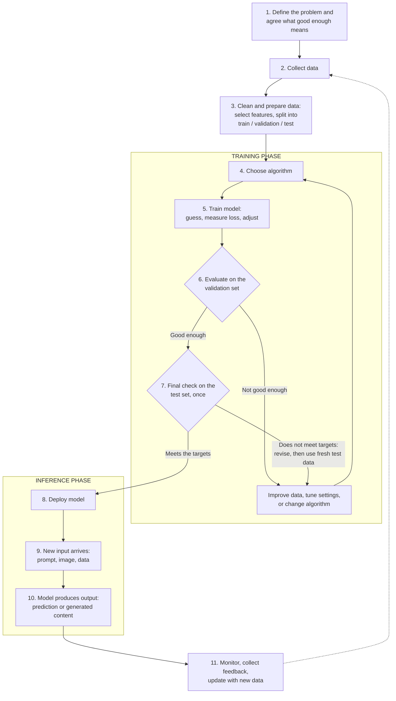
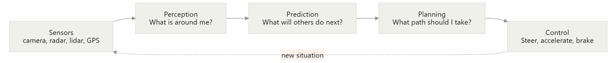

# Stage 1 — AI Overview Study Guide

## About This Document

This document contains the combined learning materials developed by Team Babi Guling for the **AI Overview** module during Stage 1 of the project.

It brings together all five chapters into one document, making it easier to read, review, and export as a PDF for submission.

The study guide covers the introduction to artificial intelligence, different types of AI, how AI works, real-world applications, and AI ethics and limitations.

All materials were prepared by the team members and reviewed as part of the project's quality assurance process. The review records are kept in the project repository.

## Chapters Included

1. [Chapter 1: Introduction to Artificial Intelligence](#chapter-1-introduction-to-artificial-intelligence)
2. [Chapter 2: Types of Artificial Intelligence](#chapter-2-types-of-artificial-intelligence)
3. [Chapter 3: How Artificial Intelligence Works](#chapter-3-how-artificial-intelligence-works)
4. [Chapter 4: Applications of AI](#chapter-4-applications-of-ai)
5. [Chapter 5: AI Ethics and Limitations](#chapter-5-ai-ethics-and-limitations)

---


# Chapter 1: Introduction to Artificial Intelligence
> **Author:** Jonathan Sugianto | **Reviewer:** Brian Djoni Suzanna  
> **Audience:** Complete beginners. No programming or AI background needed.  
> **Estimated study time:** Approximately 2–3 hours (including practice questions)

---

<a id="chapter-1-table-of-contents"></a>

## Table of Contents

1. [Learning Outcomes](#chapter-1-learning-outcomes)
2. [Chapter Map](#chapter-1-chapter-map)
3. [1.1 What is AI?](#11-what-is-ai)
4. [1.2 A Brief History of AI](#12-a-brief-history-of-ai)
5. [1.3 AI vs Traditional Programming](#13-ai-vs-traditional-programming)
6. [1.4 Basic AI Terminology](#14-basic-ai-terminology)
7. [1.5 Worked Example: A Spam Filter That Learns](#15-worked-example-a-spam-filter-that-learns)
8. [1.6 Practice Questions and Answers](#16-practice-questions-and-answers)
9. [1.7 Summary, Reuse Plan, and References](#17-summary-reuse-plan-and-references)

---

<a id="chapter-1-learning-outcomes"></a>

## Learning Outcomes

After this chapter, you should be able to:

1. Explain in your own words what Artificial Intelligence (AI) is.
2. Describe five key moments in the history of AI.
3. Explain the difference between traditional programming and AI that learns from data.
4. Use nine basic AI terms correctly: data, algorithm, label, machine learning, model, training, inference, neural network, deep learning.
5. Walk through a simple example of a program that learns from examples, and explain why it works and where it fails.

<a id="chapter-1-chapter-map"></a>

## Chapter Map

| Section | Topic |
|:-------:|-------|
| 1.1 | What is AI? |
| 1.2 | A Brief History of AI |
| 1.3 | AI vs Traditional Programming |
| 1.4 | Basic AI Terminology |
| 1.5 | Worked Example: A Spam Filter That Learns |
| 1.6 | Practice Questions and Answers |
| 1.7 | Summary, Reuse Plan, and References |

---

## 1.1 What is AI?

### A simple definition

**Artificial Intelligence (AI)** is the part of computer science that tries to make computers do tasks that normally need human intelligence. Examples are recognizing faces, understanding speech, translating languages, and making decisions.

Three things to keep in mind:

- **AI is a field of study**, just like biology or physics. People also say "an AI" for a specific system built using that field, such as a chatbot.
- **There is no single official definition.** Different textbooks describe AI in slightly different ways. For example, Russell and Norvig (2021) organize the field around building systems that *act rationally*, meaning they choose actions that are likely to reach a goal. In this module, we use the simple definition above.
- **AI is usually built for one specific job.** A system that is very good at chess cannot cook rice or drive a car. We will come back to this in Chapter 2.

### AI around you

You probably used AI several times today without noticing.

| Situation | What the AI is doing |
|-----------|----------------------|
| Unlocking your phone with your face | Checking if the face matches the owner |
| Watching a video app | Predicting which videos you may like next |
| Typing a message | Suggesting the next word |
| Pointing your camera at a foreign sign | Reading the text and translating it |
| Checking your email | Moving suspicious emails to the spam folder |
| Using a chatbot | Writing a reply to your question |

### Three common myths

| Myth | What is actually true |
|------|-----------------------|
| "AI is a robot." | Most AI is just software with no body. A robot is a machine, and AI can act as its "brain," but they are not the same thing. |
| "AI thinks like a human." | Today's AI finds patterns in data. Scientists still debate what "understanding" means for a machine, but AI does not work like a human brain. |
| "AI is always right." | AI makes mistakes, sometimes confident ones. We cover this in Chapter 5. |

---

## 1.2 A Brief History of AI

The history of AI has exciting breakthroughs and also long periods of disappointment. Here are some important moments. The sources for each event are listed in Section 1.7.


*Figure 1.1: Timeline of key moments in AI history. Source: created by our team, based on the references in Section 1.7.*

| Year | Event | Why it matters |
|:----:|-------|----------------|
| 1950 | Alan Turing publishes the paper *Computing Machinery and Intelligence* (Turing, 1950). He suggests the "imitation game" (later called the **Turing Test**): if a person chatting with a machine cannot tell it apart from a human, can we say the machine is intelligent? | He turned the question "Can machines think?" into something that can be tested. |
| 1955–1956 | John McCarthy, Marvin Minsky, Nathaniel Rochester, and Claude Shannon write a proposal in 1955 for a summer workshop at Dartmouth College (McCarthy et al., 1955/2006). The proposal uses the term "artificial intelligence." The workshop takes place in summer 1956. | Many people see this as the start of AI as a research field. |
| 1959 | Arthur Samuel describes a checkers program that improves by playing and learning from experience (Samuel, 1959). | One of the first examples of a computer **learning** instead of only following fixed instructions. |
| 1966 | Joseph Weizenbaum creates **ELIZA**, a program that chats using simple keyword rules (Weizenbaum, 1966). | An early chatbot. Many users felt that ELIZA understood them, even though it did not. |
| 1997 | IBM's **Deep Blue** beats world chess champion Garry Kasparov in a six-game match (3½ to 2½) (Campbell et al., 2002). | A machine beat the best human at a game people linked with intelligence. |
| 2012 | A neural network called **AlexNet** wins the ImageNet image recognition competition by a large margin (Krizhevsky et al., 2012). | Started the modern boom of **deep learning**. |
| 2016 | **AlphaGo** (made by Google DeepMind) beats Lee Sedol, a top Go player, 4 games to 1 (Silver et al., 2016). | Go is much harder for computers than chess. AlphaGo learned from many human games and then improved by playing against itself. |
| 2017 | Google researchers publish the **Transformer**, a new design for neural networks (Vaswani et al., 2017). | It is the base of today's large language models. |
| 2022 | OpenAI releases **ChatGPT** to the public on 30 November (OpenAI, 2022). | Made generative AI available to millions of ordinary users. |

### Two famous moments in pictures


*Figure 1.2: Alan Turing at age 16 (passport photo, around 1927–1928). Source: Wikimedia Commons, "File:Alan Turing Aged 16.jpg" (https://commons.wikimedia.org/wiki/File:Alan_Turing_Aged_16.jpg). License: public domain (Public Domain Mark 1.0), as stated on the Commons file page.*


*Figure 1.3: A computer similar to Deep Blue, displayed at the Computer History Museum. Photo by James (originally on Flickr). Source: Wikimedia Commons, "File:Deep Blue.jpg" (https://commons.wikimedia.org/wiki/File:Deep_Blue.jpg), also used in the Wikipedia article "Deep Blue (chess computer)". License: CC BY 2.0 (https://creativecommons.org/licenses/by/2.0/).*

### Booms and "AI winters"

In the early years, researchers expected fast progress. But computers were slow, and there was little data, so many promises were not kept. Funding and interest dropped, first in the 1970s and again from the late 1980s into the early 1990s. These quiet periods are called **AI winters**.

Progress became fast again when three things came together: **much more data** (from the internet), **much faster computers**, and **better learning methods**.

---

## 1.3 AI vs Traditional Programming

### Traditional programming: a human writes the rules

Think of a **recipe**. It gives exact steps, and if you follow them, you get the same dish every time.

Traditional programming works the same way. The programmer writes exact instructions, called **rules**. The computer takes the **rules** and the **data**, and gives **answers**.

*Example:* A program that changes Celsius to Fahrenheit uses the fixed rule `F = C × 9/5 + 32`. The rule is clear and always correct.

### Machine learning: the computer finds the rules

Now imagine you must write exact rules to decide "Is this mango ripe?" You would need to describe color, smell, softness, and more, and every mango is a little different. It is very hard to write rules for this.

Instead, a person learns from experience: after seeing and touching many mangoes, you can tell if one is ripe, even if you cannot explain every rule. **Machine learning** does something similar. We give the computer many **examples with the correct answers**, and it finds the patterns by itself.

> This is an example of **supervised learning**, where a model learns from labeled data. Other machine learning approaches may learn without labeled answers.


*Figure 1.4: Traditional programming vs machine learning. Source: created by our team.*

### Side-by-side comparison

| | Traditional Programming | Machine Learning |
|---|------------------------|------------------|
| Who creates the rules? | The programmer | The computer, from examples |
| What goes in? | Data + rules | Data + correct answers |
| What comes out? | Answers | Rules (a **model**) that can give answers for new data |
| Works best when | Rules are clear and exact (calculating tax, sorting names) | Rules are hard to write (recognizing faces, understanding speech) |
| Main weakness | Fails on cases the programmer did not think of | Needs a lot of good data, and learns mistakes if the data is bad |

> **Important note:** Not all AI learns from data. Some early AI systems, such as *expert systems*, used rules written by human experts. We focus on learning-based AI because it powers most modern tools, but the two ideas are not the same thing.

In Section 1.5, you will see both approaches solve the same task, so you can compare them directly.

---

## 1.4 Basic AI Terminology

These terms appear again in the rest of the module.

| Term | Simple meaning | Example |
|------|----------------|---------|
| **Data** | Information a computer can process, like numbers, text, images, or sound. | A collection of 1,000 emails |
| **Algorithm** | A step-by-step method for solving a problem. | The steps for sorting names from A to Z |
| **Label** | The correct answer attached to an example. | "Spam" or "Not spam" |
| **Machine Learning (ML)** | A way of building AI where the computer learns patterns from data instead of being given exact rules. | A system that learns to detect spam from examples |
| **Model** | What the computer has learned: patterns used to make predictions on new data. | A spam filter after it has studied many emails |
| **Training** | Showing data to a learning algorithm so it can build a model. | Studying 10,000 labelled emails |
| **Inference** | Using a trained model on new data to get a result. | Checking a brand-new email |
| **Neural network** | A model made of many simple connected units. It is loosely inspired by the brain, and it learns by adjusting how strong each connection is. | A network that recognizes handwritten digits |
| **Deep learning** | Machine learning that uses neural networks with many layers. | Speech recognition and image recognition |

### Training vs inference: an everyday comparison

Think of studying for an exam and taking the exam.

- **Training** is like studying many past questions. It takes a long time, and you do it before the exam.
- **Inference** is like answering questions in the real exam. You use what you learned on questions you have not seen before.


*Figure 1.5: Training vs inference. Source: created by our team.*

### How the fields fit together


*Figure 1.6: How AI, machine learning, and deep learning fit together. Source: created by our team.*

Deep learning is a part of machine learning, and machine learning is a part of AI.

---

## 1.5 Worked Example: A Spam Filter That Learns

Let's build a very small spam filter by hand. Real filters are much more advanced, but this shows the full cycle: **data → training → model → inference**. At the end, we also compare it with a filter made of hand-written rules.

### Step 1: Collect labelled data

We have six short emails with labels.

| # | Email text | Label |
|:-:|-----------|:-----:|
| 1 | win free prize now | Spam |
| 2 | free money offer | Spam |
| 3 | meeting at noon | Not spam |
| 4 | project report due | Not spam |
| 5 | claim your free prize | Spam |
| 6 | lunch at noon tomorrow | Not spam |

### Step 2: Train by counting

For each word, count how many spam emails contain it, and how many not-spam emails contain it. Then calculate the word's **score**:

> **score = (number of spam emails with the word) − (number of not-spam emails with the word)**

| Word | In spam | In not spam | Score |
|------|:-------:|:-----------:|:-----:|
| free | 3 | 0 | **+3** |
| prize | 2 | 0 | **+2** |
| win, now, money, offer, claim, your | 1 each | 0 | **+1** each |
| meeting, project, report, due, lunch, tomorrow | 0 | 1 each | **−1** each |
| at | 0 | 2 | **−2** |
| noon | 0 | 2 | **−2** |

This score table is our **model**. We never wrote a rule like "the word *free* means spam." The scores came from the examples.

> **Note:** These scores are simple counts taken from the six training emails. They are **not probabilities** and they do not measure how confident the filter is. They are only used together with this model's decision rule (Step 3).

### Step 3: Make a decision rule

> Add up the scores of all the words in an email. If the total is **greater than 0**, predict **Spam**. Otherwise, predict **Not spam**. A word that is not in the table scores 0.

### Step 4: Inference on a new email

New email: **"free offer tomorrow"**

| Word | Score |
|------|:-----:|
| free | +3 |
| offer | +1 |
| tomorrow | −1 |
| **Total** | **+3** |

The total is above 0, so the prediction is **Spam**.

### Step 5: See where it struggles

New email: **"free lunch at noon"** (a friend inviting you to eat)

| Word | Score |
|------|:-----:|
| free | +3 |
| lunch | −1 |
| at | −2 |
| noon | −2 |
| **Total** | **−2** |

The prediction is **Not spam**, which is correct here. But look at how it happened: the harmless words "at" and "noon" pulled the score down. Now try **"free prize at noon"**: +3 +2 −2 −2 = **+1**, so the filter says **Spam**. Is it really spam? The filter cannot know, because it only counts words.

### Step 6: Compare with a rule-based filter

Now let's solve the same task the traditional way. A programmer looks at the emails and writes a rule by hand:

> **Rule:** If the email contains the word "free" or "prize", predict **Spam**. Otherwise, predict **Not spam**.

On our six training emails, this rule is correct every time: emails 1, 2, and 5 contain "free", and emails 3, 4, and 6 contain neither word. Now test both filters on two new emails:

| New email | What it really is | Rule-based filter | Learning-based filter (score table) |
|-----------|-------------------|-------------------|-------------------------------------|
| win money now | Spam | Not spam ✗ (no "free" or "prize") | Spam ✓ (total +3) |
| free lunch at noon | Not spam (a friend's invitation) | Spam ✗ (contains "free") | Not spam ✓ (total −2) |

What we can learn from this comparison:

- The rule-based filter only knows what the programmer thought of. To fix its mistakes, the programmer must edit the rule by hand.
- The learning-based filter found useful words such as "money" and "noon" from the examples. To improve it, we add more labelled examples and count again.
- Neither filter is perfect. The learning-based filter predicts "Spam" for "free prize at noon" (Step 5) because its total score is +1, but the prediction may still be unreliable because the model uses only simple word counts from six training emails. The rule-based filter would also call that email spam.

### What this example teaches

- **A model depends on its training data.** The words "at" and "noon" look "safe" only because our six emails happened to include them in not-spam messages.
- **More and varied data makes a better model.** Six emails is far too few. Real filters learn from millions.
- **Models make mistakes.** Even good filters sometimes block real emails or let spam through.
- **Training and inference are separate.** We counted once (training), then used the same table for any number of new emails (inference).
- **Hand-written rules and learned rules have different weaknesses.** Rules only cover what the programmer imagined, while learned models only cover what the data showed.

> **Note:** This word-scoring method is a simplified teaching version. Real spam filters use more advanced statistical or neural network methods, and they look at much more than single words.

---

## 1.6 Practice Questions and Answers

<a id="chapter-1-part-a-check-your-understanding"></a>

### Part A: Check your understanding

**Q1.** Which statement describes AI best?

- A. A robot that looks like a human
- B. Computer systems that do tasks that normally need human intelligence
- C. Any program that connects to the internet
- D. A computer that thinks exactly like a human brain

**Q2.** In traditional programming, who writes the rules? In machine learning, where do the rules come from?

**Q3.** Put these steps in the correct order:

- A. Use the model to check a new email
- B. Train the model
- C. Collect emails with labels

Which step is **inference**?

**Q4.** What is the difference between **data** and a **model**?

**Q5.** True or False: "All AI systems learn from data." Explain your answer.

**Q6.** Give one reason why it is hard to recognize a cat in a photo using hand-written rules.

### Part B: Apply the idea

Use the model from Section 1.5 (the score table and the rule "total > 0 means spam").

**Q7.** Classify the email **"win money now"**. Show the total.

**Q8.** Classify the email **"project meeting tomorrow"**. Show the total.

**Q9.** Classify the email **"claim free money at noon"**. Show the total, then explain in one sentence why this result is uncertain.

**Q10.** Classify the email **"hello friend"**. What does the result tell you about the model's limits?

**Q11 (Think).** Our filter was trained on only six emails. Name **two** ways to improve it.

<a id="chapter-1-answers-and-explanations"></a>

### Answers and Explanations

**A1. B.** AI is about systems that do tasks needing human-like intelligence. A is wrong because most AI has no body. C is wrong because AI and the internet are different things. D is wrong because AI does not work like a human brain.

**A2.** In traditional programming, the **programmer** writes the rules. In machine learning, the **computer finds the rules** by studying examples with correct answers.

**A3.** The order is **C → B → A**. Step **A** is **inference**, because it uses the trained model on a new email. Step B is training.

**A4.** **Data** is the information the computer receives (for example, emails). A **model** is what the computer learns from that data: patterns used to make predictions.

**A5. False.** Many modern AI systems learn from data, but not all. Some early systems, such as expert systems, used rules written by people.

**A6.** Any one of these: cats come in many colors, sizes, and poses; photos have different lighting and angles; a cat may be partly hidden. It is almost impossible to write exact rules for every case.

**A7.** win (+1) + money (+1) + now (+1) = **+3**, so **Spam**.

**A8.** project (−1) + meeting (−1) + tomorrow (−1) = **−3**, so **Not spam**.

**A9.** claim (+1) + free (+3) + money (+1) + at (−2) + noon (−2) = **+1**, so **Spam**. The total is barely above 0, and harmless words ("at", "noon") pulled the score down, so a small change in the training data could flip the result. The score is not a probability or a direct measure of confidence. Since the model uses only a small training dataset and simple word counts, its predictions may not always be reliable.

**A10.** Both words are not in the table, so each scores 0. The total is **0**, which is not greater than 0, so the prediction is **Not spam**. The model has no knowledge about words it never saw during training, so it may be wrong on new kinds of emails.

**A11.** Any two of these: add many more training emails; include more varied examples (different senders and topics); ignore very common words such as "at"; check the mistakes it makes and add them as new training examples; use a smarter scoring method.

---

## 1.7 Summary, Reuse Plan, and References

<a id="chapter-1-key-takeaways"></a>

### Key takeaways

- AI is the field of making computers do tasks that normally need human intelligence.
- AI has a history of breakthroughs and "winters." The recent boom came from more data, faster computers, and better methods.
- Traditional programming uses rules written by humans. Machine learning lets the computer find rules from examples.
- **Training** builds a model from data. **Inference** uses the model on new data.
- A model depends on its data, and it can make mistakes.

### How this chapter will be reused

| Resource | Planned use |
|----------|-------------|
| **Study Guide** | Sections 1.1–1.4 become the reading text. The terminology table becomes a glossary. Questions Q1–Q11 go into the Test Bank with the explained answers. |
| **PPT Slides** | The timeline (1.2), the two flow diagrams (1.3), and the nested diagram (1.4) become full-slide visuals. The spam filter (1.5) becomes a step-by-step slide sequence that builds the score table, followed by the rule-based comparison. |
| **Video Tutorial** | A short video that follows Section 1.5: show the six emails, build the score table on screen, test new emails while narrating each step, then compare with the rule-based filter. |

<a id="chapter-1-references"></a>

### References

1. Turing, A. M. (1950). Computing machinery and intelligence. *Mind*, 59(236), 433–460. https://doi.org/10.1093/mind/LIX.236.433
2. McCarthy, J., Minsky, M. L., Rochester, N., & Shannon, C. E. (2006). A proposal for the Dartmouth summer research project on artificial intelligence, August 31, 1955. *AI Magazine*, 27(4), 12–14. https://doi.org/10.1609/aimag.v27i4.1904
3. Samuel, A. L. (1959). Some studies in machine learning using the game of checkers. *IBM Journal of Research and Development*, 3(3), 210–229. https://doi.org/10.1147/rd.33.0210
4. Weizenbaum, J. (1966). ELIZA: A computer program for the study of natural language communication between man and machine. *Communications of the ACM*, 9(1), 36–45. https://doi.org/10.1145/365153.365168
5. Campbell, M., Hoane, A. J., & Hsu, F.-h. (2002). Deep Blue. *Artificial Intelligence*, 134(1–2), 57–83. https://doi.org/10.1016/S0004-3702(01)00129-1
6. Krizhevsky, A., Sutskever, I., & Hinton, G. E. (2012). ImageNet classification with deep convolutional neural networks. *Advances in Neural Information Processing Systems*, 25. https://papers.nips.cc/paper/4824-imagenet-classification-with-deep-convolutional-neural-networks
7. Silver, D., et al. (2016). Mastering the game of Go with deep neural networks and tree search. *Nature*, 529, 484–489. https://doi.org/10.1038/nature16961
8. Vaswani, A., et al. (2017). Attention is all you need. *Advances in Neural Information Processing Systems*, 30. https://arxiv.org/abs/1706.03762
9. OpenAI. (2022, November 30). *Introducing ChatGPT*. https://openai.com/index/chatgpt/
10. Russell, S., & Norvig, P. (2021). *Artificial Intelligence: A Modern Approach* (4th ed.). Pearson.

> The spam filter in Section 1.5 is the team's own simplified teaching example, inspired by word-counting spam filters. It does not copy a specific source.

# Chapter 2: Types of Artificial Intelligence

> **Author:** Gandhi Bestin Dhammananda | **Reviewer:** Brian Djoni Suzanna  
> **Audience:** Complete beginners. No programming or AI background needed.  
> **Estimated study time:** Approximately 2–3 hours (including activities)

<a id="chapter-2-learning-outcomes"></a>

## Learning Outcomes

After completing this chapter, readers should be able to:

- Explain why AI can be classified in different ways.
- Describe the three capability-based categories: Artificial Narrow Intelligence (ANI), Artificial General Intelligence (AGI), and Artificial Superintelligence (ASI).
- Explain the four commonly discussed functionality-based categories.
- Distinguish between established AI capabilities and those that remain hypothetical.
- Explain the differences between Machine Learning and Generative AI.
- Compare capability, functionality, Machine Learning, and Generative AI as different perspectives on AI.
- Classify familiar AI applications and explain their classifications.
- Recognize common misunderstandings and limitations of AI classification frameworks.

<a id="chapter-2-chapter-map"></a>

## Chapter Map

| Section | Topic | Estimated time |
| --- | --- | --- |
| 2.1 | Introduction to AI Classification | 3 min |
| 2.2 | AI Based on Capability | 8 min |
| 2.3 | AI Based on Functionality | 10 min |
| 2.4 | Machine Learning and Generative AI | 8 min |
| 2.5 | Comparing the Classification Frameworks | 5 min |
| 2.6 | Classification Activity | 5 min |
| 2.7 | Common Misunderstandings | 3 min |
| 2.8 | Practice Questions and Answers | 10 min |
| 2.9 | Summary and References | 3 min |
| **Total** |  | **55 min** |

## 2.1 Introduction to AI Classification

In Chapter 1, we learned that Artificial Intelligence (AI) allows computers to perform tasks that normally require human intelligence. Examples include recognizing images, answering questions, detecting spam, and recommending videos.

However, AI systems do not all have the same abilities, designs, or purposes. Some are developed for specific tasks, while others can handle a variety of requests. Some use information from earlier observations, while others generate new content such as text or images.

To understand these differences, we use classification systems.

A classification system groups things according to shared characteristics. For example, animals can be classified by their habitats or diets. Similarly, AI systems can be described according to their capabilities, functionality, learning methods, and intended outputs.

This chapter introduces four useful perspectives:

1. **Capability:** How broadly can an AI system perform intellectual tasks?
2. **Functionality:** How does an AI system behave or use information within a commonly taught classification framework?
3. **Machine Learning:** How does a system learn patterns from data?
4. **Generative AI:** What kind of content can a system generate?

These perspectives answer different questions. They are useful for introductory learning, but they do not form one universally standardized scientific taxonomy. Their categories may overlap, and the best description of a system depends on its design and the framework being used (IBM, n.d.; Stanford HAI, n.d.-a).

## 2.2 AI Based on Capability

Capability refers to the range and level of tasks an AI system can perform. A commonly used capability framework distinguishes three categories:

- Artificial Narrow Intelligence (ANI)
- Artificial General Intelligence (AGI)
- Artificial Superintelligence (ASI)

These categories describe different levels of possible intellectual capability. They should not be understood as three equally developed technologies (IBM, n.d.; Stanford HAI, n.d.-b).

### 2.2.1 Artificial Narrow Intelligence (ANI)

Artificial Narrow Intelligence (ANI), also called narrow AI, is AI designed or developed to perform a specific task or a limited range of tasks.

Consider a calculator. It can perform calculations quickly, but it cannot automatically become a doctor, write a novel, or drive a car. Similarly, an AI system may perform its intended task very well without possessing general intelligence.

ANI is sometimes called weak AI. The word _weak_ does not necessarily mean that the system performs poorly. It refers to the limited scope of its abilities compared with the broad capabilities associated with human intelligence.

**Examples of ANI**

- **Facial recognition:** Compares facial information to help identify or verify a person.
- **Spam detection:** Identifies suspicious emails and helps filter unwanted messages.
- **Recommendation systems:** Suggests videos, music, or products based on relevant information.
- **Conversational AI:** Answers questions, summarizes text, and assists with writing.
- **Image generation:** Produces images in response to instructions.

These systems perform different tasks, but their ability to perform those tasks does not automatically establish general human-level intelligence.

**Main characteristics of ANI**

- It performs a particular task or a defined range of tasks.
- It may outperform people on its intended task.
- It can still make mistakes.
- Strong performance in one area does not prove that it can perform every intellectual task.

Modern conversational AI can handle many different requests. However, this breadth alone does not establish that a system meets a particular definition of AGI. Current AI systems are generally discussed as narrow AI under this framework (IBM, n.d.; Stanford HAI, n.d.-a).

### 2.2.2 Artificial General Intelligence (AGI)

Artificial General Intelligence (AGI) refers to a proposed form of AI with broad, flexible intellectual abilities, potentially comparable to human abilities across a wide range of tasks.

Imagine someone who learns to cook and then applies their general problem-solving abilities to learn a language, repair a bicycle, or plan a journey. People can often transfer knowledge between different situations. AGI aims for similarly broad and flexible abilities in an artificial system.

AGI does not need to look like a human or have a human body. The central idea is the breadth and flexibility of its intellectual abilities.

**What might AGI be able to do?**

A system that meets a strong definition of AGI might be able to:

- Learn unfamiliar intellectual tasks with limited task-specific preparation.
- Apply knowledge from one area to another.
- Solve new problems it has not encountered before.
- Adapt flexibly to different situations.

These are proposed characteristics. Researchers and organizations do not all agree on the exact abilities necessary to qualify as AGI.

**Does AGI exist today?**

There is no universally accepted definition or test for AGI. Researchers and technology organizations may disagree about which abilities are necessary for a system to qualify.

Current AI systems can perform many impressive tasks. However, broad performance alone does not settle whether a system meets a particular definition of AGI (Stanford HAI, n.d.-b).

For this chapter, AGI is treated as a proposed level of general intelligence whose achievement has not been universally confirmed.

### 2.2.3 Artificial Superintelligence (ASI)

Artificial Superintelligence (ASI) refers to a hypothetical form of AI that would surpass human intellectual abilities across many or most important domains.

The distinction between AGI and ASI can be understood simply:

- **AGI:** Broad intellectual abilities comparable to humans under a given definition.
- **ASI:** Intellectual abilities that surpass human abilities across many important domains.

A hypothetical ASI might solve difficult scientific problems, develop new mathematical ideas, and plan complex projects beyond the abilities of the best human experts.

These are possible future scenarios, not descriptions of an AI system known to exist today.

**Possible benefits and concerns**

If such a system were developed, it might help researchers investigate difficult scientific questions or find solutions to complex problems. However, it could also raise serious concerns about safety, control, responsibility, and the consequences of its decisions.

Its effects would depend on how it was designed, managed, and used. It would be inaccurate to assume that superintelligence would automatically be helpful or harmful.

**Does ASI exist today?**

ASI remains hypothetical. There is no verified evidence that an AI system currently surpasses human intellectual abilities across all or nearly all relevant domains.

High performance also does not automatically imply consciousness, emotions, or self-awareness. These are separate questions.

### 2.2.4 Comparing ANI, AGI, and ASI

| Feature | ANI | AGI | ASI |
| --- | --- | --- | --- |
| Main idea | Specific or limited tasks | Broad, flexible intellectual abilities | Intellectual abilities beyond humans across many domains |
| Scope | A defined or learned range of tasks | Broad and adaptable | Hypothetically beyond human capabilities in many areas |
| Status | Established in current AI applications | No universally accepted confirmation of achievement | Hypothetical |
| Example | Spam filter or facial recognition system | Hypothetical system with broad, flexible learning | Hypothetical system surpassing human experts across many fields |

**Key takeaway:** ANI is established in practical AI applications today. AGI and ASI describe broader levels of possible capability whose achievement has not been universally established.

## 2.3 AI Based on Functionality

A second commonly taught framework groups AI according to its behavior and use of information. It contains four categories:

1. Reactive Machines
2. Limited-Memory AI
3. Theory-of-Mind AI
4. Self-Aware AI

These categories are useful teaching concepts, not a universally standardized technical taxonomy. Real AI systems may have more complex architectures and behaviors than these introductory descriptions suggest (IBM, n.d.).

### 2.3.1 Reactive Machines

Reactive machines are systems that respond to current inputs without relying on stored memories of past events to guide decisions in the way described by this category.

A classic example is IBM's Deep Blue chess computer, which defeated world chess champion Garry Kasparov in 1997. Deep Blue evaluated chess positions and selected moves using its computational methods. It is commonly used to illustrate reactive AI because it did not learn from a personal memory of previous games during play.

Deep Blue was technically complex. Its use as an example does not mean that every chess-playing system belongs to the same category.

**Main characteristics**

- Responds to currently available inputs.
- Does not use stored personal experiences in the way described by the limited-memory category.
- Can perform a specific task very well.
- Does not automatically gain broader abilities outside its intended task.

**Advantages**

Reactive systems can be useful for tasks with clear goals and defined conditions. Their behavior may be easier to analyze when their operating methods are well understood.

**Limitations**

A purely reactive system, as described here, cannot rely on a stored history of earlier situations in the way a memory-based system can. It may therefore be unsuitable for tasks that depend heavily on remembering previous events.

### 2.3.2 Limited-Memory AI

Limited-Memory AI refers to systems that use information from earlier observations, historical data, or stored contextual information when producing outputs or making decisions.

Imagine a driver approaching a busy road. The driver observes nearby cars and considers what happened moments earlier to decide whether to slow down. An AI driving system may similarly use recent sensor observations to track traffic and help make decisions.

**Examples**

- **Driver-assistance systems:** Some use recent sensor observations to track nearby vehicles.
- **Recommendation systems:** Some use a person's earlier viewing or listening activity to suggest content.
- **Conversational AI:** A system may use earlier messages in the same conversation to make a reply more relevant.

These examples illustrate different uses of past information. Not every recommendation system or chatbot has the same memory design.

**Main characteristics**

- Uses previous observations or stored information in some form.
- Can consider changes over time when its design supports this.
- May make more context-sensitive decisions than a system using only one isolated input.
- Remains limited by the information it can access and the way it was designed.

**An important clarification about memory**

Limited memory does not always mean that a system remembers only for a few seconds. Some systems use information during a short interaction, while others can use historical records over longer periods.

Also, a system that uses stored information does not necessarily learn or improve automatically every time it is used. Updating a model and using existing information to produce a response are different things.

Many modern AI applications use historical or contextual information, although their designs vary considerably (IBM, n.d.).

### 2.3.3 Theory-of-Mind AI

Theory-of-Mind AI is a proposed category of AI that would understand other people's beliefs, intentions, emotions, and perspectives in a deeper and more flexible way.

In everyday life, people try to understand what others know or feel. For example, a teacher may notice that a student is confused even when the student does not say so directly. The teacher can then change the explanation to help the student.

A hypothetical AI with strong theory-of-mind abilities would ideally reason about another person's mental state and use that understanding appropriately.

**What might it do?**

A hypothetical system might:

- Recognize that two people have different beliefs about the same situation.
- Consider what another person knows or does not know.
- Adjust an explanation to account for a person's perspective.
- Reason about possible intentions while recognizing uncertainty.

These examples describe a proposed capability, not proof that current AI systems possess it in the full human sense.

**Does this type of AI exist today?**

AI systems can recognize certain emotional cues, classify facial expressions, or generate responses that sound empathetic. However, these abilities do not establish that a system genuinely understands another person's inner experience.

Full theory-of-mind AI, as described here, remains an unestablished capability.

**Main limitation**

Human emotions and intentions are complex. The same expression can mean different things in different situations. An AI system may misinterpret someone's behavior, words, or cultural background.

Therefore, we should not assume that an AI understands a person's feelings simply because it produces a convincing response.

### 2.3.4 Self-Aware AI

Self-aware AI is a hypothetical form of AI that would possess meaningful awareness of its own existence and internal state.

Consider the difference between a machine that reports its battery level and a being that is aware of itself as an individual. A machine can monitor its battery and report that it is low without this demonstrating consciousness.

**What might self-aware AI involve?**

A hypothetical self-aware system might possess:

- Meaningful awareness of itself as an entity.
- An understanding of its own internal states.
- Some form of subjective experience, if consciousness is included in the definition being used.

There is no single agreed scientific definition of self-aware AI. These proposed features should not be treated as a confirmed technical specification.

**Does self-aware AI exist today?**

There is no widely accepted scientific demonstration that current AI systems possess consciousness or self-awareness in this strong sense.

An AI system may describe itself, monitor its own performance, or say phrases such as "I think" and "I feel." These statements alone do not prove that it has subjective experiences or a conscious sense of self.

**Main limitation**

Consciousness is difficult to define and measure. It is therefore difficult to establish what evidence would be sufficient to prove machine consciousness. Claims about self-aware AI should be made carefully.

### 2.3.5 Comparing the Four Functionality Categories

| Category | Main idea | Illustrative example | Current status |
| --- | --- | --- | --- |
| Reactive Machines | Respond to current information without using stored past experiences in the described way | Deep Blue's chess-playing system | Classic examples exist |
| Limited-Memory AI | Uses past observations or stored information | Driving system tracking nearby vehicles | Common in current AI applications |
| Theory-of-Mind AI | Would reason about beliefs, intentions, and perspectives | Hypothetical assistant that understands what another person knows | Full capability remains unestablished |
| Self-Aware AI | Would possess meaningful self-awareness or consciousness | Hypothetical conscious machine | Hypothetical; no accepted demonstration |

The table describes the categories as used in this introductory framework. It does not mean that every system assigned to a category shares the same design or abilities.

## 2.4 Machine Learning and Generative AI

Machine Learning and Generative AI are important concepts in modern AI. They describe different aspects of systems and should not be treated as additional levels in the capability framework or as extra categories in the four-part functionality framework.

### 2.4.1 What Is Machine Learning?

Machine Learning (ML) is an approach in which computer systems learn patterns from data to make predictions, classifications, recommendations, or other outputs. Instead of relying only on manually specified rules, a machine-learning model uses patterns learned during training (NIST, n.d.-a; Stanford HAI, n.d.-c).

Imagine teaching a system to distinguish between pictures of cats and dogs. Developers provide examples, and a model learns patterns that help it classify new images.

**Common applications of Machine Learning**

- **Spam detection:** Learns patterns associated with unwanted email.
- **Recommendation systems:** Uses relevant activity and other data to suggest content.
- **Fraud detection:** Identifies transactions that appear suspicious.
- **Image recognition:** Classifies or detects objects in pictures.
- **Forecasting:** Uses data to predict possible future values.

Machine Learning does not guarantee accurate results. Models depend on the quality and suitability of their data, training methods, and evaluation.

**How is ML related to AI?**

AI is the broader field. Machine Learning is one approach used to develop AI systems. Not every AI method necessarily uses Machine Learning, and not every machine-learning application generates content.

### 2.4.2 What Is Generative AI?

Generative AI refers to AI systems that create new content, such as text, images, audio, video, or computer code. These systems learn patterns from data and use them to produce new outputs (NIST, n.d.-b; Stanford HAI, n.d.-d).

**Examples include:**

- **Text generation:** Drafts explanations, stories, or summaries.
- **Image generation:** Creates pictures from text instructions.
- **Audio generation:** Produces speech or music.
- **Code generation:** Suggests or creates computer code.
- **Video generation:** Produces video content from prompts or other inputs.

Generative AI can produce useful and convincing content, but its output may contain factual errors, misleading information, or unsuitable material. Generated content should be checked when accuracy matters.

Generating content also does not prove that a system understands it as a human would or possesses consciousness.

### 2.4.3 How Are ML and Generative AI Different?

| Feature | Machine Learning | Generative AI |
| --- | --- | --- |
| What does it describe? | An approach for learning patterns from data | AI systems designed to generate content |
| Common outputs or functions | Predictions, classifications, recommendations, and other results | Text, images, audio, video, code, and other content |
| Example | Predicting whether an email is spam | Generating an image from a text prompt |
| Relationship to AI | A major approach used to develop AI systems | A category of AI systems focused on generating content |
| Can they overlap? | Yes | Yes; many generative AI systems use Machine Learning |

**Key takeaway:** Machine Learning describes how a system learns patterns from data. Generative AI describes systems that create content. Many generative AI systems use Machine Learning, but ML also supports applications that do not generate content.

## 2.5 Comparing the Classification Frameworks

The four perspectives discussed in this chapter answer different questions:

- **Capability:** How broad are the system's intellectual abilities?
- **Functionality:** How does it respond to information, or what proposed cognitive features does it illustrate?
- **Machine Learning:** Does it learn patterns from data using a machine-learning approach?
- **Generative AI:** Does it generate new content?

These perspectives are related, but they are not interchangeable. They also do not form one standardized hierarchy.

For example, a conversational AI system may answer science questions, write stories, and generate summaries. These abilities do not, by themselves, establish that it is AGI, understands emotions as a human does, or is self-aware.

### 2.5.1 A Simplified Relationship Diagram

The following diagram summarizes the four perspectives and their relationships.

```
                     ARTIFICIAL INTELLIGENCE
                               |
             +-----------------+-----------------+
             |                 |                 |
         CAPABILITY        FUNCTIONALITY    OTHER PERSPECTIVES
             |                 |                 |
        ANI, AGI, ASI     Four commonly      +----+----+
                          taught categories  |         |
                                             ML      Generative
                                          (Machine      AI
                                          Learning)
                                             |         |
                                             +----+----+
                                                  |
                                      Often used together
```

**How to read the diagram**

- **Capability** describes the breadth of an AI system's intellectual abilities.
- **Functionality** describes how a system behaves or uses information within the simplified framework introduced in Section 2.3.
- **Machine Learning** describes an approach in which systems learn patterns from data.
- **Generative AI** describes systems designed to generate content, such as text, images, audio, video, or code.
- The connecting relationship between ML and Generative AI indicates that many generative AI systems use Machine Learning. It does not mean that the two terms are interchangeable or that Generative AI is a separate level of the ML hierarchy.

This diagram is a simplified teaching aid, not a formal or universally standardized taxonomy. The four perspectives answer different questions, and one AI system may be described using more than one of them. Many Generative AI systems use ML, but the terms describe different aspects of AI (IBM, n.d.; NIST, n.d.-a, n.d.-b; Stanford HAI, n.d.-c, n.d.-d).

### 2.5.2 Applying the Four Perspectives

Consider a conversational AI system that can answer questions, summarize reports, and generate stories.

- **Capability:** It may be described as ANI under the framework used in this chapter. Its broad performance alone does not establish AGI.
- **Functionality:** Its classification depends on how it uses inputs, context, and stored information. A chatbot should not automatically be assigned a category solely because it produces conversational responses.
- **Machine Learning:** It may use models trained on data to produce its outputs.
- **Generative AI:** It qualifies as generative AI when it generates content such as text or stories.

This example shows why one system can be described from several perspectives without those descriptions contradicting one another.

### 2.5.3 Comparing the Perspectives

| Question | Perspective | What it helps us understand |
| --- | --- | --- |
| How broadly can the system perform intellectual tasks? | Capability | The intended breadth of its abilities |
| How does it respond to information or use memory? | Functionality | Its behavior under the introductory functionality framework |
| How does it learn patterns from data? | Machine Learning | Its learning approach |
| What kinds of content can it create? | Generative AI | Its content-generation abilities |

These perspectives help describe AI systems, but no single perspective explains every aspect of a system.

## 2.6 Classification Activity

**Instructions:** Read each example. Identify the most suitable category or perspective and explain your choice in one or two sentences. Some examples can fit more than one perspective.

| No. | Familiar application | Your task |
| --- | --- | --- |
| 1 | An email service identifies suspicious messages and moves them into a spam folder. | Identify its capability category and explain whether it may use ML. |
| 2 | A music application recommends songs based on listening history. | Explain how ML and stored information may be involved. |
| 3 | A chatbot writes a birthday greeting and summarizes a report. | Identify whether it is Generative AI and explain why this does not automatically establish AGI. |
| 4 | A driving-assistance system uses recent observations of nearby cars to help determine when to slow down. | Identify the functionality category illustrated by its use of recent observations. |
| 5 | A tool creates an image from the instruction "Draw a house beside a lake." | Identify the type of output and explain how it relates to Generative AI. |
| 6 | A hypothetical AI reasons reliably about what different people believe and know. | Identify the proposed functionality category and state whether the full capability is established. |

### Suggested Answers and Explanations

**1\. ANI; possibly ML.** The system performs a specific task. It may use a machine-learning model trained to recognize patterns in spam, although not every spam filter must use ML.

**2\. ANI; potentially ML and stored information.** A recommendation system may learn patterns from listening activity and use historical data to suggest songs. Its exact design determines how it works.

**3\. Generative AI; generally ANI under this chapter's framework.** The chatbot generates text, but the ability to perform several language tasks does not automatically establish AGI.

**4\. Limited-Memory AI.** The example illustrates the use of recent observations to support decisions. Actual driving systems vary in design.

**5\. Generative AI.** The tool generates an image from a prompt. This describes its output, not its general level of intelligence.

**6\. Theory-of-Mind AI.** The example describes a proposed ability to reason about other people's mental states. Full theory-of-mind capability, in the sense used here, remains unestablished.

The purpose of this activity is not to force every application into a single label. It is to practise explaining which aspect of an AI system a category describes.

## 2.7 Common Misunderstandings About AI Types

### Misunderstanding 1: Every AI system has the same abilities.

**Reality:** AI systems are designed for different purposes. A spam filter and a conversational assistant have different tasks and capabilities.

### Misunderstanding 2: A powerful chatbot must be AGI.

**Reality:** A chatbot may handle many types of requests, but broad performance alone does not establish AGI. The definition and assessment criteria matter (Stanford HAI, n.d.-b).

### Misunderstanding 3: An AI that talks about emotions must feel them.

**Reality:** Generating emotional language does not prove that a system has emotional experiences or consciousness.

### Misunderstanding 4: All four functionality categories are established technologies.

**Reality:** Reactive and limited-memory systems have practical examples. Full theory-of-mind and self-aware AI, as described in this chapter, remain unestablished.

### Misunderstanding 5: Machine Learning and Generative AI mean the same thing.

**Reality:** Machine Learning is an approach to learning patterns from data. Generative AI describes systems that generate content. Many generative AI systems use ML, but the terms are not interchangeable (NIST, n.d.-a, n.d.-b).

### Misunderstanding 6: Every AI system belongs to exactly one category.

**Reality:** A system may be described from multiple perspectives. For example, a generative AI application may use Machine Learning and still be considered ANI under the capability framework.

## 2.8 Practice Questions and Answers

<a id="chapter-2-part-a-check-your-understanding"></a>

### Part A: Check Your Understanding

**Q1. What is the main difference between ANI and AGI?**

A. ANI is always a robot, while AGI is always software.

B. ANI is designed for specific or limited tasks, while AGI refers to broader, general intellectual abilities.

C. ANI is conscious, while AGI is not.

D. ANI can only perform calculations.

**Q2. Which capability category describes a hypothetical AI that surpasses human intellectual abilities across many important domains?**

A. ANI

B. AGI

C. ASI

D. Reactive Machines

**Q3. Why should we be careful when someone claims that an AI system has achieved AGI?**

**Q4. What is the main difference between reactive machines and limited-memory AI?**

**Q5. Does an AI system that says "I feel sad" prove that it has emotions? Explain your answer.**

### Part B: Apply the Ideas

**Q6.** A company creates an AI system that detects damaged products on a factory conveyor belt. Which capability category best describes this system, and why?

**Q7.** A driving system uses recent observations of nearby vehicles to help decide when to slow down. Which functionality category does this illustrate?

**Q8.** Imagine a future AI that could reliably consider what different people believe, what information they have, and why they may act differently. Which functionality category would this resemble? Is the full capability established in current AI?

**Q9.** A conversational assistant can write stories, answer questions, and summarize reports. Does this automatically make it AGI? Explain why or why not.

**Q10.** Explain in your own words why capability classification and functionality classification are different.

**Q11.** Explain the difference between Machine Learning and Generative AI. Give one example of each.

**Q12.** An AI system uses Machine Learning to generate pictures from text instructions. Which of the four perspectives introduced in this chapter describe it, and what does each perspective tell us?

<a id="chapter-2-answers-and-explanations"></a>

### Answers and Explanations

**A1. B.** ANI is designed for specific or limited tasks, while AGI refers to broad intellectual abilities across different tasks and domains.

**A2. C.** ASI describes a hypothetical AI that would surpass human intellectual abilities across many or most relevant domains.

**A3.** There is no universally accepted definition or test for AGI. A system may perform well on many tasks without satisfying every proposed definition of general intelligence.

**A4.** A reactive machine responds to current information without relying on stored past experiences in the way described by this category. Limited-memory AI can use earlier observations or stored information to guide outputs or decisions.

**A5.** No. Producing words about emotions does not prove that a system experiences them. Language output and consciousness are different questions.

**A6. ANI.** The system is designed for a specific task: detecting damaged products. Performing that task well does not establish general intelligence.

**A7. Limited-Memory AI.** The example uses recent observations over time to help make a decision.

**A8. Theory-of-Mind AI.** The example describes the proposed ability to reason about people's beliefs and perspectives. The full capability described here has not been established in current AI.

**A9.** No. Handling several kinds of requests does not automatically establish AGI. The system must be assessed against a clear definition of general intelligence, and no universally accepted test exists.

**A10.** Capability classification describes how broadly an AI system can perform intellectual tasks. Functionality classification describes behavior, information use, or proposed features such as understanding other minds and self-awareness.

**A11.** Machine Learning is an approach in which systems learn patterns from data; a spam detector is one example. Generative AI produces content; an image generator is one example. Many generative AI systems use Machine Learning.

**A12.** All four perspectives can be relevant. Capability classification may describe the system as ANI if its abilities remain within the narrow-AI framework. Functionality classification depends on how it uses information and memory. Machine Learning describes how it learns patterns from data. Generative AI describes its ability to produce images.

## 2.9 Summary and References

<a id="chapter-2-key-takeaways"></a>

### Key Takeaways

- AI can be classified in different ways because systems have different abilities, designs, and purposes.
- The capability framework distinguishes ANI, AGI, and ASI.
- ANI is established in current practical applications. AGI has no universally accepted confirmation of achievement, and ASI remains hypothetical.
- The commonly taught functionality framework distinguishes reactive machines, limited-memory AI, theory-of-mind AI, and self-aware AI.
- Reactive and limited-memory systems have practical examples. Full theory-of-mind and self-aware AI remain unestablished in the senses described here.
- Machine Learning is an approach to learning patterns from data.
- Generative AI describes systems that generate content such as text, images, audio, video, and code.
- Many generative AI systems use Machine Learning, but the terms describe different aspects of AI.
- One system can be described through multiple perspectives. No single framework explains every aspect of an AI system.
- Fluent language, broad task performance, or statements about feelings do not by themselves establish AGI, emotions, or consciousness.

<a id="chapter-2-references"></a>

### References

IBM. (n.d.). _Understanding the different types of artificial intelligence_. IBM Think. https://www.ibm.com/think/topics/artificial-intelligence-types

National Institute of Standards and Technology. (n.d.-a). _Machine learning_. CSRC Glossary. https://csrc.nist.gov/glossary/term/machine\_learning

National Institute of Standards and Technology. (n.d.-b). _Generative artificial intelligence_. CSRC Glossary. https://csrc.nist.gov/glossary/term/generative\_artificial\_intelligence

Stanford Institute for Human-Centered Artificial Intelligence. (n.d.-a). _What is artificial intelligence (AI)?_ https://hai.stanford.edu/ai-definitions/what-is-artificial-intelligence-ai

Stanford Institute for Human-Centered Artificial Intelligence. (n.d.-b). _What is AGI (artificial general intelligence)?_ https://hai.stanford.edu/ai-definitions/what-is-agi-artificial-general-intelligence

Stanford Institute for Human-Centered Artificial Intelligence. (n.d.-c). _What is Machine Learning (ML)?_ https://hai.stanford.edu/ai-definitions/what-is-machine-learning

Stanford Institute for Human-Centered Artificial Intelligence. (n.d.-d). _What is Generative AI?_ https://hai.stanford.edu/ai-definitions/what-is-generative-ai

# Chapter 3: How Artificial Intelligence Works

> **Author:** Benedict Subhata | **Reviewer:** Brian Djoni Suzanna  
> **Audience:** Learners who have completed Chapter 1 and Chapter 2  
> **Estimated study time:** 90–120 minutes  
> **Module:** AI Overview | **Level:** Beginner → Intermediate

**Contents**

- [3.1 Learning Objectives](#31-learning-objectives)
- [3.2 The Big Picture](#32-the-big-picture)
- [3.3 Data: The Fuel of AI](#33-data-the-fuel-of-ai)
- [3.4 Algorithms and Models](#34-algorithms-and-models)
- [3.5 Machine Learning: Learning from Examples](#35-machine-learning-learning-from-examples)
- [3.6 Neural Networks and Deep Learning](#36-neural-networks-and-deep-learning)
- [3.7 How Modern Language AI Works](#37-how-modern-language-ai-works)
- [3.8 Training vs. Inference](#38-training-vs-inference)
- [3.9 Evaluating a Model](#39-evaluating-a-model)
- [3.10 The AI Workflow](#310-the-ai-workflow)
- [3.11 From Beginner to Expert](#311-from-beginner-to-expert)
- [3.12 Common Misconceptions](#312-common-misconceptions)
- [3.13 Key Takeaways](#313-key-takeaways)
- [3.14 Glossary](#314-glossary)
- [3.15 Self-Check Reflection](#315-self-check-reflection)
- [3.16 Practice Questions](#316-practice-questions)
- [3.17 Hands-On Activities (No Coding Required)](#317-hands-on-activities-no-coding-required)
- [3.18 Further Reading and References](#318-further-reading-and-references)

---

## 3.1 Learning Objectives

By the end of this chapter, you will be able to:

1. Explain the role of **data** in an AI system and why its quality matters.
2. Distinguish between an **algorithm** and a **model**.
3. Describe how **machine learning** learns patterns instead of following hand-written rules.
4. Explain, in plain language, how **neural networks** and **large language models** work.
5. Distinguish **training** from **inference**, and tell apart improvements that *use* an existing model (inference-time) from those that *change or create* one (training-based).
6. Read the basic **evaluation metrics** used to judge a model, and explain why deciding whether a result is "good enough" depends on the application.
7. Trace the **end-to-end workflow** of an AI system.
8. Use this understanding to **use AI tools more effectively and critically**.

**Prerequisites:** Chapter 1 (What is AI) and Chapter 2 (Types of AI). Chapter 2 classified AI by *capability* and by *functionality*. This chapter looks *inside* the machine to see how it works.

---

## 3.2 The Big Picture

Traditional software follows rules that a programmer writes by hand. Machine-learning-based AI works the other way round.


*Figure 3.1: In machine learning, you supply data and answers, and the computer discovers the rules.*

| | Traditional Programming | Machine-Learning-Based AI |
|---|---|---|
| **You provide** | Rules + Input | Data + Desired Outputs (examples) |
| **The computer produces** | Output | The rules (a *model*) |
| **Example** | "If the email contains the word 'lottery', mark as spam." | Show the system 100,000 labelled emails; it discovers what spam looks like. |
| **Handles new situations** | Only those the programmer anticipated | Can generalise to similar cases it has never seen |
| **Breaks when** | Rules are incomplete | Data is poor, biased, or outdated |

**Core idea:** Most modern AI does not get *told* how to solve a problem. It **learns patterns from data**, then applies those patterns to new situations.

Three ingredients make this possible:

```
 DATA  +  ALGORITHM  +  COMPUTING POWER  →  TRAINED MODEL
```

> **Why did AI take off in the 2010s and 2020s?** Not because of one invention, but because all three ingredients matured together: huge digital datasets (the internet, smartphones, sensors), better algorithms (deep learning, transformers), and cheap, powerful hardware (GPUs and specialised AI chips).

---

## 3.3 Data: The Fuel of AI

### What is data?

Data is any recorded information an AI system can learn from: text, images, audio, video, numbers in a spreadsheet, clicks on a website, or sensor readings.

### Types of data

| Type | Description | Examples |
|---|---|---|
| **Structured** | Organised in rows and columns | Sales tables, bank records |
| **Unstructured** | No fixed format | Emails, photos, videos, social media posts |
| **Labelled** | Each example has the correct answer attached | A photo tagged "cat" |
| **Unlabelled** | No answers attached | A pile of raw photos |

Modern large language models (LLMs) are trained mostly on huge amounts of **unstructured text**, using a trick (Section 3.7) that creates the "labels" automatically from the text itself.

### Where does training data come from?

- **Collected by the organisation:** customer records, transactions, sensor logs.
- **Public or open datasets:** government statistics, scientific datasets, benchmark collections.
- **Web-scale text and images:** large-scale collections of public content (this raises ongoing questions about copyright and consent).
- **Licensed data:** purchased or partnered content.
- **Human-labelled data:** people tag images, rate answers, or write example responses.
- **Synthetic data:** data generated by software or by another AI model, useful when real data is rare, private, or expensive, but risky if it simply repeats the original model's mistakes.

### Key terms

- **Feature:** an individual measurable input (e.g., house size, number of bedrooms).
- **Label / Target:** the answer we want the model to predict (e.g., house price).
- **Example (or sample):** one row of data: its features plus its label.

### Preparing data: the unglamorous part

Practitioners often report that preparing data takes more time than building the model. Google's Machine Learning Crash Course puts it at around 80% of the time on a typical project. [[1]](#ref-1) Typical steps:

| Step | What it means | Example |
|---|---|---|
| **Cleaning** | Fix or remove errors, duplicates, and missing values | Delete duplicate customer rows; fill in a missing age |
| **Labelling** | Attach the correct answers | Humans mark which emails are spam |
| **Feature engineering** | Create more useful inputs from raw data | Turn a date into "day of week" and "is holiday" |
| **Normalising / scaling** | Put numbers on comparable scales | Convert salary (in thousands) and age (in tens) to a common range |
| **Encoding** | Convert non-numbers into numbers | Turn the word "red" into a numeric code |
| **Splitting** | Divide data into training, validation, and test sets | See below |

### Splitting the data


*Figure 3.2: A dataset is divided so the model is graded on data it has never seen.*

| Split | Typical share | Purpose | Analogy |
|---|---|---|---|
| **Training set** | ~70–80% | The model learns from this | The textbook |
| **Validation set** | ~10–15% | Tune settings and compare versions during development. Used again and again | A practice quiz |
| **Test set** | ~10–15% | One final check of real-world performance, after all development decisions are made | The final exam |

Use the **validation set** for every decision made along the way (which algorithm, which settings, which features). Keep the **test set** untouched until the very end. If you keep adjusting the model to improve its test score, the test set quietly becomes a second validation set, and the final score will look better than real-world performance will be. If you do have to change the model after seeing the test result, collect a fresh, untouched test set for the next final check. Section 3.9 explains why. [[1]](#ref-1)

### Why data quality matters

> **"Garbage in, garbage out."** A model can only be as good as the data it learns from.

| Data problem | What goes wrong | Example |
|---|---|---|
| **Bias** | Under-represented groups get worse results | A face-recognition system trained mostly on one skin tone performs worse on others |
| **Noise and errors** | Wrong labels teach wrong patterns | Images labelled "dog" that are actually wolves |
| **Unrepresentative data** | The model fails outside the conditions it saw | A model trained on daytime photos fails at night |
| **Data leakage** | Answers slip into the inputs, so scores look better than reality | A model predicting hospital readmission accidentally sees the discharge outcome |
| **Outdated data** | The world changed since training | A pricing model trained before a market shift |
| **Too little data** | Not enough examples to learn a reliable pattern | Rare diseases with only a few hundred recorded cases |

**Data-centric thinking:** Experienced practitioners often get bigger improvements by *improving the data* (fixing labels, adding missing cases) than by switching to a fancier algorithm.

**Practical takeaway:** When an AI tool gives a poor answer, ask: *"What data was this likely trained on, and what might be missing from it?"*

---

## 3.4 Algorithms and Models

These two terms are often confused.

- **Algorithm:** a step-by-step procedure for learning or solving a problem (the *recipe*).
- **Model:** the result of running a learning algorithm on data (the *finished dish*). It is a set of learned numbers, called **parameters** or **weights**, that captures patterns.

> **Algorithm + Data → Model**

### Two basic kinds of prediction task

| Task | Question it answers | Output | Example |
|---|---|---|---|
| **Classification** | "Which category?" | A label | Spam or not spam; cat, dog, or bird |
| **Regression** | "How much?" | A number | House price; tomorrow's temperature |

Classification and regression are both **supervised learning** tasks: the model learns from examples that come with correct answers. Other approaches include **unsupervised learning** (finding structure in unlabelled data, as in clustering) and **reinforcement learning** (learning by trial and error from rewards).

### Common algorithm families

| Family | Idea in one line | Typical use | Strength | Limitation |
|---|---|---|---|---|
| **Linear / Logistic Regression** | Fit a straight line (or S-curve) to the data | Prices, yes/no outcomes | Simple, fast, easy to explain | Misses complex patterns |
| **Decision Trees** | A flowchart of yes/no questions | Loan approval, triage | Very easy to read | Can overfit |
| **Random Forests / Gradient Boosting** | Combine many trees into one stronger model | Fraud detection, tabular business data | Often best for spreadsheet-style data | Harder to explain |
| **Clustering (e.g., k-means)** | Group similar items without labels | Customer segments | Finds hidden structure | Results need human interpretation |
| **Neural Networks** | Layers of simple units that learn complex patterns | Images, speech, language | Powerful on unstructured data | Needs lots of data and computing power |
| **Transformers** *(a neural network design)* | Use "attention" to relate parts of the input | ChatGPT-style assistants, translation, many image and audio systems | Handles context very well | Very expensive to train |

### Example: a decision tree

A bank might use a simple tree to pre-screen loan applications:



*Figure 3.3: A decision tree. In real ML, the algorithm learns which questions to ask and which thresholds to use from the data.*

### Choosing an algorithm

There is **no single best algorithm**. A useful rule of thumb:

| Your situation | Good starting point |
|---|---|
| Small, structured (spreadsheet-like) data; need an explainable result | Linear/logistic regression or decision trees |
| Medium to large structured data; accuracy matters most | Gradient boosting or random forests |
| Images, audio, video, or free text | Neural networks |
| Generating or understanding natural language | Transformer-based models |

---

## 3.5 Machine Learning: Learning from Examples

**Machine learning (ML)** is the branch of AI where systems improve at a task through experience (data) rather than explicit programming.

### A worked example (simple enough to follow by hand)

**Goal:** predict a student's exam score from hours studied.

| Hours studied (feature) | Exam score (label) |
|---|---|
| 1 | 55 |
| 2 | 65 |
| 3 | 75 |

**Model:** `score = w × hours + b`, where `w` (weight) and `b` (bias) are the parameters to learn. (This `b` is a *bias parameter*, a number added to the output. It is unrelated to *bias in data* from Section 3.3, which means an unfair skew.)

1. **Start with a guess.** Set `w = 0`, `b = 0`. The model predicts 0 for everyone.
2. **Measure the error.** Compare predictions with the true scores. The number that summarises the total error is the **loss**. A common choice is *mean squared error*: the average of the squared gaps.
3. **Adjust the parameters** slightly in the direction that reduces the loss. This method is called **gradient descent**.
4. **Repeat** thousands of times. The model settles near `w ≈ 10`, `b ≈ 45`, so `score = 10 × hours + 45`.
5. **Use it on new data.** A student who studies 4 hours → predicted score **85**.

> This tiny loop (*guess → measure error → adjust → repeat*) is the logic behind even the largest AI systems. The difference is scale: today's large models have **billions of parameters** instead of two. [[1]](#ref-1) [[2]](#ref-2)

### Gradient descent in more detail


*Figure 3.4: Each numbered dot is one update step, moving toward the lowest loss.*

> *Analogy:* You are on a foggy hillside and want to reach the valley. You cannot see the bottom, but you can feel which direction slopes downward, so you take a step that way, again and again.

The figure follows a single weight `w` with loss `(w − 5)²`, a **learning rate** of 0.18, and a starting value of 0.8:

| Step | Weight w | Loss |
|---|---|---|
| 0 | 0.80 | 17.64 |
| 1 | 2.31 | 7.23 |
| 2 | 3.28 | 2.96 |
| 3 | 3.90 | 1.21 |
| 4 | 4.30 | 0.50 |
| 5 | 4.55 | 0.20 |

Notice that the steps get smaller as the slope flattens near the bottom. With this learning rate, each step removes 36% of the remaining distance to the best weight (new gap = 0.64 × old gap). The best weight is 5, where the loss reaches zero.

### Parameters vs. hyperparameters

| | Parameters (weights) | Hyperparameters |
|---|---|---|
| **Set by** | The learning process | The human (or an automated search) |
| **Examples** | The `w` and `b` above; billions of weights in an LLM | Learning rate, number of layers, number of training rounds |
| **Analogy** | What the student learns | How the student is taught (study hours, textbook choice) |

**Learning rate matters:** too large and training overshoots the minimum and becomes unstable; too small and training is painfully slow. One full pass through the training data is called an **epoch**. Models usually train for many epochs, processing data in small groups called **batches**.

### Overfitting and underfitting


*Figure 3.5: A good model captures the trend without memorising the noise.*

| Problem | Meaning | Analogy | Common fixes |
|---|---|---|---|
| **Underfitting** | Model too simple to capture the pattern | A student who barely studied | Use a more powerful model; add better features |
| **Overfitting** | Model memorises training data and fails on new data | A student who memorised past exam answers but cannot solve new questions | More diverse data; simpler model; *regularisation* (a penalty that discourages overly complex models); stop training earlier |

The **validation set** is how you catch overfitting while you are still developing: if training performance is excellent but validation performance is poor, the model has memorised rather than learned. The **test set** then gives a final, one-time confirmation (Section 3.9).

---

## 3.6 Neural Networks and Deep Learning

A **neural network** is a model made of layers of small mathematical units called "neurons". It is *loosely* inspired by the brain, but it is a mathematical tool, not a copy of one.


*Figure 3.6: Data flows left to right; every line is a weight that training adjusts.*

### What a single neuron does

Each neuron performs three simple actions:

1. **Multiplies** each input by a weight.
2. **Adds** the results together with a bias.
3. **Applies an activation function**, which decides how strongly the neuron "fires".

**Tiny numeric example:** inputs `x₁ = 2`, `x₂ = 1`; weights `0.5` and `−1`; bias `0.5`.

```
sum = (2 × 0.5) + (1 × −1) + 0.5 = 0.5
```

With the common **ReLU** activation (output the number if positive, otherwise 0), the neuron outputs **0.5**. Had the sum been −0.3, it would output 0.

Why bother with an activation function? Without it, stacking layers would still only produce straight-line relationships. Activation functions let networks learn **curved, complex patterns**.

### Layers build up understanding

In a typical image classifier (a convolutional network), the layers tend to specialise like this:

| Layer depth | What it tends to detect |
|---|---|
| Early layers | Edges, colours, simple textures |
| Middle layers | Shapes and parts (eyes, wheels, fur) |
| Late layers | Whole objects (a cat, a car) |

**Deep learning** simply means neural networks with *many* hidden layers.

### How a neural network learns

Training repeats four steps over many batches of data:

1. **Forward pass:** data flows through the network to produce a prediction.
2. **Loss:** compare the prediction with the correct answer.
3. **Backpropagation:** work backwards through the network to calculate how much each weight contributed to the error.
4. **Update:** gradient descent nudges every weight slightly to reduce the loss.

Backpropagation was popularised as a way to train multi-layer networks by Rumelhart, Hinton, and Williams in 1986. [[3]](#ref-3) For an animated walk-through of all four steps, see the 3Blue1Brown series. [[4]](#ref-4)

### Common neural network designs

| Design | Best known for |
|---|---|
| **Convolutional neural networks (CNNs)** | Image recognition, medical imaging |
| **Recurrent networks (RNNs, LSTMs)** | Older approach for sequences such as speech and text |
| **Transformers** | Language models, translation, and increasingly images, audio, and video |
| **Diffusion models** | Image and video generation (they learn to turn random noise into a clear picture step by step) |

---

## 3.7 How Modern Language AI Works

Tools such as ChatGPT, Claude, and Gemini are built on **large language models (LLMs)**. The core mechanism is easier than it sounds.


*Figure 3.7: An LLM writes by repeatedly predicting the next token.*

### Step 1: Tokens and embeddings

- Text is split into **tokens**: words or word-pieces. A rough rule for English is that 1 token ≈ ¾ of a word.
- Each token is converted into a list of numbers called an **embedding** (a *vector*). During training, the model learns these numbers so that tokens used in similar ways tend to receive similar vectors. This is how the model can work with *relationships between meanings* mathematically. [[1]](#ref-1)

> **Careful:** An embedding is not a dictionary definition. It is a learned set of numbers that is useful for the task the model was trained on. Vectors that are close together often reflect related meanings or similar usage, but not always, and the individual numbers usually have no meaning a human can read off. A token's first embedding is the same wherever it appears, but the transformer's attention layers (Step 3) then adjust each token's representation using its context. That is how "bank" in "river bank" and "bank" in "bank loan" can end up with different representations.

### Step 2: Next-token prediction (the training trick)

During training, the model reads enormous amounts of text and repeatedly tries to predict *the next token*. The correct answer is already in the text, so **no human labelling is required**. This is called **self-supervised learning**, and it is why LLMs could be trained at such a vast scale.

To predict well, the model is forced to learn grammar, facts, reasoning patterns, coding conventions, and writing styles.

### Step 3: The transformer and attention


*Figure 3.8: Attention lets the model decide which earlier words matter for interpreting the current one.*

In the sentence "The animal didn't cross the street because it was tired", what does "it" refer to? Humans know instantly. The transformer's **attention mechanism** lets the model weigh how strongly each word relates to every other word, so it can resolve references and capture context across long passages. Transformers also process many tokens in parallel, which makes training on massive hardware practical. The transformer architecture, introduced by Vaswani et al. in 2017, uses attention as a core mechanism for relating different parts of an input. Combined with feed-forward layers and other components, this design underpins most modern language models. [[5]](#ref-5)

### Step 4: Generating a response

To answer a question, the model:

1. Reads your prompt as tokens.
2. Produces a probability for every possible next token.
3. **Picks one** (the choice is shaped by settings such as *temperature*).
4. Adds it to the text and repeats until the response is complete.

| Setting | Effect |
|---|---|
| **Low temperature** | Picks the most likely tokens: focused, consistent, repeatable |
| **High temperature** | Samples more widely: varied, creative, less predictable |

Temperature changes *how the model chooses* among its options. It does not make the model more knowledgeable or more accurate.

### How an LLM is built: the training pipeline



*Figure 3.9: The usual stages of building an AI assistant.*

| Stage | What happens | Result |
|---|---|---|
| **Pre-training** | Learns language and general knowledge by predicting the next token | A powerful but unfocused "base model" |
| **Fine-tuning** | Trained on high-quality examples of instructions and good answers | Follows instructions and holds a conversation |
| **Preference tuning (e.g., RLHF)** | Human (or AI) feedback on which answers are better steers the model | More helpful, honest, and safe behaviour |

Reinforcement learning from human feedback was shown to make a much smaller model preferred over a far larger base model in human evaluations of instruction-following. [[6]](#ref-6)

### Important properties of LLMs

- **Context window:** the maximum amount of text (prompt plus conversation plus reply) the model can consider at once. Anything outside it is effectively invisible. Context windows have grown very large, but they are still finite.
- **Knowledge cutoff:** the model knows nothing after the end of its training data unless connected to a tool such as web search.
- **Multimodal models:** many current models accept and produce more than text, including images, audio, and sometimes video.
- **Reasoning models:** some newer models are trained to spend extra effort "thinking" through a problem step by step before answering, which often improves results on maths, coding, and logic tasks at the cost of speed and expense.
- **AI agents:** systems that wrap a model with tools (search, code execution, software controls) and let it carry out multi-step tasks, checking results along the way.

> **Important insight:** An LLM generates text that is *statistically plausible*, not text it has *verified as true*. This is why AI can sound confident and still be wrong (a "hallucination", covered in Chapter 5). Fluency is not accuracy.

---

## 3.8 Training vs. Inference

These are the two phases of an AI model's life.


*Figure 3.10: Training changes the model. Inference only uses it.*

| | **Training** | **Inference** |
|---|---|---|
| **What happens** | The model *learns* by adjusting its parameters | The trained model is *used* to produce outputs |
| **Parameters** | Updated repeatedly | **Fixed** (frozen) |
| **Data used** | Large datasets | A single new input (your prompt, photo, etc.) |
| **Cost and time** | Very high (days to months, specialised hardware such as GPUs/TPUs) | Low per use (milliseconds to seconds), but large at scale |
| **Who does it** | AI developers and companies | Everyone who uses the AI |
| **Analogy** | A student studying for years | The graduate answering a question |

### Key points to remember

- When you chat with an AI, **it is not learning from you in real time.** Its core parameters are frozen. It only uses what is inside the current conversation (its **context window**).
- Whether a company later uses conversations to improve future models is a separate policy decision. Check the privacy settings of any tool you use.
- Some inference settings are in your control, such as **temperature**, and the *quality of your prompt*.

### Two ways to improve results

There is a simple test for any improvement technique: **did the model's weights change?**

- **No:** it is an *inference-time* improvement. You use the existing model better. Most people only ever do this.
- **Yes:** it is a *training-based* improvement. You change or create a model.

#### A. Inference-time improvements (no retraining)

From simplest to most involved:

| Technique | What it is | Best for |
|---|---|---|
| **Prompting** | Giving clear instructions, context, examples, and a desired format [[7]](#ref-7) | Almost every task; always try this first |
| **Retrieval-Augmented Generation (RAG)** | The system searches documents or the web, then hands the relevant passages to the model [[8]](#ref-8) | Up-to-date or private information; reducing made-up answers |
| **Tools and agents** | The model calls calculators, code, search, or other software | Accurate maths, data analysis, multi-step tasks |



*Figure 3.11: Retrieval-Augmented Generation (RAG), an inference-time technique. The model is given facts to work from instead of relying only on memory.*

#### B. Training-based improvements (the model changes)

| Technique | What it is | Best for |
|---|---|---|
| **Fine-tuning** | Further training of an existing model on your own examples (changes the weights) | A consistent style or specialised behaviour at scale |
| **Training from scratch** | Building a new model from raw data | Mostly large companies and research labs |

**At a glance:** inference-time methods *use* the model you already have, so the weights stay frozen. Training-based methods *change or create* a model, so the weights change.

**Rule of thumb:** work down the first table before touching the second. Fine-tuning and training cost far more time, data, and money, and a fine-tuned model must be updated again whenever the knowledge it was taught goes out of date.

---

## 3.9 Evaluating a Model

How do we know whether a model is any good? We measure it on data it was **not trained on**. Two held-out sets do two different jobs. [[1]](#ref-1)

| Data | Used for | How often |
|---|---|---|
| **Training set** | Learning: the weights change | Throughout training |
| **Validation set** | Comparing versions and tuning settings, including the decision threshold described below | Repeatedly, during development |
| **Test set** | One final, honest estimate of real-world performance | **Once**, after all development decisions are made |

**Why the separation matters.** Every time you use the same data to decide what to change, that data "wears out": the model and your choices start to fit its quirks, and scores on it become too optimistic. The validation set is expected to wear out, because you use it many times. The test set must stay fresh. If you change the model after seeing the test results, those results no longer give an unbiased estimate, so you need a new, untouched test set (more fresh data) for the next final check. [[1]](#ref-1)

The confusion matrix and metrics below are the results of that **final test**. Section 3.10 shows where it fits in the workflow.

### The confusion matrix

Take a spam filter whose final test used **1,000 emails**, of which 100 are really spam. The filter flags 90 emails as spam.

| | **Predicted: spam** | **Predicted: not spam** |
|---|---|---|
| **Actually spam (100)** | 80 (true positives) | 20 (false negatives: spam that got through) |
| **Actually not spam (900)** | 10 (false positives: good emails wrongly flagged) | 890 (true negatives) |

### Key metrics

| Metric | Question it answers | Calculation | Result |
|---|---|---|---|
| **Accuracy** | What share of all predictions were right? | (80 + 890) / 1000 | 97.0% |
| **Precision** | Of the emails flagged as spam, how many really were? | 80 / (80 + 10) | 88.9% |
| **Recall** | Of all real spam, how much did we catch? | 80 / (80 + 20) | 80.0% |
| **F1 score** | A single balance of precision and recall | 2 × (0.889 × 0.80) / (0.889 + 0.80) | 0.84 |

F1 is the *harmonic mean* of precision and recall, so it is high only when both are reasonably high. (Computed directly from the matrix: 2 × 80 / (2 × 80 + 10 + 20) = 160 / 190 ≈ 0.84.)

### Why accuracy alone can mislead

If only 10% of emails are spam, a "model" that labels *everything* as not spam scores **90% accuracy** while catching **zero** spam. Always ask which kind of mistake is more costly:

| Situation | More costly mistake | Metric to favour |
|---|---|---|
| Cancer screening | Missing a real case (false negative) | Recall |
| Spam filter | Blocking an important email (false positive) | Precision |
| Fraud detection | Depends on the cost of fraud vs. annoying customers | A balance (F1) |

### Is the result "good enough"? Metrics inform the decision

A number such as "80% recall" does not say, by itself, whether a model is ready. That depends on the application, not just the maths. Before the final test, a team should agree what *good enough* means by asking:

| Question | Spam-filter example |
|---|---|
| What does each kind of mistake cost? | A missed spam message is an annoyance. A blocked genuine email (a job offer, an invoice) may be costly. |
| What does the application require? | An email service may require that genuine mail is almost never blocked, even if more spam gets through. |
| How does it compare with the alternative? | Is it better than the current filter, or than a simple baseline? |
| What safety nets exist? | A spam folder users can check, a "not spam" button, and monitoring after launch. |

#### The decision threshold

Many classifiers first produce a score between 0 and 1 (for the spam filter, the estimated chance that an email is spam). A **classification threshold** turns that score into a yes/no decision: scores above the threshold are labelled "spam". Moving the threshold trades one kind of mistake for another. [[1]](#ref-1)

| Threshold | Effect |
|---|---|
| **Higher** (stricter, such as 0.9) | Fewer genuine emails are blocked, so precision usually rises, but more spam gets through, so recall falls |
| **Lower** (more permissive, such as 0.3) | More spam is caught, so recall rises, but more genuine emails are blocked, so precision usually falls |

A threshold of 0.5 sounds natural, but it is not automatically the best choice when one kind of mistake costs more than the other. In the example above, the filter blocked 10 genuine emails out of 900. Whether that is acceptable is a judgment call: a team might raise the threshold to protect genuine mail and accept lower recall. The threshold is a setting, so it is chosen on the **validation set**, never on the test set.

**Metrics inform the deployment decision; people make it.** The team weighs the metrics against the cost of each error, the application's requirements, and the available safety nets.

### Evaluating language models

Language-model quality is harder to score with one number. Common approaches include **benchmark tests** (standard question sets), **human evaluation** (people rate answers), and **task-specific tests** built for your own use case. Benchmark scores can be inflated if test questions leaked into training data, so for important work, **test the model on your own examples**. For a yearly overview of how model performance is measured and reported, see the Stanford AI Index. [[9]](#ref-9)

---

## 3.10 The AI Workflow

The diagram below shows the life cycle of a typical AI system.



*Figure 3.12: The AI life cycle. Steps 4 to 6 form a loop that uses the validation set; step 7 uses the test set once; step 11 feeds back to step 2.*

### Case study: an email spam filter, end to end

| Step | What happens in this example |
|---|---|
| 1. Define the problem | Automatically separate spam from genuine email (a classification task). The team agrees what "good enough" means, for example how much genuine mail may be blocked and how much spam may slip through |
| 2. Collect data | 200,000 past emails, each marked spam or not spam by users |
| 3. Prepare data | Remove duplicates; convert text to numbers; split 70/15/15 |
| 4. Choose algorithm | Start with logistic regression as a baseline, then try a neural network |
| 5. Train | The model learns which words and patterns signal spam |
| 6. Evaluate on validation data | The team checks results on the validation set, chooses the decision threshold there, and improves labels and retrains until the validation results look good enough |
| 7. Final test | The untouched test set is used once and shows 80% recall and 89% precision (the results in Section 3.9). The team compares them with the targets agreed at step 1 and the cost of each kind of error, then decides whether to deploy |
| 8. Deploy | The model is placed inside the email service |
| 9–10. Inference | Each incoming email is scored in milliseconds and filed to inbox or spam |
| 11. Monitor | Spammers change tactics (**drift**), so performance drops; new examples are collected and the model is retrained |

### Reading the diagram

- Steps 1–3 are **preparation**, often the largest share of a project's time. Step 1 includes agreeing what "good enough" will mean, *before* any results are seen.
- Steps 4–6 form a **loop** that uses the **validation set**. Models are rarely right on the first attempt.
- Step 7 is the **final exam**. The test set is used once, after development decisions are finished. If the model is revised after this result, the next final check needs fresh test data.
- Steps 9–10 are what *you* experience as a user.
- Step 11 closes the loop. Real-world conditions change (**data drift** and **concept drift**), so AI systems must be **continuously monitored and maintained**, not built once and forgotten.

---

## 3.11 From Beginner to Expert

Understanding *how* AI works directly improves *how well you use it*.

| What you now know | How it makes you a better user |
|---|---|
| AI learns from data | You understand its blind spots and biases and question outputs on topics where data may be thin. |
| LLMs predict plausible text | You **verify** facts, numbers, and citations instead of trusting fluent answers. |
| Parameters are frozen at inference | You know AI will not "remember" you across chats unless a memory feature exists, so you supply the context. |
| The context window is limited | You give clear, relevant background and avoid overloading long conversations. |
| Knowledge cutoff exists | You use search-enabled tools for recent information. |
| Temperature and prompts shape output | You adjust instructions to get consistent or creative results. |
| RAG and tools exist | You attach documents or enable tools instead of expecting the model to "just know". |
| Models need evaluation | You test AI outputs against known answers before relying on them for important work. |

### A reliable prompt structure

A well-formed prompt gives the model what it cannot guess. [[7]](#ref-7)

| Element | Question it answers | Example |
|---|---|---|
| **Role** | Who should the AI act as? | "You are an experienced statistics tutor." |
| **Context** | What is the situation? | "I'm a first-year student who knows basic algebra." |
| **Task** | What exactly should it do? | "Explain gradient descent." |
| **Format** | What should the answer look like? | "Use an everyday analogy, then a 5-step summary." |
| **Constraints** | Any limits or must-haves? | "Under 200 words; avoid jargon." |

**Weak prompt:** "Explain gradient descent."

**Stronger prompt:** "You are a patient statistics tutor. I'm a first-year student who knows basic algebra. Explain gradient descent using an everyday analogy, then summarise it in 5 steps. Keep it under 200 words and avoid jargon."

Further techniques worth practising: giving **examples** of the output you want, asking the model to **work step by step**, asking it to **state its assumptions**, and asking it to **critique and improve its own draft**.

### A verification checklist for AI output

1. **Facts and figures:** can I confirm them from a reliable source?
2. **Citations:** do the references actually exist and say what is claimed?
3. **Recency:** could this have changed since the model's training?
4. **Reasoning:** does each step follow, and does the maths check out?
5. **Bias and gaps:** whose perspective might be missing?
6. **Stakes:** if this is wrong, what is the cost? (Medical, legal, and financial decisions need qualified human review.)
7. **Privacy:** did I share anything confidential that I should not have?

### Skill ladder

| Level | Characteristics |
|---|---|
| **Beginner** | Asks simple questions; accepts answers as given |
| **Intermediate** | Writes structured prompts; gives context; checks and refines outputs; understands limitations |
| **Advanced** | Chooses the right tool or model for the task; uses documents, search, and tools to ground answers; builds repeatable workflows |
| **Expert** | Evaluates quality systematically on their own test cases; understands trade-offs of cost, accuracy, privacy, and risk; can explain *why* a model behaves as it does |

---

## 3.12 Common Misconceptions

| Misconception | Reality |
|---|---|
| "AI thinks like a human." | AI finds statistical patterns in data. It has no human-style understanding, intent, or consciousness. |
| "AI looks up the answer in a database." | A trained LLM generates responses from learned patterns, unless it is explicitly connected to a search or retrieval tool. |
| "AI learns from every chat I have." | Parameters are fixed at inference. Learning happens during training, and separate policies control whether chats are ever used later. |
| "More data always means a better model." | Quality, relevance, and diversity matter as much as quantity. |
| "If AI sounds confident, it is correct." | Fluency is not accuracy. Always verify important claims. |
| "A bigger model is always better." | Smaller, specialised models can beat larger ones on specific tasks, and they cost less to run. |
| "AI is objective because it is maths." | Models inherit the biases and gaps in their data and in the choices people make when building them. |
| "Accuracy is the only number that matters." | Precision, recall, and the real-world cost of errors often matter more. |

---

## 3.13 Key Takeaways

1. **Data** is the raw material. Its quality sets the ceiling on performance.
2. An **algorithm** is the learning procedure. A **model** is what it produces.
3. **Machine learning** works by *guess → measure error → adjust → repeat*.
4. **Neural networks** learn layered patterns; **transformers** with attention power today's language AI.
5. **LLMs** are trained to predict the next token. They produce plausible text, not verified truth.
6. **Training** builds the model (expensive, done by developers). **Inference** uses it (fast, done by everyone).
7. You can improve results **without retraining** through **prompting, RAG, and tools**. Fine-tuning and training from scratch are the *training-based* options that change the model itself.
8. **Evaluate** with the right metric on data the model has never seen: tune on the validation set, test once at the end, and judge "good enough" against the cost of each kind of error.
9. Real AI systems follow a **loop**: prepare data, train, evaluate, deploy, monitor, improve.
10. Knowing these mechanics helps you **use AI more effectively and critically**.

### One-page cheat sheet

| Concept | One-line memory aid |
|---|---|
| Data | The examples the model learns from |
| Feature / Label | The inputs / the answer |
| Algorithm | The recipe |
| Model | The finished dish (learned weights) |
| Loss | How wrong the model is |
| Gradient descent | Walking downhill to reduce the loss |
| Overfitting | Memorised the exam instead of learning the subject |
| Validation set | The practice quiz: used again and again to tune |
| Test set | The final exam: used once, at the end |
| Threshold | The cut-off that turns a score into a yes or no |
| Training | Learning (weights change) |
| Inference | Using (weights frozen) |
| Token | A chunk of text |
| Attention | Deciding which words matter |
| Temperature | Randomness dial |
| Context window | The model's short-term working memory |
| RAG | Give the model the facts to read first |
| Fine-tuning | Extra training that changes the weights |
| Precision / Recall | How trustworthy the flags are / how much was caught |
| Hallucination | Fluent text that is not true |

---

## 3.14 Glossary

| Term | Definition |
|---|---|
| **Accuracy** | The share of all predictions that were correct |
| **Activation function** | A function in each neuron that decides its output strength and lets networks learn curved patterns |
| **Agent** | A system that lets a model use tools and take multiple steps to complete a task |
| **Algorithm** | A step-by-step procedure used to learn from data or solve a problem |
| **Attention** | A mechanism that lets a model weigh how strongly different parts of the input relate to each other |
| **Backpropagation** | The method of working out each weight's contribution to the error so it can be adjusted |
| **Batch** | A small group of examples processed together during training |
| **Bias (in data)** | Systematic gaps or skews that lead a model to treat some cases or groups unfairly |
| **Classification** | Predicting a category |
| **Classification threshold** | The score cut-off that turns a model's probability into a yes/no decision |
| **CNN (convolutional neural network)** | A neural network design well suited to images |
| **Concept drift** | A change in the relationship between inputs and the correct answer over time (for example, spammers adopt new tricks) |
| **Confusion matrix** | A table of true positives, false positives, true negatives, and false negatives used to evaluate a classifier |
| **Context window** | The amount of text a model can consider at one time |
| **Data drift** | A change in real-world data over time that makes a model less accurate |
| **Deep learning** | Machine learning using neural networks with many layers |
| **Diffusion model** | A generative model that learns to turn random noise into a clear image step by step |
| **Embedding** | A list of numbers (a vector) that represents a token, word, or other item. Training makes the vectors useful for the task, but they are not dictionary definitions |
| **Epoch** | One full pass through the training data |
| **F1 score** | A single score combining precision and recall (their harmonic mean) |
| **Feature** | An input variable used for prediction |
| **Fine-tuning** | Further training of an existing model on specialised examples |
| **Gradient descent** | A method that repeatedly adjusts parameters to reduce the loss |
| **Hallucination** | Fluent output that sounds confident but is false or unsupported |
| **Hyperparameter** | A setting chosen by humans before training, such as the learning rate |
| **Inference** | The phase where a trained model produces outputs for new inputs |
| **Label** | The correct answer the model tries to predict |
| **Learning rate** | How large each training update step is |
| **LLM** | Large language model: a transformer trained on massive amounts of text |
| **Loss** | A number measuring how wrong the model's predictions are |
| **Model** | The learned result of training: a set of parameters that makes predictions |
| **Multimodal model** | A model that can accept or produce more than one kind of data, such as text, images, and audio |
| **Neural network** | A model of connected layers of simple units |
| **Overfitting** | Memorising training data so that performance on new data suffers |
| **Parameter / Weight** | A number inside the model that is adjusted during training |
| **Pre-training** | The first, large-scale training stage in which a language model learns by predicting the next token |
| **Precision** | Of the items flagged positive, the share that truly were |
| **Preference tuning** | Training stage that steers a model toward answers people judge to be better (for example, RLHF) |
| **RAG** | Retrieval-Augmented Generation: giving a model retrieved documents to improve answers |
| **Reasoning model** | A model trained to work through a problem step by step before answering |
| **Recall** | Of all true positives, the share that were found |
| **Regression** | Predicting a number |
| **Regularisation** | Techniques that discourage overly complex models in order to reduce overfitting |
| **Reinforcement learning** | Learning by trial and error, guided by rewards |
| **RLHF** | Reinforcement learning from human feedback: tuning a model using people's judgments of its answers |
| **Self-supervised learning** | Learning in which the labels come from the data itself, such as the next word in a text |
| **Supervised learning** | Learning from examples that come with correct answers |
| **Temperature** | A setting controlling the randomness of generated output |
| **Test set** | Data held back and used once, after all development decisions are made, to estimate real-world performance |
| **Token** | A small chunk of text processed by a language model |
| **Training** | The phase where a model learns from data |
| **Training set** | The data a model learns from |
| **Transformer** | A neural network design that uses attention, together with feed-forward layers and other components; the basis of most modern LLMs |
| **Underfitting** | A model too simple to capture the pattern in the data |
| **Unsupervised learning** | Finding structure in data that has no labels |
| **Validation set** | Data used repeatedly during development to tune settings and compare versions |

---

## 3.15 Self-Check Reflection

Before moving on, write a short answer to each in your own words:

1. In one paragraph, explain to a friend why an AI chatbot can sound certain and still be wrong.
2. Name one situation where *improving the data* would help more than choosing a different algorithm.
3. Describe one habit from Section 3.11 that you will start using this week.

---

## 3.16 Practice Questions

Try answering each question before opening the answer.

**Q1. Which best describes the difference between an algorithm and a model?**

- A) They mean the same thing
- B) An algorithm is the learning procedure; a model is the result of applying it to data
- C) A model is the procedure; an algorithm is the data
- D) An algorithm only exists in traditional programming

<details>
<summary>Answer</summary>

**B.** The algorithm is the "recipe" for learning. Running it on data produces the model (the "finished dish").

A is wrong because the two are different things. C reverses the definitions. D is wrong because algorithms exist throughout computing, including machine learning.

</details>

**Q2. A model scores 99% on its training data but only 60% on new, unseen data. What is the most likely problem, and name two ways to address it.**

<details>
<summary>Answer</summary>

**Overfitting.** The model memorised the training data instead of learning general patterns.

Fixes include using more diverse data, simplifying the model, applying regularisation, or stopping training earlier.

</details>

**Q3. True or False: When you chat with an AI assistant, its core model is being retrained by your conversation in real time.**

<details>
<summary>Answer</summary>

**False.** During inference the parameters are frozen. The model uses your conversation only as temporary context.

Any later retraining is a separate process controlled by the developer.

</details>

**Q4. Why is the test set kept separate from the training set?**

<details>
<summary>Answer</summary>

To measure performance on data the model has **never seen**, which estimates real-world performance and reveals overfitting.

If test data leaked into training, the results would be misleadingly high (data leakage).

Note that the *validation* set is separate again: it guides development decisions, while the test set is kept for one final check.

</details>

**Q5. In your own words, explain how an LLM generates a sentence.**

<details>
<summary>Answer</summary>

The LLM splits the input into tokens, converts them to embeddings, uses its transformer layers (attention) to weigh how the tokens relate, produces probabilities for the next token, picks one, appends it, and repeats token by token until the response is complete.

</details>

**Q6. Only 10% of emails are spam. A model labels every email "not spam". What is its accuracy, and why is it useless?**

<details>
<summary>Answer</summary>

Accuracy is **90%**, but its recall for spam is **0%**: it never catches any spam.

This shows why accuracy alone can mislead when classes are imbalanced. Precision and recall give a more honest picture.

</details>

**Q7. Name three things you can do at inference time to improve an AI's answer *without* retraining the model.**

<details>
<summary>Answer</summary>

Any three of:

- write a clearer, more specific prompt;
- provide relevant background context or examples;
- use RAG or web search to supply current information;
- adjust settings such as temperature;
- connect the model to tools (calculator, code execution);
- ask for step-by-step work and then verify the output.

Fine-tuning would **not** count, because it changes the model's weights.

</details>

**Q8. A cancer-screening model has 95% accuracy but low recall. Why might this be dangerous, and which metric should the team prioritise?**

<details>
<summary>Answer</summary>

Low recall means many real cases are missed (false negatives).

Missing a cancer diagnosis is very costly, so the team should prioritise **recall**, even if it produces more false alarms that doctors then check.

</details>

**Q9. A neuron has inputs 3 and −2, weights 1 and 0.5, and bias 1. With a ReLU activation, what does it output?**

<details>
<summary>Answer</summary>

Sum = (3 × 1) + (−2 × 0.5) + 1 = 3 − 1 + 1 = **3**.

ReLU keeps positive values, so the output is **3**.

</details>

**Q10. Your company chatbot must answer questions using the latest internal policy documents, which change monthly. Would you fine-tune the model or use RAG? Explain.**

<details>
<summary>Answer</summary>

**RAG** is the better choice.

The documents change often, and RAG retrieves the current version at question time, whereas fine-tuning would need to be repeated for every update and bakes information into the weights. RAG also makes it easier to point to the source of an answer.

</details>

**Q11. During gradient descent, the loss keeps jumping up and down wildly and never settles. What hyperparameter is the most likely culprit, and how would you adjust it?**

<details>
<summary>Answer</summary>

The **learning rate** is probably too large, so each step overshoots the minimum.

Reduce it.

</details>

**Q12 (Challenge). Trace the workflow of building a model that detects defective products on a factory line. List the main steps in order (use the numbering of Figure 3.12), and name one risk at the monitoring stage.**

<details>
<summary>Answer</summary>

| Step (Figure 3.12) | What happens in this example |
|---|---|
| 1. Define the problem | Classify each product as "defective" or "normal", and agree targets (for example, catch almost all defects) |
| 2. Collect data | Thousands of product images, including rare defect types |
| 3. Clean and prepare data | Label and clean the images; split into training, validation, and test sets |
| 4. Choose algorithm | For example, a convolutional neural network |
| 5. Train model | Guess → measure loss → adjust, repeated over many batches |
| 6. Evaluate on validation data | Check held-out validation images, focusing on recall for defects; improve and retrain until good enough |
| 7. Final test | Check once on the untouched test images against the agreed targets |
| 8. Deploy model | Install on the production line |
| 9–10. Inference | A new image arrives and the model labels it in real time |
| 11. Monitor and update | Track errors, collect new examples, retrain periodically |

**Risk at monitoring:** *data drift*, such as a new lighting setup, new camera, or a changed product design that the model has never seen, causing accuracy to drop silently.

</details>

**Q13. A team keeps adjusting its model and checks the test-set score after every change, stopping when the score looks good. Why is the final test score no longer trustworthy, and what should they do instead?**

<details>
<summary>Answer</summary>

Each time the test score guides a decision, information from the test set leaks into development. The model and the team's choices start to fit that particular data, so the score becomes too optimistic about real-world performance.

Instead, use the **validation set** for all tuning and comparison, and use the **test set once**, at the end. If the model is revised after seeing the test result, collect a fresh, untouched test set for the next final check.

</details>

**Q14. A spam filter outputs a score from 0 to 1. The team raises the classification threshold from 0.5 to 0.9. What usually happens to precision and recall, and why might they make this change?**

<details>
<summary>Answer</summary>

Fewer emails are flagged as spam. Fewer genuine emails are wrongly blocked, so **precision usually rises**, but more real spam slips through, so **recall falls**.

A team might do this when blocking a genuine email is more costly than letting some spam into the inbox. Metrics do not decide this automatically: the choice depends on the cost of each error and the application's requirements.

</details>

---

## 3.17 Hands-On Activities (No Coding Required)

### Activity A: See the limits of inference

1. Open any AI chat assistant.
2. Ask a factual question about a very recent event, then ask the same question with web search enabled (if available). Compare the answers.
3. Ask the same creative request (e.g., "write a slogan for a recycling campaign") three times. Observe how the answers vary.
4. Write a 3–4 sentence reflection linking each observation to a concept from this chapter (knowledge cutoff, randomness, prompting and context).

### Activity B: Weak prompt vs. strong prompt

1. Pick a topic you are studying.
2. Ask for an explanation using a vague one-line prompt. Save the answer.
3. Rewrite the prompt using the Role, Context, Task, Format, Constraints structure (Section 3.11). Save the answer.
4. Compare the two. Which details improved the result, and why?

### Activity C: Fact-check an AI answer

1. Ask an AI assistant for three statistics and their sources on a topic you know about.
2. Use the verification checklist in Section 3.11 to check each one.
3. Record how many were fully correct, partly correct, or unverifiable. What does this tell you about how much to trust AI output?

### Activity D (Optional): Teach a tiny model

**Tool:** Google's Teachable Machine, a free, browser-based tool that trains a small image classifier from examples, with no coding and no account needed. [[10]](#ref-10) Open <https://teachablemachine.withgoogle.com/>.

**Part 1: Train a classifier (about 10 minutes)**

1. Click **Get Started**, choose **Image Project**, then **Standard image model**.
2. Rename the two classes to two clearly different objects, for example "pen" and "mug".
3. Add at least 30 example images to each class. Use **Webcam** (hold the record button) or **Upload** pictures from your device.
4. Click **Train Model** and wait for it to finish.
5. In the **Preview** panel, show each object to the camera (or upload a new picture) and watch the confidence bars.

**Part 2: Break it on purpose (about 10 minutes)**

1. **Unbalanced data:** retrain with 5 examples of one class and 50 of the other. What does the model tend to predict?
2. **Narrow data:** retrain using images of one class taken only in bright light and the other class only in dim light. Then test with the lighting swapped.
3. **Fresh test:** always test with new examples the model was **not** trained on, as in Section 3.3. How does the result compare with what you saw on the training images?

**Reflect (3–4 sentences):** link what you saw to **data quality**, **bias**, **overfitting**, and the idea of a held-out test (Sections 3.3, 3.5, and 3.9).

*Privacy tip:* images you record stay in your browser unless you choose to save or upload the project. Avoid recording other people. If a webcam is not available, use uploaded images instead. If the tool is unavailable when you read this, any other no-code, browser-based image classifier supports the same learning goals.

---

## 3.18 Further Reading and References

### References cited in this chapter

<a id="ref-1"></a>**[1]** Google for Developers. *Machine Learning Crash Course.* Free, beginner-friendly lessons covering loss, gradient descent, data splits, classification metrics, embeddings, and language models. <https://developers.google.com/machine-learning/crash-course>

- *Datasets: Dividing the original dataset* (training, validation, and test sets; why test sets "wear out"): <https://developers.google.com/machine-learning/crash-course/overfitting/dividing-datasets>
- *Thresholds and the confusion matrix* (classification thresholds and the four outcomes): <https://developers.google.com/machine-learning/crash-course/classification/thresholding>
- *Embeddings: Embedding space and static embeddings*: <https://developers.google.com/machine-learning/crash-course/embeddings/embedding-space>

<a id="ref-2"></a>**[2]** Goodfellow, I., Bengio, Y., and Courville, A. (2016). *Deep Learning.* MIT Press. Free to read online. <https://www.deeplearningbook.org/>

<a id="ref-3"></a>**[3]** Rumelhart, D. E., Hinton, G. E., and Williams, R. J. (1986). "Learning representations by back-propagating errors." *Nature*, 323, 533–536. The article itself is behind a paywall. <https://doi.org/10.1038/323533a0>

<a id="ref-4"></a>**[4]** Sanderson, G. (3Blue1Brown). *Neural Networks* (video series). Outstanding visual explanations of neural networks, gradient descent, and backpropagation. <https://www.3blue1brown.com/topics/neural-networks>

<a id="ref-5"></a>**[5]** Vaswani, A., et al. (2017). "Attention Is All You Need." The paper that introduced the transformer (advanced). <https://arxiv.org/abs/1706.03762>

<a id="ref-6"></a>**[6]** Ouyang, L., et al. (2022). "Training language models to follow instructions with human feedback." Describes the RLHF approach used to build instruction-following assistants (advanced). <https://arxiv.org/abs/2203.02155>

<a id="ref-7"></a>**[7]** Anthropic. *Prompt engineering overview.* A practical prompting guide; it points to a "Prompting best practices" page covering clarity, examples, and role prompting. Other major AI providers publish similar guides. <https://platform.claude.com/docs/en/build-with-claude/prompt-engineering/overview>

<a id="ref-8"></a>**[8]** Lewis, P., et al. (2020). "Retrieval-Augmented Generation for Knowledge-Intensive NLP Tasks." The paper that introduced RAG (advanced). <https://arxiv.org/abs/2005.11401>

<a id="ref-9"></a>**[9]** Stanford Institute for Human-Centered AI. *AI Index Report 2026* (ninth edition, published April 2026). An annual, data-rich overview of where AI stands. <https://hai.stanford.edu/ai-index/2026-ai-index-report>

<a id="ref-10"></a>**[10]** Google Creative Lab. *Teachable Machine.* A free, browser-based tool for training image, sound, and pose classifiers without code; used in Activity D. <https://teachablemachine.withgoogle.com/>

### More to explore

- **Andrew Ng, "AI for Everyone" (Coursera):** a non-technical overview of AI in practice. <https://www.coursera.org/learn/ai-for-everyone>

*Links were checked on 23 October 2026. The Nature paper is paywalled, so only its record page was confirmed. Pages, courses, and report editions change, so please re-check shortly before publication.*

---

*Previous chapter: Chapter 2, Types of Artificial Intelligence | Next chapter: Chapter 4, Applications of AI*

# Chapter 4: Applications of AI

*A beginner-friendly learning module (one branch of the AI Overview course)*

> **Author:** Brian Djoni Suzanna | **Reviewer:** Brian Djoni Suzanna  
> **Audience:** Learners with no technical background in AI  
> **Estimated study time:** Approximately 3.5–4.5 hours (including activities)

**How to use this module:** Read each topic, work through the example, try the activity questions, then click **Show answer** to check your thinking.

---

<a id="chapter-4-table-of-contents"></a>

## Table of Contents

1. [Learning Outcomes](#chapter-4-learning-outcomes)
2. [Prerequisites and Framing](#chapter-4-prerequisites-and-framing)
3. [Module Map](#chapter-4-module-map)
4. [Applications at a Glance](#applications-at-a-glance)
5. [Topic 1: Healthcare (fully developed)](#topic-1-healthcare)
6. [Topic 2: Education](#topic-2-education)
7. [Topic 3: Transportation](#topic-3-transportation)
8. [Topic 4: Everyday Life](#topic-4-everyday-life)
9. [Topic 5: Finance and Trading](#topic-5-finance-and-trading)
10. [Cross-Topic Synthesis Activity](#cross-topic-synthesis-activity)
11. [Teacher Notes](#teacher-notes)
12. [Glossary](#chapter-4-glossary)
13. [References](#chapter-4-references)

---

<a id="chapter-4-learning-outcomes"></a>

## Learning Outcomes

By the end of this module, learners will be able to:

- **Describe** how AI is used in healthcare, education, transportation, everyday life, and finance.
- **Match** a real-world problem to the type of AI task it involves (for example classification, recommendation, prediction, anomaly detection).
- **Calculate and interpret** basic performance measures (sensitivity, specificity, precision) for a diagnostic AI tool.
- **Evaluate** the benefits and limits of an AI application, including who is affected if it makes a mistake.
- **Compare** applications by the level of human oversight each one needs.

<a id="chapter-4-prerequisites-and-framing"></a>

## Prerequisites and Framing

This module is one branch of the wider **AI Overview** course. It assumes learners have already met the basic vocabulary from earlier chapters, so those definitions are not repeated here:

- artificial intelligence, machine learning, model, training data

Terms specific to **applications** (for example *sensitivity*, *adaptive learning*, *backtesting*) are defined where they first appear and collected in the [Glossary](#chapter-4-glossary). Ethical issues such as bias, privacy, and hallucination are covered in the **AI Ethics and Limitations** module; this module points to them where they matter.

> **Core idea of this module:** AI is not one tool. It is a set of techniques applied to specific problems. To judge any application, ask three questions: *What is the task? What data does it use? What happens when it is wrong?*

<a id="chapter-4-module-map"></a>

## Module Map

| Topic | Depth of coverage | What is included |
|---|---|---|
| 1. Healthcare | **Fully developed** | Explanations, terms, pipeline diagram, worked example with code, 3-question activity, answers |
| 2. Education | Developed | Explanation, comparison table, step-by-step adaptive-learning example, activity with answer |
| 3. Transportation | Developed | Pipeline diagram, automation-levels table, classification activity with answers |
| 4. Everyday Life | Developed | Examples table, worked spam-filter scoring example, activity with answer |
| 5. Finance and Trading | Developed | Explanation, worked trading-rule example, risk discussion, activity with answer |
| Synthesis | Developed | Cross-topic comparison activity |

## Applications at a Glance

| Sector | Typical AI task | Example application | Main benefit | Main risk |
|---|---|---|---|---|
| Healthcare | Classification (sorting into categories) | Detecting disease in medical images | Earlier, more consistent detection | Missed cases, false alarms, unequal performance across patients |
| Education | Personalisation, prediction | Adaptive practice, tutoring systems | Learning matched to each student | Over-reliance, privacy of student data |
| Transportation | Perception and planning | Driver assistance, route planning | Safety and efficiency | Failures in rare or unusual situations |
| Everyday life | Recommendation, speech recognition, filtering | Streaming suggestions, voice assistants, spam filters | Convenience | Filter bubbles, data collection |
| Finance and trading | Prediction, anomaly detection | Fraud alerts, algorithmic trading | Speed and scale | Fast-moving errors, over-confidence in past patterns |

---

## Topic 1: Healthcare

### 1.1 Why healthcare?

Healthcare produces large amounts of data (scans, test results, patient records) and many decisions that depend on spotting patterns. AI is used here mainly to **support** clinicians, not replace them. Common uses include:

- **Medical imaging:** analysing X-rays, retinal photos, mammograms, and skin images.
- **Triage:** deciding which cases a doctor should look at first.
- **Administrative support:** summarising notes, scheduling, coding records.
- **Drug discovery:** predicting which molecules might work as medicines.

This topic focuses on **medical imaging classification**, because it clearly shows how an AI application is built, measured, and limited.

**Terms defined:**

- **Clinician:** a health professional who treats patients, such as a doctor or nurse.
- **Diagnosis:** deciding what condition, if any, a patient has.
- **Screening:** commonly involves testing people who have **no symptoms** to identify possible disease early.
- **Classification:** an AI task where the model puts an input into one of several categories (for example "disease" or "no disease").
- **Clinical decision support:** software that provides information or recommendations to assist healthcare professionals.

### 1.2 Evidence that this works, and its limits

| Study | What it showed | Why it matters |
|---|---|---|
| Gulshan et al. (2016) | A deep learning system detected diabetic retinopathy (eye damage from diabetes) in retinal photographs with high accuracy on the test data used. | Shows AI can screen images for a specific condition. |
| Esteva et al. (2017) | A neural network classified skin lesion images, with performance comparable to dermatologists on the tested tasks. | Shows AI can match experts on a defined image task. |
| McKinney et al. (2020) | An AI system for breast cancer screening reported fewer false positives and false negatives than radiologists in the UK and US datasets studied. | Shows possible benefit in a high-volume screening setting. |

> **Important limit:** These results come from specific datasets and test conditions. Performance can drop when a tool is used on different hospitals, equipment, or patient populations (Topol, 2019). That is why evaluation and human oversight matter.

### 1.3 How a medical imaging tool works


If the diagram does not render in your viewer, read it as: **image → preparation → model → probability → threshold check → clinician decision**.

**Term defined:**

- **Threshold:** the cut-off probability above which the tool raises a flag. Lowering the threshold catches more true cases but also raises more false alarms.

### 1.4 How do we measure whether a diagnostic AI is good?

"Accuracy" alone can mislead. Healthcare uses measures based on four outcomes, usually shown in a **confusion matrix**.

**Terms defined:**

- **Confusion matrix:** a table that counts how often the tool was right or wrong, split by what was actually true.
- **True positive (TP):** the patient has the disease and the tool says "disease".
- **False negative (FN):** the patient has the disease but the tool says "no disease" (a **missed case**).
- **False positive (FP):** the patient is healthy but the tool says "disease" (a **false alarm**).
- **True negative (TN):** the patient is healthy and the tool says "no disease".
- **Prevalence:** the proportion of a population that actually has the disease.

|  | **Tool says: disease** | **Tool says: no disease** |
|---|---|---|
| **Patient has disease** | True positive (TP) | False negative (FN) |
| **Patient is healthy** | False positive (FP) | True negative (TN) |

From these four counts we calculate:

| Measure | Plain-language question | Formula |
|---|---|---|
| **Sensitivity** (also called recall) | Of the people who *have* the disease, how many did the tool catch? | TP ÷ (TP + FN) |
| **Specificity** | Of the people who are *healthy*, how many did the tool correctly clear? | TN ÷ (TN + FP) |
| **Precision** (also called positive predictive value) | When the tool says "disease", how often is it right? | TP ÷ (TP + FP) |
| **Accuracy** | Overall, how often is the tool right? | (TP + TN) ÷ total |

### 1.5 Worked example: evaluating a screening tool

**Scenario.** A hospital tests an AI tool that screens chest X-rays for a lung condition. (The numbers are invented for teaching.) The tool is used on **1,000 patients**, and **10% (100 patients)** actually have the condition.

After comparing the tool's output with confirmed diagnoses, the results are:

|  | Tool says: disease | Tool says: no disease | Total |
|---|---|---|---|
| **Has disease** | TP = 90 | FN = 10 | 100 |
| **Healthy** | FP = 45 | TN = 855 | 900 |

**Step 1: Sensitivity.** 90 ÷ (90 + 10) = 90 ÷ 100 = **0.90** (90%). The tool catches 9 of every 10 sick patients.

**Step 2: Specificity.** 855 ÷ (855 + 45) = 855 ÷ 900 = **0.95** (95%). The tool correctly clears 95 of every 100 healthy patients.

**Step 3: Precision.** 90 ÷ (90 + 45) = 90 ÷ 135 ≈ **0.667** (66.7%). When the tool flags a patient, it is right about two times in three.

**Step 4: Accuracy.** (90 + 855) ÷ 1,000 = **0.945** (94.5%).

**Step 5: Interpret.** The tool looks strong, but notice that 1 in 3 flagged patients is a false alarm. Each false alarm may cause worry and extra tests.

**Step 6: Change one thing: the population.** Now use the **same tool** (same sensitivity 0.90 and specificity 0.95) to screen **10,000 people** where only **1% (100 people)** have the condition.

- People with the disease: 100. The tool catches 90 (TP = 90, FN = 10).
- Healthy people: 9,900. The tool wrongly flags 5% of them: 9,900 × 0.05 = **495** false positives. TN = 9,405.
- Precision = 90 ÷ (90 + 495) = 90 ÷ 585 ≈ **0.154** (15.4%).

The tool did not get worse. The disease is just rarer, so a **much larger share of the flags are false alarms**. When a disease is rare, there are many more healthy people than affected people. Even a small false-positive rate can therefore produce more false alarms than true detections. This is why screening tools need careful planning, and why a positive result is usually followed by confirmation tests.

You can reproduce both scenarios with this Python script:

```python
def metrics(tp, fn, fp, tn):
    sensitivity = tp / (tp + fn)
    specificity = tn / (tn + fp)
    precision = tp / (tp + fp)
    accuracy = (tp + tn) / (tp + fn + fp + tn)
    return sensitivity, specificity, precision, accuracy

scenarios = {
    "Scenario 1 (10% prevalence)": (90, 10, 45, 855),
    "Scenario 2 (1% prevalence)": (90, 10, 495, 9405),
}

for name, (tp, fn, fp, tn) in scenarios.items():
    s, sp, p, a = metrics(tp, fn, fp, tn)
    print(f"{name}: sensitivity={s:.4f} specificity={sp:.4f} "
          f"precision={p:.4f} accuracy={a:.4f}")
```

**Expected output:**

```text
Scenario 1 (10% prevalence): sensitivity=0.9000 specificity=0.9500 precision=0.6667 accuracy=0.9450
Scenario 2 (1% prevalence): sensitivity=0.9000 specificity=0.9500 precision=0.1538 accuracy=0.9495
```

### 1.6 Learner activity

Use the same 1,000 patients, with 100 who have the condition (10% prevalence), for all three questions.

**Question 1: Calculate.** A second tool, **Model B**, gives these results:

|  | Tool says: disease | Tool says: no disease |
|---|---|---|
| **Has disease (100)** | TP = 75 | FN = 25 |
| **Healthy (900)** | FP = 90 | TN = 810 |

Calculate sensitivity, specificity, precision, and accuracy for Model B.

<details>
<summary>Show answer to Question 1</summary>

- Sensitivity = 75 ÷ (75 + 25) = **0.75**
- Specificity = 810 ÷ (810 + 90) = 810 ÷ 900 = **0.90**
- Precision = 75 ÷ (75 + 90) = 75 ÷ 165 ≈ **0.455**
- Accuracy = (75 + 810) ÷ 1,000 = **0.885**

</details>

**Question 2: Choose.** Compare Model B with the tool from the worked example (call it Model A: sensitivity 0.90, specificity 0.95). The condition is serious and treatable if found early. Which model would you prefer for screening, and why?

<details>
<summary>Show answer to Question 2</summary>

**Model A.** It misses fewer sick patients (sensitivity 0.90 versus 0.75) and also raises fewer false alarms (specificity 0.95 versus 0.90), so it is better on both measures. A good answer also explains that in a serious, treatable condition, missed cases (false negatives) usually cost more than false alarms, so high sensitivity is especially important. Accept any well-reasoned answer that refers to the numbers.

</details>

**Question 3: Spot the trap.** A "lazy" tool simply says **"no disease" for every patient**. Calculate its accuracy and sensitivity on these 1,000 patients. What does this tell you about using accuracy alone?

<details>
<summary>Show answer to Question 3</summary>

The lazy tool gets all 900 healthy patients right (TN = 900) and misses all 100 sick patients (FN = 100, TP = 0, FP = 0).

- Accuracy = 900 ÷ 1,000 = **0.90** (90%)
- Sensitivity = 0 ÷ 100 = **0** (0%)

It looks 90% accurate while catching **no one who is sick**. Accuracy can be misleading when one group (here, healthy patients) is much larger than the other, so healthcare tools must be judged with sensitivity and specificity too. (Its precision is undefined, because the tool never says "disease" and the formula would divide by zero.)

</details>

### 1.7 Limits and responsibilities

| Issue | Explanation | Where to learn more |
|---|---|---|
| **Unequal performance** | A tool trained mostly on one patient group may perform worse on others. | AI Ethics and Limitations: Bias |
| **Patient privacy** | Medical data is highly sensitive and must be protected. | AI Ethics and Limitations: Privacy |
| **Overtrust** | Clinicians may accept the tool's output without question. | Topic 5 (Teacher Notes) |
| **Accountability** | Responsibility and oversight depend on the clinical workflow, the type of tool, and applicable regulations. | WHO (2021) |

---

## Topic 2: Education

### 2.1 What does AI do in education?

AI in education aims to make learning more **personal**. A teacher with 30 students cannot give each one a different explanation at every moment. Software can help by adapting to each student's responses.

**Terms defined:**

- **Adaptive learning:** a system that changes the difficulty, order, or type of content based on how the learner is performing.
- **Intelligent tutoring system (ITS):** software that gives step-by-step hints and feedback on problems, somewhat like a one-to-one tutor.
- **Learning analytics:** collecting and analysing data about learners (for example time spent, mistakes made) to understand and improve learning.

**Background.** Bloom (1984) reported that students tutored one-to-one performed far better than students taught in a conventional class, which became known as the "2 sigma problem". Researchers have since studied whether software tutors can capture part of that benefit. A review by VanLehn (2011) found that well-designed intelligent tutoring systems can be nearly as effective as human tutoring in some settings, though research findings vary across subjects, systems, and study conditions.

### 2.2 Common uses

| Use | What the AI does | Example |
|---|---|---|
| Adaptive practice | Chooses the next question based on past answers | Maths practice that gets harder as you improve |
| Tutoring and feedback | Gives hints on a step the student is stuck on | Hints on an algebra step |
| Automated marking support | Scores certain question types and flags unusual answers | Marking multiple-choice and short answers |
| Language learning | Recognises speech and corrects pronunciation | Speaking practice apps |
| Early warning | Predicts which students may struggle | Flags a student who has stopped logging in |

### 2.3 Worked example: a simple adaptive quiz

> **Note:** The following example uses fixed rules to demonstrate how automated decisions work. In real AI applications, machine-learning models may learn patterns from data instead of relying only on manually defined rules.

**Rule used by the system** (invented for teaching):

- Difficulty has 5 levels (1 = easiest, 5 = hardest). The student starts at level 3.
- A **correct** answer moves the next question **up one level** (maximum 5).
- A **wrong** answer moves the next question **down one level** (minimum 1).

**Student answers in order:** Correct, Correct, Correct, Wrong, Wrong.

| Question | Level of question | Result | Next level |
|---|---|---|---|
| 1 | 3 | Correct | 4 |
| 2 | 4 | Correct | 5 |
| 3 | 5 | Correct | 5 (already at maximum) |
| 4 | 5 | Wrong | 4 |
| 5 | 4 | Wrong | 3 |

**Reading the result.** The student started at level 3, climbed to the top, and then dropped back. A teacher can see where the student's comfortable level seems to sit. Real systems use more advanced statistical models, but the idea is the same: **respond to each answer by adjusting what comes next.**

### 2.4 Learner activity

A student starts at level 3 under the same rule. The student's answers are: **Correct, Wrong, Wrong, Wrong, Wrong, Wrong**.

1. Fill in the level of each question.
2. What is the level at the end, and what happens at the minimum?
3. A teacher says: "This system makes my job unnecessary." Write two sentences responding, one on what the system does well and one on what it cannot do.

<details>
<summary>Show answer</summary>

1. Question levels: Q1 = 3 (correct → 4), Q2 = 4 (wrong → 3), Q3 = 3 (wrong → 2), Q4 = 2 (wrong → 1), Q5 = 1 (wrong → stays 1, minimum), Q6 = 1 (wrong → stays 1).
2. The next level after the final answer is **1**. At the minimum the level cannot drop further, so the student stays at level 1 and a good system would flag that the student may need human help.
3. *Model answer:* The system is good at giving each student instant, personalised practice and alternative explanations, and at showing patterns in their answers. It cannot reliably replace a teacher's judgment, emotional support, classroom management, or responsibility for students' wellbeing, so teachers remain essential.

</details>

**Things to watch:** Student data is sensitive (see AI Ethics: Privacy), and learners may rely on AI answers without building their own understanding. Holmes, Bialik and Fadel (2019) discuss both the promise and these concerns.

---

## Topic 3: Transportation

### 3.1 AI on the road

Transportation uses AI for several tasks, from helping drivers to planning journeys:

- **Driver assistance:** lane-keeping, adaptive cruise control, collision warning.
- **Self-driving (autonomous) vehicles:** the vehicle performs some or all of the driving.
- **Navigation and routing:** estimating arrival times and choosing routes using live traffic.
- **Fleet and logistics:** planning delivery routes and predicting maintenance needs.

**Terms defined:**

- **Autonomous vehicle:** a vehicle that can perform driving tasks without constant human control.
- **Sensor:** a device that collects information about the surroundings, such as a camera, radar (uses radio waves), or lidar (uses laser light to measure distance).
- **Geofenced area:** a mapped zone where an automated vehicle is allowed to operate.

### 3.2 How a self-driving system makes decisions



Read it as a loop that repeats many times per second: **sense → perceive → predict → plan → act**.

### 3.3 Levels of driving automation

The SAE J3016 standard describes six levels, from 0 to 5 (SAE International, 2021).

| Level | Name | Who is responsible for monitoring the road? | Example |
|---|---|---|---|
| 0 | No automation | Human | Warnings only; human does all driving |
| 1 | Driver assistance | Human | Adaptive cruise control **or** lane centering |
| 2 | Partial automation | Human (must supervise constantly) | Steering **and** speed support together |
| 3 | Conditional automation | System, but human must take over when asked | Traffic-jam driving on a motorway |
| 4 | High automation | System, within limited conditions or areas | Driverless taxi in a mapped zone |
| 5 | Full automation | System, everywhere and in all conditions | Not yet widely available |

> **Key idea:** The big jump is between **Level 2 and Level 3**. Up to Level 2 the human must always watch the road. From Level 3, the system takes on that duty in some conditions.

### 3.4 Learner activity

Assign an SAE level (0 to 5) to each scenario and give a reason.

- **(a)** A car beeps when you drift out of your lane but never steers.
- **(b)** A car holds speed, keeps a safe gap, and keeps itself centred in the lane, but you must keep your eyes on the road and hands ready.
- **(c)** In a traffic jam on a motorway, an approved Level 3 automated driving system performs the driving task within its operating conditions. The driver does not need to continuously monitor the road but must remain available to take over when requested.
- **(d)** A car with no driver picks up passengers inside a mapped city zone, and nobody needs to supervise.

<details>
<summary>Show answer</summary>

- **(a) Level 0.** It only warns; it does not control the car.
- **(b) Level 2.** Speed and steering are both supported, but the human must supervise constantly.
- **(c) Level 3.** The system handles driving in limited conditions, but the human must remain available and take over when requested.
- **(d) Level 4.** The system drives without supervision, but only inside a limited area (geofenced). No human fallback driver is needed while it operates within its specified conditions.

</details>

**Why rare events matter:** Driving contains millions of ordinary situations and a long tail of unusual ones (odd road works, unusual objects). A system can perform well on typical roads and still fail in a rare case, which is why testing and human oversight are central to safety.

---

## Topic 4: Everyday Life

### 4.1 AI you may use without noticing

| Everyday tool | AI task | What it uses as input |
|---|---|---|
| Video or music suggestions | **Recommendation** | What you watched, skipped, and liked, and what similar users liked (see Gomez-Uribe and Hunt, 2016) |
| Voice assistant | **Speech recognition** and language understanding | Your voice |
| Email spam filter | **Classification** (spam or not spam) | Words, sender, links in the message |
| Map and ride apps | **Prediction** (arrival time) and route planning | Live location and traffic data |
| Phone camera | **Image processing** | Photo data to adjust faces, light, and focus |
| Autocomplete and translation | **Language generation and translation** | The text you type |

**Terms defined:**

- **Recommendation system:** software that predicts what content or products you are likely to want, based on your past behaviour and on similar users.
- **Filter bubble:** a situation where recommendations mostly show you content similar to what you have already seen, narrowing what you are exposed to.

### 4.2 Worked example: how a simple spam filter scores a message

> **Note:** The following example uses fixed rules to demonstrate how automated decisions work. In real AI applications, machine-learning models may learn patterns from data instead of relying only on manually defined rules.

A filter can give each word a **score**: positive numbers push toward "spam", negative numbers toward "not spam". Real filters learn these scores from many examples. In this example the scores are assigned by hand for teaching purposes, so they are invented and do not come from a trained model.

| Word | Score |
|---|---|
| "free" | +2 |
| "winner" | +3 |
| "click" | +1 |
| "meeting" | −2 |
| "report" | −2 |

**Rule:** Add the scores of the words in the message. If the total is **3 or more**, mark it as spam.

**Message 1:** "You are a winner click now for a free prize"
- Matching words: winner (+3), click (+1), free (+2)
- Total = 3 + 1 + 2 = **+6** → 6 ≥ 3 → **Spam**.

**Message 2:** "Please send the report before the meeting"
- Matching words: report (−2), meeting (−2)
- Total = **−4** → below 3 → **Not spam**.

**Message 3:** "Free tickets to the team meeting"
- Matching words: free (+2), meeting (−2)
- Total = **0** → below 3 → **Not spam**.

**Reading the result.** The filter treats *patterns of words* as signals of spam. It can make mistakes: a real message containing "free" and "click" might be wrongly marked as spam (a false positive, as in Topic 1).

### 4.3 Learner activity

Using the scores above, classify the message: **"Click here, free winner, report this meeting"**. Then explain what this shows about the limits of the method.

<details>
<summary>Show answer</summary>

Matching words: click (+1), free (+2), winner (+3), report (−2), meeting (−2).
Total = 1 + 2 + 3 − 2 − 2 = **+2**, which is below 3, so the filter marks it **not spam**.

*What this shows:* the filter only counts words and ignores meaning, so a spammer can add harmless words ("report", "meeting") to lower the score. Real filters use many more signals and keep updating, and they still make errors.

</details>

**Things to watch:** Everyday AI collects data about you (see AI Ethics: Privacy) and recommendation systems can shape what you see (filter bubbles).

---

## Topic 5: Finance and Trading

> **Educational note:** This section explains how AI and automated tools are used in finance. It is not investment advice. Anyone making financial decisions should consult a qualified financial professional.

### 5.1 Where AI is used in finance

| Use | What AI does | Example |
|---|---|---|
| **Fraud detection** | Spots unusual transactions (anomaly detection) | A card used in two countries within an hour triggers an alert (see Ngai et al., 2011) |
| **Credit scoring** | Estimates the chance a borrower will repay | Loan approval support |
| **Algorithmic trading** | Executes buy and sell orders using programmed rules or models | A program trades when price patterns appear |
| **Robo-advisers** | Suggest portfolios based on goals and risk tolerance | Automated investment suggestions |
| **Customer service** | Answers common questions | Banking chatbots |

**Terms defined:**

- **Anomaly detection:** finding data points that do not fit the usual pattern.
- **Algorithmic trading:** using computer programs to decide when and how to buy or sell financial assets.
- **High-frequency trading (HFT):** algorithmic trading that makes very large numbers of trades at extremely high speed.
- **Backtesting:** testing a trading rule on **past** data to see how it would have performed.
- **Overfitting:** when a model or rule fits past data so closely that it captures noise and then performs poorly on new data.
- **Moving average:** the average price over a recent number of days, used to smooth out daily ups and downs.

### 5.2 Worked example: a simple trading rule

> **Note:** The following example uses fixed rules to demonstrate how automated decisions work. Moving-average trading rules are examples of algorithmic automation and do not necessarily involve AI. In real AI applications, machine-learning models may learn patterns from data instead of relying only on manually defined rules.

A classic rule compares a **short-term** moving average with a **long-term** one:

- If the short-term average moves **above** the long-term average → **enter** (buy).
- If the short-term average falls **below** the long-term average → **exit** (sell).

Here we use a 2-day average (short) and a 3-day average (long) on invented daily prices.

**Assumptions (kept the same throughout this example and the activity):**

- Prices are **daily closing prices**.
- The rule is **evaluated after each day's close**, once that day's price is known.
- Because the signal only appears after the market has closed, the trade is carried out at the **next day's closing price**. (This is a simplification; real trades happen at whatever price is available when the order executes.)
- We trade **one unit**, hold only one position at a time, and ignore fees and taxes.
- For this simplified example, the first day when both moving averages are available counts as a buy signal if the short-term average is above the long-term average. After that, new signals occur when their relative positions change.

| Day | Closing price | 2-day average | 3-day average | Short above long? | Signal (after close) | Trade (at this day's close) |
|---|---|---|---|---|---|---|
| 1 | 10 | – | – | – | – | – |
| 2 | 11 | – | – | – | – | – |
| 3 | 12 | (11 + 12) ÷ 2 = 11.50 | (10 + 11 + 12) ÷ 3 = 11.00 | Yes | **Buy signal** | – |
| 4 | 11 | (12 + 11) ÷ 2 = 11.50 | (11 + 12 + 11) ÷ 3 ≈ 11.33 | Yes | Hold | **Buy at 11** (from the Day 3 signal) |
| 5 | 10 | (11 + 10) ÷ 2 = 10.50 | (12 + 11 + 10) ÷ 3 = 11.00 | No | **Sell signal** | – |
| 6 | 9 | (10 + 9) ÷ 2 = 9.50 | (11 + 10 + 9) ÷ 3 = 10.00 | No | Stay out | **Sell at 9** (from the Day 5 signal) |

**Result:** Bought at 11, sold at 9, giving a **loss of 2 per unit**. (If we had assumed the trades happened at the same day's close as each signal, we would have bought at 12 and sold at 10, which is also a loss of 2. The delay between signal and trade can change the result, which is why the assumption must always be stated.)

**What this teaches:**

1. The rule is purely mechanical; a computer can follow it instantly and without emotion.
2. Moving averages **lag**: they react after prices have already moved, and the trade happens after the signal, so the entry came late and the trade lost money. Assumptions about **when** the signal is evaluated and **at what price** the trade happens can change a result, so they must always be stated.
3. A rule that works on one period of past data may fail on another, which is why **backtesting** uses long and varied data and why **overfitting** is dangerous.
4. AI/machine learning models can replace the fixed rule with patterns learned from data, but the same risks apply.

### 5.3 When automation goes wrong: the 2010 Flash Crash

On 6 May 2010, US stock markets fell sharply within minutes and then largely recovered. Official investigations by US regulators found that a large automated sell order interacted with fast-reacting trading algorithms, which amplified the drop (US CFTC and SEC, 2010; Kirilenko et al., 2017).

**Lessons:**

- Automated systems can react **faster than humans can intervene**.
- Many algorithms reacting to each other can create effects no single designer intended (a **feedback loop**).
- Markets now use safeguards such as automatic trading pauses, and firms use human monitoring and "kill switches".

### 5.4 Learner activity

Using the same rule and the same assumptions as the worked example (2-day versus 3-day average; buy signal when short goes above long; signal evaluated after the close; trade at the **next day's closing price**), analyse these closing prices for days 1 to 6: **10, 9, 8, 9, 10, 11**.

1. Calculate the 2-day and 3-day averages from day 3 onwards.
2. On which day does the rule first give a "buy" signal, and at what price would the trade be carried out?
3. What does this show about the rule's timing?

<details>
<summary>Show answer</summary>

1. - Day 3: 2-day = (9 + 8) ÷ 2 = 8.50; 3-day = (10 + 9 + 8) ÷ 3 = 9.00
   - Day 4: 2-day = (8 + 9) ÷ 2 = 8.50; 3-day = (9 + 8 + 9) ÷ 3 ≈ 8.67
   - Day 5: 2-day = (9 + 10) ÷ 2 = 9.50; 3-day = (8 + 9 + 10) ÷ 3 = 9.00
   - Day 6: 2-day = (10 + 11) ÷ 2 = 10.50; 3-day = (9 + 10 + 11) ÷ 3 = 10.00
2. The short average first rises above the long average on **day 5** (9.50 > 9.00), so the buy **signal** appears after the day-5 close. Under the stated assumption, the trade is carried out at the day-6 closing price of **11**.
3. The price actually bottomed on day 3 (at 8), so the rule bought **three days after the low**, at a much higher price (11). It shows the signal **lags** the market, and the delay before the trade adds to the lag. (The rule was also still "short below long" on days 3 and 4, so it stayed out while the price fell, which is the benefit of a rule like this.)

</details>

---

## Cross-Topic Synthesis Activity

Complete the table for **three** of the five sectors, then answer the question below.

| Sector | Task type | Cost of a wrong output | Level of human oversight needed (low / medium / high) | Reason |
|---|---|---|---|---|
| Healthcare |  |  |  |  |
| Education |  |  |  |  |
| Transportation |  |  |  |  |
| Everyday life |  |  |  |  |
| Finance and trading |  |  |  |  |

**Question:** A film recommendation and a cancer screening tool both use AI to predict. Explain in 3 to 4 sentences why they should be treated differently.

<details>
<summary>Show model answers</summary>

**Sample table (accept reasoned variations):**

| Sector | Task type | Cost of a wrong output | Oversight needed | Reason |
|---|---|---|---|---|
| Healthcare | Classification | Missed disease or unnecessary treatment | **High** | Errors can seriously harm health. |
| Education | Personalisation | A student gets work that is too easy or hard | **Medium** | Errors are usually recoverable but affect learning over time. |
| Transportation | Perception and planning | Crash, injury | **High** | Safety-critical and fast-moving. |
| Everyday life | Recommendation, filtering | Wasted time, missed email | **Low** | Errors are usually minor and reversible (spam folders can be checked). |
| Finance and trading | Prediction, anomaly detection | Financial loss, market disruption | **High** (for trading), **medium** (for fraud alerts) | Losses can be large and fast. |

**Question, model answer:** Both tools make predictions, but the cost of an error differs greatly. A poor film suggestion wastes a few minutes, while a missed cancer can cost a life and a false alarm can cause distress and unnecessary procedures. Because the stakes are higher, the screening tool needs rigorous testing, careful measurement (sensitivity and specificity), and a clinician who reviews and takes responsibility for the decision. The general rule: **the higher the cost of error, the more evaluation and human oversight are needed.**

</details>

---

## Teacher Notes

- **Suggested pacing:** Healthcare (60 to 75 min), Education, Transportation, Everyday life, Finance (about 30 to 40 min each), Synthesis (20 min).
- **Common misconception (Topic 1):** Learners often assume high accuracy means a good tool. Question 3 (the "lazy" tool) and Step 6 of the worked example (changing prevalence) address this directly. Ask learners to predict the answer before revealing it.
- **Common misconception (Topic 3):** Learners confuse driver assistance (Level 2) with self-driving. Stress that at Level 2 the human is still responsible at all times.
- **Common misconception (Topic 5):** The trading rule is a fixed algorithm, not a learning model. Use it to show how automated decisions work, then discuss how machine learning would replace the fixed rule.
- **Rule-based automation versus machine learning (Topics 2, 4, and 5):** The adaptive quiz, the spam-filter scores, and the moving-average trading rule use fixed or hand-assigned rules to show how automated decisions work. They are not trained machine-learning models. Ask learners how a real system might learn these rules or scores from data instead.
- **Trading assumptions (Topic 5):** Insist that learners state when the signal is evaluated and at what price the trade happens before calculating a result. Ask them to redo the worked example with trades at the same day's close and compare.
- **Extension:** Ask learners to find one current example of AI in a sector and evaluate it with the three questions from the Core idea: *What is the task? What data does it use? What happens when it is wrong?*
- **Linking to ethics:** Each topic notes where bias, privacy, or accountability issues arise. Use these as bridges to the AI Ethics and Limitations module.
- **Data note:** All patient numbers, quiz rules, spam scores, and prices are **invented for teaching**.

---

<a id="chapter-4-glossary"></a>

## Glossary

| Term | Definition |
|---|---|
| **Accuracy** | The share of all cases a tool gets right: (TP + TN) ÷ total. |
| **Adaptive learning** | A system that adjusts content based on a learner's performance. |
| **Algorithmic trading** | Using computer programs to decide when and how to buy or sell assets. |
| **Anomaly detection** | Finding data points that do not fit the usual pattern. |
| **Autonomous vehicle** | A vehicle able to perform driving tasks without constant human control. |
| **Backtesting** | Testing a rule or model on past data to estimate how it would have performed. |
| **Classification** | An AI task that places an input into one of several categories. |
| **Clinical decision support** | Software that provides information or recommendations to assist healthcare professionals. |
| **Clinician** | A health professional who treats patients. |
| **Confusion matrix** | A table counting correct and incorrect outputs by true category. |
| **Diagnosis** | Deciding what condition, if any, a patient has. |
| **False negative (FN)** | A real case the tool missed. |
| **False positive (FP)** | A false alarm: the tool flags something that is not there. |
| **Filter bubble** | A narrowed range of content caused by recommendations that match past behaviour. |
| **Geofenced area** | A mapped zone where an automated vehicle may operate. |
| **High-frequency trading** | Algorithmic trading at very high speed and volume. |
| **Intelligent tutoring system** | Software that gives step-by-step hints and feedback like a tutor. |
| **Learning analytics** | Collecting and analysing learner data to improve learning. |
| **Moving average** | The average price over a recent number of days. |
| **Overfitting** | Fitting past data so closely that performance on new data is poor. |
| **Precision** | When the tool says "positive", how often it is right: TP ÷ (TP + FP). |
| **Prevalence** | The proportion of a population that has a condition. |
| **Recommendation system** | Software that predicts what content or products you are likely to want. |
| **Screening** | Commonly testing people without symptoms to identify possible disease early. |
| **Sensitivity** | Of the people who have the condition, the share the tool catches: TP ÷ (TP + FN). |
| **Sensor** | A device that collects information about the surroundings. |
| **Specificity** | Of the people who are healthy, the share the tool clears: TN ÷ (TN + FP). |
| **Threshold** | The cut-off probability above which a tool raises a flag. |
| **True negative (TN)** | A healthy case correctly cleared. |
| **True positive (TP)** | A real case correctly detected. |

---

<a id="chapter-4-references"></a>

## References

Bloom, B.S. (1984) 'The 2 sigma problem: The search for methods of group instruction as effective as one-to-one tutoring', *Educational Researcher*, 13(6), pp. 4-16. https://doi.org/10.3102/0013189X013006004

Esteva, A. et al. (2017) 'Dermatologist-level classification of skin cancer with deep neural networks', *Nature*, 542, pp. 115-118. https://doi.org/10.1038/nature21056

Gomez-Uribe, C.A. and Hunt, N. (2016) 'The Netflix recommender system: Algorithms, business value, and innovation', *ACM Transactions on Management Information Systems*, 6(4), Article 13. https://doi.org/10.1145/2843948

Gulshan, V. et al. (2016) 'Development and validation of a deep learning algorithm for detection of diabetic retinopathy in retinal fundus photographs', *JAMA*, 316(22), pp. 2402-2410. https://doi.org/10.1001/jama.2016.17216

Holmes, W., Bialik, M. and Fadel, C. (2019) *Artificial intelligence in education: Promises and implications for teaching and learning*. Boston: Center for Curriculum Redesign.

Kirilenko, A., Kyle, A.S., Samadi, M. and Tuzun, T. (2017) 'The Flash Crash: High-frequency trading in an electronic market', *The Journal of Finance*, 72(3), pp. 967-998. https://doi.org/10.1111/jofi.12498

McKinney, S.M. et al. (2020) 'International evaluation of an AI system for breast cancer screening', *Nature*, 577, pp. 89-94. https://doi.org/10.1038/s41586-019-1799-6

Ngai, E.W.T., Hu, Y., Wong, Y.H., Chen, Y. and Sun, X. (2011) 'The application of data mining techniques in financial fraud detection: A classification framework and an academic review of literature', *Decision Support Systems*, 50(3), pp. 559-569. https://doi.org/10.1016/j.dss.2010.08.006

SAE International (2021) *J3016: Taxonomy and definitions for terms related to driving automation systems for on-road motor vehicles*. Warrendale, PA: SAE International. https://www.sae.org/standards/content/j3016_202104/

Topol, E.J. (2019) 'High-performance medicine: the convergence of human and artificial intelligence', *Nature Medicine*, 25, pp. 44-56. https://doi.org/10.1038/s41591-018-0300-7

US Commodity Futures Trading Commission and US Securities and Exchange Commission (2010) *Findings regarding the market events of May 6, 2010: Report of the staffs of the CFTC and SEC to the Joint Advisory Committee on Emerging Regulatory Issues*. Washington, DC. https://www.sec.gov/news/studies/2010/marketevents-report.pdf

VanLehn, K. (2011) 'The relative effectiveness of human tutoring, intelligent tutoring systems, and other tutoring systems', *Educational Psychologist*, 46(4), pp. 197-221. https://doi.org/10.1080/00461520.2011.611369

World Health Organization (2021) *Ethics and governance of artificial intelligence for health: WHO guidance*. Geneva: WHO. https://www.who.int/publications/i/item/9789240029200

> **Note on examples:** All numbers in the worked examples and activities are **invented for teaching purposes**. The studies, standards, and the 2010 Flash Crash are real and cited above. Links to the original publications or standards are given where available (Holmes, Bialik and Fadel, 2019, has no link here). Please check each link and bibliographic detail against the original source before formal use.


# Chapter 5: AI Ethics and Limitations

> **Author:** Joseph Lokman | **Reviewer:** Brian Djoni Suzanna  
> **Audience:** Learners with no technical background in AI  
> **Estimated study time:** 3 to 4 hours (including activities)

**Format:** Read, work through the examples, complete the activities, then check the answer keys.

---

<a id="chapter-5-table-of-contents"></a>

## Table of Contents

1. [Learning Outcomes](#chapter-5-learning-outcomes)
2. [Module Map](#chapter-5-module-map)
3. [Prerequisites and Framing](#chapter-5-prerequisites-and-framing)
4. [Topic 1: Bias (fully developed)](#topic-1-bias)
5. [Topic 2: Privacy](#topic-2-privacy)
6. [Topic 3: Hallucinations](#topic-3-hallucinations)
7. [Topic 4: Responsible AI](#topic-4-responsible-ai)
8. [Topic 5: Discussion Scenario](#topic-5-discussion-scenario-bias-or-hallucination)
9. [Glossary](#chapter-5-glossary)
10. [References](#chapter-5-references)

---

<a id="chapter-5-learning-outcomes"></a>

## Learning Outcomes

By the end of this module, learners will be able to:

- **Explain** what bias, privacy risk, and hallucination mean in an AI context.
- **Identify** where in an AI system's life cycle bias can enter.
- **Calculate** a simple fairness check (selection rate and the four-fifths rule) and interpret the result.
- **Verify** an AI-generated claim using a short checking routine.
- **Apply** responsible AI principles to a realistic scenario and justify a decision.

<a id="chapter-5-module-map"></a>

## Module Map

| Topic | What is included |
|---|---|
| 1. Bias | Explanations, terms, diagram, worked example with code, activity, answer key |
| 2. Privacy | Explanation, table, short activity with answer |
| 3. Hallucinations | Explanation, verification routine, short activity with answer |
| 4. Responsible AI | Principles table, checklist |
| 5. Discussion scenario | Real case, guided questions, teacher notes |

---

<a id="chapter-5-prerequisites-and-framing"></a>

## Prerequisites and Framing

This module is one branch of the wider **AI Overview** course. It assumes learners have already met the basic vocabulary from the earlier chapters, so those definitions are not repeated here:

- artificial intelligence, machine learning, model, and training data (see Chapter 1, *Introduction to Artificial Intelligence*, and Chapter 3, *How Artificial Intelligence Works*)

Terms that are **specific to ethics and limitations** (for example *proxy variable*, *impact ratio*, *hallucination*) are defined where they first appear and collected in the [Glossary](#chapter-5-glossary).

> **Core idea of this module:** AI systems do not have opinions or intentions. They reflect the data, goals, and choices of the people who build and use them. Ethics is about those choices.

---

## Topic 1: Bias

### 1.1 What is bias?

In everyday language, *bias* means unfair preference. In AI, **bias** means that a system produces results that are **systematically** less accurate or less favourable for some people or groups than for others.

Two words in that definition matter:

- **Systematically:** the unfairness follows a pattern. It is not random bad luck.
- **Groups:** bias is usually discovered by comparing results across groups (for example by gender, age, skin tone, language, or region).

Bias is not always intentional. Most harmful AI bias happens even when the builders had good intentions.

### 1.2 Where does bias come from?

Bias can enter at several stages of an AI system's life cycle:


*Figure 1. Where bias can enter an AI system's life cycle.*

If the image does not display in your viewer, use this table instead (it contains the same information):

| Stage | Type of bias | Plain-language meaning | Example |
|---|---|---|---|
| Collect data | **Historical bias** | The world was unfair, so the data is too | Past hiring records favour one gender |
| Collect data | **Sampling bias** | Some groups are barely in the data | A face dataset with mostly light-skinned faces |
| Label data | **Labelling bias** | Human labellers add their own assumptions | Labelling certain dialects as "rude" |
| Train model | **Proxy variable** | A harmless-looking input correlates with a protected trait | Postcode standing in for ethnicity |
| Test model | **Measurement bias** | Success is only checked on a convenient group | Testing accuracy overall, not per group |
| Use model | **Feedback loop** | Biased outputs create new biased data | Police sent to a "high-crime" area record more crime there |

**Terms defined:**

- **Protected characteristic:** a trait that laws or ethics say should not be used to treat people unfairly, such as race, sex, religion, age, or disability.
- **Proxy variable:** an input that is not itself a protected characteristic but is strongly linked to one.
- **Feedback loop:** when a system's outputs influence the data it later learns from, which can amplify an original error.

### 1.3 Real-world evidence

| Case | What happened | Lesson |
|---|---|---|
| **Gender Shades (2018)** | Researchers tested commercial facial-analysis systems and found much higher error rates for darker-skinned women than for lighter-skinned men (Buolamwini & Gebru, 2018). | Overall accuracy can hide large gaps between groups. |
| **Healthcare risk algorithm (2019)** | An algorithm used to decide who gets extra care used past healthcare *spending* as a stand-in for health *need*. Because less money had been spent on Black patients with the same level of illness, it under-estimated their needs (Obermeyer et al., 2019). | A proxy variable (cost) quietly encoded unequal access to care. |
| **Recruiting tool (reported 2018)** | Reuters reported that Amazon abandoned an experimental hiring tool that learned to downgrade résumés associated with women, because it was trained on past, male-dominated hiring (Dastin, 2018). | Historical bias in training data is reproduced by the model. |

### 1.4 Worked example: checking a hiring tool for unequal outcomes

**Scenario.** A company uses an AI tool to shortlist job applicants. You are asked to check whether it treats two groups, Group A and Group B, fairly. (The numbers below are invented for teaching.)

| | Applicants | Shortlisted by the tool |
|---|---|---|
| Group A | 100 | 60 |
| Group B | 100 | 30 |

We will use a common screening measure called the **four-fifths rule**.

**Terms defined:**

- **Selection rate:** the share of a group that receives the favourable outcome. Formula: `shortlisted ÷ applicants`.
- **Four-fifths (80%) rule:** a rule of thumb from US employment guidance. If one group's selection rate is **less than 80% (4/5)** of the highest group's rate, this is treated as a warning sign of possible adverse impact (US EEOC et al., 1978, 29 CFR §1607.4(D)). It is a **screening indicator, not proof** of discrimination.

**Step 1: Calculate each group's selection rate.**

- Group A: 60 ÷ 100 = **0.60** (60%)
- Group B: 30 ÷ 100 = **0.30** (30%)

**Step 2: Identify the highest rate.** Group A, at 0.60.

**Step 3: Divide each other group's rate by the highest rate.** This is the **impact ratio**.

- Group B: 0.30 ÷ 0.60 = **0.50**

**Step 4: Compare to the threshold of 0.80.**

- 0.50 is less than 0.80, so the tool **fails** the screening check. Group B is shortlisted at half the rate of Group A.

**Step 5: Decide what to do next.** The result is a warning, not a verdict. A sensible next step is to investigate: Which inputs does the model use? Are any of them proxies? Was it trained on biased historical hiring decisions? Do qualified applicants in Group B get rejected more often?

You can reproduce the calculation with this short Python script:

```python
# Fairness check: selection rates and the four-fifths rule
groups = {
    "Group A": {"applicants": 100, "shortlisted": 60},
    "Group B": {"applicants": 100, "shortlisted": 30},
}

# Step 1: selection rate for each group
rates = {name: g["shortlisted"] / g["applicants"] for name, g in groups.items()}

# Step 2: highest rate
highest = max(rates.values())

# Steps 3 and 4: impact ratio and comparison with 0.8
for name, rate in rates.items():
    ratio = rate / highest
    status = "PASS" if ratio >= 0.8 else "FLAG for review"
    print(f"{name}: selection rate = {rate:.2f}, impact ratio = {ratio:.2f} -> {status}")
```

**Expected output:**

```text
Group A: selection rate = 0.60, impact ratio = 1.00 -> PASS
Group B: selection rate = 0.30, impact ratio = 0.50 -> FLAG for review
```

> **Limitation of this check.** The four-fifths rule only compares outcome rates. It does not tell you *why* the gap exists, and a tool can pass this check while still making more *mistakes* for one group. There are several competing definitions of fairness, and they cannot all be satisfied at once (Chouldechova, 2017). Real audits use several measures plus human judgment.

### 1.5 Learner activity

**Part A: Calculation (10 minutes).** A different company's tool produces these results:

| | Applicants | Shortlisted |
|---|---|---|
| Group C | 50 | 20 |
| Group D | 80 | 36 |

1. Calculate the selection rate for each group.
2. Calculate the impact ratio.
3. Does the tool pass the four-fifths rule? Explain in one sentence.

**Part B: Spot the proxy (10 minutes).** A bank builds a loan-approval model. It is **not** given any information about race or gender, but it **is** given the applicant's postcode, first language, and job title.

1. Which input might act as a proxy variable? Why?
2. Name one way the team could check whether the proxy is causing unfair results.

**Part C: Reflection (5 minutes).** In 3 to 4 sentences, explain why "we removed the sensitive column from the data" does not guarantee a fair model.

### 1.6 Answer key and expected outcomes

**Part A**

1. Group C: 20 ÷ 50 = **0.40**. Group D: 36 ÷ 80 = **0.45**.
2. Highest rate is Group D (0.45). Impact ratio for Group C = 0.40 ÷ 0.45 ≈ **0.89**.
3. 0.89 is above 0.80, so the tool **passes** this screening check; the gap is small enough that this rule does not flag it. (A good answer also notes that passing does not prove the tool is fair, as it ignores error rates and the reasons for the gap.)

**Part B**

1. **Postcode** is the strongest candidate, because neighbourhoods are often strongly linked to ethnicity and income due to historical patterns (a proxy). First language can also act as a proxy for national origin. Job title may be a weaker proxy for gender in some fields. *Accept any well-reasoned answer.*
2. Acceptable checks: compare approval rates and error rates across groups (using group information held *only for auditing*); remove or test the model without the suspected proxy and see whether outcomes change; review whether the input is truly relevant to repayment ability.

**Part C** *(Model answer)*: Other inputs can still carry the same information (proxy variables), and the historical data may already reflect unfair past decisions. Removing the column also makes it impossible to measure whether groups are treated differently, so unfairness can become harder to detect, not easier.

**Teacher check:** Learners demonstrate understanding if they (a) compute rates correctly, (b) interpret the ratio relative to 0.8, and (c) recognise that fairness requires investigating causes, not only removing columns.

### 1.7 Ways to reduce bias (overview)

| Approach | What it means | Example |
|---|---|---|
| Better data | Collect more representative data | Add faces with a wider range of skin tones |
| Per-group testing | Report accuracy for each group, not just overall | Publish results by gender and skin tone |
| Documentation | Describe a model's intended use and limits | **Model cards** (Mitchell et al., 2019); **datasheets for datasets** (Gebru et al., 2021) |
| Human oversight | A person can review and override decisions | Manager reviews all automated rejections |
| Ongoing monitoring | Re-check after launch | Re-run the fairness check every quarter |

---

## Topic 2: Privacy

### 2.1 What is privacy in AI?

**Privacy** is a person's ability to control information about themselves. **Personal data** (also called **personally identifiable information, PII**) is any information that can identify a person, directly (name, ID number, face) or indirectly (a combination of age, postcode, and job).

AI raises privacy concerns because it:

1. **Is trained on large amounts of data**, which may include personal information collected without clear consent.
2. **Can memorise** parts of its training data. Researchers have shown that large language models can sometimes be prompted to reproduce text from their training sets, including personal details (Carlini et al., 2021).
3. **Can infer sensitive facts** (such as health conditions) from innocent-looking data.
4. **Receives user input.** Anything typed into an AI tool may be stored or used according to that service's policy.

### 2.2 Risks and protections

| Risk | Plain-language description | Protection |
|---|---|---|
| Data collection without consent | Data gathered for one purpose is reused for another | Collect only what is needed (**data minimisation**); get clear consent |
| Memorisation / leakage | The model repeats private training text | Remove personal data before training; test for leakage |
| Re-identification | "Anonymous" data is matched with other data to find the person | Aggregate or add noise (**differential privacy**) |
| Oversharing by users | A user pastes confidential text into a chatbot | Read the tool's data policy; never paste secrets or personal data |

**Terms defined:**

- **Data minimisation:** collecting and keeping only the data that is necessary for a stated purpose.
- **Anonymisation:** removing identifying details. It is hard to do perfectly, which is why re-identification is a risk.
- **Differential privacy:** a technique that adds carefully measured random noise so that results reveal patterns about a group without revealing facts about any one individual.

**Legal context:** Laws such as the EU's General Data Protection Regulation (GDPR) give people rights over their personal data, including rights of access and erasure, and require a lawful basis for processing (European Union, 2016).

### 2.3 Learner activity

You work for a clinic. A colleague wants to paste a patient's full name, date of birth, and symptoms into a public AI chatbot to "help draft a letter faster."

1. Identify two privacy risks.
2. Suggest a safer way to get help with the letter.

**Answer key.**
1. Possible risks: the data may be stored or used for training under the provider's terms; it may be exposed to people without authorisation; it may breach the clinic's policies or health-privacy law; the patient did not consent to this use.
2. Safer options: remove all identifying details and use placeholders such as "[Patient]"; use an approved tool covered by the clinic's data agreement; or write the sensitive parts manually.

---

## Topic 3: Hallucinations

### 3.1 What is a hallucination?

In AI, a **hallucination** is an output that is **fluent and confident but false, made up, or unsupported** by the source it should rely on (Ji et al., 2023).

**Why does it happen?** A **large language model (LLM)** is trained to predict which words are likely to come next. It is optimised to produce **plausible** text, not to check **truth**. When it lacks information, it may still generate something that *sounds* right.

**Terms defined:**

- **Large language model (LLM):** an AI model trained on very large amounts of text that generates text by predicting likely next words.
- **Grounding:** connecting a model's answer to trusted sources, for example by letting it retrieve documents and cite them.
- **Fabricated citation:** a reference that looks real (author, title, journal) but does not exist.

### 3.2 Common types

| Type | Example |
|---|---|
| Made-up facts | Stating a wrong date or statistic with confidence |
| Fabricated sources | Inventing a court case, paper, or URL |
| Wrong reasoning | A maths or logic answer that looks neat but is incorrect |
| Unfaithful summary | A summary that adds details not in the original document |

### 3.3 Worked example: verifying an AI-generated claim

**Scenario.** You ask an AI assistant for a source on a claim, and it replies:

> "According to Henderson & Zhou (2019), published in the *Journal of Applied Cognitive Ethics*, 87% of students prefer AI tutors."

**Step 1: Flag it.** It contains specific details (names, year, journal, percentage). Specific does not mean true.

**Step 2: Search the exact title and authors** in a scholarly database or a search engine.

**Step 3: Check the journal exists** and whether that article, volume, and page are listed.

**Step 4: Check the claim inside the source** (if found). Does the paper actually report 87%?

**Step 5: Decide and record.**

- *Not found anywhere* → treat as **likely fabricated**; do not cite or use it.
- *Found but says something different* → use what the real source says.
- *Found and matches* → cite the **original source**, not the AI.

**Rule of thumb:** *Trust, but verify; the more important the decision, the more you verify.*

### 3.4 Reducing the risk

- Ask the AI to **cite sources, then check them yourself.**
- Ask for **uncertainty**: "If you are unsure, say so."
- Provide the source text and ask the AI to answer **only from that text.**
- Cross-check with a second, independent source.
- Keep a **human in the loop** for high-stakes uses (legal, medical, financial).

### 3.5 Learner activity

An AI summary of a news article says: "The mayor announced a 20% tax cut." You have the original article, and it never mentions a tax cut.

1. What type of hallucination is this?
2. List two steps you would take before sharing the summary.

**Answer key.**
1. An **unfaithful summary** (an unsupported added detail).
2. Re-read the original article and compare; re-run the summary with the instruction "only use facts stated in the article"; check another news source; do not share until verified.

---

## Topic 4: Responsible AI

### 4.1 What is responsible AI?

**Responsible AI** means designing, building, and using AI in ways that are safe, fair, transparent, and accountable, and that respect human rights. It turns the concerns in Topics 1 to 3 into practical commitments.

Many organisations have published similar principles. The OECD AI Principles (2019) and the NIST AI Risk Management Framework (2023) are widely referenced starting points.

### 4.2 Core principles

| Principle | Meaning | Question to ask |
|---|---|---|
| **Fairness** | Treat people and groups equitably | Have we tested results across groups? |
| **Transparency** | Be open about when and how AI is used | Do users know AI is involved? |
| **Explainability** | Be able to give understandable reasons for outputs | Can we explain why this decision was made? |
| **Privacy and security** | Protect data and systems | Do we collect only what we need? |
| **Accountability** | A person or organisation is answerable for outcomes | Who is responsible if it goes wrong? |
| **Reliability and safety** | The system works as intended, including in unusual cases | What happens when it fails? |
| **Human oversight** | People can review, challenge, and override | Can a human step in? |

**Term defined:**

- **Accountability:** the idea that humans and organisations, not "the algorithm," are responsible for outcomes.

### 4.3 A simple pre-use checklist

```text
Before using AI for a task, ask:
[ ] What is the purpose, and is AI appropriate for it?
[ ] What could go wrong, and who could be harmed?
[ ] Is any personal or confidential data involved?
[ ] Have outputs been checked for accuracy and bias?
[ ] Is a human reviewing high-stakes outputs?
[ ] Is it clear to others that AI was used?
[ ] Who is accountable, and how can someone appeal a decision?
```

### 4.4 Regulation snapshot

Governments are introducing rules. For example, the EU AI Act (Regulation (EU) 2024/1689) takes a **risk-based approach**: it bans a small set of practices, sets stricter requirements for **high-risk** uses (its list includes some uses in employment, such as recruitment, and in access to essential services, such as assessing creditworthiness), and sets lighter requirements for lower-risk uses (European Union, 2024). The full text is available from the [official EUR-Lex page](https://eur-lex.europa.eu/eli/reg/2024/1689/oj). Learners should check the rules that apply in their own country and sector, as these are changing.

---

## Topic 5: Discussion Scenario (Bias or Hallucination)

### 5.1 Case: Fabricated court cases (hallucination)

In 2023, in the US case *Mata v. Avianca, Inc.*, lawyers submitted a legal brief that cited several court decisions. The decisions had been produced by an AI chatbot and **did not exist**. The court later sanctioned the lawyers and their firm, noting that they continued to stand by the citations after questions were raised (*Mata v. Avianca, Inc.*, 2023).

### 5.2 Guided discussion questions

1. **Identify:** Which type of hallucination is this (see Section 3.2)?
2. **Process:** At what step could the error have been caught? Use the verification steps in Section 3.3.
3. **Responsibility:** Who was accountable, the AI, the tool's maker, or the lawyers? Why?
4. **Principles:** Which responsible AI principles (Section 4.2) were not followed?
5. **Prevention:** Write three rules a law firm should adopt for AI use.
6. **Compare:** How is this different from a *bias* problem? Could a tool be free of hallucination and still biased? Give an example.

### 5.3 Alternative scenario: a biased résumé screener (bias)

A company's screener rejects many applicants who have career gaps. Data shows women, who more often take caregiving breaks, are rejected at a much higher rate. Discuss: Is "career gap" a proxy? Is it job-relevant? Who should decide, and how should the company monitor outcomes?

### 5.4 Teacher notes and expected discussion points

- **Q1:** Fabricated sources (invented court cases).
- **Q2:** Step 2 or 3 of the verification routine: looking up the case in an official legal database would have shown the cases did not exist.
- **Q3:** Accountability rests with the **professionals who signed and submitted** the brief. Tool makers may share responsibility for communicating limits, but users cannot hand off professional duties to a tool.
- **Q4:** Accountability, human oversight, reliability, transparency.
- **Q5:** Acceptable rules include: all citations independently verified; AI use disclosed internally; no confidential client data in public tools; a named reviewer signs off.
- **Q6:** Hallucination is about **truth**; bias is about **fair treatment across groups**. A system can give accurate answers yet systematically serve one group worse.
- **Section 5.3:** Strong answers recognise that the gap may be a proxy for sex, question its relevance to the job, and propose outcome monitoring by group plus human review.

---

<a id="chapter-5-glossary"></a>

## Glossary

| Term | Definition |
|---|---|
| **Accountability** | Humans and organisations are responsible for AI outcomes. |
| **Anonymisation** | Removing identifying details from data. |
| **Bias (AI)** | Systematically less accurate or less favourable results for some groups. |
| **Data minimisation** | Collecting only the data needed for a purpose. |
| **Differential privacy** | Adding measured noise so group patterns are visible but individuals are not. |
| **Feedback loop** | Outputs that influence future data, possibly amplifying errors. |
| **Four-fifths rule** | Screening indicator: a group's selection rate below 80% of the highest group's rate is a warning sign, not proof of discrimination. |
| **Grounding** | Tying AI answers to trusted, citable sources. |
| **Hallucination** | A confident but false or unsupported AI output. |
| **Impact ratio** | A group's selection rate divided by the highest group's selection rate. |
| **Large language model (LLM)** | A model that generates text by predicting likely next words. |
| **Personal data / PII** | Information that can identify a person. |
| **Protected characteristic** | A trait (e.g. race, sex, age) that should not be a basis for unfair treatment. |
| **Proxy variable** | An input that stands in for a protected characteristic. |
| **Responsible AI** | Building and using AI safely, fairly, transparently, and accountably. |
| **Selection rate** | The share of a group receiving the favourable outcome. |

---

<a id="chapter-5-references"></a>

## References

Buolamwini, J. and Gebru, T. (2018) 'Gender Shades: Intersectional accuracy disparities in commercial gender classification', *Proceedings of Machine Learning Research*, 81, pp. 77-91. Conference on Fairness, Accountability and Transparency. https://proceedings.mlr.press/v81/buolamwini18a.html

Carlini, N. et al. (2021) 'Extracting training data from large language models', *30th USENIX Security Symposium*. https://www.usenix.org/conference/usenixsecurity21/presentation/carlini-extracting

Chouldechova, A. (2017) 'Fair prediction with disparate impact: A study of bias in recidivism prediction instruments', *Big Data*, 5(2), pp. 153-163. https://doi.org/10.1089/big.2016.0047

Dastin, J. (2018) 'Amazon scraps secret AI recruiting tool that showed bias against women', *Reuters*, 10 October. Republished at: https://www.euronews.com/2018/10/10/amazon-scraps-secret-ai-recruiting-tool-that-showed-bias-against-women

European Union (2016) *Regulation (EU) 2016/679 (General Data Protection Regulation)*. https://eur-lex.europa.eu/eli/reg/2016/679/oj

European Union (2024) *Regulation (EU) 2024/1689 laying down harmonised rules on artificial intelligence (Artificial Intelligence Act)*. https://eur-lex.europa.eu/eli/reg/2024/1689/oj

Gebru, T. et al. (2021) 'Datasheets for datasets', *Communications of the ACM*, 64(12), pp. 86-92. https://doi.org/10.1145/3458723

Ji, Z. et al. (2023) 'Survey of hallucination in natural language generation', *ACM Computing Surveys*, 55(12), Article 248. https://doi.org/10.1145/3571730

*Mata v. Avianca, Inc.* (2023) No. 22-cv-1461 (PKC) (S.D.N.Y.), opinion and order on sanctions, 22 June 2023, 678 F. Supp. 3d 443. Court filings: https://storage.courtlistener.com/recap/gov.uscourts.nysd.575368/

Mitchell, M. et al. (2019) 'Model cards for model reporting', *Proceedings of the Conference on Fairness, Accountability, and Transparency*, pp. 220-229. https://doi.org/10.1145/3287560.3287596

National Institute of Standards and Technology (NIST) (2023) *Artificial Intelligence Risk Management Framework (AI RMF 1.0)*. NIST AI 100-1. https://doi.org/10.6028/NIST.AI.100-1

Obermeyer, Z. et al. (2019) 'Dissecting racial bias in an algorithm used to manage the health of populations', *Science*, 366(6464), pp. 447-453. https://doi.org/10.1126/science.aax2342

OECD (2019) *Recommendation of the Council on Artificial Intelligence*. OECD/LEGAL/0449. https://legalinstruments.oecd.org/en/instruments/OECD-LEGAL-0449

US Equal Employment Opportunity Commission et al. (1978) *Uniform Guidelines on Employee Selection Procedures*, 29 CFR Part 1607 (the four-fifths rule is at §1607.4(D)). https://www.ecfr.gov/current/title-29/subtitle-B/chapter-XIV/part-1607

> **Note on examples:** The hiring-tool numbers in Sections 1.4 and 1.5 and the "Henderson & Zhou" citation in Section 3.3 are **invented for teaching purposes**. All other cases are real and cited above. Please check each link and bibliographic detail against the original source before formal use.
