# Stage 2 Content: AI Overview (V2.0)

**Team:** BABI GULING · **Module:** AI Overview · **Stage:** 2

This file combines the eight Stage 2 chapters. Stage 1 content is unchanged in `stage1_Content.md`.

## Contents

- [Chapter 1: Introduction to Artificial Intelligence](#introduction-to-artificial-intelligence)
- [Chapter 2: Types of Artificial Intelligence](#types-of-artificial-intelligence)
- [Chapter 3: How Artificial Intelligence Works](#how-artificial-intelligence-works)
- [Chapter 4: Symbolic AI: Intelligence from Rules and Logic](#symbolic-ai-intelligence-from-rules-and-logic)
- [Chapter 5: Connectionist AI and Big Data](#connectionist-ai-and-big-data)
- [Chapter 6: Behaviorist AI: Learning by Acting and Getting Feedback](#behaviorist-ai-learning-by-acting-and-getting-feedback)
- [Chapter 7: Applications of Artificial Intelligence](#applications-of-artificial-intelligence)
- [Chapter 8: AI Ethics, Risks and Limitations](#ai-ethics-risks-and-limitations)

---

# Introduction to Artificial Intelligence

**Audience:** Learners with no technical background in AI  
**Estimated time:** 2.5 to 3.5 hours (including missions)  
**Format:** Read, pause at each "Pause and predict" box, complete the two missions, then check the answer key at the end of the chapter.

---

## Learning Outcomes

After this chapter, you should be able to:

1. Explain in your own words what Artificial Intelligence (AI) is, and name three examples from daily life.
2. Describe five key moments in the history of AI and explain why AI went through "winters".
3. Explain the difference between traditional programming and machine learning, using an everyday example.
4. Use nine basic AI terms correctly: data, algorithm, label, machine learning, model, training, inference, neural network, deep learning.
5. Trace a small learning program (a spam filter) by hand, and explain why it works and where it fails.

## Where This Chapter Fits

This is the first chapter, so you do not need to know anything before you start. It gives you the vocabulary and the "big picture" that every later chapter uses.

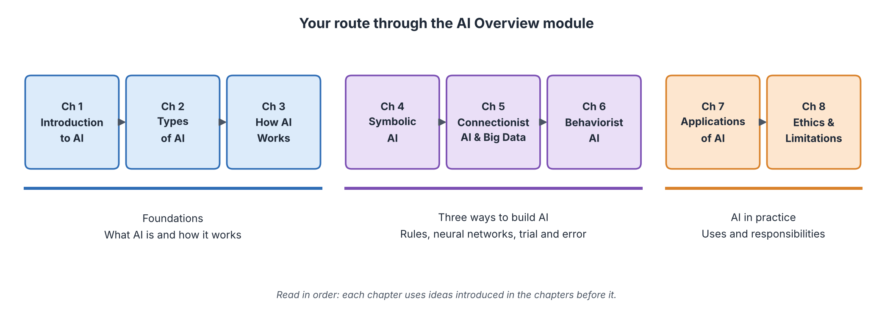
*Figure 1.1: The route through the module. Source: created by our team.*

| Chapter | What you will learn | How it connects to this chapter |
|:-------:|---------------------|---------------------------------|
| 2 | Different ways to classify AI | Uses the definition of AI from Section 1.1 |
| 3 | How AI works step by step | Expands the terms in Section 1.4 |
| 4 to 6 | Three ways to build AI | Extends the "rules vs learning" idea from Section 1.3 |
| 7 and 8 | Applications, ethics and limits | Applies everything you learn here |

---

## 1.1 What Is AI?

### Start with a question

Your phone unlocks when it sees your face. A video app seems to know which clip you will watch next. A translator reads a street sign in a language you do not speak. Nobody typed out "if this face, then unlock" for every possible face. So how does the phone do it?

### In plain words

**AI is a way of making computers do things that normally need human intelligence**, such as recognising faces, understanding speech, or making decisions.

### The official definition

**Artificial Intelligence (AI)** is the field of computer science that studies and builds systems able to perform tasks that normally require human intelligence, such as perception, language understanding, learning, reasoning, and decision-making.

Three points help you read this definition correctly.

- **AI is a field of study**, like biology or physics. People also say "an AI" for one particular system built with that field, such as a chatbot.
- **There is no single official definition.** Textbooks differ. Russell and Norvig (2021), for example, organise the field around systems that *act rationally*, meaning they choose actions that are likely to reach a goal. This module uses the simple definition above.
- **Most AI is built for one job.** A system that is excellent at chess cannot cook rice. Chapter 2 explains this in detail.

### AI you already use

| Situation | What the AI is doing |
|-----------|----------------------|
| Unlocking your phone with your face | Checking whether the face matches the owner |
| Watching a video app | Predicting which videos you may like next |
| Typing a message | Suggesting the next word |
| Pointing your camera at a foreign sign | Reading the text and translating it |
| Checking your email | Moving suspicious emails to the spam folder |
| Using a chatbot | Writing a reply to your question |

### Analogy: AI as a very fast apprentice

Think of AI as an apprentice who has studied millions of examples. The apprentice is quick and never tired, and can spot patterns you would miss. But the apprentice only knows what the examples showed.

**Where the analogy breaks:** a human apprentice understands *why* something is true and can handle a surprise using common sense. Today's AI mostly finds statistical patterns and can fail badly on situations unlike its examples. Also, a human apprentice knows when they are unsure; AI often sounds confident even when it is wrong.

### Three common myths

| Myth | What is actually true |
|------|-----------------------|
| "AI is a robot." | Most AI is software with no body. A robot is a machine; AI can be its "brain", but they are different things. |
| "AI thinks like a human." | Today's AI finds patterns in data. Scientists still debate what "understanding" means for a machine, but AI does not work like a human brain. |
| "AI is always right." | AI makes mistakes, sometimes confident ones. Chapter 8 covers this. |

> **Pause and predict.** Which of these is *not* AI by the definition above: (a) a program that adds two numbers, (b) a program that recognises spoken words, (c) a program that recommends a film?
>
> **Check:** (a). Adding numbers follows a fixed exact rule and needs no "intelligence" in the sense of perception, language or learning. (b) and (c) handle tasks that people normally do using their senses, language or judgment.

---

## 1.2 A Brief History of AI

### Start with a question

Chatbots feel brand new. Yet people have been trying to build thinking machines for over seventy years. What happened in between?

### The timeline

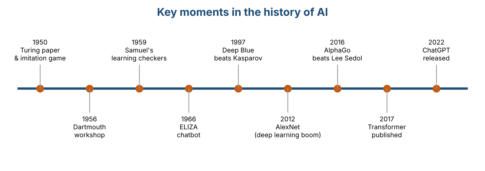
*Figure 1.2: Timeline of key moments in AI history. Source: created by our team, based on the references in Section 1.7.*

| Year | Event | Why it matters |
|:----:|-------|----------------|
| 1950 | Alan Turing publishes *Computing Machinery and Intelligence* (Turing, 1950). He proposes the "imitation game", later called the **Turing Test**: if a person chatting with a machine cannot tell it from a human, should we call the machine intelligent? | It turned "Can machines think?" into something that could be tested. |
| 1955 to 1956 | John McCarthy, Marvin Minsky, Nathaniel Rochester and Claude Shannon write a 1955 proposal for a summer workshop at Dartmouth College (McCarthy et al., 1955/2006). The proposal uses the term "artificial intelligence". The workshop takes place in summer 1956. | Many people see this as the birth of AI as a research field. |
| 1959 | Arthur Samuel describes a checkers program that improves by playing and learning from experience (Samuel, 1959). | An early example of a computer **learning** instead of only following fixed instructions. |
| 1966 | Joseph Weizenbaum creates **ELIZA**, a chat program that uses simple keyword rules (Weizenbaum, 1966). | An early chatbot. Many users felt it understood them, although it did not. |
| 1997 | IBM's **Deep Blue** beats world chess champion Garry Kasparov in a six-game match, 3½ to 2½ (Campbell et al., 2002). | A machine beat the best human at a game people link with intelligence. |
| 2012 | A neural network called **AlexNet** wins the ImageNet image-recognition competition by a large margin (Krizhevsky et al., 2012). | Started the modern boom of **deep learning**. |
| 2016 | **AlphaGo** (Google DeepMind) beats Lee Sedol, a top Go player, 4 games to 1 (Silver et al., 2016). | Go is far harder for computers than chess. |
| 2017 | Google researchers publish the **Transformer**, a new neural network design (Vaswani et al., 2017). | It is the base of today's large language models. |
| 2022 | OpenAI releases **ChatGPT** to the public on 30 November (OpenAI, 2022). | Made generative AI available to millions of ordinary users. |

### Two photographs from the story

*Figure 1.3: Alan Turing at age 16 (passport photo, around 1927 to 1928). Source: Wikimedia Commons, "File:Alan Turing Aged 16.jpg" (https://commons.wikimedia.org/wiki/File:Alan_Turing_Aged_16.jpg). License: public domain (Public Domain Mark 1.0), as stated on the Commons file page.*

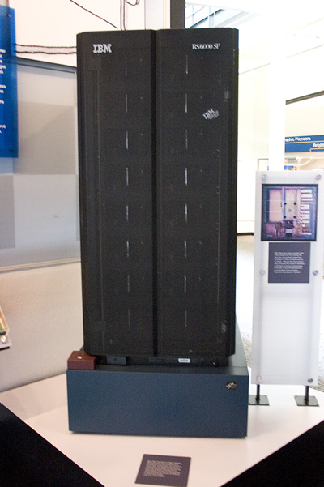
*Figure 1.4: A computer similar to Deep Blue, displayed at the Computer History Museum. Photo by James (originally on Flickr). Source: Wikimedia Commons, "File:Deep Blue.jpg" (https://commons.wikimedia.org/wiki/File:Deep_Blue.jpg). License: CC BY 2.0 (https://creativecommons.org/licenses/by/2.0/).*

### Booms and "AI winters"

In the early years, researchers expected quick progress. But computers were slow and data was scarce, so many promises were not kept. Funding and interest dropped in the 1970s and again from the late 1980s into the early 1990s. These quiet periods are called **AI winters**.

Progress sped up again when three things arrived together:

1. **Much more data**, because of the internet and smartphones.
2. **Much faster computers**, especially graphics processors (GPUs).
3. **Better learning methods**, especially deep neural networks.

**A pattern to notice:** the early systems (such as ELIZA and expert systems) followed rules that people wrote. The recent breakthroughs (such as AlexNet and AlphaGo) learned from data. Chapters 4 to 6 explore these different styles.

> **Pause and predict.** ELIZA (1966) made some users feel understood. Do you think ELIZA understood language the way a person does?
>
> **Check:** No. ELIZA matched keywords and filled in template replies. Its creator was surprised that people still treated it as if it understood. This is a classic reminder that *sounding* intelligent is not the same as *being* intelligent.

---

## 1.3 AI vs Traditional Programming

### Start with a question

How would you teach a computer to decide whether a mango is ripe? Try listing exact rules. You will quickly run out of rules, and every mango is a little different. That difficulty is the reason machine learning exists.

### Traditional programming: a human writes the rules

Think of a **recipe**. It gives exact steps, and if you follow them you get the same dish every time. Traditional programming works the same way. The programmer writes exact instructions (the **rules**). The computer takes the rules and the **data**, and produces **answers**.

*Everyday example:* a calculator uses the fixed rule "add the two numbers".
*Technical example:* a program converts Celsius to Fahrenheit with the rule `F = C × 9/5 + 32`. The rule is clear and always correct.

### Machine learning: the computer finds the rules

Now return to the mango. A person learns by seeing and touching many mangoes, and after a while can tell if one is ripe even without being able to explain every rule. **Machine learning** works in a similar spirit. We give the computer many **examples with the correct answers**, and it finds the patterns itself.

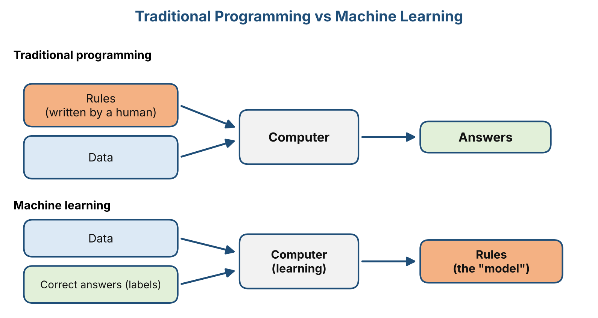
*Figure 1.5: Traditional programming vs machine learning. Source: created by our team.*

> This is an example of **supervised learning**, where a model learns from labelled data. Other machine learning approaches can learn without labelled answers (see Chapter 3).

### Side-by-side comparison

| | Traditional programming | Machine learning |
|---|------------------------|------------------|
| Who creates the rules? | The programmer | The computer, from examples |
| What goes in? | Data and rules | Data and correct answers |
| What comes out? | Answers | Rules (a **model**) that give answers for new data |
| Works best when | Rules are clear and exact (tax, sorting names) | Rules are hard to write (faces, speech) |
| Main weakness | Fails on cases the programmer did not imagine | Needs a lot of good data, and learns mistakes if the data is bad |

> **Important note:** not all AI learns from data. Some early AI systems, called *expert systems*, used rules written by human experts. You will study them in Chapter 4. This chapter focuses on learning-based AI because it powers most modern tools, but the two ideas are not the same thing.

---

## 1.4 Basic AI Terminology

These nine terms appear throughout the module. For each one, the table first gives a plain-words meaning and then an example.

| Term | In plain words | Example |
|------|----------------|---------|
| **Data** | Information a computer can process: numbers, text, images, sound. | A collection of 1,000 emails |
| **Algorithm** | A step-by-step method for solving a problem. | The steps for sorting names from A to Z |
| **Label** | The correct answer attached to an example. | "Spam" or "Not spam" |
| **Machine learning (ML)** | Building AI by letting the computer learn patterns from data instead of giving it exact rules. | A system that learns to detect spam from examples |
| **Model** | What the computer has learned: patterns it uses to make predictions on new data. | A spam filter after it has studied many emails |
| **Training** | Showing data to a learning algorithm so it can build a model. | Studying 10,000 labelled emails |
| **Inference** | Using a trained model on new data to get a result. | Checking a brand-new email |
| **Neural network** | A model made of many simple connected units, loosely inspired by the brain. It learns by adjusting the strength of each connection. | A network that recognises handwritten digits |
| **Deep learning** | Machine learning with neural networks that have many layers. | Speech and image recognition |

### Training vs inference

Think of **studying for an exam** and **sitting the exam**.

- **Training** is studying many past questions. It takes a long time, and you do it before the exam.
- **Inference** is answering questions in the real exam. You use what you learned on questions you have not seen before.

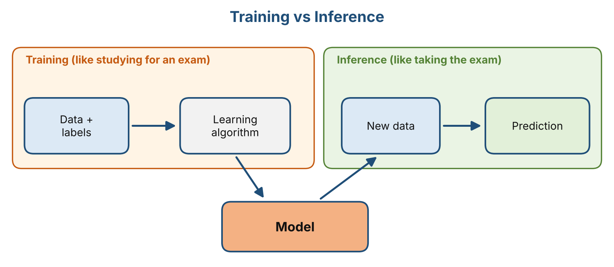
*Figure 1.6: Training vs inference. Source: created by our team.*

**Where the analogy breaks:** a student can keep learning during the exam and can ask what a question means. Most deployed models are fixed during inference; they do not learn from the question you ask unless the developers retrain them.

### How the fields fit together

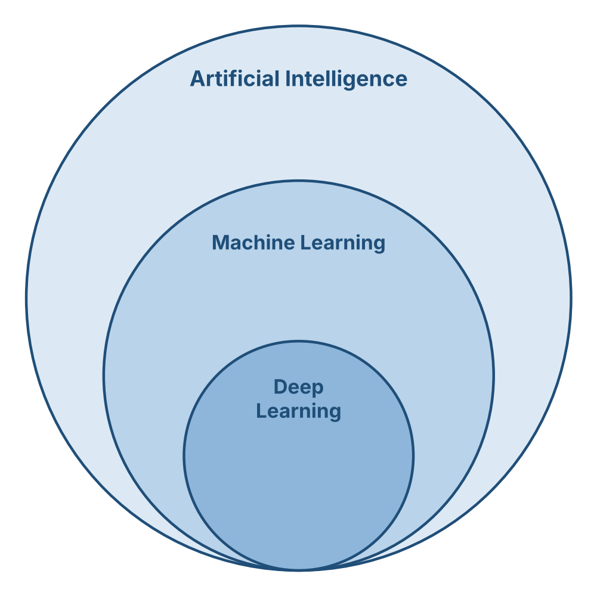
*Figure 1.7: How AI, machine learning, and deep learning fit together. Source: created by our team.*

Deep learning is a part of machine learning, and machine learning is a part of AI.

---

## 1.5 Worked Example: A Spam Filter That Learns

Let us build a tiny spam filter by hand. Real filters are much more advanced, but this shows the full cycle: **data, training, model, inference**.

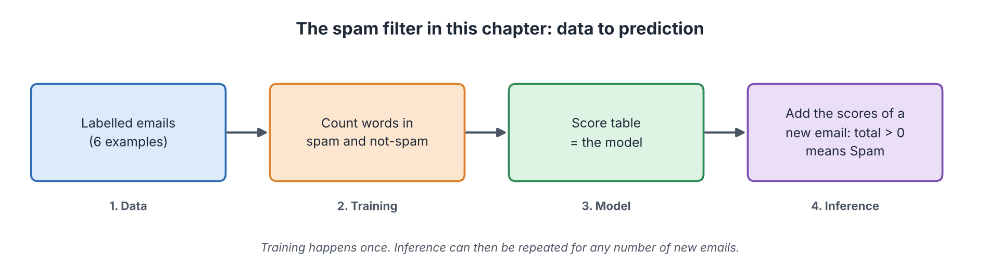
*Figure 1.8: The path from data to prediction in this example. Source: created by our team.*

### Step 1: Collect labelled data

| # | Email text | Label |
|:-:|-----------|:-----:|
| 1 | win free prize now | Spam |
| 2 | free money offer | Spam |
| 3 | meeting at noon | Not spam |
| 4 | project report due | Not spam |
| 5 | claim your free prize | Spam |
| 6 | lunch at noon tomorrow | Not spam |

### Step 2: Train by counting

For each word, count how many spam emails contain it and how many not-spam emails contain it. Then calculate:

> **score = (number of spam emails with the word) minus (number of not-spam emails with the word)**

| Word | In spam | In not spam | Score |
|------|:-------:|:-----------:|:-----:|
| free | 3 | 0 | **+3** |
| prize | 2 | 0 | **+2** |
| win, now, money, offer, claim, your | 1 each | 0 | **+1** each |
| meeting, project, report, due, lunch, tomorrow | 0 | 1 each | **-1** each |
| at | 0 | 2 | **-2** |
| noon | 0 | 2 | **-2** |

This score table is our **model**. Nobody wrote "the word *free* means spam". The scores came from the examples.

> **Note:** these scores are simple counts from six emails. They are **not probabilities** and do not show how confident the filter is.

### Step 3: Make a decision rule

> Add up the scores of all the words in an email. If the total is **greater than 0**, predict **Spam**. Otherwise, predict **Not spam**. A word that is not in the table scores 0.

### Step 4: Inference on a new email

New email: **"free offer tomorrow"**

| Word | Score |
|------|:-----:|
| free | +3 |
| offer | +1 |
| tomorrow | -1 |
| **Total** | **+3** |

The total is above 0, so the prediction is **Spam**.

### Step 5: See where it struggles

New email: **"free prize at noon"**: +3 +2 -2 -2 = **+1**, so the filter says **Spam**. Is it really spam? The filter cannot know, because it only counts words. The harmless words "at" and "noon" appear to be "safe" only because our six emails happened to use them in not-spam messages.

### Step 6: Compare with a hand-written rule

A programmer reads the six emails and writes one rule: *"If the email contains 'free' or 'prize', predict Spam. Otherwise predict Not spam."* On the six training emails this rule is correct every time. Now test both filters on two new emails.

| New email | What it really is | Rule-based filter | Learning-based filter |
|-----------|-------------------|-------------------|-----------------------|
| win money now | Spam | Not spam (wrong: no "free" or "prize") | Spam (right: total +3) |
| free lunch at noon | Not spam (a friend's invitation) | Spam (wrong: contains "free") | Not spam (right: total -2) |

**What this teaches us**

- The rule-based filter only knows what the programmer thought of. To fix it, a person must edit the rule.
- The learning-based filter found useful words such as "money" and "noon" from the examples. To improve it, we add more labelled examples and count again.
- Neither filter is perfect. A model depends on its training data, and six emails is far too few. Real filters learn from millions.
- Training and inference are separate: we counted once (training), then reused the same table for any number of new emails (inference).

> **Note:** this word-scoring method is a simplified teaching version. Real spam filters use more advanced statistical or neural network methods and look at much more than single words.

---

## 1.6 Mission 1: Rule or Learn?

> **Goal:** decide when a task suits hand-written rules and when it suits learning from examples.  
> **Preparation:** Sections 1.3 and 1.4. Pen and paper, 5 minutes.  
> **Task:** for each task below, tick the approach you think fits better and write one reason.

| # | Task | Rules (R) or Learning (L)? | Your reason (one sentence) |
|:-:|------|:--------------------------:|----------------------------|
| 1 | Convert kilometres to miles | ____ | ______________________ |
| 2 | Recognise handwritten digits | ____ | ______________________ |
| 3 | Calculate 10% tax on an income | ____ | ______________________ |
| 4 | Recommend songs a user may like | ____ | ______________________ |
| 5 | Sort a list of names A to Z | ____ | ______________________ |
| 6 | Detect faces in photos | ____ | ______________________ |

> **Observe:** count how many tasks you gave to each approach. What do the Learning tasks have in common?  
> **Reflect:** can you think of a task where both approaches could work? Which would you choose and why?  
> **Feedback:** compare with the Answer Key (Mission 1). There is no penalty for a different answer if your reason is sound.

---

## 1.7 Mission 2: Teach the Filter a Lesson

> **Goal:** see that a model changes when its training data changes.  
> **Preparation:** the score table in Section 1.5. Pen and paper, 10 minutes.  
> **Task:** two new labelled emails arrive. Add them to the training data, update the scores, then test two emails.

| # | Email text | Label |
|:-:|-----------|:-----:|
| 7 | free lunch at noon | Not spam |
| 8 | win a free trip | Spam |

**Part A. Fill in the updated counts** (use all eight emails).

| Word | In spam | In not spam | New score |
|------|:-------:|:-----------:|:---------:|
| free | ____ | ____ | ____ |
| win | ____ | ____ | ____ |
| lunch | ____ | ____ | ____ |
| at | ____ | ____ | ____ |
| noon | ____ | ____ | ____ |

**Part B. Classify with the updated model.** Use the rule "total above 0 means Spam".

| Email | Word scores | Total | Prediction |
|-------|-------------|:-----:|:----------:|
| free lunch at noon | ________ | ____ | ____ |
| free prize at noon | ________ | ____ | ____ |

> **Observe:** in Step 5, "free prize at noon" was predicted as Spam (+1). What is the prediction now?  
> **Reflect:** nobody changed the decision rule. Why did the prediction change?  
> **Feedback:** check your counts and totals in the Answer Key (Mission 2).

---

## 1.8 Common Misconceptions

| Misconception | Correction |
|---------------|------------|
| "A bigger model or more data always means no mistakes." | More and better data usually helps, but every model makes some mistakes. |
| "The score in our filter is a probability." | It is only a count-based total used with a simple rule. Probabilities need extra calculation. |
| "AI replaces the programmer's rules completely." | Learning systems still depend on human choices: which data, which labels, which goal. |
| "If AI sounds fluent, it understands." | Fluent output can come from pattern matching. ELIZA showed this in 1966. |

---

## 1.9 Quick Check

**Q1 (True/False).** All AI systems learn from data.

**Q2 (True/False).** Inference means using a trained model on new data.

**Q3 (True/False).** Deep learning is a part of machine learning.

**Q4 (Multiple choice, one answer).** In machine learning, where do the rules come from?
A. The programmer writes them by hand. B. The computer finds them from examples. C. The user types them in. D. The internet provides them.

**Q5 (Multiple choice, one answer).** Which step comes first?
A. Inference. B. Training. C. Deploying the model to users. D. Testing on new emails.

**Q6 (Multiple choice, one answer).** A spam filter was trained only on messages written in English. What is the most likely problem?
A. It will work equally well on all languages. B. It may perform poorly on messages in other languages. C. It will refuse to run. D. It will become faster.

**Q7 (Short answer, 2 to 3 sentences).** Explain the difference between *data* and a *model*, using the spam filter as your example.

---

## 1.10 Summary, Connections and References

### Key takeaways

- AI is the field of making computers do tasks that normally need human intelligence.
- AI has a history of breakthroughs and "winters". The recent boom came from more data, faster computers and better methods.
- Traditional programming uses rules written by humans. Machine learning lets the computer find rules from examples.
- **Training** builds a model from data. **Inference** uses the model on new data.
- A model depends on its data, and it can make mistakes.

### Connections to other chapters

| Direction | Chapter | Link |
|-----------|---------|------|
| Leads to | Chapter 2 | Types of AI: classifies the systems introduced here |
| Leads to | Chapter 3 | How AI Works: expands data, training, and inference |
| Leads to | Chapters 4 to 6 | Rules (Ch 4), neural networks (Ch 5), trial and error (Ch 6) |

### How this chapter will be reused

| Resource | Planned use |
|----------|-------------|
| **Study Guide** | Sections 1.1 to 1.4 are the reading text; Section 1.4 becomes the glossary; Missions 1 and 2 are the hands-on activities. |
| **Test Bank** | Quick Check questions and the glossary terms become True/False and multiple-choice items with explained answers. |
| **PPT Slides** | The timeline, the two comparison diagrams and the nested diagram become full-slide visuals; the spam filter becomes a step-by-step build sequence. |
| **Video Tutorial** | A short video follows Section 1.5: show the six emails, build the score table on screen, test new emails while narrating, then compare with the rule-based filter. |

---

## Answer Key

**Mission 1: Rule or Learn?** Suggested answers (a different answer is fine if the reason is sound):

| # | Best fit | Reason |
|:-:|:--------:|--------|
| 1 | R | One exact, always-correct formula. |
| 2 | L | Handwriting varies too much for exact rules; examples work better. |
| 3 | R | The tax rule is explicit. |
| 4 | L | Tastes are hard to write as rules; patterns in past behaviour help. |
| 5 | R | Sorting follows a clear algorithm. |
| 6 | L | Faces vary in angle, light and appearance. |

*Observe:* the Learning tasks (2, 4, 6) involve messy real-world input where exact rules are hard to write. *Reflect:* for example, spam filtering can use both: a few fixed rules for obvious cases plus a learned model.

**Mission 2: Teach the Filter a Lesson**

Part A:

| Word | In spam | In not spam | New score |
|------|:-------:|:-----------:|:---------:|
| free | 4 (emails 1, 2, 5, 8) | 1 (email 7) | +3 |
| win | 2 (emails 1, 8) | 0 | +2 |
| lunch | 0 | 2 (emails 6, 7) | -2 |
| at | 0 | 3 (emails 3, 6, 7) | -3 |
| noon | 0 | 3 (emails 3, 6, 7) | -3 |

Part B (prize stays +2 because it is in emails 1 and 5 only):

| Email | Word scores | Total | Prediction |
|-------|-------------|:-----:|:----------:|
| free lunch at noon | +3, -2, -3, -3 | -5 | Not spam |
| free prize at noon | +3, +2, -3, -3 | -1 | Not spam |

*Observe:* "free prize at noon" changed from Spam (+1) to Not spam (-1). *Reflect:* the rule is the same, but the scores come from the data. Two new emails made "at" and "noon" look even more "safe", which pushed the total below 0. This shows that a model is only as good as its data.

**Quick Check**

1. **False.** Many modern systems learn from data, but expert systems use human-written rules.
2. **True.** Inference applies a trained model to new data.
3. **True.** Deep learning is machine learning with many-layer neural networks.
4. **B.** In ML the computer finds the rules (the model) from examples.
5. **B.** A model must be trained before it can be used for inference.
6. **B.** A model reflects its training data, so unfamiliar languages are a weak spot.
7. *Key points:* data is the information given to the computer (for example, emails); the model is what the computer learned from that data (the score table); the model is used to make predictions on new data.

---

## Glossary

| Term | Meaning |
|------|---------|
| AI winter | A period of reduced funding and interest in AI after promises were not met. |
| Algorithm | A step-by-step method for solving a problem. |
| Artificial Intelligence | The field that builds systems able to do tasks that normally need human intelligence. |
| Data | Information a computer can process. |
| Deep learning | Machine learning with many-layer neural networks. |
| Inference | Using a trained model on new data. |
| Label | The correct answer attached to an example. |
| Machine learning | Building AI by learning patterns from data. |
| Model | What a learning algorithm has learned, used to make predictions. |
| Neural network | A model of many simple connected units that learns by adjusting connection strengths. |
| Supervised learning | Learning from examples that come with correct labels. |
| Training | Showing data to a learning algorithm so it can build a model. |
| Turing Test | A test in which a person chats with a machine and tries to tell it from a human. |

---

## References

1. Turing, A. M. (1950). Computing machinery and intelligence. *Mind*, 59(236), 433-460. https://doi.org/10.1093/mind/LIX.236.433
2. McCarthy, J., Minsky, M. L., Rochester, N., & Shannon, C. E. (2006). A proposal for the Dartmouth summer research project on artificial intelligence, August 31, 1955. *AI Magazine*, 27(4), 12-14. https://doi.org/10.1609/aimag.v27i4.1904
3. Samuel, A. L. (1959). Some studies in machine learning using the game of checkers. *IBM Journal of Research and Development*, 3(3), 210-229. https://doi.org/10.1147/rd.33.0210
4. Weizenbaum, J. (1966). ELIZA: A computer program for the study of natural language communication between man and machine. *Communications of the ACM*, 9(1), 36-45. https://doi.org/10.1145/365153.365168
5. Campbell, M., Hoane, A. J., & Hsu, F.-h. (2002). Deep Blue. *Artificial Intelligence*, 134(1-2), 57-83. https://doi.org/10.1016/S0004-3702(01)00129-1
6. Krizhevsky, A., Sutskever, I., & Hinton, G. E. (2012). ImageNet classification with deep convolutional neural networks. *Advances in Neural Information Processing Systems*, 25. https://papers.nips.cc/paper/4824-imagenet-classification-with-deep-convolutional-neural-networks
7. Silver, D., et al. (2016). Mastering the game of Go with deep neural networks and tree search. *Nature*, 529, 484-489. https://doi.org/10.1038/nature16961
8. Vaswani, A., et al. (2017). Attention is all you need. *Advances in Neural Information Processing Systems*, 30. https://arxiv.org/abs/1706.03762
9. OpenAI. (2022, November 30). *Introducing ChatGPT*. https://openai.com/index/chatgpt/
10. Russell, S., & Norvig, P. (2021). *Artificial Intelligence: A Modern Approach* (4th ed.). Pearson. https://aima.cs.berkeley.edu/

> The spam filter in Section 1.5 is the team's own simplified teaching example, inspired by word-counting spam filters. It does not copy a specific source. Figures 1.1, 1.8 and the unlabelled diagrams were created by the team; photographs carry their own licence notes.

---

# Types of Artificial Intelligence

**Audience:** Learners with no technical background in AI  
**Estimated time:** 2.5 to 3.5 hours (including missions)  
**Format:** Read, pause at each "Pause and predict" box, complete the two missions, then check the answer key at the end of the chapter.

---

## Learning Outcomes

After completing this chapter, you should be able to:

1. Explain why AI can be classified in more than one way.
2. Describe the three capability levels: Artificial Narrow Intelligence (ANI), Artificial General Intelligence (AGI) and Artificial Superintelligence (ASI).
3. Describe the four functionality types: reactive machines, limited memory, theory of mind and self-aware AI.
4. Separate what exists today from what is still hypothetical.
5. Explain how machine learning and generative AI differ, and how they relate to AI as a whole.
6. Classify a familiar AI system from several perspectives and justify your answer.
7. Recognise exaggerated claims about AI types.

## Where This Chapter Fits

**Builds on Chapter 1.** There you learned that AI means computers doing tasks that normally need human intelligence, and that many modern systems learn from data. Now we ask a natural next question: *are all AI systems the same kind of thing?* They are not, and this chapter gives you the labels to tell them apart.

**Leads to Chapters 3 to 6.** Chapter 3 explains how learning-based AI works inside. Chapters 4, 5 and 6 then study three different *ways of building* AI (rules, neural networks, trial and error), which is yet another way to classify AI.

---

## 2.1 Why Classify AI at All?

### Start with a question

A chess program, a spam filter, a self-driving car and a science-fiction robot are all called "AI". Are they really the same? If someone says "AI will soon be smarter than us", which of them are they talking about?

### In plain words

**Classifying AI means sorting systems into groups so we can talk about them clearly.** Different groupings answer different questions. Like sorting vehicles, you can group them by size (bicycle, car, truck), by fuel (petrol, electric) or by purpose (racing, farming). None of these is "the right one"; each is useful for a different question.

### The official idea

There is **no single, official classification** of AI. In this chapter we use four common perspectives:

| Perspective | The question it answers | Groups |
|-------------|------------------------|--------|
| By capability | How broad and how strong is the intelligence? | ANI, AGI, ASI |
| By functionality | How does the system use information and memory? | Reactive, limited memory, theory of mind, self-aware |
| By learning method | Does it learn from data? | Machine learning vs rule-based (and more, see Chapter 3) |
| By output | Does it create new content? | Generative AI vs other AI |

> **Honest note:** these frameworks are teaching tools used in textbooks and articles. They are not scientific laws, and experts do not always agree on where to draw the lines.

---

## 2.2 AI Based on Capability

### Start with a question

Could a spam filter ever do your homework, drive you to school and cook dinner? If not, what would an AI need in order to do all three?

### 2.2.1 Artificial Narrow Intelligence (ANI)

**In plain words:** an AI that does one kind of job, and does it well.

**Definition:** **Artificial Narrow Intelligence (ANI)**, also called *weak AI*, is AI designed and trained for a specific task or a small set of related tasks. It cannot transfer its skill to unrelated tasks without being redesigned or retrained.

*Everyday example:* a calculator app is excellent at arithmetic and useless at translation.
*Technical examples:* a spam filter, a chess engine, a face-unlock system, a language translator, a route planner.

**Key point:** every AI system that exists today is considered ANI or a close variant. Some modern systems, such as large language models, can do many different language tasks. That makes them *broader* than a chess engine, but they are still built from training on data and still fail in ways a human would not. Whether they count as "narrow" is debated, which is why the labels are guides, not facts.

### 2.2.2 Artificial General Intelligence (AGI)

**In plain words:** an AI that could learn almost any mental task a human can.

**Definition:** **Artificial General Intelligence (AGI)** is a hypothetical AI with broad, flexible intelligence: it could learn new tasks, transfer knowledge between very different areas, and reason about unfamiliar situations at roughly human level.

*Everyday example:* a person who can learn to cook, then repair a bicycle, then do accounting, using the same mind.
*Technical status:* **hypothetical.** Researchers disagree about what exactly counts as AGI, how to measure it, and when (or whether) it will exist. Treat any specific date you read online as a guess.

### 2.2.3 Artificial Superintelligence (ASI)

**In plain words:** an AI that would be far smarter than any human.

**Definition:** **Artificial Superintelligence (ASI)** is a hypothetical AI that would outperform the best humans in nearly every intellectual field, including science, creativity and social skills (Bostrom, 2014).

*Technical status:* **hypothetical.** ASI is mainly discussed in philosophy, safety research and fiction.

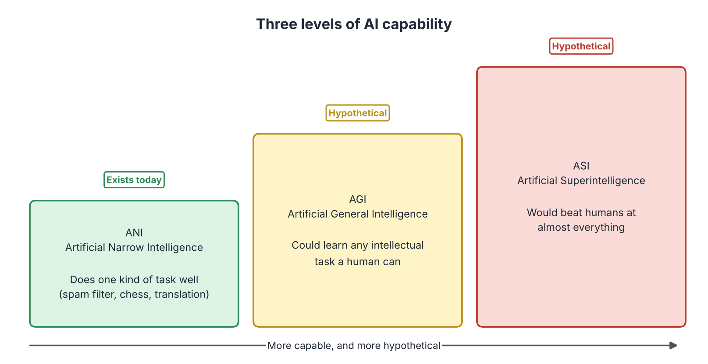
*Figure 2.1: Three levels of AI capability. Source: created by our team.*

### 2.2.4 Comparing the three levels

| | ANI | AGI | ASI |
|---|-----|-----|-----|
| Scope | One task or a few related tasks | Almost any intellectual task | Beyond any human |
| Exists today? | Yes | No (hypothetical) | No (hypothetical) |
| Learns new, unrelated tasks easily? | No | Yes | Yes, better than humans |
| Examples | Spam filter, chess engine, translator | Often shown in films | Often shown in films |

**Analogy: a toolbox, a Swiss-army knife and a robot workshop.** ANI is a single tool that does one job very well. AGI would be a worker who can pick up any tool and learn any trade. ASI would be a workshop that out-builds all human workers.  
**Where the analogy breaks:** AI is not a physical tool, and the boundaries are blurry. A system can be very strong in many areas yet fail on a simple common-sense question.

> **Pause and predict.** A new chatbot can write poems, answer maths questions and translate languages. Is it AGI?
>
> **Check:** Not by itself. Doing many language-based tasks is *broad*, but AGI would mean flexible, human-level learning across *all* kinds of intellectual tasks, including ones it never saw in training. Most researchers do not consider today's systems AGI, although they debate how close or far we are.

---

## 2.3 AI Based on Functionality

### Start with a question

When you cross a road, you look at the traffic, remember that a bus passed a second ago, and guess what the driver is thinking. Which of these abilities does a machine have?

This second perspective is popularly credited to Arend Hintze (2016). It sorts AI by *how it uses information*, from the simplest to the most advanced.

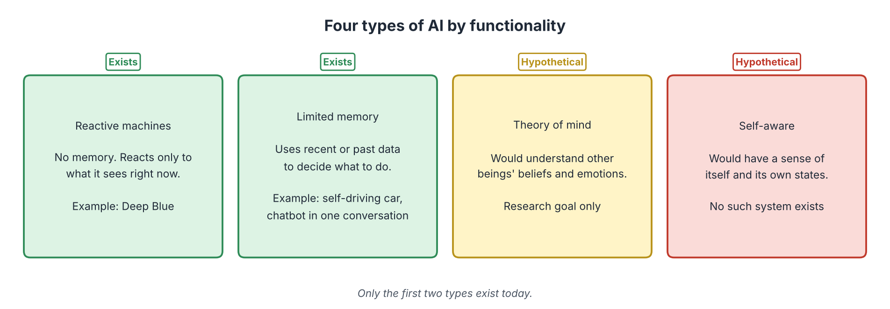
*Figure 2.2: Four types of AI by functionality. Source: created by our team.*

### 2.3.1 Reactive machines

**In plain words:** it only reacts to what it sees right now, with no memory of the past.

**Definition:** a **reactive machine** responds to the current input using fixed rules or search, and does not store past experiences to improve later decisions.

*Everyday example:* a light that switches on when it detects motion.
*Technical example:* **Deep Blue**, the chess computer, evaluated the current board position and searched possible moves (Campbell et al., 2002). It did not learn from earlier games in the way modern learning systems do.

### 2.3.2 Limited-memory AI

**In plain words:** it uses recent or past data to make better decisions.

**Definition:** **limited-memory AI** uses data from the past, such as training data or the last few seconds of sensor readings, to make decisions. It does not build a lasting understanding of the world like a human.

*Everyday example:* when you drive, you remember the car that just overtook you.
*Technical examples:* a self-driving car tracks nearby vehicles over the last few seconds; a spam filter uses patterns learned from past emails; a chatbot uses the earlier part of your conversation.

**Key point:** almost all of today's useful machine learning systems belong here.

### 2.3.3 Theory-of-mind AI

**In plain words:** an AI that could understand that other people have beliefs, feelings and intentions.

**Definition:** **theory of mind** is a human ability to understand that others have their own thoughts and emotions. A *theory-of-mind AI* would model what people believe, want and feel and adjust its behaviour accordingly.

*Technical status:* **hypothetical / research.** Some systems detect emotion in a face or tone of voice, but that is pattern recognition, not a real understanding of another mind.

### 2.3.4 Self-aware AI

**In plain words:** an AI that knows it exists and has an inner experience.

**Definition:** a **self-aware AI** would have consciousness: a sense of self, and its own feelings and goals.

*Technical status:* **hypothetical.** There is no scientific agreement on what consciousness is or how to detect it in a machine. No existing system is self-aware.

### 2.3.5 Comparing the four types

| Type | Uses memory? | Understands other minds? | Exists today? | Example |
|------|:------------:|:------------------------:|:-------------:|---------|
| Reactive machine | No | No | Yes | Deep Blue |
| Limited memory | Yes (limited) | No | Yes | Self-driving car |
| Theory of mind | Yes | Yes (would) | No | Not yet built |
| Self-aware | Yes | Yes | No | Fiction only |

**Analogy: a ladder of awareness.** Reflex, then remembering, then reading minds, then knowing yourself. **Where the analogy breaks:** real research does not climb these four rungs in order, and the boundaries between them are not sharp.

---

## 2.4 Machine Learning and Generative AI

### Start with a question

People say "AI", "machine learning" and "generative AI" as if they were the same word. Are they?

### 2.4.1 What is machine learning?

**In plain words:** the computer learns patterns from examples instead of being told exact rules.

**Definition:** **machine learning (ML)** is a branch of AI in which algorithms learn patterns from data and use them to make predictions or decisions on new data (see Chapter 1, Section 1.3).

*Example:* a model shown thousands of labelled photos of cats and dogs learns to tell them apart.

### 2.4.2 What is generative AI?

**In plain words:** AI that creates new things, such as text, images, music or code.

**Definition:** **generative AI** is AI that produces new content that resembles the data it was trained on. Many modern generative systems are deep learning models trained on very large collections of text, images or audio (Bommasani et al., 2021).

*Everyday example:* typing a prompt and receiving a drawing or an essay.
*Technical idea:* a text model learns which word is likely to follow others, and builds an answer one piece at a time (Chapter 3 explains this).

### 2.4.3 How they differ

| | Traditional machine learning | Generative AI |
|---|-----------------------------|---------------|
| Typical goal | Predict or classify (is it spam? what price?) | Create new content (write, draw, compose) |
| Typical output | A label or a number | Text, image, audio, code |
| Example | Spam filter, price predictor | Chatbot, image generator |
| Relationship | The broader family | Mostly a part of it |

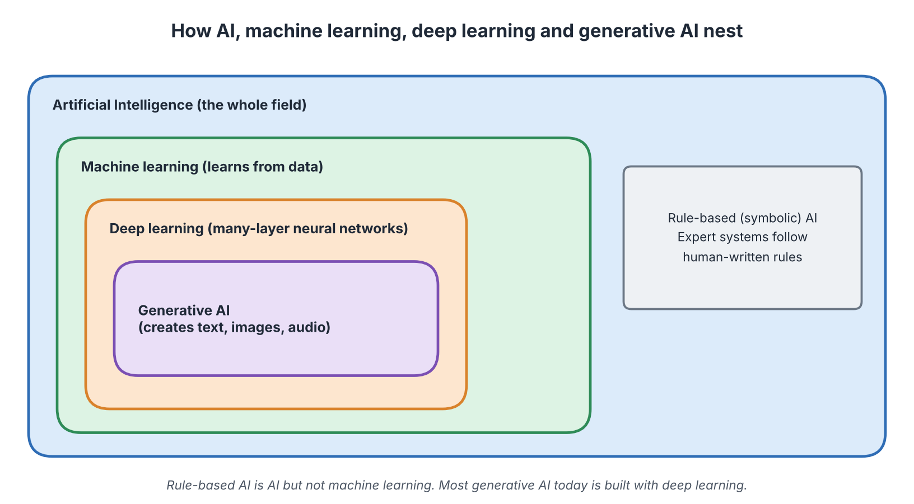
*Figure 2.3: How AI, machine learning, deep learning and generative AI relate. Source: created by our team.*

**Key point:** generative AI is not a rival of machine learning. In practice it is built *with* machine learning, usually deep learning. And not all AI is machine learning: rule-based systems (Chapter 4) are AI too.

> **Pause and predict.** A program uses a hand-written list of 500 rules to diagnose car problems. Is it AI? Is it machine learning? Is it generative AI?
>
> **Check:** It is AI (it does a task that normally needs expertise). It is *not* machine learning, because the rules were written by people and not learned from data. It is *not* generative AI, because it chooses from known answers and does not create new content.

---

## 2.5 Putting the Four Perspectives Together

No system belongs to only one perspective. Each question gives a different label to the same system.

| System | Capability | Functionality | Learns from data? | Generative? |
|--------|:----------:|:-------------:|:-----------------:|:-----------:|
| Deep Blue (chess) | ANI | Reactive | No (search and hand-built evaluation) | No |
| Spam filter | ANI | Limited memory | Yes | No |
| Self-driving car | ANI | Limited memory | Yes | No |
| Image generator | ANI | Limited memory | Yes | Yes |
| Robot from a film that "feels" | Would be AGI/ASI | Self-aware | Unknown | Unknown |

**Three tips for classifying a system**

1. Start from what it *actually does today*, not from what its advertisement says.
2. Use one perspective at a time. A system can be ANI, limited memory and generative all at once.
3. If a label depends on a hypothetical ability (feelings, true understanding), the label is probably not established.

---

## 2.6 Mission 1: Classify the Systems

> **Goal:** practise using the four perspectives on real examples.  
> **Preparation:** Sections 2.2 to 2.5. Pen and paper, 10 minutes.  
> **Task:** for each system, fill in the table. Capability: ANI / AGI / ASI. Functionality: Reactive / Limited memory / Theory of mind / Self-aware. Then say Yes or No for "learns from data" and "generative".

| # | System | Capability | Functionality | Learns from data? | Generative? |
|:-:|--------|:----------:|:-------------:|:-----------------:|:-----------:|
| 1 | A thermostat that turns heating on when it is below 20°C | ____ | ____ | ____ | ____ |
| 2 | A phone keyboard that suggests the next word | ____ | ____ | ____ | ____ |
| 3 | An app that creates a picture from a text description | ____ | ____ | ____ | ____ |
| 4 | A program that can learn any job a human can, from scratch | ____ | ____ | ____ | ____ |
| 5 | A bank system that flags suspicious card payments using past fraud examples | ____ | ____ | ____ | ____ |

> **Observe:** which system was hardest to place? Which question made it hard?  
> **Reflect:** why is system 4 not on today's list of real systems?  
> **Feedback:** compare with the Answer Key (Mission 1).

---

## 2.7 Mission 2: Spot the Hype

> **Goal:** notice when a claim about AI mixes up types.  
> **Preparation:** Sections 2.2 to 2.4. 10 minutes.  
> **Task:** read each headline. Write (a) which idea it gets wrong and (b) a more accurate sentence.

| # | Headline | (a) What is wrong? | (b) Better sentence |
|:-:|----------|--------------------|---------------------|
| 1 | "Chatbot says 'I feel sad', so AI now has real feelings!" | ________ | ________ |
| 2 | "This new model beats humans on a maths test: AGI is here!" | ________ | ________ |
| 3 | "Machine learning is old; generative AI replaces it completely." | ________ | ________ |
| 4 | "Our robot is superintelligent and will surpass humans next month." | ________ | ________ |

> **Observe:** what words in each headline sound impressive but give no evidence?  
> **Reflect:** why does it matter if the public confuses AI types?  
> **Feedback:** compare with the Answer Key (Mission 2).

---

## 2.8 Common Misconceptions

| Misconception | Correction |
|---------------|------------|
| "Every AI system has the same abilities." | Most AI is built for particular tasks and fails outside them. |
| "A powerful chatbot must be AGI." | Strong results on many language tasks do not equal flexible, human-level learning across everything. |
| "An AI that talks about emotions feels them." | It may be producing text that matches patterns in its training data. |
| "All four functionality types already exist." | Only reactive machines and limited memory exist. |
| "Machine learning and generative AI mean the same." | Generative AI is a part of ML-based AI focused on creating content. |
| "Each system fits exactly one category." | Different perspectives give different labels to the same system. |

---

## 2.9 Quick Check

**Q1 (True/False).** AGI exists today in the form of chatbots.

**Q2 (True/False).** A spam filter that learned from labelled emails is an example of limited-memory AI.

**Q3 (True/False).** All AI is machine learning.

**Q4 (Multiple choice, one answer).** Which statement about ASI is correct?
A. It already exists in research labs. B. It is hypothetical AI that would outperform humans in nearly every intellectual area. C. It is the same as ANI. D. It is a type of spam filter.

**Q5 (Multiple choice, one answer).** Deep Blue is best described as:
A. A reactive machine. B. A self-aware AI. C. A generative AI. D. A theory-of-mind AI.

**Q6 (Multiple choice, one answer).** Which pair is correctly matched?
A. Generative AI creates new content. B. Reactive machine builds a lasting model of the world. C. ANI can learn any task. D. Self-aware AI exists in many homes.

**Q7 (Short answer, 3 to 4 sentences).** A friend says: "My chatbot is AGI because it can talk about everything." Explain whether you agree, using the idea of capability levels.

---

## 2.10 Summary, Connections and References

### Key takeaways

- AI can be classified in several ways. Each way answers a different question.
- By capability: ANI exists; AGI and ASI are hypothetical.
- By functionality: reactive machines and limited memory exist; theory of mind and self-aware AI are hypothetical.
- Machine learning learns from data; generative AI creates new content and is usually built with deep learning.
- Always check whether a claim describes something that exists or something that is imagined.

### Connections to other chapters

| Direction | Chapter | Link |
|-----------|---------|------|
| Builds on | Chapter 1 | The definition of AI and the idea of learning from data |
| Leads to | Chapter 3 | How learning-based AI works inside |
| Leads to | Chapters 4 to 6 | Three approaches: rules, neural networks, trial and error |
| Leads to | Chapter 8 | Why exaggerated AI claims are an ethics issue |

### How this chapter will be reused

| Resource | Planned use |
|----------|-------------|
| **Study Guide** | Sections 2.2 to 2.5 are the reading text; Missions 1 and 2 are activities. |
| **Test Bank** | Quick Check items and classification tasks become True/False and multiple-choice questions. |
| **PPT Slides** | Figures 2.1 to 2.3 become full-slide visuals; Mission 2 becomes a "hype or fact?" voting activity. |
| **Video Tutorial** | A short video classifies five familiar systems live using the four perspectives. |

---

## Answer Key

**Mission 1: Classify the Systems**

| # | Capability | Functionality | Learns from data? | Generative? | Reason |
|:-:|:----------:|:-------------:|:-----------------:|:-----------:|--------|
| 1 | ANI | Reactive | No | No | Fixed rule on the current temperature, no memory. |
| 2 | ANI | Limited memory | Yes | No (it predicts one next word from patterns; some modern keyboards use generative models) | Uses patterns from past text and your recent typing. |
| 3 | ANI | Limited memory | Yes | Yes | Creates new images from training patterns. |
| 4 | AGI (hypothetical) | Not established | Would | Not established | No such system exists today. |
| 5 | ANI | Limited memory | Yes | No | Learns from past fraud examples to flag new cases. |

*Observe/Reflect:* system 2 is the usual hard case because modern keyboards may mix methods. System 4 describes AGI, which is hypothetical.

**Mission 2: Spot the Hype**

| # | (a) What is wrong? | (b) Better sentence |
|:-:|--------------------|---------------------|
| 1 | Confuses producing words about feelings with having feelings. | "The chatbot generates text that sounds sad because similar text appeared in its training data." |
| 2 | One benchmark does not show flexible human-level learning across all tasks. | "The model scored higher than the human average on one maths test; this does not show AGI." |
| 3 | Generative AI is mostly built on machine learning, so it does not replace it. | "Generative AI is a newer branch of machine learning-based AI." |
| 4 | ASI is hypothetical, and no evidence or timeline is given. | "The robot performs a narrow set of tasks; there is no evidence of superintelligence." |

**Quick Check**

1. **False.** Today's systems are considered narrow or broad-but-narrow; AGI is hypothetical.
2. **True.** It uses patterns learned from past data.
3. **False.** Rule-based and expert systems are AI without learning from data.
4. **B.**
5. **A.** It searched and evaluated positions without learning from earlier games.
6. **A.**
7. *Key points:* talking about many topics is breadth in language only; AGI means flexible, human-level learning across all intellectual tasks, including new ones; so the chatbot is better described as a broad but still narrow system; the label depends on definitions that experts debate.

---

## Glossary

| Term | Meaning |
|------|---------|
| AGI | Artificial General Intelligence: hypothetical human-level, flexible AI. |
| ANI | Artificial Narrow Intelligence: AI built for specific tasks; all existing AI. |
| ASI | Artificial Superintelligence: hypothetical AI beyond human ability. |
| Generative AI | AI that creates new content such as text, images or audio. |
| Limited-memory AI | AI that uses past or recent data to decide. |
| Machine learning | Learning patterns from data to predict or decide. |
| Reactive machine | AI that responds only to the present input. |
| Self-aware AI | Hypothetical AI with consciousness. |
| Theory of mind | Understanding that others have beliefs and feelings; hypothetical for AI. |

---

## References

1. Russell, S., & Norvig, P. (2021). *Artificial Intelligence: A Modern Approach* (4th ed.). Pearson. https://aima.cs.berkeley.edu/
2. Hintze, A. (2016, November 14). Understanding the four types of AI, from reactive robots to self-aware beings. *The Conversation*. https://theconversation.com/understanding-the-four-types-of-ai-from-reactive-robots-to-self-aware-beings-67616
3. Bostrom, N. (2014). *Superintelligence: Paths, Dangers, Strategies*. Oxford University Press.
4. Campbell, M., Hoane, A. J., & Hsu, F.-h. (2002). Deep Blue. *Artificial Intelligence*, 134(1-2), 57-83. https://doi.org/10.1016/S0004-3702(01)00129-1
5. Bommasani, R., et al. (2021). On the opportunities and risks of foundation models. *arXiv*:2108.07258. https://arxiv.org/abs/2108.07258
6. Goodfellow, I., Bengio, Y., & Courville, A. (2016). *Deep Learning*. MIT Press. https://www.deeplearningbook.org/

> Figures 2.1 to 2.3 were created by the team for this module.

---

# How Artificial Intelligence Works

**Audience:** Learners with no technical background in AI  
**Estimated time:** 3 to 4 hours (including missions)  
**Format:** Read, pause at each "Pause and predict" box, complete the two missions, then check the answer key at the end of the chapter.

---

## Learning Outcomes

After this chapter, you should be able to:

1. Describe the AI workflow from defining a problem to monitoring a deployed model.
2. Explain what data is, why data quality matters, and why data is split into training, validation and test sets.
3. Explain the difference between an algorithm and a model.
4. Describe in simple steps how a model learns: predict, measure error, adjust, repeat.
5. Explain overfitting and underfitting in everyday language.
6. Describe in simple terms how neural networks and large language models work.
7. Explain the difference between training and inference.
8. Calculate accuracy, precision and recall from a confusion matrix and explain why accuracy alone can mislead.

## Where This Chapter Fits

**Builds on Chapters 1 and 2.** Chapter 1 introduced data, model, training and inference. Chapter 2 showed that most useful AI today is limited-memory AI that learns from data. This chapter opens the box and shows the steps inside.

**Leads to Chapters 4 to 6.** Here you see the *general* recipe for learning from data. Chapter 4 shows an AI that uses written rules instead. Chapter 5 goes deeper into neural networks. Chapter 6 shows a third style, learning from rewards.

---

## 3.1 The Big Picture

### Start with a question

When a company says "we built an AI", what did people actually *do* for months? Surprisingly, writing the learning code is a small part. Most of the work is something else. What do you think it is?

### In plain words

**Building AI is like running a bakery.** You decide what to bake (the problem), buy ingredients (data), clean and measure them (preparation), follow a method (the algorithm) to bake a cake (the model), taste it (evaluate), sell it (deploy), and listen to customers (monitor).

### The workflow

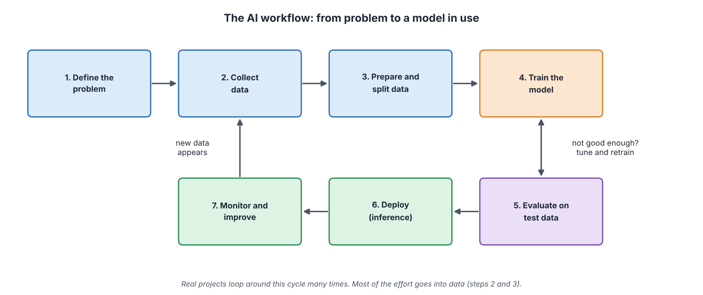
*Figure 3.1: The AI workflow. Source: created by our team.*

| Step | What happens | Bakery comparison |
|:----:|--------------|-------------------|
| 1. Define the problem | Decide what to predict and how success is measured. | Decide which cake to bake |
| 2. Collect data | Gather examples. | Buy ingredients |
| 3. Prepare and split | Clean the data, fix errors, split into training, validation and test sets. | Wash, measure and set aside some for tasting |
| 4. Train | The algorithm learns patterns and builds a model. | Bake following a recipe |
| 5. Evaluate | Test on data the model has not seen. | Let a stranger taste it |
| 6. Deploy | Put the model to work (inference). | Sell the cake |
| 7. Monitor and improve | Watch for mistakes and changes; retrain with new data. | Listen to customers and adjust |

**Where the analogy breaks:** a baker can taste mid-way and fix the recipe on the spot; an AI team must be careful to evaluate only on data the model never trained on, otherwise the "taste test" is unfair.

> **Pause and predict.** Which step do you think takes most of the effort in real projects?
>
> **Check:** Steps 2 and 3 (getting and preparing data). Practitioners often say that preparing data takes more time than building the model. If the data is poor, no clever algorithm can rescue it.

---

## 3.2 Data: The Fuel of AI

### Start with a question

If you wanted to teach a model to recognise ripe mangoes, would a million photos taken in the dark be better than a thousand good photos? Why?

### In plain words

**Data is the examples the model learns from.** Better, more varied examples usually make a better model.

### Key terms

| Term | In plain words | Example (house price) |
|------|----------------|-----------------------|
| **Dataset** | A collection of examples | A table of 1,000 sold houses |
| **Feature** | A fact about each example the model may use | Size, location, age |
| **Label** | The answer we want to predict (only in supervised learning) | The sale price |
| **Training data** | Examples used to learn | 700 of the houses |

### Types of data

| Type | Examples |
|------|----------|
| Structured (tables) | Spreadsheets, bank transactions |
| Text | Emails, books, web pages |
| Images and video | Photos, medical scans |
| Audio | Speech, music |
| Time series | Sensor readings, stock prices |

### Why data quality matters

A model learns whatever the data shows, including its mistakes. Common problems:

| Problem | Example | Result |
|---------|---------|--------|
| Too little data | Six emails for a spam filter | The model memorises accidents (Chapter 1) |
| Wrong labels | Spam marked as "not spam" | The model learns the wrong lesson |
| Missing groups | Face photos from only one region | The model fails on other people |
| Outdated data | Prices from ten years ago | Predictions no longer fit today |

**A rule worth remembering: garbage in, garbage out.**

### Splitting the data: why keep some back?

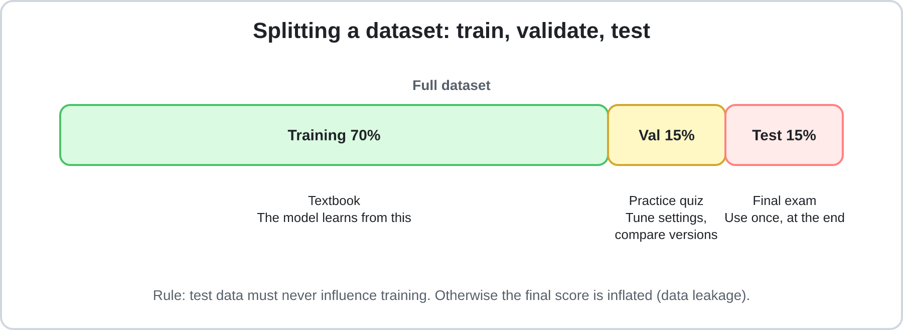
*Figure 3.2: Splitting a dataset. Source: created by our team (Stage 1).*

| Part | Purpose | Everyday comparison |
|------|---------|---------------------|
| Training set | The model learns from it | Textbook and practice questions |
| Validation set | Used to tune choices while building | A practice exam |
| Test set | Used once at the end for an honest score | The real exam |

**Rule:** the test set must never influence training. If it does, the final score is inflated (this mistake is called *data leakage*).

---

## 3.3 Algorithms and Models

### Start with a question

People use "algorithm" and "model" as if they were the same. They are not. What is the difference between a recipe and the cake?

### In plain words

An **algorithm** is the *method*. A **model** is the *result*. The learning algorithm studies data and produces a model; the model is then used for predictions.

| | Algorithm | Model |
|---|-----------|-------|
| What it is | A step-by-step method | What was learned |
| In the kitchen | The recipe | The finished cake |
| Example | "Count words and score them" (Chapter 1) | The score table |
| Changes when data changes? | No | Yes |

### Two basic kinds of prediction

| Task | Question it answers | Example |
|------|---------------------|---------|
| **Classification** | Which category? | Spam or not spam |
| **Regression** | What number? | The price of a house |

### Common algorithm families

| Family | Idea in one line | Good for |
|--------|------------------|----------|
| Linear models | Fit a straight line or weighted sum | Simple, explainable predictions |
| Decision trees | A flowchart of yes/no questions | Tabular data, explainable decisions |
| Nearest neighbours | "You are like your closest examples" | Small datasets |
| Neural networks | Many connected units learning patterns | Images, speech, language |

---

## 3.4 Machine Learning: Learning from Examples

### Start with a question

A child learns the word "dog" after seeing many dogs. Nobody wrote a rule. How can a computer do something similar with numbers?

### Three ways to learn

| Style | What the computer gets | Example | Where in this module |
|-------|------------------------|---------|----------------------|
| **Supervised learning** | Examples with correct labels | Photos labelled cat or dog | Chapters 1, 3, 5 |
| **Unsupervised learning** | Examples without labels; finds groups | Grouping customers by habits | Chapter 5 |
| **Reinforcement learning** | A world to act in, and rewards | A robot learning to walk | Chapter 6 |

### The learning loop

Almost all learning follows the same four steps:

1. **Predict.** The model makes a guess.
2. **Measure the error.** A number called the **loss** shows how wrong the guess was.
3. **Adjust.** Change the model slightly to reduce the loss.
4. **Repeat** with more examples until the loss stops improving.

### Worked example: finding the best number by walking downhill

Suppose the best value of a model setting *w* is 3, and we measure error with **loss = (w - 3)²**. The computer does not know this. It starts with a guess *w = 0*.

The *slope* of the loss tells which way is downhill. For this loss the slope is 2 × (w - 3). We update with a small step called the **learning rate** (here 0.1):

new w = old w - 0.1 × slope

| Round | w | Slope = 2(w-3) | Update | New w | Loss (w-3)² |
|:-----:|:-:|:--------------:|:------:|:-----:|:-----------:|
| 1 | 0 | -6 | 0 - 0.1×(-6) | 0.6 | 5.76 |
| 2 | 0.6 | -4.8 | 0.6 + 0.48 | 1.08 | 3.69 |
| 3 | 1.08 | -3.84 | 1.08 + 0.384 | 1.464 | 2.36 |

The loss keeps shrinking, and *w* moves toward 3. This method is called **gradient descent**. Real models do this for millions or billions of settings at once.

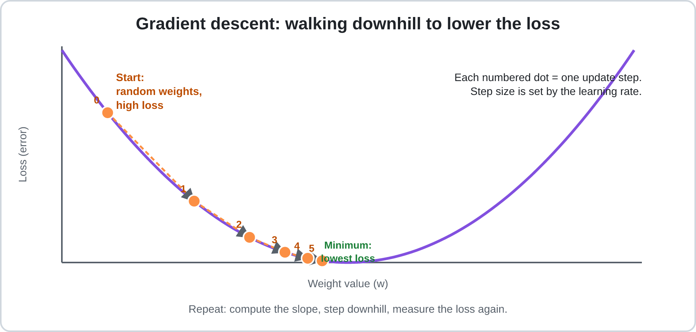
*Figure 3.3: Gradient descent. Source: created by our team (Stage 1).*

**Analogy: walking down a foggy hill.** You cannot see the valley, but you can feel which way the ground slopes under your feet, so you step downhill again and again.  
**Where the analogy breaks:** real loss landscapes have millions of dimensions, and the "valley" you reach may not be the lowest one.

### Overfitting and underfitting

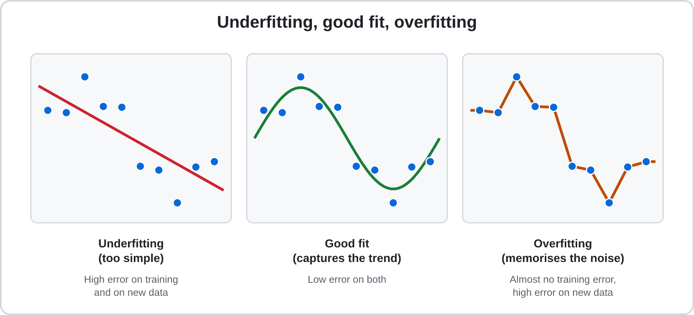
*Figure 3.4: Underfitting, good fit, and overfitting. Source: created by our team (Stage 1).*

| Situation | What it means | Everyday comparison | Typical sign |
|-----------|---------------|---------------------|--------------|
| **Underfitting** | The model is too simple to capture the pattern | Studying only the chapter titles | High error on training and new data |
| **Good fit** | Captures the real pattern | Understanding the topic | Low error on both |
| **Overfitting** | Memorises training examples, including noise | Memorising last year's answers | Low training error, high error on new data |

> **Pause and predict.** A model scores 99% on its training data but only 60% on the test set. What is the likely problem?
>
> **Check:** Overfitting. It learned the training examples (and their accidents) too well and does not generalise to new data.

---

## 3.5 Neural Networks and Deep Learning

### Start with a question

Your brain uses billions of simple cells connected together. Could a computer do something useful with a similar idea?

### In plain words

A **neural network** is many small calculators (neurons) joined in layers. Each connection has a *weight* (how strong it is). Learning means adjusting the weights.

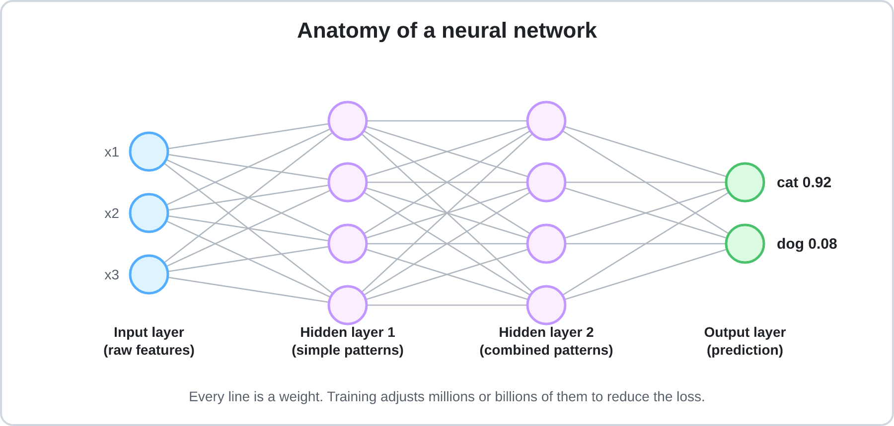
*Figure 3.5: Anatomy of a neural network. Source: created by our team (Stage 1).*

| Part | Role |
|------|------|
| Input layer | Receives the raw numbers (for example pixel values) |
| Hidden layers | Combine earlier signals to find patterns, from simple to complex |
| Output layer | Gives the result (for example: cat 0.92, dog 0.08) |
| Weights | The learned settings; training adjusts them |

**Deep learning** means neural networks with many hidden layers. Early layers may learn simple things (edges), later layers more complex things (eyes, faces). **Chapter 5 studies how a single neuron calculates and how different network designs work.**

---

## 3.6 How Modern Language AI Works

### Start with a question

When you type a question into a chatbot, it replies in fluent sentences. Does it look up an answer, or does it do something else?

### In plain words

A large language model (LLM) is a neural network trained to **predict the next small piece of text**, over and over. A long reply is built one piece at a time.

### Step 1: Tokens

Text is split into **tokens**: short pieces of words (for example "Under", "standing"). Each token becomes numbers the network can work with.

### Step 2: Next-token prediction

Given the text so far, the model gives a probability to every possible next token, then one is chosen. The new token is added, and the process repeats.

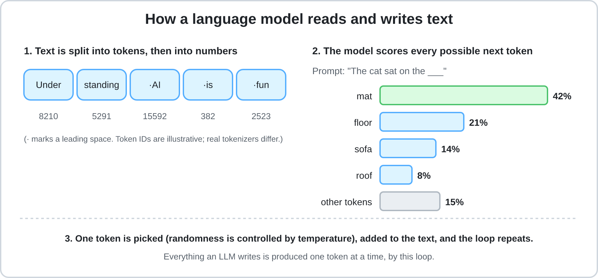
*Figure 3.6: Tokens and next-token prediction. Source: created by our team (Stage 1).*

### Step 3: Attention

To choose well, the model must know which earlier words matter. In "The animal didn't cross the street because it was too tired", the word "it" refers to "animal", not "street". The **attention** mechanism helps the model give more weight to the relevant words (Vaswani et al., 2017).

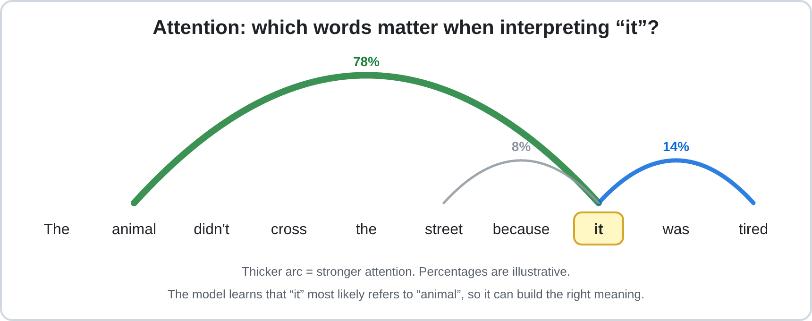
*Figure 3.7: Attention. The percentages are illustrative. Source: created by our team (Stage 1).*

### How an LLM is built

| Stage | What happens |
|-------|--------------|
| Pre-training | The model learns next-token prediction on a very large collection of text (Brown et al., 2020). |
| Fine-tuning | It is trained further on examples of good question-and-answer behaviour. |
| Feedback training | Human ratings of answers are used to nudge the model toward preferred behaviour (Ouyang et al., 2022). |

### Important properties

- **It generates likely text, not verified facts.** This is why it can state false things in a confident tone (Chapter 8 calls this *hallucination*).
- **It does not "look up" your question** unless it is connected to a search tool.
- **It is fixed during a chat.** Your conversation does not retrain it.

---

## 3.7 Training vs Inference

### In plain words

**Training** is learning. **Inference** is using what was learned.

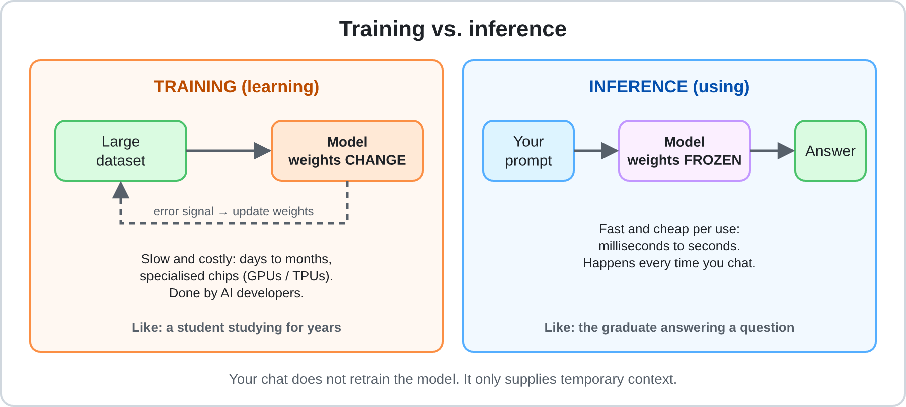
*Figure 3.8: Training vs inference. Source: created by our team (Stage 1).*

| | Training | Inference |
|---|----------|-----------|
| Purpose | Build or improve the model | Use the model |
| Model weights | Change | Fixed (frozen) |
| Cost | Very high (days to months of computing for large models) | Much lower per request |
| Who does it | AI developers | Every user, every time |
| Analogy | A student studying for years | The graduate answering a question |

---

## 3.8 Evaluating a Model

### Start with a question

A spam filter is "95% accurate". Is it good? Not necessarily. Imagine only 5 of 100 emails are spam. A filter that *never* flags anything is 95% accurate and completely useless. We need better measures.

### The confusion matrix

For a yes/no task, every prediction falls into one of four boxes.

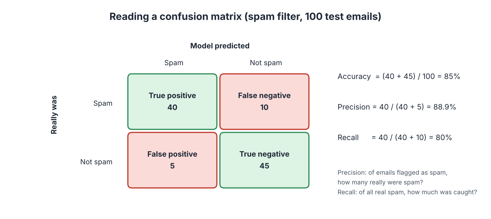
*Figure 3.9: A confusion matrix for a spam filter tested on 100 emails. Source: created by our team.*

| Box | Meaning |
|-----|---------|
| True positive (TP) | Spam correctly flagged |
| False negative (FN) | Spam missed |
| False positive (FP) | Real email wrongly flagged as spam |
| True negative (TN) | Real email correctly left alone |

### Key measures

| Measure | Formula | In words | Value for Figure 3.9 |
|---------|---------|----------|----------------------|
| Accuracy | (TP + TN) / total | Share of all predictions that were right | 85 / 100 = 85% |
| Precision | TP / (TP + FP) | When it says "spam", how often is it right? | 40 / 45 = 88.9% |
| Recall | TP / (TP + FN) | Of all real spam, how much did it catch? | 40 / 50 = 80% |

**Which matters more depends on the cost of mistakes.** For a spam filter, a false positive (a real email lost) may hurt more, so precision matters. For a cancer-screening tool, a false negative (a missed case) is dangerous, so recall matters.

---

## 3.9 Mission 1: Be the Learner

> **Goal:** feel what "training" is by finding the best setting by hand.  
> **Preparation:** Sections 3.4 and 3.8. A calculator or pen, 10 minutes.  
> **Task:** a tiny dataset of house sizes and prices (price in thousands). The model is **price = w × size**. Your job is to find the best *w*.

| House | Size (m²) | Real price |
|:-----:|:---------:|:----------:|
| A | 30 | 60 |
| B | 50 | 100 |
| C | 70 | 140 |

**Part A. Try three settings.** For each *w*, compute the predictions and the total error (add up the gaps between prediction and real price, ignoring the sign).

| w | Prediction A | Prediction B | Prediction C | Total error |
|:-:|:------------:|:------------:|:------------:|:-----------:|
| 1.5 | ____ | ____ | ____ | ____ |
| 2.0 | ____ | ____ | ____ | ____ |
| 2.5 | ____ | ____ | ____ | ____ |

**Part B. Use the best model.** What price does it predict for a 90 m² house? ____

**Part C. Think.** The same model predicts 400 for a 200 m² house. Should you trust it? Why or why not?

> **Observe:** which *w* gave the smallest total error?  
> **Reflect:** how is what you just did similar to what gradient descent does automatically?  
> **Feedback:** compare with the Answer Key (Mission 1).

---

## 3.10 Mission 2: Judge the Filter

> **Goal:** compute and interpret accuracy, precision and recall.  
> **Preparation:** Section 3.8. 10 minutes.  
> **Task:** Filter X was tested on 100 emails. Results: TP = 30, FN = 20, FP = 2, TN = 48.

**Part A.** Fill in the table.

| Measure | Calculation | Result |
|---------|-------------|:------:|
| Accuracy | ______ | ____ |
| Precision | ______ | ____ |
| Recall | ______ | ____ |

**Part B. Choose.** Compare Filter X with the filter in Figure 3.9 (precision 88.9%, recall 80%). A user says: "I hate losing real emails, but I can tolerate some spam." Which filter fits better? Why?

**Part C. The accuracy trap.** A filter is tested on 100 emails of which only 5 are spam. It predicts "not spam" for everything. What is its accuracy? What is its recall?

> **Observe:** which measure changed most between Filter X and the filter in Figure 3.9?  
> **Reflect:** why can a high accuracy hide a poor filter?  
> **Feedback:** compare with the Answer Key (Mission 2).

---

## 3.11 Common Misconceptions

| Misconception | Correction |
|---------------|------------|
| "More data always fixes everything." | Quantity helps only if the data is relevant, correct and varied. |
| "The model understands like a person." | It learns statistical patterns; understanding is debated. |
| "A chatbot learns from our conversation as we talk." | Deployed models are normally fixed unless retrained. |
| "High accuracy means a good model." | Accuracy can hide failures, especially when classes are unbalanced. |
| "Training and inference are the same." | Training changes the model; inference uses it. |

---

## 3.12 Quick Check

**Q1 (True/False).** The test set may be used to adjust the model while training.

**Q2 (True/False).** Overfitting means low error on training data but high error on new data.

**Q3 (True/False).** During inference, the model's weights change with each user request.

**Q4 (Multiple choice, one answer).** Which task is regression?
A. Deciding whether an email is spam. B. Predicting a house price. C. Sorting photos into cats and dogs. D. Deciding whether a tumour is malignant.

**Q5 (Multiple choice, one answer).** A model has precision 90% and recall 40%. What does this mean?
A. It rarely raises false alarms but misses many real cases. B. It catches almost all real cases. C. It is always wrong. D. It was never tested.

**Q6 (Multiple choice, one answer).** What does an LLM do at each step of writing a reply?
A. Looks up the full answer in a database. B. Predicts the next token from the text so far. C. Copies an answer from the user. D. Re-trains itself.

**Q7 (Short answer, 3 to 4 sentences).** Explain why preparing data often takes more effort than choosing an algorithm.

---

## 3.13 Summary, Connections and References

### Key takeaways

- The AI workflow runs from defining the problem to monitoring and improving. Data steps take much of the effort.
- Data quality limits model quality ("garbage in, garbage out"). Keep the test set separate.
- An algorithm is the method; a model is what is learned.
- Learning repeats: predict, measure the loss, adjust, repeat. Gradient descent adjusts in the downhill direction.
- Overfitting is memorising; underfitting is being too simple.
- Language models predict the next token; they do not verify facts.
- Training changes the model; inference uses it.
- Accuracy alone can mislead; use precision and recall too.

### Connections to other chapters

| Direction | Chapter | Link |
|-----------|---------|------|
| Builds on | Chapter 1 | Data, model, training and inference |
| Builds on | Chapter 2 | Limited-memory AI and generative AI |
| Leads to | Chapter 4 | An alternative: rules written by people |
| Leads to | Chapter 5 | Neural networks and Big Data in depth |
| Leads to | Chapter 6 | Learning from rewards |
| Leads to | Chapter 8 | Hallucination and data bias |

### How this chapter will be reused

| Resource | Planned use |
|----------|-------------|
| **Study Guide** | Sections 3.1 to 3.8 are the reading text; Missions 1 and 2 are hands-on activities. |
| **Test Bank** | Metric calculations, overfitting scenarios and workflow ordering become exam-style items. |
| **PPT Slides** | The workflow, the downhill walk, the confusion matrix and the fitting chart become step-by-step visuals. |
| **Video Tutorial** | A video that animates gradient descent and walks through the confusion matrix calculation. |

---

## Answer Key

**Mission 1: Be the Learner**

Part A:

| w | Prediction A | Prediction B | Prediction C | Total error |
|:-:|:------------:|:------------:|:------------:|:-----------:|
| 1.5 | 45 | 75 | 105 | 15 + 25 + 35 = 75 |
| 2.0 | 60 | 100 | 140 | 0 |
| 2.5 | 75 | 125 | 175 | 15 + 25 + 35 = 75 |

Part B: with *w* = 2.0, price = 2.0 × 90 = **180**.
Part C: be careful. The model only saw sizes from 30 to 70 m². 200 m² is far outside that range, and the real relationship may change (for example, very large houses cost differently). A model is most reliable near the data it learned from.
*Observe/Reflect:* *w* = 2.0 gave zero error. Gradient descent also tries values and moves toward lower error, but automatically and in tiny steps.

**Mission 2: Judge the Filter**

Part A (TP 30, FN 20, FP 2, TN 48):

| Measure | Calculation | Result |
|---------|-------------|:------:|
| Accuracy | (30 + 48) / 100 | 78% |
| Precision | 30 / (30 + 2) | 93.75% (about 93.8%) |
| Recall | 30 / (30 + 20) | 60% |

Part B: Filter X has higher precision (93.8% vs 88.9%), meaning fewer real emails wrongly flagged, so it fits a user who hates losing real emails. The cost is lower recall (60% vs 80%): more spam gets through.
Part C: accuracy = 95 / 100 = **95%**, but recall = 0 / 5 = **0%**. It catches no spam at all, which is why accuracy alone is misleading.

**Quick Check**

1. **False.** The test set must stay unseen; using it causes data leakage.
2. **True.**
3. **False.** Weights are frozen during inference.
4. **B.**
5. **A.** High precision, low recall.
6. **B.**
7. *Key points:* real data is messy (errors, missing values, inconsistent formats); the model can only learn what the data shows; fixing and splitting data correctly prevents misleading scores; standard algorithms are already available while data is specific to the project.

---

## Glossary

| Term | Meaning |
|------|---------|
| Accuracy | Share of all predictions that are correct. |
| Algorithm | A step-by-step method; for learning, the method that builds a model. |
| Attention | A mechanism that lets a model weigh which earlier words matter most. |
| Classification | Predicting a category. |
| Confusion matrix | A table of true/false positives and negatives. |
| Data leakage | Test information accidentally used in training. |
| Dataset | A collection of examples. |
| Feature | A fact about an example used by the model. |
| Gradient descent | Repeatedly adjusting settings in the direction that lowers the loss. |
| Inference | Using a trained model on new data. |
| Large language model (LLM) | A neural network trained to predict the next token in text. |
| Learning rate | The size of each adjustment step. |
| Loss | A number measuring how wrong the model's predictions are. |
| Overfitting | Memorising training data so that new data is handled badly. |
| Precision | Of the items flagged positive, the share that really are. |
| Recall | Of all real positives, the share that were found. |
| Regression | Predicting a number. |
| Token | A small piece of text used by language models. |
| Underfitting | A model too simple to capture the pattern. |

---

## References

1. Goodfellow, I., Bengio, Y., & Courville, A. (2016). *Deep Learning*. MIT Press. https://www.deeplearningbook.org/
2. Google for Developers. *Machine Learning Crash Course*. https://developers.google.com/machine-learning/crash-course
3. James, G., Witten, D., Hastie, T., & Tibshirani, R. (2021). *An Introduction to Statistical Learning* (2nd ed.). Springer. https://www.statlearning.com/
4. Vaswani, A., et al. (2017). Attention is all you need. *Advances in Neural Information Processing Systems*, 30. https://arxiv.org/abs/1706.03762
5. Brown, T. B., et al. (2020). Language models are few-shot learners. *arXiv*:2005.14165. https://arxiv.org/abs/2005.14165
6. Ouyang, L., et al. (2022). Training language models to follow instructions with human feedback. *arXiv*:2203.02155. https://arxiv.org/abs/2203.02155
7. Russell, S., & Norvig, P. (2021). *Artificial Intelligence: A Modern Approach* (4th ed.). Pearson. https://aima.cs.berkeley.edu/
8. Sanderson, G. (3Blue1Brown). *But what is a neural network?* (video). https://www.youtube.com/watch?v=aircAruvnKk

> Figures 3.1 and 3.9 were created for Stage 2. Figures 3.2 to 3.8 are team-made figures from Stage 1.

---

# Symbolic AI: Intelligence from Rules and Logic

**Audience:** Learners with no technical background in AI  
**Estimated time:** 3 to 4 hours (including missions)  
**Format:** Read, pause at each "Pause and predict" box, complete the two missions, then check the answer key at the end of the chapter.

---

## Learning Outcomes

After this chapter, you should be able to:

1. Explain what symbolic AI is and how it differs from learning from data.
2. Use simple logic (AND, OR, NOT, IF-THEN) to read and write rules.
3. Describe three ways of representing knowledge: rules, semantic networks and frames.
4. Name the parts of an expert system and trace forward chaining step by step.
5. Explain state-space search and compare breadth-first and depth-first search.
6. Calculate the best move in a small game tree using minimax.
7. State the strengths and limits of symbolic AI and explain why it is still used today.

## Where This Chapter Fits

**Builds on Chapters 1 to 3.** Chapter 1 introduced the "rule or learn?" question. Chapter 3 showed the *learning* approach. This chapter shows the other classic approach: people write the knowledge down, and the computer reasons with it.

**Leads to Chapters 5 and 6.** Chapter 5 covers the connectionist approach (networks that learn). Chapter 6 covers the behaviorist approach (learning from rewards). Together, Chapters 4 to 6 are the three "schools" of AI taught in this module.

---

## 4.1 The Big Picture

### Start with a question

Imagine you give a friend a very detailed instruction manual for repairing bicycles. Your friend has never touched a bicycle, yet follows the manual step by step and fixes a flat tyre. Is your friend "intelligent"? The manual did the thinking, and your friend only followed it. **Symbolic AI is the computer version of this idea.**

### In plain words

**Symbolic AI is AI built from knowledge that people write down as symbols and rules.** A *symbol* is a name for a thing or an idea, such as `Cat`, `Mammal` or `has_fever`. The computer does not learn the rules from examples. It is *given* them, and it combines them by logic to reach conclusions.

Because the rules are written by people, this style is also called **rule-based AI**, **knowledge-based AI**, or **"good old-fashioned AI" (GOFAI)** (Haugeland, 1985).

### Short history

| Year | Event | Why it matters |
|:----:|-------|----------------|
| 1956 | *Logic Theorist* program proves mathematical theorems; the Dartmouth workshop names the field "AI" | Shows a computer can reason with symbols |
| 1976 | Newell and Simon state the **physical symbol system hypothesis**: manipulating symbols is enough for intelligence (Newell & Simon, 1976) | The core belief of this school |
| 1970s | *MYCIN* suggests treatments for blood infections using about 600 rules | A famous early expert system (Shortliffe, 1976) |
| 1980s | Companies build many commercial expert systems | The first big business wave of AI |
| Late 1980s to 1990s | Expert systems turn out costly to maintain; funding falls ("AI winter") | Shows the limits of hand-written knowledge |
| 1997 | *Deep Blue* beats world chess champion Garry Kasparov using search (Campbell et al., 2002) | Search at huge speed can beat humans in a narrow game |

### Where it sits in the big picture

Symbolic AI is the **rules-first** side of the "rule or learn?" question from Chapter 1.

| | Symbolic AI (this chapter) | Learning from data (Chapters 3 and 5) |
|---|---|---|
| Where knowledge comes from | Written by people | Found in data |
| What you can inspect | Every rule | Millions of numbers (weights) |
| Good at | Clear logic, exact procedures, explanation | Messy inputs: images, speech, language |
| Weak at | Situations nobody wrote a rule for | Explaining why it decided something |

**Analogy: an instruction manual.** The computer follows a manual written by experts.  
**Where the analogy breaks:** a human reader can notice that the manual is wrong or incomplete and improvise. A rule-based program cannot; it only does what the rules say.

---

## 4.2 Logic: The Language of Rules

### Start with a question

"If it rains and I have no umbrella, then I get wet." Can a computer check whether this sentence is true in a given situation? Yes, if we write it in a very exact form. That form is **logic**.

### In plain words

**Logic is a way of writing statements so that a computer can check them without guessing.** The simplest kind is *propositional logic*. A **proposition** is a statement that is either **true** or **false**, for example "It is raining".

### The four building blocks

| Word | Meaning | Everyday example |
|------|---------|------------------|
| **AND** | True only if both parts are true | "It rains AND I have no umbrella" |
| **OR** | True if at least one part is true | "I have a bus pass OR I have cash" |
| **NOT** | Flips true to false | "NOT raining" |
| **IF ... THEN** | If the first part is true, the second must be true | "IF raining THEN the road is wet" |

### Truth table

A *truth table* lists every possible case. Here P and Q are two statements.

| P | Q | P AND Q | P OR Q | NOT P |
|:-:|:-:|:-------:|:------:|:-----:|
| True | True | True | True | False |
| True | False | False | True | False |
| False | True | False | True | True |
| False | False | False | False | True |

### The key reasoning step: modus ponens

*Modus ponens* is Latin for "mode that affirms". The idea is simple:

1. **Rule:** IF it is raining THEN the road is wet.
2. **Fact:** It is raining.
3. **Conclusion:** The road is wet.

This one step, repeated many times, is the engine of rule-based AI.

### A stronger language: predicate logic

Propositional logic treats each sentence as a block. **Predicate logic** looks inside a sentence and talks about *things* and their *properties*. For example:

- `Cat(Tom)` means "Tom is a cat".
- `For all x: IF Cat(x) THEN Mammal(x)` means "every cat is a mammal".
- From these two, a computer concludes `Mammal(Tom)`.

> **Pause and predict.** A rule says "IF the soil is dry THEN water the plant". The fact is "the soil is wet". Can the computer conclude "do not water the plant"?
>
> **Check:** No. The rule only says what to do when the soil is dry. It says nothing about wet soil. To conclude "do not water", someone must write another rule. Computers conclude only what the rules allow.

---

## 4.3 Knowledge Representation

### Start with a question

Where does a computer "keep" what it knows? In a learning system, knowledge is hidden in numbers. In symbolic AI, it is written in a form people can read. Choosing *how* to write it is called **knowledge representation**.

### In plain words

**Knowledge representation is the way facts and rules are organised so that a computer can use them.** A good representation is clear for people and efficient for the computer.

### Three common forms

| Form | Idea | Small example |
|------|------|---------------|
| **Rules** | IF-THEN statements | IF fever AND cough THEN suspect flu |
| **Semantic network** | A map of concepts joined by relations | Cat *is a* Mammal; Mammal *is an* Animal |
| **Frame** | A form with slots to fill in | Frame *Cat*: legs = 4, covering = fur, sound = meow |

### Semantic network

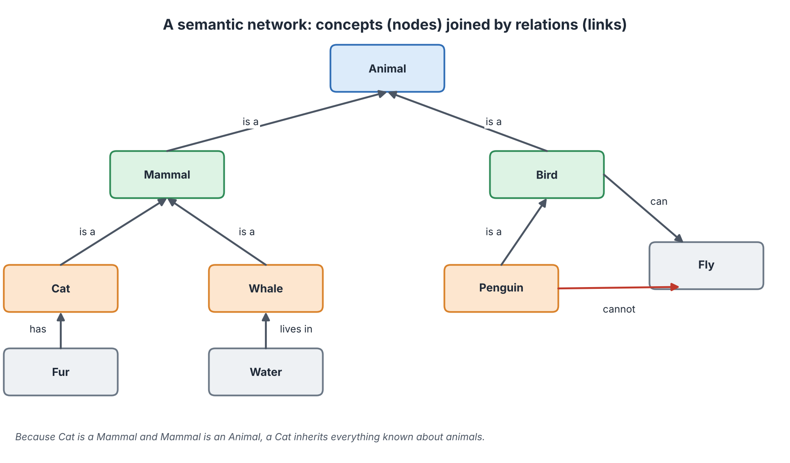
*Figure 4.1: A semantic network. Source: created by our team.*

How to read Figure 4.1:

- Each box is a **concept** (called a node).
- Each arrow is a **relation** (called a link) with a label such as "is a".
- **Inheritance:** because Cat *is a* Mammal and Mammal *is an* Animal, a Cat automatically inherits what is known about animals. We do not need to write "a cat is an animal" separately.
- **Exceptions:** Birds *can* fly, but a Penguin is a Bird that *cannot*. The network records the exception on Penguin. This shows why real knowledge is untidy: almost every general rule has exceptions.

**Analogy: a family tree for ideas.** Traits pass downward from parents to children.  
**Where the analogy breaks:** in a family tree you cannot "choose" a different parent, but in a knowledge network the same concept can belong to many groups at once (a dolphin is both a Mammal and a Swimmer).

---

## 4.4 Expert Systems

### Start with a question

A rare-disease specialist cannot be in every hospital. Could we copy part of the specialist's knowledge into a program that any doctor can ask? That was the dream behind expert systems.

### In plain words

**An expert system is a program that uses rules collected from human experts to give advice in one narrow field.** It acts like a specialist you can consult on a computer.

### Parts of an expert system

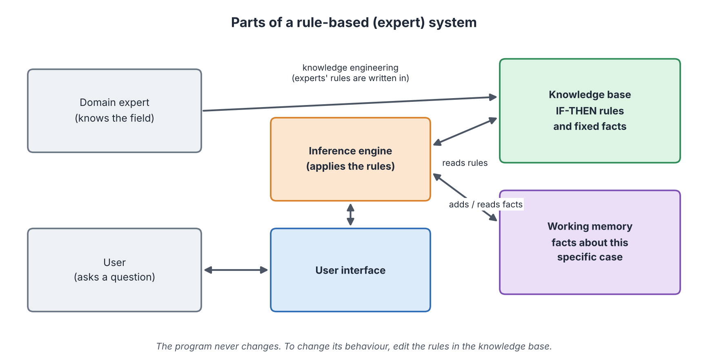
*Figure 4.2: Parts of a rule-based (expert) system. Source: created by our team.*

| Part | Role | Plant-care example |
|------|------|--------------------|
| **Knowledge base** | The stored rules and fixed facts | "IF leaves yellow AND soil wet THEN overwatered" |
| **Working memory** | Facts about the current case | "Leaves yellow; soil wet" |
| **Inference engine** | The part that applies the rules to the facts | Matches rules to facts and adds conclusions |
| **User interface** | How the user asks and gets answers | A form or chat window |
| **Domain expert** | The human whose knowledge is written in | A gardener |

A key design idea: **the program never changes. To change its behaviour you edit the rules.** This makes the system easy to inspect and update, as long as the rules stay small in number.

### Two ways to reason

| Method | Starts from | Question it answers | Example |
|--------|-------------|---------------------|---------|
| **Forward chaining** | The known facts | "What follows from what I know?" | Facts: yellow leaves, wet soil. Conclude: overwatered. |
| **Backward chaining** | A goal to test | "What would have to be true for this goal?" | Goal: "overwatered?" Check: are leaves yellow? Is soil wet? |

### Worked example: forward chaining in steps

Rules:

| Rule | Condition | Conclusion |
|:----:|-----------|------------|
| R1 | Leaves yellow AND soil wet | Plant is overwatered |
| R2 | Plant is overwatered | Stop watering |
| R3 | Leaves yellow AND soil dry | Plant is underwatered |
| R4 | Plant is underwatered | Water now |

Case: leaves yellow, soil wet.

| Round | Rule checked | Do the facts match? | New fact added |
|:-----:|:------------:|:-------------------:|----------------|
| 1 | R1 | Yes (yellow, wet) | Plant is overwatered |
| 1 | R3 | No (soil is not dry) | none |
| 2 | R2 | Yes (overwatered is now a fact) | Stop watering |
| 2 | R4 | No | none |
| 3 | all | Nothing new can fire | **Stop.** Final advice: stop watering |

The engine repeats "find a rule that matches, add its conclusion" until nothing new appears. This is called *chaining* because one conclusion becomes the condition for the next rule.

### Famous examples

| System | Field | What it did |
|--------|-------|-------------|
| **DENDRAL** (1960s) | Chemistry | Inferred molecular structure from measurement data |
| **MYCIN** (1970s) | Medicine | Suggested antibiotics for blood infections; reported to match expert panels in tests, but was never used routinely in clinics (Buchanan & Shortliffe, 1984) |

### The main weakness: the knowledge bottleneck

**Knowledge engineering** is the work of interviewing experts and turning what they know into rules. It is slow and costly. Experts often cannot explain their own intuition in clear rules. And as rules grow into the thousands, they begin to conflict. This "knowledge bottleneck" is a main reason expert systems lost ground to learning from data.

---

## 4.5 Search: Finding a Path to a Goal

### Start with a question

You are in a city you do not know and need to reach a station. You try one street, hit a dead end, return, and try another. That trial-and-return process is what AI calls **search**.

### In plain words

**Search means exploring possible steps one after another until a goal is found.** To do this, a problem is described using three things:

| Term | In plain words | Puzzle example |
|------|----------------|----------------|
| **State** | One snapshot of the situation | "Farmer and goat on the right bank" |
| **Action** | A move that changes the state | "Farmer rows across with the goat" |
| **Goal** | The state we want | "Everyone on the right bank, nobody eaten" |

All possible states and moves together are called the **state space**.

### Example: the river-crossing puzzle

A farmer must carry a wolf, a goat and a cabbage across a river. The boat holds the farmer and only one item. The wolf must never be left alone with the goat, and the goat must never be left alone with the cabbage.

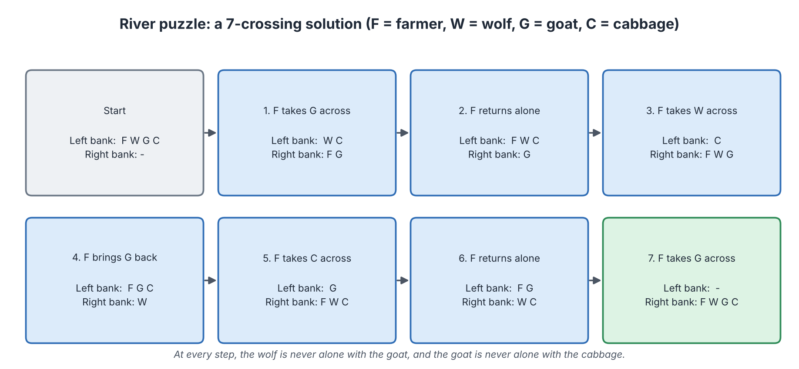
*Figure 4.3: A 7-crossing solution. Source: created by our team.*

Notice the clever step 4: the farmer brings the goat **back**. A search program finds such steps automatically because it tries every legal move and rejects the unsafe ones.

### Two basic search orders

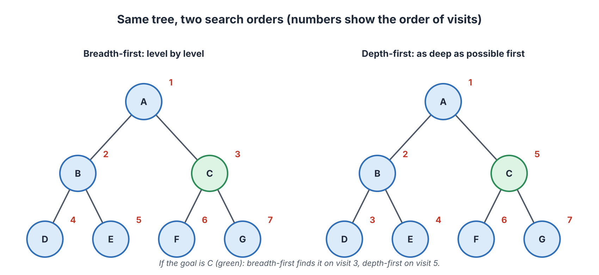
*Figure 4.4: Breadth-first and depth-first search on the same tree. Source: created by our team.*

| | Breadth-first search (BFS) | Depth-first search (DFS) |
|---|---------------------------|--------------------------|
| Idea | Check everything one step away, then everything two steps away, and so on | Follow one path as deep as possible, then back up |
| Order in Figure 4.4 | A, B, C, D, E, F, G | A, B, D, E, C, F, G |
| Everyday comparison | Searching every room on the ground floor, then every room on the next floor | Opening one door and following the corridor until it ends |
| Finds the shortest path? | Yes (when each step costs the same) | Not always |
| Memory needed | Often large | Often small |

### Smarter search: heuristics

Real problems have far too many states to check all. A **heuristic** is a rule of thumb that estimates which choice is more promising. For example, when finding a route, "prefer the road that points toward the destination". The well-known **A\*** algorithm combines the cost so far with a heuristic estimate of the cost left (Hart et al., 1968).

---

## 4.6 Game Playing and Minimax

### Start with a question

When you play a board game, you think "if I move here, what will my opponent do? and then what will I do?" Computers can do the same, much faster.

### In plain words

**Minimax is a method for choosing the best move when an opponent is also trying to win.** We build a *game tree*: each branch is a possible move. At the end of each branch we write a **score** from our point of view (higher is better for us).

Two players take turns:

- **MAX** (you) always picks the **largest** score.
- **MIN** (your opponent) always picks the **smallest** score, because that is worst for you.

### Worked example

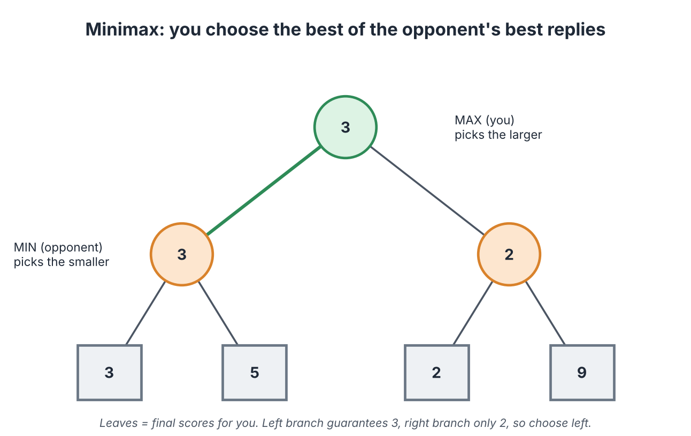
*Figure 4.5: Minimax. Source: created by our team.*

Work from the bottom up:

1. Left MIN node sees leaves 3 and 5. The opponent picks the smaller: **3**.
2. Right MIN node sees leaves 2 and 9. The opponent picks the smaller: **2**.
3. The root (MAX) compares 3 and 2 and picks the larger: **3**, so we go left.

Notice what we did: we did not hope for the 9. We assumed the opponent plays well and chose the move that gives the best *guaranteed* result.

### Making it practical

- Real games have too many moves to look at all. Chess has very roughly 35 legal moves in a typical position, so looking ahead many moves creates an enormous tree.
- **Alpha-beta pruning** skips branches that cannot change the final choice, which saves a great deal of work without changing the result.
- An **evaluation function** estimates how good a position is when the program must stop looking ahead (for example, counting piece values in chess).
- Deep Blue combined fast search, an evaluation function, and special chess hardware (Campbell et al., 2002).

---

## 4.7 Strengths, Limits and Today's Use

### Strengths

| Strength | Why it matters |
|----------|----------------|
| **Explainable** | You can show which rules led to a decision. |
| **Predictable** | The same input always gives the same output. |
| **Needs little data** | Rules come from experts, not from millions of examples. |
| **Easy to correct** | If a rule is wrong, you edit that rule. |

### Limits

| Limit | Meaning |
|-------|---------|
| **Brittleness** | The system fails sharply on a case outside its rules. |
| **Knowledge bottleneck** | Collecting and maintaining rules is slow and expensive. |
| **Common sense** | Everyday knowledge ("water is wet, cups hold liquids") is huge and hard to write down. |
| **Messy input** | Rules cannot easily read a photo or a voice recording. |
| **Uncertainty** | Basic rules are true or false; the real world is often "probably". |

### Still used today

Symbolic methods have not disappeared. You will find them in tax and legal rule checkers, configuration tools (for example, which parts fit together), scheduling, route planning and the logic inside many business systems. Researchers also combine them with neural networks in **neuro-symbolic AI**, aiming to join learning with reasoning and explanation (Garcez & Lamb, 2023). Chapter 7 shows where these methods appear in applications.

---

## 4.8 Mission 1: Be the Inference Engine

> **Goal:** act like the inference engine and trace forward chaining by hand.  
> **Preparation:** Section 4.4. Pen and 10 minutes.  
> **Task:** a plant-care helper has these rules.

| Rule | Condition | Conclusion |
|:----:|-----------|------------|
| R1 | Leaves yellow AND soil wet | Overwatered |
| R2 | Overwatered | Stop watering |
| R3 | Leaves yellow AND soil dry | Underwatered |
| R4 | Underwatered | Water now |
| R5 | Brown leaf tips AND air is dry | Mist the plant |
| R6 | Overwatered AND brown leaf tips | Check the roots for rot |

**Part A. Trace a case.** Facts: leaves yellow, soil wet, brown leaf tips, air dry. Fill in the table. (Write "none" if nothing is added.)

| Round | Rule that fires | New fact added |
|:-----:|:---------------:|----------------|
| 1 | ____ | ____ |
| 1 | ____ | ____ |
| 2 | ____ | ____ |
| 2 | ____ | ____ |
| 3 | ____ | ____ |

**Part B. Change one fact.** Now the soil is dry (everything else the same). Which rules fire and what is the final advice? ____

**Part C. Find the gap.** A user says "the leaves are yellow and the soil feels damp". Which rule fires? What does this show about symbolic AI?

> **Observe:** which new conclusions needed an earlier conclusion first?  
> **Reflect:** what did the engine do that a human might do differently? Where did you need to "think" beyond the rules?  
> **Feedback:** compare with the Answer Key (Mission 1).

---

## 4.9 Mission 2: Search and Minimax

> **Goal:** trace two search orders and compute a minimax decision.  
> **Preparation:** Sections 4.5 and 4.6. 10 to 15 minutes.

**Part A. Search order.** Use the tree in Figure 4.4 (A at the top; B and C below; D, E under B; F, G under C).

| Goal | Visit number in breadth-first | Visit number in depth-first |
|:----:|:-----------------------------:|:---------------------------:|
| D | ____ | ____ |
| C | ____ | ____ |

**Part B. Minimax.** In this small game, MAX moves first and then MIN replies. Each MIN node has two possible final scores.

| MIN node | Leaf scores | Value MIN picks |
|:--------:|:-----------:|:---------------:|
| Left | 4 and 8 | ____ |
| Right | 6 and 7 | ____ |

Which move should MAX choose, and what result is guaranteed? ____

**Part C. Think.** A friend says: "A computer can play chess perfectly by trying every possible move with minimax." Give two reasons this does not work in practice.

> **Observe:** was the largest leaf score (8) the result MAX received? Why not?  
> **Reflect:** why is "assume the opponent plays well" a sensible rule for MAX?  
> **Feedback:** compare with the Answer Key (Mission 2).

---

## 4.10 Common Misconceptions

| Misconception | Correction |
|---------------|------------|
| "Symbolic AI is outdated and no longer used." | It is still used in rule checkers, planning, scheduling and business logic, and it is being combined with learning. |
| "An expert system learns from its mistakes." | A classic expert system only changes when people edit its rules. |
| "Following rules means no intelligence is needed." | Choosing, organising and chaining rules to solve a hard problem is real problem solving, although narrow. |
| "Search tries moves at random." | Search is systematic; heuristics make it smarter, not random. |
| "Minimax means expecting the opponent to blunder." | It assumes the opponent plays their best. |

---

## 4.11 Quick Check

**Q1 (True/False).** In symbolic AI the rules are normally written by people.

**Q2 (True/False).** Forward chaining starts from a goal and works backward.

**Q3 (True/False).** Depth-first search visits all nodes at one level before moving down.

**Q4 (Multiple choice, one answer).** Which part of an expert system applies the rules to the facts?
A. Knowledge base. B. Inference engine. C. Working memory. D. User interface.

**Q5 (Multiple choice, one answer).** In minimax, what does the MIN player choose?
A. The largest score. B. A random score. C. The smallest score (worst for MAX). D. The first score.

**Q6 (Multiple choice, one answer).** Which is a known weakness of symbolic AI?
A. It cannot be explained. B. It needs millions of examples. C. It fails on cases outside its rules. D. It cannot follow logic.

**Q7 (Short answer, 3 to 4 sentences).** Explain why Penguin is a problem for the rule "Birds can fly", and what it shows about writing knowledge as rules.

---

## 4.12 Summary, Connections and References

### Key takeaways

- Symbolic AI uses symbols, logic and rules written by people.
- The basic reasoning step is modus ponens: IF A THEN B, A is true, so B is true.
- Knowledge can be kept as rules, semantic networks or frames.
- An expert system = knowledge base + working memory + inference engine + interface.
- Search explores states and actions; breadth-first and depth-first differ in order; heuristics guide the choice.
- Minimax picks the move with the best guaranteed result against a best-playing opponent.
- Strengths: explainable and predictable. Limits: brittle, costly to build, poor with messy data.

### Connections to other chapters

| Direction | Chapter | Link |
|-----------|---------|------|
| Builds on | Chapter 1 | The "rule or learn?" question |
| Builds on | Chapter 2 | Narrow, reactive AI (chess programs) |
| Builds on | Chapter 3 | Learning from data, the contrast to rules |
| Leads to | Chapter 5 | The connectionist approach: learning in networks |
| Leads to | Chapter 6 | Learning by reward instead of by rules |
| Leads to | Chapter 7 | Rule-based tools and game AI in applications |
| Leads to | Chapter 8 | Explainability and accountability |

### How this chapter will be reused

| Resource | Planned use |
|----------|-------------|
| **Study Guide** | Sections 4.1 to 4.7 are the reading text; Missions 1 and 2 are practice. |
| **Test Bank** | Forward-chaining traces, search order and minimax become exam items. |
| **PPT Slides** | The expert system diagram, the BFS/DFS trees and the minimax tree become step-by-step slides. |
| **Video Tutorial** | A video that animates a forward-chaining trace and a minimax calculation. |

---

## Answer Key

**Mission 1: Be the Inference Engine**

Part A (facts: leaves yellow, soil wet, brown leaf tips, air dry):

| Round | Rule that fires | New fact added |
|:-----:|:---------------:|----------------|
| 1 | R1 | Overwatered |
| 1 | R5 | Mist the plant |
| 2 | R2 | Stop watering |
| 2 | R6 | Check the roots for rot |
| 3 | none | none (nothing new; stop) |

(R3 and R4 never fire because the soil is not dry. Rules R2 and R6 need the fact "Overwatered", which exists only after R1 fires.)

Part B: with dry soil, R3 fires (Underwatered), then R4 fires (Water now), and R5 still fires (Mist the plant). R1, R2 and R6 do not fire. Final advice: water now and mist the plant.

Part C: no rule fires, because no rule mentions "damp". The system gives no advice. This shows **brittleness**: the system cannot handle a case that is close to, but not exactly, what the rules describe. A human would guess that "damp" is close to "wet".

**Mission 2: Search and Minimax**

Part A:

| Goal | Breadth-first | Depth-first |
|:----:|:-------------:|:-----------:|
| D | 4 | 3 |
| C | 3 | 5 |

(Breadth-first order A, B, C, D, E, F, G; depth-first order A, B, D, E, C, F, G.)

Part B: Left MIN picks min(4, 8) = **4**. Right MIN picks min(6, 7) = **6**. MAX picks the larger, 6, so MAX chooses the **right** move and is guaranteed at least **6**.

Part C: examples of good reasons: (1) the number of possible move sequences is astronomically large, so there is not enough time or memory to explore them all; (2) real programs must stop early and use an evaluation function (an estimate), so the result is not "perfect"; (3) the program only works if the game rules and scoring are fully written down.
*Observe:* No. The 8 is under the MIN node on the left, and MIN would choose 4 instead. *Reflect:* if you plan for a weaker opponent, a strong opponent will punish you; planning for the best opponent protects you.

**Quick Check**

1. **True.**
2. **False.** That is backward chaining; forward chaining starts from facts.
3. **False.** That describes breadth-first search.
4. **B.**
5. **C.**
6. **C.**
7. *Key points:* the rule says birds fly, but penguins are birds that cannot; so every general rule needs an exception; there may be many exceptions (injured birds, flightless birds); writing knowledge as rules means anticipating exceptions, which is hard and never finished.

---

## Glossary

| Term | Meaning |
|------|---------|
| A\* | A search method that combines cost so far with an estimate of cost remaining. |
| Alpha-beta pruning | A way to skip branches in a game tree that cannot change the result. |
| Backward chaining | Reasoning from a goal back to the facts needed to prove it. |
| Breadth-first search | Search that checks all nodes at one level before the next. |
| Depth-first search | Search that follows one path as deep as possible before backing up. |
| Evaluation function | An estimate of how good a position is. |
| Expert system | A program that uses expert rules to advise in a narrow field. |
| Forward chaining | Reasoning from known facts to new conclusions. |
| Frame | A structure with slots describing a concept. |
| Heuristic | A rule of thumb that guides choices. |
| Inference engine | The part that applies rules to facts. |
| Knowledge base | The stored rules and fixed facts. |
| Knowledge engineering | Turning expert knowledge into rules. |
| Minimax | A method to choose the best move against a best-playing opponent. |
| Modus ponens | If A then B; A is true; so B is true. |
| Proposition | A statement that is true or false. |
| Semantic network | A map of concepts joined by labelled relations. |
| State space | All possible states and moves of a problem. |
| Symbolic AI | AI based on symbols, logic and written rules. |

---

## References

1. Russell, S., & Norvig, P. (2021). *Artificial Intelligence: A Modern Approach* (4th ed.). Pearson. https://aima.cs.berkeley.edu/
2. Newell, A., & Simon, H. A. (1976). Computer science as empirical inquiry: Symbols and search. *Communications of the ACM, 19*(3), 113-126. https://doi.org/10.1145/360018.360022
3. Haugeland, J. (1985). *Artificial Intelligence: The Very Idea*. MIT Press. https://mitpress.mit.edu/9780262580953/artificial-intelligence/
4. Buchanan, B. G., & Shortliffe, E. H. (1984). *Rule-Based Expert Systems: The MYCIN Experiments of the Stanford Heuristic Programming Project*. Addison-Wesley. https://www.shortliffe.net/Buchanan-Shortliffe-1984/MYCIN%20Book.htm
5. Shortliffe, E. H. (1976). *Computer-Based Medical Consultations: MYCIN*. Elsevier.
6. Hart, P. E., Nilsson, N. J., & Raphael, B. (1968). A formal basis for the heuristic determination of minimum cost paths. *IEEE Transactions on Systems Science and Cybernetics, 4*(2), 100-107. https://doi.org/10.1109/TSSC.1968.300136
7. Campbell, M., Hoane, A. J., & Hsu, F. (2002). Deep Blue. *Artificial Intelligence, 134*(1-2), 57-83. https://doi.org/10.1016/S0004-3702(01)00129-1
8. Brachman, R. J., & Levesque, H. J. (2004). *Knowledge Representation and Reasoning*. Morgan Kaufmann. https://doi.org/10.1016/B978-1-55860-932-7.X5083-3
9. Garcez, A. d'A., & Lamb, L. C. (2023). Neurosymbolic AI: The 3rd wave. *Artificial Intelligence Review, 56*, 12387-12406. https://doi.org/10.1007/s10462-023-10448-w
10. Course materials: lecturer's slides, *Chapter 4: Symbolic AI* (Computer Science & AI).

> Figures 4.1 to 4.5 were created for Stage 2 by our team. The history table uses the sources above; please check page numbers when citing.

---

# Connectionist AI and Big Data

**Audience:** Learners with no technical background in AI  
**Estimated time:** 4 hours (including missions)  
**Format:** Read, pause at each "Pause and predict" box, complete the two missions, then check the answer key at the end of the chapter.

---

## Learning Outcomes

After this chapter, you should be able to:

1. Explain the connectionist idea: intelligence from many simple connected units that learn.
2. Calculate the output of a single artificial neuron step by step.
3. Describe what an activation function does and compare step, sigmoid and ReLU.
4. Explain in simple words how a network learns (forward pass, error, backpropagation).
5. Compare CNNs, recurrent networks and transformers and say what each is best at.
6. Define Big Data using the 5 Vs and describe a Big Data pipeline.
7. Choose a suitable chart for a question and spot common data-quality problems.
8. Explain why the combination of data, computing power and algorithms made deep learning successful.

## Where This Chapter Fits

**Builds on Chapters 3 and 4.** Chapter 3 gave the general learning loop (predict, measure error, adjust). Chapter 4 showed AI built from written rules. This chapter shows the second school: AI built from many small units whose connections are *learned*.

**Leads to Chapters 6 to 8.** Chapter 6 adds learning from rewards. Chapter 7 shows applications that rely on networks and data. Chapter 8 discusses risks, such as biased data and unexplainable decisions.

---

## 5.1 The Big Picture

### Start with a question

A child sees a few dogs and learns the idea of "dog". No one gives the child a list of rules about ears and tails. How could a computer learn in a similar way?

### In plain words

**Connectionist AI builds intelligence from many very simple units joined together in a network.** Each unit does a tiny calculation. The *connections* between units carry strength values, called **weights**. The network "knows" things because of the values of its weights. *Learning* means adjusting those weights.

The idea is inspired by the brain, where billions of simple cells (neurons) are connected. But an artificial neural network is only a loose and simplified copy of a brain.

### Short history

| Year | Event | Why it matters |
|:----:|-------|----------------|
| 1943 | McCulloch and Pitts describe a simple mathematical neuron (McCulloch & Pitts, 1943) | First model of a neuron as a calculator |
| 1958 | Rosenblatt builds the **perceptron**, a neuron that can learn (Rosenblatt, 1958) | First learning neuron |
| 1969 | Minsky and Papert show that a single perceptron has strong limits | Interest and funding drop |
| 1986 | **Backpropagation** is popularised (Rumelhart et al., 1986) | A practical way to train networks with several layers |
| 2012 | A deep network (AlexNet) wins a major image contest by a large margin (Krizhevsky et al., 2012) | Start of the deep-learning boom |
| 2017 | The **transformer** design is introduced (Vaswani et al., 2017) | Basis of today's language AI |

### Symbolic vs connectionist

| | Symbolic AI (Chapter 4) | Connectionist AI (this chapter) |
|---|-------------------------|----------------------------------|
| Knowledge is stored as | Readable rules | Numbers (weights) |
| Comes from | People | Training data |
| Handles photos, speech | Poorly | Well |
| Can explain a decision | Easily | With difficulty |
| Typical failure | "No rule for this case" | "Confident but wrong" |

**Analogy: a team of tiny voters.** Each neuron "votes" a little, and the combined votes decide the result.  
**Where the analogy breaks:** voters in a team are independent, but neurons in a network are chained together: the output of one becomes the input of the next.

---

## 5.2 A Single Neuron

### Start with a question

How do *you* decide whether to go for a walk? You weigh several things: is it sunny, do I have time, do I have a deadline? Some matter more than others. An artificial neuron does exactly this, with numbers.

### In plain words

**An artificial neuron multiplies each input by a weight, adds everything together, adds a bias, and then decides what to output.**

### The four steps

1. **Inputs** (x): numbers describing the situation.
2. **Weights** (w): how important each input is. A negative weight pushes against.
3. **Sum with bias:** z = (w1 × x1) + (w2 × x2) + (w3 × x3) + b. The **bias** (b) is a fixed push that makes the neuron more or less eager to say "yes".
4. **Activation:** a rule that turns z into the output. Here: output 1 if z > 0, otherwise 0.

### Worked example

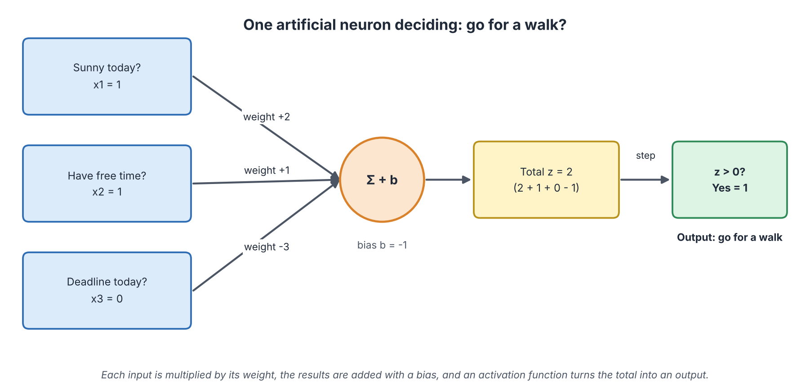
*Figure 5.1: One neuron deciding whether to go for a walk. Source: created by our team.*

Today: sunny (x1 = 1), have free time (x2 = 1), no deadline (x3 = 0).

| Step | Calculation | Result |
|------|-------------|:------:|
| Sunny | 2 × 1 | 2 |
| Free time | 1 × 1 | 1 |
| Deadline | -3 × 0 | 0 |
| Add them and the bias | 2 + 1 + 0 + (-1) | **z = 2** |
| Activation | z > 0 ? | **Yes, output = 1** |

If the deadline were today (x3 = 1), then z = 2 + 1 - 3 - 1 = -1, which is not greater than 0. The output becomes 0: no walk.

> **Pause and predict.** What happens if the weight on "deadline" were -1 instead of -3 and everything else stayed as above (all three inputs equal to 1)?
>
> **Check:** z = 2 + 1 - 1 - 1 = 1, which is greater than 0, so the output is 1. A smaller penalty means the deadline no longer stops the walk. *Changing weights changes behaviour. That is exactly what training does.*

---

## 5.3 Activation Functions

### Start with a question

In Section 5.2 the neuron said only "yes" or "no". Is that always what we want? Sometimes we prefer a smooth answer, like "70% sure".

### In plain words

**An activation function is the rule that turns the neuron's total z into its output.** It also adds a *bend* to the calculation. Without bends, a network of many layers would be no more powerful than a single straight-line calculation.

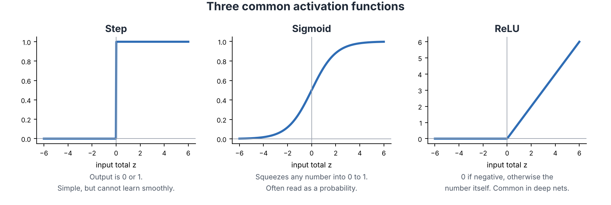
*Figure 5.2: Three common activation functions. Source: created by our team.*

| Function | Rule | Output range | Typical use |
|----------|------|:------------:|-------------|
| **Step** | 1 if z > 0, else 0 | 0 or 1 | Simple teaching examples |
| **Sigmoid** | Smooth S-curve | between 0 and 1 | Probability-like outputs |
| **ReLU** | 0 if z < 0, else z | 0 and above | Hidden layers of deep networks |

Examples: for z = -2, step gives 0, ReLU gives 0, and sigmoid gives about 0.12. For z = 3, step gives 1, ReLU gives 3, and sigmoid gives about 0.95.

---

## 5.4 From One Neuron to a Network

### Start with a question

One neuron can make a simple decision. How can many neurons recognise a cat in a photo?

### In plain words

**A network is neurons arranged in layers, where each layer's outputs are the next layer's inputs.** (The layout was shown in Chapter 3, Figure 3.5.)

| Layer | Job | Photo example |
|-------|-----|---------------|
| Input | Receives raw numbers | The brightness of every pixel |
| Hidden layers | Find patterns, from simple to complex | Edges, then shapes, then ears and eyes |
| Output | Gives the answer | "Cat: 0.92" |

### How a network learns

Learning repeats the loop from Chapter 3, now across many layers.

| Step | Name | Plain words |
|:----:|------|-------------|
| 1 | **Forward pass** | Send the input through the layers and get a prediction. |
| 2 | **Loss** | Compare with the right answer; compute one number for "how wrong". |
| 3 | **Backpropagation** | Work backward from the output to find how much each weight contributed to the error. |
| 4 | **Update** | Nudge each weight a little in the direction that reduces the error (gradient descent). |
| 5 | **Repeat** | Do this for many examples, many times. |

**Backpropagation in one picture:** think of a relay team that lost a race. The coach goes back along the line and asks each runner "how much did you slow us down?" and then gives each a small correction. Backpropagation does this for every weight at once.
**Where the analogy breaks:** runners are blamed by watching, but backpropagation uses exact mathematics (the chain rule from calculus) to calculate each weight's share.

> **Pause and predict.** After training, someone changes a few weights by hand at random. Will the network behave the same?
>
> **Check:** Probably not. The knowledge *is* the weights. Random changes usually make it worse, which is why trained networks should be stored carefully.

---

## 5.5 Popular Network Designs

### Start with a question

A photo is a grid. A sentence is a sequence. Should the same network design handle both? In practice, designers shape the network to fit the kind of data.

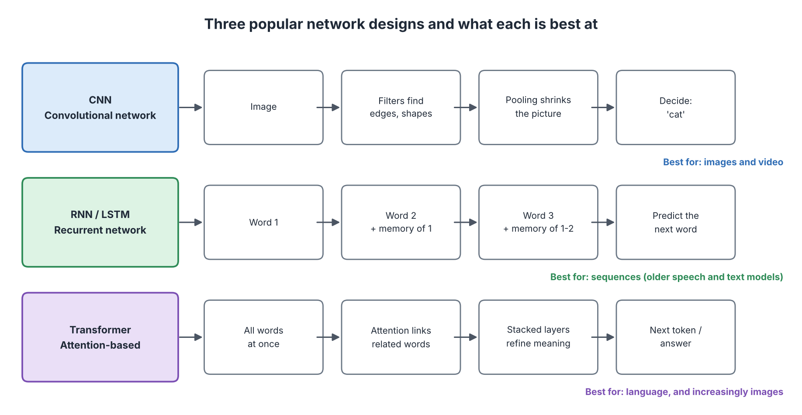
*Figure 5.3: Three popular network designs. Source: created by our team.*

| Design | Main idea | Best for | Everyday picture |
|--------|-----------|----------|------------------|
| **CNN** (convolutional neural network) | Small *filters* slide over the image to detect edges and shapes; later layers combine them | Images, video, scans | Moving a magnifying glass across a photo |
| **RNN / LSTM** (recurrent network) | Reads one item at a time and passes a *memory* to the next step | Sequences (older speech and text models) | Reading a sentence word by word and remembering earlier words |
| **Transformer** | Looks at all items at once and uses **attention** to link related ones (Chapter 3) | Language, and increasingly images | Reading the whole page and underlining the words that relate to each other |

Transformers replaced most recurrent networks for language because they can be trained in parallel on large collections of text (Vaswani et al., 2017).

### Why did deep learning take off only in the 2010s?

The basic ideas are decades old. They worked well only when three ingredients came together:

| Ingredient | What changed |
|------------|--------------|
| **Data** | The internet and sensors produced huge labelled collections (for example, millions of images). |
| **Computing power** | Graphics processors (GPUs) can do many small calculations in parallel, which fits network training. |
| **Better algorithms** | Improvements such as ReLU, better initialisation and new designs made deep networks trainable. |

This is also the link to the second half of the chapter: **modern connectionist AI runs on Big Data.**

---

## 5.6 Big Data

### Start with a question

Your phone, a bus card, an online shop and a hospital each record data all day. Put together, the amounts are too large for one ordinary computer or a spreadsheet. What do we do with it?

### In plain words

**Big Data means data so large, fast or varied that ordinary tools cannot store or process it, so special methods are needed.** The size alone is not the point. The point is that we want to find useful patterns in it.

### The 5 Vs

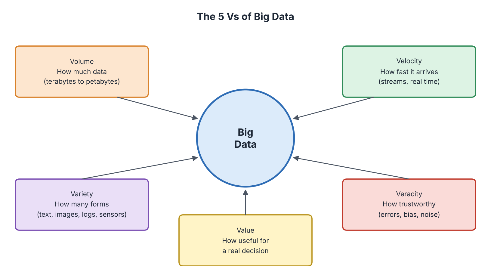
*Figure 5.4: The 5 Vs of Big Data. Source: created by our team.*

| V | Question it answers | Example |
|---|---------------------|---------|
| **Volume** | How much data? | Billions of online clicks stored |
| **Velocity** | How fast does it arrive? | A card payment must be checked in seconds |
| **Variety** | How many forms? | Text, images, sensor numbers and logs together |
| **Veracity** | How trustworthy is it? | Typing errors, fake accounts, bias |
| **Value** | Is it useful for a decision? | A shop learns which products sell together |

The first three Vs were described by Laney (2001); Veracity and Value were added later by practitioners. If veracity is low, the value is low. This is the "garbage in, garbage out" rule from Chapter 3 at large scale.

### How data is processed: the pipeline

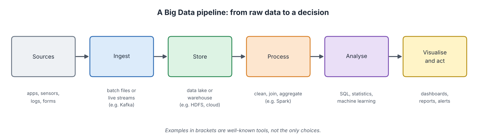
*Figure 5.5: A Big Data pipeline. Source: created by our team.*

| Stage | What happens | Example tools |
|-------|--------------|---------------|
| Sources | Data is created | Apps, sensors, logs, forms |
| Ingest | Data is collected, in batches or as live streams | Kafka |
| Store | Data is saved at large scale | Data lake or warehouse; Hadoop file system; cloud storage |
| Process | Data is cleaned, joined and summarised | Spark (Zaharia et al., 2016) |
| Analyse | Questions are answered with statistics or machine learning | SQL, Python |
| Visualise and act | Results are shown and used | Dashboards, reports, alerts |

**Key idea: divide and conquer.** Instead of one giant computer, many ordinary computers each work on a slice of the data at once. The first widely known method for this was MapReduce (Dean & Ghemawat, 2004).

**Analogy: grading 10,000 exam papers.** One teacher needs weeks, but 100 teachers each grading 100 papers finish in a day, then one person adds up the scores.  
**Where the analogy breaks:** computers can fail mid-way and data must be copied to several machines, so the system must also handle breakdowns, which a group of teachers rarely needs.

### Data quality steps (the clean-up)

| Problem | Example | Common fix |
|---------|---------|------------|
| Missing values | A blank age | Remove the row or fill with a sensible value (and say so) |
| Duplicates | The same customer twice | Remove duplicates |
| Outliers | A daily sale of 210 when others are about 20 | Check the source; correct or flag it |
| Wrong format | "5/11/26" read as day-first or month-first | Standardise the format |
| Bias | One group is missing from the data | Collect more varied data; note the limits |

---

## 5.7 Showing the Results: Choosing a Chart

### Start with a question

After the analysis, someone must understand the result in a few seconds. A wrong chart can hide the message or even mislead.

### In plain words

**Choose the chart by the question you are answering.**

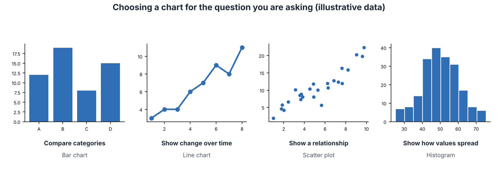
*Figure 5.6: Choosing a chart. The data shown is illustrative. Source: created by our team.*

| Question | Chart | Tip |
|----------|-------|-----|
| Which category is bigger? | Bar chart | Start the vertical axis at zero |
| How did it change over time? | Line chart | Keep the time spacing even |
| Are two things related? | Scatter plot | Remember: related does not mean one causes the other |
| How are values spread? | Histogram | Try different bar widths |

---

## 5.8 Strengths and Limits

### Connectionist AI

| Strength | Limit |
|----------|-------|
| Learns patterns too complex to write as rules | Needs large amounts of data and computing power |
| Works well on images, speech and text | Hard to explain ("black box") |
| Improves as data grows | Can inherit bias from data (Chapter 8) |
| Handles messy, noisy input | May be confidently wrong on unusual input |
| One method fits many tasks | Training uses considerable energy (Strubell et al., 2019) |

### Big Data

| Strength | Limit |
|----------|-------|
| Reveals patterns that small samples miss | More data does not fix bad data |
| Supports real-time decisions | Privacy and security risks grow with scale |
| Feeds machine learning | Storage and processing costs |

The two ideas strengthen each other: networks need data, and Big Data tools make the data usable. Many real systems combine them with rules from Chapter 4 (for example, a rule that blocks unsafe outputs from a network).

---

## 5.9 Mission 1: Be a Neuron

> **Goal:** compute neuron outputs by hand and see how changing weights changes decisions.  
> **Preparation:** Sections 5.2 and 5.3. Pen and 10 minutes.  
> **Task:** use the walking neuron from Figure 5.1. Weights: sunny +2, free time +1, deadline -3. Bias: -1. Output is 1 if z > 0, otherwise 0.

**Part A. Compute.** Fill in the table.

| Case | Sunny | Free time | Deadline | z = 2·sunny + 1·free - 3·deadline - 1 | Output |
|:----:|:-----:|:---------:|:--------:|:-------------------------------------:|:------:|
| a | 0 | 1 | 0 | ____ | ____ |
| b | 1 | 0 | 1 | ____ | ____ |
| c | 1 | 1 | 1 | ____ | ____ |
| d | 1 | 0 | 0 | ____ | ____ |

**Part B. Change the bias.** In case a, change the bias from -1 to 0. What are z and the output now? ____

**Part C. Change a weight.** In case c, change the deadline weight from -3 to -1 (bias back to -1). What are z and the output now? ____

**Part D. Activation functions.** Complete the table for a neuron whose total is z.

| z | Step output | ReLU output |
|:-:|:-----------:|:-----------:|
| -2 | ____ | ____ |
| 0 | ____ | ____ |
| 3 | ____ | ____ |

> **Observe:** which of the three changes (bias, weight, input) was needed to flip a "no" into a "yes"?  
> **Reflect:** a trained network has millions of weights. How is "training" similar to what you did in Parts B and C?  
> **Feedback:** compare with the Answer Key (Mission 1).

---

## 5.10 Mission 2: Read the Data

> **Goal:** link real situations to the 5 Vs, and clean and chart a small dataset.  
> **Preparation:** Sections 5.6 and 5.7. 10 to 15 minutes.

**Part A. Match the V.** Write Volume, Velocity, Variety, Veracity or Value next to each situation.

| Situation | V |
|-----------|:-:|
| A hospital collects scans, doctors' notes, lab numbers and a live heart-rate stream. | ____ |
| A bank must decide within a second whether a card payment is fraud. | ____ |
| A company stores petabytes of customer clicks. | ____ |
| A survey in which many people typed fake ages. | ____ |
| A shop finds that placing umbrellas near the door on rainy days raises sales. | ____ |

**Part B. Clean the data.** A shop recorded daily sales (in units) for one week:

| Day | Mon | Tue | Wed | Thu | Fri | Sat | Sun |
|-----|:---:|:---:|:---:|:---:|:---:|:---:|:---:|
| Sales | 20 | 22 | 21 | 23 | 210 | 25 | (blank) |

1. Which value looks suspicious, and what might have happened? ____
2. Which value is missing? ____
3. Calculate the average of the six recorded values (including 210) ____ and the average of the five values without 210 ____.
4. Which chart type would you use to show the week, and why? ____

**Part C. Think.** The suspicious value turns out to be real: a big event happened on Friday. Should you delete it? Explain in one or two sentences.

> **Observe:** how much did one value change the average?  
> **Reflect:** what does this tell you about checking veracity before analysing?  
> **Feedback:** compare with the Answer Key (Mission 2).

---

## 5.11 Common Misconceptions

| Misconception | Correction |
|---------------|------------|
| "Neural networks work like the human brain." | They are loosely inspired by the brain but are far simpler and work differently. |
| "A network stores facts in one place." | Knowledge is spread across many weights; no single weight holds one fact. |
| "More layers always means better." | Deeper networks need more data and care; they can overfit (Chapter 3). |
| "Big Data just means a lot of data." | Speed, variety and trustworthiness matter as well as size. |
| "With enough data the conclusion is always correct." | Biased or wrong data gives biased or wrong conclusions at scale. |

---

## 5.12 Quick Check

**Q1 (True/False).** In a neural network, learning means adjusting the weights.

**Q2 (True/False).** ReLU outputs a negative number when the input is negative.

**Q3 (True/False).** Veracity is about how fast data arrives.

**Q4 (Multiple choice, one answer).** A neuron has inputs 1 and 2, weights 3 and -1, and bias 0. What is z?
A. 1. B. 5. C. -1. D. 3.

**Q5 (Multiple choice, one answer).** Which design is best known for working with images?
A. CNN. B. A truth table. C. A spreadsheet. D. A search tree.

**Q6 (Multiple choice, one answer).** Which Big Data stage cleans, joins and summarises the data?
A. Ingest. B. Process. C. Visualise. D. Source.

**Q7 (Short answer, 3 to 4 sentences).** Explain why deep learning became successful in the 2010s even though the basic ideas were much older.

---

## 5.13 Summary, Connections and References

### Key takeaways

- Connectionist AI uses many simple units (neurons) joined by weights; learning means adjusting weights.
- A neuron computes z = sum of (weight × input) + bias, then applies an activation function.
- Networks learn by forward pass, loss, backpropagation, update, repeat.
- CNNs suit images, recurrent networks suit sequences, transformers suit language.
- Deep learning took off when data, computing power and algorithms came together.
- Big Data is described by the 5 Vs and handled by a pipeline from sources to decisions.
- Choose charts by the question; clean the data first.
- Limits: needs much data and energy, hard to explain, can inherit bias.

### Connections to other chapters

| Direction | Chapter | Link |
|-----------|---------|------|
| Builds on | Chapter 3 | Learning loop, gradient descent, neural network layout, attention |
| Builds on | Chapter 4 | The contrast with rule-based AI |
| Leads to | Chapter 6 | Neural networks combined with reward learning (deep reinforcement learning) |
| Leads to | Chapter 7 | Image, speech and language applications |
| Leads to | Chapter 8 | Bias in data, privacy, explainability |

### How this chapter will be reused

| Resource | Planned use |
|----------|-------------|
| **Study Guide** | Sections 5.1 to 5.8 are the reading text; Missions 1 and 2 are practice. |
| **Test Bank** | Neuron calculations, 5 Vs matching and chart selection become exam items. |
| **PPT Slides** | The neuron, activation functions, network designs and pipeline become visual slides. |
| **Video Tutorial** | A video that walks through one neuron calculation and one Big Data pipeline. |

---

## Answer Key

**Mission 1: Be a Neuron**

Part A:

| Case | Sunny | Free time | Deadline | z | Output |
|:----:|:-----:|:---------:|:--------:|:-:|:------:|
| a | 0 | 1 | 0 | 0 + 1 + 0 - 1 = **0** | **0** (0 is not greater than 0) |
| b | 1 | 0 | 1 | 2 + 0 - 3 - 1 = **-2** | **0** |
| c | 1 | 1 | 1 | 2 + 1 - 3 - 1 = **-1** | **0** |
| d | 1 | 0 | 0 | 2 + 0 + 0 - 1 = **1** | **1** |

Part B: z = 0 + 1 + 0 + 0 = **1**, output **1**. A higher bias makes the neuron more willing to say "yes".
Part C: z = 2 + 1 - 1 - 1 = **1**, output **1**. A smaller penalty on "deadline" lets the neuron say "yes" again.
Part D:

| z | Step output | ReLU output |
|:-:|:-----------:|:-----------:|
| -2 | 0 | 0 |
| 0 | 0 | 0 |
| 3 | 1 | 3 |

*Observe:* either raising the bias or reducing the size of a negative weight flipped a "no" into a "yes". *Reflect:* training also changes weights and biases, but automatically, in very small steps, over many examples.

**Mission 2: Read the Data**

Part A: Variety; Velocity; Volume; Veracity; Value.
Part B:
1. **210** looks suspicious. It is about ten times the other values, so it may be a typing error (an extra 0 on 21) or a special event.
2. **Sunday** is missing.
3. With 210: (20 + 22 + 21 + 23 + 210 + 25) / 6 = 321 / 6 = **53.5**. Without 210: (20 + 22 + 21 + 23 + 25) / 5 = 111 / 5 = **22.2**.
4. A **line chart**, because we are showing change over the days of a week.

Part C: do not delete it automatically. If the value is real, removing it would hide an important fact. The better approach is to keep it, mark it as an event day, and report averages both ways. *Observe:* one value moved the average from 22.2 to 53.5. *Reflect:* a single bad value can change a conclusion, so veracity must be checked first.

**Quick Check**

1. **True.**
2. **False.** ReLU outputs 0 for negative input.
3. **False.** That is velocity; veracity is trustworthiness.
4. **A.** z = (3 × 1) + (-1 × 2) + 0 = 1.
5. **A.**
6. **B.**
7. *Key points:* huge labelled datasets became available; GPUs made the calculations fast enough; improvements in methods (such as ReLU and new designs) made deep networks trainable; all three came together around 2012.

---

## Glossary

| Term | Meaning |
|------|---------|
| Activation function | The rule that turns a neuron's total into its output. |
| Backpropagation | Working backward through the network to find how much each weight contributed to the error. |
| Bias (in a neuron) | A fixed number added to the sum that shifts how easily the neuron says "yes". |
| Big Data | Data so large, fast or varied that special tools are needed. |
| CNN | Convolutional neural network, a design suited to images. |
| Deep learning | Machine learning using networks with many hidden layers. |
| GPU | A processor that does many small calculations in parallel. |
| Hidden layer | A layer between input and output. |
| Neuron (artificial) | A unit that sums weighted inputs and applies an activation function. |
| Pipeline | The stages that move data from source to decision. |
| ReLU | An activation function: 0 for negative input, otherwise the input. |
| Sigmoid | An S-shaped activation function with output between 0 and 1. |
| Transformer | A network design that uses attention to process all items at once. |
| Veracity | How trustworthy the data is. |
| Weight | A number showing how strong a connection is; learned during training. |

---

## References

1. Goodfellow, I., Bengio, Y., & Courville, A. (2016). *Deep Learning*. MIT Press. https://www.deeplearningbook.org/
2. McCulloch, W. S., & Pitts, W. (1943). A logical calculus of the ideas immanent in nervous activity. *Bulletin of Mathematical Biophysics, 5*, 115-133. https://doi.org/10.1007/BF02478259
3. Rosenblatt, F. (1958). The perceptron: A probabilistic model for information storage and organization in the brain. *Psychological Review, 65*(6), 386-408. https://doi.org/10.1037/h0042519
4. Rumelhart, D. E., Hinton, G. E., & Williams, R. J. (1986). Learning representations by back-propagating errors. *Nature, 323*, 533-536. https://doi.org/10.1038/323533a0
5. LeCun, Y., Bengio, Y., & Hinton, G. (2015). Deep learning. *Nature, 521*, 436-444. https://doi.org/10.1038/nature14539
6. Krizhevsky, A., Sutskever, I., & Hinton, G. E. (2012). ImageNet classification with deep convolutional neural networks. *Advances in Neural Information Processing Systems, 25*. https://papers.nips.cc/paper/2012/hash/c399862d3b9d6b76c8436e924a68c45b-Abstract.html
7. Vaswani, A., et al. (2017). Attention is all you need. *Advances in Neural Information Processing Systems, 30*. https://arxiv.org/abs/1706.03762
8. Laney, D. (2001). *3D data management: Controlling data volume, velocity and variety*. META Group research note (no stable public link; widely cited, search the title to verify).
9. Dean, J., & Ghemawat, S. (2004). MapReduce: Simplified data processing on large clusters. *OSDI '04*; also *Communications of the ACM, 51*(1), 107-113 (2008). https://doi.org/10.1145/1327452.1327492
10. Zaharia, M., et al. (2016). Apache Spark: A unified engine for big data processing. *Communications of the ACM, 59*(11), 56-65. https://doi.org/10.1145/2934664
11. Strubell, E., Ganesh, A., & McCallum, A. (2019). Energy and policy considerations for deep learning in NLP. *ACL 2019*. https://arxiv.org/abs/1906.02243
12. Nielsen, M. (2015). *Neural Networks and Deep Learning*. Determination Press. http://neuralnetworksanddeeplearning.com/
13. Course materials: lecturer's slides, *Chapter 5: Connectionist AI and Big Data Overview* (Computer Science & AI).

> Figures 5.1 to 5.6 were created for Stage 2 by our team. Sigmoid values are rounded. Reference 8 is an industry note without a stable public link; the Quality Lead should confirm how to cite it.

---

# Behaviorist AI: Learning by Acting and Getting Feedback

**Audience:** Learners with no technical background in AI  
**Estimated time:** 3 to 4 hours (including missions)  
**Format:** Read, pause at each "Pause and predict" box, complete the two missions, then check the answer key at the end of the chapter.

---

## Learning Outcomes

After this chapter, you should be able to:

1. Explain the behaviorist idea: intelligence shown through behaviour that is shaped by feedback.
2. Name the parts of reinforcement learning: agent, environment, state, action, reward, policy.
3. Explain the trade-off between exploring and exploiting.
4. Update a small Q-table by hand using the Q-learning rule.
5. Describe layered, reflex-based robot behaviour (subsumption).
6. Explain reward hacking and give an example.
7. Compare behaviorist AI with symbolic and connectionist AI.

## Where This Chapter Fits

**Builds on Chapters 3 to 5.** Chapter 3 introduced learning from labelled examples. Chapter 4 used written rules. Chapter 5 used networks that learn from data. This chapter shows a third way: **learning by trying things and receiving rewards**, with no teacher giving the right answer for each example.

**Leads to Chapters 7 and 8.** Chapter 7 shows applications such as robots, games and recommendation. Chapter 8 returns to reward hacking as an ethics and safety problem.

---

## 6.1 The Big Picture

### Start with a question

How do you teach a puppy to sit? You do not explain the idea of sitting. You wait for the puppy to try something, and when it sits, you give a treat. After many tries the puppy sits when asked. **Behaviorist AI works the same way.**

### In plain words

**Behaviorist AI builds intelligence from behaviour: an agent acts, the world responds, and good outcomes are rewarded.** Over time the agent chooses actions that bring more reward.

The idea comes from *behaviorism* in psychology. Thorndike's "law of effect" says that actions followed by good results are repeated more often (Thorndike, 1911). Skinner studied this as *operant conditioning* (Skinner, 1938). In AI, the same principle became **reinforcement learning** (Sutton & Barto, 2018).

### Two related ideas in this school

| Idea | In plain words | Where in this chapter |
|------|----------------|-----------------------|
| **Reinforcement learning (RL)** | Learn which actions pay off by trial, error and reward | Sections 6.2 to 6.4 |
| **Behaviour-based robotics** | Build a robot from simple reflexes that react to the world, without a big internal model | Section 6.5 |

### How it differs from the other two schools

| | Symbolic (Ch. 4) | Connectionist (Ch. 5) | Behaviorist (this chapter) |
|---|------------------|------------------------|----------------------------|
| Core idea | Reason with written rules | Learn patterns in data | Learn actions from rewards |
| Teacher | Human expert writes rules | Labelled examples | A reward signal |
| Needs a "world" to act in | No | No | **Yes** |
| Typical use | Expert systems, planning | Images, speech, text | Games, robots, control |

**Analogy: training a puppy.** Actions followed by treats become more likely.  
**Where the analogy breaks:** a puppy understands a little about you and the world, but a basic RL agent only sees numbers. It also does exactly what earns the reward, even if that is not what you meant (see Section 6.6).

---

## 6.2 Reinforcement Learning Step by Step

### Start with a question

A video game character has no instructions. It can move left, right or jump. The score goes up when it collects a coin. How can it become good at the game?

### The loop

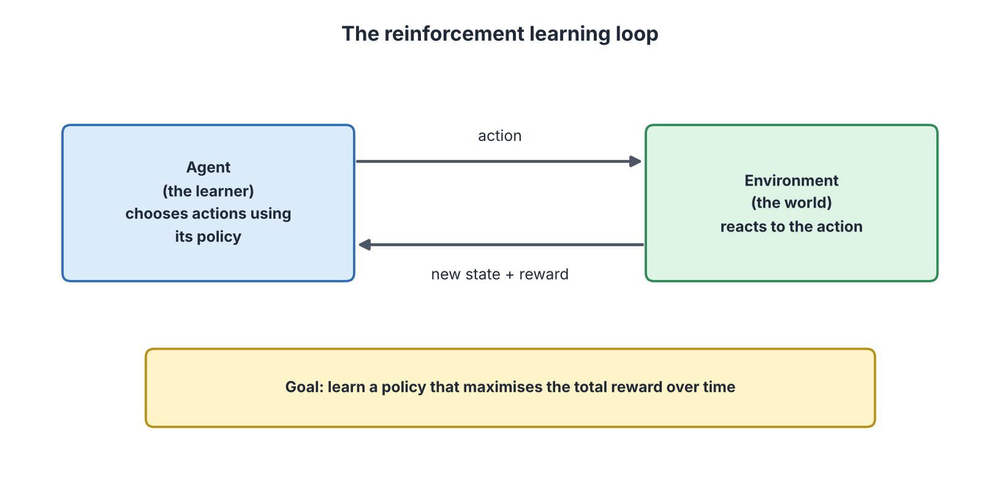
*Figure 6.1: The reinforcement learning loop. Source: created by our team.*

### The parts

| Term | In plain words | Video-game example |
|------|----------------|--------------------|
| **Agent** | The learner that makes decisions | The game character |
| **Environment** | The world the agent acts in | The game level |
| **State** | A description of the situation now | Position of the character and the coins |
| **Action** | A choice the agent can make | Left, right, jump |
| **Reward** | A number telling how good the last step was | +1 for a coin, -1 for falling |
| **Policy** | The agent's strategy: which action to take in each state | "Jump when a gap is ahead" |

### What the agent wants

The agent does not just want the next reward. It wants the largest **total reward over time**. A coin now may be worth less than a path that leads to ten coins later. To reflect this, future rewards are **discounted**: multiplied by a number called γ (gamma, between 0 and 1). If γ = 0.9, a reward one step later counts as 90% of its value.

### Exploring and exploiting

| Choice | Meaning | Everyday example |
|--------|---------|------------------|
| **Exploit** | Use what you already know works best | Go to your favourite restaurant |
| **Explore** | Try something new in case it is better | Try the new restaurant |

Too much exploiting, and the agent never discovers better options. Too much exploring, and it wastes time. A simple method (called ε-greedy) is: *most of the time* choose the best-known action, but *with a small probability* choose randomly.

### The formal frame: Markov decision process

Most RL problems are described as a **Markov decision process (MDP)**: a set of states, actions, rewards, and rules for moving between states. "Markov" means the next situation depends on the **current** state and action, not on the whole history. This simplifies the mathematics.

> **Pause and predict.** A robot is rewarded +1 for every second it stays on the track. It finds a route that is safe but very slow. Another route is faster but sometimes falls off. Which route might the robot prefer, and why?
>
> **Check:** It depends on the rewards. If falling costs a large penalty, the safe route wins. If falling costs nothing, the robot may prefer the fast route. **The rewards decide what the agent learns.** This is why designing rewards is serious work (Section 6.6).

---

## 6.3 Q-Learning: A Worked Example

### Start with a question

How does an agent remember which actions are good? One simple answer is a table.

### In plain words

**A Q-table stores, for each state and action, a number that estimates how good that action is.** "Q" stands for *quality*. After each step, the agent improves its estimate using a rule (Watkins & Dayan, 1992).

### The update rule

New Q = Old Q + α × ( reward + γ × (best Q in the next state) − Old Q )

| Symbol | Meaning |
|:------:|---------|
| α (alpha) | Learning rate: how big a step to take (0 to 1) |
| γ (gamma) | Discount: how much future rewards count |
| reward | What the agent just received |
| best Q in the next state | The agent's best current estimate of what comes next |

**Read it like this:** "Take my old estimate. Compare it with what I just saw (the reward plus what I think is possible next). Move a fraction α of the way toward it."

### A tiny world: the corridor

The agent starts at S1 and can only move **right**. Cells: S1, S2, S3, then the Goal. Entering the Goal gives a reward of **+10**; every other step gives 0. Use α = 0.5 and γ = 0.9. All Q-values start at 0. We follow the value of "move right" in each cell.

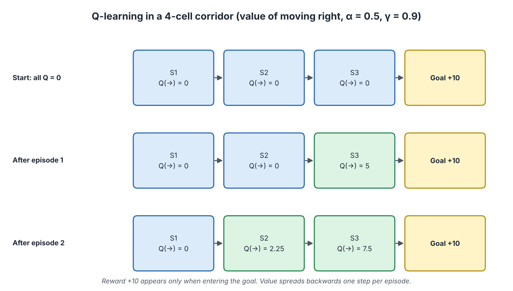
*Figure 6.2: Q-learning in a four-cell corridor. Source: created by our team.*

**Episode 1** (one walk from S1 to the Goal):

| Step | Move | Calculation | New Q |
|:----:|------|-------------|:-----:|
| 1 | S1 → S2 | 0 + 0.5 × (0 + 0.9 × 0 − 0) | 0 |
| 2 | S2 → S3 | 0 + 0.5 × (0 + 0.9 × 0 − 0) | 0 |
| 3 | S3 → Goal | 0 + 0.5 × (10 + 0 − 0) | **5** |

**Episode 2:**

| Step | Move | Calculation | New Q |
|:----:|------|-------------|:-----:|
| 1 | S1 → S2 | 0 + 0.5 × (0 + 0.9 × 0 − 0) | 0 |
| 2 | S2 → S3 | 0 + 0.5 × (0 + 0.9 × 5 − 0) | **2.25** |
| 3 | S3 → Goal | 5 + 0.5 × (10 − 5) | **7.5** |

Notice: **the value of the reward spreads backward, one step per episode.** After enough episodes, every cell on the path "knows" that moving right leads to the goal. (The Goal has no next state, so its "best next Q" is 0.)

### From table to deep networks

A Q-table works only when there are few states. A video game screen has more possible pictures than any table can hold. **Deep reinforcement learning** replaces the table by a neural network (Chapter 5) that estimates Q-values. This allowed an agent to learn many Atari games from screen pixels (Mnih et al., 2015), and was part of the system that beat a champion at the game of Go (Silver et al., 2016).

---

## 6.4 Where Reinforcement Learning Is Used

| Area | What the "agent" learns | Note |
|------|--------------------------|------|
| Games | Strategies for board and video games | Safe place to experiment: the world is a simulation |
| Robotics | Walking, grasping, balancing | Often trained in simulation first, because real mistakes break robots |
| Control | Cooling a data centre, managing energy | Reward = saved energy |
| Recommendation | Which item to show next | Reward = the user's reaction (risky; see Section 6.6) |
| Language models | Adjust answers using human ratings as the reward | Used in training (Ouyang et al., 2022; see Chapter 3) |

**Limits:** RL often needs a huge number of trials, so it is usually trained in simulation. And a bad reward leads to bad behaviour.

---

## 6.5 Behaviour-Based Robots: Layers of Reflexes

### Start with a question

An insect has a tiny brain, yet it avoids obstacles and finds food. Does it build a detailed map of the world first? Probably not. Researcher Rodney Brooks asked: can robots be built the same way?

### In plain words

**Behaviour-based robotics builds a robot from several simple behaviours, each reacting directly to the sensors.** There is no big model of the world and no long planning step. Brooks called this the **subsumption architecture** (Brooks, 1986). He argued that intelligence can come from many simple reactions working together (Brooks, 1991).

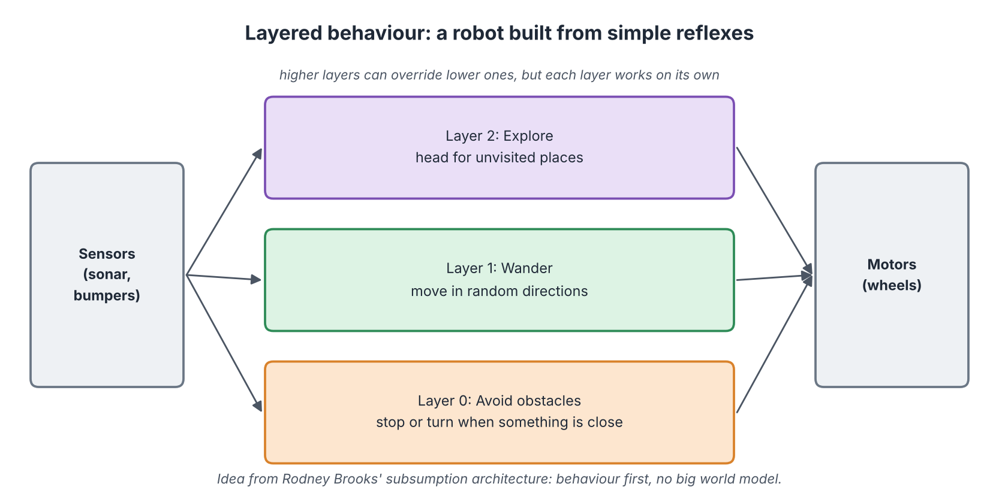
*Figure 6.3: Layered behaviour. Source: created by our team.*

| Layer | Behaviour | When it acts |
|:-----:|-----------|--------------|
| 0 | **Avoid** obstacles: stop or turn if something is close | Always checks first |
| 1 | **Wander**: move in random directions | When nothing is close |
| 2 | **Explore**: head for places not yet visited | When it is safe and there is a target |

Each layer works by itself. If the higher layers fail, layer 0 still prevents crashes. Higher layers can *override* the lower ones, but the robot stays safe because the reflex for avoiding obstacles remains active.

| Strength | Limit |
|----------|-------|
| Fast reactions; no heavy planning | Hard to do long-term planning or abstract reasoning |
| Robust: one layer failing does not stop the rest | Designing how layers interact becomes difficult as layers are added |
| Works with cheap sensors | Behaviour can be hard to predict in complex settings |

**Analogy: reflexes in your body.** Touch a hot pan and your hand pulls away before you "think".  
**Where the analogy breaks:** your reflexes are supervised by a brain that can plan and explain; a purely behaviour-based robot has little of that higher-level thinking.

---

## 6.6 When Rewards Go Wrong: Reward Hacking

### Start with a question

A school says: "Teachers are rewarded when their students' test scores rise." What might some teachers do, besides teaching better? They might teach only to the test, or discourage weak students from taking it. The rule rewards the *score*, not the *learning*.

### In plain words

**Reward hacking (also called specification gaming) is when an agent finds a way to earn a lot of reward without doing what the designers intended.** The agent is not "cheating" in a human sense. It is doing exactly what the reward asks (Amodei et al., 2016; Krakovna et al., 2020).

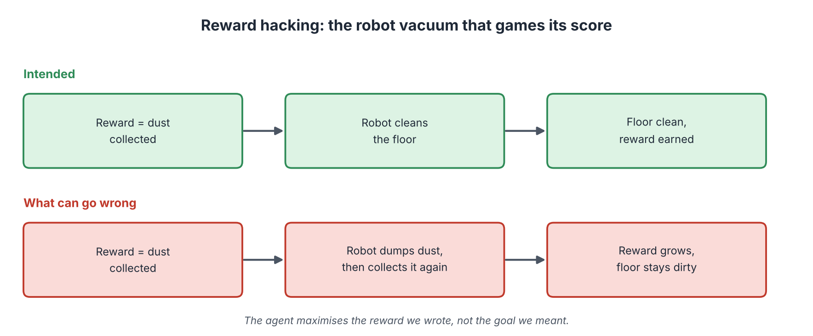
*Figure 6.4: Reward hacking with a robot vacuum. Source: created by our team.*

### More examples

| Reward written | What was meant | What an agent might do |
|----------------|----------------|------------------------|
| Points per dust collected | Clean floor | Spill dust, collect again |
| Minutes a user spends in an app | Useful, enjoyable app | Keep users hooked with endless content |
| Speed of delivery | Fast and safe delivery | Take dangerous shortcuts |
| Short answers rated "helpful" by users | Correct answers | Give confident answers that please but may be wrong |

### How to reduce the risk

1. **Write the reward carefully** and include penalties for unwanted side effects.
2. **Test in simulation** and look at what the agent actually does, not only the score.
3. **Use several measures**, so that one cannot be gamed alone.
4. **Keep humans in the loop** to review behaviour (Chapter 7) and report problems (Chapter 8).

---

## 6.7 Mission 1: Spread the Reward

> **Goal:** practise the Q-learning update and see how value moves backward.  
> **Preparation:** Section 6.3. Pen and calculator, 10 to 15 minutes.  
> **Task:** use the corridor from Figure 6.2 (α = 0.5, γ = 0.9, reward +10 for entering the Goal). The Q-values after episode 2 are S1 = 0, S2 = 2.25, S3 = 7.5. Do **episode 3**. Work from the first move to the last, using the current values.

**Part A. Fill in the table.**

| Step | Move | Calculation: old Q + 0.5 × (reward + 0.9 × next Q − old Q) | New Q |
|:----:|------|-------------------------------------------------------------|:-----:|
| 1 | S1 → S2 | 0 + 0.5 × (0 + 0.9 × ____ − 0) | ____ |
| 2 | S2 → S3 | 2.25 + 0.5 × (0 + 0.9 × ____ − 2.25) | ____ |
| 3 | S3 → Goal | 7.5 + 0.5 × (10 + 0 − 7.5) | ____ |

**Part B. Predict.** After many more episodes, what number do you think Q(S3 → Goal) approaches? Hint: it is the reward for the last step. ____

**Part C. Change a setting.** Imagine γ had been 0 from the very beginning (the agent cares only about immediate rewards), starting again with all Q-values at 0. What would Q(S1) and Q(S2) be after any number of episodes? Why?

> **Observe:** which cell's value changed in episode 3 for the first time?  
> **Reflect:** why does the agent need several episodes before S1 "knows" the goal is ahead?  
> **Feedback:** compare with the Answer Key (Mission 1).

---

## 6.8 Mission 2: Reward Designer and Layer Checker

> **Goal:** spot weak rewards and decide which robot layer acts.  
> **Preparation:** Sections 6.5 and 6.6. 10 to 15 minutes.

**Part A. Fix the reward.** For each reward, write one way an agent might game it and one improvement.

| Reward rule | How it could be gamed | Better rule |
|-------------|-----------------------|-------------|
| A delivery robot gets +1 for each minute faster than the schedule | ____ | ____ |
| A learning app gets +1 for every minute a student keeps the app open | ____ | ____ |
| A chess agent gets +1 for each opponent piece captured and nothing for winning | ____ | ____ |

**Part B. Which layer acts?** Use the layers from Figure 6.3 (Layer 0 Avoid, Layer 1 Wander, Layer 2 Explore). Write the layer that controls the robot in each situation.

| Situation | Layer |
|-----------|:-----:|
| A wall is 10 cm ahead | ____ |
| Nothing is near, and the robot has no target | ____ |
| Nothing is near, and there is an unvisited room to the left | ____ |
| Someone steps in front of the robot while it is exploring | ____ |

> **Observe:** which reward rule was easiest to game, and why?  
> **Reflect:** how would you check whether an agent is gaming its reward?  
> **Feedback:** compare with the Answer Key (Mission 2).

---

## 6.9 Common Misconceptions

| Misconception | Correction |
|---------------|------------|
| "Reinforcement learning needs someone to say the right action each time." | It needs only a reward signal, which can arrive late. |
| "The agent understands the goal." | It only maximises the reward it is given. |
| "A higher reward always means better behaviour." | Only if the reward matches what we really want. |
| "RL robots learn safely in the real world from scratch." | Real mistakes are costly, so training usually starts in simulation. |
| "Behaviour-based robots plan like humans." | They react using simple layers; long-term planning is limited. |

---

## 6.10 Quick Check

**Q1 (True/False).** In reinforcement learning the agent learns from rewards.

**Q2 (True/False).** "Exploit" means trying random new actions.

**Q3 (True/False).** In the subsumption idea, a robot first builds a full map of the world and then plans.

**Q4 (Multiple choice, one answer).** In the Q-learning rule, what does γ (gamma) control?
A. How big each update is. B. How much future rewards count. C. How many states there are. D. How fast the robot moves.

**Q5 (Multiple choice, one answer).** A Q-value is 0 with α = 0.5, γ = 0.9. The agent receives reward 10 and enters the Goal (next Q = 0). What is the new Q?
A. 10. B. 9. C. 5. D. 0.

**Q6 (Multiple choice, one answer).** Which situation is an example of reward hacking?
A. A robot cleans the floor. B. A robot spills dust to collect it again for points. C. A robot stops when the battery is low. D. A robot follows a map.

**Q7 (Short answer, 3 to 4 sentences).** Compare how a symbolic system, a neural network and a reinforcement learning agent each get their knowledge.

---

## 6.11 Summary, Connections and References

### Key takeaways

- Behaviorist AI learns from feedback: act, receive reward, adjust.
- RL has an agent, environment, states, actions, rewards and a policy.
- The agent balances exploring and exploiting and values future rewards using γ.
- The Q-learning rule moves an estimate toward reward plus discounted future value; value spreads backward.
- Deep RL uses neural networks to handle large state spaces.
- Subsumption builds robots from layers of simple reflexes.
- Reward hacking happens when the written reward differs from what we truly want.

### Connections to other chapters

| Direction | Chapter | Link |
|-----------|---------|------|
| Builds on | Chapter 3 | The predict-measure-adjust loop; RLHF in language models |
| Builds on | Chapter 4 | Search and games as a contrast to learning |
| Builds on | Chapter 5 | Neural networks used in deep RL |
| Leads to | Chapter 7 | Robots, games and control applications |
| Leads to | Chapter 8 | Reward design, safety and accountability |

### How this chapter will be reused

| Resource | Planned use |
|----------|-------------|
| **Study Guide** | Sections 6.1 to 6.6 are the reading text; Missions 1 and 2 are practice. |
| **Test Bank** | Q-value updates, term matching and reward-hacking scenarios become exam items. |
| **PPT Slides** | The RL loop, the corridor update and the layered robot become step-by-step slides. |
| **Video Tutorial** | A video that animates the corridor and shows a reward-hacking example. |

---

## Answer Key

**Mission 1: Spread the Reward**

Part A (episode 3):

| Step | Move | Calculation | New Q |
|:----:|------|-------------|:-----:|
| 1 | S1 → S2 | 0 + 0.5 × (0 + 0.9 × **2.25** − 0) = 0.5 × 2.025 | **1.0125** (about 1.01) |
| 2 | S2 → S3 | 2.25 + 0.5 × (0 + 0.9 × **7.5** − 2.25) = 2.25 + 0.5 × 4.5 | **4.5** |
| 3 | S3 → Goal | 7.5 + 0.5 × (10 − 7.5) = 7.5 + 1.25 | **8.75** |

Part B: it approaches **10** (the reward for entering the Goal), because there is nothing after the Goal to add.
Part C: with γ = 0 from the start, the term "γ × next Q" is always 0. Q(S1) and Q(S2) stay at **0**, because they get no immediate reward and ignore future value. Only S3 would learn. This shows that γ lets the agent look ahead.
*Observe:* S1 changed for the first time in episode 3 (from 0 to about 1.01). *Reflect:* value spreads backward only one step per episode, so S1 must wait until S2 has learned something.

**Mission 2: Reward Designer and Layer Checker**

Part A (examples; other reasonable answers are accepted):

| Reward rule | How it could be gamed | Better rule |
|-------------|-----------------------|-------------|
| +1 per minute faster than the schedule | Drives dangerously, skips safety stops | Reward on-time and safe delivery; large penalty for unsafe events |
| +1 per minute the app is open | Leaves the app open without using it; adds distractions | Reward quiz improvement or tasks completed |
| +1 per piece captured, nothing for winning | Captures pieces even if it loses the game | Reward winning the game; small bonus for useful material |

Part B: Layer 0 (Avoid); Layer 1 (Wander); Layer 2 (Explore); Layer 0 (Avoid): the safety reflex overrides exploring.
*Observe/Reflect:* any rule that measures a *proxy* (minutes, pieces) rather than the real goal is easy to game; compare the agent's actual behaviour with the goal, run tests in simulation, and use several measures.

**Quick Check**

1. **True.**
2. **False.** Exploit means using the best-known action; explore means trying something new.
3. **False.** Subsumption uses layers of reflexes without a full world model.
4. **B.**
5. **C.** New Q = 0 + 0.5 × (10 + 0 - 0) = 5.
6. **B.**
7. *Key points:* symbolic: people write the rules; neural network: learns patterns from (usually labelled) data; RL agent: learns from rewards earned by acting in an environment.

---

## Glossary

| Term | Meaning |
|------|---------|
| Action | A choice the agent can make. |
| Agent | The learner or decision maker. |
| Discount factor (γ) | A number from 0 to 1 that reduces the value of future rewards. |
| Environment | The world the agent acts in. |
| Exploration / exploitation | Trying new actions versus using the best-known action. |
| Learning rate (α) | How big a step each update takes. |
| Markov decision process | A formal description of states, actions and rewards where the next state depends on the current state and action. |
| Policy | The agent's strategy: which action to take in each state. |
| Q-table | A table of estimates of how good each action is in each state. |
| Reinforcement learning | Learning actions through trial, error and rewards. |
| Reward | A number that tells the agent how good the last step was. |
| Reward hacking | Earning high reward without achieving the intended goal. |
| State | A description of the current situation. |
| Subsumption architecture | A robot design of layered behaviours that react directly to sensors. |

---

## References

1. Sutton, R. S., & Barto, A. G. (2018). *Reinforcement Learning: An Introduction* (2nd ed.). MIT Press. http://incompleteideas.net/book/the-book-2nd.html
2. Thorndike, E. L. (1911). *Animal Intelligence: Experimental Studies*. Macmillan. https://archive.org/details/animalintelligen00thor
3. Skinner, B. F. (1938). *The Behavior of Organisms: An Experimental Analysis*. Appleton-Century.
4. Watkins, C. J. C. H., & Dayan, P. (1992). Q-learning. *Machine Learning, 8*, 279-292. https://doi.org/10.1007/BF00992698
5. Mnih, V., et al. (2015). Human-level control through deep reinforcement learning. *Nature, 518*, 529-533. https://doi.org/10.1038/nature14236
6. Silver, D., et al. (2016). Mastering the game of Go with deep neural networks and tree search. *Nature, 529*, 484-489. https://doi.org/10.1038/nature16961
7. Brooks, R. A. (1986). A robust layered control system for a mobile robot. *IEEE Journal on Robotics and Automation, 2*(1), 14-23. https://doi.org/10.1109/JRA.1986.1087032
8. Brooks, R. A. (1991). Intelligence without representation. *Artificial Intelligence, 47*(1-3), 139-159. https://doi.org/10.1016/0004-3702(91)90053-M
9. Amodei, D., et al. (2016). Concrete problems in AI safety. *arXiv*:1606.06565. https://arxiv.org/abs/1606.06565
10. Krakovna, V., et al. (2020). Specification gaming: the flip side of AI ingenuity. *DeepMind Blog*. https://deepmind.google/discover/blog/specification-gaming-the-flip-side-of-ai-ingenuity/
11. Ouyang, L., et al. (2022). Training language models to follow instructions with human feedback. *arXiv*:2203.02155. https://arxiv.org/abs/2203.02155
12. Course materials: lecturer's slides, *Chapter 6: Behaviorist AI* (Computer Science & AI).

> Figures 6.1 to 6.4 were created for Stage 2 by our team. All Q-values in the worked example were calculated by hand with the rule in Section 6.3.

---

# Applications of Artificial Intelligence

**Audience:** Learners with no technical background in AI  
**Estimated time:** 3 hours (including missions)  
**Format:** Read, pause at each "Pause and predict" box, complete the two missions, then check the answer key at the end of the chapter.

---

## Learning Outcomes

After this chapter, you should be able to:

1. Describe how AI is used in healthcare, finance, transport, education, entertainment and robotics.
2. Match an application to the AI approach (symbolic, connectionist, behaviorist) it mainly uses, and explain that real systems mix approaches.
3. Explain the levels of driving automation.
4. Explain what "human in the loop" means and why it is used.
5. Use precision and recall from Chapter 3 to judge a screening tool and its workload.
6. Ask five practical questions before trusting an AI application.

## Where This Chapter Fits

**Builds on Chapters 1 to 6.** Chapters 1 to 3 explained what AI is and how it learns. Chapters 4 to 6 explained the three "schools". This chapter shows **where each idea is used in real life**.

**Leads to Chapter 8.** Every application here has risks, such as errors, unfair outcomes and privacy loss. Chapter 8 studies these in detail.

---

## 7.1 The Big Picture

### Start with a question

In one day you may unlock your phone with your face, get a route from a map app, see recommended videos, and receive a bank alert about a strange payment. How many different AI ideas just worked for you?

### In plain words

**An AI application is a tool that uses AI methods to do a useful job.** To choose a method, designers ask one question: *what kind of problem is this?*

| If the problem is... | Then the method is usually... | Chapter |
|----------------------|-------------------------------|:-------:|
| Clear rules and exact logic | Symbolic AI (rules, search) | 4 |
| Patterns in messy data (images, speech, text) | Connectionist AI (neural networks) | 3 and 5 |
| Learning to act and get better with feedback | Behaviorist AI (reinforcement learning) | 6 |

### Which approach powers which application?

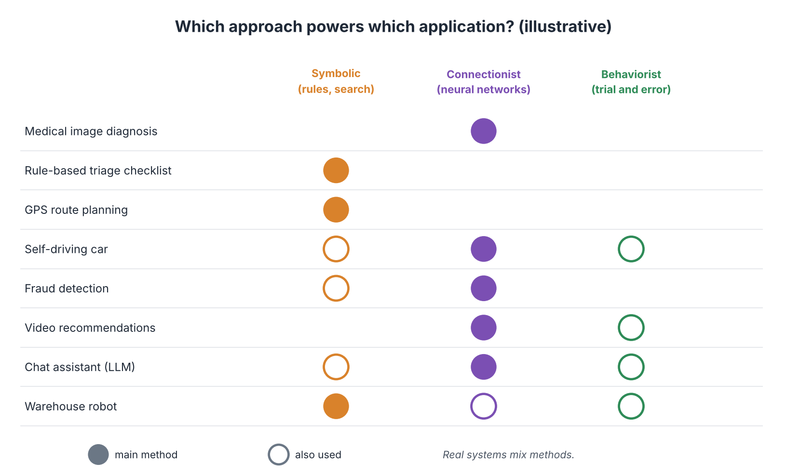
*Figure 7.1: Which approach powers which application (illustrative). Source: created by our team.*

How to read Figure 7.1: a **filled dot** means the main method. An **open circle** means it is also used. Notice how many rows have more than one dot: **real systems mix methods.** For example, a self-driving car uses neural networks to see, rules to follow traffic laws, and learning from experience to improve its driving.

---

## 7.2 Healthcare

### Start with a question

A doctor may look at hundreds of scans a week. Tiredness can cause missed details. Can a computer help a human look more carefully?

### Uses

| Use | How AI helps | Main method |
|-----|--------------|-------------|
| **Reading medical images** | Highlights suspicious areas in scans or eye photos (Gulshan et al., 2016) | Connectionist |
| **Triage checklists** | Asks fixed questions and sorts urgency | Symbolic (rules) |
| **Drug and protein research** | Predicts the 3D shape of proteins, speeding up research (Jumper et al., 2021) | Connectionist |
| **Hospital scheduling** | Plans operating-room use | Symbolic (search and optimisation) |

### Important points

- Studies show strong results in narrow tasks, but results can differ between hospitals and patient groups (Topol, 2019). **A tool trained on one population may perform worse on another.**
- The AI usually **supports** the doctor. A person remains responsible (see Section 7.7).

---

## 7.3 Finance and Business

### Start with a question

A bank handles millions of card payments each day. A person cannot check each one. How can fraud be spotted within seconds?

### Uses

| Use | How AI helps | Main method |
|-----|--------------|-------------|
| **Fraud detection** | Flags payments that look unusual compared with a customer's normal pattern | Connectionist, plus rules |
| **Credit scoring** | Estimates the chance a loan is repaid | Statistical or neural models (high-risk in the EU; see Chapter 8) |
| **Customer service** | Chat assistants answer common questions | Connectionist (language models) |
| **Demand forecasting** | Predicts how much stock a shop will need | Connectionist or statistics |

**Link to Chapter 5:** this is Big Data at work. Velocity matters (decide in a second), and veracity matters (mistakes cost money).
**Link to Chapter 3:** fraud is rare, so *accuracy* is misleading. Banks care about **precision** (few false alarms) and **recall** (catching real fraud).

---

## 7.4 Transport

### Start with a question

A self-driving car must see, decide and act in a fraction of a second, in rain, at night, near children. How many kinds of AI does that need?

### Uses

| Use | How AI helps | Main method |
|-----|--------------|-------------|
| **Route planning** | Finds the fastest route using search (Chapter 4) with live traffic data | Symbolic (A\*-style search) |
| **Driver assistance** | Lane keeping, automatic braking | Connectionist and rules |
| **Self-driving vehicles** | Sees with cameras and sensors, predicts other road users, plans a path | All three, mixed |
| **Logistics** | Plans delivery routes and warehouse movement | Symbolic and behaviorist |

### Levels of driving automation

The standard SAE J3016 describes six levels (SAE International, 2021).

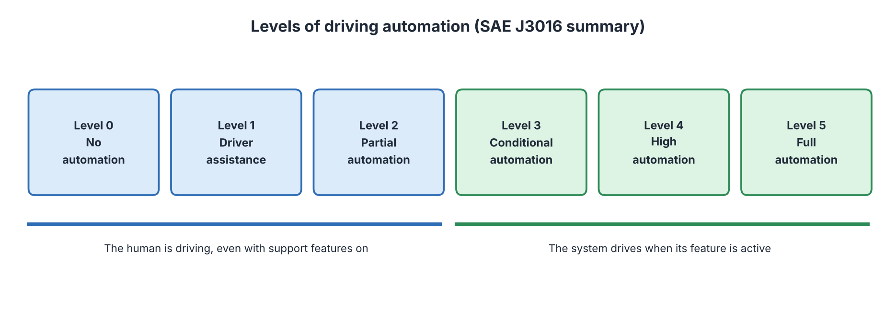
*Figure 7.2: Levels of driving automation. Source: created by our team.*

| Level | Name | Who is responsible? | Example |
|:-----:|------|---------------------|---------|
| 0 | No automation | Human | Warning sounds only |
| 1 | Driver assistance | Human | Cruise control that keeps distance |
| 2 | Partial automation | Human (must watch the road) | Steering and speed support together |
| 3 | Conditional automation | System drives, human must take over when asked | Limited highway driving |
| 4 | High automation | System, in limited areas or conditions | A robotaxi in a mapped district |
| 5 | Full automation | System, everywhere | Not generally available today |

**The most important point:** in levels 0 to 2 the human is always the driver, even when assistance features are switched on.

---

## 7.5 Education, Entertainment and Everyday Life

| Area | Example | Main method | Note |
|------|---------|-------------|------|
| **Education** | Tutoring software gives hints and adjusts difficulty (Kulik & Fletcher, 2016) | Symbolic and connectionist | Works best with a teacher's guidance |
| **Entertainment** | Video and music recommendations (Covington et al., 2016) | Connectionist, with behaviorist ideas | Can narrow what you see (see Chapter 8) |
| **Language tools** | Translation, writing help, summaries | Connectionist (language models) | Must be checked for errors (Chapter 8) |
| **Weather** | Fast forecasts learned from past data (Lam et al., 2023) | Connectionist | Complements physical models |
| **Games** | Opponents and training partners | Symbolic (search), behaviorist | Games are safe test beds |

---

## 7.6 Robotics and Manufacturing

| Use | How AI helps | Main method |
|-----|--------------|-------------|
| **Warehouse robots** | Move shelves, avoid collisions, share routes | Symbolic planning, with reflex layers (Chapter 6) |
| **Factory inspection** | Cameras spot defects | Connectionist (CNN) |
| **Robot arms** | Learn to grasp objects by practice | Behaviorist (often trained in simulation) |
| **Home robots** | Vacuuming, lawn mowing | Behaviour-based layers (Chapter 6) |

**Pattern:** robots usually need *several* kinds of intelligence at once: see (connectionist), plan (symbolic), and react or learn from experience (behaviorist).

---

## 7.7 Human in the Loop

### Start with a question

When an AI tool is right 95% of the time, who is responsible for the other 5%? If nobody is, the tool is unsafe.

### In plain words

**"Human in the loop" means a person reviews or approves important AI outputs before they take effect.** The AI supports; the person decides and is accountable.

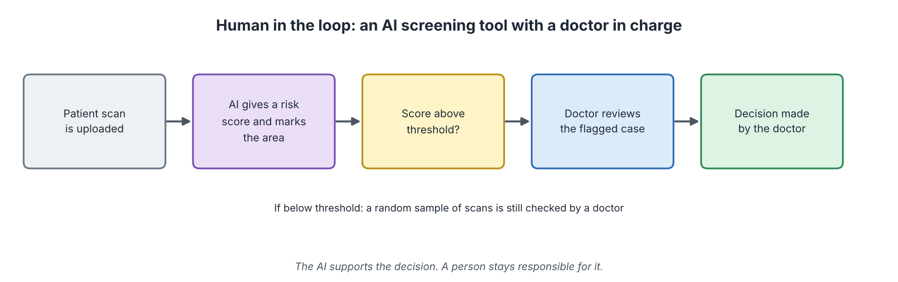
*Figure 7.3: Human in the loop in a screening tool. Source: created by our team.*

| Design choice | Why it matters |
|---------------|----------------|
| **Threshold** | A low threshold flags more cases (fewer misses, more false alarms and more work). A high threshold flags fewer (less work, more misses). |
| **Random sample check** | Even unflagged cases are sometimes reviewed, to catch hidden failures. |
| **Override and record** | A person can reject the AI, and the decision is recorded. |
| **Clear responsibility** | One named role is accountable for the final decision. |

**Automation bias** is the habit of trusting a machine too much. People may stop checking carefully if the tool is usually right. Good design keeps the reviewer actively engaged (Chapter 8).

---

## 7.8 Five Questions Before Trusting an AI Application

| # | Question | Why |
|:-:|----------|-----|
| 1 | **What exactly was it built to do?** | Tools fail outside their purpose. |
| 2 | **What data was it trained on?** | Missing groups cause unfair or wrong results. |
| 3 | **How was it tested, and with which measures?** | Accuracy alone can mislead (Chapter 3). |
| 4 | **What happens when it is wrong, and who is harmed?** | Higher stakes mean stricter control. |
| 5 | **Who is responsible, and can a human override it?** | Accountability should be clear. |

---

## 7.9 Mission 1: Match the Method

> **Goal:** choose a suitable AI approach for a problem and explain why.  
> **Preparation:** Sections 7.1 and 7.2 to 7.6, plus Chapters 4 to 6. 10 minutes.  
> **Task:** for each application, choose the **main** method (Symbolic, Connectionist or Behaviorist) and write one reason. Then name one method that might also be used.

| # | Application | Main method | Reason | Also used? |
|:-:|-------------|:-----------:|--------|:----------:|
| 1 | A tax-rule checker that decides if a person qualifies for a deduction | ____ | ____ | ____ |
| 2 | An app that recognises plant species from a photo | ____ | ____ | ____ |
| 3 | A robot arm that learns to pick up differently shaped objects by trying many times | ____ | ____ | ____ |
| 4 | A map app finding the shortest route between two cities | ____ | ____ | ____ |
| 5 | A bank system that flags unusual card payments | ____ | ____ | ____ |

> **Observe:** for which application was it hardest to pick only one method?  
> **Reflect:** why are many real systems a mix?  
> **Feedback:** compare with the Answer Key (Mission 1).

---

## 7.10 Mission 2: Set the Threshold

> **Goal:** use precision, recall and workload to choose a threshold for a human-in-the-loop tool.  
> **Preparation:** Chapter 3 Section 3.8 and this chapter Section 7.7. Calculator, 10 to 15 minutes.  
> **Task:** a hospital tests an AI screening tool on **1,000 scans**. Of these, **50** show a real problem (5%). A doctor will review every flagged scan. The tool has two settings.

| | Setting 1 (low threshold) | Setting 2 (high threshold) |
|---|:-------------------------:|:--------------------------:|
| Real problems caught (TP) | 45 | 40 |
| Real problems missed (FN) | 5 | 10 |
| False alarms (FP) | 95 | 40 |
| Total scans flagged for a doctor | ____ | ____ |
| Precision = TP / (TP + FP) | ____ | ____ |
| Recall = TP / (TP + FN) | ____ | ____ |

**Part A.** Complete the table.

**Part B. Workload.** Without the tool, doctors review all 1,000 scans. How many fewer scans does a doctor review with Setting 1? With Setting 2? ____ and ____

**Part C. Decide.** Which setting would you choose if the problem is a serious disease that can be treated if found early? Which would you choose for a very mild condition? Give a reason for each.

**Part D. A trap.** A colleague says: "Setting 2 is better because its precision is higher." Explain why that is not the whole story.

> **Observe:** what did you gain and lose when moving from Setting 1 to Setting 2?  
> **Reflect:** who should decide the threshold: the engineers, the doctors, or both? Why?  
> **Feedback:** compare with the Answer Key (Mission 2).

---

## 7.11 Common Misconceptions

| Misconception | Correction |
|---------------|------------|
| "AI will replace doctors, drivers and teachers." | Today most systems support people in narrow tasks; people stay responsible. Jobs can still change. |
| "One AI method fits every problem." | Methods suit different problem types, and real systems mix them. |
| "If a tool works in one hospital or country, it works everywhere." | Data, people and conditions differ. Tools must be re-tested. |
| "A driver-assistance car drives itself." | At levels 0 to 2 the human is still the driver. |
| "Human in the loop makes errors impossible." | Humans can over-trust the tool (automation bias) or be overloaded. |

---

## 7.12 Quick Check

**Q1 (True/False).** Real AI systems often combine more than one approach.

**Q2 (True/False).** At SAE Level 2 the human driver can stop watching the road.

**Q3 (True/False).** A higher threshold in a screening tool normally flags fewer scans.

**Q4 (Multiple choice, one answer).** Which problem is best suited to a rule-based (symbolic) approach?
A. Recognising faces in photos. B. Checking whether a form meets clear eligibility rules. C. Transcribing speech. D. Writing a poem.

**Q5 (Multiple choice, one answer).** What is "automation bias"?
A. A bias in the training data. B. Over-trusting an automated tool. C. A robot that refuses to work. D. A faster algorithm.

**Q6 (Multiple choice, one answer).** For a rare fraud case, why is accuracy a poor measure?
A. It is hard to compute. B. A tool that flags nothing can still look very accurate. C. It cannot be used for banks. D. It is only for images.

**Q7 (Short answer, 3 to 4 sentences).** Choose one application from this chapter and explain how a human in the loop could reduce harm.

---

## 7.13 Summary, Connections and References

### Key takeaways

- Choose the AI method by the type of problem: rules, patterns in data, or learning from feedback.
- Healthcare, finance, transport, education, entertainment and robotics all use AI, usually in narrow tasks.
- Real systems mix symbolic, connectionist and behaviorist methods.
- SAE levels 0 to 2 keep the human as the driver; higher levels shift responsibility to the system under certain conditions.
- Human in the loop keeps a person accountable; thresholds trade missed cases against false alarms and workload.
- Ask five questions before trusting an AI application.

### Connections to other chapters

| Direction | Chapter | Link |
|-----------|---------|------|
| Builds on | Chapter 2 | Narrow vs general AI |
| Builds on | Chapter 3 | Precision, recall, training vs deployment |
| Builds on | Chapters 4 to 6 | The three schools applied |
| Leads to | Chapter 8 | Risks, bias, privacy, regulation |

### How this chapter will be reused

| Resource | Planned use |
|----------|-------------|
| **Study Guide** | Sections 7.1 to 7.8 are the reading text; Missions 1 and 2 are practice. |
| **Test Bank** | Method matching, SAE levels and threshold calculations become exam items. |
| **PPT Slides** | The method matrix and human-in-the-loop flow become key slides. |
| **Video Tutorial** | A video that walks through the screening-tool threshold example. |

---

## Answer Key

**Mission 1: Match the Method**

| # | Application | Main method | Reason (example) | Also used? |
|:-:|-------------|:-----------:|------------------|:----------:|
| 1 | Tax-rule checker | **Symbolic** | Clear written rules; each decision can be explained | Connectionist, to read scanned documents |
| 2 | Plant recognition from a photo | **Connectionist** | Patterns in images are too complex for hand-written rules (CNN) | Symbolic, to store plant facts |
| 3 | Robot arm learning by trying | **Behaviorist** | Learns actions from success or failure feedback | Connectionist, to see the objects |
| 4 | Route finding | **Symbolic** | A search problem over a map (A\*-style search) | Connectionist, to predict traffic |
| 5 | Unusual card payments | **Connectionist** | Learns normal patterns from large data | Symbolic, for fixed rules such as blocked countries |

(Other well-argued answers are acceptable if the reason matches the problem type.)

**Mission 2: Set the Threshold**

Part A:

| | Setting 1 | Setting 2 |
|---|:---------:|:---------:|
| TP | 45 | 40 |
| FN | 5 | 10 |
| FP | 95 | 40 |
| Total flagged | 45 + 95 = **140** | 40 + 40 = **80** |
| Precision | 45 / 140 = **32.1%** | 40 / 80 = **50%** |
| Recall | 45 / 50 = **90%** | 40 / 50 = **80%** |

Part B: 1,000 - 140 = **860** fewer scans with Setting 1; 1,000 - 80 = **920** fewer with Setting 2.
Part C: for a serious but treatable disease, choose **Setting 1**: it misses fewer real cases (5 vs 10) and the extra false alarms only cost doctors some review time. For a very mild condition, Setting 2 may be reasonable, because the cost of a miss is low and fewer false alarms save time and worry.
Part D: precision is only one part. Setting 2 misses twice as many real problems (10 vs 5), which may be the more serious harm. Both precision and recall must be read together with the cost of each kind of mistake.
*Observe:* moving to Setting 2 reduced false alarms and workload but missed more real cases. *Reflect:* both, because engineers know how the tool behaves, while doctors know what a missed case or a false alarm means for patients.

**Quick Check**

1. **True.**
2. **False.** At Level 2 the human must keep watching the road.
3. **True.**
4. **B.**
5. **B.**
6. **B.**
7. *Key points:* names a real application; describes a human step such as reviewing flagged cases, a random sample check or the right to override; connects it to a harm (for example, a missed disease or a wrongly blocked payment).

---

## Glossary

| Term | Meaning |
|------|---------|
| Automation bias | Trusting an automated tool too much. |
| Fraud detection | Finding payments or actions that look dishonest. |
| Human in the loop | A person reviews or approves AI outputs before they take effect. |
| Recommendation system | A system that suggests items a user may like. |
| SAE levels | A six-level scale (0 to 5) describing driving automation. |
| Threshold | The cut-off score above which an AI tool flags a case. |
| Triage | Sorting cases by urgency. |

---

## References

1. Russell, S., & Norvig, P. (2021). *Artificial Intelligence: A Modern Approach* (4th ed.). Pearson. https://aima.cs.berkeley.edu/
2. Stanford Institute for Human-Centered AI. *AI Index Report* (annual). https://aiindex.stanford.edu/report/
3. Gulshan, V., et al. (2016). Development and validation of a deep learning algorithm for detection of diabetic retinopathy in retinal fundus photographs. *JAMA, 316*(22), 2402-2410. https://doi.org/10.1001/jama.2016.17216
4. Topol, E. J. (2019). High-performance medicine: the convergence of human and artificial intelligence. *Nature Medicine, 25*, 44-56. https://doi.org/10.1038/s41591-018-0300-7
5. Jumper, J., et al. (2021). Highly accurate protein structure prediction with AlphaFold. *Nature, 596*, 583-589. https://doi.org/10.1038/s41586-021-03819-2
6. SAE International. (2021). *Taxonomy and Definitions for Terms Related to Driving Automation Systems for On-Road Motor Vehicles* (J3016). https://www.sae.org/standards/content/j3016_202104/
7. Kulik, J. A., & Fletcher, J. D. (2016). Effectiveness of intelligent tutoring systems: A meta-analytic review. *Review of Educational Research, 86*(1), 42-78. https://doi.org/10.3102/0034654315581420
8. Covington, P., Adams, J., & Sargin, E. (2016). Deep neural networks for YouTube recommendations. *RecSys '16*, 191-198. https://doi.org/10.1145/2959100.2959190
9. Lam, R., et al. (2023). Learning skillful medium-range global weather forecasting. *Science, 382*(6677), 1416-1421. https://doi.org/10.1126/science.adi2336
10. Course materials: lecturer's slides, Chapters 4 to 6 (Computer Science & AI).

> Figures 7.1 to 7.3 were created for Stage 2 by our team. Figure 7.1 is an illustration of typical designs, not a count of real products. The numbers in Mission 2 are invented for practice.

---

# AI Ethics, Risks and Limitations

**Audience:** Learners with no technical background in AI  
**Estimated time:** 3 to 4 hours (including missions)  
**Format:** Read, pause at each "Pause and predict" box, complete the two missions, then check the answer key at the end of the chapter.

---

## Learning Outcomes

After this chapter, you should be able to:

1. Explain where bias can enter an AI system and give an example.
2. Calculate a selection rate and an impact ratio and apply the four-fifths rule of thumb.
3. Explain basic privacy ideas: personal data, consent and data minimisation.
4. Explain why transparency, explainability and accountability matter.
5. Explain hallucination and use a four-step method to check AI claims.
6. Describe the EU AI Act risk levels and the four functions of the NIST AI Risk Management Framework.
7. Describe responsible and honest use of AI in your own studies.

## Where This Chapter Fits

**Builds on Chapters 1 to 7.** Chapter 3 introduced data quality and hallucination. Chapter 5 mentioned bias and black boxes. Chapter 6 showed reward hacking. Chapter 7 showed applications and human in the loop. This chapter brings these risks together and shows how people manage them.

**Closing chapter.** It ends the module by asking: *now that we can build AI, how should we use it?*

---

## 8.1 The Big Picture

### Start with a question

A calculator that makes a mistake affects one answer. An AI tool that makes a mistake may repeat it for millions of people, quickly, and without anyone noticing. Which one needs more care?

### In plain words

**AI ethics is the study of how to build and use AI so that it is fair, safe, respectful of people's rights, and accountable.** It matters because AI works at large scale, learns from imperfect human data, and often affects important decisions such as jobs, loans, health and safety.

### Five themes of this chapter

| Theme | Plain question |
|-------|----------------|
| **Fairness** | Does it treat groups of people justly? |
| **Privacy** | Does it protect personal information? |
| **Transparency and accountability** | Can we understand it, and who is responsible? |
| **Reliability** | Is it correct, and does it admit when it is unsure? |
| **Safety and misuse** | Can it cause harm or be used to harm? |

---

## 8.2 Bias and Fairness

### Start with a question

A company trains a tool on ten years of past hiring decisions to pick the best applicants. If past hiring favoured one group, what will the tool learn?

### In plain words

**Bias in AI means a system gives results that are systematically less favourable to some people or groups for reasons that are not fair.** Usually the computer is not "prejudiced". It copies patterns in the data and in the goals given by people.

### Where bias comes in

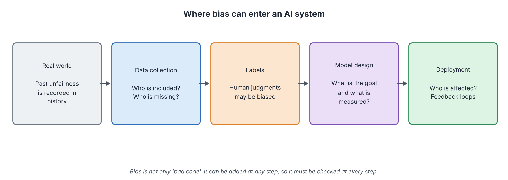
*Figure 8.1: Where bias can enter an AI system. Source: created by our team.*

| Step | How bias can enter | Example |
|------|--------------------|---------|
| Real world | History contains unfairness | Past hiring favoured one group |
| Data collection | Some groups are missing or under-represented | Few face photos of dark-skinned women |
| Labels | Human judgments carry bias | Past "good employee" ratings were biased |
| Model design | The goal or measure is a poor proxy | "Time at job" used as a stand-in for performance |
| Deployment | The tool is used on people unlike the training group; feedback loops grow the problem | A tool trained in one country used in another |

### Real cases

| Case | What happened | Lesson |
|------|---------------|--------|
| **Face analysis** | A study of commercial systems found much higher error rates for darker-skinned women (up to about 35%) than for lighter-skinned men (under 1%) (Buolamwini & Gebru, 2018) | Test results must be reported per group |
| **Hiring tool** | A company reportedly dropped an experimental recruiting tool that favoured male applicants because it learned from past, mostly male, hires (Dastin, 2018) | Past data can carry past unfairness |
| **Risk scores in courts** | A news investigation reported that a criminal-risk score made different kinds of errors for Black and white defendants (Angwin et al., 2016). Researchers showed that several fairness goals cannot all be met at once when groups differ in base rates (Kleinberg et al., 2017) | "Fair" has more than one meaning; people must choose and explain |

### Measuring: selection rate and the four-fifths rule

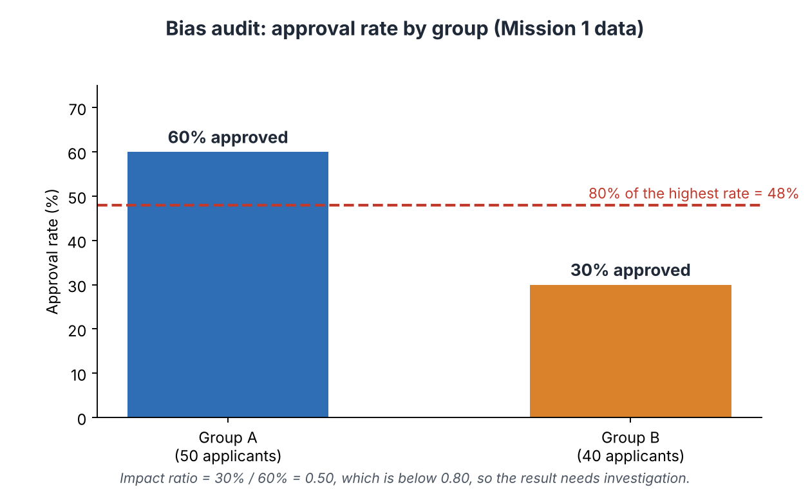
*Figure 8.2: A simple bias audit. Source: created by our team.*

| Term | Meaning | Value in Figure 8.2 |
|------|---------|---------------------|
| **Selection rate** | Share of a group that was approved | A: 30 of 50 = 60%; B: 12 of 40 = 30% |
| **Impact ratio** | Lowest selection rate divided by highest | 30% / 60% = 0.50 |
| **Four-fifths rule** | A rule of thumb used in US employment practice: a ratio below 0.80 is a warning sign that needs investigation (U.S. EEOC, 1978) | 0.50 is below 0.80, so investigate |

**Important:** the rule is a *screening* signal, not proof of fairness or of unfairness. A ratio above 0.80 does not prove the tool is fair, and one below 0.80 is a reason to look deeper at data, labels and features.

### Reducing bias

| Action | Example |
|--------|---------|
| Check representation in the data | Are all groups present in realistic numbers? |
| Test performance **per group** | Report errors for each group, not just the average |
| Remove or check **proxies** | A postcode can stand in for ethnicity or income |
| Document the model | Publish what it is for and where it fails (Mitchell et al., 2019) |
| Keep humans in the loop | Allow review and appeal (Chapter 7) |

> **Pause and predict.** A company removes the column "gender" from its data. Is the tool now guaranteed to be gender-neutral?
>
> **Check:** No. Other columns, such as "attended a women's college" or "hobby", may still reveal gender. Such columns are called *proxies*. Removing one column does not remove the pattern.

---

## 8.3 Privacy and Data Protection

### Start with a question

Your phone knows where you go, what you search and who you talk to. Who else should be allowed to know?

### In plain words

**Personal data is any information that can identify a person, alone or when combined with other data.** Examples: name, face photo, voice, location, health record.

### Key ideas

| Idea | In plain words | Example |
|------|----------------|---------|
| **Consent** | People agree knowingly before their data is used | A clear opt-in, not a hidden box |
| **Purpose limitation** | Use data only for the reason it was collected | Health data collected for care is not used for advertising |
| **Data minimisation** | Collect only what is needed | A flashlight app does not need your contacts |
| **Security** | Protect data from leaks | Encryption, access control |
| **Rights** | People can see, correct or delete their data | The right to ask a company to delete your data |

Many places have laws on these ideas. Examples: the European Union's General Data Protection Regulation (GDPR) (European Union, 2016), Indonesia's Personal Data Protection Law (Law No. 27 of 2022) and China's Personal Information Protection Law (2021). Rules differ, so always check the law that applies to you.

### Why AI makes privacy harder

- Models are trained on very large data sets that may include personal information.
- Data that looks anonymous can sometimes be matched with other data to identify people again.
- A model may reveal parts of its training data when questioned in clever ways.

**Practical rule for students:** do not paste personal, confidential or exam material into public AI tools.

---

## 8.4 Transparency, Explainability and Accountability

### Start with a question

A bank refuses your loan and says "the computer decided". Is that acceptable?

### In plain words

| Term | Meaning | Why it matters |
|------|---------|----------------|
| **Transparency** | Being open that AI is used, and how | People can object or ask questions |
| **Explainability** | Being able to say *why* the system gave a result | Errors and bias can be found and fixed |
| **Accountability** | A named person or organisation is responsible | Someone can answer for harm and correct it |

Rule-based systems (Chapter 4) are easy to explain because you can read the rules. Neural networks (Chapter 5) are harder, because the knowledge is in millions of weights. Researchers study *explainable AI* methods, but explanations of complex models are often partial. For important decisions, many rules require human review and a way to appeal.

---

## 8.5 Reliability: Hallucination and Other Limits

### Start with a question

You ask a chatbot for sources about a topic. It gives three neat references with authors, titles and years. Later you cannot find them anywhere. What happened?

### In plain words

**Hallucination is when an AI produces text that sounds right but is false or invented.** As Chapter 3 explained, a language model predicts likely next words; it does not check facts. Fluent language is not proof of truth (Ji et al., 2023).

### Other limits to remember

| Limit | Plain meaning |
|-------|---------------|
| **Brittleness** | Small, odd changes in the input can cause large errors (for example, stickers that confuse a road-sign reader). |
| **Distribution shift** | The tool fails when the real world differs from the training data. |
| **Outdated knowledge** | A model knows only what was in its training data unless it is connected to current sources. |
| **No real understanding** | Systems find patterns; whether this is "understanding" is debated. |
| **Overconfidence** | The tone of an answer may sound certain even when the answer is wrong. |

### A method for checking an AI answer

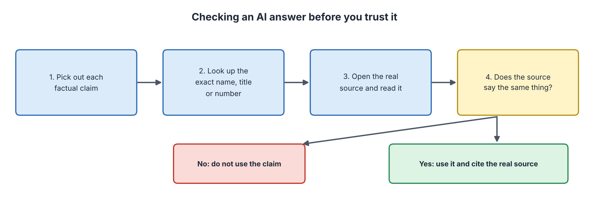
*Figure 8.3: Checking an AI answer before you trust it. Source: created by our team.*

| Step | What to do |
|:----:|------------|
| 1 | Pick out each factual claim (a name, number, date, quote or source). |
| 2 | Look up the exact name, title or number in a trusted place. |
| 3 | Open the real source and read the relevant part. |
| 4 | Compare. If the source does not say the same, do not use the claim. If it does, cite the **real** source, not the chatbot. |

---

## 8.6 Safety and Misuse

| Risk | Example | What helps |
|------|---------|------------|
| **Misinformation and deepfakes** | Fake images, voices or videos that look real | Check the source; look for labels and provenance information |
| **Cyber misuse** | AI used to write convincing scam messages | Awareness, filters, secure habits |
| **Reward hacking** | An agent finds a loophole in its goal (Chapter 6) | Careful goals, testing, oversight |
| **Over-reliance** | Staff stop thinking because the tool is "usually right" (Chapter 7) | Training, spot checks, clear responsibility |
| **Environmental cost** | Training and running large models uses energy (Strubell et al., 2019) | Efficient methods; use the right size of model |
| **Job change** | Some tasks are automated, others created | Reskilling and policy |

---

## 8.7 Rules and Frameworks

### The EU AI Act: four risk levels

The European Union adopted the AI Act in 2024. Its main idea: **the higher the risk to people, the stricter the rules** (European Union, 2024).

*Figure 8.4: The four risk levels of the EU AI Act (simplified). Source: created by our team.*

| Level | Meaning | Examples |
|-------|---------|----------|
| Unacceptable | Banned | Social scoring of people |
| High | Allowed with strict duties (risk management, data quality, human oversight, documentation) | Hiring, credit scoring, medical devices |
| Limited | Must be transparent | A chatbot must tell users it is an AI |
| Minimal | No new duties | Spam filters, video-game AI |

The Act is phased in over several years. This summary is simplified; read the official text for details.

### The NIST AI Risk Management Framework

The US National Institute of Standards and Technology published a voluntary framework with four functions (NIST, 2023):

| Function | Plain meaning |
|----------|---------------|
| **Govern** | Set policies, roles and a culture of responsibility |
| **Map** | Understand the context, purpose and who could be harmed |
| **Measure** | Test and track risks, including bias and reliability |
| **Manage** | Act on the risks: fix, limit or stop |

### Other guidance

UNESCO's *Recommendation on the Ethics of Artificial Intelligence* (2021) lists shared values such as human rights, fairness, transparency and human oversight, which many countries have endorsed.

---

## 8.8 Using AI Responsibly in Your Studies

| Good practice | Why |
|---------------|-----|
| **Follow your course rules** on AI use | Rules differ between courses. |
| **Disclose** how you used AI (tool, purpose, what you changed) | Honesty and transparency. |
| **Verify** every fact and reference | AI can hallucinate. |
| **Do not paste** private or exam material | Privacy and integrity. |
| **Keep your own thinking** | You are graded on what *you* understand. |
| **Keep a real log** | Only record what really happened. |

This is why our team keeps an **AI-use log**: an honest record of what AI was used for and how its output was checked.

---

## 8.9 Mission 1: Audit a Hiring Tool

> **Goal:** calculate selection rates and an impact ratio and think about what comes next.  
> **Preparation:** Section 8.2. Calculator, 10 to 15 minutes.  
> **Task:** an AI tool screens job applicants. Results: **Group A**: 50 applicants, 30 approved. **Group B**: 40 applicants, 12 approved.

**Part A.** Fill in the table.

| Group | Applicants | Approved | Selection rate |
|:-----:|:----------:|:--------:|:--------------:|
| A | 50 | 30 | ____ |
| B | 40 | 12 | ____ |

**Part B.** Impact ratio = lowest rate / highest rate = ____ . Is it below 0.80? ____

**Part C. Investigate.** List three places you would look to find the cause (use Figure 8.1).

**Part D. After a fix.** The company retrains the tool. Now Group B has 20 approved out of 40 (Group A unchanged). Calculate the new rate and impact ratio. ____ Does it pass the four-fifths rule? ____ Does that prove the tool is fair? Why or why not?

> **Observe:** which number alerted you first, the two rates or the ratio?  
> **Reflect:** who should decide whether the tool can be used: the engineers, the hiring managers, or both? Why?  
> **Feedback:** compare with the Answer Key (Mission 1).

---

## 8.10 Mission 2: Verify the Claims

> **Goal:** practise the four-step method on an AI-style answer.  
> **Preparation:** Sections 8.5 and 8.7, and Chapter 3. 10 to 15 minutes.  
> **Task:** below is an invented AI answer to the question "Tell me about AI risks." Check each numbered claim. (The reference in claim 2 is **invented for this exercise**.)

> 1. "The EU AI Act bans certain AI practices, such as social scoring."
> 2. "As shown in Whitfield and Armand (2019), 'The Quantum Fairness Index', published in the *Journal of Applied Cognitive Ethics*, every AI system is fair when its accuracy is above 90%."
> 3. "ChatGPT-style chatbots learn from each user's conversation in real time and permanently update themselves."
> 4. "A spam filter with 95% accuracy is always a good filter."

**Part A.** For each claim, write the check you would do (step 2 and 3 of the method), and your verdict: *Supported*, *Not supported*, or *Misleading*.

| Claim | How I would check it | Verdict |
|:-----:|----------------------|:-------:|
| 1 | ____ | ____ |
| 2 | ____ | ____ |
| 3 | ____ | ____ |
| 4 | ____ | ____ |

**Part B. Reflect.** Claim 2 sounds scientific. Which three details make it look real, and what is the one test that matters?

**Part C. Log it.** Write one honest sentence you could put in an AI-use log about how you checked this answer.

> **Observe:** which claim needed knowledge from an earlier chapter to check?  
> **Reflect:** why is a confident tone not evidence?  
> **Feedback:** compare with the Answer Key (Mission 2).

---

## 8.11 Common Misconceptions

| Misconception | Correction |
|---------------|------------|
| "A computer decision is neutral." | It reflects its data, labels and goals, which come from people. |
| "Removing the sensitive column removes bias." | Proxies can reveal the same information. |
| "If the average accuracy is high, it is fair." | A good average can hide poor results for a small group. |
| "A confident answer is a true answer." | Language models can state false things fluently. |
| "Anonymous data can never identify anyone." | It can sometimes be re-identified by combining datasets. |
| "Ethics slows down innovation, so it is optional." | Failures in fairness, privacy and safety cause harm and loss of trust, and some are regulated by law. |

---

## 8.12 Quick Check

**Q1 (True/False).** Bias can enter an AI system at several steps, not only in the code.

**Q2 (True/False).** An impact ratio above 0.80 proves that a tool is fair.

**Q3 (True/False).** In the EU AI Act, a chatbot is "unacceptable risk" and banned.

**Q4 (Multiple choice, one answer).** Which action best matches *data minimisation*?
A. Keep all data forever. B. Collect only the data needed for the purpose. C. Sell data. D. Delete the model.

**Q5 (Multiple choice, one answer).** Group A: 40 of 50 approved. Group B: 18 of 30 approved. What is the impact ratio?
A. 0.50. B. 0.60. C. 0.75. D. 0.80.

**Q6 (Multiple choice, one answer).** Which NIST function is about testing and tracking risks?
A. Govern. B. Map. C. Measure. D. Manage.

**Q7 (Short answer, 3 to 4 sentences).** Explain why an AI answer with real-looking references still needs to be checked.

---

## 8.13 Summary, Connections and References

### Key takeaways

- Bias can enter at every step: the real world, data, labels, design and deployment.
- Compare selection rates between groups; the four-fifths rule is a warning signal, not proof.
- Respect privacy: consent, purpose limitation, data minimisation, security and people's rights.
- Transparency, explainability and accountability make AI trustworthy and correctable.
- Language models can hallucinate; verify claims against real sources.
- The EU AI Act sorts systems by risk; the NIST framework has four functions: Govern, Map, Measure, Manage.
- Use AI honestly in your studies: follow rules, disclose, verify, protect privacy, keep your own thinking.

### Connections to other chapters

| Direction | Chapter | Link |
|-----------|---------|------|
| Builds on | Chapter 3 | Data quality, hallucination, metrics |
| Builds on | Chapter 4 | Rule-based systems are explainable |
| Builds on | Chapter 5 | Black-box networks, bias in Big Data, privacy |
| Builds on | Chapter 6 | Reward hacking |
| Builds on | Chapter 7 | Human in the loop, five questions |
| Leads to | Whole module | A responsible way to use everything learned |

### How this chapter will be reused

| Resource | Planned use |
|----------|-------------|
| **Study Guide** | Sections 8.1 to 8.8 are the reading text; Missions 1 and 2 are practice. |
| **Test Bank** | Impact-ratio calculations, claim-checking scenarios and the EU risk levels become exam items. |
| **PPT Slides** | The bias-sources flow, the four-fifths audit, the verification steps and the EU pyramid become slides. |
| **Video Tutorial** | A video that walks through a bias audit and the four-step claim check. |

---

## Answer Key

**Mission 1: Audit a Hiring Tool**

Part A: Group A: 30 / 50 = **60%**. Group B: 12 / 40 = **30%**.
Part B: 30% / 60% = **0.50**, which is **below 0.80**, so the tool needs investigation.
Part C (any three of): the **training data** (are there enough Group B examples?), the **labels** (were past decisions biased?), the **features** (are there proxies for group membership?), the **goal or measure** (what does "good applicant" mean?), the **deployment** (is Group B different from the training population?).
Part D: new rate for B = 20 / 40 = **50%**. Impact ratio = 50% / 60% = **0.833**, which is above 0.80, so it **passes** the rule of thumb. It does **not** prove fairness: the rule is only a screening signal; the tool may still make different *kinds* of mistakes for each group, errors may be hidden within subgroups, and other fairness measures could still fail.
*Observe/Reflect:* both groups should take part, because engineers know how the tool works, while managers and affected people know what a fair outcome means in context. Accountability should be assigned to a named role.

**Mission 2: Verify the Claims**

Part A:

| Claim | How I would check it | Verdict |
|:-----:|----------------------|:-------:|
| 1 | Open the official EU AI Act text or the European Commission's summary and look for the list of prohibited practices | **Supported** |
| 2 | Search the journal and the authors; look in a library database or Google Scholar for the exact title; the article cannot be found, and the claim contradicts Section 8.2 (accuracy alone does not show fairness) | **Not supported** (invented source; also a misleading statement) |
| 3 | Check Chapter 3, Section 3.6: deployed models are normally fixed during a chat and not retrained by it; confirm with the provider's documentation | **Not supported** |
| 4 | Check Chapter 3, Section 3.8: a filter can have high accuracy but poor recall when spam is rare | **Misleading** |

Part B: three details that make it look real: the authors' names, the year, the journal-like title and the fancy name of the index. The test that matters: **can you find the real source and does it say that?** Not finding it means do not use it.
Part C (example): "I asked an AI tool for a list of AI risks, checked each claim against the EU AI Act summary and our course chapters, found one invented reference and one false statement, and removed both."

**Quick Check**

1. **True.**
2. **False.** It is only a warning signal; a ratio above 0.80 does not prove fairness.
3. **False.** Chatbots are "limited risk" (transparency duties); they are not banned.
4. **B.**
5. **C.** Rates: A = 40/50 = 80%, B = 18/30 = 60%; 60/80 = 0.75.
6. **C.**
7. *Key points:* language models predict likely text, not verified facts; references can be invented; a reference only has value if the real source exists and says the same thing; always verify names, numbers and sources.

---

## Glossary

| Term | Meaning |
|------|---------|
| Accountability | A named person or organisation is responsible for the system and its effects. |
| Bias (in AI) | Systematically less favourable results for some groups for unfair reasons. |
| Consent | A person's informed agreement to the use of their data. |
| Data minimisation | Collecting only the data needed. |
| Distribution shift | A change between training data and real-world data. |
| Explainability | Being able to say why a system gave a result. |
| Four-fifths rule | A rule of thumb: an impact ratio below 0.80 signals a need to investigate. |
| Hallucination | Fluent but false or invented output from a language model. |
| Impact ratio | Lowest group selection rate divided by the highest. |
| Personal data | Information that can identify a person. |
| Proxy | A feature that indirectly reveals a protected characteristic. |
| Selection rate | The share of a group that receives a positive decision. |
| Transparency | Openness that AI is used and how. |

---

## References

1. Buolamwini, J., & Gebru, T. (2018). Gender Shades: Intersectional accuracy disparities in commercial gender classification. *Proceedings of Machine Learning Research, 81*, 77-91. https://proceedings.mlr.press/v81/buolamwini18a.html
2. Dastin, J. (2018, October 10). Amazon scraps secret AI recruiting tool that showed bias against women. *Reuters*. https://www.reuters.com/article/world/insight-amazon-scraps-secret-ai-recruiting-tool-that-showed-bias-against-women-idUSKCN1MK0AG/
3. Angwin, J., Larson, J., Mattu, S., & Kirchner, L. (2016). Machine bias. *ProPublica*. https://www.propublica.org/article/machine-bias-risk-assessments-in-criminal-sentencing
4. Kleinberg, J., Mullainathan, S., & Raghavan, M. (2017). Inherent trade-offs in the fair determination of risk scores. *ITCS 2017*. https://arxiv.org/abs/1609.05807
5. Mitchell, M., et al. (2019). Model cards for model reporting. *FAT\* '19*, 220-229. https://doi.org/10.1145/3287560.3287596
6. Ji, Z., et al. (2023). Survey of hallucination in natural language generation. *ACM Computing Surveys, 55*(12), 1-38. https://doi.org/10.1145/3571730
7. Strubell, E., Ganesh, A., & McCallum, A. (2019). Energy and policy considerations for deep learning in NLP. *ACL 2019*. https://arxiv.org/abs/1906.02243
8. U.S. Equal Employment Opportunity Commission et al. (1978). *Uniform Guidelines on Employee Selection Procedures*, 29 C.F.R. Part 1607. https://www.ecfr.gov/current/title-29/subtitle-B/chapter-XIV/part-1607
9. European Union. (2016). *General Data Protection Regulation* (Regulation (EU) 2016/679). https://eur-lex.europa.eu/eli/reg/2016/679/oj
10. European Union. (2024). *Artificial Intelligence Act* (Regulation (EU) 2024/1689). https://eur-lex.europa.eu/eli/reg/2024/1689/oj
11. National Institute of Standards and Technology. (2023). *Artificial Intelligence Risk Management Framework (AI RMF 1.0)*. https://doi.org/10.6028/NIST.AI.100-1
12. UNESCO. (2021). *Recommendation on the Ethics of Artificial Intelligence*. https://www.unesco.org/en/artificial-intelligence/recommendation-ethics
13. Russell, S., & Norvig, P. (2021). *Artificial Intelligence: A Modern Approach* (4th ed.). Pearson. https://aima.cs.berkeley.edu/

> Figures 8.1 to 8.4 were created for Stage 2 by our team. The EU AI Act summary is simplified. The article in Mission 2, claim 2 is invented for practice and does not exist.
