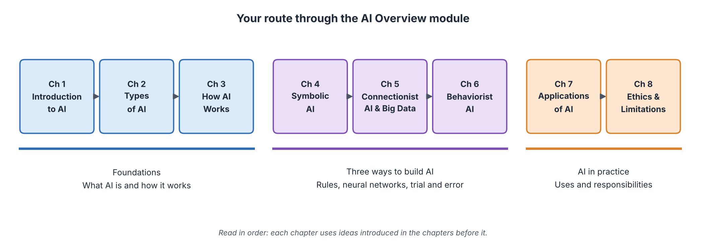
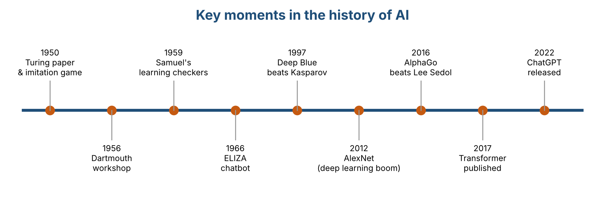
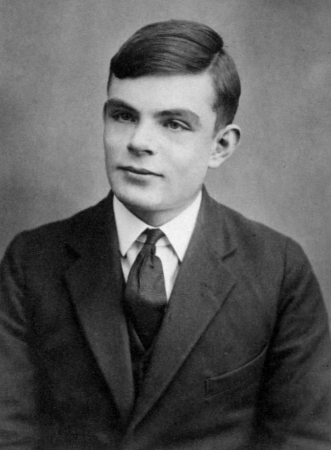
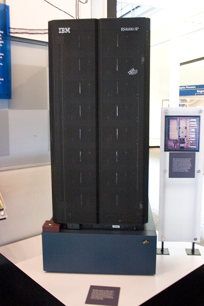
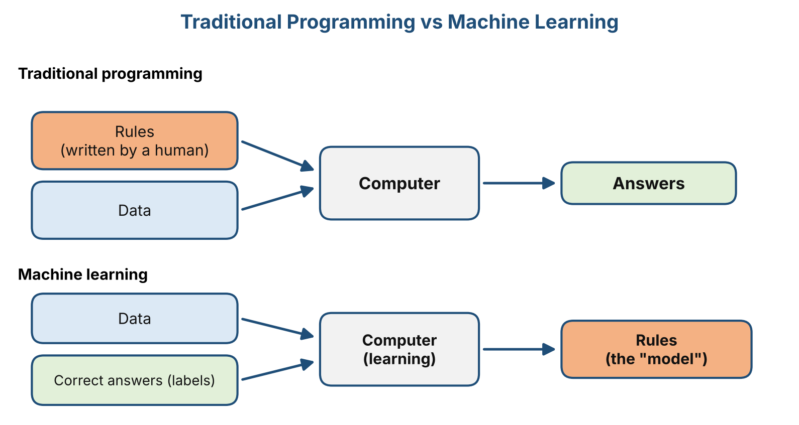
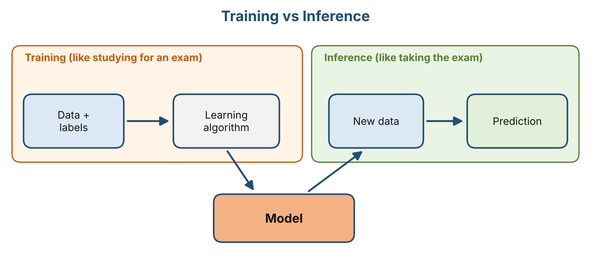
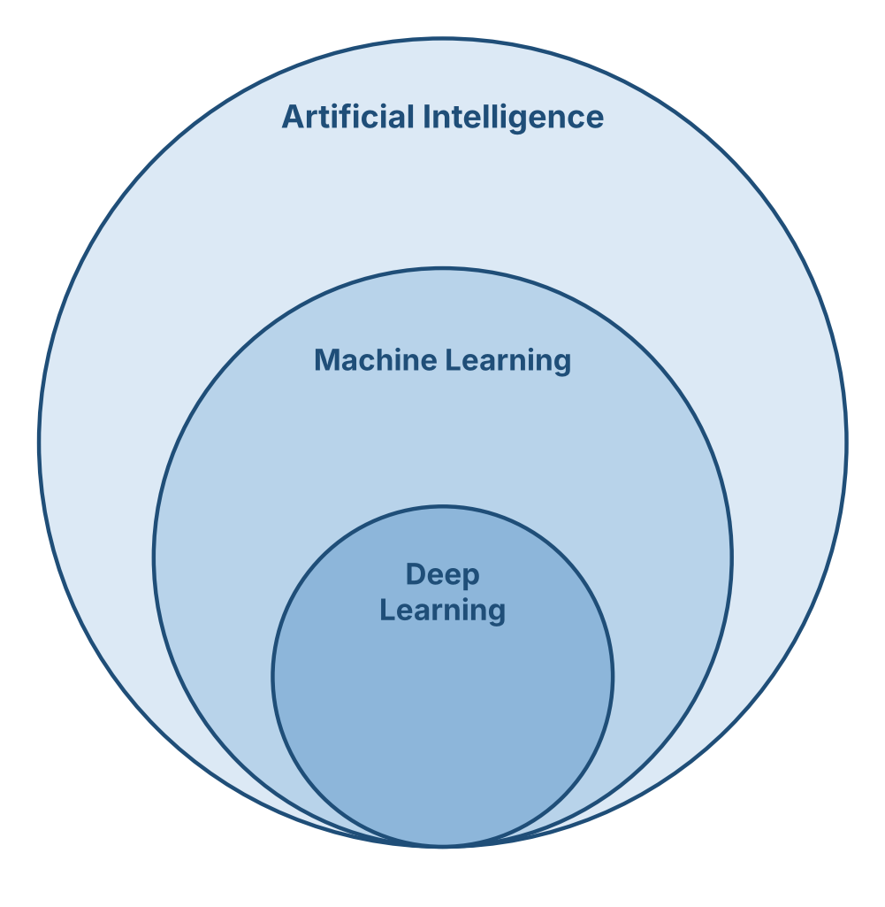
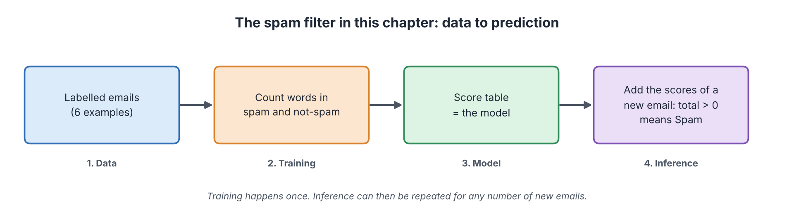

# Introduction to Artificial Intelligence

**Audience:** Learners with no technical background in AI  
**Estimated time:** 2.5 to 3.5 hours (including missions)  
**Format:** Read, pause at each "Pause and predict" box, complete the two missions, then check the answer key at the end of the chapter.

---

## Table of Contents

- [Learning Outcomes](#learning-outcomes)
- [Where This Chapter Fits](#where-this-chapter-fits)
- [1.1 What Is AI?](#11-what-is-ai)
- [1.2 A Brief History of AI](#12-a-brief-history-of-ai)
- [1.3 AI vs Traditional Programming](#13-ai-vs-traditional-programming)
- [1.4 Basic AI Terminology](#14-basic-ai-terminology)
- [1.5 Worked Example: A Spam Filter That Learns](#15-worked-example-a-spam-filter-that-learns)
- [1.6 Mission 1: Rule or Learn?](#16-mission-1-rule-or-learn)
- [1.7 Mission 2: Teach the Filter a Lesson](#17-mission-2-teach-the-filter-a-lesson)
- [1.8 Common Misconceptions](#18-common-misconceptions)
- [1.9 Quick Check](#19-quick-check)
- [1.10 Summary, Connections and References](#110-summary-connections-and-references)
- [Answer Key](#answer-key)
- [Glossary](#glossary)
- [References](#references)

---

## Learning Outcomes

After this chapter, you should be able to:

1. Explain in your own words what Artificial Intelligence (AI) is, and name three examples from daily life.
2. Describe five key moments in the history of AI and explain why AI went through "winters".
3. Explain the difference between traditional programming and machine learning, using an everyday example.
4. Use nine basic AI terms correctly: data, algorithm, label, machine learning, model, training, inference, neural network, deep learning.
5. Trace a small learning program (a spam filter) by hand, and explain why it works and where it fails.

## Where This Chapter Fits

This is the first chapter, so you do not need to know anything before you start. It gives you the vocabulary and the "big picture" that every later chapter uses.

*Figure 1.1: The route through the module. Source: created by our team.*

| Chapter | What you will learn | How it connects to this chapter |
|:-------:|---------------------|---------------------------------|
| 2 | Different ways to classify AI | Uses the definition of AI from Section 1.1 |
| 3 | How AI works step by step | Expands the terms in Section 1.4 |
| 4 to 6 | Three ways to build AI | Extends the "rules vs learning" idea from Section 1.3 |
| 7 and 8 | Applications, ethics and limits | Applies everything you learn here |

---

## 1.1 What Is AI?

### Start with a question

Your phone unlocks when it sees your face. A video app seems to know which clip you will watch next. A translator reads a street sign in a language you do not speak. Nobody typed out "if this face, then unlock" for every possible face. So how does the phone do it?

### In plain words

**AI is a way of making computers do things that normally need human intelligence**, such as recognising faces, understanding speech, or making decisions.

### The official definition

**Artificial Intelligence (AI)** is the field of computer science that studies and builds systems able to perform tasks that normally require human intelligence, such as perception, language understanding, learning, reasoning, and decision-making.

Three points help you read this definition correctly.

- **AI is a field of study**, like biology or physics. People also say "an AI" for one particular system built with that field, such as a chatbot.
- **There is no single official definition.** Textbooks differ. Russell and Norvig (2021), for example, organise the field around systems that *act rationally*, meaning they choose actions that are likely to reach a goal. This module uses the simple definition above.
- **Most AI is built for one job.** A system that is excellent at chess cannot cook rice. Chapter 2 explains this in detail.

### AI you already use

| Situation | What the AI is doing |
|-----------|----------------------|
| Unlocking your phone with your face | Checking whether the face matches the owner |
| Watching a video app | Predicting which videos you may like next |
| Typing a message | Suggesting the next word |
| Pointing your camera at a foreign sign | Reading the text and translating it |
| Checking your email | Moving suspicious emails to the spam folder |
| Using a chatbot | Writing a reply to your question |

### Analogy: AI as a very fast apprentice

Think of AI as an apprentice who has studied millions of examples. The apprentice is quick and never tired, and can spot patterns you would miss. But the apprentice only knows what the examples showed.

**Where the analogy breaks:** a human apprentice understands *why* something is true and can handle a surprise using common sense. Today's AI mostly finds statistical patterns and can fail badly on situations unlike its examples. Also, a human apprentice knows when they are unsure; AI often sounds confident even when it is wrong.

### Three common myths

| Myth | What is actually true |
|------|-----------------------|
| "AI is a robot." | Most AI is software with no body. A robot is a machine; AI can be its "brain", but they are different things. |
| "AI thinks like a human." | Today's AI finds patterns in data. Scientists still debate what "understanding" means for a machine, but AI does not work like a human brain. |
| "AI is always right." | AI makes mistakes, sometimes confident ones. Chapter 8 covers this. |

> **Pause and predict.** Which of these is *not* AI by the definition above: (a) a program that adds two numbers, (b) a program that recognises spoken words, (c) a program that recommends a film?
>
> **Check:** (a). Adding numbers follows a fixed exact rule and needs no "intelligence" in the sense of perception, language or learning. (b) and (c) handle tasks that people normally do using their senses, language or judgment.

---

## 1.2 A Brief History of AI

### Start with a question

Chatbots feel brand new. Yet people have been trying to build thinking machines for over seventy years. What happened in between?

### The timeline

*Figure 1.2: Timeline of key moments in AI history. Source: created by our team, based on the references in Section 1.7.*

| Year | Event | Why it matters |
|:----:|-------|----------------|
| 1950 | Alan Turing publishes *Computing Machinery and Intelligence* (Turing, 1950). He proposes the "imitation game", later called the **Turing Test**: if a person chatting with a machine cannot tell it from a human, should we call the machine intelligent? | It turned "Can machines think?" into something that could be tested. |
| 1955 to 1956 | John McCarthy, Marvin Minsky, Nathaniel Rochester and Claude Shannon write a 1955 proposal for a summer workshop at Dartmouth College (McCarthy et al., 1955/2006). The proposal uses the term "artificial intelligence". The workshop takes place in summer 1956. | Many people see this as the birth of AI as a research field. |
| 1959 | Arthur Samuel describes a checkers program that improves by playing and learning from experience (Samuel, 1959). | An early example of a computer **learning** instead of only following fixed instructions. |
| 1966 | Joseph Weizenbaum creates **ELIZA**, a chat program that uses simple keyword rules (Weizenbaum, 1966). | An early chatbot. Many users felt it understood them, although it did not. |
| 1997 | IBM's **Deep Blue** beats world chess champion Garry Kasparov in a six-game match, 3½ to 2½ (Campbell et al., 2002). | A machine beat the best human at a game people link with intelligence. |
| 2012 | A neural network called **AlexNet** wins the ImageNet image-recognition competition by a large margin (Krizhevsky et al., 2012). | Started the modern boom of **deep learning**. |
| 2016 | **AlphaGo** (Google DeepMind) beats Lee Sedol, a top Go player, 4 games to 1 (Silver et al., 2016). | Go is far harder for computers than chess. |
| 2017 | Google researchers publish the **Transformer**, a new neural network design (Vaswani et al., 2017). | It is the base of today's large language models. |
| 2022 | OpenAI releases **ChatGPT** to the public on 30 November (OpenAI, 2022). | Made generative AI available to millions of ordinary users. |

### Two photographs from the story

*Figure 1.3: Alan Turing at age 16 (passport photo, around 1927 to 1928). Source: Wikimedia Commons, "File:Alan Turing Aged 16.jpg" (https://commons.wikimedia.org/wiki/File:Alan_Turing_Aged_16.jpg). License: public domain (Public Domain Mark 1.0), as stated on the Commons file page.*

*Figure 1.4: A computer similar to Deep Blue, displayed at the Computer History Museum. Photo by James (originally on Flickr). Source: Wikimedia Commons, "File:Deep Blue.jpg" (https://commons.wikimedia.org/wiki/File:Deep_Blue.jpg). License: CC BY 2.0 (https://creativecommons.org/licenses/by/2.0/).*

### Booms and "AI winters"

In the early years, researchers expected quick progress. But computers were slow and data was scarce, so many promises were not kept. Funding and interest dropped in the 1970s and again from the late 1980s into the early 1990s. These quiet periods are called **AI winters**.

Progress sped up again when three things arrived together:

1. **Much more data**, because of the internet and smartphones.
2. **Much faster computers**, especially graphics processors (GPUs).
3. **Better learning methods**, especially deep neural networks.

**A pattern to notice:** the early systems (such as ELIZA and expert systems) followed rules that people wrote. The recent breakthroughs (such as AlexNet and AlphaGo) learned from data. Chapters 4 to 6 explore these different styles.

> **Pause and predict.** ELIZA (1966) made some users feel understood. Do you think ELIZA understood language the way a person does?
>
> **Check:** No. ELIZA matched keywords and filled in template replies. Its creator was surprised that people still treated it as if it understood. This is a classic reminder that *sounding* intelligent is not the same as *being* intelligent.

---

## 1.3 AI vs Traditional Programming

### Start with a question

How would you teach a computer to decide whether a mango is ripe? Try listing exact rules. You will quickly run out of rules, and every mango is a little different. That difficulty is the reason machine learning exists.

### Traditional programming: a human writes the rules

Think of a **recipe**. It gives exact steps, and if you follow them you get the same dish every time. Traditional programming works the same way. The programmer writes exact instructions (the **rules**). The computer takes the rules and the **data**, and produces **answers**.

*Everyday example:* a calculator uses the fixed rule "add the two numbers".
*Technical example:* a program converts Celsius to Fahrenheit with the rule `F = C × 9/5 + 32`. The rule is clear and always correct.

### Machine learning: the computer finds the rules

Now return to the mango. A person learns by seeing and touching many mangoes, and after a while can tell if one is ripe even without being able to explain every rule. **Machine learning** works in a similar spirit. We give the computer many **examples with the correct answers**, and it finds the patterns itself.

*Figure 1.5: Traditional programming vs machine learning. Source: created by our team.*

> This is an example of **supervised learning**, where a model learns from labelled data. Other machine learning approaches can learn without labelled answers (see Chapter 3).

### Side-by-side comparison

| | Traditional programming | Machine learning |
|---|------------------------|------------------|
| Who creates the rules? | The programmer | The computer, from examples |
| What goes in? | Data and rules | Data and correct answers |
| What comes out? | Answers | Rules (a **model**) that give answers for new data |
| Works best when | Rules are clear and exact (tax, sorting names) | Rules are hard to write (faces, speech) |
| Main weakness | Fails on cases the programmer did not imagine | Needs a lot of good data, and learns mistakes if the data is bad |

> **Important note:** not all AI learns from data. Some early AI systems, called *expert systems*, used rules written by human experts. You will study them in Chapter 4. This chapter focuses on learning-based AI because it powers most modern tools, but the two ideas are not the same thing.

---

## 1.4 Basic AI Terminology

These nine terms appear throughout the module. For each one, the table first gives a plain-words meaning and then an example.

| Term | In plain words | Example |
|------|----------------|---------|
| **Data** | Information a computer can process: numbers, text, images, sound. | A collection of 1,000 emails |
| **Algorithm** | A step-by-step method for solving a problem. | The steps for sorting names from A to Z |
| **Label** | The correct answer attached to an example. | "Spam" or "Not spam" |
| **Machine learning (ML)** | Building AI by letting the computer learn patterns from data instead of giving it exact rules. | A system that learns to detect spam from examples |
| **Model** | What the computer has learned: patterns it uses to make predictions on new data. | A spam filter after it has studied many emails |
| **Training** | Showing data to a learning algorithm so it can build a model. | Studying 10,000 labelled emails |
| **Inference** | Using a trained model on new data to get a result. | Checking a brand-new email |
| **Neural network** | A model made of many simple connected units, loosely inspired by the brain. It learns by adjusting the strength of each connection. | A network that recognises handwritten digits |
| **Deep learning** | Machine learning with neural networks that have many layers. | Speech and image recognition |

### Training vs inference

Think of **studying for an exam** and **sitting the exam**.

- **Training** is studying many past questions. It takes a long time, and you do it before the exam.
- **Inference** is answering questions in the real exam. You use what you learned on questions you have not seen before.

*Figure 1.6: Training vs inference. Source: created by our team.*

**Where the analogy breaks:** a student can keep learning during the exam and can ask what a question means. Most deployed models are fixed during inference; they do not learn from the question you ask unless the developers retrain them.

### How the fields fit together

*Figure 1.7: How AI, machine learning, and deep learning fit together. Source: created by our team.*

Deep learning is a part of machine learning, and machine learning is a part of AI.

---

## 1.5 Worked Example: A Spam Filter That Learns

Let us build a tiny spam filter by hand. Real filters are much more advanced, but this shows the full cycle: **data, training, model, inference**.

*Figure 1.8: The path from data to prediction in this example. Source: created by our team.*

### Step 1: Collect labelled data

| # | Email text | Label |
|:-:|-----------|:-----:|
| 1 | win free prize now | Spam |
| 2 | free money offer | Spam |
| 3 | meeting at noon | Not spam |
| 4 | project report due | Not spam |
| 5 | claim your free prize | Spam |
| 6 | lunch at noon tomorrow | Not spam |

### Step 2: Train by counting

For each word, count how many spam emails contain it and how many not-spam emails contain it. Then calculate:

> **score = (number of spam emails with the word) minus (number of not-spam emails with the word)**

| Word | In spam | In not spam | Score |
|------|:-------:|:-----------:|:-----:|
| free | 3 | 0 | **+3** |
| prize | 2 | 0 | **+2** |
| win, now, money, offer, claim, your | 1 each | 0 | **+1** each |
| meeting, project, report, due, lunch, tomorrow | 0 | 1 each | **-1** each |
| at | 0 | 2 | **-2** |
| noon | 0 | 2 | **-2** |

This score table is our **model**. Nobody wrote "the word *free* means spam". The scores came from the examples.

> **Note:** these scores are simple counts from six emails. They are **not probabilities** and do not show how confident the filter is.

### Step 3: Make a decision rule

> Add up the scores of all the words in an email. If the total is **greater than 0**, predict **Spam**. Otherwise, predict **Not spam**. A word that is not in the table scores 0.

### Step 4: Inference on a new email

New email: **"free offer tomorrow"**

| Word | Score |
|------|:-----:|
| free | +3 |
| offer | +1 |
| tomorrow | -1 |
| **Total** | **+3** |

The total is above 0, so the prediction is **Spam**.

### Step 5: See where it struggles

New email: **"free prize at noon"**: +3 +2 -2 -2 = **+1**, so the filter says **Spam**. Is it really spam? The filter cannot know, because it only counts words. The harmless words "at" and "noon" appear to be "safe" only because our six emails happened to use them in not-spam messages.

### Step 6: Compare with a hand-written rule

A programmer reads the six emails and writes one rule: *"If the email contains 'free' or 'prize', predict Spam. Otherwise predict Not spam."* On the six training emails this rule is correct every time. Now test both filters on two new emails.

| New email | What it really is | Rule-based filter | Learning-based filter |
|-----------|-------------------|-------------------|-----------------------|
| win money now | Spam | Not spam (wrong: no "free" or "prize") | Spam (right: total +3) |
| free lunch at noon | Not spam (a friend's invitation) | Spam (wrong: contains "free") | Not spam (right: total -2) |

**What this teaches us**

- The rule-based filter only knows what the programmer thought of. To fix it, a person must edit the rule.
- The learning-based filter found useful words such as "money" and "noon" from the examples. To improve it, we add more labelled examples and count again.
- Neither filter is perfect. A model depends on its training data, and six emails is far too few. Real filters learn from millions.
- Training and inference are separate: we counted once (training), then reused the same table for any number of new emails (inference).

> **Note:** this word-scoring method is a simplified teaching version. Real spam filters use more advanced statistical or neural network methods and look at much more than single words.

---

## 1.6 Mission 1: Rule or Learn?

> **Goal:** decide when a task suits hand-written rules and when it suits learning from examples.  
> **Preparation:** Sections 1.3 and 1.4. Pen and paper, 5 minutes.  
> **Task:** for each task below, tick the approach you think fits better and write one reason.

| # | Task | Rules (R) or Learning (L)? | Your reason (one sentence) |
|:-:|------|:--------------------------:|----------------------------|
| 1 | Convert kilometres to miles | ____ | ______________________ |
| 2 | Recognise handwritten digits | ____ | ______________________ |
| 3 | Calculate 10% tax on an income | ____ | ______________________ |
| 4 | Recommend songs a user may like | ____ | ______________________ |
| 5 | Sort a list of names A to Z | ____ | ______________________ |
| 6 | Detect faces in photos | ____ | ______________________ |

> **Observe:** count how many tasks you gave to each approach. What do the Learning tasks have in common?  
> **Reflect:** can you think of a task where both approaches could work? Which would you choose and why?  
> **Feedback:** compare with the Answer Key (Mission 1). There is no penalty for a different answer if your reason is sound.

---

## 1.7 Mission 2: Teach the Filter a Lesson

> **Goal:** see that a model changes when its training data changes.  
> **Preparation:** the score table in Section 1.5. Pen and paper, 10 minutes.  
> **Task:** two new labelled emails arrive. Add them to the training data, update the scores, then test two emails.

| # | Email text | Label |
|:-:|-----------|:-----:|
| 7 | free lunch at noon | Not spam |
| 8 | win a free trip | Spam |

**Part A. Fill in the updated counts** (use all eight emails).

| Word | In spam | In not spam | New score |
|------|:-------:|:-----------:|:---------:|
| free | ____ | ____ | ____ |
| win | ____ | ____ | ____ |
| lunch | ____ | ____ | ____ |
| at | ____ | ____ | ____ |
| noon | ____ | ____ | ____ |

**Part B. Classify with the updated model.** Use the rule "total above 0 means Spam".

| Email | Word scores | Total | Prediction |
|-------|-------------|:-----:|:----------:|
| free lunch at noon | ________ | ____ | ____ |
| free prize at noon | ________ | ____ | ____ |

> **Observe:** in Step 5, "free prize at noon" was predicted as Spam (+1). What is the prediction now?  
> **Reflect:** nobody changed the decision rule. Why did the prediction change?  
> **Feedback:** check your counts and totals in the Answer Key (Mission 2).

---

## 1.8 Common Misconceptions

| Misconception | Correction |
|---------------|------------|
| "A bigger model or more data always means no mistakes." | More and better data usually helps, but every model makes some mistakes. |
| "The score in our filter is a probability." | It is only a count-based total used with a simple rule. Probabilities need extra calculation. |
| "AI replaces the programmer's rules completely." | Learning systems still depend on human choices: which data, which labels, which goal. |
| "If AI sounds fluent, it understands." | Fluent output can come from pattern matching. ELIZA showed this in 1966. |

---

## 1.9 Quick Check

**Q1 (True/False).** All AI systems learn from data.

**Q2 (True/False).** Inference means using a trained model on new data.

**Q3 (True/False).** Deep learning is a part of machine learning.

**Q4 (Multiple choice, one answer).** In machine learning, where do the rules come from?
A. The programmer writes them by hand. B. The computer finds them from examples. C. The user types them in. D. The internet provides them.

**Q5 (Multiple choice, one answer).** Which step comes first?
A. Inference. B. Training. C. Deploying the model to users. D. Testing on new emails.

**Q6 (Multiple choice, one answer).** A spam filter was trained only on messages written in English. What is the most likely problem?
A. It will work equally well on all languages. B. It may perform poorly on messages in other languages. C. It will refuse to run. D. It will become faster.

**Q7 (Short answer, 2 to 3 sentences).** Explain the difference between *data* and a *model*, using the spam filter as your example.

---

## 1.10 Summary, Connections and References

### Key takeaways

- AI is the field of making computers do tasks that normally need human intelligence.
- AI has a history of breakthroughs and "winters". The recent boom came from more data, faster computers and better methods.
- Traditional programming uses rules written by humans. Machine learning lets the computer find rules from examples.
- **Training** builds a model from data. **Inference** uses the model on new data.
- A model depends on its data, and it can make mistakes.

### Connections to other chapters

| Direction | Chapter | Link |
|-----------|---------|------|
| Leads to | Chapter 2 | Types of AI: classifies the systems introduced here |
| Leads to | Chapter 3 | How AI Works: expands data, training, and inference |
| Leads to | Chapters 4 to 6 | Rules (Ch 4), neural networks (Ch 5), trial and error (Ch 6) |

### How this chapter will be reused

| Resource | Planned use |
|----------|-------------|
| **Study Guide** | Sections 1.1 to 1.4 are the reading text; Section 1.4 becomes the glossary; Missions 1 and 2 are the hands-on activities. |
| **Test Bank** | Quick Check questions and the glossary terms become True/False and multiple-choice items with explained answers. |
| **PPT Slides** | The timeline, the two comparison diagrams and the nested diagram become full-slide visuals; the spam filter becomes a step-by-step build sequence. |
| **Video Tutorial** | A short video follows Section 1.5: show the six emails, build the score table on screen, test new emails while narrating, then compare with the rule-based filter. |

---

## Answer Key

**Mission 1: Rule or Learn?** Suggested answers (a different answer is fine if the reason is sound):

| # | Best fit | Reason |
|:-:|:--------:|--------|
| 1 | R | One exact, always-correct formula. |
| 2 | L | Handwriting varies too much for exact rules; examples work better. |
| 3 | R | The tax rule is explicit. |
| 4 | L | Tastes are hard to write as rules; patterns in past behaviour help. |
| 5 | R | Sorting follows a clear algorithm. |
| 6 | L | Faces vary in angle, light and appearance. |

*Observe:* the Learning tasks (2, 4, 6) involve messy real-world input where exact rules are hard to write. *Reflect:* for example, spam filtering can use both: a few fixed rules for obvious cases plus a learned model.

**Mission 2: Teach the Filter a Lesson**

Part A:

| Word | In spam | In not spam | New score |
|------|:-------:|:-----------:|:---------:|
| free | 4 (emails 1, 2, 5, 8) | 1 (email 7) | +3 |
| win | 2 (emails 1, 8) | 0 | +2 |
| lunch | 0 | 2 (emails 6, 7) | -2 |
| at | 0 | 3 (emails 3, 6, 7) | -3 |
| noon | 0 | 3 (emails 3, 6, 7) | -3 |

Part B (prize stays +2 because it is in emails 1 and 5 only):

| Email | Word scores | Total | Prediction |
|-------|-------------|:-----:|:----------:|
| free lunch at noon | +3, -2, -3, -3 | -5 | Not spam |
| free prize at noon | +3, +2, -3, -3 | -1 | Not spam |

*Observe:* "free prize at noon" changed from Spam (+1) to Not spam (-1). *Reflect:* the rule is the same, but the scores come from the data. Two new emails made "at" and "noon" look even more "safe", which pushed the total below 0. This shows that a model is only as good as its data.

**Quick Check**

1. **False.** Many modern systems learn from data, but expert systems use human-written rules.
2. **True.** Inference applies a trained model to new data.
3. **True.** Deep learning is machine learning with many-layer neural networks.
4. **B.** In ML the computer finds the rules (the model) from examples.
5. **B.** A model must be trained before it can be used for inference.
6. **B.** A model reflects its training data, so unfamiliar languages are a weak spot.
7. *Key points:* data is the information given to the computer (for example, emails); the model is what the computer learned from that data (the score table); the model is used to make predictions on new data.

---

## Glossary

| Term | Meaning |
|------|---------|
| AI winter | A period of reduced funding and interest in AI after promises were not met. |
| Algorithm | A step-by-step method for solving a problem. |
| Artificial Intelligence | The field that builds systems able to do tasks that normally need human intelligence. |
| Data | Information a computer can process. |
| Deep learning | Machine learning with many-layer neural networks. |
| Inference | Using a trained model on new data. |
| Label | The correct answer attached to an example. |
| Machine learning | Building AI by learning patterns from data. |
| Model | What a learning algorithm has learned, used to make predictions. |
| Neural network | A model of many simple connected units that learns by adjusting connection strengths. |
| Supervised learning | Learning from examples that come with correct labels. |
| Training | Showing data to a learning algorithm so it can build a model. |
| Turing Test | A test in which a person chats with a machine and tries to tell it from a human. |

---

## References

1. Turing, A. M. (1950). Computing machinery and intelligence. *Mind*, 59(236), 433-460. https://doi.org/10.1093/mind/LIX.236.433
2. McCarthy, J., Minsky, M. L., Rochester, N., & Shannon, C. E. (2006). A proposal for the Dartmouth summer research project on artificial intelligence, August 31, 1955. *AI Magazine*, 27(4), 12-14. https://doi.org/10.1609/aimag.v27i4.1904
3. Samuel, A. L. (1959). Some studies in machine learning using the game of checkers. *IBM Journal of Research and Development*, 3(3), 210-229. https://doi.org/10.1147/rd.33.0210
4. Weizenbaum, J. (1966). ELIZA: A computer program for the study of natural language communication between man and machine. *Communications of the ACM*, 9(1), 36-45. https://doi.org/10.1145/365153.365168
5. Campbell, M., Hoane, A. J., & Hsu, F.-h. (2002). Deep Blue. *Artificial Intelligence*, 134(1-2), 57-83. https://doi.org/10.1016/S0004-3702(01)00129-1
6. Krizhevsky, A., Sutskever, I., & Hinton, G. E. (2012). ImageNet classification with deep convolutional neural networks. *Advances in Neural Information Processing Systems*, 25. https://papers.nips.cc/paper/4824-imagenet-classification-with-deep-convolutional-neural-networks
7. Silver, D., et al. (2016). Mastering the game of Go with deep neural networks and tree search. *Nature*, 529, 484-489. https://doi.org/10.1038/nature16961
8. Vaswani, A., et al. (2017). Attention is all you need. *Advances in Neural Information Processing Systems*, 30. https://arxiv.org/abs/1706.03762
9. OpenAI. (2022, November 30). *Introducing ChatGPT*. https://openai.com/index/chatgpt/
10. Russell, S., & Norvig, P. (2021). *Artificial Intelligence: A Modern Approach* (4th ed.). Pearson. https://aima.cs.berkeley.edu/

> The spam filter in Section 1.5 is the team's own simplified teaching example, inspired by word-counting spam filters. It does not copy a specific source. Figures 1.1, 1.8 and the unlabelled diagrams were created by the team; photographs carry their own licence notes.
