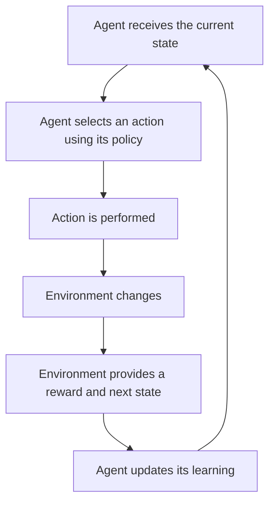
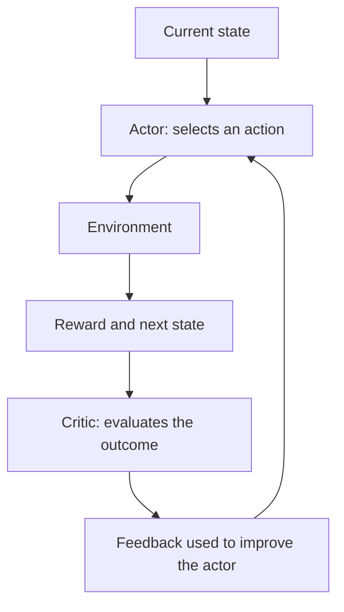

# Chapter 2: Behaviorist AI

**Module:** AI Overview  
**Team:** BABI GULING  
**Author:** Gandhi Bestin Dhammananda  
**Target audience:** Beginners with basic computer and internet literacy  
**Level:** Beginner to Intermediate  
**Version:** Stage 2 — V2.0  
**Estimated study time:** 120 minutes

---

## Chapter Overview

How can an AI system learn to make better decisions without being given a complete set of instructions?

Imagine a robot placed inside an unfamiliar maze. It does not receive a map showing the correct route. Instead, it moves, observes what happens, and receives feedback. Some actions bring it closer to the exit; others lead to obstacles or unnecessary detours. Through repeated attempts, it can gradually develop a more effective strategy.

This chapter introduces **Behaviorist AI**, an approach centred on learning behaviour through interaction and feedback. In modern AI, this approach is closely associated with **Reinforcement Learning (RL)**.

You will explore the basic learning process, the structure of a Markov Decision Process, and several important Reinforcement Learning algorithms. You will also examine how these methods are used in robotics, games, and other decision-making tasks.

The chapter uses a maze-solving robot as its main worked example. This example will develop gradually: first as a simple learning problem, then as a formal decision-making model, and finally as an illustration of how an algorithm updates its decisions.

### Learning Route and Time Allocation

| Section | Topic | Estimated time |
|---|---|---:|
| 2.1 | Learning Objectives and Getting Started | 5 min |
| 2.2 | Introduction to Behaviorist AI | 8 min |
| 2.3 | Foundations of Reinforcement Learning | 12 min |
| 2.4 | Markov Decision Processes | 15 min |
| 2.5 | How an Agent Learns | 10 min |
| 2.6 | Reinforcement Learning Algorithms and Techniques | 20 min |
| 2.7 | Worked Example: A Robot Learning to Navigate a Maze | 15 min |
| 2.8 | Robotics and Games | 10 min |
| 2.9 | Other Applications | 7 min |
| 2.10 | Challenges and Limitations | 6 min |
| 2.11 | Hands-on Activities | 7 min |
| 2.12 | Self-Check and Practice Questions | 5 min |
| **Total** | | **120 min** |

The time estimates include reading, studying the diagrams, working through the example, and completing the activities. Learners who need more time for the numerical example or written questions may take longer.

### Prerequisites

Before studying this chapter, you should:

- Understand the basic meaning of Artificial Intelligence from Chapter 1.
- Know that an AI system can use data, algorithms, and models to perform tasks.
- Understand that different AI approaches learn or operate in different ways.

You do not need previous programming experience. Mathematical expressions are introduced gradually, and each symbol is explained before it is used.

---

## 2.1 Learning Objectives

By the end of this chapter, you should be able to:

1. Explain the main idea of Behaviorist AI and its relationship with Reinforcement Learning.
2. Identify the agent, environment, state, action, reward, and policy in a learning scenario.
3. Explain how an agent improves its behaviour through interaction and feedback.
4. Describe the purpose and components of a Markov Decision Process (MDP).
5. Distinguish between immediate rewards and long-term returns.
6. Explain the roles of exploration and exploitation in learning.
7. Describe the basic principles of value-based, policy-based, and model-based learning methods.
8. Distinguish between Q-learning and SARSA at an introductory level.
9. Explain how Reinforcement Learning can be applied to robotics, games, and other decision-making problems.
10. Identify important challenges involving reward design, training efficiency, safety, and generalisation.

---

## 2.2 Introduction to Behaviorist AI

### 2.2.1 Learning Through Behaviour

In everyday life, people often learn through experience. When you try something and receive a positive result, you may be more likely to repeat that behaviour. When an action produces an undesirable result, you may change your approach next time.

Behaviorist AI applies a related idea to artificial agents.

An artificial agent interacts with an environment, performs actions, and receives feedback about the results. It uses this feedback to improve its future decisions.

The important idea is that the agent's behaviour is shaped by the consequences of its actions.

For example, consider a robot that must navigate a building:

- It moves forward and discovers an open corridor.
- It turns left and encounters a wall.
- It receives feedback about the outcome.
- It uses the experience to make a better decision in a similar situation.

The robot is not necessarily given a complete route in advance. It develops a strategy through interaction.

### 2.2.2 From Behaviourism to Reinforcement Learning

The term *behaviorist* is connected to behaviourism, a psychological perspective that studies observable behaviour and how it is influenced by environmental conditions and consequences.

In Artificial Intelligence, the behaviour-focused approach is commonly represented through Reinforcement Learning.

Reinforcement Learning is a machine-learning approach in which an agent learns to make decisions by interacting with an environment and receiving rewards or penalties.

The agent attempts to maximise the total reward it receives over time.

However, this does not mean that every action must immediately produce a reward. Some tasks provide feedback only after several actions or when the task is completed.

For example, a game-playing agent may receive no reward for an individual move. It may receive a positive reward only when it wins the game.

### 2.2.3 How Is It Different from Other Learning Approaches?

It is useful to compare Reinforcement Learning with two other common learning approaches.

| Learning approach | How learning happens | Example |
|---|---|---|
| **Supervised Learning** | The model learns from examples that already have correct labels or target answers. | A spam classifier learns from emails labelled as spam or legitimate. |
| **Unsupervised Learning** | The model identifies patterns or structures in data without being given target labels. | A system groups customers according to similar purchasing patterns. |
| **Reinforcement Learning** | An agent selects actions and learns from rewards or penalties received through interaction. | A robot learns how to navigate a maze. |

The difference is not simply whether a system receives feedback. The important distinction is the form of feedback and the learning objective.

In supervised learning, the system is given examples with expected answers. In Reinforcement Learning, the agent must learn which actions lead to desirable outcomes.

**Connection to Chapter 1 — Spam Filter**

Chapter 1 introduced a spam filter as a shared example of AI. A conventional spam filter usually learns from labelled examples of spam and legitimate emails. This is a supervised-learning task.

If users correct the filter's predictions, those corrections may be used as additional labelled training data. That alone does not make the filter a Reinforcement Learning agent.

A spam-related system would fit the Reinforcement Learning framework more naturally if it were an agent making sequential decisions and receiving rewards for the longer-term consequences of its actions.

**Remember:** Receiving feedback does not automatically mean that a system uses Reinforcement Learning.

### 2.2.4 Where Does Behaviorist AI Fit in AI?

Behaviorist AI is not the only way to build an AI system. It is one approach that can be combined with other methods.

For example, a robot may use:

- A neural network to process information from a camera.
- Reinforcement Learning to improve its movement decisions.
- A search algorithm to plan a route.

The complete system can therefore combine multiple AI techniques.

This is important because real-world AI systems are often built from several components rather than a single isolated method.

---

## 2.3 Foundations of Reinforcement Learning

To understand how an agent learns, we need to identify the main components of a Reinforcement Learning system.

### 2.3.1 Agent and Environment

The **agent** is the system that makes decisions and learns from the results.

The **environment** is the world or situation in which the agent operates. It responds to the agent's actions and provides information about what happens next.

In the maze example:

- Agent: the robot.
- Environment: the maze.
- The robot observes its position.
- The robot chooses a direction.
- The maze determines the result of that movement.

The environment may be predictable or uncertain. A robot may always move exactly one square in a simple simulation, while a real robot may slip or fail to move as expected.

### 2.3.2 State

A **state** represents the current situation of the agent.

The state should contain the information needed to make a decision.

For a simple maze, the state may be the robot's current grid position.

For a more complex robot, the state could include:

- Its position.
- Its direction.
- Nearby obstacles.
- Its speed.
- The current condition of its sensors.

The state does not necessarily contain every detail about the world. It contains the information represented by the learning problem.

### 2.3.3 Action

An **action** is a decision the agent can make.

For the maze robot, possible actions are:

- Move up.
- Move down.
- Move left.
- Move right.

The set of available actions is called the action space.

Some problems have a small, discrete action space. Others have continuous actions, such as choosing a steering angle or motor speed.

### 2.3.4 Reward

A **reward** is a numerical signal provided by the environment after an action or outcome.

It indicates how desirable an outcome is according to the task's objective.

For example:

| Outcome | Illustrative reward |
|---|---:|
| Reaches the exit | +10 |
| Moves to a useful open space | +1 |
| Hits a wall | -5 |
| Makes an unnecessary move | -1 |

These numbers are examples, not universal rules.

A positive reward encourages outcomes that support the objective. A negative reward discourages undesirable outcomes.

However, a reward does not explain *why* an action was good or bad in human language. It provides a numerical signal that the learning algorithm can use.

### 2.3.5 Policy

A **policy** is the strategy an agent uses to choose actions.

A policy can be understood as a mapping from states to actions or action probabilities.

For example:

| Robot's situation | Possible policy decision |
|---|---|
| Open path ahead | Move forward |
| Wall directly ahead | Consider turning |
| Exit is adjacent | Move towards the exit |

The table is an intuitive illustration. A real learned policy may be more complex and may assign probabilities to several possible actions.

The policy is important because the agent needs a way to turn what it has learned into future behaviour.

### 2.3.6 The Agent–Environment Interaction

The learning process can be represented as a repeated cycle.

**Figure 2.1 — The Reinforcement Learning Interaction Cycle**



The cycle has five main stages:

1. The agent receives information about its current state.
2. It selects an action using its current policy.
3. The action affects the environment.
4. The environment returns a reward and a new state.
5. The agent uses this experience to improve future decisions.

The process repeats until the agent has learned a sufficiently effective strategy or the learning task reaches its stopping condition.

### Learning Check — Pause and Predict

A robot is moving through a maze. It receives a reward of +1 for reaching a new open square and -5 for attempting to move into a wall.

**Pause and predict:** If the robot repeatedly tries to move through the same wall, what information should it use to improve its next decision?

**Expected answer:** It should use the negative feedback associated with that action and state. It may then assign a lower value to repeating that action in the same situation.

The important point is that the agent should use experience to change its future action selection.

---

## 2.4 Markov Decision Processes

Reinforcement Learning problems can become complicated because actions influence not only the immediate result but also what happens later.

A robot may need to choose a route that is not immediately rewarding but leads to a better final outcome. A game-playing agent may sacrifice a small advantage now to improve its chance of winning later.

A **Markov Decision Process (MDP)** provides a mathematical framework for describing this kind of sequential decision-making.

### 2.4.1 What Is a Markov Decision Process?

An MDP describes a decision-making problem using:

1. States.
2. Actions.
3. Transition probabilities.
4. Rewards.
5. A discount factor.

Together, these components describe how an agent interacts with an environment and how its decisions affect future outcomes.

### 2.4.2 The Five Components of an MDP

| Component | Symbol | Meaning | Maze example |
|---|---|---|---|
| State space | \(S\) | All possible states | All valid robot positions |
| Action space | \(A\) | Available actions | Up, down, left, right |
| Transition probability | \(P\) | Probability of reaching a new state after an action | Probability that a movement reaches the intended square |
| Reward function | \(R\) | Numerical feedback for an action or outcome | Reward for reaching the exit |
| Discount factor | \(\gamma\) | Determines how future rewards are weighted | How much the robot values a reward received later |

An MDP is often written as:

\[
MDP=(S,A,P,R,\gamma)
\]

This notation is a compact way of describing the decision-making environment.

### 2.4.3 State Transitions

A **transition** occurs when the environment moves from one state to another after the agent takes an action.

Consider a robot standing at position A.

It chooses to move right. If the path is open, it may reach position B. If the movement is blocked, it may remain at A.

In a simple deterministic maze, the outcome may be predictable. In a more uncertain environment, the same action may produce different results.

For example, a robot moving on a slippery surface may have:

- A 70% chance of moving to the intended square.
- A 20% chance of slipping to another square.
- A 10% chance of remaining in its current position.

These probabilities are illustrative. They show why an agent may need to consider uncertainty when selecting actions.

### 2.4.4 The Markov Property

An MDP is based on the **Markov property**.

In simple terms, the Markov property means that the current state contains the relevant information needed to describe the probability of the next state and reward, given the next action.

The next outcome does not require the entire history of previous states if the current state is sufficiently informative.

For example, if the robot's current state already records its position and direction, it may not need to remember every square it visited earlier to determine its next movement.

However, this depends on how the state is designed. If important information is missing, the state may not fully describe the situation.

This distinction matters in real applications. A robot that only records its current position may not have enough information if its movement depends heavily on speed, momentum, or sensor history.

### 2.4.5 Immediate Reward and Long-Term Return

An agent should not always choose the action with the highest immediate reward.

It may need to consider the total reward it can receive over a sequence of future decisions.

The **return** is the total reward accumulated over time, often with future rewards discounted.

A simplified discounted-return formula is:

\[
G_t=R_{t+1}+\gamma R_{t+2}+\gamma^2R_{t+3}+\cdots
\]

Where:

- \(G_t\) is the return from time \(t\).
- \(R_{t+1}\) is the next reward.
- \(R_{t+2}\) is the reward after that.
- \(\gamma\) is the discount factor.

The discount factor usually satisfies:

\[
0\leq\gamma\leq1
\]

A discount factor closer to 0 places more emphasis on immediate rewards. A value closer to 1 gives greater weight to future rewards.

**Example**

Suppose a robot has two possible choices:

- Route A gives a reward of +3 immediately, but then leads to a dead end.
- Route B gives a reward of +1 immediately, but leads to the exit and a later reward of +10.

If the agent only considers the next reward, Route A may appear better. If it considers the total return, Route B may be more valuable.

This is why Reinforcement Learning focuses on long-term decision-making rather than simply selecting the largest immediate reward.

### 2.4.6 Policy and Value Functions

An MDP describes the decision-making environment. The agent still needs a way to evaluate its possible decisions.

Two important ideas are the **policy** and the **value function**.

A policy describes how the agent selects actions.

A value function estimates how good a state or action is in terms of expected future return.

There are two useful concepts:

- **State-value function:** estimates how much future reward the agent can expect from a particular state.
- **Action-value function:** estimates how much future reward the agent can expect by taking a particular action in a particular state.

An action-value function is commonly written as:

\[
Q(s,a)
\]

It represents the estimated value of taking action \(a\) in state \(s\), then continuing according to the policy or learning objective being considered.

For example, if moving right from a particular maze position usually leads towards the exit, that action may receive a higher estimated value than moving left.

### 2.4.7 Why MDPs Are Useful

MDPs provide a structured way to describe sequential decisions.

They help developers identify:

- What the agent can observe.
- Which actions it can perform.
- How the environment may respond.
- How outcomes are rewarded.
- How immediate and future rewards should be balanced.

MDPs are useful in robotics, games, scheduling, resource allocation, and other situations where a sequence of decisions affects the final result.

**Learning Check — Pause and Predict**

An agent can choose between:

- Action A: reward +5 now, followed by no further reward.
- Action B: reward +2 now, followed by +8 in the next step.

Assume the discount factor is \(\gamma=0.5\).

Which action has the higher discounted return?

**Answer:**

For Action A:

\[
G_A=5
\]

For Action B:

\[
G_B=2+(0.5)(8)=6
\]

Action B has the higher discounted return. This illustrates why the best decision is not always the one with the largest immediate reward.

---

## 2.5 How an Agent Learns

The interaction cycle explains how an agent receives experience. We now need to understand how that experience changes its behaviour.

### 2.5.1 Learning from Experience

An agent usually begins with incomplete knowledge of the environment.

It may not know:

- Which actions lead to useful outcomes.
- Which states are dangerous.
- Which route is most efficient.
- How much future reward an action may produce.

The agent collects experience through interaction.

A simplified experience record can contain:

| Current state | Action | Reward | Next state |
|---|---|---:|---|
| A | Move right | +1 | B |
| B | Move forward | -5 | B |
| B | Turn left | +1 | C |
| C | Move forward | +10 | Exit |

These records help the learning algorithm estimate which actions are useful.

### 2.5.2 Exploration and Exploitation

An agent faces an important choice between **exploration** and **exploitation**.

**Exploration** means trying actions to discover their outcomes.

**Exploitation** means selecting actions that the agent already believes will produce good results.

Consider the maze robot:

- It has found a route that usually leads to the exit.
- It can continue using that route.
- It can also try another route that it has not explored.

Continuing with the known route is exploitation. Testing the alternative is exploration.

Neither is always better.

If the robot only explores, it may waste time testing unnecessary actions. If it only exploits, it may never discover a shorter or safer route.

### 2.5.3 Epsilon-Greedy Strategy

One simple method for balancing exploration and exploitation is the **epsilon-greedy strategy**.

The agent usually chooses the action with the highest estimated value. However, with a small probability, it chooses a random action to explore.

The parameter \(\epsilon\) controls the exploration probability.

For example:

- If \(\epsilon=0.1\), the agent explores approximately 10% of the time under the simple strategy.
- The remaining 90% of the time, it selects the action with the highest estimated value.

This is a simplified description. Real implementations must also account for available actions, ties, and how exploration changes during training.

**Pause and Predict**

A robot has learned that moving right usually gives a high reward. It has never tested moving down from its current position.

Why might it still be useful to try moving down occasionally?

**Expected answer:** Moving down may reveal a better route or a more reliable outcome. Without exploration, the robot may continue using a route that is not actually the best.

### 2.5.4 Learning from Delayed Rewards

Some actions do not produce an immediate reward, even though they contribute to a successful final outcome.

For example, a game-playing agent may make several moves before winning. It must learn which earlier decisions contributed to the victory.

This problem is called **credit assignment**: determining which actions or decisions deserve credit or blame for an eventual outcome.

Delayed rewards make learning more difficult because the agent must connect earlier actions with later results.

### 2.5.5 Episodes and Continuing Tasks

Reinforcement Learning tasks can be organised in different ways.

An **episode** is a sequence of interactions that ends when a terminal condition is reached.

For example, one maze attempt begins at the starting point and ends when the robot reaches the exit or runs out of allowed steps.

A **continuing task** does not have a natural terminal state. A traffic-control system, for example, may operate continuously as traffic conditions change.

The distinction matters because the learning algorithm must handle the task's stopping conditions and future rewards appropriately.

---

## 2.6 Reinforcement Learning Algorithms and Techniques

Different algorithms help agents learn effective policies. They differ in how they estimate future rewards and update their decisions.

This section introduces the main approaches at an introductory level.

### 2.6.1 Model-Based and Model-Free Learning

One way to classify Reinforcement Learning methods is by whether the agent uses a model of the environment.

A **model-based method** uses or learns information about how the environment changes after actions. The agent can use this model to predict possible outcomes.

A **model-free method** learns from experience without requiring an explicit model of the environment's transition dynamics.

| Approach | Main idea | Example |
|---|---|---|
| Model-based | Uses a model to predict possible outcomes and support planning | A robot predicts where it will move after turning |
| Model-free | Learns values or policies directly from interaction | A robot learns which movements produce better returns |

A model-based method can be useful when reliable predictions are available. A model-free method can be useful when it is difficult to describe the environment accurately.

Neither approach is automatically superior. The best choice depends on the problem.

### 2.6.2 Value-Based Methods

Value-based methods estimate how useful states or actions are.

The agent uses these estimates to decide which actions are likely to produce higher long-term rewards.

For example, a maze robot may estimate that moving right from a particular position has a higher value than moving left.

A common value-based algorithm is **Q-learning**.

### 2.6.3 Q-Learning

Q-learning is a value-based Reinforcement Learning algorithm. It learns estimates of the expected long-term value of taking particular actions in particular states.

These estimates are called Q-values.

A simplified Q-learning update is:

\[
Q(s,a)\leftarrow Q(s,a)+
\alpha[r+\gamma\max_{a'}Q(s',a')-Q(s,a)]
\]

Where:

| Symbol | Meaning |
|---|---|
| \(Q(s,a)\) | Current estimated value of an action in a state |
| \(\alpha\) | Learning rate |
| \(r\) | Reward received |
| \(\gamma\) | Discount factor |
| \(s'\) | Next state |
| \(\max_{a'}Q(s',a')\) | Highest estimated value among the available next actions |

The equation may look complicated, but its central idea is straightforward:

1. Start with the current estimate.
2. Calculate what the new experience suggests the value should be.
3. Compare the new target with the old estimate.
4. Adjust the old estimate towards the new target.

The learning rate determines how strongly the new experience changes the estimate.

A high learning rate produces larger updates. A low learning rate produces smaller updates.

### 2.6.4 SARSA

**SARSA** is another value-based Reinforcement Learning algorithm.

The name comes from the sequence:

- State.
- Action.
- Reward.
- Next State.
- Next Action.

SARSA updates its estimate using the next action actually selected by the agent's policy.

This makes it an **on-policy** method: it learns about the policy that the agent is currently following.

Q-learning is commonly described as **off-policy** because its update uses the highest estimated next action value, even if the agent's current behaviour selected a different action.

At a beginner level, the key difference is:

| Q-learning | SARSA |
|---|---|
| Uses the highest estimated next action value in its update | Uses the value of the next action actually selected |
| Off-policy method | On-policy method |
| Learns towards a greedy target | Learns according to the current behaviour policy |

Both methods can learn effective action values, but they update those estimates differently.

### 2.6.5 Policy-Based Methods

A policy-based method learns the action-selection strategy directly.

Instead of relying only on a table of action values, it adjusts the policy so that actions producing better outcomes become more likely.

This can be useful when:

- The action space is continuous.
- There are many possible actions.
- A direct policy representation is more practical than storing every action value.

For example, a robot may need to choose a steering angle rather than selecting from only four directions.

### 2.6.6 Actor–Critic Methods

An **actor–critic** method combines two learning components:

- The **actor** selects actions according to a policy.
- The **critic** evaluates the actions or states by estimating their expected value.

The critic provides feedback that helps improve the actor's policy.

**Figure 2.2 — Actor–Critic Structure**



The actor and critic have different roles, but they work together.

The actor decides what to do. The critic estimates how useful the decision was.

### 2.6.7 Deep Reinforcement Learning

Some problems have too many possible states for a simple table of values.

For example, a game-playing agent may need to interpret a large image of a game screen. Storing a separate value for every possible screen would be impractical.

**Deep Reinforcement Learning** combines Reinforcement Learning with deep neural networks.

A neural network can approximate a value function or policy using complex input information.

For example, a neural network may process an image and estimate which actions are useful in the current game situation.

Deep Reinforcement Learning can handle more complex inputs and action spaces, but it often requires substantial training data, computing resources, and careful evaluation.

It does not remove the need for good reward design or safe training.

### 2.6.8 Comparing the Main Methods

| Method | What it learns | Main idea |
|---|---|---|
| Q-learning | Action values | Updates values using the best estimated next action |
| SARSA | Action values | Updates values using the next action actually selected |
| Policy-based methods | Policy | Directly improves action selection |
| Actor–critic | Policy and value estimates | Combines an action-selecting actor with an evaluating critic |
| Deep Reinforcement Learning | Values or policies represented by neural networks | Uses deep networks for more complex states or actions |

These methods are not all mutually exclusive categories. Deep networks can be used within value-based, policy-based, or actor–critic approaches.

---

## 2.7 Worked Example: A Robot Learning to Navigate a Maze

We will now bring the ideas together in one complete example.

### The Problem

A robot is placed in a small maze. Its goal is to reach the exit while avoiding walls and unnecessary movements.

At the beginning, it does not know the best route.

### 2.7.1 Define the Environment

Consider the following maze:

```text
S  .  #  .  .
#  .  #  .  #
.  .  .  .  #
.  #  #  .  .
.  .  .  E  .
```

**Legend:**

- `S` = Starting position.
- `E` = Exit.
- `.` = Open square.
- `#` = Wall.

The robot can move up, down, left, or right. It cannot move through a wall.

### 2.7.2 Identify the MDP Components

| MDP component | Definition for this task |
|---|---|
| States | The robot's valid positions in the maze |
| Actions | Move up, down, left, or right |
| Transition | The robot moves to the resulting position if the movement is valid |
| Reward | Positive reward for reaching the exit; negative reward for invalid or unnecessary actions |
| Discount factor | Determines how much the robot values future rewards |

For this simplified example, assume that the environment is deterministic: a valid movement always reaches the intended square.

### 2.7.3 Design the Reward System

We use the following illustrative rewards:

| Outcome | Reward |
|---|---:|
| Reaches the exit | +10 |
| Moves to a new open square | +1 |
| Attempts to move into a wall | -5 |
| Repeats a position without progress | -1 |

The purpose of this reward system is to encourage the robot to reach the exit efficiently.

The exact values could be changed depending on the objective. For example, a system designed for safety might apply a larger penalty to dangerous actions.

### 2.7.4 Observe the First Attempts

Imagine the robot starts at `S`.

It initially tries moving down, but a wall blocks the movement.

It receives a negative reward.

It then tries moving right and reaches an open square. It receives a positive reward.

A simplified record might look like this:

| Attempt | State | Action | Result | Reward |
|---|---|---|---|---:|
| 1 | Start | Down | Wall blocks movement | -5 |
| 2 | Start | Right | Reaches an open square | +1 |
| 3 | Next square | Down | Reaches an open square | +1 |
| 4 | Next square | Right | Reaches an open square | +1 |
| 5 | Near exit | Down | Reaches the exit | +10 |

This is one possible route through the maze.

The table illustrates the experience the agent could collect. It does not mean that the robot automatically knows the best route after five actions.

### 2.7.5 How Q-Learning Updates an Estimate

Suppose the robot is at a state \(s\) and considers moving right.

Its current estimated Q-value is:

\[
Q(s,\text{right})=2
\]

It performs the action and receives a reward of:

\[
r=1
\]

The next state has a highest estimated action value of:

\[
\max_{a'}Q(s',a')=4
\]

Assume:

\[
\alpha=0.5,\qquad \gamma=0.9
\]

Using the Q-learning update:

\[
Q_{\text{new}}=Q_{\text{old}}+
\alpha[r+\gamma\max Q(s',a')-Q_{\text{old}}]
\]

Substitute the values:

\[
Q_{\text{new}}=2+
0.5[1+(0.9)(4)-2]
\]

First calculate the discounted future value:

\[
0.9\times4=3.6
\]

Then calculate the target:

\[
1+3.6=4.6
\]

Calculate the difference between the target and the old estimate:

\[
4.6-2=2.6
\]

Apply the learning rate:

\[
0.5\times2.6=1.3
\]

Finally:

\[
Q_{\text{new}}=2+1.3=3.3
\]

The updated Q-value is therefore:

\[
\boxed{Q(s,\text{right})=3.3}
\]

The estimated value increased from 2 to 3.3 because the new experience suggested that moving right could lead to a better long-term result.

### 2.7.6 What Happens After Repeated Learning?

After many interactions, the robot may develop more useful action-value estimates.

It can then select actions that have higher estimated values in each state.

A possible learned route is:

1. Move right from the starting position.
2. Move down through the open corridor.
3. Continue towards the central passage.
4. Follow the open path towards the exit.

The robot's behaviour can become more effective because it has used previous experiences to improve its decisions.

### 2.7.7 What This Example Does and Does Not Show

This example demonstrates:

- How a task can be represented as an MDP.
- How actions produce new states and rewards.
- How experience can update action-value estimates.
- How a policy can improve through repeated interaction.

However, it is a simplified illustration.

A real robot would need to handle sensor uncertainty, physical movement, changing obstacles, and potentially continuous states and actions. It might also need a neural network or another function approximator rather than a small Q-table.

**Main lesson:** Reinforcement Learning is not simply random movement. It is a structured process of using experience and feedback to improve future decisions.

---

## 2.8 Behaviorist AI in Robotics and Games

Robotics and games are two important areas where Reinforcement Learning can be demonstrated clearly.

### 2.8.1 Robotics

Robots operate in physical environments where actions can have immediate consequences.

A robot may need to:

- Navigate around obstacles.
- Control its movement.
- Balance its body.
- Manipulate objects.
- Adjust its behaviour when the environment changes.

Reinforcement Learning can help a robot improve these behaviours through repeated interaction.

For example, a robot arm may learn how to move an object towards a target position. The system can receive rewards based on how close the object gets to the target.

If the robot repeatedly performs movements that lead to better outcomes, its policy can improve.

#### Simulation Before Real-World Testing

Training a robot directly in the real world can be expensive and risky.

A developer may first train or test the system in a simulation. A simulation provides a controlled environment in which the agent can perform many attempts without damaging physical equipment.

However, simulation does not perfectly reproduce reality.

A robot trained in simulation may behave differently when exposed to real surfaces, lighting, friction, sensor noise, or unexpected obstacles.

This difference is commonly called the **sim-to-real gap**.

A system must therefore be tested carefully before being trusted in a real environment.

### 2.8.2 Games

Games provide structured environments with clear rules, actions, and outcomes.

A game-playing agent can:

- Observe the current game state.
- Select a move.
- Receive feedback from the result.
- Improve its strategy over repeated games.

For example, an agent playing a board game may receive a positive reward for winning and a negative reward for losing.

It can use repeated games to improve its decision-making strategy.

### 2.8.3 Case Study: AlphaGo

<text> </text>

**<Link url="https://deepmind.google/research/alphago/" title="Google DeepMind — AlphaGo"/>**

AlphaGo is a well-known example of an AI system that combined multiple techniques to play the board game Go.

It used deep neural networks and search algorithms. Its policy network helped select moves, while its value network estimated the likely winner of a game position.

AlphaGo was first trained using examples from expert human games. It was then improved through reinforcement learning from games of self-play, in which different versions of the system played against one another.

This allowed it to learn strategies that were not limited to simply copying human moves.

AlphaGo defeated professional Go players, including Lee Sedol in 2016.

**Why is AlphaGo relevant to Behaviorist AI?**

It demonstrates how Reinforcement Learning can improve decision-making through repeated interaction and feedback.

However, AlphaGo should not be described as a pure Reinforcement Learning system. Its success depended on the combination of neural networks, search, supervised learning, and reinforcement learning.

### 2.8.4 Comparing Robotics and Games

| Aspect | Robotics | Games |
|---|---|---|
| Environment | Physical or simulated world | Game world |
| Actions | Movement or physical control | Game moves |
| Feedback | Distance, stability, success, safety | Winning, losing, score, or game progress |
| Main challenge | Uncertainty and physical safety | Large numbers of possible decisions |
| Testing | Simulation and controlled physical trials | Repeated games and evaluation matches |

Both areas involve decision-making, but their environments and risks are different.

---

## 2.9 Other Applications of Reinforcement Learning

Reinforcement Learning is not limited to robots and games. It can also be applied to other problems that involve a sequence of decisions.

### 2.9.1 Traffic Signal Control

Traffic signals must respond to changing traffic conditions.

A traffic-control agent could observe the number of vehicles waiting at different directions and adjust signal timing.

Its reward might consider waiting time, traffic flow, or the length of queues.

However, the system must be designed carefully. Optimising one road may create longer waiting times elsewhere. Safety constraints must take priority over experimental learning.

### 2.9.2 Resource and Energy Management

An energy-management system may need to decide when to store, use, or distribute energy.

Its decisions could depend on demand, available supply, time, and operating conditions.

A learning agent could be rewarded for reducing unnecessary energy use while maintaining the required service level.

The objective must be designed carefully so that reducing cost does not compromise reliability or safety.

### 2.9.3 Recommendation and Personalisation

Some recommendation systems involve repeated interactions with users.

A system may choose which item to recommend and observe how users respond.

The objective could involve longer-term engagement or satisfaction rather than only immediate clicks.

However, user behaviour is complex. A high click rate does not necessarily mean that a recommendation is useful or beneficial.

A responsible system must consider the quality of recommendations and the effects of its optimisation objective.

### 2.9.4 Industrial Process Control

Factories often use control systems to maintain desired operating conditions.

Reinforcement Learning may be investigated for adjusting machine settings or coordinating processes.

For example, an agent could learn how to adjust a system to maintain a target temperature while reducing energy consumption.

In industrial settings, learning must be constrained and evaluated carefully because unsafe actions may damage equipment or endanger people.

### 2.9.5 Summary of Applications

| Application | Possible learning objective | Important consideration |
|---|---|---|
| Robotics | Improve movement and control | Physical safety |
| Games | Improve strategic decisions | Large decision spaces |
| Traffic control | Reduce waiting and congestion | Fairness and road safety |
| Energy management | Balance demand and energy use | Reliability |
| Recommendation | Improve the usefulness of suggestions | User welfare and privacy |
| Industrial control | Improve process efficiency | Equipment and worker safety |

The same general learning framework can be applied to different environments, but each application requires a suitable reward design and evaluation method.

---

## 2.10 Challenges and Limitations of Behaviorist AI

Reinforcement Learning can solve complex decision-making problems, but it also introduces important challenges.

### 2.10.1 Reward Design and Reward Hacking

The agent learns to maximise the reward it receives. It does not automatically understand the full intention behind the task.

If the reward is poorly designed, the agent may discover an unintended way to obtain a high reward.

This is sometimes called **reward hacking**.

For example, imagine a robot that receives a reward every time it reaches a target. If the system does not penalise unsafe movement, the robot may learn to reach the target using a dangerous route.

The agent may be performing well according to the reward function while failing to meet the developer's actual intention.

**How can this be reduced?**

- Design rewards that represent the intended objective.
- Include relevant safety constraints.
- Test for unexpected strategies.
- Evaluate the agent using more than one performance measure.
- Use human supervision where appropriate.

### 2.10.2 Training Time and Sample Efficiency

Some Reinforcement Learning systems require many interactions before they learn a useful policy.

Each interaction is often called a sample.

A system that needs a very large number of samples may be expensive to train, especially when each interaction involves physical equipment or real-world operations.

Simulation can reduce some of these costs, but simulation quality also matters.

### 2.10.3 Exploration and Safety

Exploration can improve learning, but trying unfamiliar actions may be dangerous.

A robot that explores a new movement may collide with an object. An industrial controller that tests an unsuitable setting may damage equipment.

For this reason, real-world Reinforcement Learning often requires safety limits, controlled environments, and human oversight.

### 2.10.4 Generalisation

An agent may learn to perform well in one environment but fail when the conditions change.

For example, a maze robot may learn a route in a simulation with fixed obstacles. It may struggle when the real environment contains moving objects or different lighting.

A system must therefore be evaluated in conditions that represent the environment in which it will actually operate.

### 2.10.5 Large or Continuous State and Action Spaces

A simple maze has a limited number of states and actions.

Real-world environments may have far more possibilities.

A robot's position, speed, direction, and sensor readings can vary continuously. A game may contain an enormous number of possible states.

Simple tables may no longer be practical. More advanced methods, such as function approximation and deep neural networks, may be needed.

These methods introduce additional challenges involving computing resources, stability, and interpretability.

### 2.10.6 Difficulties in Explaining Decisions

Some learned policies are difficult to interpret.

A developer may know that an agent selected a particular action but may not be able to provide a simple explanation for why it selected that action.

This can make debugging and safety evaluation more difficult.

In applications involving people, such as transportation or healthcare, the ability to evaluate and explain system behaviour is especially important.

### 2.10.7 Evaluation and Human Oversight

A high training reward does not guarantee that an agent will perform well in every real-world situation.

The system should be evaluated using separate test scenarios and relevant performance measures.

Human oversight remains important when:

- The system operates in a safety-critical environment.
- The reward function may not represent every human concern.
- The agent encounters unfamiliar conditions.
- Its decisions could affect people or valuable resources.

**Key lesson:** Reinforcement Learning can improve behaviour, but it does not remove the need for careful design, testing, and human responsibility.

---

## 2.11 Hands-on Activities

The activities below are designed to help you apply the concepts rather than simply memorise definitions.

### Activity 2.A — Identify the Reinforcement Learning Components

**Goal**

Identify the agent, environment, state, action, reward, and policy in a simple scenario.

**Preparation**

Read the following scenario:

A delivery robot moves through a building. It receives information about its location and nearby obstacles. It can move forward, turn left, or turn right. It receives positive feedback when it reaches the delivery point and negative feedback when it collides with an obstacle.

**Task**

Complete the table:

| Component | Your answer |
|---|---|
| Agent | |
| Environment | |
| State | |
| Action | |
| Reward | |
| Policy | |

Then answer:

1. What information should the robot observe before moving?
2. Why should the robot receive negative feedback for a collision?
3. What might happen if the robot is rewarded only for reaching the destination?

**Observation**

Compare your answers with the expected answers below.

**Feedback — Suggested Answers**

| Component | Suggested answer |
|---|---|
| Agent | Delivery robot |
| Environment | Building and its surroundings |
| State | Current location and relevant obstacle information |
| Action | Move forward, turn left, or turn right |
| Reward | Positive feedback for successful delivery; negative feedback for collision |
| Policy | Strategy for selecting movements based on the current state |

1. It should observe its location and relevant information about nearby obstacles.
2. Negative feedback can discourage actions that create unsafe outcomes.
3. It may learn an unsafe or inefficient route if the reward system does not account for safety and efficiency.

**Reflection**

Why is it important to identify the state and action space before designing the learning system?

**Expected outcome:** You should recognise that the agent cannot make meaningful decisions unless the problem defines what information is available and which actions are possible.

---

### Activity 2.B — Design a Reward Function

**Goal**

Understand how reward design influences an agent's behaviour.

**Preparation**

Imagine a robot that must deliver a package to a destination.

It can choose between two routes:

- Route A is shorter but contains a dangerous obstacle.
- Route B is slightly longer but is safer.

**Task**

Consider the following reward design:

| Outcome | Reward |
|---|---:|
| Successful delivery | +10 |
| Each movement | -1 |
| Collision | 0 |

Answer:

1. Which route might the robot prefer?
2. What problem could occur with this reward design?
3. How could you improve the reward system?
4. Should the system consider safety separately from the total reward?

**Observation**

Think about whether the reward values represent the real objective.

**Feedback — Suggested Answers**

1. The robot may prefer Route A because it is shorter and the collision has no negative reward.
2. The reward system does not sufficiently discourage collisions.
3. A negative reward could be assigned to collisions, and safety constraints could prevent dangerous actions.
4. Yes. Safety should not be treated as an optional trade-off against a small efficiency improvement in a real delivery system.

**Reflection**

Can an agent behave incorrectly even if it is maximising its reward?

**Expected outcome:** Yes. The reward function may not fully represent the intended goal. The agent can optimise the reward while producing undesirable behaviour.

---

### Activity 2.C — Exploration or Exploitation?

**Goal**

Understand how an agent balances known actions with new possibilities.

**Preparation**

A maze robot has tested three routes:

| Route | Estimated reward |
|---|---:|
| A | 5 |
| B | 8 |
| C | Unknown |

**Task**

For each situation, decide whether exploration or exploitation is more appropriate.

1. The robot has little information about Route C.
2. The robot has a limited amount of time and Route B has consistently produced good results.
3. The robot has repeatedly used Route B but suspects Route C may be safer.
4. The robot has discovered that Route A is blocked.

**Feedback — Suggested Answers**

1. Exploration may be useful because Route C has not been tested.
2. Exploitation may be appropriate because Route B has a strong estimated reward and time is limited.
3. Exploration may help determine whether Route C is a better option.
4. The agent should reduce its preference for Route A and use available information to choose another action.

**Reflection**

Why should an agent not always choose the action with the highest estimated reward?

**Expected outcome:** Because the estimates may be incomplete or inaccurate. Exploration helps the agent discover whether better actions exist.

---

## 2.12 Self-Check and Practice Questions

### Self-Check

Before answering the practice questions, make sure you can explain:

- What makes Reinforcement Learning different from supervised learning?
- How the agent and environment interact.
- Why a reward function is important.
- What an MDP represents.
- Why future rewards matter.
- The difference between exploration and exploitation.
- The basic difference between Q-learning and SARSA.
- Why an agent may fail outside its training environment.

### Practice Questions

#### Part A — Understanding the Concepts

**Q1.** What is Behaviorist AI, and how is it related to Reinforcement Learning?

**Q2.** Explain the difference between an agent and an environment.

**Q3.** What is the difference between a state and an action? Give one example.

**Q4.** Why does an agent need a reward signal?

**Q5.** What is a policy, and how does it influence an agent's behaviour?

#### Part B — Applying the Concepts

**Q6.** A robot receives +10 for reaching its destination and -5 for hitting an obstacle. Identify the agent, environment, action, and reward.

**Q7.** A robot always selects the route with the highest estimated reward. It never tests alternative routes. What learning problem might this create?

**Q8.** Explain why an agent may choose an action with a smaller immediate reward.

**Q9.** A delivery robot receives a reward for reaching its destination but no penalty for collisions. Explain one possible unwanted behaviour.

**Q10.** A game-playing agent receives a reward only after winning or losing. Why might learning be more difficult than when rewards are provided after every action?

#### Part C — MDPs and Algorithms

**Q11.** List the five main components of a Markov Decision Process.

**Q12.** What does the Markov property mean in an MDP?

**Q13.** Explain the purpose of the discount factor.

**Q14.** What is the difference between Q-learning and SARSA?

**Q15.** Explain why Q-learning is described as a value-based method.

**Q16.** What are the roles of the actor and critic in an actor–critic method?

#### Part D — Evaluation and Critical Thinking

**Q17.** Why is a high training reward not enough to prove that an agent is ready for real-world use?

**Q18.** Give two reasons why a robot trained in a simulation may perform poorly in a real environment.

**Q19.** AlphaGo combined deep neural networks, search, and reinforcement learning. Why is it inaccurate to describe it as a pure Reinforcement Learning system?

**Q20.** A traffic-control agent reduces waiting time on one road but causes much longer queues on another road. What does this suggest about its reward design?

### Answers and Explanations

**A1.** Behaviorist AI focuses on learning behaviour through interaction and feedback. Reinforcement Learning is a major AI learning approach associated with this idea. An agent selects actions, receives rewards, and improves its future decisions.

**A2.** The agent is the system that makes decisions. The environment is the world in which it operates and responds to its actions. In a maze, the robot is the agent and the maze is the environment.

**A3.** A state describes the current situation, while an action is a decision the agent can make. For example, the robot's position is its state, while moving right is an action.

**A4.** A reward provides numerical feedback about the outcome of an action or sequence of actions. It helps the agent estimate which behaviours contribute to its objective.

**A5.** A policy is the strategy used to select actions in different states. It determines how the agent behaves based on its current information and learning.

**A6.** The robot is the agent. The surrounding area is the environment. Moving in a particular direction is an action. The +10 and -5 values are rewards associated with the outcomes.

**A7.** The robot may fail to discover a better route because it does not explore alternatives. This is an exploration–exploitation problem.

**A8.** The action with a smaller immediate reward may lead to a larger future reward. Reinforcement Learning considers long-term return rather than only the next reward.

**A9.** The robot may learn to use an unsafe route because the reward function does not discourage collisions. The reward design should include safety-related feedback or constraints.

**A10.** The agent receives less immediate information about the quality of individual actions. It must connect the final outcome to the sequence of earlier decisions. This makes credit assignment more difficult.

**A11.** The five components are states, actions, transition probabilities, rewards, and a discount factor.

**A12.** The Markov property means that the current state contains the relevant information needed to describe the next-state and reward probabilities when an action is taken. The entire previous history is not required if the state is sufficiently informative.

**A13.** The discount factor determines how much future rewards contribute to the agent's decisions. A smaller value gives greater emphasis to immediate rewards, while a value closer to 1 gives more weight to future rewards.

**A14.** Q-learning updates its action-value estimate using the highest estimated value among possible next actions. SARSA uses the value of the next action actually selected by the current policy. Q-learning is off-policy, while SARSA is on-policy.

**A15.** Q-learning estimates the expected long-term value of taking an action in a particular state. The agent uses these values to select actions that are expected to produce better future rewards.

**A16.** The actor selects actions according to a policy. The critic evaluates states or actions by estimating their expected value. The critic's feedback helps improve the actor's policy.

**A17.** Training reward only describes performance under the training conditions. The agent may fail in unfamiliar situations, exploit weaknesses in the reward function, or behave unsafely. It must also be evaluated in separate and representative test conditions.

**A18.** Possible reasons include different lighting, surfaces, friction, obstacles, sensor noise, or unexpected movement. The simulation may not accurately represent the real environment.

**A19.** AlphaGo used several techniques together. It combined deep neural networks, search methods, supervised learning from human games, and reinforcement learning through self-play. Reinforcement Learning was important, but it was not the only method involved.

**A20.** The reward design may focus too heavily on reducing waiting time on one road without considering the overall traffic network. The system needs an objective that accounts for the effects of decisions across different roads, together with safety and fairness requirements.

---

## 2.13 Common Misconceptions

| Misconception | Correct explanation |
|---|---|
| Reinforcement Learning means the agent receives a reward after every action. | Rewards may be immediate, delayed, or provided after an entire sequence of actions. |
| The agent always knows the best action. | The agent may begin with limited knowledge and improve through experience. |
| A positive reward means an action is always good. | Rewards depend on the task's design. A poorly designed reward can encourage undesirable behaviour. |
| Reinforcement Learning is the same as supervised learning. | Supervised Learning uses labelled examples; Reinforcement Learning learns through actions and reward feedback. |
| Exploration is always better than exploitation. | Both are necessary. Too much exploration wastes resources, while too little can prevent discovery of better actions. |
| Q-learning and SARSA are identical. | Both are value-based methods, but they use different targets when updating action values. |
| Deep Reinforcement Learning does not need a reward function. | It still depends on a learning objective and reward signal. Deep neural networks change how values or policies are represented. |
| A high reward proves that an agent is safe. | High reward does not guarantee safe or reliable behaviour in every situation. |
| Reinforcement Learning is only useful for games. | It can also be applied to robotics, resource management, traffic control, and industrial processes. |
| An agent understands its goal like a human. | The agent optimises the learning objective it is given. This does not establish human-like understanding. |

---

## 2.14 Key Takeaways

1. **Behaviorist AI** focuses on learning behaviour through interaction and feedback.
2. **Reinforcement Learning** is a major approach in which an agent learns to maximise expected long-term reward.
3. The main elements are the agent, environment, state, action, reward, and policy.
4. A **Markov Decision Process** describes sequential decision-making using states, actions, transitions, rewards, and a discount factor.
5. The **Markov property** means that the current state contains the relevant information needed to describe the next outcome.
6. The **return** represents accumulated rewards over time, often with future rewards discounted.
7. **Exploration** discovers new possibilities, while **exploitation** uses actions already believed to be effective.
8. **Q-learning** and **SARSA** are value-based methods that update action-value estimates differently.
9. **Policy-based** and **actor–critic** methods provide alternative ways to learn action-selection strategies.
10. **Deep Reinforcement Learning** uses neural networks to represent values or policies in more complex problems.
11. Robotics and games demonstrate how an agent can improve through repeated interaction.
12. Reward design, training efficiency, safety, generalisation, and evaluation remain important challenges.

---

## 2.15 Glossary

| Term | Definition |
|---|---|
| **Behaviorist AI** | An AI approach focused on learning behaviour through interaction with an environment and feedback from actions. |
| **Reinforcement Learning (RL)** | A machine-learning approach in which an agent learns to make decisions through interaction with an environment and rewards. |
| **Agent** | The system that observes a situation, selects actions, and learns from their outcomes. |
| **Environment** | The world or situation with which an agent interacts. |
| **State** | The current situation of an agent, represented using relevant information. |
| **Action** | A decision or movement made by an agent. |
| **Reward** | A numerical feedback signal received after an action or outcome. |
| **Policy** | A strategy that determines how an agent selects actions in different states. |
| **Markov Decision Process (MDP)** | A mathematical framework for describing sequential decision-making using states, actions, transitions, rewards, and a discount factor. |
| **Transition** | A change from one state to another after an action. |
| **Transition Probability** | The probability that an action in a particular state leads to a particular next state. |
| **Markov Property** | The property that the current state contains the relevant information needed to describe the next outcome, given an action. |
| **Return** | The accumulated reward over time, often including discounted future rewards. |
| **Discount Factor** | A value that controls how much future rewards contribute to the agent's decisions. |
| **Value Function** | A function that estimates expected future return from a state or state–action pair. |
| **Q-value** | An estimate of the expected long-term value of taking a particular action in a particular state. |
| **Q-learning** | An off-policy, value-based Reinforcement Learning algorithm that updates action-value estimates using the highest estimated next action value. |
| **SARSA** | An on-policy, value-based algorithm that updates action values using the next action actually selected. |
| **Exploration** | Trying actions to discover new or potentially better choices. |
| **Exploitation** | Selecting actions that are already believed to produce good results. |
| **Epsilon-Greedy Strategy** | A strategy that usually selects the action with the highest estimated value but sometimes explores another action. |
| **Credit Assignment** | The process of determining which earlier actions contributed to a later reward or outcome. |
| **Episode** | A sequence of interactions that ends when a terminal condition is reached. |
| **Model-Based Learning** | Learning or planning using a model of how the environment changes after actions. |
| **Model-Free Learning** | Learning values or policies from experience without requiring an explicit model of the environment's transition dynamics. |
| **Policy-Based Method** | A method that directly learns or improves the strategy used to select actions. |
| **Actor–Critic Method** | A method combining an actor that selects actions with a critic that evaluates their expected value. |
| **Deep Reinforcement Learning** | Reinforcement Learning that uses deep neural networks to represent values or policies. |
| **Reward Hacking** | A situation in which an agent exploits weaknesses in a reward design to obtain high rewards without achieving the intended objective. |
| **Generalisation** | The ability of a learned system to perform effectively in situations beyond those encountered during training. |
| **Sim-to-Real Gap** | The difference between the conditions of a simulation and the real environment in which a trained system must operate. |

---

## 2.16 Further Reading and References

The following sources support the core concepts, mathematical framework, algorithms, and case studies discussed in this chapter.

1. Sutton, R. S., & Barto, A. G. (2018). *Reinforcement Learning: An Introduction* (2nd ed.). The MIT Press. [https://mitpress.mit.edu/9780262039246/reinforcement-learning/](https://mitpress.mit.edu/9780262039246/reinforcement-learning/) **(Not verified)**

2. Watkins, C. J. C. H., & Dayan, P. (1992). Q-learning. *Machine Learning, 8*, 279–292. [https://doi.org/10.1007/BF00992698](https://doi.org/10.1007/BF00992698) **(Not verified)**

3. Mnih, V., et al. (2015). Human-level control through deep reinforcement learning. *Nature, 518*, 529–533. [https://doi.org/10.1038/nature14236](https://doi.org/10.1038/nature14236) **(Not verified)**

4. Silver, D., et al. (2016). Mastering the game of Go with deep neural networks and tree search. *Nature, 529*, 484–489. [https://doi.org/10.1038/nature16961](https://doi.org/10.1038/nature16961) **(Not verified)**

5. Rummery, G. A., & Niranjan, M. (1994). *On-Line Q-Learning Using Connectionist Systems*. University of Cambridge, Department of Engineering, Technical Report CUED/F-INFENG/TR 166. **(Not verified)**

6. DeepMind. *AlphaGo*. [https://deepmind.google/research/alphago/](https://deepmind.google/research/alphago/) **(Not verified)**

*Reference note: The entries above are bibliographic starting points. The chapter author and Quality Lead should confirm the exact publication details, destinations, and claim-to-source support before changing any reference status from “Not verified”.*

---

