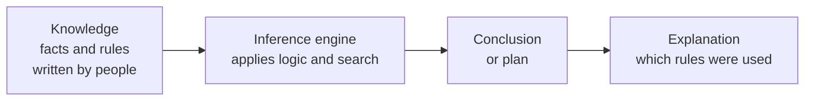
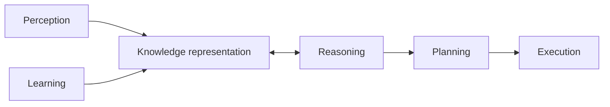
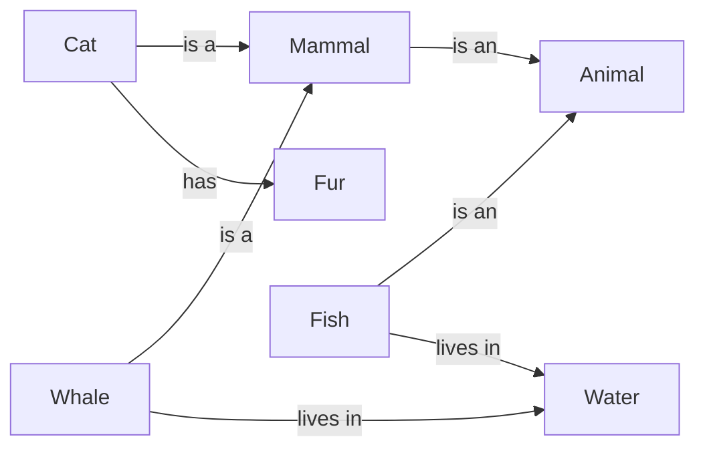
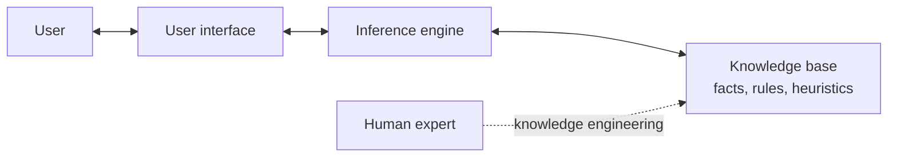
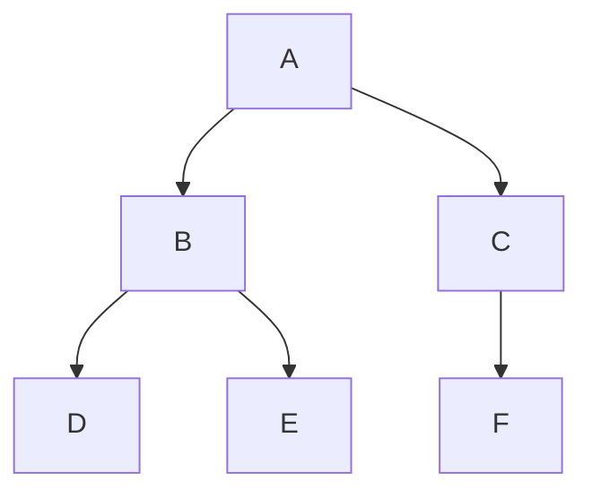
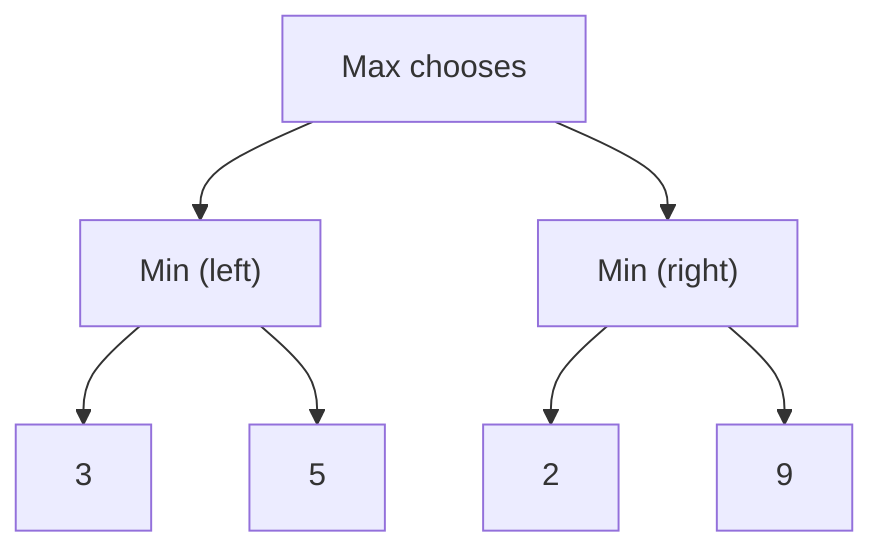

# Chapter 2: Symbolic AI

> **Module:** AI Overview
> **Chapter:** 2 — Symbolic AI (course Chapter 4)
> **Version:** 1.1 (Stage 1, rebuilt from the lecturer's course slides)
> **Author:** Gandhi Bestin Dhammananda (proposed owner)
> **Reviewer:** Brian Djoni Suzanna
> **Audience:** Complete beginners with basic computer and internet literacy; no programming experience needed
> **Estimated study time:** about 3 hours, including activities
> **Course source:** Lecturer's slides "chap4: Symbolic AI". The chapter follows the slides' six topics: Introduction, Logic and Reasoning, Knowledge Representation, Rule-Based Systems and Expert Systems, Planning and Problem Solving, and Natural Language Processing in Symbolic AI.

---

## Table of Contents

1. [Learning Outcomes](#learning-outcomes)
2. [Topic 1: Introduction to Symbolic AI](#topic-1-introduction-to-symbolic-ai)
3. [Topic 2: Logic and Reasoning](#topic-2-logic-and-reasoning)
4. [Topic 3: Knowledge Representation](#topic-3-knowledge-representation)
5. [Topic 4: Rule-Based Systems and Expert Systems](#topic-4-rule-based-systems-and-expert-systems)
6. [Topic 5: Planning and Problem Solving](#topic-5-planning-and-problem-solving)
7. [Topic 6: Natural Language Processing in Symbolic AI](#topic-6-natural-language-processing-in-symbolic-ai)
8. [Hands-On Activity: A Rule-Based Smart Classroom](#hands-on-activity-a-rule-based-smart-classroom)
9. [Key Takeaways](#key-takeaways)
10. [Practice Questions](#practice-questions)
11. [Answer Key](#answer-key)
12. [Glossary](#glossary)
13. [References](#references)

---

## Learning Outcomes

After completing this chapter, you should be able to:

1. Define Symbolic AI (also called GOFAI) and state its main benefits and limitations.
2. Use propositional logic (AND, OR, NOT, implication) and read simple predicate-logic statements with ∀ and ∃.
3. Apply modus ponens and modus tollens to simple examples.
4. Describe five ways to represent knowledge: logic, semantic networks, frames and scripts, rules, and ontologies.
5. Explain the parts of a rule-based system and of an expert system, and trace a small rule example.
6. Describe planning as search in a state space, and trace breadth-first, depth-first, A*, and minimax on small examples.
7. Describe how rules, grammars, and logic are used for natural language processing, and explain where they fail.



*Figure 2.1: The symbolic pipeline. People write the knowledge; the machine reasons with it.*

---

## Topic 1: Introduction to Symbolic AI

### 1.1 What Is Symbolic AI?

**Symbolic AI**, also called **Good Old-Fashioned AI (GOFAI)**, builds intelligence by manipulating **symbols** (words, labels, logical statements) with **explicit rules and logic**. Knowledge is written down in a form the computer can reason with.

The lecturer's example is a medical diagnosis rule:

```
IF   patient has a fever
AND  patient has a cough
AND  patient has difficulty breathing
THEN patient may have pneumonia
```

The system checks each condition. If all are true, it concludes "may have pneumonia". Because we can point at the exact rule that fired, we can **explain the decision**, and a person can **edit the rule** when medical knowledge changes.

> **Reading the example carefully.** The rule says *may have*, not *has*. A real medical system is a decision-support tool for doctors. It does not replace them.

### 1.2 Where Symbolic AI Is Used

The slides list four application areas: digital assistants such as Siri, medical diagnosis systems, autonomous cars, and computer vision. The table shows the symbolic part in each.

| Application | Symbolic part | Note |
|---|---|---|
| Digital assistants | Rules and grammars that interpret a command, and dialogue rules | Modern assistants combine such parts with machine-learning models (Chapter 3). |
| Medical diagnosis | Rules and knowledge bases that suggest a condition from symptoms | Classic expert systems such as MYCIN worked this way. |
| Autonomous cars | Traffic rules such as "if the light is red, stop", and route planning by search | Recognising a stop sign from a camera picture is mostly done with neural networks. |
| Computer vision | Rules that reason about what was detected (for example, "a pedestrian near a crossing means slow down") | Detecting objects in pixels is mostly done with neural networks. |

**Key point.** Most real systems are **hybrids**. The symbolic part handles *reasoning with known rules*; the learning part handles *messy sensor data*.

### 1.3 Benefits and Limitations

| Benefits | What it means |
|---|---|
| **Interpretability** | You can trace the reasoning from conclusion back to the rules. |
| **Knowledge representation** | Complex knowledge can be stored in a formal, structured way. |
| **Flexibility** | Change the rules or knowledge base and the system adapts to a new domain. |

| Limitations | What it means |
|---|---|
| **Incomplete knowledge** | The system works only if the knowledge is complete and well defined. |
| **Scalability** | The more symbols and rules, the more computing work. |
| **Uncertain or ambiguous information** | Rules need precise statements; "fairly warm" or "maybe" is hard. |
| **Limited ability to learn** | People must write and update the rules by hand. |

---

## Topic 2: Logic and Reasoning

Logic gives the computer a precise language for statements and a method to derive new statements from old ones.

### 2.1 Propositional Logic

A **proposition** is a declarative sentence that is either **true or false, but not both**.

* "The sky is blue." (a proposition)
* "It is raining." (a proposition)
* "2 + 2 = 4." (a proposition, true)
* "Close the door!" (not a proposition; it is a command)

**Boolean operators.** Take two propositions: **p** = "It is raining" and **q** = "It is windy".

| Operator | Symbol | Reads as | True when |
|---|:-:|---|---|
| AND | ∧ | p ∧ q: "raining and windy" | both p and q are true |
| OR | ∨ | p ∨ q: "raining or windy (or both)" | at least one is true |
| NOT | ¬ | ¬p: "not raining" | p is false |

**Truth table for AND, OR, and NOT**

| p | q | p ∧ q | p ∨ q | ¬p |
|:-:|:-:|:-:|:-:|:-:|
| T | T | T | T | F |
| T | F | F | T | F |
| F | T | F | T | T |
| F | F | F | F | T |

**Logical equivalences.** Two statements are equivalent when they have the same truth value in every case.

* De Morgan's laws: ¬(p ∧ q) ≡ ¬p ∨ ¬q and ¬(p ∨ q) ≡ ¬p ∧ ¬q
* Double negation: ¬(¬p) ≡ p

*Check one case.* Let p = T and q = F. Then p ∧ q = F, so ¬(p ∧ q) = T. On the other side ¬p = F and ¬q = T, so ¬p ∨ ¬q = T. Both sides agree. ✔

**Implication and biconditional**

* **p → q** reads "if p, then q". p is the **antecedent** (premise) and q is the **consequent** (conclusion).
* **p ↔ q** reads "p if and only if q": p and q have the same truth value.

| p | q | p → q | p ↔ q |
|:-:|:-:|:-:|:-:|
| T | T | T | T |
| T | F | **F** | F |
| F | T | T | F |
| F | F | T | T |

"If it is raining, then the ground is wet" is false in only one situation: it is raining and the ground is *not* wet. If it is not raining, the statement does not claim anything, so it counts as true.

**Inference rules.** These let us derive new facts.

| Rule | Form | Example |
|---|---|---|
| **Modus ponens** ("mode that affirms") | From p → q and p, conclude q | "If it rains, the ground is wet." "It rains." Therefore: "The ground is wet." |
| **Modus tollens** ("mode that denies") | From p → q and ¬q, conclude ¬p | "If it rains, the ground is wet." "The ground is not wet." Therefore: "It is not raining." |

> **Common mistake.** From p → q and **q**, you *cannot* conclude p. The ground can be wet because someone watered it.

**Why this matters in AI.** Propositional logic lets a system represent facts ("the lights are on", "the door is locked") and make inferences ("the traffic light is red" and "if red, then stop" lead to "stop the vehicle").

### 2.2 Predicate Logic (First-Order Logic)

Propositional logic treats "Socrates is a man" as one block. **Predicate logic** looks inside the sentence.

* A **predicate** is a statement with variables that is true or false depending on the values. Example: **Even(x)** is true for x = 4 and false for x = 5.
* The **universal quantifier ∀** means "for all". ∀x (Cat(x) → Mammal(x)) reads "every cat is a mammal".
* The **existential quantifier ∃** means "there exists at least one". ∃x (Prime(x) ∧ x < 10) reads "some prime number is less than 10" (true: 2, 3, 5, 7).

**Turning a sentence into logic (four steps)**

| Step | Action | Example: "Some birds can fly." |
|---|---|---|
| a | Identify the predicates | Bird(·), CanFly(·) |
| b | Introduce variables | y |
| c | Apply the quantifier | "Some" means ∃ |
| d | Write the expression | ∃y (Bird(y) ∧ CanFly(y)) |

**Connectives in predicate logic**

| Expression | Meaning |
|---|---|
| Even(x) ∧ Prime(x) | x is even and prime |
| Positive(x) ∨ Negative(x) | x is positive or negative |
| Adult(x) → CanVote(x) | if x is an adult, x can vote (in a given rule set) |
| ¬Married(x) | x is not married |
| ∀x (Even(x) → Positive(x)) | every even x is positive (false if x ranges over all integers, because −2 is even; it is true only when x ranges over positive numbers) |

> **Why the last row matters.** A logic statement is true or false *relative to a domain*. A knowledge base must say what its variables range over.

**Rules of inference with quantifiers**

| Rule | In words | Form |
|---|---|---|
| **Universal instantiation** | If it is true for all x, it is true for a particular a | from ∀x (P(x) → Q(x)) to P(a) → Q(a) |
| **Existential instantiation** | If something exists with the property, give it a *new* name c | from ∃x (P(x) ∧ Q(x)) to P(c) ∧ Q(c) |
| **Universal generalization** | If it holds for an *arbitrary* a, it holds for all | from P(a) → Q(a) to ∀x (P(x) → Q(x)) |
| **Existential generalization** | If it holds for a particular c, then something exists | from P(c) ∧ Q(c) to ∃x (P(x) ∧ Q(x)) |
| **Universal modus ponens** | From ∀x (P(x) → Q(x)) and P(a) | conclude Q(a) |
| **Universal modus tollens** | From ∀x (P(x) → Q(x)) and ¬Q(a) | conclude ¬P(a) |

**The slides ask: "Do you see anything strange for the above four rules?"** Here is the answer.

* **Existential generalization** is always safe. If c has the property, then *something* has it.
* **Universal instantiation** is always safe. What holds for everything holds for a. 
* **Existential instantiation** is safe only if the name c is **new**. We know *some* x has the property; we do not know which one. If c is already a name for something else, the step is wrong.
* **Universal generalization** is the strange one. Going from **one** example to **all** is **not valid** in general. "My cat is black" does not prove "all cats are black". The rule is valid only if a is **arbitrary**, meaning we assumed nothing special about it.

**Example of the universal rules.** Premises: ∀x (Human(x) → Mortal(x)) and Human(Socrates). Universal modus ponens gives **Mortal(Socrates)**.

---

## Topic 3: Knowledge Representation

**Knowledge representation (KR)** is the process of structuring information so that a computer program can use it to reason, solve problems, and make decisions. A system needs knowledge about the world before it can reason about it.

Why KR matters (from the slides):

1. **Reasoning.** It allows logical inference and drawing conclusions.
2. **Problem solving.** Well-organised information makes hard problems easier.
3. **Learning.** Structured knowledge can be extended and generalised.



*Figure 2.2: Knowledge representation sits between perception and learning on one side, and reasoning, planning, and action on the other.*

### 3.1 Five Ways to Represent Knowledge

**1. Logic-based representation**

* Propositional: P = "It is raining"; "It is not raining" is ¬P.
* First-order: "All humans are mortal" is ∀x (Human(x) → Mortal(x)).

**2. Semantic networks.** Knowledge is a graph. **Nodes** are concepts; **links** are relationships.



*Figure 2.3: A small semantic network. From it we can infer that a cat is an animal by following "is a" links.*

**3. Frames and scripts**

* A **frame** is a data structure for a typical object or situation, with **slots**. A "car" frame has slots: make, model, year, colour.
* A **script** is a sequence of frames for a typical event. "Going to a restaurant" has the frames *reservation*, *ordering*, and *paying the bill*.

| Slot | Value in a frame for "my car" |
|---|---|
| make | (example) Toyota |
| model | (example) Corolla |
| year | (example) 2019 |
| colour | (example) white |

**4. Rule-based representation.** Knowledge as **IF–THEN** production rules: "If the patient has fever and cough, then consider a respiratory infection."

**5. Ontologies.** A formal description of the **concepts in a domain and their relationships**, giving everyone a **shared vocabulary**. A medical ontology defines *disease*, *symptom*, and *treatment*, and how they relate (a disease *has symptom* a symptom; a treatment *treats* a disease).

| Method | Best for | Weakness |
|---|---|---|
| Logic | Precise reasoning | Hard to write for everyday knowledge |
| Semantic network | Showing relationships; "is-a" inheritance | Can be vague about exact meaning |
| Frames and scripts | Typical objects and routines | Struggles with exceptions |
| Rules | Decisions and advice | Many rules are hard to keep consistent |
| Ontology | Shared vocabulary across systems | Costly to build and agree on |

### 3.2 Applications of Knowledge Representation

1. **Medical diagnosis.** Capture symptoms, diseases, and medical expertise.
2. **Natural language understanding.** Represent linguistic knowledge to understand and produce language.
3. **Robotics.** Spatial reasoning, object handling, and task planning.
4. **Expert systems.** Domain knowledge used to give expert-level advice.

---

## Topic 4: Rule-Based Systems and Expert Systems

### 4.1 Rule-Based Systems

A **rule-based system** (also called a **production system**) works with a collection of **condition–action rules**: each rule has a condition (the IF part) and an action (the THEN part).

Examples:

* If the temperature is greater than 30 °C, then turn on the air conditioning.
* If the customer has purchased more than $100 of goods, then offer a 10% discount.

A rule-based system has three parts:

| Part | Role |
|---|---|
| **Condition–action rules** | The knowledge: what to do in which situation |
| **Knowledge base** | The facts the system currently knows |
| **Inference engine** | The program that checks the conditions and triggers the actions |

**Worked example: a thermostat**

Rules:

* R1: If temperature > 25 °C, then turn on the air conditioning.
* R2: If temperature < 20 °C, then turn on the heating.

| Current temperature | R1 fires? | R2 fires? | Action |
|--:|:-:|:-:|---|
| 28 °C | yes | no | Air conditioning on |
| 22 °C | no | no | Nothing |
| 15 °C | no | yes | Heating on |

### 4.2 Forward Chaining: Rules Triggering Rules

Real systems chain rules together. In **forward chaining**, the engine starts from known facts and keeps applying rules until no new fact appears.

**Facts:** it is raining; I am going outside.

**Rules**

* R1: If it is raining, then the ground is wet.
* R2: If the ground is wet and I am going outside, then take an umbrella and wear waterproof shoes.

**Trace**

| Step | Facts known | Rule checked | Result |
|--:|---|---|---|
| 0 | raining; going outside | — | start |
| 1 | raining; going outside | R1 (raining) fires | adds "ground is wet" |
| 2 | raining; going outside; ground wet | R2 (wet and going outside) fires | adds "take umbrella and waterproof shoes" |
| 3 | all facts | no rule has a new result | stop |

The trace itself is the **explanation**: the system can say "I suggest an umbrella because the ground is wet, and the ground is wet because it is raining."

### 4.3 Expert Systems

An **expert system** is an AI system built to copy the decision-making of a **human expert in a narrow domain** such as medicine, finance, or engineering. It has three parts.

| Part | Role |
|---|---|
| **Knowledge base** | Domain facts, rules, and *heuristics* (expert rules of thumb) |
| **Inference engine** | Reasoning that draws conclusions from the knowledge base and the user's input |
| **User interface** | How the user enters data and receives recommendations |



*Figure 2.4: Parts of an expert system. A "knowledge engineer" interviews human experts and turns what they know into rules.*

**Rule-based system versus expert system**

| | Rule-based system | Expert system |
|---|---|---|
| Focus | Conditional rules for decisions or tasks | Copy the reasoning of a human expert |
| Scope | General-purpose | Specialised in one domain |
| Example | Thermostat | MYCIN-style infection advisor |

**History note.** MYCIN, built at Stanford in the 1970s, suggested infection diagnoses and treatments from rules written with doctors. Expert systems were widely used in business in the 1980s. Their main weakness is the **knowledge acquisition bottleneck**: it takes a long time to get an expert's knowledge into rules.

---

## Topic 5: Planning and Problem Solving

### 5.1 What Are Planning and Problem Solving?

* **Planning** finds a **sequence of actions** that changes an **initial state** into a **goal state**.
* **Problem solving** finds solutions to hard problems by searching, reasoning about possible actions, and evaluating results.

Four building blocks:

| Block | Meaning | Example: a delivery robot in a building |
|---|---|---|
| **State space** | All states the system can be in | Every position of the robot |
| **Actions** | Steps that move from one state to another, with **preconditions** and **effects** | "Move through door" needs the door open |
| **Goal state** | The desired end state | Robot at room 305 |
| **Search** | Systematically exploring the state space to find the action sequence | Try routes until room 305 is reached |

### 5.2 Uninformed (Blind) Search

These methods know nothing about where the goal is.

* **Breadth-first search (BFS)**: explores all neighbours at the current depth before going deeper.
* **Depth-first search (DFS)**: goes as deep as possible along a branch, then backtracks.
* **Uniform-cost search**: always expands the node with the lowest path cost so far.

**Worked example.** Graph: A is connected to B and C; B to D and E; C to F. Goal: **E**. Neighbours are visited left to right.



*Figure 2.5: A small search tree.*

| Method | Order of visiting | Nodes visited before reaching E |
|---|---|:-:|
| BFS | A, B, C, D, E | 5 |
| DFS | A, B, D, E | 4 (D was a dead end, so DFS backtracked to B) |

BFS finds the **shallowest** goal (fewest steps) but must remember many nodes. DFS needs little memory but can wander down a long wrong branch and does not guarantee the shortest path.

### 5.3 Informed Search

Informed search uses a **heuristic**, an estimate of how close a state is to the goal.

* **Greedy best-first search** expands the node that *looks* closest to the goal.
* **A\* search** uses **f(n) = g(n) + h(n)**, where g is the cost so far and h is the estimated cost to the goal.

**Worked example (A\*).** Start S, goal G. Roads: S→A cost 1, S→B cost 2, A→G cost 6, B→G cost 3. Estimated remaining costs: h(A) = 5, h(B) = 3 (both are never larger than the true remaining cost).

| Node | g (cost so far) | h (estimate) | f = g + h |
|---|--:|--:|--:|
| A | 1 | 5 | 6 |
| B | 2 | 3 | 5 |

A\* expands **B** first (lowest f = 5), reaches G with total cost 2 + 3 = **5**. The other route costs 1 + 6 = 7. A\* is both **efficient** and **optimal** when the heuristic never overestimates.

### 5.4 Adversarial Search (Games)

In two-player games, one player's gain is the other's loss.

* **Minimax**: assume the opponent plays the best reply. Choose the move that gives the best result in the worst case.
* **Alpha-beta pruning**: skips branches that cannot change the final decision, so it gives the same answer with less work.

**Worked example.** Max moves first, then Min. The leaf scores (good for Max = high) are: left branch 3 and 5; right branch 2 and 9.



*Figure 2.6: A tiny game tree.*

* Left Min picks the smaller leaf: min(3, 5) = **3**.
* Right Min picks the smaller leaf: min(2, 9) = **2**.
* Max picks the larger: max(3, 2) = **3**, so Max chooses the **left** move.

**Alpha-beta shortcut.** After the left branch Max is already guaranteed 3. In the right branch the first leaf is 2, which is already worse than 3, so Min's branch cannot help Max. The leaf 9 is **never examined**.

### 5.5 Local Search

Local search starts with a complete solution and keeps moving to a **neighbouring** better one.

* **Hill climbing**: always move uphill. Simple, but can get stuck on a small hill (a *local maximum*).
* **Simulated annealing**: sometimes accepts a worse move, with decreasing probability, to escape local maxima.

| Family | Looks at | Example use |
|---|---|---|
| Uninformed | Only the structure of the problem | Finding any route in a maze |
| Informed | Structure plus a heuristic | Shortest road route |
| Adversarial | A game with an opponent | Chess, checkers |
| Local | Neighbouring complete solutions | Timetables, circuit layout |

---

## Topic 6: Natural Language Processing in Symbolic AI

**Natural Language Processing (NLP)** is the part of AI that lets computers **understand, interpret, and generate human language**. In symbolic NLP, the work is done with **formal rules, logic, and symbolic representations**.

### 6.1 Syntax and Semantics

* **Syntax** is the *structure* of a sentence: word order, phrases, and clauses.
* **Semantics** is the *meaning*.

**Formal grammar.** Context-free grammar rules describe valid sentences. Example sentence: *The cat chased the mouse.*

| Rule | Meaning |
|---|---|
| S → NP VP | A sentence is a noun phrase plus a verb phrase |
| NP → Det N | A noun phrase is a determiner plus a noun |
| VP → V NP | A verb phrase is a verb plus a noun phrase |

Parse: **S** = [NP: The cat] + [VP: chased + NP: the mouse]. So *cat* is the subject, *chased* is the verb, and *mouse* is the object.

**Semantic representation.** The meaning can be written in logic: **chased(cat, mouse)**. Now the system "knows" who did what to whom, and a different sentence such as *The mouse was chased by the cat* can map to the same representation.

### 6.2 Rule-Based NLP Tasks

| Task | How a rule-based system does it | Example |
|---|---|---|
| **Part-of-speech tagging** | Pattern rules for each word | "the" is a determiner; "quick", "brown" are adjectives; "fox" is a noun |
| **Syntactic parsing** | Grammar rules | Find subject, verb, object |
| **Information extraction** | Patterns for names, dates, organisations | Capitalised words near "Mr." may be a person's name |
| **Sentiment analysis** | Lists of positive and negative words | "good", "excellent", "happy" → positive; "bad", "poor", "disappointed" → negative |
| **Question answering** | Knowledge graph plus logical inference | "Which symptoms go with disease X?" → follow links in a medical knowledge graph |
| **Information retrieval** | Formal representations of documents, e.g. legal concepts | Match a legal question to relevant statutes |

**Logic and inference in NLP.** A knowledge base stores relations such as parent(Ann, Ben) and parent(Ann, Carla). A rule says: **sibling(x, y) if both have the same parent and x ≠ y**. The system infers sibling(Ben, Carla) without being told.

### 6.3 Why Rules Break

Rule-based NLP is transparent but brittle.

| Rule | Where it fails |
|---|---|
| "A word ending in *-ing* is a verb." | *Thing* and *king* end in -ing and are nouns. |
| "Words in the positive list make the review positive." | "This is **not good**" contains *good* but is negative. |
| "The sentence has the form NP VP NP." | "Time flies like an arrow" can be parsed in more than one way. |

Language is full of exceptions and ambiguity. This is one reason that modern NLP mostly uses learning (Chapter 3), often combined with symbolic parts.

---

## Hands-On Activity: A Rule-Based Smart Classroom

The lecturer's hands-on slide shows a block program for a virtual classroom with a **fan** and a **lamp**. The program *asks* for a command, then uses IF–THEN blocks to react. Build this in your block tool, or follow the paper version.

**Rules (pseudocode)**

```
ASK "Enter your command"
IF answer = "Fan on"   OR answer = "Fan on please"  THEN broadcast  fan-on
IF answer = "Fan off"                                THEN broadcast  fan-off
IF answer = "Lamp on"                                THEN broadcast  lamp-on
IF answer = "Lamp off"                               THEN broadcast  lamp-off
```

**Test table**

| Typed command | Which rule matches? | Result | Expected? |
|---|---|---|:-:|
| Fan on | Rule 1 | fan turns on | yes |
| Fan on please | Rule 1 | fan turns on | yes |
| Lamp off | Rule 4 | lamp turns off | yes |
| Turn on the fan | none | nothing happens | **no, this is the limitation** |
| fan ON | depends on the tool: some compare text ignoring capital letters | maybe | ? |

**Discussion**

1. Return to your prediction from Chapter 1, Activity B. Was it correct?
2. How many rules would you need to cover ten ways of saying "turn on the fan"?
3. Is the program **explainable**? (Yes. Every action comes from a visible rule.)
4. Is the program **flexible** with new wording? (No. Someone must add a rule.)

In Chapter 3 you will see the **machine-learning version** of the same classroom, which recognises new wording because it has learned from examples.

---

## Key Takeaways

* **Symbolic AI (GOFAI)** uses **explicit rules, logic, and symbols**. People write the knowledge.
* Its strength is **interpretability**: you can trace and edit the rules.
* **Propositional logic** uses AND, OR, NOT, and →; **predicate logic** adds predicates and the quantifiers ∀ and ∃.
* **Modus ponens** and **modus tollens** are valid; "affirming the consequent" is not. Generalising from **one** example to **all** is not valid unless the example is arbitrary.
* Knowledge can be represented by **logic, semantic networks, frames and scripts, rules, and ontologies**.
* A **rule-based system** has rules, a knowledge base, and an inference engine. An **expert system** adds a user interface and a narrow expert domain.
* **Planning** is search in a state space: **BFS, DFS, uniform cost** (uninformed), **A\*** (informed), **minimax and alpha-beta** (games), **hill climbing and simulated annealing** (local).
* Symbolic **NLP** uses grammars, patterns, and logic. It is transparent, but breaks on exceptions and ambiguity.
* Main limits: **incomplete knowledge, scalability, uncertainty, and no automatic learning**.

---

## Practice Questions

### Part A: Multiple Choice

**Q1.** Which description fits Symbolic AI best?
A. Learning weights from millions of images
B. Reasoning with explicit rules and logic
C. Learning from rewards by trial and error
D. Grouping data without any rules

**Q2.** For p = true and q = false, what is p → q?
A. true
B. false
C. unknown
D. both

**Q3.** "If it rains, the ground is wet. The ground is not wet." Which conclusion is valid?
A. It is raining.
B. It is not raining.
C. The ground is dry because of the sun.
D. No conclusion is possible.

**Q4.** Which statement is written correctly in predicate logic: "Every cat is a mammal"?
A. ∃x (Cat(x) ∧ Mammal(x))
B. ∀x (Cat(x) → Mammal(x))
C. ∀x (Cat(x) ∧ Mammal(x))
D. ¬Cat(x)

**Q5.** Which is *not* part of an expert system?
A. Knowledge base
B. Inference engine
C. User interface
D. Neural network weights

**Q6.** In BFS on the tree of Figure 2.5, which node is visited right after A?
A. D
B. B
C. F
D. E

**Q7.** In alpha-beta pruning, what is the main benefit?
A. It changes the answer of minimax.
B. It gives the same answer while examining fewer nodes.
C. It removes the need for a heuristic.
D. It makes the opponent play worse.

**Q8.** Which problem is a typical limit of Symbolic AI?
A. It cannot be explained.
B. It copes poorly with uncertain or ambiguous information.
C. It cannot use logic.
D. It cannot be edited.

### Part B: Short Answer

**Q9.** Write "Some students are not tired" in predicate logic, using Student(x) and Tired(x).

**Q10.** Explain why "From p → q and q, conclude p" is invalid. Give an example.

**Q11.** Explain the difference between a frame and a script, with one example of each.

**Q12.** Show one step of forward chaining on the rules: R1: if it is raining, then the ground is wet; R2: if the ground is wet, then the road is slippery. The fact: it is raining.

### Part C: Apply It

**Q13.** In the A\* example (Section 5.3), the heuristic h(A) was changed to 1. Which node does A\* expand first now, and does the result change? Explain.

**Q14.** Give one example where a rule-based sentiment analyser fails, and say why.

---

## Answer Key

| Q | Answer | Explanation |
|---|---|---|
| Q1 | B | Symbolic AI reasons with explicit rules and logic. |
| Q2 | B | An implication is false only when the premise is true and the conclusion is false. |
| Q3 | B | Modus tollens: from p → q and ¬q, conclude ¬p. |
| Q4 | B | "For all x, if x is a cat then x is a mammal." Option C would say everything is a cat and a mammal. |
| Q5 | D | Neural network weights belong to Connectionist AI (Chapter 3). |
| Q6 | B | BFS visits all neighbours of A (B, C) before going deeper. |
| Q7 | B | Pruning skips branches that cannot affect the final choice. |
| Q8 | B | Rules need precise statements; uncertainty is hard. |
| Q9 | ∃x (Student(x) ∧ ¬Tired(x)) | "Some" means ∃. Use ∧ with ∃. |
| Q10 | Sample | The conclusion may come from another cause. "If it rains, the ground is wet. The ground is wet." The ground might be wet because of a sprinkler, so we cannot conclude it rained. |
| Q11 | Sample | A frame describes one typical object with slots (a car: make, model, year, colour). A script is a sequence of frames for a typical event (a restaurant visit: reservation, ordering, paying). |
| Q12 | Sample | R1 fires because it is raining, so we add "the ground is wet". Next, R2 can fire because the ground is wet, so we add "the road is slippery". |
| Q13 | Sample | f(A) = 1 + 1 = 2 and f(B) = 2 + 3 = 5, so A is expanded first. From A the goal G is reached with g = 1 + 6 = 7, so f(G) = 7. B (f = 5) is still waiting and is expanded next. Through B, G is reached with cost 5, which is better than 7, so A\* returns the optimal cost 5. The result does not change, because h(A) = 1 never overestimates the true remaining cost (6). A weaker heuristic only makes A\* do extra work. |
| Q14 | Sample | "The film was not good" contains the positive word *good*, so a word-list rule marks it positive, although the sentence is negative. The rule cannot see negation. |

---

## Glossary

| Term | Meaning |
|---|---|
| **Alpha-beta pruning** | A way to speed up minimax by skipping branches that cannot change the result. |
| **A\* search** | An informed search that uses cost so far plus an estimate of the remaining cost. |
| **Breadth-first search** | Search that explores all nodes at one depth before the next. |
| **Depth-first search** | Search that follows one branch as deep as possible before backtracking. |
| **Expert system** | A system that copies the decision-making of a human expert in a narrow domain. |
| **Forward chaining** | Reasoning from known facts, applying rules until no new fact appears. |
| **Frame** | A data structure with slots describing a typical object or situation. |
| **GOFAI** | Good Old-Fashioned AI, another name for Symbolic AI. |
| **Heuristic** | A rule of thumb that estimates how good a state or choice is. |
| **Inference engine** | The part of a system that applies rules to knowledge to reach conclusions. |
| **Knowledge base** | The stored facts and rules a system uses. |
| **Modus ponens / tollens** | Valid inference rules: from p → q and p conclude q; from p → q and ¬q conclude ¬p. |
| **Ontology** | A formal description of the concepts in a domain and how they relate. |
| **Predicate** | A statement with variables that is true or false depending on their values. |
| **Proposition** | A sentence that is either true or false. |
| **Quantifier** | ∀ ("for all") or ∃ ("there exists"). |
| **Script** | A sequence of frames describing a typical event. |
| **Semantic network** | A graph of concepts (nodes) and relationships (links). |
| **State space** | The set of all states a system can be in. |

---

## References

1. Course slides, "chap4: Symbolic AI", Introduction to Computer Science and Artificial Intelligence (lecturer's materials). Primary source for the structure, examples, and hands-on activity.
2. Russell, S., and Norvig, P. (2021). *Artificial Intelligence: A Modern Approach* (4th ed.). Pearson. (Logic, knowledge representation, and search. *Not opened during this revision.*)
3. Haugeland, J. (1985). *Artificial Intelligence: The Very Idea*. MIT Press. (Origin of the term GOFAI. *Not opened during this revision.*)
4. Shortliffe, E. H. (1976). *Computer-Based Medical Consultations: MYCIN*. Elsevier. (Expert system history. *Not opened during this revision.*)

> References 2 to 4 must be checked by the author or reviewer before submission.
