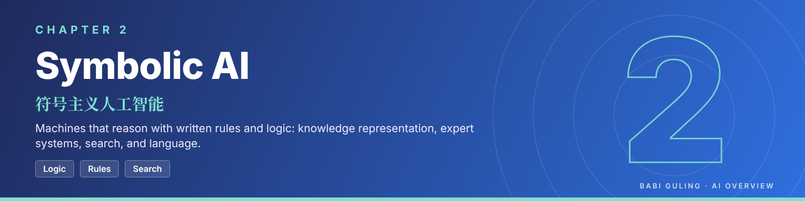

# Chapter 2: Symbolic AI

> **Module:** AI Overview  
> **Chapter:** 2 of 4 (course Chapter 4)  
> **Version:** 2.0 (Stage 2; developed from the Stage 1 chapter, version 1.1)  
> **Author:** Gandhi Bestin Dhammananda (proposed owner)  
> **Reviewer:** Brian Djoni Suzanna (review pending; no signed review exists for this version)  
> **Audience:** Complete beginners with basic computer and internet literacy; no programming needed  
> **Study time:** about 4.5 hours, including the hands-on activity  
> **Course source:** Lecturer's slides "chap4: Symbolic AI". The chapter follows the slides' six topics: Introduction, Logic and Reasoning, Knowledge Representation, Rule-Based Systems and Expert Systems, Planning and Problem Solving, and Natural Language Processing in Symbolic AI.

| [← Chapter 1: Introduction to CS and AI](../chapter-1-introduction-to-cs-and-ai/introduction-to-cs-and-ai.md) | [Module overview](../../../README.md) | [Chapter 3: Connectionist AI and Big Data →](../chapter-3-connectionist-ai-and-big-data/connectionist-ai-and-big-data.md) |
|:--|:-:|--:|


<details>
<summary><b>Contents</b></summary>

1. [Where This Chapter Fits](#where-this-chapter-fits)
2. [What You Will Learn](#what-you-will-learn)
3. [Topic 1: Introduction to Symbolic AI](#topic-1-introduction-to-symbolic-ai)
4. [Topic 2: Logic and Reasoning](#topic-2-logic-and-reasoning)
5. [Topic 3: Knowledge Representation](#topic-3-knowledge-representation)
6. [Topic 4: Rule-Based Systems and Expert Systems](#topic-4-rule-based-systems-and-expert-systems)
7. [Topic 5: Planning and Problem Solving](#topic-5-planning-and-problem-solving)
8. [Topic 6: Natural Language Processing in Symbolic AI](#topic-6-natural-language-processing-in-symbolic-ai)
9. [Hands-On Activity: A Rule-Based Smart Classroom](#hands-on-activity-a-rule-based-smart-classroom)
10. [Common Misconceptions](#common-misconceptions)
11. [Key Takeaways](#key-takeaways)
12. [Practice Questions](#practice-questions)
13. [Answer Key](#answer-key)
14. [What Comes Next: From Written Rules to Learned Weights](#what-comes-next-from-written-rules-to-learned-weights)
15. [Key Terms in Chinese](#key-terms-in-chinese)
16. [Glossary](#glossary)
17. [References](#references)

</details>

---

## Where This Chapter Fits

Chapter 1 ended with a question: you saw two ways to build the same spam filter, one with rules written by a person and one learned from examples, but you studied only the second one closely. Chapter 2 goes back to the first way. It is the oldest approach to AI, and it is still used today.

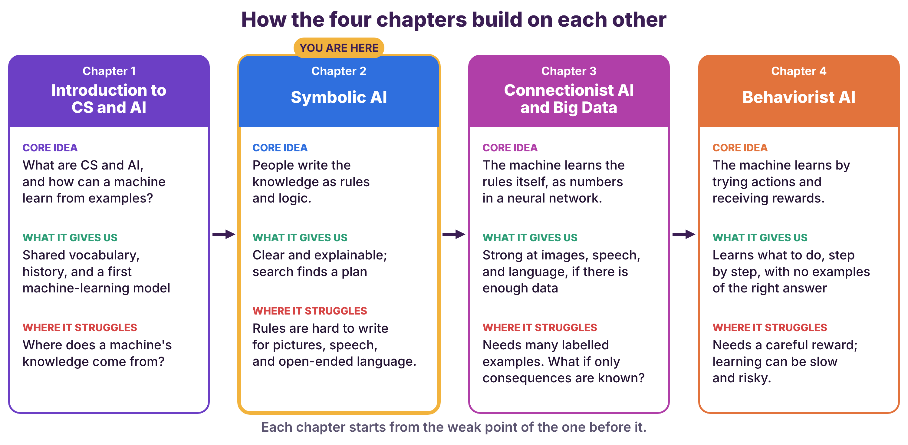

*Figure 2.1: How the four chapters build on each other. You are in Chapter 2.*

**How to read this figure.** Find the highlighted card, Chapter 2. Its **core idea** is that people write the knowledge down as rules and logic. Its **strength** is that the system is clear and explainable. Its **weak point**, in the red part, is the reason Chapter 3 exists: rules are very hard to write for pictures, speech, and open-ended language.

| | Before this chapter | In this chapter | In the next chapter |
|---|---|---|---|
| **What you know** | AI, machine learning, and the idea of a model. You have seen that a machine can follow rules or learn them. You made predictions about the Smart Classroom. | How a machine can **reason** with knowledge that people write down: logic, knowledge representation, rule-based and expert systems, search, and language rules. | A machine that **learns its own rules** from examples, stored as numbers in a neural network. |
| **Main question** | What does it mean for a machine to learn? | What can a machine do when we write the knowledge for it, and where does that stop working? | What if the knowledge is too big or too hard to write by hand? |

## What You Will Learn

After this chapter you should be able to:

1. **Explain** what Symbolic AI is and name its strengths and limits. (Topic 1)
2. **Use** propositional and predicate logic to write statements and to tell valid reasoning from invalid reasoning. (Topic 2)
3. **Describe** five ways to represent knowledge and say when each one fits. (Topic 3)
4. **Trace** a rule-based system with forward chaining, and describe the parts of an expert system. (Topic 4)
5. **Describe** how a machine plans and solves problems by search, and compare breadth-first, depth-first, A\*, minimax, and local search. (Topic 5)
6. **Explain** how rule-based language processing works and why it breaks. (Topic 6)
7. **Build** a rule-based program, test it, and find where it fails. (Hands-on activity)

---

## Topic 1: Introduction to Symbolic AI

This topic answers three questions: **what** Symbolic AI is and how it works, **where** it is used, and **what it does well and badly**. The other five topics each go deeper into one part of the picture.

### What Symbolic AI is

**Symbolic AI**, also called **Good Old-Fashioned AI (GOFAI)**, builds intelligence by working with **symbols** (words, labels, logical statements) according to **explicit rules and logic**. A person writes the knowledge down in a form the computer can reason with, and the computer applies it.

Here is the lecturer's example, a rule for medical diagnosis:

```
IF   patient has a fever
AND  patient has a cough
AND  patient has difficulty breathing
THEN patient may have pneumonia
```

The system checks each condition against what it knows about the patient. If all three are true, it concludes "may have pneumonia". Notice two things. First, **you can point at the exact rule that produced the answer**, so the system can explain itself. Second, **a person can edit the rule** when medical knowledge changes, and nothing else in the system has to be rebuilt. Also notice the wording: the rule says *may have*, not *has*. A real medical system is a decision-support tool for doctors. It does not replace them.

The figure shows the three parts that every symbolic system has.

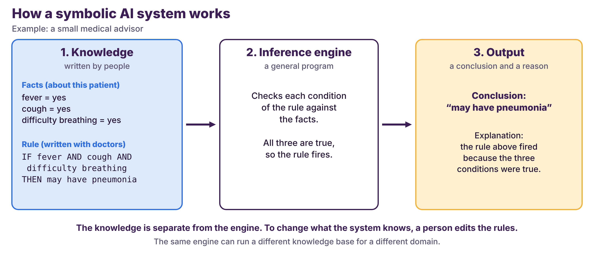

*Figure 2.2: How a symbolic AI system works, using the pneumonia rule.*

**How to read this figure.** Read from left to right. In the first box a person has written the **knowledge**: the facts about this patient and a rule. The second box is the **inference engine**, a general-purpose program that compares the rule's conditions with the facts. It does not know anything about medicine. All three conditions are true, so the rule fires. The third box shows the **output**: a conclusion, and the reason for it. The key idea is the **separation** between knowledge and engine. To give the system new knowledge, you change the first box. To use the same engine for a different job, such as checking loan applications, you give it a different set of rules.

### Where Symbolic AI is used

The slides list four application areas. In each one the symbolic part is the part that follows known rules.

| Application | Symbolic part | Note |
|---|---|---|
| **Digital assistants** (for example Siri) | Rules and grammars that interpret a command, and dialogue rules | Modern assistants combine such parts with machine-learning models (Chapter 3). |
| **Medical diagnosis** | Rules and knowledge bases that suggest a condition from symptoms | Classic expert systems such as MYCIN worked this way. |
| **Autonomous cars** | Traffic rules such as "if the light is red, stop", and route planning by search | Recognising a stop sign from a camera picture is mostly done with neural networks. |
| **Computer vision** | Rules that reason about what was detected (for example, "a pedestrian near a crossing means slow down") | Detecting objects in pixels is mostly done with neural networks. |

The pattern in the last two rows matters. **Most real systems are hybrids.** The symbolic part handles *reasoning with known rules*. The learning part (Chapter 3) handles *messy sensor data* such as pictures and sound. So Symbolic AI is not obsolete. It is one half of many modern systems.

### What it does well and what it does badly

| Strength | What it means in practice |
|---|---|
| **Interpretability** | You can trace the reasoning from the conclusion back to the rules. This matters in medicine, law, and finance, where someone must be able to ask "why?". |
| **Structured knowledge** | Complex knowledge can be stored in a formal, organised way, so it can be checked and reused. |
| **Flexibility of the knowledge** | Change the rules or the knowledge base and the system adapts to a new domain, without redesigning the engine. |

| Limitation | What it means in practice |
|---|---|
| **Incomplete knowledge** | The system works only if the knowledge is complete. For a situation no rule covers, it does nothing, or does the wrong thing. This is called **brittleness**. |
| **Scalability** | The more symbols and rules there are, the more computing work is needed, and the harder it is to keep the rules consistent. |
| **Uncertain or ambiguous information** | Rules need precise statements. "Fairly warm" or "maybe" is hard to write as a rule. |
| **Limited ability to learn** | A person must write and update every rule by hand. |

The two lists are two sides of one fact: **the knowledge is written by people**. That makes the system clear and editable, and it also makes it limited by what people can write down. The rest of the chapter shows this trade-off again and again.

### Check yourself

<details>
<summary>Question 1. A school library lets a student borrow a book only if the student has a valid card, has fewer than 5 books on loan, and has no overdue book. Write one IF–THEN rule, then say what happens for a student with a valid card, 5 books on loan, and no overdue book.</summary>

```
IF   student has a valid card
AND  books on loan < 5
AND  student has no overdue book
THEN allow borrowing
```

The student is **refused**, because 5 is not fewer than 5. The system can name the exact condition that refused the request, which is the explainability of Symbolic AI. If the library later allows 6 books, only one number in the rule changes.

</details>

<details>
<summary>Question 2. Why is Symbolic AI called "brittle"?</summary>

Because it handles only the cases that its rules cover. For a situation that nobody wrote a rule for, it fails instead of adapting, like a brittle object that breaks instead of bending.

</details>

> [!IMPORTANT]
> **In short**
>
> * Symbolic AI represents knowledge as symbols and rules that people write. An inference engine applies them to facts.
> * Its strengths are exactness and explanation: you can point to the rule that produced an answer.
> * Its limits are brittleness (it fails on cases no rule covers), the effort of writing rules, and difficulty with messy sensor data.
> * Most real systems are hybrids: symbolic reasoning for known rules, learning for messy data.

---

## Topic 2: Logic and Reasoning

Rules such as "IF fever AND cough THEN…" are a small piece of something bigger: **logic**. Logic is the precise language in which a machine can state facts and the exact method by which it can derive new facts from old ones. This topic builds it in two layers: **propositional logic** (whole statements) and **predicate logic** (statements about things and their properties).

Why does a machine need logic, when people reason without it? Because people use common sense to fill gaps, and a machine has none. Consider the sentence "If it rains, the ground is wet." Does it follow that "if the ground is wet, it rained"? A person knows at once that it does not (someone may have watered the garden). A computer can only know this if its reasoning rules are exact.

### Propositional logic

A **proposition** is a declarative sentence that is either **true or false, but not both**.

* "The sky is blue." is a proposition.
* "2 + 2 = 4." is a proposition (true).
* "Close the door!" is **not** a proposition. It is a command, so it is neither true nor false.

Take two propositions: **p** = "It is raining" and **q** = "It is windy". We build bigger statements with **Boolean operators**.

| Operator | Symbol | Reads as | True when |
|---|:-:|---|---|
| AND | ∧ | p ∧ q: "raining and windy" | both p and q are true |
| OR | ∨ | p ∨ q: "raining or windy (or both)" | at least one is true |
| NOT | ¬ | ¬p: "not raining" | p is false |

A **truth table** lists every possible combination of true (T) and false (F) and the result.

| p | q | p ∧ q | p ∨ q | ¬p |
|:-:|:-:|:-:|:-:|:-:|
| T | T | T | T | F |
| T | F | F | T | F |
| F | T | F | T | T |
| F | F | F | F | T |

Two statements are **logically equivalent** when they have the same truth value in every row. Two useful equivalences are **De Morgan's laws**, ¬(p ∧ q) ≡ ¬p ∨ ¬q and ¬(p ∨ q) ≡ ¬p ∧ ¬q, and **double negation**, ¬(¬p) ≡ p. To check the first law in one case, let p = T and q = F. Then p ∧ q = F, so ¬(p ∧ q) = T. On the other side ¬p = F and ¬q = T, so ¬p ∨ ¬q = T. Both sides agree. In words, "it is not true that I have both a pen and a pencil" means the same as "I lack a pen or I lack a pencil".

The most important operator for AI is the **implication**, because every rule is one. The statement **p → q** reads "if p, then q". Here p is the **antecedent** (the condition) and q is the **consequent** (the conclusion). A related statement, **p ↔ q**, reads "p if and only if q" and means that p and q always have the same truth value.

| p | q | p → q | p ↔ q |
|:-:|:-:|:-:|:-:|
| T | T | T | T |
| T | F | **F** | F |
| F | T | T | F |
| F | F | T | T |

Look at the implication column. "If it is raining, then the ground is wet" is false in only **one** situation: it is raining and the ground is *not* wet. If it is not raining, the statement does not claim anything, so it counts as true. This surprises many beginners, but it is the right definition for rules: a rule is broken only when its condition holds and its conclusion does not.

### Rules of inference

**Inference** means deriving a new statement from statements we already accept. An inference rule is valid if it can never lead from true statements to a false one. Two valid rules matter most.

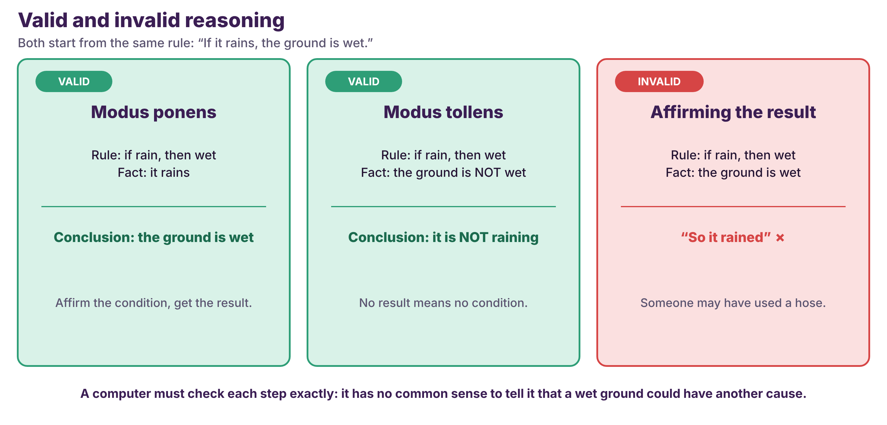

*Figure 2.3: Two valid rules and one common mistake, all starting from "If it rains, the ground is wet."*

**How to read this figure.** Each card starts from the same rule and adds a different fact. In the left card the fact is "it rains", and the conclusion "the ground is wet" must be true: this is **modus ponens** ("the mode that affirms"). In the middle card the fact is "the ground is *not* wet", and the conclusion "it is not raining" must be true, because if it were raining the ground would be wet: this is **modus tollens** ("the mode that denies"). In the red card the fact is "the ground is wet", and the conclusion "so it rained" does **not** follow, because the ground could be wet for another reason. This mistake is called *affirming the consequent*, and it is the most common error in everyday reasoning.

An AI system that reasons with rules must avoid the red card. This is the reason for formal logic: it makes the check mechanical.

### Predicate logic

Propositional logic treats "Socrates is a man" as one indivisible block. It cannot say "**all** men are mortal" in a way that applies to Socrates. **Predicate logic** (also called first-order logic) looks inside the sentence.

* A **predicate** is a statement with a variable that is true or false depending on the value. **Even(x)** is true for x = 4 and false for x = 5.
* The **universal quantifier ∀** means "for all". ∀x (Cat(x) → Mammal(x)) reads "every cat is a mammal".
* The **existential quantifier ∃** means "there exists at least one". ∃x (Prime(x) ∧ x < 10) reads "some prime number is less than 10" (true: 2, 3, 5, 7).

To turn an English sentence into logic, follow four steps. Take "Some birds can fly."

| Step | Action | Result |
|---|---|---|
| a | Identify the predicates | Bird(·), CanFly(·) |
| b | Introduce a variable | y |
| c | Apply the quantifier | "Some" means ∃ |
| d | Write the expression | ∃y (Bird(y) ∧ CanFly(y)) |

A habit worth learning: **∀ goes with →, and ∃ goes with ∧.** "Every cat is a mammal" is ∀x (Cat(x) → Mammal(x)). If you wrote ∀x (Cat(x) ∧ Mammal(x)) it would say that *everything* is a cat and a mammal.

The connectives work as before. For example, Adult(x) → CanVote(x) says "if x is an adult, x can vote (in a given rule set)", and ¬Married(x) says "x is not married". One more example needs care: ∀x (Even(x) → Positive(x)) is **false** if x ranges over all integers, because −2 is even but not positive. It is true only if x ranges over positive numbers. A logic statement is true or false **relative to a domain**, so a knowledge base must say what its variables range over.

The slides give four more inference rules for quantifiers.

| Rule | In words | Form |
|---|---|---|
| **Universal instantiation** | If it is true for all x, it is true for a particular a | from ∀x (P(x) → Q(x)) to P(a) → Q(a) |
| **Existential instantiation** | If something has the property, give it a *new* name c | from ∃x (P(x) ∧ Q(x)) to P(c) ∧ Q(c) |
| **Universal generalization** | If it holds for an *arbitrary* a, it holds for all | from P(a) → Q(a) to ∀x (P(x) → Q(x)) |
| **Existential generalization** | If it holds for a particular c, then something exists | from P(c) ∧ Q(c) to ∃x (P(x) ∧ Q(x)) |

The slides ask: "Do you see anything strange about these four rules?" Yes, and the answer is the point of the table.

* **Existential generalization** is always safe. If c has the property, then *something* has it.
* **Universal instantiation** is always safe. What holds for everything holds for a.
* **Existential instantiation** is safe only if the name c is **new**. We know that *some* x has the property but not which one. If c is already the name of something else, the step is wrong.
* **Universal generalization** is the strange one. Going from **one** example to **all** is **not valid** in general. "My cat is black" does not prove "all cats are black". The rule is valid only when a is **arbitrary**, meaning we assumed nothing special about it.

The classic use is the one you know from school logic. Premises: ∀x (Human(x) → Mortal(x)) and Human(Socrates). **Universal modus ponens** gives **Mortal(Socrates)**. Together with its mirror image, universal modus tollens (from ∀x (P(x) → Q(x)) and ¬Q(a), conclude ¬P(a)), this is how a rule-based system applies a general rule to a particular case.

### Check yourself

<details>
<summary>Question 1. For p = true and q = false, what is p → q? Why?</summary>

It is **false**. An implication is false only when the condition is true and the conclusion is false.

</details>

<details>
<summary>Question 2. "If it rains, the ground is wet. The ground is not wet." Which conclusion is valid?</summary>

"It is not raining." This is modus tollens. The conclusion "it is raining" would be wrong.

</details>

<details>
<summary>Question 3. Write "Every student is tired" and "Some students are not tired" in predicate logic, using Student(x) and Tired(x).</summary>

"Every student is tired": ∀x (Student(x) → Tired(x)).  
"Some students are not tired": ∃x (Student(x) ∧ ¬Tired(x)).

</details>

> [!IMPORTANT]
> **In short**
>
> * Logic gives a machine an exact language for facts (propositions, predicates) and exact rules for deriving new facts (inference).
> * An implication p → q is false only when p is true and q is false.
> * Modus ponens and modus tollens are valid. Affirming the consequent ("q is true, so p is true") is not.
> * ∀ goes with →, and ∃ goes with ∧. A statement is true or false relative to a domain.

---

## Topic 3: Knowledge Representation

Logic tells a machine *how to reason*. Before it can reason, it needs something to reason **about**: facts about the world, written in a form it can use. **Knowledge representation (KR)** is the work of structuring information so that a program can use it to reason, solve problems, and make decisions.

The slides give three reasons why this matters. First, **reasoning**: well-structured knowledge allows logical inference. Second, **problem solving**: well-organised information makes hard problems easier. Third, **learning**: structured knowledge can be extended and generalised. In short, a machine cannot be smarter than the way its knowledge is written. A fact that is stored in a form the machine cannot use might as well not be stored.

### Five ways to write the same knowledge

There is no single best way to write knowledge. The figure takes one small piece of knowledge, "Birds can fly. A penguin is a bird. A penguin cannot fly", and writes it five ways.

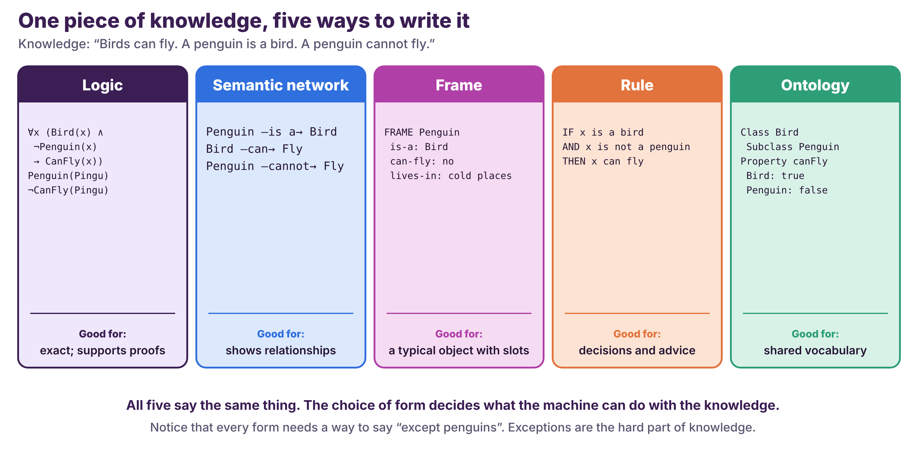

*Figure 2.4: One piece of knowledge in five forms. Each form suits a different job.*

**How to read this figure.** Each card is one representation, and the bottom line says what it is good for. Compare the cards, not the details. The **logic** card is exact and supports formal proofs. The **semantic network** card shows relationships as links. The **frame** card describes a typical object with named slots. The **rule** card is an IF–THEN statement that can be applied to decide something. The **ontology** card defines classes and properties so that different systems can share one vocabulary. Notice that every card needs a way to say "except penguins". Exceptions are the hardest part of knowledge.

Here is each form in more detail.

**1. Logic-based representation.** Facts are statements in propositional or predicate logic: P = "It is raining", or ∀x (Human(x) → Mortal(x)). Logic is exact and supports proofs, but it is hard to write everyday knowledge in it.

**2. Semantic networks.** Knowledge is a graph. The **nodes** are concepts and the **links** are relationships. The next figure shows a small network and how it handles an exception.

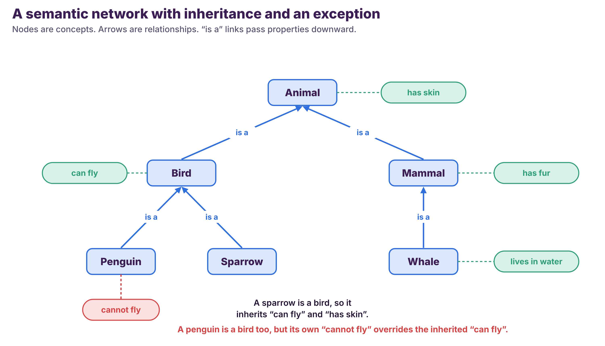

*Figure 2.5: A semantic network. Properties are passed down along "is a" links, and a more specific property overrides the inherited one.*

**How to read this figure.** Arrows labelled "is a" go from a specific concept to a more general one: a sparrow *is a* bird, a bird *is an* animal. The green bubbles are properties. A concept **inherits** the properties of everything above it, so a sparrow can fly (from Bird) and has skin (from Animal) although nobody wrote those facts on the Sparrow node. The red bubble shows an **exception**: a penguin is a bird, but its own "cannot fly" overrides the inherited "can fly". This saves a great deal of writing, because facts are stored once at the most general level. It also needs a rule for handling exceptions, and a network that is not careful about this will wrongly conclude that penguins fly.

**3. Frames and scripts.** A **frame** is a data structure for a typical object or situation, with named **slots**. A "car" frame has the slots make, model, year, and colour; one particular car fills them in (Toyota, Corolla, 2019, white). A **script** is a sequence of frames for a typical event. "Going to a restaurant" is a script made of the frames *reservation*, *ordering*, and *paying the bill*, which lets a program fill in what usually happens even when a story does not mention it.

**4. Rule-based representation.** Knowledge is a set of **IF–THEN** production rules: "If the patient has a fever and a cough, then consider a respiratory infection." This is the form used by the expert systems in the next topic.

**5. Ontologies.** An ontology is a formal description of the **concepts in a domain and the relationships between them**, which gives everyone a shared vocabulary. A medical ontology defines *disease*, *symptom*, and *treatment*, and how they relate: a disease *has symptom* a symptom, and a treatment *treats* a disease. Its main value is agreement: two hospital systems that use the same ontology can exchange information without misunderstanding each other.

| Method | Best for | Weakness |
|---|---|---|
| Logic | Precise reasoning and proof | Hard to write for everyday knowledge |
| Semantic network | Showing relationships and "is a" inheritance | Can be vague about the exact meaning of a link |
| Frames and scripts | Typical objects and routines | Struggles with exceptions |
| Rules | Decisions and advice | Many rules are hard to keep consistent |
| Ontology | A shared vocabulary across systems | Costly to build, and people must agree on it |

### Where knowledge representation is used

* **Medical diagnosis.** Symptoms, diseases, and medical expertise are stored so that a system can match them.
* **Natural language understanding.** Linguistic knowledge is represented so that a program can understand and produce language (Topic 6).
* **Robotics.** Spatial relations, objects, and task plans are represented so that a robot can reason about its surroundings.
* **Expert systems.** Domain knowledge is stored as rules so that the system can give expert-level advice (Topic 4).

### Check yourself

<details>
<summary>Question 1. In Figure 2.5, a whale "is a" mammal and a mammal "has fur". What does the network wrongly conclude about whales, and what does that show?</summary>

It concludes that whales have fur, which is wrong (whales are almost hairless). It shows that inheritance is only as good as its general facts, and that a careful network must record exceptions. Real knowledge has many exceptions, which is why "All birds can fly" is a poor rule.

</details>

<details>
<summary>Question 2. Which representation would you choose to say that a school's "lesson" has a teacher, a room, and a time slot? Why?</summary>

A **frame**: it describes a typical object with named slots (teacher, room, time slot), and each real lesson fills in the slots.

</details>

> [!IMPORTANT]
> **In short**
>
> * Knowledge representation structures information so that a machine can reason with it. A machine cannot be smarter than its representation.
> * Five common forms are logic, semantic networks, frames and scripts, rules, and ontologies. Each has a best use and a weakness.
> * Inheritance saves writing but needs a way to handle exceptions.

---

## Topic 4: Rule-Based Systems and Expert Systems

Topic 3 listed rules as one way to write knowledge. This topic shows what a machine can **do** with rules. It answers three questions: how a rule-based system is built, how rules trigger one another to reach a conclusion nobody typed in, and how all this is packaged into an expert system.

### Rule-based systems

A **rule-based system** (also called a **production system**) works with a collection of **condition–action rules**. Each rule has a condition (the IF part) and an action (the THEN part). Examples: "If the temperature is greater than 30 °C, then turn on the air conditioning." "If the customer has purchased more than $100 of goods, then offer a 10% discount."

Every rule-based system has three parts.

| Part | Role |
|---|---|
| **Condition–action rules** | The knowledge: what to do in which situation |
| **Knowledge base** (working memory) | The facts the system currently knows |
| **Inference engine** | The program that checks the conditions and triggers the actions |

The simplest example is a thermostat with two rules: **R1:** if the temperature is above 25 °C, turn on the air conditioning. **R2:** if the temperature is below 20 °C, turn on the heating.

| Current temperature | R1 fires? | R2 fires? | Action |
|--:|:-:|:-:|---|
| 28 °C | yes | no | Air conditioning on |
| 22 °C | no | no | Nothing |
| 15 °C | no | yes | Heating on |

A thermostat looks too simple to be AI, and that is the point: the same three parts, scaled up to thousands of rules, are what the first commercial AI systems were made of.

### Forward chaining: rules triggering rules

The interesting thing happens when the result of one rule becomes the condition of another. In **forward chaining**, the engine starts from the known facts and keeps applying rules until no new fact appears. Take the facts "it is raining" and "I am going outside", and two rules. **R1:** if it is raining, then the ground is wet. **R2:** if the ground is wet and I am going outside, then take an umbrella and wear waterproof shoes.

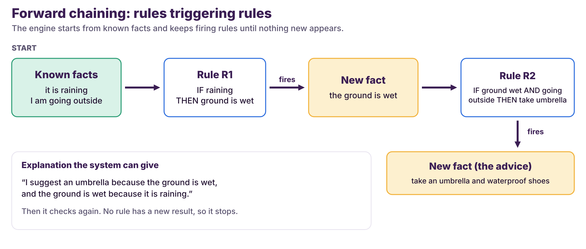

*Figure 2.6: Forward chaining on the umbrella example.*

**How to read this figure.** Follow the arrows. The known facts make R1's condition true, so R1 **fires** and adds a new fact, "the ground is wet". That new fact makes R2's condition true, so R2 fires and adds the final fact, the advice. The engine then checks again, finds no rule with a new result, and stops. Nobody typed "take an umbrella" as a conclusion. The system **derived** it by chaining two rules. The box at the bottom shows a major benefit: the trace of rules that fired *is* the explanation.

| Step | Facts known | Rule that fires | Result |
|--:|---|---|---|
| 0 | raining; going outside | none | start |
| 1 | raining; going outside | R1 | adds "ground is wet" |
| 2 | raining; going outside; ground wet | R2 | adds "take umbrella and waterproof shoes" |
| 3 | all facts | none | stop |

There is a mirror-image method called **backward chaining**. Instead of starting from the facts, the engine starts from a **goal** ("should I take an umbrella?") and works backward: which rule would conclude this, and are its conditions true? If a condition is not known, that condition becomes a new goal. Forward chaining suits problems where you collect data and want to know what follows. Backward chaining suits problems where you have one question to answer. Prolog, a programming language built around this idea, is used in AI courses.

Two problems appear when rules interact. The first is **incomplete knowledge**: if no rule matches, the system does nothing, even when something should be done. The second is **conflicting rules**: two rules can fire at once and give opposite advice. The engine then needs a **conflict resolution** strategy, such as a fixed priority order (rule R5 before R4), the most specific rule first, or the most recently added rule first. You will meet both problems in the hands-on activity.

### Expert systems

An **expert system** is a rule-based system built to copy the decision-making of a **human expert in a narrow domain**, such as medicine, finance, or engineering. In addition to the knowledge base and inference engine, it has a **user interface**, through which a non-expert enters data and reads the advice.

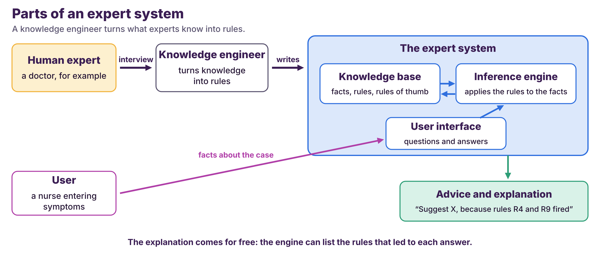

*Figure 2.7: The parts of an expert system and the people around it.*

**How to read this figure.** The top row shows how the knowledge gets into the system: a **knowledge engineer** interviews a human expert (a doctor, for example) and writes what the expert knows as rules and rules of thumb, called **heuristics**. These go into the **knowledge base**. The bottom row shows how the system is used: a user enters facts about a case, the **inference engine** applies the rules, and the user receives **advice together with an explanation** of which rules led to it.

| | Rule-based system | Expert system |
|---|---|---|
| Focus | Conditional rules for decisions or tasks | Copy the reasoning of a human expert |
| Scope | General-purpose | Specialised in one domain |
| Example | A thermostat | A MYCIN-style infection advisor |

The best-known early expert system is **MYCIN**, built at Stanford in the 1970s. It suggested diagnoses and treatments for blood infections using rules written with doctors. Expert systems were widely used in business in the 1980s. Their main weakness is the **knowledge acquisition bottleneck**: it takes a very long time to get an expert's knowledge out of their head and into rules, and the rules go out of date. This is a large part of why the field moved toward learning from data (Chapter 3).

### Check yourself

<details>
<summary>Question 1. A garden system has three rules. R1: IF the soil is dry AND it is sunny THEN the plant needs water. R2: IF the plant needs water AND the tank is empty THEN refill the tank. R3: IF the plant needs water AND the tank has water THEN water the plant. The facts are: soil is dry; it is cloudy; tank has water. What happens, and what does it show?</summary>

R1 does not fire, because it is not sunny, so no rule fires at all and nothing happens. Yet the soil is dry, so the plant should still be watered. The rules never said what to do on a cloudy day. The program is correct about its rules, but the **knowledge is incomplete**, which is the main limit of Symbolic AI.

</details>

<details>
<summary>Question 2. Rules: R1: if A and B then C. R2: if C then D. R3: if D and E then F. The known facts are A, B, and E. Which facts are known after forward chaining?</summary>

R1 fires (A and B), adding C. R2 fires (C), adding D. R3 fires (D and E), adding F. No rule is left. The facts are **A, B, E, C, D, F**.

</details>

<details>
<summary>Question 3. Rule R4: IF the plant needs water THEN water the plant. Rule R5: IF rain is expected THEN do not water. Both conditions are true. What is the problem and one way to solve it?</summary>

The two rules give opposite advice, which is a **conflict**. One solution is a priority order, for example "R5 before R4", so that the system does not water when rain is expected.

</details>

> [!IMPORTANT]
> **In short**
>
> * A rule-based system has condition–action rules, a knowledge base of facts, and an inference engine.
> * In forward chaining, rules fire and add new facts, which can trigger more rules. The trace of fired rules is the explanation. Backward chaining starts from a goal instead.
> * An expert system copies a human expert in one narrow domain. Its weak point is the effort of getting knowledge into rules (the knowledge acquisition bottleneck).
> * Incomplete knowledge and conflicting rules are the two main problems.

---

## Topic 5: Planning and Problem Solving

Rules and logic tell a machine what is true and what follows. Many problems ask something different: **what should I do?** How do I get a delivery robot to room 305? How do I move a farmer, a wolf, a goat, and a cabbage across a river? How do I choose a good chess move? These are problems of **planning and problem solving**, and the symbolic answer is **search**: describe every situation the machine could be in, and look through them systematically.

### What a problem looks like to a machine

* **Planning** finds a **sequence of actions** that changes an **initial state** into a **goal state**.
* **Problem solving** finds solutions to hard problems by searching, by reasoning about possible actions, and by evaluating the results.

Every such problem is described with four building blocks.

| Block | Meaning | Example: a delivery robot in a building |
|---|---|---|
| **State space** | All states the system can be in | Every position of the robot |
| **Actions** | Steps that move from one state to another, with **preconditions** and **effects** | "Move through door" needs the door open |
| **Goal state** | The desired end state | The robot is at room 305 |
| **Search** | Systematically exploring the state space to find the action sequence | Try routes until room 305 is reached |

A small puzzle makes this concrete. A farmer must take a wolf, a goat, and a cabbage from the left bank of a river to the right bank. The boat carries the farmer and **at most one** item. If the farmer is away, the wolf eats the goat, and the goat eats the cabbage. So the wolf and the goat must never be left alone together, and neither must the goat and the cabbage.

A **state** says which bank each of the four (farmer, wolf, goat, cabbage) is on. A **move** is one crossing. The **goal state** has all four on the right bank. The figure shows the shortest path through the states.

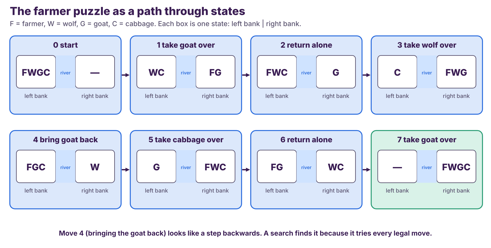

*Figure 2.8: The farmer puzzle as a path through states. F = farmer, W = wolf, G = goat, C = cabbage.*

**How to read this figure.** Each box is one state, written *left bank | right bank*. The first box is the start: everyone is on the left. Each arrow is one legal crossing, described at the top of the next box. For example, in move 1 the farmer takes the goat over, leaving the wolf and the cabbage alone on the left, which is safe because wolves do not eat cabbages. The last box is the goal. The surprising step is **move 4**, where the farmer brings the goat **back**. It looks like going backwards, but without it the puzzle cannot be solved. A search program finds such moves automatically, because it tries every legal move instead of only the ones that look like progress. (The puzzle has a second solution of the same length, where the cabbage and the wolf swap roles in moves 3 and 5.)

Why not just take the wolf first? Then the goat and the cabbage would be left alone on the left bank and the goat would eat the cabbage. A program knows this only because the rule is written into the **actions**: a move is legal only if it does not leave a forbidden pair alone.

### Uninformed (blind) search

The first family of search methods knows nothing about where the goal is. They only know the structure of the problem.

* **Breadth-first search (BFS)** explores all neighbours at the current depth before going deeper.
* **Depth-first search (DFS)** goes as deep as possible along one branch, then backtracks.
* **Uniform-cost search** always expands the node with the lowest path cost so far.

The figure shows BFS and DFS on the same small tree. The goal is node B, and children are taken left to right.

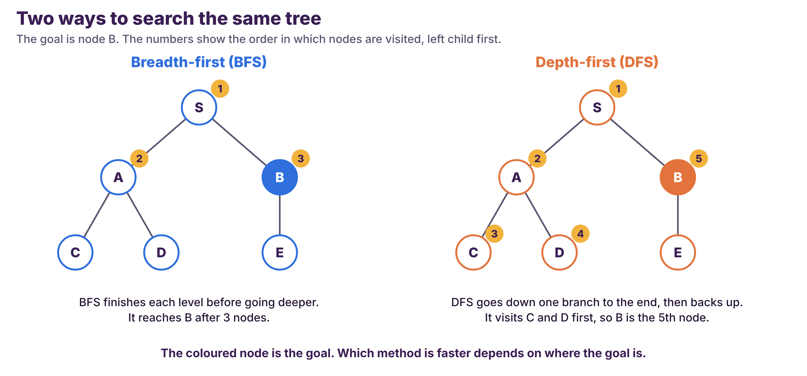

*Figure 2.9: BFS and DFS on the same tree, goal B. The numbers give the order of visiting.*

**How to read this figure.** The yellow numbers are the order in which each search visits a node. **BFS** (left) visits S, then both of S's children, A and B, and stops: three nodes. **DFS** (right) goes from S down to A, then down to A's first child C (a dead end), then D (another dead end), backs up, and only then reaches B: five nodes. For this goal BFS is faster, but the result depends on where the goal is. If the goal were E, both would visit six nodes.

What to remember: BFS finds the **shallowest** goal, which means the path with the fewest steps, but it must remember many nodes at once. DFS needs little memory but can wander down a long wrong branch and does not guarantee the shortest path.

### Informed search

Blind search wastes time on directions that obviously lead away from the goal. **Informed search** uses a **heuristic**, an estimate of how close a state is to the goal. A good heuristic is a rule of thumb, for example "straight-line distance to the destination".

* **Greedy best-first search** expands the node that *looks* closest to the goal.
* **A\* search** combines two quantities, **f(n) = g(n) + h(n)**, where **g** is the cost already paid to reach the node and **h** is the estimated cost still to go. It always expands the node with the lowest f.

Here is a small example. The start is S and the goal is G. The roads cost S→A = 1, S→B = 2, A→G = 6, and B→G = 3. The estimates are h(A) = 5 and h(B) = 3.

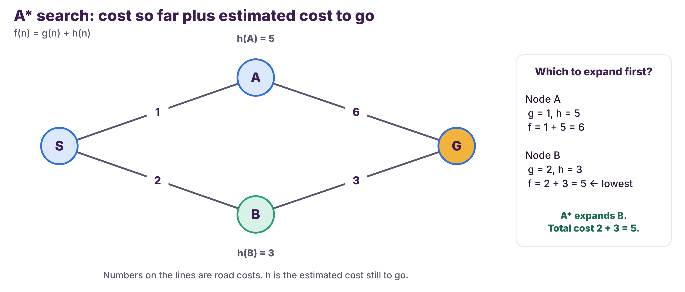

*Figure 2.10: A\* decides between two roads using f = g + h.*

**How to read this figure.** The numbers on the lines are road costs. The estimate h is written next to each middle node. For node A, g = 1 and h = 5, so f = 6. For node B, g = 2 and h = 3, so f = 5. B has the lower f, so A\* expands B first, reaches G with total cost 2 + 3 = **5**, and does not need to try the other road, which would cost 1 + 6 = 7.

A\* is both efficient and **optimal** (it finds a cheapest path) **as long as the heuristic never overestimates** the true remaining cost. This condition is easy to forget and important. If a heuristic were too pessimistic, say h(B) = 10 when the true cost is 3, A\* would wrongly think B is a bad road and might return a worse route. An honest estimate, one that is never larger than the truth, keeps A\* safe. A weak but honest estimate (such as h = 0 everywhere) never breaks the answer. It only makes the search do extra work.

### Adversarial search: games

In a two-player game, one player's gain is the other player's loss. The machine must plan against an opponent who also plans.

* **Minimax** assumes that the opponent always plays the best reply. The machine picks the move whose result is best in the worst case.
* **Alpha-beta pruning** skips branches that cannot change the final decision. It gives exactly the same answer as minimax with less work.

The next figure shows a tiny game tree. **Max** (the machine) moves first, then **Min** (the opponent). The numbers in the squares are the final scores, where a high score is good for Max.

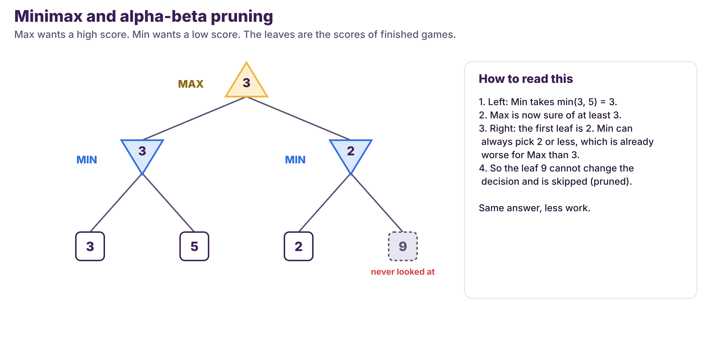

*Figure 2.11: Minimax on a small tree, with alpha-beta pruning.*

**How to read this figure.** Work from the bottom up. In the left branch Min can choose between 3 and 5, and Min picks the smaller, so that branch is worth **3** to Max. Max is now sure of at least 3. In the right branch the first leaf is 2. Min can already force a score of 2 or less there, which is worse for Max than 3, so **it does not matter what the next leaf is**. The leaf with 9 is never examined. That is pruning: the same answer (Max picks the left move) with one leaf fewer to look at. In a real game tree, pruning can remove most of the tree.

### Local search

All the methods above build a solution step by step. **Local search** does the opposite: it starts with a **complete** solution and keeps moving to a neighbouring better one.

* **Hill climbing** always moves uphill. It is simple, but it can get stuck on a small hill (a *local maximum*) while a higher mountain exists elsewhere.
* **Simulated annealing** sometimes accepts a worse move, with a probability that decreases over time, to escape local maxima.

| Family | Looks at | Example use |
|---|---|---|
| Uninformed | Only the structure of the problem | Finding any route in a maze |
| Informed | Structure plus a heuristic | The shortest road route |
| Adversarial | A game with an opponent | Chess, checkers |
| Local | Neighbouring complete solutions | Timetables, circuit layout |

### Why search is hard: combinatorial explosion

Search sounds easy: just try everything. How big is "everything"? Take tic-tac-toe, a game that children play. A **game tree** has a node for every position that can appear and a branch for every legal move.

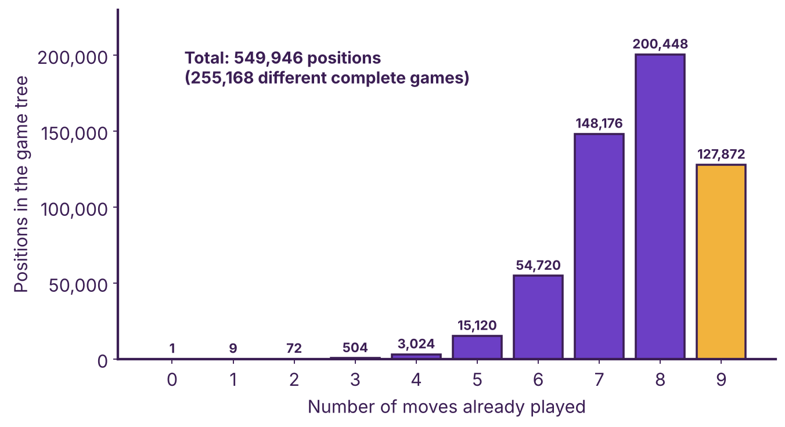

*Figure 2.12: The number of positions in the tic-tac-toe game tree after each number of moves. The total is 549,946.*

**How to read this figure.** The horizontal axis is the number of moves already played, and the bar is how many positions exist at that depth. After 1 move there are 9 positions. After 2 moves there are 72 (9 × 8). After 3 there are 504 (9 × 8 × 7). The counts grow quickly until about move 8, where there are 200,448. They drop at move 9 (127,872) because many games **end early** when someone completes a line. The total is **549,946** positions, and there are **255,168** different complete games, although only 5,478 different boards can occur, because many move orders reach the same board.

For chess, Shannon's rough estimate of the number of possible games is about 10^120, which no computer can search. Real programs therefore use three tricks that you have now met: a **heuristic** (estimate how good a position is), **pruning** (skip useless branches), and **memory** (remember positions already seen). This pressure, the **combinatorial explosion**, is one reason why symbolic search alone was not enough for games such as Go, where Chapters 3 and 4 take over.

### Check yourself

<details>
<summary>Question 1. On the tree in Figure 2.9, the goal is E. In which order does BFS visit nodes and in which order does DFS? Which visits fewer?</summary>

BFS: S, A, B, C, D, E. DFS: S, A, C, D, B, E. Both visit **6** nodes, so neither is faster for this goal.

</details>

<details>
<summary>Question 2. In the A* example, suppose the heuristic is changed to h(A) = 1. Which node is expanded first, and does the final answer change?</summary>

f(A) = 1 + 1 = 2 and f(B) = 2 + 3 = 5, so A is expanded first. Through A the goal is reached with cost 1 + 6 = 7. B (f = 5) is then expanded, and through B the goal costs 5, which is better, so A\* still returns the optimal cost **5**. The answer does not change, because h(A) = 1 never overestimates the true remaining cost (6). The weaker estimate only makes A\* do extra work.

</details>

<details>
<summary>Question 3. Why can alpha-beta pruning skip a branch without changing the result?</summary>

Because once Max already has a guaranteed score from another branch, a branch where Min can force something worse cannot be chosen. Whatever its remaining leaves are, they cannot change Max's decision.

</details>

> [!IMPORTANT]
> **In short**
>
> * Planning finds a sequence of actions from an initial state to a goal state by searching a **state space**.
> * Blind search (BFS, DFS) uses only the structure of the problem. Informed search (A\*) adds a heuristic. A\* is optimal if the heuristic never overestimates.
> * Games use minimax, and alpha-beta pruning gives the same answer with less work.
> * The number of possibilities grows explosively, so real programs need heuristics, pruning, and memory.

---

## Topic 6: Natural Language Processing in Symbolic AI

Human language is the hardest test for rules. **Natural Language Processing (NLP)** is the part of AI that lets computers **understand, interpret, and generate human language**. In symbolic NLP, this work is done with **formal rules, logic, and symbolic representations**. This topic shows how, and then shows why it breaks.

### Syntax and semantics

Two ideas organise the work. **Syntax** is the *structure* of a sentence: word order, phrases, and clauses. **Semantics** is its *meaning*.

For syntax, linguists write **grammar rules**. A small set is enough to describe a simple sentence. Take *The cat chased the mouse.*

| Rule | Meaning |
|---|---|
| S → NP VP | A sentence is a noun phrase plus a verb phrase |
| NP → Det N | A noun phrase is a determiner plus a noun |
| VP → V NP | A verb phrase is a verb plus a noun phrase |

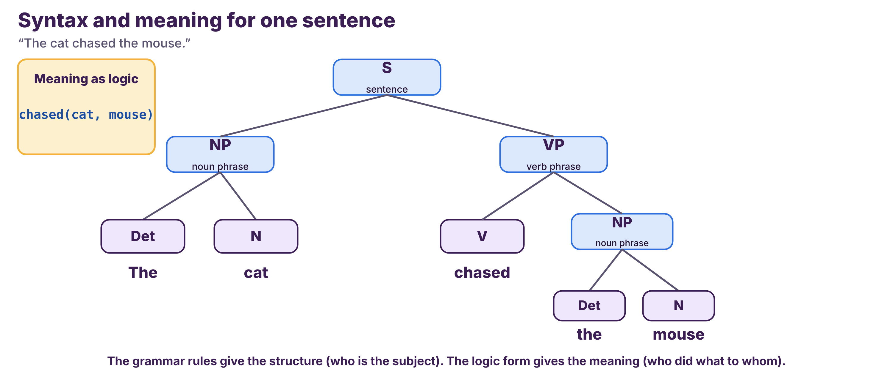

*Figure 2.13: The grammar structure and the meaning of one sentence.*

**How to read this figure.** The tree shows how the rules break the sentence into parts. The sentence **S** splits into a noun phrase **NP** (*the cat*) and a verb phrase **VP** (*chased the mouse*). The VP splits again into a verb and another NP. From the tree the program knows that *cat* is the subject, *chased* is the verb, and *mouse* is the object. The box at the left shows the **meaning** written in logic: **chased(cat, mouse)**. Now the system "knows" who did what to whom, and a different sentence, *The mouse was chased by the cat*, can be mapped to the same logic form.

### What rule-based language processing can do

| Task | How a rule-based system does it | Example |
|---|---|---|
| **Part-of-speech tagging** | Pattern rules for each word | "the" is a determiner; "quick" and "brown" are adjectives; "fox" is a noun |
| **Syntactic parsing** | Grammar rules | Find the subject, verb, and object |
| **Information extraction** | Patterns for names, dates, organisations | Capitalised words after "Mr." may be a person's name |
| **Sentiment analysis** | Lists of positive and negative words | "good", "excellent", "happy" mean positive; "bad", "poor", "disappointed" mean negative |
| **Question answering** | A knowledge graph plus logical inference | "Which symptoms go with disease X?" follows links in a medical knowledge graph |
| **Information retrieval** | Formal representations of documents | Match a legal question to relevant statutes |

Logic helps here too. A knowledge base can store parent(Ann, Ben) and parent(Ann, Carla). A rule says: **sibling(x, y) if x and y have the same parent and x ≠ y**. The system then infers sibling(Ben, Carla) without being told.

### Why rules break

Rule-based NLP is transparent, but it is **brittle**. Language is full of exceptions and ambiguity.

| Rule | Where it fails |
|---|---|
| "A word ending in *-ing* is a verb." | *Thing* and *king* end in -ing and are nouns. |
| "Words in the positive list make the review positive." | "This is **not good**" contains *good* but is negative. |
| "The sentence has the form NP VP NP." | "Time flies like an arrow" can be parsed in more than one way. |

Every rule works on most cases and fails on some, and each patch creates new failures. This is one reason that modern NLP mostly uses learning (Chapter 3), often combined with symbolic parts.

### A famous example: ELIZA

The first chatbot, **ELIZA**, was written by Joseph Weizenbaum at MIT in the mid-1960s (1966 is the usual release date) and is described in a 1966 article in *Communications of the ACM*. Its best-known script, **DOCTOR**, imitated a therapist who reflects the speaker's words back as questions. It used scripted keyword rules, like the three below. This small version checks the rules **in order**, uses the **first** rule that matches, and ignores capital letters.

* **R1:** If the text starts with "I feel ", answer "Why do you feel " + the rest of the text + "?"
* **R2:** If the text contains "mother" or "father", answer "Tell me more about your family."
* **R3:** Otherwise, answer "Please go on."

| # | Input | Rule that fires | Answer |
|--:|---|---|---|
| a | I feel tired | R1 | Why do you feel tired? |
| b | My mother called me | R2 | Tell me more about your family. |
| c | I don't feel well | R3 | Please go on. |
| d | I feel that my mother is angry | R1 | Why do you feel that my mother is angry? |

Inputs a and b work well. Input c shows **brittleness**: the sentence is about feeling unwell, but "I don't feel" does not match "I feel ", so the chatbot says nothing useful. Input d shows two weaknesses at once: R1 comes first, so the family rule is never reached, and the chatbot repeats "my mother" instead of changing it to "your mother". The rules do not understand the sentence. They only match text.

The lesson is older than modern chatbots: **a program can produce replies that *seem* attentive using only pattern matching, and people are quick to read understanding into fluent text.** When you evaluate any chatbot, ask how it produces its answers, not only how they sound.

### Check yourself

<details>
<summary>Question 1. Give one example where a rule-based sentiment analyser fails, and say why.</summary>

"The film was not good" contains the positive word *good*, so a word-list rule marks it positive, although the sentence is negative. The rule cannot see negation.

</details>

<details>
<summary>Question 2. With the ELIZA-style rules above, what does the chatbot answer to "My father and I feel tired"? Why does R1 not fire?</summary>

R2 fires, so the answer is "Tell me more about your family." R1 needs the text to *start with* "I feel ", but this text starts with "My father".

</details>

> [!IMPORTANT]
> **In short**
>
> * Symbolic NLP uses grammars (for structure) and logic (for meaning). It does well in narrow, controlled settings.
> * It breaks on ambiguity, negation, words hidden inside other words, and context.
> * ELIZA shows that matching text can look like understanding. Modern NLP mostly learns from data (Chapter 3), often together with symbolic parts.

---

## Hands-On Activity: A Rule-Based Smart Classroom

In Chapter 1 you predicted how a program that matches exact text would treat different wording. Now you build that program and test your predictions. Finding where the rules break is the main lesson, because it shows what Symbolic AI cannot do alone.

The lecturer's hands-on slide shows a block program for a virtual classroom with a **fan** and a **lamp**. The program *asks* for a command, then uses IF–THEN blocks to react.

### Activity A: Exact-Match Rules, Then "Contains" Rules

**Goal.** Build a rule-based program, test it with the sentences from your Chapter 1 prediction table, and find out where rules fail and what each fix costs.

**Preparation.**

* Your completed prediction table from Chapter 1, Activity B.
* Tool version: the lecture's block tool with a fan and a lamp. Paper version: pen and paper, and the test table below. If the tool is unavailable, use the paper version. It gives the same result.

**Task.**

*Part 1: exact-match rules (the same four rules as in Chapter 1)*

```
ASK "Enter your command"
IF answer = "Fan on"    THEN broadcast  fan-on
IF answer = "Fan off"   THEN broadcast  fan-off
IF answer = "Lamp on"   THEN broadcast  lamp-on
IF answer = "Lamp off"  THEN broadcast  lamp-off
```

Test each sentence and write what happens in the last column. In the tool, type it in. On paper, apply the rules by hand.

| # | Typed sentence | Your Chapter 1 prediction | What happens |
|--:|---|---|---|
| 1 | Fan on | | |
| 2 | fan on | | |
| 3 | Fan on please | | |
| 4 | Please turn the fan on | | |
| 5 | Turn the fan on | | |
| 6 | Lamp off | | |
| 7 | Switch the lamp off | | |

*Part 2: fix it with "contains" rules*

Add these four rules and test again.

```
IF answer CONTAINS "fan"  AND answer CONTAINS "on"   THEN broadcast  fan-on
IF answer CONTAINS "fan"  AND answer CONTAINS "off"  THEN broadcast  fan-off
IF answer CONTAINS "lamp" AND answer CONTAINS "on"   THEN broadcast  lamp-on
IF answer CONTAINS "lamp" AND answer CONTAINS "off"  THEN broadcast  lamp-off
```

Test: "Turn the fan on", "Switch the lamp off", "Turn the fan off soon", and "Don't turn the fan on".

**Observation.**

* How many of the 7 sentences in Part 1 did the program handle correctly? How many of your predictions were right?
* In Part 2, which of the four test sentences are handled correctly, and which are not?

**Reflection.**

1. How many exact-match rules would you need to cover ten different ways of saying "turn on the fan"?
2. In Part 2, what went wrong with "Turn the fan off soon"? (Hint: look at the letters of the word "soon".)
3. Is the program **explainable**? Is it **flexible** with new wording?

**Feedback.**

<details>
<summary>Check your answers</summary>

**Part 1** (strict, case-sensitive comparison)

| # | What happens |
|--:|---|
| 1 | The fan turns on. |
| 2 | Depends on the tool. A strict comparison treats "fan" and "Fan" as different, so nothing happens. Some tools ignore capital letters. Record what your tool does. |
| 3 | Nothing happens (the text is not exactly "Fan on"). |
| 4 | Nothing happens. |
| 5 | Nothing happens. |
| 6 | The lamp turns off. |
| 7 | Nothing happens. |

Only sentences 1 and 6 are certain to work. Compare with your predictions from Chapter 1.

**Part 2**

| Sentence | Result |
|---|---|
| Turn the fan on | The fan turns on (fan-on rule). Correct. |
| Switch the lamp off | The lamp turns off (lamp-off rule). Correct. |
| Turn the fan off soon | The word "soon" contains the letters "on", so the fan-on rule **and** the fan-off rule both fire. The program receives two opposite commands. This is a **rule conflict**. |
| Don't turn the fan on | The fan turns on. The rules do not understand "don't". |

1. About ten, one for each wording, unless you use "contains" rules. The "contains" rules reduce the count but create new mistakes.
2. A "contains" test matches letters inside other words. A fix is to match whole words, and to give "off" a higher priority than "on". Each fix adds more rules.
3. **Explainable: yes.** Every action comes from a visible rule, and you can say which one fired. **Flexible: no.** A person must write each new rule and also check how it interacts with the old ones.

</details>

### Activity B: Repair the Rules, Then Break Them Again

**Goal.** See that each repair to a rule-based program removes one failure and leaves others.

**Preparation.** Your results for Part 2 ("contains" rules) of Activity A.

**Task.**

1. In Part 2, the sentence "Turn the fan off soon" fired two opposite rules. Change the rules so that a word counts only when it appears as a **whole word**. Test the sentence again.
2. Test "Don't turn the fan on" with the whole-word rules. What happens?
3. Add a rule to handle "don't". Write one sentence that this new rule would handle wrongly.

**Observation.** Record what each repair fixed and what it left broken.

**Reflection.** (1) Why does every fix leave some failure behind? (2) What does this say about the cost of maintaining a large rule base?

**Feedback.**

<details>
<summary>Check your answers</summary>

1. With whole-word matching, "soon" no longer contains "on", so only the fan-off rule fires. The conflict is repaired.
2. The fan still turns **on**: the rules ignore the word "don't".
3. One possible rule: "if the sentence contains *don't*, do nothing." It fails on "Don't worry, turn the fan on", which should turn the fan on. Your own example may differ; any sentence where "don't" does not negate the command works.

*Reflection:* (1) Language has many more cases than any one rule covers, so each rule handles some cases and breaks others. (2) Every new rule must be checked against all the old ones, which is why large rule bases are expensive to maintain.

In Chapter 3 you will see the **machine-learning version** of the same classroom. It recognises new wording because it has learned from example sentences.

</details>

> [!IMPORTANT]
> **In short**
>
> * Exact-match rules work only for the exact wording. "Contains" rules cover more wording but can fire by accident and can conflict.
> * Every repair removes one failure and creates another, so a large rule base becomes expensive to maintain.
> * The program is **explainable** (you can name the rule that fired) but not **flexible** (a person must write each new case).

---

## Common Misconceptions

> [!WARNING]
> Read the left column, decide whether it is true, and then check the right column.

| Misconception | What is true | Where to check |
|---|---|---|
| "Symbolic AI is obsolete." | Rule engines, planners, and game search are still used, and many modern systems mix symbolic and learning parts. | Topic 1 |
| "A rule that passes my tests works for every input." | It works for the inputs that the author thought of. New wording can fall outside every rule. | Hands-on activity |
| "If p → q and q is true, then p is true." | That is affirming the consequent. The conclusion can have another cause. | Topic 2 |
| "'All birds can fly' is a good rule." | Real knowledge has exceptions, such as penguins. | Topic 3 |
| "A\* always finds the best path." | It finds a cheapest path when the heuristic never overestimates the real remaining cost. | Topic 5 |
| "An expert system understands the subject." | It applies the rules that people wrote. It knows nothing beyond them. | Topic 4 |

---

## Key Takeaways

> [!IMPORTANT]
> **If you remember only eight things**
>
> * **Symbolic AI** works with symbols, explicit rules, and logic that people write.
> * Its great strength is **explanation**. Its great weakness is **brittleness**: it fails where no rule applies.
> * **Logic** makes reasoning exact. An implication is false only when the condition is true and the conclusion false. Modus ponens and modus tollens are valid; affirming the consequent is not.
> * **Knowledge representation** decides what a machine can conclude. Logic, semantic networks, frames, rules, and ontologies each suit a different job.
> * **Rule-based and expert systems** chain rules by forward chaining. The knowledge acquisition bottleneck is their main weakness.
> * **Planning** is search through a state space. A\* is optimal when its heuristic never overestimates; alpha-beta pruning saves work without changing the answer.
> * **Combinatorial explosion** limits search, even for simple games.
> * **Symbolic NLP** gives structure and meaning but breaks on ambiguity and negation. That opens the door to learning from data, which is Chapter 3.

---

## Practice Questions

### Part A: Multiple Choice

**Q1.** Which description fits Symbolic AI best?  
A. Learning weights from millions of images  
B. Reasoning with explicit rules and logic  
C. Learning from rewards by trial and error  
D. Grouping data without any rules

**Q2.** For p = true and q = false, what is p → q?  
A. true  
B. false  
C. unknown  
D. both

**Q3.** "If it rains, the ground is wet. The ground is not wet." Which conclusion is valid?  
A. It is raining.  
B. It is not raining.  
C. The ground is dry because of the sun.  
D. No conclusion is possible.

**Q4.** Which statement is written correctly in predicate logic: "Every cat is a mammal"?  
A. ∃x (Cat(x) ∧ Mammal(x))  
B. ∀x (Cat(x) → Mammal(x))  
C. ∀x (Cat(x) ∧ Mammal(x))  
D. ¬Cat(x)

**Q5.** Which is *not* part of an expert system?  
A. Knowledge base  
B. Inference engine  
C. User interface  
D. Neural network weights

**Q6.** In BFS on the tree in Figure 2.9, which node is visited right after A?  
A. D  
B. B  
C. C  
D. E

**Q7.** In alpha-beta pruning, what is the main benefit?  
A. It changes the answer of minimax.  
B. It gives the same answer while examining fewer nodes.  
C. It removes the need for a heuristic.  
D. It makes the opponent play worse.

**Q8.** Which problem is a typical limit of Symbolic AI?  
A. It cannot be explained.  
B. It copes poorly with uncertain or ambiguous information.  
C. It cannot use logic.  
D. It cannot be edited.

### Part B: Short Answer

**Q9.** Write "Some students are not tired" in predicate logic, using Student(x) and Tired(x).

**Q10.** Explain why "From p → q and q, conclude p" is invalid. Give an example.

**Q11.** Explain the difference between a frame and a script, with one example of each.

**Q12.** Show one step of forward chaining on these rules. R1: if it is raining, then the ground is wet. R2: if the ground is wet, then the road is slippery. The fact: it is raining.

### Part C: Apply It

**Q13.** Give one example where a rule-based sentiment analyser fails, and say why.

**Q14.** "All birds can fly. Penguins are birds. So penguins can fly." Which statement is wrong, and what does this show about knowledge written as rules?

### Part D: Trace It

**Q15.** Rules: R1: if A and B then C. R2: if C then D. R3: if D and E then F. The known facts are A, B, and E. Use forward chaining. Which facts are known at the end?

**Q16.** On the tree in Figure 2.9 the goal is node E. In which order does BFS visit the nodes, and in which order does DFS? Which one visits fewer nodes?

**Q17.** Use the ELIZA-style rules of Topic 6. What does the chatbot answer to "My father and I feel tired"? Why does R1 not fire?

---

## Answer Key

| Q | Answer | Explanation |
|---|---|---|
| Q1 | B | Symbolic AI reasons with explicit rules and logic. |
| Q2 | B | An implication is false only when the premise is true and the conclusion is false. |
| Q3 | B | Modus tollens: from p → q and ¬q, conclude ¬p. |
| Q4 | B | "For all x, if x is a cat then x is a mammal." Option C would say everything is a cat and a mammal. |
| Q5 | D | Neural network weights belong to Connectionist AI (Chapter 3). |
| Q6 | B | BFS visits all neighbours of S (A, B) before going deeper, so B comes right after A. |
| Q7 | B | Pruning skips branches that cannot affect the final choice. |
| Q8 | B | Rules need precise statements; uncertainty is hard. |
| Q9 | ∃x (Student(x) ∧ ¬Tired(x)) | "Some" means ∃. Use ∧ with ∃. |
| Q10 | Sample | The conclusion may come from another cause. "If it rains, the ground is wet. The ground is wet." The ground might be wet because of a sprinkler, so we cannot conclude it rained. |
| Q11 | Sample | A frame describes one typical object with slots (a car: make, model, year, colour). A script is a sequence of frames for a typical event (a restaurant visit: reservation, ordering, paying). |
| Q12 | Sample | R1 fires because it is raining, so we add "the ground is wet". Next, R2 can fire because the ground is wet, so we add "the road is slippery". |
| Q13 | Sample | "The film was not good" contains the positive word *good*, so a word-list rule marks it positive, although the sentence is negative. The rule cannot see negation. |
| Q14 | Sample | The first statement is wrong, because penguins cannot fly. It shows that rules need **exceptions**, and that incomplete knowledge leads to wrong conclusions. |
| Q15 | A, B, E, C, D, F | R1 fires (A and B), adding C. R2 fires (C), adding D. R3 fires (D and E), adding F. No rule is left. |
| Q16 | Sample | BFS: S, A, B, C, D, E. DFS: S, A, C, D, B, E. Both visit 6 nodes for this goal, so neither is faster here. |
| Q17 | Sample | R2 fires, so the answer is "Tell me more about your family." R1 needs the text to *start with* "I feel ", but this text starts with "My father". |

---

## What Comes Next: From Written Rules to Learned Weights

**What you have now.** You saw what a machine can do when people write the knowledge: it can reason exactly with logic, chain rules to reach new conclusions, explain every step, and search for a plan. You also saw the limits: incomplete knowledge, rule conflicts, new wording, the effort of writing rules, and an explosion of possibilities.

**What is still missing.** Everything above depended on people writing the knowledge. Nobody can write rules for recognising a face, understanding any sentence, or spotting a tumour in a scan. People cannot put such knowledge into words, even though they can do the tasks.

**Chapter 3 starts there.** It asks: *what if the program could find the rules itself, from examples?* That is **Connectionist AI**. You will replace IF–THEN rules with **neurons and weights**, see how a network learns from data, and learn why very large amounts of data (Big Data) changed what is possible. **Keep your test table from the hands-on activity.** In Chapter 3 you will build the machine-learning version of the same Smart Classroom and compare how many rules you needed here with how many examples you need there.

---

## Key Terms in Chinese

*Check these against your course textbook or a Chinese-speaking teammate; wording varies between books.*

| English | 中文 |
|---|---|
| Symbolic AI | 符号主义（符号人工智能） |
| logic | 逻辑 |
| propositional logic | 命题逻辑 |
| predicate logic | 谓词逻辑 |
| knowledge representation | 知识表示 |
| semantic network | 语义网络 |
| ontology | 本体 |
| rule-based system | 基于规则的系统 |
| expert system | 专家系统 |
| inference engine | 推理机 |
| forward chaining | 正向推理（前向链接） |
| backward chaining | 反向推理（后向链接） |
| search | 搜索 |
| breadth-first search (BFS) | 广度优先搜索 |
| depth-first search (DFS) | 深度优先搜索 |
| heuristic | 启发式 |
| minimax | 极小极大算法 |
| alpha-beta pruning | α-β 剪枝 |
| natural language processing | 自然语言处理 |

## Glossary

| Term | Meaning |
|---|---|
| **A\* search** | An informed search that uses cost so far plus an estimate of the remaining cost. |
| **Admissible heuristic** | An estimate of the remaining cost that never exceeds the true cost. |
| **Alpha-beta pruning** | A way to speed up minimax by skipping branches that cannot change the result. |
| **Backward chaining** | Reasoning that starts from a goal and looks for rules and facts that prove it. |
| **Breadth-first search** | Search that explores all nodes at one depth before the next. |
| **Conflict resolution** | A strategy for choosing which rule to use when two rules give different advice, such as priority, specificity, or recency. |
| **Contrapositive** | The statement “if not q then not p”, which is equivalent to “if p then q”. |
| **Converse** | The statement “if q then p”, which is **not** equivalent to “if p then q”. |
| **Default knowledge** | A fact assumed true unless an exception is known, such as "birds can fly". |
| **Depth-first search** | Search that follows one branch as deep as possible before backtracking. |
| **Equivalent statements** | Statements that have the same truth value in every row of the truth table. |
| **Exception** | A case in which a general rule does not hold, such as a penguin among birds. |
| **Expert system** | A system that copies the decision-making of a human expert in a narrow domain. |
| **Forward chaining** | Reasoning from known facts, applying rules until no new fact appears. |
| **Frame** | A data structure with slots describing a typical object or situation. |
| **Game tree** | A tree of the positions that can occur in a game, with a branch for each legal move. |
| **Goal state** | The state a search is trying to reach. |
| **GOFAI** | Good Old-Fashioned AI, another name for Symbolic AI. |
| **Heuristic** | A rule of thumb that estimates how good a state or choice is. |
| **Inference engine** | The part of a system that applies rules to knowledge to reach conclusions. |
| **Inheritance** | In a semantic network, passing a property from a general concept to a more specific one. |
| **Knowledge base** | The facts and rules that a symbolic system reasons with. |
| **Modus ponens / tollens** | Valid inference rules: from p → q and p conclude q; from p → q and ¬q conclude ¬p. |
| **Ontology** | A formal description of the concepts in a domain and how they relate. |
| **Pattern matching** | Comparing text with a template to decide which rule applies. |
| **Predicate** | A statement with variables that is true or false depending on their values. |
| **Proposition** | A sentence that is either true or false. |
| **Quantifier** | ∀ ("for all") or ∃ ("there exists"). |
| **Rule-based system** | A system whose knowledge is a set of IF–THEN rules that an inference engine applies. |
| **Script** | A sequence of frames describing a typical event. |
| **Semantic network** | A graph of concepts (nodes) and relationships (links). |
| **State** | A complete description of the situation at one moment, for example in a search problem (Chapter 2) or a reinforcement learning problem (Chapter 4). |
| **State space** | The set of all states a system can be in. |

---

## References

1. Course slides, "chap4: Symbolic AI". Lecturer's course materials (no public link). Primary source for the structure, examples, and hands-on activity.
2. Russell, S., and Norvig, P. (2021). *Artificial Intelligence: A Modern Approach* (4th ed.). Pearson. [https://aima.cs.berkeley.edu/](https://aima.cs.berkeley.edu/) *(not opened; logic, knowledge representation, search)*
3. Haugeland, J. (1985). *Artificial Intelligence: The Very Idea*. MIT Press. Overview of the term GOFAI: [https://en.wikipedia.org/wiki/GOFAI](https://en.wikipedia.org/wiki/GOFAI) *(the link is a secondary overview and was not opened; the book itself was not opened)*
4. Shortliffe, E. H. (1976). *Computer-Based Medical Consultations: MYCIN*. Elsevier. Overview: [https://en.wikipedia.org/wiki/Mycin](https://en.wikipedia.org/wiki/Mycin) *(the link is a secondary overview and was not opened; the book itself was not opened)*
5. Weizenbaum, J. (1966). ELIZA: a computer program for the study of natural language communication between man and machine. *Communications of the ACM*, 9(1), 36–45. [https://doi.org/10.1145/365153.365168](https://doi.org/10.1145/365153.365168) *(not opened; basis of the ELIZA example in Topic 6)*
6. Wolf, goat and cabbage problem. [https://en.wikipedia.org/wiki/Wolf,_goat_and_cabbage_problem](https://en.wikipedia.org/wiki/Wolf,_goat_and_cabbage_problem) *(secondary overview of the puzzle in Topic 5; not opened; the 7-move solutions were checked by a short breadth-first search script on 5 November 2026)*
7. Stanford Encyclopedia of Philosophy. *Classical Logic.* [https://plato.stanford.edu/entries/logic-classical/](https://plato.stanford.edu/entries/logic-classical/) *(optional reading on propositional and predicate logic; not opened)*
8. Wikipedia. "A* search algorithm." [https://en.wikipedia.org/wiki/A*_search_algorithm](https://en.wikipedia.org/wiki/A*_search_algorithm) *(admissible heuristic and optimality; read with a fetch tool on 5 November 2026)*
9. Wikipedia. "ELIZA." [https://en.wikipedia.org/wiki/ELIZA](https://en.wikipedia.org/wiki/ELIZA) *(creator, year, DOCTOR script, 1966 Communications of the ACM article; read with a fetch tool on 5 November 2026)*
10. Wikipedia. "Game complexity." [https://en.wikipedia.org/wiki/Game_complexity](https://en.wikipedia.org/wiki/Game_complexity) *(tic-tac-toe: 5,478 legal positions and 255,168 possible games; read with a fetch tool on 5 November 2026. We also recomputed these numbers with a program)*
11. ChessWorld. "What Is the Shannon Number in Chess?" [https://www.chessworld.net/what-is-the-shannon-number-in-chess.asp](https://www.chessworld.net/what-is-the-shannon-number-in-chess.asp) *(about 10^120, a rough estimate; read with a fetch tool on 5 November 2026)*

> **Link status.** Links marked **not opened** could not be opened while this chapter was written. The author or reviewer must click every link, confirm that it opens the right work and supports the claim it is cited for, and then change the label to "opened" with the date.

---

| [← Chapter 1: Introduction to CS and AI](../chapter-1-introduction-to-cs-and-ai/introduction-to-cs-and-ai.md) | [Module overview](../../../README.md) | [Chapter 3: Connectionist AI and Big Data →](../chapter-3-connectionist-ai-and-big-data/connectionist-ai-and-big-data.md) |
|:--|:-:|--:|
