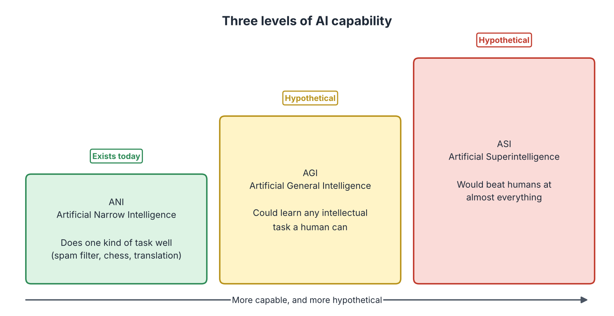
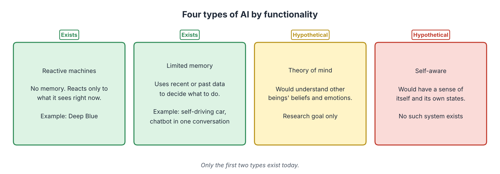
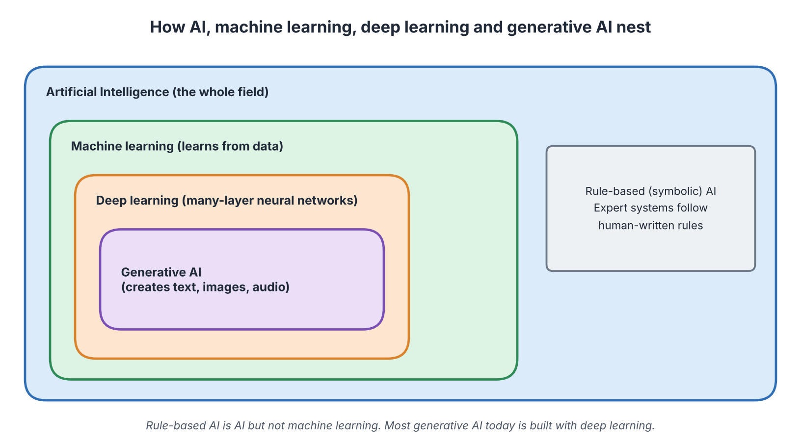

# Types of Artificial Intelligence

**Audience:** Learners with no technical background in AI  
**Estimated time:** 2.5 to 3.5 hours (including missions)  
**Format:** Read, pause at each "Pause and predict" box, complete the two missions, then check the answer key at the end of the chapter.

---

## Table of Contents

- [Learning Outcomes](#learning-outcomes)
- [Where This Chapter Fits](#where-this-chapter-fits)
- [2.1 Why Classify AI at All?](#21-why-classify-ai-at-all)
- [2.2 AI Based on Capability](#22-ai-based-on-capability)
- [2.3 AI Based on Functionality](#23-ai-based-on-functionality)
- [2.4 Machine Learning and Generative AI](#24-machine-learning-and-generative-ai)
- [2.5 Putting the Four Perspectives Together](#25-putting-the-four-perspectives-together)
- [2.6 Mission 1: Classify the Systems](#26-mission-1-classify-the-systems)
- [2.7 Mission 2: Spot the Hype](#27-mission-2-spot-the-hype)
- [2.8 Common Misconceptions](#28-common-misconceptions)
- [2.9 Quick Check](#29-quick-check)
- [2.10 Summary, Connections and References](#210-summary-connections-and-references)
- [Answer Key](#answer-key)
- [Glossary](#glossary)
- [References](#references)

---

## Learning Outcomes

After completing this chapter, you should be able to:

1. Explain why AI can be classified in more than one way.
2. Describe the three capability levels: Artificial Narrow Intelligence (ANI), Artificial General Intelligence (AGI) and Artificial Superintelligence (ASI).
3. Describe the four functionality types: reactive machines, limited memory, theory of mind and self-aware AI.
4. Separate what exists today from what is still hypothetical.
5. Explain how machine learning and generative AI differ, and how they relate to AI as a whole.
6. Classify a familiar AI system from several perspectives and justify your answer.
7. Recognise exaggerated claims about AI types.

## Where This Chapter Fits

**Builds on Chapter 1.** There you learned that AI means computers doing tasks that normally need human intelligence, and that many modern systems learn from data. Now we ask a natural next question: *are all AI systems the same kind of thing?* They are not, and this chapter gives you the labels to tell them apart.

**Leads to Chapters 3 to 6.** Chapter 3 explains how learning-based AI works inside. Chapters 4, 5 and 6 then study three different *ways of building* AI (rules, neural networks, trial and error), which is yet another way to classify AI.

---

## 2.1 Why Classify AI at All?

### Start with a question

A chess program, a spam filter, a self-driving car and a science-fiction robot are all called "AI". Are they really the same? If someone says "AI will soon be smarter than us", which of them are they talking about?

### In plain words

**Classifying AI means sorting systems into groups so we can talk about them clearly.** Different groupings answer different questions. Like sorting vehicles, you can group them by size (bicycle, car, truck), by fuel (petrol, electric) or by purpose (racing, farming). None of these is "the right one"; each is useful for a different question.

### The official idea

There is **no single, official classification** of AI. In this chapter we use four common perspectives:

| Perspective | The question it answers | Groups |
|-------------|------------------------|--------|
| By capability | How broad and how strong is the intelligence? | ANI, AGI, ASI |
| By functionality | How does the system use information and memory? | Reactive, limited memory, theory of mind, self-aware |
| By learning method | Does it learn from data? | Machine learning vs rule-based (and more, see Chapter 3) |
| By output | Does it create new content? | Generative AI vs other AI |

> **Honest note:** these frameworks are teaching tools used in textbooks and articles. They are not scientific laws, and experts do not always agree on where to draw the lines.

---

## 2.2 AI Based on Capability

### Start with a question

Could a spam filter ever do your homework, drive you to school and cook dinner? If not, what would an AI need in order to do all three?

### 2.2.1 Artificial Narrow Intelligence (ANI)

**In plain words:** an AI that does one kind of job, and does it well.

**Definition:** **Artificial Narrow Intelligence (ANI)**, also called *weak AI*, is AI designed and trained for a specific task or a small set of related tasks. It cannot transfer its skill to unrelated tasks without being redesigned or retrained.

*Everyday example:* a calculator app is excellent at arithmetic and useless at translation.
*Technical examples:* a spam filter, a chess engine, a face-unlock system, a language translator, a route planner.

**Key point:** every AI system that exists today is considered ANI or a close variant. Some modern systems, such as large language models, can do many different language tasks. That makes them *broader* than a chess engine, but they are still built from training on data and still fail in ways a human would not. Whether they count as "narrow" is debated, which is why the labels are guides, not facts.

### 2.2.2 Artificial General Intelligence (AGI)

**In plain words:** an AI that could learn almost any mental task a human can.

**Definition:** **Artificial General Intelligence (AGI)** is a hypothetical AI with broad, flexible intelligence: it could learn new tasks, transfer knowledge between very different areas, and reason about unfamiliar situations at roughly human level.

*Everyday example:* a person who can learn to cook, then repair a bicycle, then do accounting, using the same mind.
*Technical status:* **hypothetical.** Researchers disagree about what exactly counts as AGI, how to measure it, and when (or whether) it will exist. Treat any specific date you read online as a guess.

### 2.2.3 Artificial Superintelligence (ASI)

**In plain words:** an AI that would be far smarter than any human.

**Definition:** **Artificial Superintelligence (ASI)** is a hypothetical AI that would outperform the best humans in nearly every intellectual field, including science, creativity and social skills (Bostrom, 2014).

*Technical status:* **hypothetical.** ASI is mainly discussed in philosophy, safety research and fiction.

*Figure 2.1: Three levels of AI capability. Source: created by our team.*

### 2.2.4 Comparing the three levels

| | ANI | AGI | ASI |
|---|-----|-----|-----|
| Scope | One task or a few related tasks | Almost any intellectual task | Beyond any human |
| Exists today? | Yes | No (hypothetical) | No (hypothetical) |
| Learns new, unrelated tasks easily? | No | Yes | Yes, better than humans |
| Examples | Spam filter, chess engine, translator | Often shown in films | Often shown in films |

**Analogy: a toolbox, a Swiss-army knife and a robot workshop.** ANI is a single tool that does one job very well. AGI would be a worker who can pick up any tool and learn any trade. ASI would be a workshop that out-builds all human workers.  
**Where the analogy breaks:** AI is not a physical tool, and the boundaries are blurry. A system can be very strong in many areas yet fail on a simple common-sense question.

> **Pause and predict.** A new chatbot can write poems, answer maths questions and translate languages. Is it AGI?
>
> **Check:** Not by itself. Doing many language-based tasks is *broad*, but AGI would mean flexible, human-level learning across *all* kinds of intellectual tasks, including ones it never saw in training. Most researchers do not consider today's systems AGI, although they debate how close or far we are.

---

## 2.3 AI Based on Functionality

### Start with a question

When you cross a road, you look at the traffic, remember that a bus passed a second ago, and guess what the driver is thinking. Which of these abilities does a machine have?

This second perspective is popularly credited to Arend Hintze (2016). It sorts AI by *how it uses information*, from the simplest to the most advanced.

*Figure 2.2: Four types of AI by functionality. Source: created by our team.*

### 2.3.1 Reactive machines

**In plain words:** it only reacts to what it sees right now, with no memory of the past.

**Definition:** a **reactive machine** responds to the current input using fixed rules or search, and does not store past experiences to improve later decisions.

*Everyday example:* a light that switches on when it detects motion.
*Technical example:* **Deep Blue**, the chess computer, evaluated the current board position and searched possible moves (Campbell et al., 2002). It did not learn from earlier games in the way modern learning systems do.

### 2.3.2 Limited-memory AI

**In plain words:** it uses recent or past data to make better decisions.

**Definition:** **limited-memory AI** uses data from the past, such as training data or the last few seconds of sensor readings, to make decisions. It does not build a lasting understanding of the world like a human.

*Everyday example:* when you drive, you remember the car that just overtook you.
*Technical examples:* a self-driving car tracks nearby vehicles over the last few seconds; a spam filter uses patterns learned from past emails; a chatbot uses the earlier part of your conversation.

**Key point:** almost all of today's useful machine learning systems belong here.

### 2.3.3 Theory-of-mind AI

**In plain words:** an AI that could understand that other people have beliefs, feelings and intentions.

**Definition:** **theory of mind** is a human ability to understand that others have their own thoughts and emotions. A *theory-of-mind AI* would model what people believe, want and feel and adjust its behaviour accordingly.

*Technical status:* **hypothetical / research.** Some systems detect emotion in a face or tone of voice, but that is pattern recognition, not a real understanding of another mind.

### 2.3.4 Self-aware AI

**In plain words:** an AI that knows it exists and has an inner experience.

**Definition:** a **self-aware AI** would have consciousness: a sense of self, and its own feelings and goals.

*Technical status:* **hypothetical.** There is no scientific agreement on what consciousness is or how to detect it in a machine. No existing system is self-aware.

### 2.3.5 Comparing the four types

| Type | Uses memory? | Understands other minds? | Exists today? | Example |
|------|:------------:|:------------------------:|:-------------:|---------|
| Reactive machine | No | No | Yes | Deep Blue |
| Limited memory | Yes (limited) | No | Yes | Self-driving car |
| Theory of mind | Yes | Yes (would) | No | Not yet built |
| Self-aware | Yes | Yes | No | Fiction only |

**Analogy: a ladder of awareness.** Reflex, then remembering, then reading minds, then knowing yourself. **Where the analogy breaks:** real research does not climb these four rungs in order, and the boundaries between them are not sharp.

---

## 2.4 Machine Learning and Generative AI

### Start with a question

People say "AI", "machine learning" and "generative AI" as if they were the same word. Are they?

### 2.4.1 What is machine learning?

**In plain words:** the computer learns patterns from examples instead of being told exact rules.

**Definition:** **machine learning (ML)** is a branch of AI in which algorithms learn patterns from data and use them to make predictions or decisions on new data (see Chapter 1, Section 1.3).

*Example:* a model shown thousands of labelled photos of cats and dogs learns to tell them apart.

### 2.4.2 What is generative AI?

**In plain words:** AI that creates new things, such as text, images, music or code.

**Definition:** **generative AI** is AI that produces new content that resembles the data it was trained on. Many modern generative systems are deep learning models trained on very large collections of text, images or audio (Bommasani et al., 2021).

*Everyday example:* typing a prompt and receiving a drawing or an essay.
*Technical idea:* a text model learns which word is likely to follow others, and builds an answer one piece at a time (Chapter 3 explains this).

### 2.4.3 How they differ

| | Traditional machine learning | Generative AI |
|---|-----------------------------|---------------|
| Typical goal | Predict or classify (is it spam? what price?) | Create new content (write, draw, compose) |
| Typical output | A label or a number | Text, image, audio, code |
| Example | Spam filter, price predictor | Chatbot, image generator |
| Relationship | The broader family | Mostly a part of it |

*Figure 2.3: How AI, machine learning, deep learning and generative AI relate. Source: created by our team.*

**Key point:** generative AI is not a rival of machine learning. In practice it is built *with* machine learning, usually deep learning. And not all AI is machine learning: rule-based systems (Chapter 4) are AI too.

> **Pause and predict.** A program uses a hand-written list of 500 rules to diagnose car problems. Is it AI? Is it machine learning? Is it generative AI?
>
> **Check:** It is AI (it does a task that normally needs expertise). It is *not* machine learning, because the rules were written by people and not learned from data. It is *not* generative AI, because it chooses from known answers and does not create new content.

---

## 2.5 Putting the Four Perspectives Together

No system belongs to only one perspective. Each question gives a different label to the same system.

| System | Capability | Functionality | Learns from data? | Generative? |
|--------|:----------:|:-------------:|:-----------------:|:-----------:|
| Deep Blue (chess) | ANI | Reactive | No (search and hand-built evaluation) | No |
| Spam filter | ANI | Limited memory | Yes | No |
| Self-driving car | ANI | Limited memory | Yes | No |
| Image generator | ANI | Limited memory | Yes | Yes |
| Robot from a film that "feels" | Would be AGI/ASI | Self-aware | Unknown | Unknown |

**Three tips for classifying a system**

1. Start from what it *actually does today*, not from what its advertisement says.
2. Use one perspective at a time. A system can be ANI, limited memory and generative all at once.
3. If a label depends on a hypothetical ability (feelings, true understanding), the label is probably not established.

---

## 2.6 Mission 1: Classify the Systems

> **Goal:** practise using the four perspectives on real examples.  
> **Preparation:** Sections 2.2 to 2.5. Pen and paper, 10 minutes.  
> **Task:** for each system, fill in the table. Capability: ANI / AGI / ASI. Functionality: Reactive / Limited memory / Theory of mind / Self-aware. Then say Yes or No for "learns from data" and "generative".

| # | System | Capability | Functionality | Learns from data? | Generative? |
|:-:|--------|:----------:|:-------------:|:-----------------:|:-----------:|
| 1 | A thermostat that turns heating on when it is below 20°C | ____ | ____ | ____ | ____ |
| 2 | A phone keyboard that suggests the next word | ____ | ____ | ____ | ____ |
| 3 | An app that creates a picture from a text description | ____ | ____ | ____ | ____ |
| 4 | A program that can learn any job a human can, from scratch | ____ | ____ | ____ | ____ |
| 5 | A bank system that flags suspicious card payments using past fraud examples | ____ | ____ | ____ | ____ |

> **Observe:** which system was hardest to place? Which question made it hard?  
> **Reflect:** why is system 4 not on today's list of real systems?  
> **Feedback:** compare with the Answer Key (Mission 1).

---

## 2.7 Mission 2: Spot the Hype

> **Goal:** notice when a claim about AI mixes up types.  
> **Preparation:** Sections 2.2 to 2.4. 10 minutes.  
> **Task:** read each headline. Write (a) which idea it gets wrong and (b) a more accurate sentence.

| # | Headline | (a) What is wrong? | (b) Better sentence |
|:-:|----------|--------------------|---------------------|
| 1 | "Chatbot says 'I feel sad', so AI now has real feelings!" | ________ | ________ |
| 2 | "This new model beats humans on a maths test: AGI is here!" | ________ | ________ |
| 3 | "Machine learning is old; generative AI replaces it completely." | ________ | ________ |
| 4 | "Our robot is superintelligent and will surpass humans next month." | ________ | ________ |

> **Observe:** what words in each headline sound impressive but give no evidence?  
> **Reflect:** why does it matter if the public confuses AI types?  
> **Feedback:** compare with the Answer Key (Mission 2).

---

## 2.8 Common Misconceptions

| Misconception | Correction |
|---------------|------------|
| "Every AI system has the same abilities." | Most AI is built for particular tasks and fails outside them. |
| "A powerful chatbot must be AGI." | Strong results on many language tasks do not equal flexible, human-level learning across everything. |
| "An AI that talks about emotions feels them." | It may be producing text that matches patterns in its training data. |
| "All four functionality types already exist." | Only reactive machines and limited memory exist. |
| "Machine learning and generative AI mean the same." | Generative AI is a part of ML-based AI focused on creating content. |
| "Each system fits exactly one category." | Different perspectives give different labels to the same system. |

---

## 2.9 Quick Check

**Q1 (True/False).** AGI exists today in the form of chatbots.

**Q2 (True/False).** A spam filter that learned from labelled emails is an example of limited-memory AI.

**Q3 (True/False).** All AI is machine learning.

**Q4 (Multiple choice, one answer).** Which statement about ASI is correct?
A. It already exists in research labs. B. It is hypothetical AI that would outperform humans in nearly every intellectual area. C. It is the same as ANI. D. It is a type of spam filter.

**Q5 (Multiple choice, one answer).** Deep Blue is best described as:
A. A reactive machine. B. A self-aware AI. C. A generative AI. D. A theory-of-mind AI.

**Q6 (Multiple choice, one answer).** Which pair is correctly matched?
A. Generative AI creates new content. B. Reactive machine builds a lasting model of the world. C. ANI can learn any task. D. Self-aware AI exists in many homes.

**Q7 (Short answer, 3 to 4 sentences).** A friend says: "My chatbot is AGI because it can talk about everything." Explain whether you agree, using the idea of capability levels.

---

## 2.10 Summary, Connections and References

### Key takeaways

- AI can be classified in several ways. Each way answers a different question.
- By capability: ANI exists; AGI and ASI are hypothetical.
- By functionality: reactive machines and limited memory exist; theory of mind and self-aware AI are hypothetical.
- Machine learning learns from data; generative AI creates new content and is usually built with deep learning.
- Always check whether a claim describes something that exists or something that is imagined.

### Connections to other chapters

| Direction | Chapter | Link |
|-----------|---------|------|
| Builds on | Chapter 1 | The definition of AI and the idea of learning from data |
| Leads to | Chapter 3 | How learning-based AI works inside |
| Leads to | Chapters 4 to 6 | Three approaches: rules, neural networks, trial and error |
| Leads to | Chapter 8 | Why exaggerated AI claims are an ethics issue |

### How this chapter will be reused

| Resource | Planned use |
|----------|-------------|
| **Study Guide** | Sections 2.2 to 2.5 are the reading text; Missions 1 and 2 are activities. |
| **Test Bank** | Quick Check items and classification tasks become True/False and multiple-choice questions. |
| **PPT Slides** | Figures 2.1 to 2.3 become full-slide visuals; Mission 2 becomes a "hype or fact?" voting activity. |
| **Video Tutorial** | A short video classifies five familiar systems live using the four perspectives. |

---

## Answer Key

**Mission 1: Classify the Systems**

| # | Capability | Functionality | Learns from data? | Generative? | Reason |
|:-:|:----------:|:-------------:|:-----------------:|:-----------:|--------|
| 1 | ANI | Reactive | No | No | Fixed rule on the current temperature, no memory. |
| 2 | ANI | Limited memory | Yes | No (it predicts one next word from patterns; some modern keyboards use generative models) | Uses patterns from past text and your recent typing. |
| 3 | ANI | Limited memory | Yes | Yes | Creates new images from training patterns. |
| 4 | AGI (hypothetical) | Not established | Would | Not established | No such system exists today. |
| 5 | ANI | Limited memory | Yes | No | Learns from past fraud examples to flag new cases. |

*Observe/Reflect:* system 2 is the usual hard case because modern keyboards may mix methods. System 4 describes AGI, which is hypothetical.

**Mission 2: Spot the Hype**

| # | (a) What is wrong? | (b) Better sentence |
|:-:|--------------------|---------------------|
| 1 | Confuses producing words about feelings with having feelings. | "The chatbot generates text that sounds sad because similar text appeared in its training data." |
| 2 | One benchmark does not show flexible human-level learning across all tasks. | "The model scored higher than the human average on one maths test; this does not show AGI." |
| 3 | Generative AI is mostly built on machine learning, so it does not replace it. | "Generative AI is a newer branch of machine learning-based AI." |
| 4 | ASI is hypothetical, and no evidence or timeline is given. | "The robot performs a narrow set of tasks; there is no evidence of superintelligence." |

**Quick Check**

1. **False.** Today's systems are considered narrow or broad-but-narrow; AGI is hypothetical.
2. **True.** It uses patterns learned from past data.
3. **False.** Rule-based and expert systems are AI without learning from data.
4. **B.**
5. **A.** It searched and evaluated positions without learning from earlier games.
6. **A.**
7. *Key points:* talking about many topics is breadth in language only; AGI means flexible, human-level learning across all intellectual tasks, including new ones; so the chatbot is better described as a broad but still narrow system; the label depends on definitions that experts debate.

---

## Glossary

| Term | Meaning |
|------|---------|
| AGI | Artificial General Intelligence: hypothetical human-level, flexible AI. |
| ANI | Artificial Narrow Intelligence: AI built for specific tasks; all existing AI. |
| ASI | Artificial Superintelligence: hypothetical AI beyond human ability. |
| Generative AI | AI that creates new content such as text, images or audio. |
| Limited-memory AI | AI that uses past or recent data to decide. |
| Machine learning | Learning patterns from data to predict or decide. |
| Reactive machine | AI that responds only to the present input. |
| Self-aware AI | Hypothetical AI with consciousness. |
| Theory of mind | Understanding that others have beliefs and feelings; hypothetical for AI. |

---

## References

1. Russell, S., & Norvig, P. (2021). *Artificial Intelligence: A Modern Approach* (4th ed.). Pearson. https://aima.cs.berkeley.edu/
2. Hintze, A. (2016, November 14). Understanding the four types of AI, from reactive robots to self-aware beings. *The Conversation*. https://theconversation.com/understanding-the-four-types-of-ai-from-reactive-robots-to-self-aware-beings-67616
3. Bostrom, N. (2014). *Superintelligence: Paths, Dangers, Strategies*. Oxford University Press.
4. Campbell, M., Hoane, A. J., & Hsu, F.-h. (2002). Deep Blue. *Artificial Intelligence*, 134(1-2), 57-83. https://doi.org/10.1016/S0004-3702(01)00129-1
5. Bommasani, R., et al. (2021). On the opportunities and risks of foundation models. *arXiv*:2108.07258. https://arxiv.org/abs/2108.07258
6. Goodfellow, I., Bengio, Y., & Courville, A. (2016). *Deep Learning*. MIT Press. https://www.deeplearningbook.org/

> Figures 2.1 to 2.3 were created by the team for this module.
