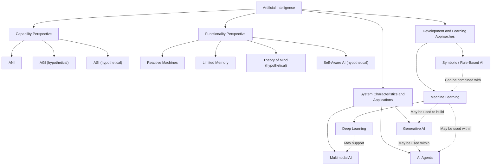

# Chapter 2: Types of Artificial Intelligence

> **Project:** Introduction to Computer Science and Artificial Intelligence  
> **Module:** AI Overview  
> **Stage:** Stage 2 — Revised Draft (V2.1)  
> **Author:** Gandhi Bestin Dhammananda  
> **Reviewer:** Brian Djoni Suzanna  
> **Audience:** Complete beginners  
> **Estimated learning time:** 110 minutes  
> **Status:** Revised draft — pending peer review, repository verification, and learner testing

---

## Chapter Map

| Section | Topic | Estimated Time |
|---|---|---:|
| 2.1 | Introduction to AI Classification | 5 minutes |
| 2.2 | AI Based on Capability: ANI, AGI, and ASI | 10 minutes |
| 2.3 | AI Based on Functionality | 12 minutes |
| 2.4 | Machine Learning and Other AI Approaches | 30 minutes |
| 2.5 | Comparing the Classification Frameworks | 12 minutes |
| 2.6 | Classification Activity | 15 minutes |
| 2.7 | Common Misunderstandings | 5 minutes |
| 2.8 | Practice Questions and Answers | 18 minutes |
| 2.9 | Summary and References | 3 minutes |
| **Total** | | **110 minutes** |

The estimated time includes reading, examining examples, completing the activity, and answering the practice questions. Learners may need additional time if they want to explore the references.

## Learning Objectives

By the end of this chapter, learners should be able to:

1. Explain why AI can be classified from different perspectives.
2. Distinguish between Artificial Narrow Intelligence, Artificial General Intelligence, and Artificial Superintelligence.
3. Describe the four traditional functionality categories of AI.
4. Explain Machine Learning and distinguish supervised, unsupervised, and reinforcement learning.
5. Describe neural networks and Deep Learning.
6. Distinguish Generative AI from Discriminative AI.
7. Explain Symbolic AI, Multimodal AI, and AI Agents.
8. Apply multiple classification perspectives to real-world AI systems.

---

## 2.1 Introduction to AI Classification

Artificial Intelligence can be classified in several ways. These classifications help us understand what an AI system can do, how it operates, and how it produces results.

There is no single classification that explains every aspect of AI. Different frameworks answer different questions.

For example:

- **Capability:** How broadly can the system perform intellectual tasks?
- **Functionality:** How does the system use information and memory?
- **Learning approach:** Does it follow programmed rules or learn patterns from data?
- **Output and application:** Does it generate content, process multiple types of information, or perform actions?

These perspectives can overlap. One AI application may belong to several categories at the same time.

**Example:** An AI assistant may be:

- Artificial Narrow Intelligence (ANI), based on its overall capability.
- Limited-Memory AI, depending on how it uses previous information.
- Machine-Learning-based, based on its learning approach.
- Generative AI, because it produces text.
- Multimodal AI, if it processes images or audio.
- An AI Agent, if it can plan and perform actions using tools.

The purpose of classification is not to place every AI system into only one box. It is to understand different aspects of the same system.

## 2.2 AI Based on Capability: ANI, AGI, and ASI

This classification compares AI capabilities with human intellectual abilities.

### 2.2.1 Artificial Narrow Intelligence (ANI)

Artificial Narrow Intelligence, also called Narrow AI or Weak AI, is designed to perform specific tasks.

Most AI systems currently in use belong to this category. They can perform certain tasks extremely well but do not automatically possess general human-like intelligence.

Examples include:

- Spam filters that identify unwanted emails.
- Recommendation systems that suggest videos or products.
- Facial recognition systems.
- Voice assistants that respond to commands.
- AI tools that generate text or images.

A chess-playing AI may defeat a human chess champion, but that does not mean it can independently perform unrelated tasks such as cooking or teaching mathematics.

Its ability is specialized.

### 2.2.2 Artificial General Intelligence (AGI)

Artificial General Intelligence refers to a hypothetical AI system that could perform a broad range of intellectual tasks at a human-like level.

Unlike ANI, AGI would not be limited to a narrow task. It would be able to transfer knowledge between different situations and adapt to unfamiliar problems.

For example, a hypothetical AGI might be able to:

1. Learn a new scientific concept.
2. Apply that knowledge to a different problem.
3. Understand unfamiliar instructions.
4. Develop a solution without being specifically trained for every task.

There is no universally accepted definition or test for AGI. Current AI systems can perform many different tasks, but that alone does not establish that they possess general human-level intelligence [2].

### 2.2.3 Artificial Superintelligence (ASI)

Artificial Superintelligence refers to a hypothetical AI system whose intellectual capabilities would surpass human abilities across virtually all areas.

It might outperform humans in scientific research, problem-solving, strategic planning, and other intellectual activities.

ASI remains hypothetical. It should not be presented as an existing technology.

### Comparison of AI Capabilities

| Category | Main Capability | Current Status |
|---|---|---|
| ANI | Performs specific tasks | Exists today |
| AGI | Performs a broad range of intellectual tasks at a human-like level | Hypothetical |
| ASI | Surpasses human intellectual abilities across virtually all areas | Hypothetical |

**Important:** A system that performs well in many tasks is not automatically AGI. General intelligence involves broader adaptability, not simply a large number of features.

## 2.3 AI Based on Functionality

Another traditional classification describes AI according to how it uses information and memory.

The four commonly discussed categories are Reactive Machines, Limited-Memory AI, Theory-of-Mind AI, and Self-Aware AI.

This framework is a simplified conceptual model. It is useful for learning, but it should not be treated as a complete technical description of every modern AI architecture [1].

### 2.3.1 Reactive Machines

Reactive Machines respond to currently available information without using stored memories of previous events to guide their decisions.

**Example: IBM Deep Blue**

Deep Blue was a chess-playing computer that evaluated the current chessboard and possible moves to select a response.

Its decisions were based on the current game position and computational evaluation, rather than remembering previous games as personal experiences.

**Main characteristic:** Responds to the current situation without relying on past experiences as memory.

### 2.3.2 Limited-Memory AI

Limited-Memory AI can use information from the past together with current information to make decisions.

For example, a self-driving vehicle may consider:

- Its current speed.
- The position of nearby vehicles.
- Recent observations of road conditions.
- Changes in the movement of pedestrians.

Using this information helps the system make better decisions.

#### Important clarification: Temporary context and retained information

The term *memory* can be confusing, especially when discussing modern conversational AI.

Using earlier messages does not necessarily mean that a system permanently remembers a conversation.

There are at least three different ways information may be used:

| Type of Information Use | Meaning | Example |
|---|---|---|
| Current input | Uses only information provided for the current task | A classifier examines one image |
| Temporary conversational context | Uses earlier messages within the same conversation | A chatbot refers to a question asked earlier in the current chat |
| Persistent stored information | Retains selected information across separate sessions | An application retrieves a saved user preference in a later conversation |

These are different system-design choices.

For example, a chatbot may use your previous message to understand the next question. This does not prove that it permanently stores the conversation or learns from it.

Likewise, persistent storage does not automatically mean that the underlying AI model has been retrained.

**Key point:** Limited-Memory AI is a broad conceptual category. A system's actual memory design depends on its architecture, settings, and data-retention policies.

### 2.3.3 Theory-of-Mind AI

Theory-of-Mind AI refers to a hypothetical system that could understand that other people have their own beliefs, intentions, emotions, and perspectives.

For example, imagine an AI tutor that can recognize when a student is confused and understand why the student may be struggling.

A system that detects a facial expression or identifies an emotional tone is not necessarily demonstrating a full theory of mind.

Recognizing an emotional signal and understanding another person's mental state are different abilities.

This category remains a research concept rather than an established general AI capability.

### 2.3.4 Self-Aware AI

Self-Aware AI refers to a hypothetical system that would possess awareness of its own existence and internal state.

Such a system would not merely describe its operations. It would have genuine self-awareness or consciousness.

Current AI systems can generate statements such as "I am thinking" or "I feel uncertain." These statements alone do not demonstrate consciousness.

Self-Aware AI remains hypothetical.

### Functionality Comparison

| Category | Memory or Awareness | Example or Status |
|---|---|---|
| Reactive Machines | No use of stored past experiences for decisions | Deep Blue as a classic example |
| Limited-Memory AI | Uses past and present information | Many modern AI applications |
| Theory-of-Mind AI | Would understand others' mental states | Hypothetical |
| Self-Aware AI | Would possess self-awareness | Hypothetical |

---

## 2.4 Machine Learning and Other AI Approaches

AI can also be classified according to how a system is built and how it produces results.

Two broad approaches are:

1. Rule-based or Symbolic AI, which uses explicitly represented rules and logic.
2. Machine Learning, which learns patterns from data.

Modern AI systems may combine both approaches.

### 2.4.1 What Is Machine Learning?

Machine Learning (ML) is a subfield of AI that allows computer systems to learn patterns from data and use those patterns to make predictions or decisions.

Instead of writing every decision rule manually, developers provide data and a learning method. The system uses them to build a model.

**Example: Spam Detection**

Imagine that we want to build an email spam filter.

A traditional rule-based system might mark every email containing the word "prize" as spam.

However, a legitimate email might also contain that word.

A Machine Learning system can learn from many examples of spam and legitimate emails. It can examine several patterns, such as:

- Frequently used words.
- Suspicious links.
- Sender information.
- Email structure.
- Previous spam classifications.

After training, the model can predict whether a new email is likely to be spam.

Machine Learning does not guarantee perfect predictions. Its performance depends on the quality of data, the learning method, and how the model is evaluated.

### 2.4.2 Three Main Types of Machine Learning

Machine Learning is commonly introduced through three learning approaches: supervised learning, unsupervised learning, and reinforcement learning [3].

#### A. Supervised Learning

Supervised Learning uses labeled training data. Each training example contains an input and its correct answer.

**Example: Identifying Spam Emails**

A training dataset might contain:

| Email | Label |
|---|---|
| "You won a free prize!" | Spam |
| "Your class begins at 8 AM." | Not Spam |
| "Claim your reward now!" | Spam |
| "Your electricity bill is ready." | Not Spam |

The model studies the relationship between the email content and its label.

After training, it can examine a new email and predict whether it is spam.

**Main idea:** Learn from examples that already have answers.

Common uses include image classification, spam detection, and price prediction.

#### B. Unsupervised Learning

Unsupervised Learning uses data without predefined answer labels.

The system attempts to discover patterns, similarities, or groups within the data.

**Example: Grouping Customers**

Imagine an online store has information about 1,000 customers but does not know their customer categories.

An unsupervised learning algorithm may group customers based on similarities such as:

- Purchase frequency.
- Average spending.
- Product preferences.
- Shopping habits.

The system might discover groups of frequent buyers, occasional buyers, and customers who mainly purchase discounted products.

The groups are discovered from the data rather than supplied as correct labels.

**Main idea:** Find patterns in data without predefined answers.

Common uses include clustering, customer segmentation, and anomaly detection.

#### C. Reinforcement Learning

Reinforcement Learning (RL) trains an agent to make decisions by interacting with an environment.

The agent performs actions and receives feedback in the form of rewards or penalties.

Over time, it learns which actions are more likely to produce desirable results.

**Example: Teaching an AI to Navigate a Maze**

Imagine an AI agent that must find the exit of a maze.

At the beginning, it does not know the correct route.

The learning process can be understood through the following steps:

**Step 1 — Observe the environment**

The agent receives information about its current position and the available directions.

**Step 2 — Choose an action**

It chooses to move up, down, left, or right.

**Step 3 — Receive feedback**

The environment provides feedback:

- +10 points for reaching the exit.
- -1 point for hitting a wall.
- -0.1 points for each unnecessary movement.

These numbers are illustrative rewards for this example, not universal reinforcement-learning values.

**Step 4 — Update its strategy**

The agent uses the feedback to improve its future decisions.

For example, if a particular route repeatedly leads to a wall, the agent may learn to avoid it.

**Step 5 — Repeat**

The agent continues interacting with the maze and improving its strategy.

Eventually, it may discover a route that reaches the exit with fewer unnecessary movements.

The simplified learning loop is:

```text
       +----------------------+
       |       Agent          |
       +----------------------+
                  |
                  | Chooses an action
                  v
       +----------------------+
       |     Environment      |
       +----------------------+
                  |
                  | Returns feedback
                  v
       +----------------------+
       | Reward or Penalty    |
       +----------------------+
                  |
                  | Helps update strategy
                  v
       +----------------------+
       |   Agent learns       |
       +----------------------+
                  |
                  +---- Repeats
```

**Main idea:** Learn through actions and feedback.

Common applications include game-playing systems, robotics research, and control problems.

### Comparison of Machine Learning Approaches

| Approach | Training Information | Main Goal | Example |
|---|---|---|---|
| Supervised | Labeled data | Predict an answer | Spam detection |
| Unsupervised | Unlabeled data | Discover patterns | Customer grouping |
| Reinforcement | Actions and feedback | Learn a strategy | Maze navigation |

### 2.4.3 Training, Validation, and Testing Data

A Machine Learning model is usually developed and evaluated using different portions of data.

| Dataset | Purpose |
|---|---|
| Training data | Used to teach the model |
| Validation data | Used to compare or adjust model settings during development |
| Testing data | Used to evaluate the final model on data not used for training or model selection |

**Example:**

Suppose we have 10,000 labeled images of cats and dogs.

We might divide them into:

- 7,000 training images.
- 1,500 validation images.
- 1,500 testing images.

These numbers are only an example. Real dataset divisions depend on the project.

The model learns from the training images. Developers use the validation images to compare model settings. The testing images provide a separate evaluation of the final model.

#### What Is Overfitting?

Overfitting occurs when a model learns the training examples too closely, including patterns that do not generalize well to new data.

For example, imagine a student memorizes the answers to one practice test but does not understand the subject.

The student may perform well on that exact test but struggle with new questions.

An overfitted model behaves similarly: it may perform very well on training data but poorly on unfamiliar data.

**Generalization** means that a model can perform well on new examples beyond the data it was trained on.

### 2.4.4 Neural Networks and Deep Learning

Neural Networks are Machine Learning models inspired by simplified ideas about how biological neurons process information.

They consist of connected computational units called neurons.

A basic neural network can be described using three types of layers:

1. **Input layer:** Receives information.
2. **Hidden layers:** Process information through learned connections.
3. **Output layer:** Produces a result.

Simplified structure:

```text
Input Layer       Hidden Layer       Output Layer

  [Input 1] ----\
                 \
  [Input 2] ------> [Neuron] ----\
                                  \
  [Input 3] ------> [Neuron] -----> [Prediction]
                                  /
  [Input 4] ---------------------/
```

Each connection has a numerical weight. During training, the model adjusts these weights to reduce prediction errors.

**Example: Recognizing a Cat**

1. The input layer receives image information.
2. Hidden layers process patterns such as edges, shapes, and more complex visual features.
3. The output layer produces a prediction, such as "cat" or "not cat."

A neural network does not literally see an image in the same way a person does. It processes numerical representations of the image.

#### What Is Deep Learning?

Deep Learning is a type of Machine Learning that uses neural networks with multiple layers to learn complex patterns.

It is commonly used in:

- Image recognition.
- Speech recognition.
- Language processing.
- Generative AI.
- Some autonomous systems.

The relationship is commonly represented as:

```text
Artificial Intelligence
          |
          v
   Machine Learning
          |
          v
    Deep Learning
          |
          v
 Neural Network Models
```

This is a simplified conceptual relationship. Neural networks are the core model architecture used by deep learning, while not every neural network is necessarily considered deep learning.

### 2.4.5 Generative AI

Generative AI refers to AI systems that produce new content based on patterns learned from data.

It can generate:

- Text.
- Images.
- Audio.
- Video.
- Computer code.

Examples include AI writing assistants, image generators, and music-generation tools.

**Example:**

A user enters:

"Write a short introduction about renewable energy."

A Generative AI system processes the prompt and produces a new text response.

Generative AI systems can produce useful content, but their outputs may still contain inaccurate information. Generated content should be checked when accuracy matters.

NIST's Generative AI Profile discusses risks associated with the development and use of these systems [4].

### 2.4.6 Discriminative AI vs. Generative AI

Discriminative and Generative AI describe different purposes of models.

| Discriminative AI | Generative AI |
|---|---|
| Focuses on distinguishing or predicting categories or values | Focuses on producing new content or data |
| Often answers "Which category?" or "What is likely?" | Often answers "What can be generated?" |
| Example: Identifying whether an image contains a cat | Example: Creating a new image of a cat |

**Example:**

Imagine two AI systems that receive an image prompt.

- A discriminative model examines an image and predicts whether it contains a cat.
- A generative model creates a new image of a cat from a text description.

Their goals are different, even though both may use Machine Learning.

These terms describe model purposes, not a complete list of mutually exclusive AI categories. Some systems combine generative and discriminative components.

### 2.4.7 Symbolic AI and Rule-Based Systems

Symbolic AI represents information using symbols, facts, logic, and explicitly defined rules.

Unlike many Machine Learning systems, which learn patterns from data, a traditional rule-based system follows rules provided by developers or experts.

**Example: A Simple Temperature Alert**

```text
IF temperature > 38°C
THEN display "High temperature alert"
ELSE display "Temperature is within the set range"
```

The system checks the temperature and follows the specified rule.

A rule-based system is useful when:

- The rules are clearly defined.
- The decision process needs to be understandable.
- The task follows a stable set of conditions.

However, it may struggle with situations that were not anticipated by the people who wrote the rules.

For example, a rule-based system may fail to recognize a complicated pattern if no suitable rule has been created.

Symbolic AI and Machine Learning can also be combined. A system might use learned predictions together with explicit rules to make a decision [5].

### 2.4.8 Multimodal AI

Multimodal AI can process or combine more than one type of information, such as:

- Text.
- Images.
- Audio.
- Video.

A system that only processes written text is an example of a unimodal system for that task. A multimodal system can work with several types of information.

**Example: Understanding a Photograph**

A user uploads a photograph of a damaged road and asks:

"What problems can you identify in this image?"

A multimodal AI system may:

1. Receive the image.
2. Process visual information.
3. Interpret the user's text question.
4. Combine the relevant information.
5. Generate a written response.

Multimodal AI describes the types of information a system can process. It does not automatically mean that the system is intelligent at a human level or that it is an AI Agent [6].

### 2.4.9 AI Agents and Agentic AI

An AI Agent is a system that works toward a goal by processing information, making decisions, and using available tools or actions.

A simple chatbot usually responds to a request. An AI Agent may go further by planning and carrying out multiple steps.

For example, consider an agent asked to prepare a weekly study schedule.

#### Step-by-Step Example: A Study-Planning Agent

**Goal:** Create a weekly study schedule based on the student's available time and deadlines.

**Step 1 — Receive the goal**

The user asks:

"Create a study schedule for my mathematics and physics exams next week."

**Step 2 — Gather information**

The agent collects relevant information, such as:

- Exam dates.
- Available study hours.
- Subject priorities.
- Existing commitments.

**Step 3 — Create a plan**

The agent divides the task into smaller steps:

1. Identify the exam dates.
2. Determine available study periods.
3. Allocate time to each subject.
4. Check for schedule conflicts.
5. Prepare the final schedule.

**Step 4 — Use tools**

Depending on its permissions, the agent might use a calendar or document tool to organize the schedule.

**Step 5 — Observe the results**

The agent checks whether the schedule was created correctly and whether any conflicts remain.

**Step 6 — Revise if necessary**

If the user has a class during a planned study period, the agent adjusts the schedule.

**Step 7 — Present the result**

The agent provides the completed schedule for the user to review.

The general process is:

```text
       Receive a Goal
              |
              v
       Gather Information
              |
              v
        Create a Plan
              |
              v
         Take Action
              |
              v
       Observe Results
              |
              v
      Is the Goal Complete?
          /         \
        No           Yes
        |             |
        v             v
   Revise Plan     Present Result
        |
        +---- Repeat
```

An AI Agent does not automatically have unlimited authority. Its actions depend on the tools, permissions, and safeguards provided by its developers.

Human approval is especially important for actions involving money, personal information, important accounts, or irreversible changes.

#### Generative AI vs. AI Agents

| Generative AI | AI Agent |
|---|---|
| Primarily produces content | Works toward a goal through decisions and actions |
| Can answer questions or generate text | Can plan and use tools to complete multiple steps |
| Example: Drafting a study timetable | Example: Organizing the timetable in a calendar after approval |

An AI Agent may use a Generative AI model as part of its system. The two concepts are related, but they are not identical [7].

---

## 2.5 Comparing the Classification Frameworks

AI classifications describe different aspects of a system. They should not be treated as one universal hierarchy.

### 2.5.1 A Conceptual Map of AI Classifications

The following diagram is a simplified conceptual map. It shows the different perspectives used in this chapter and the fact that some approaches and descriptions can overlap.



**How to read this diagram:**

- The main branches represent different ways of describing AI.
- The branches are not exclusive categories.
- Dashed arrows indicate possible relationships or combinations, not mandatory relationships.
- An AI Agent may use Machine Learning, Deep Learning, Generative AI, Symbolic AI, or a combination of approaches.
- Not every Generative AI system is an AI Agent.
- Not every AI Agent must be multimodal.

The diagram is intended to explain conceptual relationships, not to establish a strict technical taxonomy.

### 2.5.2 Comparing the Main Perspectives

| Perspective | Main Question | Examples |
|---|---|---|
| Capability | How broad is the system's intelligence? | ANI, AGI, ASI |
| Functionality | How does it use information and memory? | Reactive, Limited Memory |
| Learning approach | How does it obtain its behavior? | Supervised, Unsupervised, Reinforcement Learning |
| Model approach | What techniques does it use? | Symbolic AI, Neural Networks, Deep Learning |
| Output and application | What does it produce or do? | Generative AI, Multimodal AI, AI Agents |

### 2.5.3 Applying Multiple Classifications to One AI System

Imagine a modern AI assistant that can answer questions, understand images, and use a calendar tool.

It could be described as follows:

| Classification Perspective | Possible Description | Reason |
|---|---|---|
| Capability | ANI | It operates within designed capabilities rather than demonstrating established human-level general intelligence |
| Functionality | Limited Memory | It may use available conversational context |
| Learning approach | Machine Learning | Its underlying models may be trained using Machine Learning |
| Model approach | Deep Learning | Its models may use deep neural networks |
| Output | Generative AI | It produces text responses |
| Input and output | Multimodal AI | It can process images and text |
| Application | AI Agent | It can plan and use tools to perform tasks |

The exact classification depends on the system's actual design and capabilities.

**Main lesson:** One AI system can belong to several categories because each classification describes a different aspect of the system.

---

## 2.6 Classification Activity

This activity helps learners apply multiple classification perspectives rather than memorizing definitions.

### Instructions

For each example:

1. Identify the most relevant capability category.
2. Identify its functionality category where the information is sufficient.
3. Identify the learning approach or AI description where applicable.
4. Explain your reasoning in one or two sentences.

Not every example contains enough information to determine every category. Write "Not enough information" rather than guessing.

### Activity Questions

**Example 1 — Spam Filter**

An email system studies labeled examples of spam and legitimate emails. It then predicts whether new emails are spam.

**Example 2 — Chess Computer**

A computer examines the current chessboard and calculates possible moves without using stored memories of previous games as personal experiences.

**Example 3 — Customer Grouping**

An online store groups customers according to similarities in their shopping behavior. The dataset does not contain predefined customer categories.

**Example 4 — Maze-Navigating Robot**

A robot learns to navigate a maze by receiving rewards when it moves closer to the exit and penalties when it hits obstacles.

**Example 5 — Image Generator**

A user enters a written description, and an AI system creates a new image.

**Example 6 — Image-Understanding Assistant**

An AI assistant receives a photograph and a written question about the photograph. It produces a written explanation.

**Example 7 — Study-Planning Agent**

A system receives a student's exam dates, plans a study schedule, checks calendar availability, and prepares a timetable.

**Example 8 — Rule-Based Temperature Alert**

A system follows a predefined rule: if a measured temperature exceeds 38°C, it displays a warning.

### Suggested Answers and Explanations

**Example 1 — Spam Filter**

- Capability: ANI.
- Learning approach: Supervised Learning.
- Explanation: The system learns from labeled examples and predicts the category of new emails. Its task is specialized.

**Example 2 — Chess Computer**

- Capability: ANI.
- Functionality: Reactive Machine, in the simplified traditional framework.
- Explanation: It analyzes the current board position and selects a move without relying on stored past experiences as memory.

**Example 3 — Customer Grouping**

- Capability: ANI.
- Learning approach: Unsupervised Learning.
- Explanation: The system discovers groups from similarities in the data without predefined category labels.

**Example 4 — Maze-Navigating Robot**

- Capability: ANI.
- Learning approach: Reinforcement Learning.
- Explanation: The robot learns a strategy through actions and reward feedback.

**Example 5 — Image Generator**

- Capability: ANI.
- Description: Generative AI.
- Possible approach: Machine Learning and Deep Learning.
- Explanation: It generates new image content from a prompt. The exact model architecture depends on the system.

**Example 6 — Image-Understanding Assistant**

- Capability: ANI.
- Description: Multimodal AI.
- Possible approach: Machine Learning and Deep Learning.
- Explanation: It processes both visual and written information to produce a response.

**Example 7 — Study-Planning Agent**

- Capability: ANI.
- Description: AI Agent.
- Possible approach: It may use Generative AI, Machine Learning, and external tools.
- Explanation: It plans several steps and interacts with a calendar. The exact learning approach cannot be confirmed from the description alone.

**Example 8 — Rule-Based Temperature Alert**

- Capability: ANI, if considered an AI system within a larger AI application.
- Approach: Rule-Based or Symbolic AI.
- Explanation: It follows an explicitly programmed condition. A simple rule-based alert by itself is not necessarily AI; whether it qualifies depends on the system's overall design and purpose.

---

## 2.7 Common Misunderstandings About AI Types

1. **"All AI is AGI."**  
   Most current AI systems are specialized systems rather than established human-level general intelligence.

2. **"A chatbot that sounds human must be conscious."**  
   Producing human-like language does not prove awareness or emotions.

3. **"Limited Memory means permanent memory."**  
   Temporary conversation context and persistent stored information are different system-design features.

4. **"Machine Learning and Generative AI are the same thing."**  
   Machine Learning describes a learning approach, while Generative AI describes systems that generate content.

5. **"All Machine Learning uses neural networks."**  
   Machine Learning includes many methods, including decision trees, regression, and clustering.

6. **"Deep Learning and Machine Learning are unrelated."**  
   Deep Learning is a subfield of Machine Learning.

7. **"Multimodal AI is automatically AGI."**  
   Processing different kinds of information does not establish general intelligence.

8. **"Every AI Agent is fully autonomous."**  
   An agent's actions depend on its tools, permissions, design, and safeguards.

9. **"AI-generated answers are always correct."**  
   Generative AI may produce inaccurate or misleading information, so important claims should be verified.

---

## 2.8 Practice Questions and Answers

### Questions

**Q1.** What is the main difference between ANI and AGI?

A. ANI can perform every human intellectual task.  
B. ANI focuses on specific tasks, while AGI would perform a broad range of intellectual tasks.  
C. AGI only generates images.  
D. ANI is always conscious.

**Q2.** Which category describes a hypothetical AI that surpasses human intellectual abilities across virtually all areas?

A. ANI  
B. AGI  
C. ASI  
D. Reactive Machine

**Q3.** What is the main characteristic of a Reactive Machine?

A. It possesses consciousness.  
B. It uses current information without relying on stored past experiences.  
C. It permanently remembers every conversation.  
D. It learns through rewards.

**Q4.** A chatbot uses earlier messages in the same conversation to understand a follow-up question. Does this prove that it permanently stores those messages?

A. Yes, always.  
B. No, temporary conversational context and persistent storage are different.  
C. Yes, because all chatbots have long-term memory.  
D. No, because chatbots cannot use earlier messages.

**Q5.** Which Machine Learning approach uses labeled examples?

A. Supervised Learning  
B. Unsupervised Learning  
C. Reinforcement Learning  
D. Symbolic AI

**Q6.** A system groups customers according to similarities without predefined labels. Which approach is being used?

A. Supervised Learning  
B. Unsupervised Learning  
C. Reinforcement Learning  
D. Self-Aware AI

**Q7.** An AI learns to navigate a maze by receiving rewards and penalties. Which approach is most suitable?

A. Supervised Learning  
B. Unsupervised Learning  
C. Reinforcement Learning  
D. Rule-Based AI only

**Q8.** What is overfitting?

A. A model performs well on new data but poorly on training data.  
B. A model learns training data too closely and struggles to generalize.  
C. A model refuses to process data.  
D. A model has too many users.

**Q9.** Which statement best describes Deep Learning?

A. It is unrelated to Machine Learning.  
B. It uses neural networks with multiple layers to learn complex patterns.  
C. It only follows manually written rules.  
D. It is another name for AGI.

**Q10.** What is the main difference between Discriminative and Generative AI?

A. Discriminative AI predicts or distinguishes, while Generative AI produces new content.  
B. Discriminative AI always has consciousness.  
C. Generative AI cannot use Machine Learning.  
D. They are exactly the same.

**Q11.** An AI system receives a photograph and a written question, then produces a written explanation. Which description is most relevant?

A. Multimodal AI  
B. ASI  
C. Reactive Machine only  
D. Self-Aware AI

**Q12.** An AI system plans several steps, uses tools, checks the results, and adjusts its actions to complete a goal. What is it most likely to be?

A. A basic rule-only calculator  
B. An AI Agent  
C. A Reactive Machine only  
D. ASI

### Answers and Explanations

**A1. B — ANI focuses on specific tasks, while AGI would perform a broad range of intellectual tasks.**

ANI systems are designed for specialized tasks. AGI is a hypothetical system with much broader adaptability.

**A2. C — ASI.**

Artificial Superintelligence refers to hypothetical AI that would surpass human intellectual abilities across virtually all areas.

**A3. B — It uses current information without relying on stored past experiences.**

Reactive Machines respond to the current situation rather than using stored memories of previous events.

**A4. B — Temporary context and persistent storage are different.**

A system can use earlier messages in the current conversation without retaining them across separate conversations.

**A5. A — Supervised Learning.**

Supervised Learning uses labeled training examples containing inputs and their correct answers.

**A6. B — Unsupervised Learning.**

Unsupervised Learning discovers patterns or groups in data without predefined answer labels.

**A7. C — Reinforcement Learning.**

The agent learns by taking actions and receiving rewards or penalties from its environment.

**A8. B — A model learns training data too closely and struggles to generalize.**

An overfitted model may perform well on training examples but poorly on unfamiliar data.

**A9. B — It uses neural networks with multiple layers.**

Deep Learning is a subfield of Machine Learning that uses multi-layer neural networks to learn complex patterns.

**A10. A — Discriminative AI predicts or distinguishes, while Generative AI produces new content.**

For example, one model may identify a cat in an image, while another creates a new image of a cat.

**A11. A — Multimodal AI.**

The system processes more than one information type: an image and written text.

**A12. B — An AI Agent.**

AI Agents can work toward goals by planning, using tools, observing results, and adjusting their actions.

---

## 2.9 Summary and References

### Key Takeaways

Artificial Intelligence can be classified through several perspectives.

- **Capability:** ANI, AGI, and ASI describe how broadly an AI system can perform intellectual tasks.
- **Functionality:** Reactive Machines, Limited-Memory AI, Theory-of-Mind AI, and Self-Aware AI describe different ways of thinking about information use and awareness.
- **Machine Learning:** Systems learn patterns from data through supervised, unsupervised, or reinforcement learning.
- **Deep Learning:** Uses multi-layer neural networks to learn complex patterns.
- **Generative AI:** Produces new content such as text, images, audio, and video.
- **Discriminative AI:** Predicts or distinguishes between categories or values.
- **Symbolic AI:** Uses symbols, logic, and explicitly defined rules.
- **Multimodal AI:** Processes multiple types of information.
- **AI Agents:** Work toward goals by planning, making decisions, and using tools.

The most important lesson is that these categories describe different aspects of AI. One system can fit several descriptions at the same time.

### References

The following references support the concepts discussed in this chapter. Access dates are recorded for the reviewed destinations.

1. IBM Data and AI Team. (n.d.). *Understanding the different types of artificial intelligence*. IBM Think. https://www.ibm.com/think/topics/artificial-intelligence-types (Accessed November 4, 2026).

2. Bergmann, D. (2024, September 17; updated July 14, 2026). *What is artificial general intelligence (AGI)?* IBM Think. https://www.ibm.com/think/topics/artificial-general-intelligence (Accessed November 4, 2026).

3. Google for Developers. (n.d.). *Machine Learning Crash Course*. https://developers.google.com/machine-learning/crash-course/ (Accessed November 4, 2026).

4. Autio, C., Schwartz, R., Dunietz, J., Jain, S., Stanley, M., Tabassi, E., Hall, P., & Roberts, K. (2024). *Artificial Intelligence Risk Management Framework: Generative Artificial Intelligence Profile*. NIST AI 600-1. National Institute of Standards and Technology. https://doi.org/10.6028/NIST.AI.600-1 (Accessed November 4, 2026).

5. Amazon Web Services. (n.d.). *What is Symbolic AI?* https://aws.amazon.com/what-is/symbolic-ai/ (Accessed November 4, 2026).

6. Stryker, C. (2024, July 15). *What is Multimodal AI?* IBM Think. https://www.ibm.com/think/topics/multimodal-ai (Accessed November 4, 2026).

7. Google Cloud. (2026, September 16). *What is agentic AI? Definition and differentiators*. https://cloud.google.com/discover/what-is-agentic-ai (Accessed November 4, 2026).

8. IBM Data and AI Team. (n.d.). *AI vs. machine learning vs. deep learning vs. neural networks: What's the difference?* IBM Think. https://www.ibm.com/think/topics/ai-vs-machine-learning-vs-deep-learning-vs-neural-networks (Accessed November 4, 2026).

