# Chapter 3: How Artificial Intelligence Works

> **Module:** AI Overview | **Level:** Beginner → Intermediate | **Estimated study time:** Approximately 100 minutes  
> **Status:** Draft (Stage 2)

## Contents

- [3.1 Learning Objectives](#31-learning-objectives)
- [3.2 The Big Picture](#32-the-big-picture)
- [3.3 Data: The Fuel of AI](#33-data-the-fuel-of-ai)
- [3.4 Algorithms and Models](#34-algorithms-and-models)
- [3.5 Machine Learning: Learning from Examples](#35-machine-learning-learning-from-examples)
- [3.6 Neural Networks and Deep Learning](#36-neural-networks-and-deep-learning)
- [3.7 How Modern Language AI Works](#37-how-modern-language-ai-works)
- [3.8 Training vs. Inference](#38-training-vs-inference)
- [3.9 Evaluating a Model](#39-evaluating-a-model)
- [3.10 The AI Workflow](#310-the-ai-workflow)
- [3.11 From Beginner to Expert](#311-from-beginner-to-expert)
- [3.12 Common Misconceptions](#312-common-misconceptions)
- [3.13 Key Takeaways](#313-key-takeaways)
- [3.14 Glossary](#314-glossary)
- [3.15 Self-Check Reflection](#315-self-check-reflection)
- [3.16 Practice Questions](#316-practice-questions)
- [3.17 Hands-On Activities (No Coding Required)](#317-hands-on-activities-no-coding-required)
- [3.18 Further Reading and References](#318-further-reading-and-references)

---

## 3.1 Learning Objectives

By the end of this chapter, you will be able to:

1. Explain the role of **data** in an AI system and why data quality matters.
2. Distinguish between an **algorithm** and a **model**.
3. Describe how **machine learning** discovers patterns through examples.
4. Explain how **neural networks**, **deep learning**, and **large language models** work at a basic level.
5. Distinguish **training** from **inference**, including methods that improve an existing model without retraining it.
6. Understand common **evaluation metrics** and explain why the best metric depends on the application.
7. Describe the main stages of an AI system's development and maintenance.
8. Use AI tools more effectively and evaluate their outputs critically.

**Prerequisites:** Chapter 1 (What Is AI?) and Chapter 2 (Types of AI). Chapter 2 classifies AI by its capabilities and functionality. This chapter looks inside an AI system to understand how it works.

---

## 3.2 The Big Picture

Traditional software follows instructions written by programmers. Machine-learning-based AI takes a different approach: instead of manually writing every rule, developers provide examples and allow the computer to learn patterns from them.

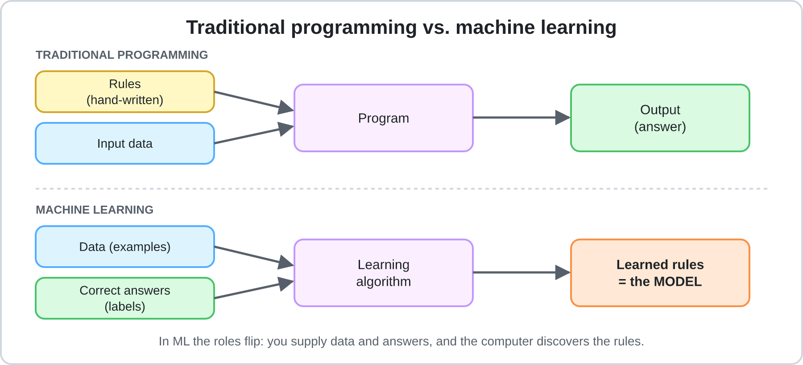

*Figure 3.1: Traditional programming uses written rules, while machine learning uses examples to learn patterns.*

| | Traditional Programming | Machine-Learning-Based AI |
|---|---|---|
| **You provide** | Rules and input | Data and, when required, desired outputs |
| **The computer produces** | An output | A trained model |
| **Example** | If an email contains a certain word, mark it as spam | Study thousands of labelled emails and learn patterns associated with spam |
| **New situations** | Depends heavily on the rules written by the programmer | Can generalise to similar situations not seen during training |
| **Common weakness** | Rules may not cover every situation | Training data may be incomplete, biased, or outdated |

Consider a spam filter. A programmer could write a rule that marks every email containing the word "lottery" as spam. However, spammers can use different words, spellings, or sentence structures. A manually written rule may not recognise these variations.

A machine-learning system can instead examine thousands of examples of spam and legitimate emails. It learns patterns that help distinguish between them, such as suspicious phrases, links, formatting, and sender behaviour.

The model does not need to memorise every possible spam message. It attempts to **generalise**: apply patterns learned from previous examples to new emails.

### The three main ingredients

A machine-learning system depends on three important ingredients:

```text
DATA + ALGORITHM + COMPUTING POWER → TRAINED MODEL
```

- **Data** provides the examples from which the system learns.
- **Algorithms** provide the mathematical procedures used to learn patterns.
- **Computing power** allows the system to process data and perform the calculations required during training.

The growth of modern AI was made possible partly because these ingredients improved together. The internet and digital devices created enormous amounts of data, research produced more effective algorithms, and GPUs and specialised AI chips made large-scale calculations practical.

**Core idea:** Machine learning does not eliminate programming. Developers still design the system, select algorithms, prepare data, and decide how the model should be evaluated. The difference is that the model learns many of its decision-making patterns from data rather than receiving every rule directly from a programmer.

---

## 3.3 Data: The Fuel of AI

### What is data?

Data is recorded information that an AI system can process. It may include text, images, audio, video, numbers, website activity, or readings from sensors.

An AI system uses data to identify relationships and patterns. For example, a system designed to predict house prices may examine:

- The size of each house.
- The number of bedrooms.
- The property's location.
- Its age and condition.
- Previous selling prices.

These pieces of information help the model estimate the price of a house it has not encountered before.

### Types of data

| Type | Description | Examples |
|---|---|---|
| **Structured** | Organised in a predefined format, often rows and columns | Sales tables, bank records, spreadsheets |
| **Unstructured** | Does not follow a fixed tabular format | Emails, photographs, videos, social media posts |
| **Labelled** | Each example has an answer attached | A photograph labelled "cat" |
| **Unlabelled** | Examples have no supplied answers | A collection of photographs without descriptions |

These categories describe different properties of data. Structured data is not automatically labelled, and unstructured data can still have labels attached to it.

Modern large language models (LLMs) are trained primarily on large collections of text. They can learn from text without requiring a human to label every individual example. This is explained in Section 3.7.

### Where does training data come from?

AI developers obtain data from several sources:

- **Organisational data:** Customer records, transactions, and sensor logs collected by a company.
- **Public datasets:** Government statistics, scientific collections, and research datasets.
- **Web-scale collections:** Large collections of text, images, and other digital content. Their use raises questions about copyright, consent, and privacy.
- **Licensed data:** Content obtained through agreements with its owners.
- **Human-labelled data:** Examples that people classify, rate, or annotate.
- **Synthetic data:** Artificial examples generated by software or another AI model.

Synthetic data is useful when real examples are limited, expensive, or difficult to obtain. However, it must be checked carefully. If generated examples repeat the errors or biases of the system that produced them, those problems may become part of the new training data.

### Features, labels, and examples

Three terms are particularly important when working with machine-learning datasets:

- **Feature:** An input variable used by the model to make a prediction.
- **Label or target:** The correct answer the model is expected to predict.
- **Example or sample:** One individual record containing its features and, in supervised learning, its label.

For example, consider a dataset used to predict house prices:

| House | Size (m²) | Bedrooms | Price |
|---|---:|---:|---:|
| A | 80 | 2 | $150,000 |
| B | 100 | 3 | $190,000 |
| C | 120 | 3 | $230,000 |

Size and number of bedrooms are features. Price is the label. Each row is one example.

### Preparing data

Preparing data is often one of the most demanding parts of an AI project. A model cannot reliably learn from information that is incorrectly recorded, inconsistent, or unsuitable for the problem.

Common preparation steps include:

| Step | Meaning | Example |
|---|---|---|
| **Cleaning** | Fix or remove errors, duplicates, and missing values | Remove duplicate customer records |
| **Labelling** | Attach the correct answers to examples | Mark emails as spam or legitimate |
| **Feature engineering** | Create useful inputs from existing information | Convert a date into its day of the week |
| **Normalising / scaling** | Put numerical features on comparable scales | Scale salary and age to suitable numerical ranges |
| **Encoding** | Convert categories into a numerical representation | Convert colour categories into numerical codes |
| **Splitting** | Divide data for training, validation, and testing | Keep some examples separate for evaluation |

Not every project needs every preparation step. The appropriate methods depend on the data and the task.

### Splitting the data

A model should not be evaluated only on the examples it used to learn. Otherwise, it may appear successful because it has memorised those examples rather than learned patterns that work on new data.

For this reason, datasets are commonly divided into three groups:

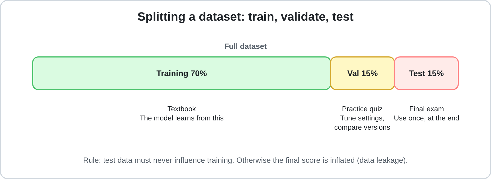

*Figure 3.2: Separating data allows developers to evaluate a model using examples that were not used to train it.*

| Split | Typical share | Purpose | Analogy |
|---|---:|---|---|
| **Training set** | 70–80% | Used to learn model parameters | Textbook |
| **Validation set** | 10–15% | Used to compare models and adjust settings during development | Practice quiz |
| **Test set** | 10–15% | Used for a final evaluation after development decisions are complete | Final exam |

These percentages are examples, not fixed rules. The correct division depends on the size and characteristics of the dataset.

The three sets have different responsibilities:

1. The **training set** teaches the model.
2. The **validation set** helps developers decide whether the model or its settings should be changed.
3. The **test set** estimates how well the final model performs on unseen data.

The test set should remain untouched during development. If developers repeatedly check its results and use them to make improvements, they gradually begin adapting the model to that particular dataset. The final score may then become overly optimistic.

If substantial changes are made after examining the test results, a new, untouched test set may be needed for another final evaluation.

### Why data quality matters

A common expression in machine learning is:

> "Garbage in, garbage out."

The quality of the training data strongly influences the quality of the model.

| Data problem | What goes wrong | Example |
|---|---|---|
| **Bias** | Certain groups are represented unfairly or inadequately | A face-recognition system performs worse on skin tones underrepresented in its training data |
| **Noise and errors** | Incorrect examples teach incorrect patterns | Images of wolves are labelled as dogs |
| **Unrepresentative data** | The model struggles with conditions it rarely encountered | A system trained only on daytime photographs performs poorly at night |
| **Data leakage** | Information that should not be available becomes part of the model's input | A prediction system accidentally receives information about the outcome it is supposed to predict |
| **Outdated data** | The data no longer represents current conditions | A pricing model relies on information from before a major market change |
| **Insufficient data** | There are too few examples to learn a reliable pattern | A model is trained using very few examples of a rare disease |

Data quality is not only about removing errors. It also involves ensuring that the examples represent the situations in which the model will eventually be used.

For example, a traffic prediction system trained using data from weekdays may perform poorly on weekends if traffic patterns differ significantly.

**Practical takeaway:** When an AI system performs poorly, consider whether the problem comes from the data before assuming that a more complicated algorithm is needed.

---

## 3.4 Algorithms and Models

The terms **algorithm** and **model** are often confused, but they describe different things.

- **Algorithm:** A step-by-step mathematical procedure used to learn from data or solve a problem.
- **Model:** The result of applying a learning algorithm to data. It contains learned parameters that allow it to make predictions or generate outputs.

A simple analogy is cooking:

- The algorithm is the recipe.
- The data is the ingredients.
- The model is the finished dish.

```text
ALGORITHM + TRAINING DATA → TRAINED MODEL
```

The algorithm determines how learning takes place, while the trained model contains the patterns learned from the examples.

### Two basic prediction tasks

Many machine-learning problems involve predicting either a category or a numerical value.

| Task | Question | Output | Example |
|---|---|---|---|
| **Classification** | Which category does this belong to? | A class or label | Spam or not spam |
| **Regression** | How much or how many? | A numerical value | House price or tomorrow's temperature |

Classification and regression are commonly used in supervised learning because the model learns from examples with known answers.

Other approaches include:

- **Unsupervised learning:** Finding patterns or groups in data without supplied labels.
- **Reinforcement learning:** Learning through actions and feedback in the form of rewards or penalties.

These learning approaches are explained further in Section 3.5.

### Common algorithm families

Different algorithms are designed for different kinds of problems.

| Family | Main idea | Typical use | Strength | Limitation |
|---|---|---|---|---|
| **Linear / Logistic Regression** | Learn relationships between input variables and an output | Price prediction, yes/no outcomes | Relatively simple and interpretable | May struggle with complex patterns |
| **Decision Trees** | Make decisions through a sequence of conditions | Loan screening, classification | Easy to understand and visualise | Can overfit |
| **Random Forests / Gradient Boosting** | Combine multiple decision trees | Fraud detection, business data | Often effective on structured data | More difficult to interpret |
| **Clustering (e.g., k-means)** | Group similar examples together | Customer segmentation | Finds patterns without labels | Groups may require human interpretation |
| **Neural Networks** | Use connected layers of mathematical units to learn complex patterns | Images, speech, and language | Can learn complicated relationships | Often requires substantial data and computing power |
| **Transformers** | Use attention and other components to process relationships between parts of an input | Language models, translation, and multimodal systems | Handles context effectively | Can be computationally expensive |

### Example: A decision tree

Imagine a bank using a decision tree to help screen loan applications.

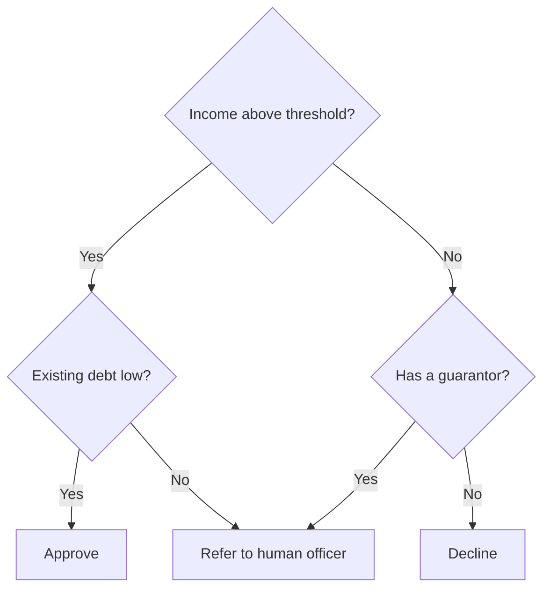

*Figure 3.3: A simplified decision tree for screening loan applications.*

The system follows a series of conditions to reach a result. In a machine-learning decision tree, the learning algorithm can determine which features and thresholds are useful by examining the training data.

This does not mean that the model should make every financial decision independently. Real loan decisions may require additional information, regulations, and human review.

### Choosing an algorithm

There is no single algorithm that is best for every situation.

| Situation | Possible starting point |
|---|---|
| Small structured dataset where explanations matter | Linear or logistic regression, decision trees |
| Larger structured dataset | Random forests or gradient boosting |
| Image, audio, or video recognition | Neural networks |
| Natural-language understanding and generation | Transformer-based models |

The choice depends on the problem, the available data, the required performance, interpretability, and computational cost.

---

## 3.5 Machine Learning: Learning from Examples

**Machine learning (ML)** is a branch of AI in which systems learn patterns from experience, usually through data, rather than relying entirely on rules written by programmers.

The goal is not simply to memorise examples. A useful model should learn relationships that allow it to make predictions about new situations.

### Three main learning approaches

#### 1. Supervised learning

Supervised learning uses labelled examples. Each training example includes an input and its correct answer.

For example, an email dataset may contain thousands of messages labelled as either "spam" or "not spam". The model learns to associate patterns in the messages with these labels.

Common applications include:

- Email spam detection.
- House-price prediction.
- Medical image classification.
- Predicting whether a customer may cancel a subscription.

Classification and regression are common supervised-learning tasks.

#### 2. Unsupervised learning

Unsupervised learning works with data that does not have supplied labels. Instead of predicting known answers, the algorithm searches for structure or similarities.

For example, a company may have customer information but no predefined customer groups. A clustering algorithm can group customers according to similarities in their purchasing behaviour.

The resulting groups do not automatically have meaningful names. People may need to examine the results and decide what the groups represent.

Common applications include customer segmentation, grouping similar documents, and discovering unusual patterns.

#### 3. Reinforcement learning

Reinforcement learning involves an agent that interacts with an environment and learns through rewards or penalties.

A simplified example is teaching an AI to play a game:

1. The agent observes the current game situation.
2. It chooses an action.
3. The environment responds.
4. The agent receives a reward or penalty.
5. It gradually learns which actions produce better long-term results.

This approach is useful when an AI system must make a sequence of decisions, such as in robotics, game-playing, and certain optimisation problems.

### A worked example: Predicting exam scores

Consider a simple machine-learning task:

**Goal:** Predict a student's exam score based on the number of hours studied.

| Hours studied (feature) | Exam score (label) |
|---:|---:|
| 1 | 55 |
| 2 | 65 |
| 3 | 75 |

We can represent the relationship using a simple linear model:

```text
score = w × hours + b
```

Here:

- `w` is the weight, which controls how strongly study hours affect the prediction.
- `b` is the bias parameter, which shifts the prediction up or down.

The model needs to learn suitable values for `w` and `b`.

1. **Start with a guess.** Suppose `w = 0` and `b = 0`. The model predicts zero for every student.
2. **Calculate the error.** Compare the predictions with the actual exam scores.
3. **Measure the loss.** A loss function converts the prediction errors into a numerical value. One common choice is mean squared error, which averages the squared differences.
4. **Adjust the parameters.** Use gradient descent to change the parameters in a direction that reduces the loss.
5. **Repeat.** Continue making updates until the model learns a suitable relationship.

For this simple dataset, the relationship is:

```text
score = 10 × hours + 45
```

A student who studies for four hours would receive a predicted score of:

```text
score = 10 × 4 + 45
score = 85
```

The model has learned a pattern from three examples and applied it to a new input.

This example is deliberately simple. Real student performance depends on many factors, and a real prediction system would require more representative data and careful evaluation.

### Gradient descent: How the model improves

Gradient descent is an optimisation method used to reduce a model's loss by adjusting its parameters.

Imagine standing on a hillside covered in fog. You cannot see the bottom, but you can feel which direction slopes downward. You take a step in that direction, check the slope again, and repeat until you approach the lowest point.

Training a model follows a similar idea:

1. The model makes predictions.
2. The loss function measures how wrong they are.
3. The gradient indicates how the loss changes when parameters change.
4. The algorithm updates the parameters.
5. The process repeats.

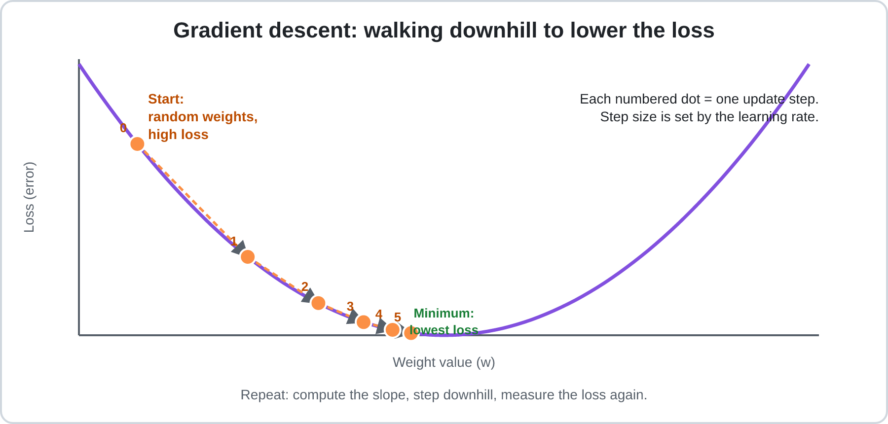

*Figure 3.4: Gradient descent gradually moves toward a parameter value that reduces the loss.*

Consider a simplified loss function:

```text
Loss = (w − 5)²
```

The best value is `w = 5`, where the loss is zero.

| Step | Weight (w) | Loss |
|---:|---:|---:|
| 0 | 0.80 | 17.64 |
| 1 | 2.31 | 7.23 |
| 2 | 3.28 | 2.96 |
| 3 | 3.90 | 1.21 |
| 4 | 4.30 | 0.50 |
| 5 | 4.55 | 0.20 |

The weight gradually approaches 5, and the loss becomes smaller.

The size of each update depends partly on the **learning rate**:

- If it is too large, updates may overshoot the minimum and become unstable.
- If it is too small, training may take much longer than necessary.

### Parameters and hyperparameters

| | Parameters | Hyperparameters |
|---|---|---|
| **Meaning** | Values learned by the model | Settings that control the learning process or model design |
| **Set by** | Training | Developers or automated search methods |
| **Examples** | Weights and bias values | Learning rate, number of layers, batch size |
| **Analogy** | What a student learns | How the student is taught |

A complete pass through the training dataset is called an **epoch**. Training usually takes multiple epochs. Instead of processing the entire dataset at once, models commonly process smaller groups of examples called **batches**.

### Overfitting and underfitting

A model must learn enough to recognise useful patterns, but it should not simply memorise the training examples.

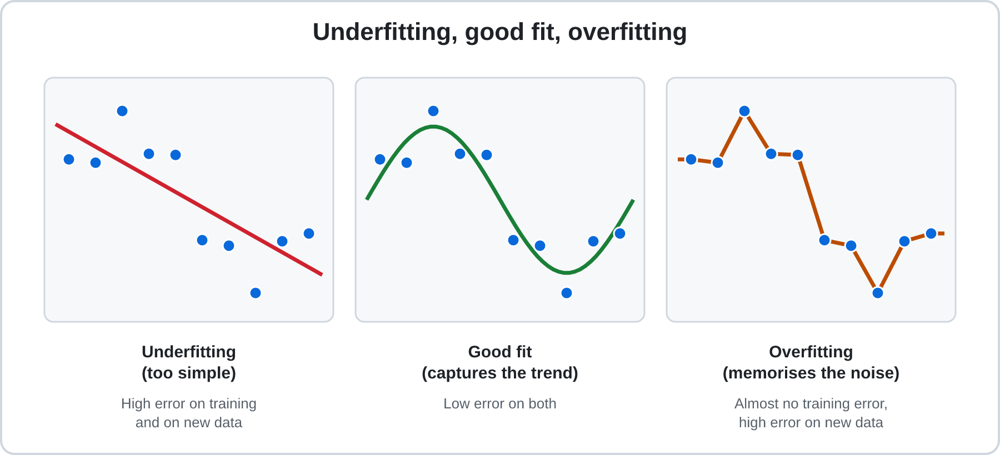

*Figure 3.5: A good model captures the general pattern without memorising random noise.*

| Problem | Meaning | Analogy | Possible solutions |
|---|---|---|---|
| **Underfitting** | The model is too simple to capture the pattern | A student who has barely studied | Use a more suitable model or improve the features |
| **Overfitting** | The model memorises training examples and performs poorly on new data | A student who memorises old exam answers but cannot solve new problems | Use more diverse data, simplify the model, apply regularisation, or stop training earlier |

The validation set helps identify overfitting. For example, if a model performs extremely well on training data but poorly on validation data, it may have memorised the training examples.

A model should be judged by how well it performs on data it has not encountered during training.

---

## 3.6 Neural Networks and Deep Learning

A **neural network** is a machine-learning model made of connected layers of mathematical units called neurons.

Neural networks are loosely inspired by the structure of biological brains. However, artificial neurons are mathematical operations, not actual brain cells.

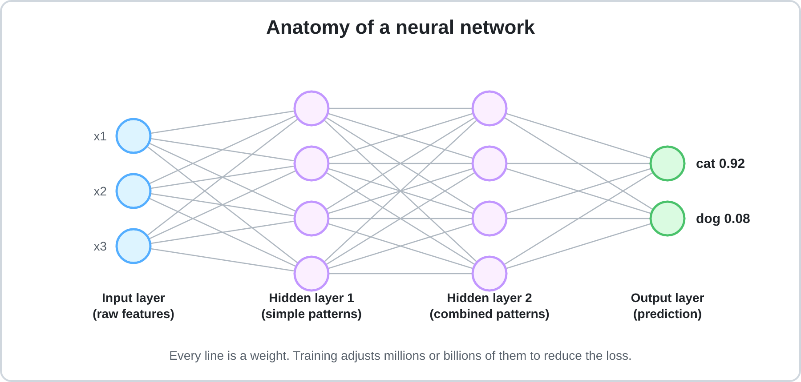

*Figure 3.6: Information moves through connected layers. Training adjusts the weights between neurons.*

### What does one artificial neuron do?

A basic artificial neuron performs three operations:

1. Receives numerical inputs.
2. Multiplies each input by a weight, adds the results, and includes a bias.
3. Passes the result through an activation function.

Consider a neuron with:

- Inputs: `x₁ = 2`, `x₂ = 1`
- Weights: `0.5` and `−1`
- Bias: `0.5`

The weighted sum is:

```text
sum = (2 × 0.5) + (1 × −1) + 0.5
sum = 1 − 1 + 0.5
sum = 0.5
```

The neuron then applies an activation function.

One common function is **ReLU (Rectified Linear Unit)**:

```text
ReLU(x) = max(0, x)
```

It keeps positive values and converts negative values to zero. Therefore, the neuron outputs `0.5`.

Activation functions are important because they allow neural networks to learn complex, non-linear relationships. Without non-linear activation functions, stacking multiple ordinary linear layers would still produce an overall linear transformation.

### How do layers work together?

Neural networks contain different types of layers:

- **Input layer:** Receives the original data.
- **Hidden layers:** Process information and learn intermediate patterns.
- **Output layer:** Produces the final prediction or result.

In an image-recognition network, different layers may learn different visual features:

| Layer depth | Possible features |
|---|---|
| Early layers | Edges, colours, and simple textures |
| Middle layers | Shapes and object parts, such as eyes or wheels |
| Later layers | More complex combinations associated with objects |

These are simplified descriptions. Real networks do not necessarily learn features in such clearly separated stages.

### How does a neural network learn?

Training a neural network involves four connected steps:

1. **Forward pass:** Input data travels through the network to produce a prediction.
2. **Loss calculation:** The prediction is compared with the correct answer.
3. **Backpropagation:** The network calculates how changes to its parameters would affect the loss.
4. **Parameter update:** An optimisation method, commonly gradient descent, adjusts the weights and biases.

This process repeats across many batches of training examples.

Backpropagation became an important method for training multi-layer neural networks through the work of Rumelhart, Hinton, and Williams in 1986. [[3]](#ref-3)

For a visual explanation, see the 3Blue1Brown neural-network series. [[4]](#ref-4)

### Common neural network designs

Different network architectures are suited to different kinds of data.

| Design | Main purpose | Common applications |
|---|---|---|
| **Convolutional Neural Networks (CNNs)** | Learn spatial patterns in data | Image recognition and medical imaging |
| **Recurrent Neural Networks (RNNs / LSTMs)** | Process sequential information | Earlier speech and language systems |
| **Transformers** | Process relationships between parts of an input using attention and other components | Language models, translation, and multimodal AI |
| **Diffusion models** | Learn to generate data by gradually removing noise from a noisy representation | Image and video generation |

**Deep learning** refers to machine learning that uses neural networks with multiple layers. The term became especially important as computing power and available datasets grew large enough to train increasingly complex networks.

---

## 3.7 How Modern Language AI Works

Many modern AI assistants are built using **large language models (LLMs)**. These models process language mathematically and generate responses by predicting sequences of tokens.

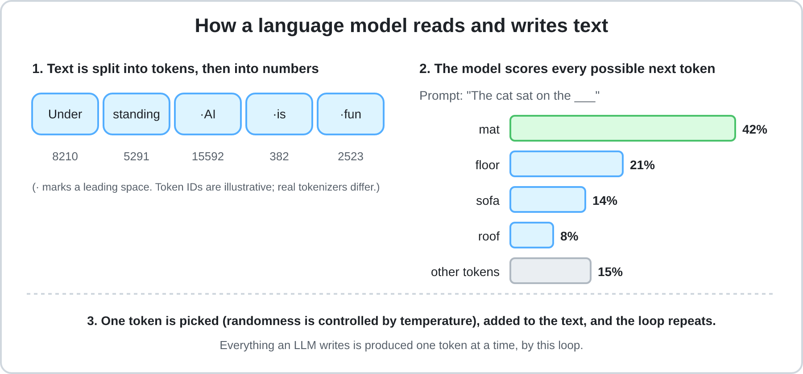

*Figure 3.7: An LLM processes text as tokens and repeatedly predicts what should come next.*

### Step 1: Tokens and embeddings

Before an LLM processes text, the text is divided into smaller units called **tokens**.

A token may represent:

- A complete word.
- Part of a word.
- Punctuation.
- A number or other text symbol.

A token is not necessarily equal to one word. The number of tokens in a sentence depends on the language and the tokenizer used by the model.

After tokenisation, each token is converted into a numerical representation called an **embedding**, which is a vector (a list of numbers).

These vectors allow the model to perform mathematical operations on language. During training, the model learns representations that help it recognise relationships between tokens.

An embedding is not a dictionary definition. Its individual numbers usually cannot be interpreted directly by a human.

The initial representation of a token is also not the complete representation used throughout the model. Transformer layers process it in context, allowing the model to represent the same word differently depending on the surrounding sentence.

For example, the word "bank" has different meanings in:

- "I deposited money at the bank."
- "We sat beside the river bank."

Context helps the model distinguish these uses.

### Step 2: Next-token prediction

During pre-training, an LLM learns to predict the next token in a sequence.

For example:

```text
Input: The sun rises in the ...

Possible next token: east
```

The model compares its prediction with the actual next token in the training text. The difference contributes to the loss, which is used to update the model's parameters.

This is called **self-supervised learning** because the training text provides the target answers automatically. Developers do not need a person to label every sentence with its next token.

By repeatedly learning to predict tokens, the model develops patterns related to grammar, writing styles, facts, and relationships between concepts.

However, predicting text successfully does not guarantee that every generated statement is true.

### Step 3: Transformers and attention

A major part of modern LLMs is the **transformer architecture**.

Its attention mechanism helps the model determine how strongly different parts of the input relate to one another.

Consider this sentence:

> "The animal did not cross the street because it was tired."

To understand the sentence, the model needs to connect "it" with the animal rather than the street.

Attention helps the model weigh relationships between tokens and use surrounding context when processing them.

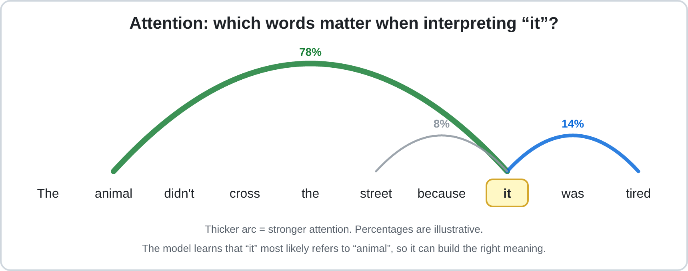

*Figure 3.8: Attention helps a transformer relate different parts of an input.*

Transformers also use feed-forward layers and other components to process information. Their architecture allows efficient parallel processing during training, which helped make large-scale language-model training practical.

The transformer architecture was introduced by Vaswani and colleagues in 2017. [[5]](#ref-5)

### Step 4: Generating a response

When an LLM receives a prompt, it generates a response through repeated prediction:

1. The prompt is converted into tokens.
2. The model processes the tokens through its transformer layers.
3. It produces scores or probabilities for possible next tokens.
4. A token is selected according to the model's output and generation settings.
5. The selected token is added to the sequence.
6. The model repeats the process until the response is complete or a stopping condition is reached.

This means that an LLM does not normally write an entire response in one operation. It generates a sequence token by token.

### Temperature and generation

One setting that can affect token selection is **temperature**.

| Setting | Typical effect |
|---|---|
| **Low temperature** | Makes output more predictable and favours higher-probability choices |
| **High temperature** | Allows more variation by making less likely choices more possible |

Temperature does not give the model additional knowledge or guarantee greater accuracy. It changes the behaviour of token selection.

### How an LLM becomes an assistant

A language model is not necessarily ready to function as a helpful assistant immediately after pre-training.

A simplified development pipeline is:

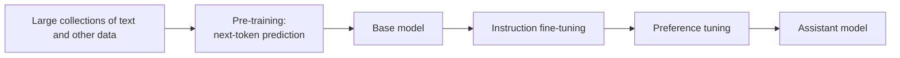

*Figure 3.9: A simplified pipeline for developing an instruction-following language model.*

| Stage | What happens | Result |
|---|---|---|
| **Pre-training** | The model learns from large collections of data, often through next-token prediction | A base model with broad language patterns |
| **Fine-tuning** | The model receives additional training on curated examples, such as instructions and appropriate responses | Better instruction-following behaviour |
| **Preference tuning** | Feedback is used to encourage responses that people or evaluators prefer | Behaviour more closely aligned with the intended assistant role |

One approach is **Reinforcement Learning from Human Feedback (RLHF)**, in which human preferences help guide model behaviour. [[6]](#ref-6)

Not every AI assistant uses exactly the same training pipeline. These stages are a simplified example of common techniques.

### Important properties of modern LLMs

- **Context window:** The amount of information a model can consider during a particular interaction. It is limited, even when the limit is very large.
- **Knowledge cutoff:** The end point of the training information available to a model. Information after that point may require external tools or updated training.
- **Multimodal models:** Models that can process or generate more than one type of information, such as text, images, and audio.
- **Reasoning models:** Models designed or trained to spend additional computation on complex problems. This may improve performance on some tasks but can increase time and cost.
- **AI agents:** Systems that connect models to tools and allow them to perform multiple steps, such as searching, calculating, or interacting with software.

**Important insight:** An LLM produces responses based on learned patterns and the information available in its context. A fluent answer is not necessarily a verified answer. This is one reason AI systems can produce incorrect or unsupported information, sometimes called hallucinations.

---

## 3.8 Training vs. Inference

Training and inference are two different phases in the life of an AI model.

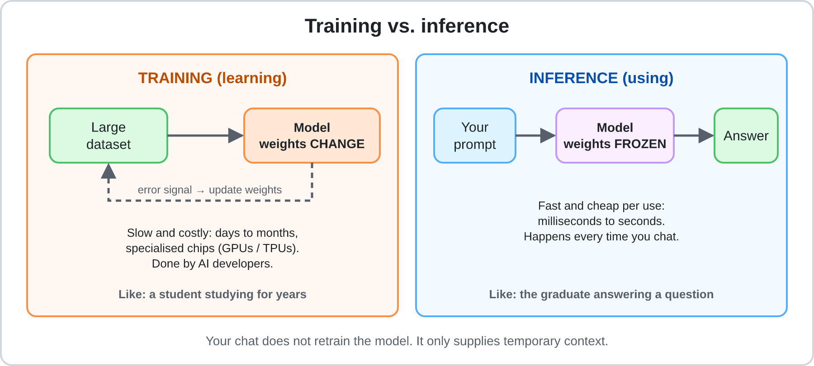

*Figure 3.10: Training changes the model's parameters, while inference uses the trained model.*

| | **Training** | **Inference** |
|---|---|---|
| **Purpose** | Teach the model patterns from data | Use the model to produce outputs |
| **Parameters** | Adjusted during training | Normally fixed during inference |
| **Input** | Training examples | New inputs, such as prompts or images |
| **Computing requirements** | Often very high | Usually lower per request, but may be substantial at large scale |
| **Typical users** | Developers and researchers | People and applications using the model |
| **Analogy** | A student studying for an examination | The student answering questions |

### What happens when you chat with an AI?

When you send a message to an AI assistant, the model normally performs inference. Its core parameters are not being retrained by every message.

The conversation is provided as context, allowing the model to consider earlier messages when generating its response. This does not mean that its underlying weights are being updated.

Whether a company later uses conversations to improve future models is a separate policy and data-handling question. Users should check the privacy settings and policies of the services they use.

### Improving results without retraining

There are different ways to improve an AI system's output. The important distinction is whether the model's parameters change.

#### A. Inference-time improvements

These methods use an existing model without updating its core weights.

| Technique | What it does | Useful for |
|---|---|---|
| **Prompting** | Provides clearer instructions, context, examples, and output requirements | Improving the relevance and structure of answers |
| **Retrieval-Augmented Generation (RAG)** | Retrieves relevant documents and supplies them to the model as context | Questions involving current or private information |
| **Tools** | Connects the model to software such as calculators, search engines, or code execution | Calculations, research, and data processing |
| **Agents** | Allows a model to coordinate multiple tool-use steps | Tasks that require a sequence of actions |


*Figure 3.11: RAG retrieves relevant information and provides it to the model before the response is generated.*

RAG can make answers more closely grounded in available documents, but it does not guarantee correctness. The retrieved information may be incomplete, outdated, or misunderstood by the model.

#### B. Training-based improvements

These methods change existing model parameters or create a new model.

| Technique | What it does | Useful for |
|---|---|---|
| **Fine-tuning** | Continues training an existing model using specialised examples | Consistent behaviour or specialised tasks |
| **Training from scratch** | Trains a new model using an initial set of parameters and a training process | Projects requiring a model built for a particular purpose |

Fine-tuning changes the model's weights, while RAG supplies information during inference without requiring the model to learn that information through weight updates.

**Rule of thumb:** Start by improving the prompt, context, or tools available to an existing model. Fine-tuning and training from scratch usually require more data, expertise, time, and computing resources.

---

## 3.9 Evaluating a Model

How can developers determine whether an AI model is reliable enough to use?

They evaluate its performance using examples that were not used to train it. Evaluation is important because a model can perform well during training but fail when it encounters new situations.

### Training, validation, and test data

| Dataset | Purpose | When it is used |
|---|---|---|
| **Training set** | Learns the model's parameters | During training |
| **Validation set** | Compares models and adjusts settings | Repeatedly during development |
| **Test set** | Estimates the final model's performance on unseen data | After development decisions are complete |

The test set should not guide repeated improvements. If developers use its results to decide what to change, it is no longer an independent final evaluation.

The validation set is designed for repeated use. The test set is kept separate to provide a more honest estimate of performance.

### The confusion matrix

A confusion matrix is a table used to evaluate classification models. It compares the model's predictions with the actual answers.

Consider a spam filter tested on 1,000 emails:

- 100 emails are actually spam.
- 900 emails are legitimate.
- The model correctly identifies 80 spam emails.
- It incorrectly marks 10 legitimate emails as spam.

| | **Predicted: Spam** | **Predicted: Not Spam** |
|---|---:|---:|
| **Actually spam** | 80 (True Positive) | 20 (False Negative) |
| **Actually not spam** | 10 (False Positive) | 890 (True Negative) |

The four outcomes are:

- **True Positive (TP):** Correctly identifies a positive case.
- **False Positive (FP):** Incorrectly identifies a negative case as positive.
- **True Negative (TN):** Correctly identifies a negative case.
- **False Negative (FN):** Fails to identify a positive case.

In this example, a true positive is a spam email correctly identified as spam. A false positive is a legitimate email incorrectly placed in the spam folder.

### Common evaluation metrics

Four important metrics can be calculated from the confusion matrix.

| Metric | What it measures | Calculation | Result |
|---|---|---|---:|
| **Accuracy** | Share of all predictions that are correct | (TP + TN) / Total | 97.0% |
| **Precision** | Share of predicted positive cases that are actually positive | TP / (TP + FP) | 88.9% |
| **Recall** | Share of actual positive cases that the model identifies | TP / (TP + FN) | 80.0% |
| **F1 score** | Balance between precision and recall | 2 × (Precision × Recall) / (Precision + Recall) | 0.84 |

For the spam filter:

```text
Accuracy  = (80 + 890) / 1000 = 97.0%

Precision = 80 / (80 + 10) = 88.9%

Recall    = 80 / (80 + 20) = 80.0%

F1        ≈ 0.84
```

F1 is the harmonic mean of precision and recall. It gives a single score that is high only when both metrics are reasonably high.

### Why accuracy alone can be misleading

Imagine that only 10% of emails are spam. A model that labels every email as "not spam" would still achieve 90% accuracy.

However, its recall for spam would be zero because it fails to identify every spam email.

This demonstrates why the choice of metric matters.

| Situation | More costly mistake | Metric that may be prioritised |
|---|---|---|
| Cancer screening | Missing a real case | Recall |
| Spam filtering | Blocking an important legitimate email | Precision |
| Fraud detection | Depends on the cost of missed fraud and false alarms | A balance of relevant metrics |

A model with high accuracy is not necessarily suitable for every application.

### The classification threshold

Many classification systems produce a score between 0 and 1. A **classification threshold** determines when that score becomes a positive prediction.

For example, a spam filter may classify an email as spam when its score is greater than or equal to 0.5.

Changing the threshold affects precision and recall:

| Threshold | Typical effect |
|---|---|
| **Higher threshold**, such as 0.9 | Fewer emails are flagged. Precision may increase, while recall may decrease. |
| **Lower threshold**, such as 0.3 | More emails are flagged. Recall may increase, while precision may decrease. |

A higher threshold may be useful when blocking a legitimate email is particularly costly. A lower threshold may be preferred when missing a positive case is more dangerous.

The threshold should be selected during development using validation data, not repeatedly adjusted based on the final test results.

### Deciding whether a model is good enough

Metrics provide evidence, but they do not automatically decide whether a model should be deployed.

A development team should consider:

1. **The cost of errors:** What happens if the model makes a false positive or false negative?
2. **Application requirements:** What level of performance is necessary?
3. **Alternative solutions:** Does the model perform better than the existing system or a simpler baseline?
4. **Safety measures:** Can a human review uncertain or high-risk decisions?
5. **Real-world conditions:** Will the model face situations that differ from its evaluation data?

For example, a medical screening model may need very high recall because missing a real case can be dangerous. Human professionals may then review additional positive results.

### Evaluating language models

Language models are more difficult to evaluate with one numerical metric because their outputs can vary in accuracy, usefulness, reasoning, safety, and clarity.

Common evaluation methods include:

- **Benchmark tests:** Standardised sets of questions or tasks used to compare models.
- **Human evaluation:** People assess the quality, accuracy, or usefulness of responses.
- **Task-specific tests:** Developers create their own examples based on the actual purpose of the system.

Benchmark scores should not be treated as complete proof of real-world performance. For important applications, developers should test models using relevant examples from their own intended environment.

---

## 3.10 The AI Workflow

Developing an AI system involves more than choosing an algorithm and training a model. It requires a complete process, from defining the problem to monitoring the system after deployment.

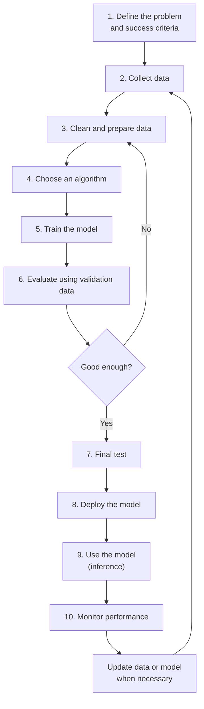

*Figure 3.12: A simplified AI development workflow. Evaluation may send a project back to earlier stages when improvements are needed.*

### Understanding each stage

1. **Define the problem:** Identify what the AI system should do and decide how success will be measured.
2. **Collect data:** Obtain examples that represent the problem.
3. **Prepare data:** Clean, label, organise, and split the data.
4. **Choose an algorithm:** Select an appropriate method based on the task and available resources.
5. **Train the model:** Allow the algorithm to learn patterns from the training data.
6. **Evaluate:** Use validation data to compare performance and decide whether changes are needed.
7. **Final test:** Evaluate the selected model using the untouched test set.
8. **Deploy:** Make the model available to users or connect it to an application.
9. **Inference:** The deployed model receives new inputs and produces outputs.
10. **Monitor:** Track performance, errors, and changes in real-world conditions.

The workflow is not always a straight line. If evaluation reveals a problem, developers may return to data preparation, algorithm selection, or training.

### Case study: Building a spam filter

Imagine an email provider wants to develop an AI system that detects spam.

| Stage | What the team does |
|---|---|
| **1. Define the problem** | Decide that the system should identify spam while avoiding the blocking of legitimate emails. |
| **2. Collect data** | Gather examples of spam and legitimate emails. |
| **3. Prepare data** | Remove duplicates, check labels, and divide the dataset into training, validation, and test sets. |
| **4. Choose an algorithm** | Select a suitable classification algorithm. |
| **5. Train the model** | Allow the model to learn patterns associated with spam. |
| **6. Evaluate** | Check precision and recall using validation data and adjust the model or threshold if needed. |
| **7. Final test** | Measure performance on the untouched test set. |
| **8. Deploy** | Integrate the model into the email service. |
| **9. Inference** | Evaluate new incoming emails. |
| **10. Monitor** | Track incorrect predictions and changes in spam patterns. |

### Why monitoring matters

An AI model does not remain reliable automatically after deployment.

The world can change, and the data received by a model may become different from the data used during training.

Two important problems are:

- **Data drift:** The distribution of incoming data changes. For example, customers begin using a different purchasing pattern.
- **Concept drift:** The relationship between the input and the correct answer changes. For example, spammers develop new techniques that make old spam patterns less useful.

Monitoring helps developers detect these changes. They may need to collect new data, update the model, adjust the system, or temporarily introduce human review.

**Important:** Deployment is not the end of AI development. A reliable AI system requires ongoing evaluation and maintenance.

---

## 3.11 From Beginner to Expert

Understanding how AI works is only one part of using it effectively. Users must also learn how to communicate with AI systems, check their outputs, and recognise their limitations.

### A reliable prompt structure

A good prompt provides information that the model cannot safely assume. A useful structure contains five elements:

| Element | Purpose | Example |
|---|---|---|
| **Role** | Defines the perspective or role | "Act as an experienced statistics tutor." |
| **Context** | Explains the situation | "I am a first-year student who knows basic algebra." |
| **Task** | States what the model should do | "Explain gradient descent." |
| **Format** | Specifies the desired output | "Use an analogy followed by a five-step summary." |
| **Constraints** | Sets limits or requirements | "Keep it under 200 words and avoid unnecessary jargon." |

**Weak prompt:**

"Explain gradient descent."

**Stronger prompt:**

"Act as a patient statistics tutor. I am a first-year student who knows basic algebra. Explain gradient descent using an everyday analogy, followed by a five-step summary. Keep it under 200 words and avoid unnecessary jargon."

The stronger prompt gives the model more information about the reader, the task, and the expected answer.

Other useful prompting techniques include providing examples, asking the model to state its assumptions, and requesting a revision when the first answer is unclear.

### Verifying AI output

AI-generated information should not automatically be accepted as correct.

Use this checklist when evaluating an answer:

1. **Facts and figures:** Can the information be confirmed using reliable sources?
2. **Citations:** Do the cited sources actually exist and support the claims?
3. **Recency:** Could the information have changed?
4. **Reasoning:** Do the steps make sense, and do calculations check out?
5. **Bias and missing perspectives:** Could important information or viewpoints be missing?
6. **Stakes:** What would happen if the answer were wrong?
7. **Privacy:** Have you shared confidential information unnecessarily?

Medical, legal, and financial decisions require particular care and appropriate professional review.

### Skill ladder

| Level | Characteristics |
|---|---|
| **Beginner** | Asks basic questions and learns to recognise that AI outputs can contain mistakes |
| **Intermediate** | Writes structured prompts, provides context, checks results, and refines outputs |
| **Advanced** | Selects suitable models and tools, uses documents and search to provide context, and creates repeatable workflows |
| **Expert** | Evaluates systems systematically, understands trade-offs, and can explain why a model may behave in a particular way |

Becoming an effective AI user does not mean trusting AI more. It means knowing when to use it, how to guide it, and when to question its output.

---

## 3.12 Common Misconceptions

| Misconception | Reality |
|---|---|
| "AI thinks exactly like a human." | AI systems process information through mathematical models. This is not the same as human thought or consciousness. |
| "AI always looks up answers in a database." | An LLM generally generates responses using learned patterns unless connected to retrieval or search tools. |
| "AI learns from every conversation in real time." | During ordinary inference, the model's core parameters remain fixed. |
| "More data always produces a better model." | Data quality, relevance, and diversity matter as well as quantity. |
| "If an AI sounds confident, it must be correct." | Fluent language does not guarantee accuracy. |
| "A larger model is always better." | Smaller specialised models may perform better on particular tasks and cost less to operate. |
| "AI is objective because it uses mathematics." | Models can inherit biases from data and decisions made during development. |
| "Accuracy is the only metric that matters." | Precision, recall, and the consequences of errors can be more important. |
| "Once a model is deployed, it no longer needs attention." | Models must be monitored because real-world conditions and data can change. |

---

## 3.13 Key Takeaways

1. **Data** provides the examples that allow a model to learn. Poor or unrepresentative data can produce unreliable results.
2. An **algorithm** is the learning procedure, while a **model** is the result of applying that procedure to data.
3. **Machine learning** improves predictions by measuring errors and adjusting parameters.
4. **Neural networks** use connected layers of mathematical units to learn complex patterns.
5. **LLMs** process text as tokens and generate responses through repeated next-token prediction.
6. **Training** changes a model's parameters, while **inference** uses the trained model to produce outputs.
7. **Prompting, RAG, and tools** can improve inference without retraining the model. Fine-tuning and training from scratch are training-based approaches.
8. **Evaluation** requires suitable metrics and data that was not used during training.
9. A complete AI system follows a workflow of problem definition, data preparation, training, evaluation, deployment, and monitoring.
10. Effective AI use requires both understanding its capabilities and checking its limitations.

### One-page cheat sheet

| Concept | Memory aid |
|---|---|
| Data | Examples used for learning |
| Feature / Label | Input / Correct answer |
| Algorithm | Learning procedure |
| Model | Learned result |
| Loss | Measurement of prediction error |
| Gradient descent | Adjusting parameters to reduce loss |
| Overfitting | Memorising training examples |
| Validation set | Used during development |
| Test set | Used for final evaluation |
| Training | Learning and changing parameters |
| Inference | Using a trained model |
| Token | A unit of text processed by an LLM |
| Embedding | Numerical representation |
| Attention | Relating different parts of an input |
| Temperature | Controls variation in generated output |
| RAG | Supplying retrieved information as context |
| Fine-tuning | Further training that changes model parameters |
| Precision | How many positive predictions are correct |
| Recall | How many actual positive cases are found |
| Hallucination | Fluent but false or unsupported output |
| Data drift | Changes in incoming data |
| Concept drift | Changes in the relationship between inputs and answers |

---

## 3.14 Glossary

| Term | Definition |
|---|---|
| **Accuracy** | The proportion of all predictions that are correct |
| **Activation function** | A function that transforms a neuron's output and allows a network to learn non-linear relationships |
| **Agent** | A system that uses a model and tools to complete tasks through multiple steps |
| **Algorithm** | A procedure used to learn from data or solve a problem |
| **Attention** | A mechanism that helps a model determine relationships between different parts of an input |
| **Backpropagation** | A method for calculating how model parameters contribute to prediction error |
| **Batch** | A group of training examples processed together |
| **Bias (in data)** | A systematic skew or gap in data that may cause unfair or unreliable results |
| **Classification** | Predicting a category or label |
| **Classification threshold** | A score cut-off used to determine a positive or negative prediction |
| **CNN** | Convolutional neural network; a network architecture commonly used for image-related tasks |
| **Concept drift** | A change over time in the relationship between input data and the correct output |
| **Confusion matrix** | A table comparing predicted and actual classification results |
| **Context window** | The amount of information a model can consider during an interaction |
| **Data drift** | A change in the distribution of incoming data over time |
| **Deep learning** | Machine learning that uses neural networks with multiple layers |
| **Diffusion model** | A generative model that learns to create data by gradually removing noise |
| **Embedding** | A numerical vector representing a token or other item |
| **Epoch** | One complete pass through the training dataset |
| **F1 score** | The harmonic mean of precision and recall |
| **Feature** | An input variable used by a model |
| **Fine-tuning** | Further training an existing model using specialised data |
| **Gradient descent** | An optimisation method that adjusts parameters to reduce loss |
| **Hallucination** | An AI output that sounds plausible but is false or unsupported |
| **Hyperparameter** | A setting chosen to control training or model design |
| **Inference** | Using a trained model to generate an output |
| **Label** | The correct answer associated with a training example |
| **Learning rate** | A setting controlling the size of parameter updates during training |
| **LLM** | Large language model; a model trained to process and generate language |
| **Loss** | A numerical measure of how incorrect a model's predictions are |
| **Model** | A trained system containing learned parameters used to produce predictions or outputs |
| **Multimodal model** | A model that can process or generate multiple data types |
| **Neural network** | A model made of connected layers of mathematical units |
| **Overfitting** | When a model memorises training data and performs poorly on new examples |
| **Parameter / Weight** | A numerical value learned during training |
| **Pre-training** | Large-scale initial training of a model, often through next-token prediction for LLMs |
| **Precision** | The proportion of positive predictions that are actually positive |
| **Preference tuning** | Training that uses preferences or evaluations to guide model behaviour |
| **RAG** | Retrieval-Augmented Generation; providing retrieved information to a model during inference |
| **Reasoning model** | A model designed or trained to spend additional computation on complex problems |
| **Recall** | The proportion of actual positive cases correctly identified |
| **Regression** | Predicting a numerical value |
| **Regularisation** | Techniques that discourage excessive model complexity and help reduce overfitting |
| **Reinforcement learning** | Learning through actions and feedback from rewards or penalties |
| **RLHF** | Reinforcement Learning from Human Feedback; using human preferences to guide model training |
| **Self-supervised learning** | Learning from targets generated automatically from the data itself |
| **Supervised learning** | Learning from examples that include correct answers |
| **Temperature** | A generation setting that affects the variation of selected tokens |
| **Test set** | Data held back for final model evaluation |
| **Token** | A unit of text processed by a language model |
| **Training** | The process of learning from data and adjusting model parameters |
| **Training set** | The data used to train a model |
| **Transformer** | A neural-network architecture using attention, feed-forward layers, and other components |
| **Underfitting** | When a model is too simple to capture useful patterns |
| **Unsupervised learning** | Learning patterns from data without supplied labels |
| **Validation set** | Data used during development to compare models and adjust settings |

---

## 3.15 Self-Check Reflection

Before moving on, answer these questions in your own words:

1. Why can an AI chatbot sound confident even when its answer is incorrect?
2. Give an example of a situation where improving the training data could be more useful than choosing a different algorithm.
3. What is the difference between training and inference?
4. Which habit from Section 3.11 would help you use AI more responsibly?

---

## 3.16 Practice Questions

Try answering each question before checking the answer.

### Q1. Which statement best describes the difference between an algorithm and a model?

- A) They mean the same thing.
- B) An algorithm is the learning procedure, while a model is the result of applying it to data.
- C) A model is the procedure, while an algorithm is the data.
- D) Algorithms only exist in traditional programming.

<details>
<summary>Answer</summary>

**B.** The algorithm is the procedure used to learn. Applying it to training data produces a model containing learned parameters.

</details>

### Q2. A model scores 99% on training data but only 60% on new, unseen data. What is the most likely problem? Name two possible solutions.

<details>
<summary>Answer</summary>

**Overfitting.** The model has learned the training examples too closely and does not generalise well.

Possible solutions include using more diverse data, simplifying the model, applying regularisation, or stopping training earlier.

</details>

### Q3. True or False: When you chat with an AI assistant, its core model is automatically retrained by every message.

<details>
<summary>Answer</summary>

**False.** Ordinary inference does not update the model's core parameters. The conversation is used as context. Any later training is a separate process.

</details>

### Q4. Why should the test set remain separate from the training and validation sets?

<details>
<summary>Answer</summary>

The test set provides a final estimate of how the model performs on unseen data.

If developers repeatedly use its results to make decisions, they may gradually adapt the model to that test set, making the final score overly optimistic.

</details>

### Q5. Explain how an LLM generates a sentence.

<details>
<summary>Answer</summary>

An LLM converts the prompt into tokens, represents them numerically, and processes them through transformer layers. It predicts possible next tokens, selects one, and repeats the process until the response is complete.

</details>

### Q6. Only 10% of emails are spam. A model labels every email as "not spam." What is its accuracy, and why is it ineffective?

<details>
<summary>Answer</summary>

Its accuracy is **90%**, because 90% of the emails are legitimate.

However, its recall for spam is **0%** because it fails to identify every spam email. This demonstrates why accuracy alone can be misleading.

</details>

### Q7. Name three ways to improve an AI answer without retraining the model.

<details>
<summary>Answer</summary>

Any three of the following:

- Write a clearer and more specific prompt.
- Provide relevant context or examples.
- Use RAG or search to supply additional information.
- Adjust generation settings such as temperature.
- Connect the model to tools such as calculators or code execution.
- Verify the generated answer using reliable sources.

Fine-tuning does not count because it changes the model's parameters.

</details>

### Q8. A cancer-screening model has 95% accuracy but low recall. Why is this potentially dangerous, and which metric should be prioritised?

<details>
<summary>Answer</summary>

Low recall means that many real cases are missed.

Because missing a cancer case can have serious consequences, the team may prioritise **recall**, while using medical professionals to review additional positive results.

</details>

### Q9. A neuron has inputs 3 and −2, weights 1 and 0.5, and a bias of 1. What is its output using ReLU?

<details>
<summary>Answer</summary>

First calculate the weighted sum:

```text
(3 × 1) + (−2 × 0.5) + 1
= 3 − 1 + 1
= 3
```

ReLU keeps positive values, so the output is **3**.

</details>

### Q10. A company chatbot must answer questions using internal policy documents that change every month. Would fine-tuning or RAG be a more suitable starting point? Explain.

<details>
<summary>Answer</summary>

**RAG** is generally more suitable because it can retrieve the latest documents during inference. Fine-tuning would require additional training when the information changes.

RAG also allows the system to provide references to the documents it retrieved, although the generated answer still needs checking.

</details>

### Q11. During gradient descent, the loss jumps up and down and does not settle. Which hyperparameter may be responsible, and how could it be adjusted?

<details>
<summary>Answer</summary>

The learning rate may be too large. Reducing it can make the parameter updates smaller and more stable.

</details>

### Q12 (Challenge). Trace the workflow of developing an AI system that detects defective products on a factory production line. List the main stages and identify one risk during monitoring.

<details>
<summary>Answer</summary>

| Stage | Example |
|---|---|
| Define the problem | Identify defective and normal products |
| Collect data | Gather images of both types |
| Prepare data | Check labels, remove errors, and split the dataset |
| Choose an algorithm | Select a suitable image-classification model |
| Train | Learn patterns from the training images |
| Evaluate | Check validation performance, including recall for defects |
| Final test | Evaluate on untouched test images |
| Deploy | Install the model on the production line |
| Inference | Classify new product images |
| Monitor | Track errors and changes in production conditions |

One risk is **data drift**. For example, a new camera or lighting arrangement may produce images that differ from the training data.

</details>

### Q13. A development team checks the test-set score after every model adjustment and stops when the score becomes high. Why is the final score no longer trustworthy?

<details>
<summary>Answer</summary>

The test set is influencing development decisions. The team gradually adapts the model to the specific test examples, so the final score may no longer represent performance on genuinely unseen data.

The team should use validation data for repeated development decisions and reserve the test set for the final evaluation.

</details>

### Q14. A spam filter raises its classification threshold from 0.5 to 0.9. What usually happens to precision and recall, and why might the team make this change?

<details>
<summary>Answer</summary>

Fewer emails are labelled as spam. Precision usually increases because fewer legitimate emails are incorrectly blocked, while recall usually decreases because more spam emails are missed.

The team may choose this change when blocking important legitimate emails is more costly than allowing some spam through.

</details>

---

## 3.17 Hands-On Activities (No Coding Required)

### Activity A: See the limits of inference

1. Open an AI chat assistant.
2. Ask a factual question about a recent event.
3. Ask the same question with web search enabled, if available.
4. Compare the answers and identify what information changed.
5. Ask the assistant to write a creative slogan three times. Observe whether the responses vary.
6. Write a short reflection connecting your observations to inference, context, and generation settings.

### Activity B: Weak prompt vs. strong prompt

1. Choose a topic you are currently studying.
2. Ask an AI assistant to explain it using a short, vague prompt.
3. Save the answer.
4. Rewrite the prompt using the Role, Context, Task, Format, and Constraints structure from Section 3.11.
5. Compare the two answers. Identify which details improved and why.

### Activity C: Fact-check an AI answer

1. Ask an AI assistant to provide three statistics about a topic you know.
2. Ask it to provide sources for each statistic.
3. Use the verification checklist from Section 3.11 to check the claims.
4. Record which claims were correct, partly correct, or unverifiable.
5. Write a short reflection about what this exercise reveals about trusting AI-generated information.

### Activity D (Optional): Teach a tiny model

**Tool:** Google's Teachable Machine, a browser-based tool that allows users to train simple image, sound, and pose classifiers without writing code. [[10]](#ref-10)

Open: https://teachablemachine.withgoogle.com/

**Part 1: Train a classifier (approximately 10 minutes)**

1. Select **Get Started** and choose **Image Project**.
2. Choose **Standard image model**.
3. Rename two classes to clearly different objects, such as "pen" and "mug".
4. Add at least 30 example images to each class using a webcam or uploaded pictures.
5. Select **Train Model** and wait for training to finish.
6. Use the preview panel to test the model with the two objects.

**Part 2: Test its limitations (approximately 10 minutes)**

1. **Unbalanced data:** Retrain using five examples of one class and 50 of the other. Observe whether the predictions change.
2. **Narrow data:** Use images of one object taken only in bright light and the other only in dim light. Then test under different lighting conditions.
3. **Fresh test:** Try images that were not used during training. Compare the results with the training examples.

**Reflection:** Write three to four sentences connecting your observations to data quality, bias, overfitting, and held-out testing.

*Privacy tip:* Avoid recording other people without permission. If a webcam is unavailable, use uploaded images instead. If the tool is unavailable, another no-code image-classification tool can support similar learning goals.

---

## 3.18 Further Reading and References

### References cited in this chapter

**[1] Google for Developers.** *Machine Learning Crash Course.* Beginner-friendly lessons covering machine learning, data, loss, gradient descent, and evaluation metrics.

https://developers.google.com/machine-learning/crash-course

Related lessons:

- Dividing datasets: https://developers.google.com/machine-learning/crash-course/overfitting/dividing-datasets
- Classification thresholds: https://developers.google.com/machine-learning/crash-course/classification/thresholding
- Embeddings: https://developers.google.com/machine-learning/crash-course/embeddings/embedding-space

**[2] Goodfellow, I., Bengio, Y., and Courville, A. (2016).** *Deep Learning.* MIT Press.

https://www.deeplearningbook.org/

**[3] Rumelhart, D. E., Hinton, G. E., and Williams, R. J. (1986).** "Learning representations by back-propagating errors." *Nature*, 323, 533–536.

https://doi.org/10.1038/323533a0

**[4] Sanderson, G. (3Blue1Brown).** *Neural Networks.* Video series explaining neural networks, gradient descent, and backpropagation.

https://www.3blue1brown.com/topics/neural-networks

**[5] Vaswani, A., et al. (2017).** "Attention Is All You Need." The research paper introducing the transformer architecture.

https://arxiv.org/abs/1706.03762

**[6] Ouyang, L., et al. (2022).** "Training language models to follow instructions with human feedback." Research on instruction-following models and reinforcement learning from human feedback.

https://arxiv.org/abs/2203.02155

**[7] Anthropic.** *Prompt Engineering Overview.* Practical guidance on writing effective prompts.

https://platform.claude.com/docs/en/build-with-claude/prompt-engineering/overview

**[8] Lewis, P., et al. (2020).** "Retrieval-Augmented Generation for Knowledge-Intensive NLP Tasks." Research paper introducing RAG.

https://arxiv.org/abs/2005.11401

**[9] Stanford Institute for Human-Centered AI.** *AI Index Report 2026.* Annual report on AI development, research, and industry trends.

https://hai.stanford.edu/ai-index/2026-ai-index-report

**[10] Google Creative Lab.** *Teachable Machine.* Browser-based tool for training simple machine-learning models without coding.

https://teachablemachine.withgoogle.com/

### More to explore

- **Andrew Ng, AI for Everyone (Coursera):** A non-technical introduction to AI and its applications.

https://www.coursera.org/learn/ai-for-everyone

*External links and the availability of online resources should be checked again before publication.*

---

*Previous chapter: Chapter 2, Types of Artificial Intelligence | Next chapter: Chapter 4, Applications of AI*
