# Chapter 3: How Artificial Intelligence Works

> **Project:** BABI GULING — AI Overview  
> **Module:** AI Overview  
> **Level:** Beginner → Intermediate  
> **Estimated study time:** Approximately 150–180 minutes  
> **Version:** V2.1 — Revised Stage 2 Draft  
> **Status:** Pending quality recheck

## Contents

- [3.1 Learning Objectives](#31-learning-objectives)
- [3.2 The Big Picture](#32-the-big-picture)
- [3.3 Data: The Fuel of AI](#33-data-the-fuel-of-ai)
- [3.4 Algorithms and Models](#34-algorithms-and-models)
- [3.5 Machine Learning: Learning from Examples](#35-machine-learning-learning-from-examples)
- [3.6 Neural Networks and Deep Learning](#36-neural-networks-and-deep-learning)
- [3.7 How Modern Language AI Works](#37-how-modern-language-ai-works)
- [3.8 Training, Evaluation, and Inference](#38-training-evaluation-and-inference)
- [3.9 Evaluating a Model](#39-evaluating-a-model)
- [3.10 The AI Workflow: An Integrated Case Study](#310-the-ai-workflow-an-integrated-case-study)
- [3.11 From Beginner to Expert](#311-from-beginner-to-expert)
- [3.12 Common Misconceptions](#312-common-misconceptions)
- [3.13 Key Takeaways](#313-key-takeaways)
- [3.14 Glossary](#314-glossary)
- [3.15 Self-Check Reflection](#315-self-check-reflection)
- [3.16 Practice Questions](#316-practice-questions)
- [3.17 Hands-On Activities (No Coding Required)](#317-hands-on-activities-no-coding-required)
- [3.18 Further Reading and References](#318-further-reading-and-references)

---

## 3.1 Learning Objectives

By the end of this chapter, you will be able to:

1. Explain how data, algorithms, and computing resources contribute to building an AI system.
2. Identify different types of data and explain why data preparation and quality matter.
3. Distinguish between an algorithm, a model, parameters, and hyperparameters.
4. Describe how machine learning discovers patterns through training examples.
5. Explain how loss, backpropagation, gradient descent, batches, and epochs work together during model training.
6. Describe the basic structure and learning process of neural networks and deep learning.
7. Explain how large language models process tokens, use embeddings and attention, and generate responses.
8. Distinguish between training, evaluation, and inference.
9. Interpret common model evaluation metrics and explain why the appropriate metric depends on the application.
10. Trace an AI system from problem definition and data collection to deployment and monitoring.
11. Explain how prompting, retrieval, and tools can improve the use of an existing model.
12. Evaluate AI-generated outputs critically and identify situations that require additional verification.

**Prerequisites:** Chapter 1 (What Is AI?) and Chapter 2 (Types of Artificial Intelligence). Chapter 2 introduces AI classifications and capabilities. This chapter examines how AI systems are developed, trained, evaluated, and used.

### Estimated learning time

| Learning component | Estimated time |
|---|---:|
| Reading and understanding Sections 3.1–3.15 | 75–90 minutes |
| Working through numerical examples and diagrams | 20–25 minutes |
| Completing the 14 practice questions | 20–25 minutes |
| Completing Activities A–C | 30–40 minutes |
| Optional Activity D: Teachable Machine | 20–30 minutes |
| **Estimated total** | **150–180 minutes** |

The estimate assumes that learners pause to understand the examples and complete the activities. Learners who only read the chapter may finish sooner.

---

## 3.2 The Big Picture

Traditional software follows instructions written by programmers. Machine-learning-based AI takes a different approach: instead of manually writing every decision rule, developers provide examples and allow a computer to learn patterns from them.

Consider an email spam filter.

A programmer could write a rule that marks every email containing the word "lottery" as spam. However, spammers can use different words, spelling variations, and sentence structures. A manually written rule may fail to recognise many suspicious messages.

A machine-learning system can examine thousands of examples of spam and legitimate emails. It learns patterns that help distinguish between them, such as suspicious phrases, links, formatting, and sender behaviour.

The important difference is that the system learns from examples rather than relying entirely on rules written by a programmer.

### Traditional programming vs. machine learning

| | Traditional Programming | Machine-Learning-Based AI |
|---|---|---|
| **You provide** | Rules and input data | Training data and, in supervised learning, correct outputs |
| **The computer produces** | An output | A trained model |
| **Example** | If an email contains a certain word, mark it as spam | Study labelled emails and learn patterns associated with spam |
| **New situations** | Depends heavily on the rules written by the programmer | Can generalise to similar situations not seen during training |
| **Common weakness** | Rules may not cover every situation | Training data may be incomplete, biased, or outdated |

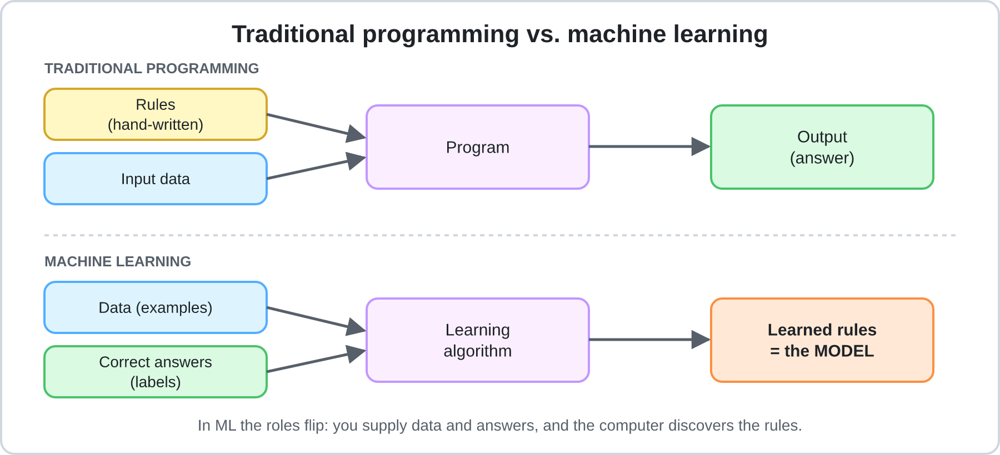

*Figure 3.1: Traditional programming uses written rules, while machine learning learns patterns from examples.*

### The three main ingredients

A machine-learning system depends on three important ingredients:

```text
DATA + ALGORITHM + COMPUTING POWER
                  |
                  v
             TRAINING
                  |
                  v
            TRAINED MODEL
```

- **Data** provides examples from which the system can learn.
- **Algorithms** provide the mathematical procedures used to learn patterns.
- **Computing power** allows the system to process data and perform the calculations required during training.

These ingredients work together. Large datasets alone do not guarantee a good model. The learning method must be appropriate, and the computing resources must be sufficient for the task.

### How the main AI processes connect

The following diagram shows the overall process of developing and using a machine-learning system.

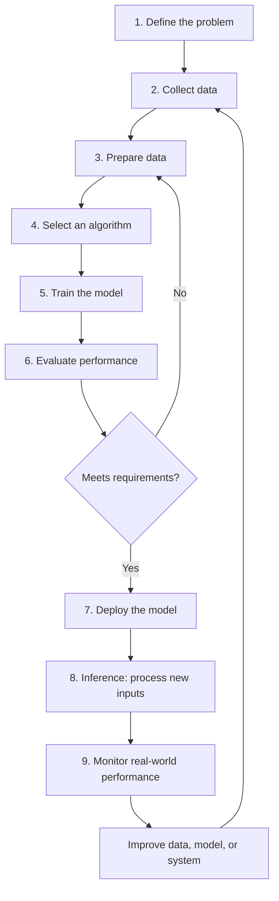

*Figure 3.2: The main stages of an AI development process. Evaluation can send a project back to earlier stages when improvements are needed.*

Each stage has a specific responsibility:

| Stage | What happens | Why it matters |
|---|---|---|
| Problem definition | Decide what the system should do | Prevents building a model for an unclear goal |
| Data collection | Gather relevant examples | Provides information for learning |
| Data preparation | Clean, organise, and divide the data | Makes the examples suitable for training and evaluation |
| Algorithm selection | Choose a suitable learning method | Determines how the model learns |
| Training | Adjust model parameters using examples | Allows the model to learn patterns |
| Evaluation | Measure performance using separate data | Checks whether the model generalises |
| Deployment | Make the model available for use | Connects the model to a real application |
| Inference | Process new inputs and produce outputs | Allows the system to perform its task |
| Monitoring | Observe performance after deployment | Helps detect problems and changing conditions |

The stages are connected. For example, poor data preparation can lead to weak training results. Weak training can lead to poor evaluation results. Even a model with good evaluation results may perform poorly if the real-world data is different from the data used during development.

**Core idea:** A successful AI system is not simply a model. It is a complete process involving data, learning, evaluation, deployment, and continuous monitoring.

---

## 3.3 Data: The Fuel of AI

### What is data?

Data is recorded information that an AI system can process. It may include text, images, audio, video, numbers, website activity, or readings from sensors.

An AI system uses data to identify relationships and patterns.

For example, a system designed to predict house prices may examine:

- The size of each house.
- The number of bedrooms.
- The property's location.
- Its age and condition.
- Previous selling prices.

These pieces of information help the model estimate the price of a house it has not encountered before.

### Types of data

| Type | Description | Examples |
|---|---|---|
| **Structured** | Organised in a predefined format, often rows and columns | Sales tables, bank records, spreadsheets |
| **Unstructured** | Does not follow a fixed tabular format | Emails, photographs, videos, social media posts |
| **Labelled** | Each example has an answer attached | A photograph labelled "cat" |
| **Unlabelled** | Examples have no supplied answers | A collection of photographs without descriptions |

These categories describe different properties of data. Structured data is not automatically labelled, and unstructured data can still have labels attached to it.

Modern large language models (LLMs) are trained primarily on large collections of text. They can learn from text without requiring a human to label every individual example. This is explained in Section 3.7.

### Where does training data come from?

AI developers obtain data from several sources:

- **Organisational data:** Customer records, transactions, and sensor logs collected by a company.
- **Public datasets:** Government statistics, scientific collections, and research datasets.
- **Web-scale collections:** Large collections of text, images, and other digital content. Their use raises questions about copyright, consent, and privacy.
- **Licensed data:** Content obtained through agreements with its owners.
- **Human-labelled data:** Examples that people classify, rate, or annotate.
- **Synthetic data:** Artificial examples generated by software or another AI model.

Synthetic data is useful when real examples are limited, expensive, or difficult to obtain. However, it must be checked carefully. If generated examples repeat the errors or biases of the system that produced them, those problems may become part of the new training data.

### Features, labels, and examples

Three terms are particularly important when working with machine-learning datasets:

- **Feature:** An input variable used by the model to make a prediction.
- **Label or target:** The correct answer the model is expected to predict.
- **Example or sample:** One individual record containing its features and, in supervised learning, its label.

For example, consider a dataset used to predict house prices:

| House | Size (m²) | Bedrooms | Price |
|---|---:|---:|---:|
| A | 80 | 2 | $150,000 |
| B | 100 | 3 | $190,000 |
| C | 120 | 3 | $230,000 |

Size and number of bedrooms are features. Price is the label. Each row is one example.

For a spam filter, the features might include the email's subject, message text, sender information, and number of suspicious links. The label would be either "spam" or "not spam."

### Preparing data

Preparing data is often one of the most demanding parts of an AI project. A model cannot reliably learn from information that is incorrectly recorded, inconsistent, or unsuitable for the problem.

Common preparation steps include:

| Step | Meaning | Example |
|---|---|---|
| **Cleaning** | Fix or remove errors, duplicates, and missing values | Remove duplicate email records |
| **Labelling** | Attach the correct answers to examples | Mark emails as spam or legitimate |
| **Feature engineering** | Create useful inputs from existing information | Count the number of links in an email |
| **Normalising / scaling** | Put numerical features on comparable scales | Scale salary and age to suitable numerical ranges |
| **Encoding** | Convert categories into numerical representations | Convert email categories into numerical codes |
| **Splitting** | Divide data for training, validation, and testing | Keep some examples separate for evaluation |

Not every project needs every preparation step. The appropriate methods depend on the data and the task.

### Dataset splitting: Training, validation, and testing

A model should not be evaluated only on the examples it used to learn. Otherwise, it may appear successful because it has memorised those examples rather than learned patterns that work on new data.

For this reason, datasets are commonly divided into three groups:

```text
                 TOTAL DATASET
                      100%
                       |
        +--------------+--------------+
        |              |              |
        v              v              v
    TRAINING        VALIDATION       TEST
      70%              15%            15%
```

*Figure 3.3: Example of a dataset divided into three non-overlapping groups.*

A common example is:

| Dataset | Percentage | Purpose |
|---|---:|---|
| **Training set** | 70% | Used to learn model parameters |
| **Validation set** | 15% | Used to compare models and adjust settings during development |
| **Test set** | 15% | Used for final evaluation after development decisions are complete |
| **Total** | **100%** | |

The percentages must add up to 100%. They are not fixed rules; they are one possible allocation. A dataset with a different size or structure may require a different split.

For example, if a project has 10,000 labelled emails:

- Training: 7,000 emails.
- Validation: 1,500 emails.
- Test: 1,500 emails.
- Total: 10,000 emails.

The three sets have different responsibilities:

1. The **training set** teaches the model.
2. The **validation set** helps developers decide whether the model or its settings should be changed.
3. The **test set** estimates how well the final model performs on unseen data.

The test set should remain separate during development. If developers repeatedly check its results and use them to make improvements, they gradually begin adapting the model to that particular dataset. The final score may then become overly optimistic.

For classification problems, developers may use **stratified splitting** to keep the proportions of important classes reasonably similar across the three sets. For example, if 10% of all emails are spam, the training, validation, and test sets should ideally contain similar spam proportions.

Some problems require different splitting methods. Time-dependent data, such as stock prices, should generally be divided chronologically so that future examples do not accidentally influence predictions about the past.

### Why data quality matters

A common expression in machine learning is:

> "Garbage in, garbage out."

The quality of training data strongly influences the quality of the model.

| Data problem | What goes wrong | Example |
|---|---|---|
| **Bias** | Certain groups are represented unfairly or inadequately | A face-recognition system performs worse on skin tones underrepresented in its training data |
| **Noise and errors** | Incorrect examples teach incorrect patterns | Images of wolves are labelled as dogs |
| **Unrepresentative data** | The model struggles with conditions it rarely encountered | A system trained only on daytime photographs performs poorly at night |
| **Data leakage** | Information that should not be available becomes part of the model's input | A prediction system receives information about the outcome it is supposed to predict |
| **Outdated data** | The data no longer represents current conditions | A pricing model relies on information from before a major market change |
| **Insufficient data** | There are too few examples to learn a reliable pattern | A model is trained using very few examples of a rare condition |

Data quality is not only about removing errors. It also involves ensuring that the examples represent the situations in which the model will eventually be used.

For example, a traffic prediction system trained using data from weekdays may perform poorly on weekends if traffic patterns differ significantly.

**Practical takeaway:** When an AI system performs poorly, consider whether the problem comes from the data before assuming that a more complicated algorithm is needed.

---

## 3.4 Algorithms and Models

The terms **algorithm** and **model** are often confused, but they describe different things.

- **Algorithm:** A step-by-step mathematical procedure used to learn from data or solve a problem.
- **Model:** The result of applying a learning algorithm to data. It contains learned parameters that allow it to make predictions or generate outputs.

A simple analogy is cooking:

- The algorithm is the recipe.
- The data is the ingredients.
- The model is the finished dish.

```text
ALGORITHM + TRAINING DATA
            |
            v
          TRAINING
            |
            v
       TRAINED MODEL
```

The algorithm determines how learning takes place, while the trained model contains the patterns learned from the examples.

### Two basic prediction tasks

Many machine-learning problems involve predicting either a category or a numerical value.

| Task | Question | Output | Example |
|---|---|---|---|
| **Classification** | Which category does this belong to? | A class or label | Spam or not spam |
| **Regression** | How much or how many? | A numerical value | House price or tomorrow's temperature |

Classification and regression are commonly used in supervised learning because the model learns from examples with known answers.

Other approaches include:

- **Unsupervised learning:** Finding patterns or groups in data without supplied labels.
- **Reinforcement learning:** Learning through actions and feedback in the form of rewards or penalties.

These learning approaches are explained further in Section 3.5.

### Common algorithm families

Different algorithms are designed for different kinds of problems.

| Family | Main idea | Typical use | Strength | Limitation |
|---|---|---|---|---|
| **Linear / Logistic Regression** | Learn relationships between input variables and an output | Price prediction, yes/no outcomes | Relatively simple and interpretable | May struggle with complex patterns |
| **Decision Trees** | Make decisions through a sequence of conditions | Loan screening, classification | Easy to understand and visualise | Can overfit |
| **Random Forests / Gradient Boosting** | Combine multiple decision trees | Fraud detection, business data | Often effective on structured data | More difficult to interpret |
| **Clustering (e.g., k-means)** | Group similar examples together | Customer segmentation | Finds patterns without labels | Groups may require human interpretation |
| **Neural Networks** | Use connected layers of mathematical units to learn complex patterns | Images, speech, and language | Can learn complicated relationships | Often requires substantial data and computing power |
| **Transformers** | Use attention and other components to process relationships between parts of an input | Language models, translation, and multimodal systems | Handles context effectively | Can be computationally expensive |

### Example: A decision tree

Imagine a bank using a decision tree to help screen loan applications.

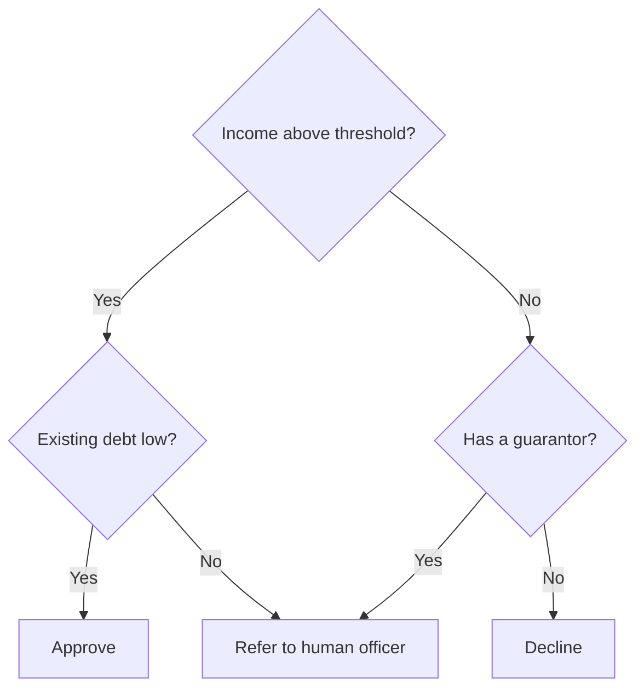

*Figure 3.4: A simplified decision tree for screening loan applications.*

The system follows a series of conditions to reach a result. In a machine-learning decision tree, the learning algorithm can determine which features and thresholds are useful by examining the training data.

This does not mean that the model should make every financial decision independently. Real loan decisions may require additional information, regulations, and human review.

### Choosing an algorithm

There is no single algorithm that is best for every situation.

| Situation | Possible starting point |
|---|---|
| Small structured dataset where explanations matter | Linear or logistic regression, decision trees |
| Larger structured dataset | Random forests or gradient boosting |
| Image, audio, or video recognition | Neural networks |
| Natural-language understanding and generation | Transformer-based models |

The choice depends on the problem, the available data, the required performance, interpretability, and computational cost.

---

## 3.5 Machine Learning: Learning from Examples

**Machine learning (ML)** is a branch of AI in which systems learn patterns from experience, usually through data, rather than relying entirely on rules written by programmers.

The goal is not simply to memorise examples. A useful model should learn relationships that allow it to make predictions about new situations.

### Three main learning approaches

#### 1. Supervised learning

Supervised learning uses labelled examples. Each training example includes an input and its correct answer.

For example, an email dataset may contain thousands of messages labelled as either "spam" or "not spam". The model learns to associate patterns in the messages with these labels.

Common applications include:

- Email spam detection.
- House-price prediction.
- Medical image classification.
- Predicting whether a customer may cancel a subscription.

Classification and regression are common supervised-learning tasks.

#### 2. Unsupervised learning

Unsupervised learning works with data that does not have supplied labels. Instead of predicting known answers, the algorithm searches for structure or similarities.

For example, a company may have customer information but no predefined customer groups. A clustering algorithm can group customers according to similarities in their purchasing behaviour.

The resulting groups do not automatically have meaningful names. People may need to examine the results and decide what the groups represent.

Common applications include customer segmentation, grouping similar documents, and discovering unusual patterns.

#### 3. Reinforcement learning

Reinforcement learning involves an agent that interacts with an environment and learns through rewards or penalties.

A simplified example is teaching an AI to play a game:

1. The agent observes the current game situation.
2. It chooses an action.
3. The environment responds.
4. The agent receives a reward or penalty.
5. It gradually learns which actions produce better long-term results.

This approach is useful when an AI system must make a sequence of decisions, such as in robotics, game-playing, and certain optimisation problems.

### A worked example: Predicting exam scores

Consider a simple machine-learning task.

**Goal:** Predict a student's exam score based on the number of hours studied.

| Hours studied (feature) | Exam score (label) |
|---:|---:|
| 1 | 55 |
| 2 | 65 |
| 3 | 75 |

We can represent the relationship using a simple linear model:

```text
score = w × hours + b
```

Here:

- `w` is the weight, which controls how strongly study hours affect the prediction.
- `b` is the bias parameter, which shifts the prediction up or down.

The model needs to learn suitable values for `w` and `b`.

#### Step 1: Make an initial prediction

Suppose the model begins with:

```text
w = 0
b = 0
```

Its prediction for every student is zero:

| Hours | Actual score | Initial prediction |
|---:|---:|---:|
| 1 | 55 | 0 |
| 2 | 65 | 0 |
| 3 | 75 | 0 |

The model is clearly not performing well.

#### Step 2: Calculate the loss

A **loss function** measures how incorrect the model's predictions are.

One common choice is mean squared error (MSE):

```text
MSE = (sum of squared prediction errors) / number of examples
```

For the initial predictions:

```text
MSE = ((55 - 0)² + (65 - 0)² + (75 - 0)²) / 3

MSE = (3025 + 4225 + 5625) / 3

MSE = 4291.67
```

The large value indicates that the predictions are far from the actual scores.

#### Step 3: Adjust the parameters

The model must change its parameters to reduce the loss. It uses an optimisation method such as gradient descent.

After learning a suitable relationship, the model may approach:

```text
w = 10
b = 45
```

Its prediction becomes:

```text
score = 10 × hours + 45
```

| Hours | Actual score | Model prediction |
|---:|---:|---:|
| 1 | 55 | 55 |
| 2 | 65 | 65 |
| 3 | 75 | 75 |

For this deliberately simple dataset, the predictions match the examples exactly.

#### Step 4: Use the model on a new input

A student who studies for four hours receives the following predicted score:

```text
score = 10 × 4 + 45
score = 85
```

The model has learned a relationship from three examples and applied it to a new input.

This example is intentionally simple. Real student performance depends on many factors, and a real prediction system would require more representative data and careful evaluation.

### Gradient descent: How the model improves

Gradient descent is an optimisation method used to reduce a model's loss by adjusting its parameters.

Imagine standing on a hillside covered in fog. You cannot see the bottom, but you can feel which direction slopes downward. You take a step in that direction, check the slope again, and repeat until you approach the lowest point.

Training a model follows a similar idea:

1. The model makes predictions.
2. The loss function measures how wrong they are.
3. The gradient indicates how the loss changes when parameters change.
4. The algorithm updates the parameters.
5. The process repeats.

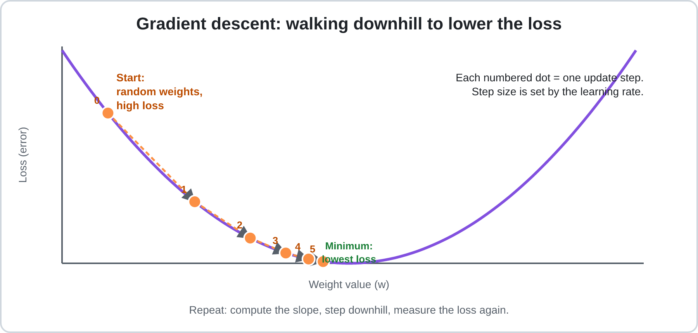

*Figure 3.5: Gradient descent gradually moves toward a parameter value that reduces the loss.*

Consider a simplified loss function:

```text
Loss = (w - 5)²
```

The best value is `w = 5`, where the loss is zero.

| Step | Weight (w) | Loss |
|---:|---:|---:|
| 0 | 0.80 | 17.64 |
| 1 | 2.31 | 7.23 |
| 2 | 3.28 | 2.96 |
| 3 | 3.90 | 1.21 |
| 4 | 4.30 | 0.50 |
| 5 | 4.55 | 0.20 |

The weight gradually approaches 5, and the loss becomes smaller.

The size of each update depends partly on the **learning rate**:

- If it is too large, updates may overshoot the minimum and become unstable.
- If it is too small, training may take much longer than necessary.

### Parameters and hyperparameters

| | Parameters | Hyperparameters |
|---|---|---|
| **Meaning** | Values learned by the model | Settings that control the learning process or model design |
| **Set by** | Training | Developers or automated search methods |
| **Examples** | Weights and bias values | Learning rate, number of layers, batch size |
| **Analogy** | What a student learns | How the student is taught |

A complete pass through the training dataset is called an **epoch**. Training usually takes multiple epochs. Instead of processing the entire dataset at once, models commonly process smaller groups of examples called **batches**.

### Overfitting and underfitting

A model must learn enough to recognise useful patterns, but it should not simply memorise the training examples.

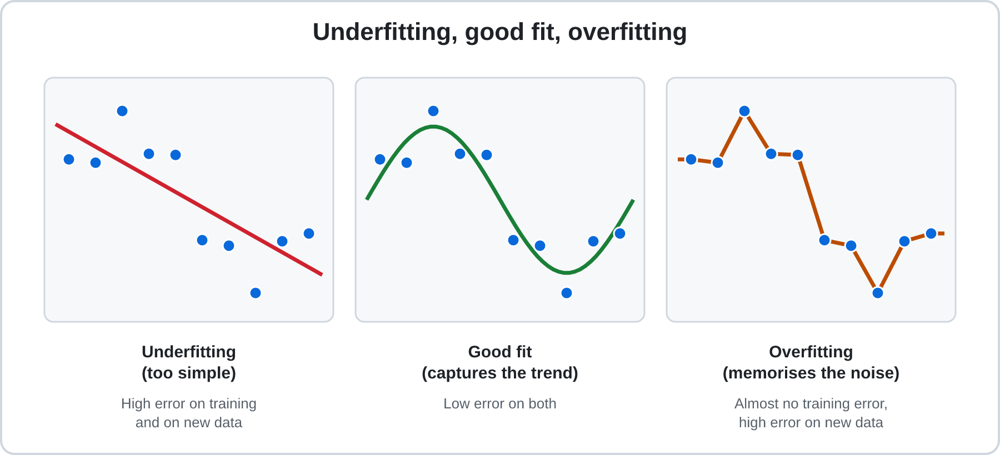

*Figure 3.6: A good model captures the general pattern without memorising random noise.*

| Problem | Meaning | Analogy | Possible solutions |
|---|---|---|---|
| **Underfitting** | The model is too simple to capture the pattern | A student who has barely studied | Use a more suitable model or improve the features |
| **Overfitting** | The model memorises training examples and performs poorly on new data | A student who memorises old exam answers but cannot solve new problems | Use more diverse data, simplify the model, apply regularisation, or stop training earlier |

The validation set helps identify overfitting. For example, if a model performs extremely well on training data but poorly on validation data, it may have memorised the training examples.

A model should be judged by how well it performs on data it has not encountered during training.

---

## 3.6 Neural Networks and Deep Learning

A **neural network** is a machine-learning model made of connected layers of mathematical units called neurons.

Neural networks are loosely inspired by the structure of biological brains. However, artificial neurons are mathematical operations, not actual brain cells.

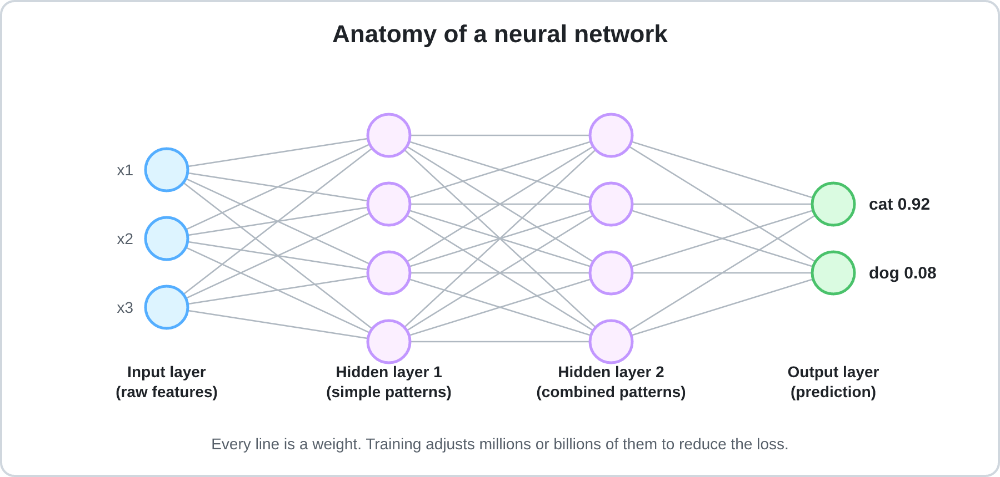

*Figure 3.7: Information moves through connected layers. Training adjusts the weights between neurons.*

### What does one artificial neuron do?

A basic artificial neuron performs three operations:

1. Receives numerical inputs.
2. Multiplies each input by a weight, adds the results, and includes a bias.
3. Passes the result through an activation function.

Consider a neuron with:

- Inputs: `x₁ = 2`, `x₂ = 1`
- Weights: `0.5` and `−1`
- Bias: `0.5`

The weighted sum is:

```text
sum = (2 × 0.5) + (1 × -1) + 0.5
sum = 1 - 1 + 0.5
sum = 0.5
```

The neuron then applies an activation function.

One common function is **ReLU (Rectified Linear Unit)**:

```text
ReLU(x) = max(0, x)
```

It keeps positive values and converts negative values to zero. Therefore, the neuron outputs `0.5`.

Activation functions are important because they allow neural networks to learn complex, non-linear relationships. Without non-linear activation functions, stacking multiple ordinary linear layers would still produce an overall linear transformation.

### How do layers work together?

Neural networks contain different types of layers:

- **Input layer:** Receives the original data.
- **Hidden layers:** Process information and learn intermediate patterns.
- **Output layer:** Produces the final prediction or result.

In an image-recognition network, different layers may learn different visual features:

| Layer depth | Possible features |
|---|---|
| Early layers | Edges, colours, and simple textures |
| Middle layers | Shapes and object parts, such as eyes or wheels |
| Later layers | More complex combinations associated with objects |

These are simplified descriptions. Real networks do not necessarily learn features in such clearly separated stages.

### How a neural network learns

Training a neural network involves four connected steps:

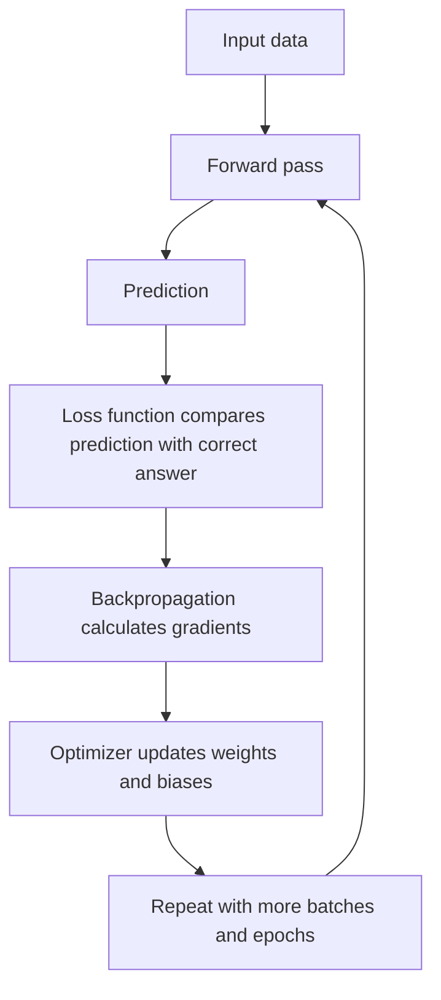

*Figure 3.8: The training loop connects predictions, loss calculation, backpropagation, and parameter updates.*

The four main steps are:

1. **Forward pass:** Input data travels through the network to produce a prediction.
2. **Loss calculation:** The prediction is compared with the correct answer.
3. **Backpropagation:** The network calculates how changes to its parameters would affect the loss.
4. **Parameter update:** An optimisation method, commonly gradient descent, adjusts the weights and biases.

These terms have different responsibilities:

| Concept | Role during training |
|---|---|
| **Forward pass** | Produces a prediction using the current parameters |
| **Loss function** | Measures the prediction error |
| **Backpropagation** | Calculates gradients that show how parameters contribute to the error |
| **Gradient descent / optimizer** | Uses the gradients to update the parameters |
| **Batch** | A group of examples processed together |
| **Epoch** | One complete pass through the training dataset |

Backpropagation does not directly mean "change every weight." It calculates the gradients needed by the optimizer. The optimizer then uses those gradients to update the parameters.

### Understanding the relationship through an example

Imagine a neural network that identifies whether an image contains a cat.

1. The network receives an image.
2. Its current weights produce a prediction, such as 0.30 probability for "cat."
3. The correct label is "cat," so the model's prediction is compared with the expected answer.
4. The loss function measures the error.
5. Backpropagation calculates how each weight contributed to the error.
6. The optimizer adjusts the weights.
7. The model processes another batch and repeats the process.

After many updates, the model may become better at identifying cats in images it has not seen before.

The improvement is not guaranteed after every individual update. Training involves many calculations, and the overall objective is to reduce loss and improve performance across the dataset.

Backpropagation became an important method for training multi-layer neural networks through the work of Rumelhart, Hinton, and Williams in 1986. [[3]](#ref-3)

For a visual explanation, see the 3Blue1Brown neural-network series. [[4]](#ref-4)

### Common neural network designs

Different network architectures are suited to different kinds of data.

| Design | Main purpose | Common applications |
|---|---|---|
| **Convolutional Neural Networks (CNNs)** | Learn spatial patterns in data | Image recognition and medical imaging |
| **Recurrent Neural Networks (RNNs / LSTMs)** | Process sequential information | Earlier speech and language systems |
| **Transformers** | Process relationships between parts of an input using attention and other components | Language models, translation, and multimodal AI |
| **Diffusion models** | Learn to generate data by gradually removing noise from a noisy representation | Image and video generation |

**Deep learning** refers to machine learning that uses neural networks with multiple layers. The term became especially important as computing power and available datasets grew large enough to train increasingly complex networks.

---

## 3.7 How Modern Language AI Works

Many modern AI assistants are built using **large language models (LLMs)**. These models process language mathematically and generate responses by predicting sequences of tokens.

### Step 1: Tokens and embeddings

Before an LLM processes text, the text is divided into smaller units called **tokens**.

A token may represent:

- A complete word.
- Part of a word.
- Punctuation.
- A number or other text symbol.

A token is not necessarily equal to one word. The number of tokens in a sentence depends on the language and the tokenizer used by the model.

After tokenisation, each token is converted into a numerical representation called an **embedding**, which is a vector (a list of numbers).

These vectors allow the model to perform mathematical operations on language. During training, the model learns representations that help it recognise relationships between tokens.

An embedding is not a dictionary definition. Its individual numbers usually cannot be interpreted directly by a human.

The initial representation of a token is also not the complete representation used throughout the model. Transformer layers process it in context, allowing the model to represent the same word differently depending on the surrounding sentence.

For example, the word "bank" has different meanings in:

- "I deposited money at the bank."
- "We sat beside the river bank."

Context helps the model distinguish these uses.

```text
TEXT
 |
 v
TOKENISATION
 |
 v
TOKEN IDs
 |
 v
EMBEDDINGS
 |
 v
TRANSFORMER LAYERS
```

*Figure 3.9: A simplified view of how text becomes numerical input for a language model.*

### Step 2: Next-token prediction

During pre-training, an LLM learns to predict the next token in a sequence.

For example:

```text
Input: The sun rises in the ...

Possible next token: east
```

The model compares its prediction with the actual next token in the training text. The difference contributes to the loss, which is used to update the model's parameters.

This is called **self-supervised learning** because the training text provides the target answers automatically. Developers do not need a person to label every sentence with its next token.

By repeatedly learning to predict tokens, the model develops patterns related to grammar, writing styles, facts, and relationships between concepts.

However, predicting text successfully does not guarantee that every generated statement is true.

### Step 3: Transformers and attention

A major part of modern LLMs is the **transformer architecture**.

Its attention mechanism helps the model determine how strongly different parts of the input relate to one another.

Consider this sentence:

> "The animal did not cross the street because it was tired."

To understand the sentence, the model needs to connect "it" with the animal rather than the street.

Attention helps the model weigh relationships between tokens and use surrounding context when processing them.

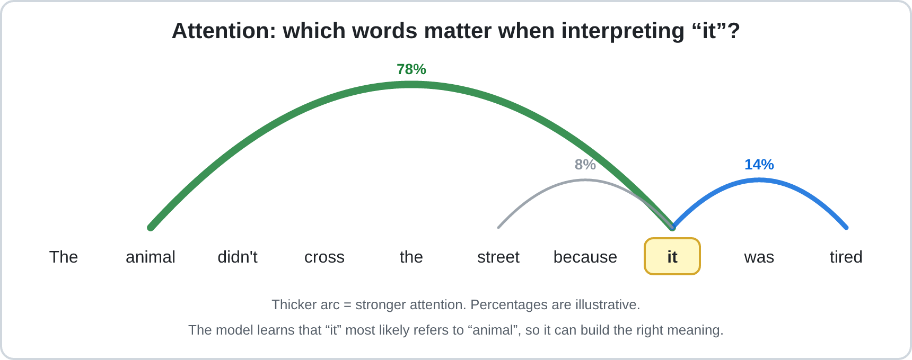

*Figure 3.10: Attention helps a transformer relate different parts of an input.*

Transformers also use feed-forward layers and other components to process information. Their architecture allows efficient parallel processing during training, which helped make large-scale language-model training practical.

The transformer architecture was introduced by Vaswani and colleagues in 2017. [[5]](#ref-5)

### Step 4: Generating a response

When an LLM receives a prompt, it generates a response through repeated prediction:

1. The prompt is converted into tokens.
2. The model processes the tokens through its transformer layers.
3. It produces scores or probabilities for possible next tokens.
4. A token is selected according to the model's output and generation settings.
5. The selected token is added to the sequence.
6. The model repeats the process until the response is complete or a stopping condition is reached.

This means that an LLM does not normally write an entire response in one operation. It generates a sequence token by token.

### Temperature and generation

One setting that can affect token selection is **temperature**.

| Setting | Typical effect |
|---|---|
| **Low temperature** | Makes output more predictable and favours higher-probability choices |
| **High temperature** | Allows more variation by making less likely choices more possible |

Temperature does not give the model additional knowledge or guarantee greater accuracy. It changes the behaviour of token selection.

### How an LLM becomes an assistant

A language model is not necessarily ready to function as a helpful assistant immediately after pre-training.

A simplified development pipeline is:

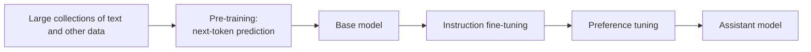

*Figure 3.11: A simplified pipeline for developing an instruction-following language model.*

| Stage | What happens | Result |
|---|---|---|
| **Pre-training** | The model learns from large collections of data, often through next-token prediction | A base model with broad language patterns |
| **Fine-tuning** | The model receives additional training on curated examples, such as instructions and appropriate responses | Better instruction-following behaviour |
| **Preference tuning** | Feedback is used to encourage responses that people or evaluators prefer | Behaviour more closely aligned with the intended assistant role |

One approach is **Reinforcement Learning from Human Feedback (RLHF)**, in which human preferences help guide model behaviour. [[6]](#ref-6)

Not every AI assistant uses exactly the same training pipeline. These stages are a simplified example of common techniques.

### Important properties of modern LLMs

- **Context window:** The amount of information a model can consider during a particular interaction. It is limited, even when the limit is very large.
- **Knowledge cutoff:** The end point of the training information available to a model. Information after that point may require external tools or updated training.
- **Multimodal models:** Models that can process or generate more than one type of information, such as text, images, and audio.
- **Reasoning models:** Models designed or trained to spend additional computation on complex problems. This may improve performance on some tasks but can increase time and cost.
- **AI agents:** Systems that connect models to tools and allow them to perform multiple steps, such as searching, calculating, or interacting with software.

**Important insight:** An LLM produces responses based on learned patterns and the information available in its context. A fluent answer is not necessarily a verified answer. This is one reason AI systems can produce incorrect or unsupported information, sometimes called hallucinations.

---

## 3.8 Training, Evaluation, and Inference

Training, evaluation, and inference are three related but different processes.

Understanding their relationship is important because they describe how a model is developed, checked, and used.

### Comparing the three processes

| Process | Main purpose | What happens |
|---|---|---|
| **Training** | Learn patterns | The model adjusts its parameters using training data |
| **Evaluation** | Measure performance | The model is checked using data that was not used to train it |
| **Inference** | Produce predictions | The trained model processes new inputs and generates outputs |

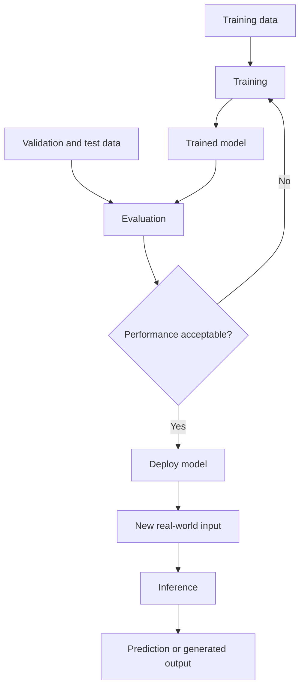

*Figure 3.12: Training creates the model, evaluation measures its performance, and inference uses it to produce outputs.*

### Following the same model through each process

Imagine an email provider developing a spam filter.

**1. Training**

The model receives labelled examples of spam and legitimate emails. It adjusts its parameters to learn patterns associated with each category.

**2. Evaluation**

The developers use validation data to compare models and adjust settings. Once they select a final model, they use the untouched test set to estimate how well it performs on unseen emails.

**3. Inference**

After deployment, the model receives new incoming emails and predicts whether each one is spam or legitimate.

The model's core parameters normally remain fixed during ordinary inference. It uses what it learned during training to process new inputs.

### What happens when you chat with an AI?

When you send a message to an AI assistant, the model normally performs inference. Its core parameters are not being retrained by every message.

The conversation is provided as context, allowing the model to consider earlier messages when generating a response. This does not mean that its underlying weights are being updated.

Whether a company later uses conversations to improve future models is a separate policy and data-handling question. Users should check the privacy settings and policies of the services they use.

### Improving results without retraining

There are different ways to improve an AI system's output. The important distinction is whether the model's parameters change.

#### A. Inference-time improvements

These methods use an existing model without updating its core weights.

| Technique | What it does | Useful for |
|---|---|---|
| **Prompting** | Provides clearer instructions, context, examples, and output requirements | Improving the relevance and structure of answers |
| **Retrieval-Augmented Generation (RAG)** | Retrieves relevant documents and supplies them to the model as context | Questions involving current or private information |
| **Tools** | Connects the model to software such as calculators, search engines, or code execution | Calculations, research, and data processing |
| **Agents** | Allows a model to coordinate multiple tool-use steps | Tasks that require a sequence of actions |

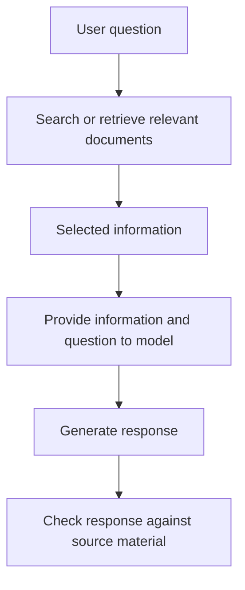

*Figure 3.13: A simplified Retrieval-Augmented Generation process.*

RAG can make answers more closely grounded in available documents, but it does not guarantee correctness. The retrieved information may be incomplete, outdated, or misunderstood by the model.

#### B. Training-based improvements

These methods change existing model parameters or create a new model.

| Technique | What it does | Useful for |
|---|---|---|
| **Fine-tuning** | Continues training an existing model using specialised examples | Consistent behaviour or specialised tasks |
| **Training from scratch** | Trains a new model using an initial set of parameters and a training process | Projects requiring a model built for a particular purpose |

Fine-tuning changes the model's weights, while RAG supplies information during inference without requiring the model to learn that information through weight updates.

**Rule of thumb:** Start by improving the prompt, context, or tools available to an existing model. Fine-tuning and training from scratch usually require more data, expertise, time, and computing resources.

---

## 3.9 Evaluating a Model

How can developers determine whether an AI model is reliable enough to use?

They evaluate its performance using examples that were not used to train it. Evaluation is important because a model can perform well during training but fail when it encounters new situations.

### The role of each dataset

| Dataset | Purpose | When it is used |
|---|---|---|
| **Training set** | Learns the model's parameters | During training |
| **Validation set** | Compares models and adjusts settings | Repeatedly during development |
| **Test set** | Estimates the final model's performance on unseen data | After development decisions are complete |

The test set should not guide repeated improvements. If developers use its results to decide what to change, it is no longer an independent final evaluation.

The validation set is designed for repeated use. The test set is kept separate to provide a more honest estimate of performance.

### The confusion matrix

A confusion matrix is a table used to evaluate classification models. It compares the model's predictions with the actual answers.

Consider a spam filter tested on 1,000 emails:

- 100 emails are actually spam.
- 900 emails are legitimate.
- The model correctly identifies 80 spam emails.
- It incorrectly marks 10 legitimate emails as spam.

| | **Predicted: Spam** | **Predicted: Not Spam** |
|---|---:|---:|
| **Actually spam** | 80 (True Positive) | 20 (False Negative) |
| **Actually not spam** | 10 (False Positive) | 890 (True Negative) |

The four outcomes are:

- **True Positive (TP):** Correctly identifies a positive case.
- **False Positive (FP):** Incorrectly identifies a negative case as positive.
- **True Negative (TN):** Correctly identifies a negative case.
- **False Negative (FN):** Fails to identify a positive case.

In this example, a true positive is a spam email correctly identified as spam. A false positive is a legitimate email incorrectly placed in the spam folder.

### Common evaluation metrics

Four important metrics can be calculated from the confusion matrix.

| Metric | What it measures | Calculation | Result |
|---|---|---|---:|
| **Accuracy** | Share of all predictions that are correct | (TP + TN) / Total | 97.0% |
| **Precision** | Share of predicted positive cases that are actually positive | TP / (TP + FP) | 88.9% |
| **Recall** | Share of actual positive cases that the model identifies | TP / (TP + FN) | 80.0% |
| **F1 score** | Balance between precision and recall | 2 × (Precision × Recall) / (Precision + Recall) | 0.84 |

For the spam filter:

```text
Accuracy  = (80 + 890) / 1000
          = 97.0%

Precision = 80 / (80 + 10)
          = 88.9%

Recall    = 80 / (80 + 20)
          = 80.0%

F1        = 2 × (0.889 × 0.80) / (0.889 + 0.80)
          ≈ 0.84
```

F1 is the harmonic mean of precision and recall. It gives a single score that is high only when both metrics are reasonably high.

### Why accuracy alone can be misleading

Imagine that only 10% of emails are spam. A model that labels every email as "not spam" would still achieve 90% accuracy.

However, its recall for spam would be zero because it fails to identify every spam email.

This demonstrates why the choice of metric matters.

| Situation | More costly mistake | Metric that may be prioritised |
|---|---|---|
| Cancer screening | Missing a real case | Recall |
| Spam filtering | Blocking an important legitimate email | Precision |
| Fraud detection | Depends on the cost of missed fraud and false alarms | A balance of relevant metrics |

A model with high accuracy is not necessarily suitable for every application.

### The classification threshold

Many classification systems produce a score between 0 and 1. A **classification threshold** determines when that score becomes a positive prediction.

For example, a spam filter may classify an email as spam when its score is greater than or equal to 0.5.

Changing the threshold affects precision and recall:

| Threshold | Typical effect |
|---|---|
| **Higher threshold**, such as 0.9 | Fewer emails are flagged. Precision may increase, while recall may decrease. |
| **Lower threshold**, such as 0.3 | More emails are flagged. Recall may increase, while precision may decrease. |

A higher threshold may be useful when blocking a legitimate email is particularly costly. A lower threshold may be preferred when missing a positive case is more dangerous.

The threshold should be selected during development using validation data, not repeatedly adjusted based on the final test results.

### Deciding whether a model is good enough

Metrics provide evidence, but they do not automatically decide whether a model should be deployed.

A development team should consider:

1. **The cost of errors:** What happens if the model makes a false positive or false negative?
2. **Application requirements:** What level of performance is necessary?
3. **Alternative solutions:** Does the model perform better than the existing system or a simpler baseline?
4. **Safety measures:** Can a human review uncertain or high-risk decisions?
5. **Real-world conditions:** Will the model face situations that differ from its evaluation data?

For example, a medical screening model may need very high recall because missing a real case can be dangerous. Human professionals may then review additional positive results.

### Evaluating language models

Language models are more difficult to evaluate with one numerical metric because their outputs can vary in accuracy, usefulness, reasoning, safety, and clarity.

Common evaluation methods include:

- **Benchmark tests:** Standardised sets of questions or tasks used to compare models.
- **Human evaluation:** People assess the quality, accuracy, or usefulness of responses.
- **Task-specific tests:** Developers create their own examples based on the actual purpose of the system.

Benchmark scores should not be treated as complete proof of real-world performance. For important applications, developers should test models using relevant examples from their own intended environment.

---

## 3.10 The AI Workflow: An Integrated Case Study

This section brings together the concepts introduced throughout the chapter.

Instead of examining data, training, evaluation, and inference separately, we will follow one AI application from the beginning to its use in the real world.

### Case study: Building an email spam filter

Imagine an email provider wants to develop a system that automatically identifies spam.

The goal is not simply to achieve high accuracy. The system must identify unwanted emails while avoiding the blocking of legitimate messages.

The development team follows the complete AI workflow.

### Stage 1: Define the problem

Before collecting data or selecting an algorithm, the team must understand the problem.

They define:

- **Input:** Incoming email information.
- **Output:** A prediction of "spam" or "not spam."
- **Goal:** Identify spam while minimising incorrect classifications.
- **Success criteria:** Suitable precision and recall, acceptable processing time, and reliable performance on new emails.

This step matters because the model's success depends on what the system is expected to achieve.

For example, a system that blocks every suspicious email may achieve high spam recall but could also block important messages. The team must consider the consequences of both types of error.

### Stage 2: Collect data

The team gathers examples of previous emails.

Each example may contain:

| Feature | Example |
|---|---|
| Subject | "Congratulations! You won a prize" |
| Message text | "Claim your reward now" |
| Sender information | Unknown sender |
| Number of links | 4 |
| Attachment information | Contains an unexpected attachment |
| Label | Spam |

Another example may be a legitimate email:

| Feature | Example |
|---|---|
| Subject | "Meeting schedule for Friday" |
| Message text | "Please review the updated timetable" |
| Sender information | Known colleague |
| Number of links | 1 |
| Attachment information | Contains a meeting document |
| Label | Not spam |

The label provides the correct answer during supervised learning. The features provide information that the model can use to make its prediction.

The examples must be collected responsibly. Personal information should be protected, and the dataset should be checked for consent, privacy, and appropriate access.

### Stage 3: Prepare the data

The team cannot immediately use every collected email. The data must first be checked and organised.

The preparation process may include:

1. Remove duplicate emails.
2. Check that labels are correct.
3. Handle missing or incorrectly recorded information.
4. Convert text and categories into representations the model can process.
5. Create useful features, such as the number of links or suspicious phrases.
6. Divide the data into training, validation, and test sets.

Suppose the team has 10,000 labelled emails.

| Dataset | Percentage | Number of emails |
|---|---:|---:|
| Training | 70% | 7,000 |
| Validation | 15% | 1,500 |
| Test | 15% | 1,500 |
| **Total** | **100%** | **10,000** |

The team should also ensure that the sets are representative of the emails the system will encounter. If nearly all examples in the test set are legitimate emails, the evaluation may not provide enough information about spam detection.

### Stage 4: Select an algorithm

The team chooses a classification algorithm.

Possible choices include:

- Logistic regression.
- Decision trees.
- Random forests.
- Neural networks.

For an introductory project, logistic regression or a decision tree may be a reasonable starting point because they are easier to understand and compare.

The best choice depends on the dataset, performance requirements, available resources, and the need to explain predictions.

### Stage 5: Train the model

The team uses the 7,000 training emails to teach the model.

The model begins with initial parameters. It processes the training examples and predicts whether each email is spam.

The training process follows this loop:

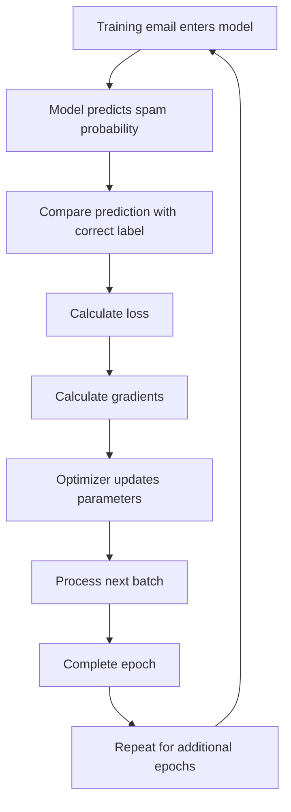

*Figure 3.14: The spam-filter training loop.*

Each part has a different responsibility:

| Training component | What it does in the spam-filter example |
|---|---|
| **Prediction** | Estimates whether an email is spam |
| **Loss function** | Measures how different the prediction is from the correct label |
| **Backpropagation or gradient calculation** | Determines how model parameters contribute to the loss |
| **Optimizer** | Updates the model parameters to reduce the loss |
| **Batch** | A group of emails processed together |
| **Epoch** | One complete pass through the 7,000 training emails |

The model repeats this process across many batches and epochs.

The objective is to learn useful patterns rather than memorise the exact emails in the training set.

### Stage 6: Evaluate during development

After training, the team uses the validation set to measure performance.

Suppose the model performs well on training data but poorly on validation data. This may indicate overfitting.

The team may then:

- Add more representative examples.
- Improve data preparation.
- Change the algorithm.
- Adjust the learning rate or other hyperparameters.
- Apply regularisation.
- Train for a different number of epochs.

The team repeats training and validation until it selects a model that meets the development requirements.

The validation set is used for these repeated decisions. The test set remains untouched.

### Stage 7: Perform the final test

Once the team has selected the model, it evaluates the model using the 1,500 test emails.

Suppose the final test produces the following confusion matrix:

| | **Predicted: Spam** | **Predicted: Not Spam** |
|---|---:|---:|
| **Actually spam** | 80 | 20 |
| **Actually not spam** | 10 | 890 |

The team calculates accuracy, precision, recall, and F1 score.

The results indicate that the model correctly identifies most legitimate emails, but it still misses some spam messages.

The team must decide whether this performance is acceptable for the intended use.

If the team changes the model after repeatedly examining the test results, the test set is no longer an independent final check. A new untouched test set may be needed.

### Stage 8: Deploy the model

After the model passes the required evaluation, the team integrates it into the email service.

The model is now available to process incoming emails.

Deployment may involve connecting the model to the email application, preparing the required computing environment, and ensuring that the system can handle incoming messages efficiently.

### Stage 9: Use the model through inference

When a new email arrives, the system performs inference.

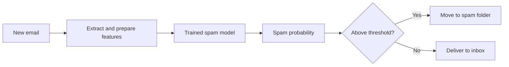

*Figure 3.15: The input, model processing, and output of a deployed spam filter.*

For example:

```text
New email
    |
    v
Feature extraction
    |
    v
Trained model
    |
    v
Spam probability = 0.92
    |
    v
Threshold = 0.50
    |
    v
Prediction = Spam
```

The model uses the parameters learned during training to produce the prediction. It does not normally retrain its core parameters every time a new email arrives.

### Stage 10: Monitor performance

The development process does not end after deployment.

Over time, spammers may change their methods. New phrases, links, and message formats may appear.

Two important problems can occur:

- **Data drift:** The distribution of incoming data changes. For example, email formats or sender patterns become different from those in the training data.
- **Concept drift:** The relationship between input features and the correct answer changes. For example, old spam patterns become less useful because spammers develop new techniques.

The team should monitor:

- False positives and false negatives.
- Changes in spam patterns.
- User reports of incorrectly classified emails.
- Processing time and system reliability.
- Performance across different types of incoming emails.

If performance decreases, the team may need to collect new examples, prepare updated data, retrain the model, and evaluate it again.

### Connecting the complete process

| Stage | Main concept from this chapter |
|---|---|
| Define the problem | AI problem definition and success criteria |
| Collect data | Data sources, features, and labels |
| Prepare data | Data cleaning, feature engineering, and dataset splitting |
| Select an algorithm | Algorithms and models |
| Train the model | Machine learning, loss, parameters, and gradient descent |
| Evaluate | Validation, testing, and evaluation metrics |
| Deploy | Making a trained model available |
| Inference | Processing new inputs and producing predictions |
| Monitor | Data drift, concept drift, and continuous improvement |

**What should learners understand from this case study?**

The spam filter is not a collection of unrelated AI concepts. Each stage depends on the previous one. Data provides examples, the algorithm learns from them, training produces a model, evaluation measures its performance, inference uses it on new emails, and monitoring checks whether it remains useful.

This is the general structure behind many machine-learning applications, even though their data, algorithms, and outputs may differ.

---

## 3.11 From Beginner to Expert

Understanding how AI works is only one part of using it effectively. Users must also learn how to communicate with AI systems, check their outputs, and recognise their limitations.

### A reliable prompt structure

A good prompt provides information that the model cannot safely assume. A useful structure contains five elements:

| Element | Purpose | Example |
|---|---|---|
| **Role** | Defines the perspective or role | "Act as an experienced statistics tutor." |
| **Context** | Explains the situation | "I am a first-year student who knows basic algebra." |
| **Task** | States what the model should do | "Explain gradient descent." |
| **Format** | Specifies the desired output | "Use an analogy followed by a five-step summary." |
| **Constraints** | Sets limits or requirements | "Keep it under 200 words and avoid unnecessary jargon." |

**Weak prompt:**

"Explain gradient descent."

**Stronger prompt:**

"Act as a patient statistics tutor. I am a first-year student who knows basic algebra. Explain gradient descent using an everyday analogy, followed by a five-step summary. Keep it under 200 words and avoid unnecessary jargon."

The stronger prompt gives the model more information about the reader, the task, and the expected answer.

Other useful prompting techniques include providing examples, asking the model to state its assumptions, and requesting a revision when the first answer is unclear.

### Verifying AI output

AI-generated information should not automatically be accepted as correct.

Use this checklist when evaluating an answer:

1. **Facts and figures:** Can the information be confirmed using reliable sources?
2. **Citations:** Do the cited sources actually exist and support the claims?
3. **Recency:** Could the information have changed?
4. **Reasoning:** Do the steps make sense, and do calculations check out?
5. **Bias and missing perspectives:** Could important information or viewpoints be missing?
6. **Stakes:** What would happen if the answer were wrong?
7. **Privacy:** Have you shared confidential information unnecessarily?

Medical, legal, and financial decisions require particular care and appropriate professional review.

### Skill ladder

| Level | Characteristics |
|---|---|
| **Beginner** | Asks basic questions and learns to recognise that AI outputs can contain mistakes |
| **Intermediate** | Writes structured prompts, provides context, checks results, and refines outputs |
| **Advanced** | Selects suitable models and tools, uses documents and search to provide context, and creates repeatable workflows |
| **Expert** | Evaluates systems systematically, understands trade-offs, and can explain why a model may behave in a particular way |

Becoming an effective AI user does not mean trusting AI more. It means knowing when to use it, how to guide it, and when to question its output.

---

## 3.12 Common Misconceptions

| Misconception | Reality |
|---|---|
| "AI thinks exactly like a human." | AI systems process information through mathematical models. This is not the same as human thought or consciousness. |
| "AI always looks up answers in a database." | An LLM generally generates responses using learned patterns unless connected to retrieval or search tools. |
| "AI learns from every conversation in real time." | During ordinary inference, the model's core parameters remain fixed. |
| "More data always produces a better model." | Data quality, relevance, and diversity matter as well as quantity. |
| "If an AI sounds confident, it must be correct." | Fluent language does not guarantee accuracy. |
| "A larger model is always better." | Smaller specialised models may perform better on particular tasks and cost less to operate. |
| "AI is objective because it uses mathematics." | Models can inherit biases from data and decisions made during development. |
| "Accuracy is the only metric that matters." | Precision, recall, and the consequences of errors can be more important. |
| "Once a model is deployed, it no longer needs attention." | Models must be monitored because real-world conditions and data can change. |
| "Backpropagation and gradient descent are the same thing." | Backpropagation calculates gradients; the optimizer uses them to update parameters. |
| "A high test score guarantees real-world success." | Test data may not fully represent the conditions the model encounters after deployment. |

---

## 3.13 Key Takeaways

1. **Data** provides the examples that allow a model to learn. Poor or unrepresentative data can produce unreliable results.
2. An **algorithm** is the learning procedure, while a **model** is the result of applying that procedure to data.
3. **Machine learning** improves predictions by measuring errors and adjusting parameters.
4. **Loss** measures prediction error, **backpropagation** calculates gradients, and an **optimizer** uses those gradients to update parameters.
5. **Neural networks** use connected layers of mathematical units to learn complex patterns.
6. **LLMs** process text as tokens and generate responses through repeated next-token prediction.
7. **Training** changes a model's parameters, **evaluation** measures its performance, and **inference** uses it to produce outputs.
8. **Prompting, RAG, and tools** can improve inference without retraining the model. Fine-tuning and training from scratch are training-based approaches.
9. **Evaluation** requires suitable metrics and data that was not used during training.
10. A complete AI system follows a workflow of problem definition, data preparation, training, evaluation, deployment, and monitoring.
11. Effective AI use requires both understanding its capabilities and checking its limitations.

### One-page cheat sheet

| Concept | Memory aid |
|---|---|
| Data | Examples used for learning |
| Feature / Label | Input / Correct answer |
| Algorithm | Learning procedure |
| Model | Learned result |
| Loss | Measurement of prediction error |
| Backpropagation | Calculates gradients |
| Gradient descent | Uses gradients to update parameters |
| Batch | Group of training examples |
| Epoch | One complete pass through training data |
| Overfitting | Memorising training examples |
| Validation set | Used during development |
| Test set | Used for final evaluation |
| Training | Learning and changing parameters |
| Evaluation | Measuring model performance |
| Inference | Using a trained model |
| Token | A unit of text processed by an LLM |
| Embedding | Numerical representation |
| Attention | Relating different parts of an input |
| Temperature | Controls variation in generated output |
| RAG | Supplying retrieved information as context |
| Fine-tuning | Further training that changes model parameters |
| Precision | How many positive predictions are correct |
| Recall | How many actual positive cases are found |
| Hallucination | Fluent but false or unsupported output |
| Data drift | Changes in incoming data |
| Concept drift | Changes in the relationship between inputs and answers |

---

## 3.14 Glossary

| Term | Definition |
|---|---|
| **Accuracy** | The proportion of all predictions that are correct |
| **Activation function** | A function that transforms a neuron's output and allows a network to learn non-linear relationships |
| **Agent** | A system that uses a model and tools to complete tasks through multiple steps |
| **Algorithm** | A procedure used to learn from data or solve a problem |
| **Attention** | A mechanism that helps a model determine relationships between different parts of an input |
| **Backpropagation** | A method for calculating how model parameters contribute to prediction error |
| **Batch** | A group of training examples processed together |
| **Bias (in data)** | A systematic skew or gap in data that may cause unfair or unreliable results |
| **Bias parameter** | A learned numerical value added within a model's calculation |
| **Classification** | Predicting a category or label |
| **Classification threshold** | A score cut-off used to determine a positive or negative prediction |
| **CNN** | Convolutional neural network; a network architecture commonly used for image-related tasks |
| **Concept drift** | A change over time in the relationship between input data and the correct output |
| **Confusion matrix** | A table comparing predicted and actual classification results |
| **Context window** | The amount of information a model can consider during an interaction |
| **Data drift** | A change in the distribution of incoming data over time |
| **Deep learning** | Machine learning that uses neural networks with multiple layers |
| **Diffusion model** | A generative model that learns to create data by gradually removing noise |
| **Embedding** | A numerical vector representing a token or other item |
| **Epoch** | One complete pass through the training dataset |
| **Evaluation** | The process of measuring a model's performance |
| **F1 score** | The harmonic mean of precision and recall |
| **Feature** | An input variable used by a model |
| **Fine-tuning** | Further training an existing model using specialised data |
| **Gradient** | A mathematical quantity showing how a function changes with respect to its parameters |
| **Gradient descent** | An optimisation method that adjusts parameters to reduce loss |
| **Hallucination** | An AI output that sounds plausible but is false or unsupported |
| **Hyperparameter** | A setting chosen to control training or model design |
| **Inference** | Using a trained model to generate an output |
| **Label** | The correct answer associated with a training example |
| **Learning rate** | A setting controlling the size of parameter updates during training |
| **LLM** | Large language model; a model trained to process and generate language |
| **Loss** | A numerical measure of how incorrect a model's predictions are |
| **Model** | A trained system containing learned parameters used to produce predictions or outputs |
| **Multimodal model** | A model that can process or generate multiple data types |
| **Neural network** | A model made of connected layers of mathematical units |
| **Optimizer** | A method that updates model parameters using calculated gradients |
| **Overfitting** | When a model memorises training data and performs poorly on new examples |
| **Parameter / Weight** | A numerical value learned during training |
| **Pre-training** | Large-scale initial training of a model, often through next-token prediction for LLMs |
| **Precision** | The proportion of positive predictions that are actually positive |
| **Preference tuning** | Training that uses preferences or evaluations to guide model behaviour |
| **RAG** | Retrieval-Augmented Generation; providing retrieved information to a model during inference |
| **Reasoning model** | A model designed or trained to spend additional computation on complex problems |
| **Recall** | The proportion of actual positive cases correctly identified |
| **Regression** | Predicting a numerical value |
| **Regularisation** | Techniques that discourage excessive model complexity and help reduce overfitting |
| **Reinforcement learning** | Learning through actions and feedback from rewards or penalties |
| **RLHF** | Reinforcement Learning from Human Feedback; using human preferences to guide model training |
| **Self-supervised learning** | Learning from targets generated automatically from the data itself |
| **Supervised learning** | Learning from examples that include correct answers |
| **Temperature** | A generation setting that affects the variation of selected tokens |
| **Test set** | Data held back for final model evaluation |
| **Token** | A unit of text processed by a language model |
| **Training** | The process of learning from data and adjusting model parameters |
| **Training set** | The data used to train a model |
| **Transformer** | A neural-network architecture using attention, feed-forward layers, and other components |
| **Underfitting** | When a model is too simple to capture useful patterns |
| **Unsupervised learning** | Learning patterns from data without supplied labels |
| **Validation set** | Data used during development to compare models and adjust settings |

---

## 3.15 Self-Check Reflection

Before moving on, answer these questions in your own words:

1. Why can an AI chatbot sound confident even when its answer is incorrect?
2. Give an example of a situation where improving training data could be more useful than choosing a different algorithm.
3. What is the difference between training, evaluation, and inference?
4. How do loss, backpropagation, and gradient descent work together during training?
5. Why should a test set remain separate from the training and validation sets?
6. Which habit from Section 3.11 would help you use AI more responsibly?

---

## 3.16 Practice Questions

Try answering each question before checking the answer.

### Q1. Which statement best describes the difference between an algorithm and a model?

- A) They mean the same thing.
- B) An algorithm is the learning procedure, while a model is the result of applying it to data.
- C) A model is the procedure, while an algorithm is the data.
- D) Algorithms only exist in traditional programming.

<details>
<summary>Answer</summary>

**B.** The algorithm is the procedure used to learn. Applying it to training data produces a model containing learned parameters.

</details>

### Q2. A model scores 99% on training data but only 60% on new, unseen data. What is the most likely problem? Name two possible solutions.

<details>
<summary>Answer</summary>

**Overfitting.** The model has learned the training examples too closely and does not generalise well.

Possible solutions include using more diverse data, simplifying the model, applying regularisation, or stopping training earlier.

</details>

### Q3. True or False: When you chat with an AI assistant, its core model is automatically retrained by every message.

<details>
<summary>Answer</summary>

**False.** Ordinary inference does not update the model's core parameters. The conversation is used as context. Any later training is a separate process.

</details>

### Q4. Why should the test set remain separate from the training and validation sets?

<details>
<summary>Answer</summary>

The test set provides a final estimate of how the model performs on unseen data.

If developers repeatedly use its results to make decisions, they may gradually adapt the model to that test set, making the final score overly optimistic.

</details>

### Q5. Explain how an LLM generates a sentence.

<details>
<summary>Answer</summary>

An LLM converts the prompt into tokens, represents them numerically, and processes them through transformer layers. It predicts possible next tokens, selects one, and repeats the process until the response is complete.

</details>

### Q6. Only 10% of emails are spam. A model labels every email as "not spam." What is its accuracy, and why is it ineffective?

<details>
<summary>Answer</summary>

Its accuracy is **90%**, because 90% of the emails are legitimate.

However, its recall for spam is **0%** because it fails to identify every spam email. This demonstrates why accuracy alone can be misleading.

</details>

### Q7. Name three ways to improve an AI answer without retraining the model.

<details>
<summary>Answer</summary>

Any three of the following:

- Write a clearer and more specific prompt.
- Provide relevant context or examples.
- Use RAG or search to supply additional information.
- Adjust generation settings such as temperature.
- Connect the model to tools such as calculators or code execution.
- Verify the generated answer using reliable sources.

Fine-tuning does not count because it changes the model's parameters.

</details>

### Q8. A cancer-screening model has 95% accuracy but low recall. Why is this potentially dangerous, and which metric should be prioritised?

<details>
<summary>Answer</summary>

Low recall means that many real cases are missed.

Because missing a cancer case can have serious consequences, the team may prioritise **recall**, while using medical professionals to review additional positive results.

</details>

### Q9. A neuron has inputs 3 and −2, weights 1 and 0.5, and a bias of 1. What is its output using ReLU?

<details>
<summary>Answer</summary>

First calculate the weighted sum:

```text
(3 × 1) + (-2 × 0.5) + 1
= 3 - 1 + 1
= 3
```

ReLU keeps positive values, so the output is **3**.

</details>

### Q10. A company chatbot must answer questions using internal policy documents that change every month. Would fine-tuning or RAG be a more suitable starting point? Explain.

<details>
<summary>Answer</summary>

**RAG** is generally more suitable because it can retrieve the latest documents during inference. Fine-tuning would require additional training when the information changes.

RAG also allows the system to provide references to the documents it retrieved, although the generated answer still needs checking.

</details>

### Q11. During gradient descent, the loss jumps up and down and does not settle. Which hyperparameter may be responsible, and how could it be adjusted?

<details>
<summary>Answer</summary>

The learning rate may be too large. Reducing it can make the parameter updates smaller and more stable.

</details>

### Q12 (Challenge). Trace the workflow of developing an AI system that detects defective products on a factory production line. List the main stages and identify one risk during monitoring.

<details>
<summary>Answer</summary>

| Stage | Example |
|---|---|
| Define the problem | Identify defective and normal products |
| Collect data | Gather images of both types |
| Prepare data | Check labels, remove errors, and split the dataset |
| Choose an algorithm | Select a suitable image-classification model |
| Train | Learn patterns from the training images |
| Evaluate | Check validation performance, including recall for defects |
| Final test | Evaluate on untouched test images |
| Deploy | Install the model on the production line |
| Inference | Classify new product images |
| Monitor | Track errors and changes in production conditions |

One risk is **data drift**. For example, a new camera or lighting arrangement may produce images that differ from the training data.

</details>

### Q13. A development team checks the test-set score after every model adjustment and stops when the score becomes high. Why is the final score no longer trustworthy?

<details>
<summary>Answer</summary>

The test set is influencing development decisions. The team gradually adapts the model to the specific test examples, so the final score may no longer represent performance on genuinely unseen data.

The team should use validation data for repeated development decisions and reserve the test set for the final evaluation.

</details>

### Q14. A spam filter raises its classification threshold from 0.5 to 0.9. What usually happens to precision and recall, and why might the team make this change?

<details>
<summary>Answer</summary>

Fewer emails are labelled as spam. Precision usually increases because fewer legitimate emails are incorrectly blocked, while recall usually decreases because more spam emails are missed.

The team may choose this change when blocking important legitimate emails is more costly than allowing some spam through.

</details>

---

## 3.17 Hands-On Activities (No Coding Required)

### Activity A: See the limits of inference

**Objective:** Understand how an existing model uses prompts and context during inference.

1. Open an AI chat assistant.
2. Ask a factual question about a recent event.
3. Ask the same question with web search enabled, if available.
4. Compare the answers and identify what information changed.
5. Ask the assistant to write a creative slogan three times.
6. Observe whether the responses vary.
7. Write a short reflection connecting your observations to inference, context, and generation settings.

**Expected learning:** A model can use different context and tools during inference without necessarily changing its core parameters.

### Activity B: Weak prompt vs. strong prompt

**Objective:** Understand how prompt structure affects model output.

1. Choose a topic you are currently studying.
2. Ask an AI assistant to explain it using a short, vague prompt.
3. Save the answer.
4. Rewrite the prompt using the Role, Context, Task, Format, and Constraints structure from Section 3.11.
5. Compare the two answers.
6. Identify which details improved and why.

**Expected learning:** A prompt that gives relevant context and clear requirements can make the response more useful and better suited to the task.

### Activity C: Fact-check an AI answer

**Objective:** Practise evaluating AI-generated information.

1. Ask an AI assistant to provide three statistics about a topic you know.
2. Ask it to provide sources for each statistic.
3. Use the verification checklist from Section 3.11 to check the claims.
4. Record which claims were correct, partly correct, or unverifiable.
5. Write a short reflection about what this exercise reveals about trusting AI-generated information.

Use reliable sources rather than accepting a citation merely because the model provided it.

**Expected learning:** Fluent responses and citations do not guarantee that information is accurate or supported by the cited source.

### Activity D (Optional): Teach a tiny model

**Tool:** Google's Teachable Machine, a browser-based tool that allows users to train simple image, sound, and pose classifiers without writing code. [[10]](#ref-10)

Open: https://teachablemachine.withgoogle.com/

**Objective:** Experience a simplified machine-learning workflow by collecting examples, training a model, and testing it on new inputs.

#### Part 1: Gather examples

1. Open Teachable Machine.
2. Choose the image-project option.
3. Select the standard image model if the option is available.
4. Create two classes with clearly different objects, such as "pen" and "mug."
5. Gather at least 30 example images for each class, using a webcam or uploaded pictures.
6. Include different angles and backgrounds where possible.

#### Part 2: Train the model

1. Check that the examples are placed in the correct classes.
2. Start model training.
3. Wait for the training process to finish.
4. Use the preview panel to test the model with examples from the classes.

#### Part 3: Test the model with new examples

1. Present an object that was not used in the training examples.
2. Test the object from a different angle.
3. Change the background or lighting.
4. Observe whether the model still predicts the correct class.
5. Record any incorrect predictions.

#### Part 4: Investigate data quality

Try one or more of these experiments:

- **Unbalanced data:** Use many more examples for one class than the other. Observe whether predictions become less reliable.
- **Narrow data:** Train using examples captured only in bright lighting, then test under dim lighting.
- **Limited variation:** Train using one angle of an object, then test with a different angle.
- **New examples:** Compare predictions on training examples with predictions on examples that were not used during training.

#### Reflection

Answer these questions:

1. What information did you provide to the model?
2. What happened when you tested it with new examples?
3. How did the number and variety of training examples affect the results?
4. Which experiment demonstrated a possible limitation of the model?
5. How does this activity relate to training, inference, and evaluation?

**Expected learning:** A model learns patterns from the examples provided. If the examples are too limited or unrepresentative, the model may struggle with new inputs.

**Privacy note:** Avoid recording other people without permission. If the tool is unavailable, another no-code image-classification tool can support similar learning goals.

### Peer learner testing: Required before final publication

The author should ask at least one teammate who did not write this chapter to follow the material as a beginner learner.

The purpose is to identify problems that the author may not notice because they already understand the subject.

The reviewer should not simply read the chapter and say whether it looks good. They should attempt the explanations, numerical examples, and activities.

#### Learner testing record

| Item | Record |
|---|---|
| Learner / tester | To be completed |
| Date | To be completed |
| Sections completed | To be completed |
| Concepts understood clearly | To be completed |
| Explanations that caused confusion | To be completed |
| Numerical examples that were difficult | To be completed |
| Activities completed successfully | To be completed |
| Activities that required additional help | To be completed |
| Suggested improvements | To be completed |

#### Questions for the learner

1. Could you explain the difference between training, evaluation, and inference after reading the chapter?
2. Could you follow the training example and explain how loss and parameter updates are related?
3. Could you understand the spam-filter case study from data collection to inference?
4. Were any diagrams or tables confusing?
5. Could you complete the activities without the author's help?

After receiving feedback, the author should record the changes made and explain which feedback was accepted or not accepted.

**Important:** This table is a template, not completed learner-testing evidence. The team must conduct the test and record actual results before claiming that learner testing has passed.

---

## 3.18 Further Reading and References

The following sources support the main technical explanations in this chapter. External links and the availability of online resources should be checked again before final publication.

### References cited in this chapter

**[1] Google for Developers.** *Machine Learning Crash Course.*

A practical introduction to machine learning, including data, training, loss, gradient descent, embeddings, and evaluation.

https://developers.google.com/machine-learning/crash-course

Related lesson:

- Datasets: Dividing the original dataset  
  https://developers.google.com/machine-learning/crash-course/overfitting/dividing-datasets

**[2] Goodfellow, I., Bengio, Y., and Courville, A. (2016).** *Deep Learning.* MIT Press.

A comprehensive textbook covering the mathematical and conceptual foundations of deep learning.

https://www.deeplearningbook.org/

**[3] Rumelhart, D. E., Hinton, G. E., and Williams, R. J. (1986).** "Learning representations by back-propagating errors." *Nature*, 323, 533–536.

Research paper describing the use of backpropagation for learning internal representations in neural networks.

https://doi.org/10.1038/323533a0

**[4] Sanderson, G. (3Blue1Brown).** *Neural Networks.*

An educational video series explaining neural networks, gradient descent, and backpropagation through visual demonstrations.

https://www.3blue1brown.com/topics/neural-networks

**[5] Vaswani, A., et al. (2017).** "Attention Is All You Need." *Advances in Neural Information Processing Systems.*

The research paper introducing the Transformer architecture.

https://arxiv.org/abs/1706.03762

**[6] Ouyang, L., et al. (2022).** "Training language models to follow instructions with human feedback." *Advances in Neural Information Processing Systems 35.*

Research on instruction-following language models and reinforcement learning from human feedback.

https://arxiv.org/abs/2203.02155

**[7] Anthropic.** *Prompt Engineering Overview.*

Practical guidance on writing effective prompts and improving model responses.

https://platform.claude.com/docs/en/build-with-claude/prompt-engineering/overview

**[8] Lewis, P., et al. (2020).** "Retrieval-Augmented Generation for Knowledge-Intensive NLP Tasks."

Research paper introducing retrieval-augmented generation for knowledge-intensive natural-language tasks.

https://arxiv.org/abs/2005.11401

**[9] Stanford Institute for Human-Centered Artificial Intelligence. (2026).** *AI Index Report 2026.*

An annual report covering AI research, technical progress, industry developments, and broader societal trends.

https://hai.stanford.edu/ai-index/2026-ai-index-report

**[10] Google Creative Lab.** *Teachable Machine.*

A browser-based tool for training simple machine-learning models without coding.

https://teachablemachine.withgoogle.com/

### More to explore

- **Andrew Ng, AI for Everyone (Coursera):** A non-technical introduction to AI and its applications.

  https://www.coursera.org/learn/ai-for-everyone

- **Google Machine Learning Crash Course:** A practical learning resource for students who want to explore machine learning in greater depth.

  https://developers.google.com/machine-learning/crash-course

---

*Previous chapter: Chapter 2, Types of Artificial Intelligence | Next chapter: Chapter 4, Applications of AI*
