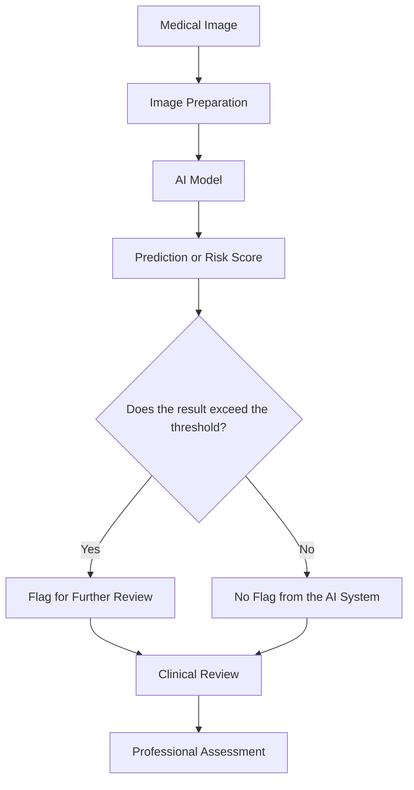
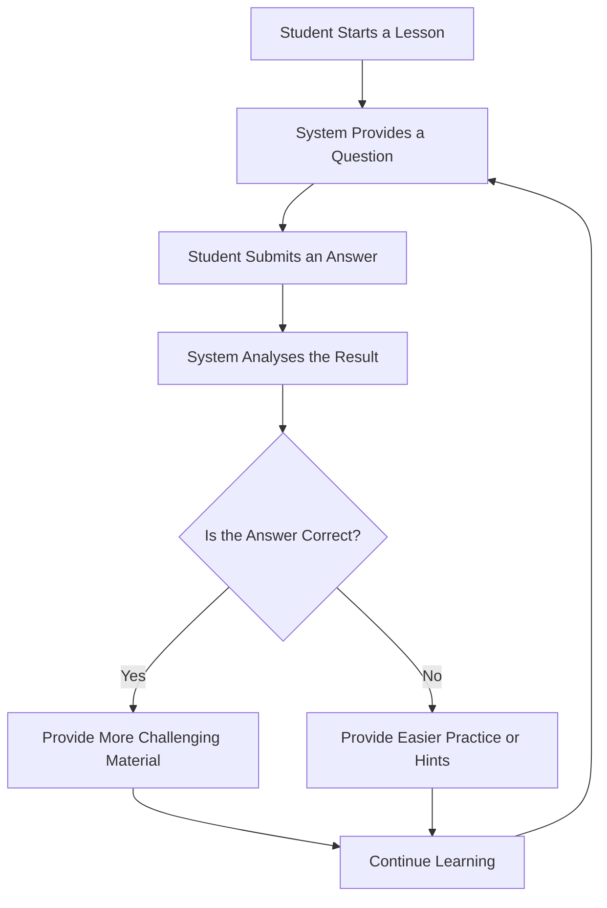
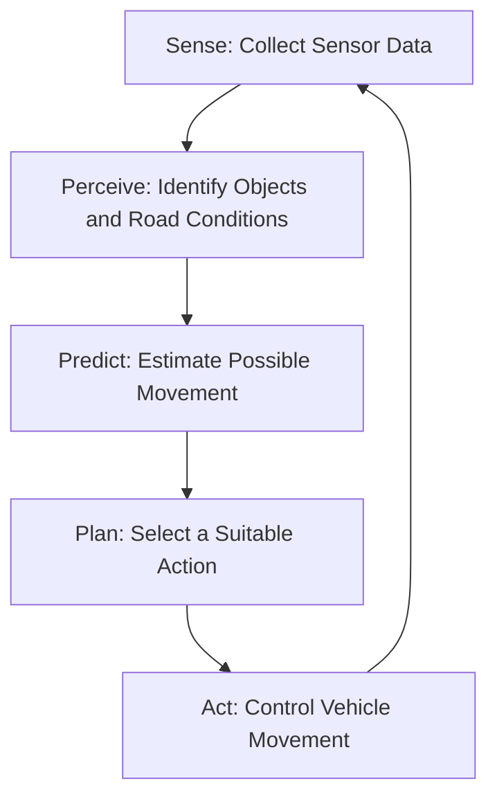
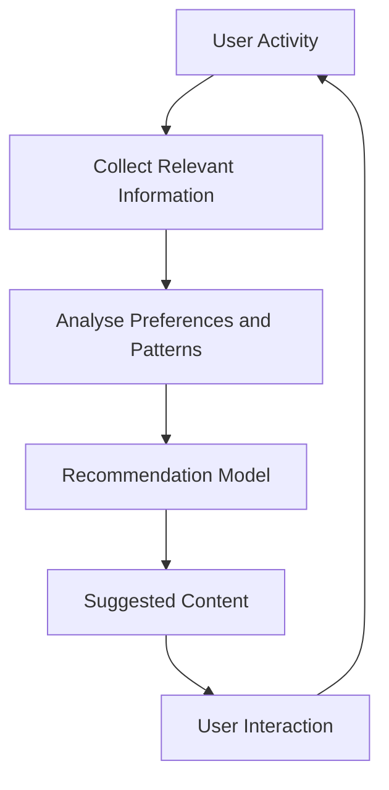
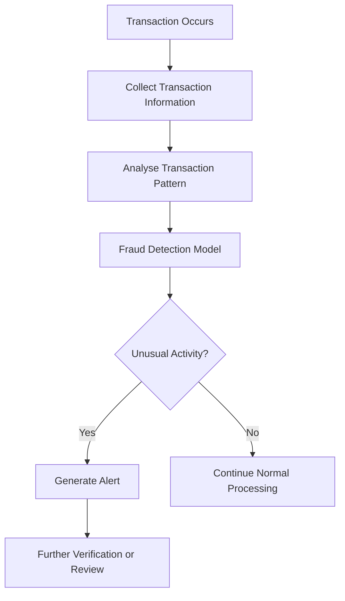

# Chapter 4: Applications of AI

> **Module:** AI Overview
> **Chapter:** 4 — Applications of AI
> **Version:** 2.1
> **Audience:** Complete beginners with no technical background in AI
> **Estimated Study Time:** Approximately 5–6 hours, including activities
> **Author:** Brian Djoni Suzanna (V2.0 draft). V2.1 course-alignment revision prepared for Jonathan Sugianto, who now owns this chapter.

---

## Table of Contents

1. [Learning Outcomes](#learning-outcomes)
2. [Prerequisites and Introduction](#prerequisites-and-introduction)
3. [Understanding AI Applications](#understanding-ai-applications)
4. [Applications at a Glance](#applications-at-a-glance)
5. [Topic 1: AI in Healthcare](#topic-1-ai-in-healthcare)
6. [Topic 2: AI in Education](#topic-2-ai-in-education)
7. [Topic 3: AI in Transportation](#topic-3-ai-in-transportation)
8. [Topic 4: AI in Everyday Life](#topic-4-ai-in-everyday-life)
9. [Topic 5: AI in Finance and Trading](#topic-5-ai-in-finance-and-trading)
10. [Topic 6: AI in Games and Robotics](#topic-6-ai-in-games-and-robotics)
11. [Cross-Topic Comparison](#cross-topic-comparison)
12. [Final Learning Activity](#final-learning-activity)
13. [Chapter Summary](#chapter-summary)
14. [Glossary](#glossary)
15. [Practice Questions and Answers](#practice-questions-and-answers)
16. [References](#references)

---

# Learning Outcomes

By the end of this chapter, learners should be able to:

1. **Identify** common applications of AI in healthcare, education, transportation, everyday life, finance, and games and robotics.
2. **Explain** how AI systems use data and models to support real-world tasks.
3. **Distinguish** between common AI tasks, including classification, prediction, recommendation, perception, and anomaly detection.
4. **Interpret** basic performance measures used in AI applications, including sensitivity, specificity, precision, and accuracy.
5. **Analyse** the benefits, limitations, and possible consequences of AI applications.
6. **Compare** different AI applications according to their purpose, data requirements, risks, and need for human oversight.
7. **Recognise** the difference between machine-learning systems and ordinary rule-based automation.
8. **Explain** which of the three classic approaches (Symbolic, Connectionist, and Behaviorist AI) an application mainly uses, and why many applications combine them.
9. **Describe** how a learning agent uses rewards, and explain why a badly designed reward can lead to unwanted behaviour.

---

# Prerequisites and Introduction

This chapter builds on the basic AI concepts introduced in the previous chapters.

Learners are expected to have a general understanding of:

* Artificial Intelligence (AI)
* Machine Learning (ML)
* Data
* Algorithms
* Models
* Training and inference
* Neural networks and deep learning
* The three classic approaches to building AI: Symbolic, Connectionist, and Behaviorist (Chapter 3, §3.3)

These concepts will be used throughout this chapter without repeating their full technical explanations.

## Introduction: Where Do We Actually Use AI?

Artificial Intelligence is no longer limited to research laboratories or advanced computer systems. It is already used in many areas of daily life and industry.

For example:

* Hospitals use AI to help analyse medical images.
* Educational platforms use AI to recommend learning materials.
* Vehicles use AI to recognise objects and support driving decisions.
* Online platforms use AI to recommend videos, music, and products.
* Banks use AI to identify unusual financial transactions.

Although these applications work in different environments, they share a similar purpose: using data and computational methods to help solve specific problems.

However, an AI system is not automatically useful simply because it uses advanced technology. Its value depends on whether it solves the intended problem reliably and safely.

To understand an AI application, ask five important questions:

| Question                       | What to investigate                                                         |
| ------------------------------ | --------------------------------------------------------------------------- |
| 1. What problem does it solve? | Identify the real-world problem or task.                                    |
| 2. What data does it use?      | Identify the information needed by the system.                              |
| 3. What does the AI produce?   | Understand its prediction, recommendation, classification, or other output. |
| 4. What are its limitations?   | Consider situations in which the system may fail.                           |
| 5. Who should oversee it?      | Determine whether a human should review or approve its output.              |

These questions provide a consistent way to evaluate applications across different industries.

---

# Understanding AI Applications

Before exploring individual sectors, it is useful to understand several common tasks performed by AI systems.

## 1. Classification

**Classification** means placing information into predefined categories.

Examples:

* Classifying an email as spam or not spam.
* Identifying whether a medical image contains signs of disease.
* Recognising whether an image contains a cat or a dog.

The output is usually a category or class.

## 2. Prediction

**Prediction** means estimating an unknown or future value based on available information.

Examples:

* Predicting tomorrow's weather.
* Estimating a vehicle's arrival time.
* Forecasting customer demand.

A prediction is an estimate, not a guarantee that something will happen.

## 3. Recommendation

A **recommendation system** suggests items that may be relevant to a user.

Examples:

* Recommending videos based on viewing history.
* Suggesting music based on listening preferences.
* Recommending products based on previous purchases.

## 4. Anomaly Detection

**Anomaly detection** identifies information that differs significantly from an expected pattern.

Examples:

* Detecting unusual bank transactions.
* Identifying abnormal machine behaviour in a factory.
* Finding unusual network activity.

An unusual event is not automatically a harmful event. It may simply require further investigation.

## 5. Perception

In AI, **perception** refers to interpreting information from the environment, such as images, sound, and sensor measurements.

Examples:

* Recognising pedestrians using a vehicle camera.
* Identifying objects in an image.
* Understanding spoken instructions.

## 6. Natural Language Processing

**Natural Language Processing (NLP)** allows computers to process and work with human language.

Examples:

* Language translation.
* Speech recognition.
* Text summarisation.
* Chatbots and conversational assistants.

## Comparing Common AI Tasks

| AI Task                     | Main Purpose                        | Example                 |
| --------------------------- | ----------------------------------- | ----------------------- |
| Classification              | Assign information to a category    | Spam detection          |
| Prediction                  | Estimate an unknown or future value | Arrival-time prediction |
| Recommendation              | Suggest relevant items              | Video recommendations   |
| Anomaly detection           | Identify unusual patterns           | Fraud alerts            |
| Perception                  | Interpret sensory information       | Pedestrian recognition  |
| Natural Language Processing | Process human language              | Translation             |
| Planning and control        | Choose a sequence of actions to reach a goal | A robot vacuum's route |

**Important:** These tasks are not mutually exclusive. A single application may combine several AI tasks. For example, a self-driving vehicle may use perception to recognise pedestrians, prediction to estimate their movement, and planning to choose an appropriate response.

## Which Approach Powers Which Application?

Chapter 3 (§3.3 to §3.6) explains three classic approaches to building AI: **Symbolic AI** (rules and logic written by people), **Connectionist AI** (networks that learn patterns from data), and **Behaviorist AI** (behaviour learned from rewards). Real applications rarely use only one. This table shows which approach supplies which part of some familiar systems. It does not repeat how the approaches work; follow the Chapter 3 links for that.

| Application | Symbolic part | Connectionist part | Behaviorist part | Read more |
| ----------- | ------------- | ------------------ | ---------------- | --------- |
| Medical decision support | Rule-based expert systems such as MYCIN, which applied hand-written IF-THEN rules to advise on antibiotics (Yu et al., 1979); clinical alert rules | Deep neural networks that analyse medical images (Gulshan et al., 2016; McKinney et al., 2020) | Not the main approach in current tools | Ch. 3, §3.4 and §3.5 |
| Driver assistance and navigation | Route planning by search; traffic rules written as explicit constraints | Neural networks that recognise pedestrians, vehicles, and signs from camera data | Learning driving behaviour from reward, mostly in simulation and research | Ch. 3, §3.4 to §3.6 |
| Recommendations and fraud detection | Business rules and thresholds (for example, "always review transfers above a set limit") | Models trained on very large data sets of past behaviour (Big Data) | Some systems treat clicks or feedback as rewards and adjust what they show | Ch. 3, §3.5 and §3.6 |
| Game-playing programs | Game-tree search, as in Deep Blue (Campbell et al., 2002) | Neural networks that judge positions or suggest moves | Learning from self-play and from the game score (Mnih et al., 2015; Silver et al., 2016) | Ch. 3, §3.4 and §3.6 |
| AI chat assistant | Tools and hand-written rules around the model, such as a calculator or safety filters | A transformer language model trained on very large amounts of text | Tuning with human feedback, a form of reinforcement learning (Ouyang et al., 2022) | Ch. 3, §3.3 and §3.11 |
| Spam filter (our running example) | Hand-written rules such as "contains 'free prize'" | Word scores or a neural network learned from labelled emails | In principle, "moved back to the inbox" can act as a penalty | Ch. 1, §1.5; Ch. 2, §2.4.10 |

**Reading the table.** The Symbolic column is usually the easiest to explain, because you can point to a rule. The Connectionist column handles messy input such as images and free text, but its decisions are harder to explain. The Behaviorist column matters when a system must choose a sequence of actions and learn from feedback. Chapter 5 returns to the strengths and risks of each approach.

---

# Applications at a Glance

| Sector              | Common AI Tasks                                     | Example Applications                                          | Main Benefits                             | Important Limitations                                          |
| ------------------- | --------------------------------------------------- | ------------------------------------------------------------- | ----------------------------------------- | -------------------------------------------------------------- |
| Healthcare          | Classification, prediction, image analysis          | Medical imaging, screening support, clinical decision support | Supports earlier detection and analysis   | Incorrect results, unequal performance, privacy concerns       |
| Education           | Recommendation, prediction, personalisation         | Adaptive learning, tutoring systems, learning analytics       | Personalised learning and faster feedback | Over-reliance, unsuitable recommendations, student privacy     |
| Transportation      | Perception, prediction, planning                    | Driver assistance, autonomous vehicles, route planning        | Safety support and operational efficiency | Rare situations, sensor limitations, safety risks              |
| Everyday Life       | Recommendation, classification, language processing | Streaming platforms, spam filters, voice assistants           | Convenience and personalisation           | Privacy, inaccurate outputs, limited recommendations           |
| Finance and Trading | Classification, prediction, anomaly detection       | Fraud detection, credit scoring, automated trading            | Faster analysis and monitoring            | Financial losses, incorrect alerts, changing market conditions |
| Games and Robotics  | Planning, perception, decision-making from rewards  | Game-playing programs, robot vacuums, warehouse and industrial robots | Safe practice in simulated worlds; automation of repetitive physical tasks | Reward design, simulation-to-reality gap, safety around people |

---

# Topic 1: AI in Healthcare

## 1.1 Why Is AI Used in Healthcare?

Healthcare is one of the areas where AI has significant potential because medical professionals work with large amounts of information.

This information includes:

* X-ray and MRI images.
* Retinal photographs.
* Laboratory test results.
* Medical records.
* Patient histories.
* Information from medical monitoring devices.

Analysing this information can take considerable time. AI systems can help identify patterns and provide additional information to healthcare professionals.

Common applications include:

| Application               | What AI Does                                               | Example                                               |
| ------------------------- | ---------------------------------------------------------- | ----------------------------------------------------- |
| Medical imaging           | Analyses medical images to identify possible abnormalities | Detecting possible signs of disease in an X-ray       |
| Disease screening         | Identifies people who may need further examination         | Retinal image screening                               |
| Clinical decision support | Provides information that may support clinical decisions   | Highlighting possible risks in patient information    |
| Patient monitoring        | Analyses measurements over time                            | Identifying unusual changes in monitored measurements |
| Administrative support    | Helps organise or process medical information              | Summarising clinical notes                            |
| Drug discovery            | Helps researchers analyse possible drug candidates         | Identifying molecules for further investigation       |

AI can support medical professionals, but it should not be treated as a complete replacement for clinical judgment.

## 1.2 Medical Imaging: How AI Analyses Medical Images

Medical imaging is an important example because it demonstrates how AI can identify patterns in visual information.

For example, a hospital may use an AI system to analyse retinal photographs and identify possible signs of diabetic retinopathy.

**Diabetic retinopathy** is damage to the blood vessels in the retina that can occur in people with diabetes.

A simplified process is:

### Understanding the Process

1. **Medical Image:** A medical professional or imaging device obtains an image.
2. **Image Preparation:** The image is prepared so that the model can process it.
3. **AI Model:** The model analyses patterns in the image.
4. **Prediction:** The system produces a category or risk score.
5. **Threshold:** The score is compared with a selected cut-off.
6. **Clinical Review:** A qualified professional considers the result and other relevant information.

A positive AI result does not automatically confirm a disease. It indicates that further assessment may be needed.

### Important Terms

* **Clinician:** A healthcare professional involved in patient care, such as a doctor or nurse.
* **Diagnosis:** The process of determining what condition a patient may have.
* **Screening:** Testing people to identify possible signs of a condition, often before symptoms appear.
* **Threshold:** A selected cut-off used to determine when a system raises an alert.
* **Clinical decision support:** Software that provides information or recommendations to assist healthcare professionals.

## 1.3 Real Research Examples

Research has demonstrated that AI can perform useful tasks in medical image analysis.

| Research               | Main Finding                                                                                                | Importance                                                                                            |
| ---------------------- | ----------------------------------------------------------------------------------------------------------- | ----------------------------------------------------------------------------------------------------- |
| Gulshan et al. (2016)  | Developed and evaluated a deep-learning system for detecting diabetic retinopathy from retinal photographs. | Demonstrated the potential of AI in retinal image screening.                                          |
| Esteva et al. (2017)   | Evaluated a deep neural network for classifying skin lesion images.                                         | Demonstrated the potential of image-based AI in dermatology.                                          |
| McKinney et al. (2020) | Evaluated an AI system for breast cancer screening using datasets from the UK and US.                       | Demonstrated possible improvements in mammography screening performance under the studied conditions. |

These studies show that AI can be useful in specific medical tasks.

However, results from a research dataset do not automatically guarantee the same performance in every hospital.

Differences in equipment, image quality, patient populations, and clinical procedures can affect performance.

## 1.4 Measuring the Performance of Medical AI

An AI system should not be evaluated only by asking whether it is accurate.

In healthcare, different types of mistakes can have different consequences.

For example:

* Missing a patient who has a disease may delay treatment.
* Incorrectly flagging a healthy patient may lead to unnecessary examinations.

To understand these outcomes, we use a **confusion matrix**.

### The Confusion Matrix

A confusion matrix compares the AI system's predictions with the actual results.

|                     | AI Predicts: Disease | AI Predicts: No Disease |
| ------------------- | -------------------- | ----------------------- |
| Patient Has Disease | True Positive (TP)   | False Negative (FN)     |
| Patient Is Healthy  | False Positive (FP)  | True Negative (TN)      |

The four outcomes are:

* **True Positive (TP):** The patient has the disease, and the AI correctly identifies it.
* **False Negative (FN):** The patient has the disease, but the AI fails to identify it.
* **False Positive (FP):** The patient is healthy, but the AI incorrectly flags the result.
* **True Negative (TN):** The patient is healthy, and the AI correctly identifies this.

### Four Important Performance Measures

| Measure     | Meaning                                                | Formula           |
| ----------- | ------------------------------------------------------ | ----------------- |
| Sensitivity | How many actual disease cases are detected?            | TP / (TP + FN)    |
| Specificity | How many healthy cases are correctly identified?       | TN / (TN + FP)    |
| Precision   | When the AI predicts disease, how often is it correct? | TP / (TP + FP)    |
| Accuracy    | How many total predictions are correct?                | (TP + TN) / Total |

### Worked Example: Evaluating a Screening Tool

A hospital evaluates an AI system that screens medical images for a particular condition.

The following numbers are invented for educational purposes.

The system is tested on **1,000 patients**:

* 100 patients actually have the condition.
* 900 patients do not have the condition.

The results are:

|             | Predicts Disease | Predicts No Disease | Total |
| ----------- | ---------------: | ------------------: | ----: |
| Has Disease |          TP = 90 |             FN = 10 |   100 |
| Healthy     |          FP = 45 |            TN = 855 |   900 |
| Total       |              135 |                 865 | 1,000 |

**Step 1: Calculate Sensitivity**

Sensitivity = TP / (TP + FN)

= 90 / (90 + 10)

= 90 / 100

= **90%**

The system identifies 90% of the patients who actually have the condition.

**Step 2: Calculate Specificity**

Specificity = TN / (TN + FP)

= 855 / (855 + 45)

= 855 / 900

= **95%**

The system correctly identifies 95% of the healthy patients.

**Step 3: Calculate Precision**

Precision = TP / (TP + FP)

= 90 / (90 + 45)

= 90 / 135

= **66.7%**

When the system predicts that a patient has the condition, approximately 66.7% of those predictions are correct.

**Step 4: Calculate Accuracy**

Accuracy = (TP + TN) / Total

= (90 + 855) / 1,000

= 945 / 1,000

= **94.5%**

### Interpreting the Results

The system has an accuracy of 94.5%, which appears strong.

However, its precision is only 66.7%.

This means that approximately one-third of the positive alerts are false positives.

Therefore, accuracy alone does not explain the complete performance of a medical AI system.

### Why Does Disease Prevalence Matter?

Consider the same AI system being used to screen 10,000 people in a population where only 1% actually have the condition.

The system still has:

* Sensitivity = 90%.
* Specificity = 95%.

The population contains:

* 100 people with the condition.
* 9,900 healthy people.

The results become:

|             | Predicts Disease | Predicts No Disease |  Total |
| ----------- | ---------------: | ------------------: | -----: |
| Has Disease |          TP = 90 |             FN = 10 |    100 |
| Healthy     |         FP = 495 |          TN = 9,405 |  9,900 |
| Total       |              585 |               9,415 | 10,000 |

Precision = 90 / (90 + 495)

= 90 / 585

= **15.4%**

The model's sensitivity and specificity have not changed, but its precision has decreased.

Why?

Because the condition is rare in this population. There are many more healthy people, so even a relatively small false-positive rate can create many false alerts.

**Key takeaway:** The performance of a screening system must be considered together with the population in which it is used.

## 1.5 Healthcare Activity

A second AI model is tested on 1,000 patients:

* 100 patients have the condition.
* 900 patients are healthy.

The results are:

|             | Predicts Disease | Predicts No Disease |
| ----------- | ---------------: | ------------------: |
| Has Disease |          TP = 75 |             FN = 25 |
| Healthy     |          FP = 90 |            TN = 810 |

Answer the following questions:

**Question 1:** Calculate the sensitivity of Model B.

**Question 2:** Calculate its specificity.

**Question 3:** Calculate its precision.

**Question 4:** Calculate its accuracy.

**Question 5:** Compare Model B with the previous model. Which model performs better based on the given measurements?

<strong>Show Answers</strong>

**1. Sensitivity**

75 / (75 + 25) = 75 / 100 = **75%**

**2. Specificity**

810 / (810 + 90) = 810 / 900 = **90%**

**3. Precision**

75 / (75 + 90) = 75 / 165 = **45.5%**

**4. Accuracy**

(75 + 810) / 1,000 = 885 / 1,000 = **88.5%**

**5. Comparison**

Model A performs better on all four measurements in these examples:

| Measure     | Model A | Model B |
| ----------- | ------: | ------: |
| Sensitivity |     90% |     75% |
| Specificity |     95% |     90% |
| Precision   |   66.7% |   45.5% |
| Accuracy    |   94.5% |   88.5% |

Model A identifies more actual cases and produces fewer false alerts in this scenario.

However, a real medical system should also be evaluated using appropriate clinical evidence and professional review.

## 1.6 Benefits and Limitations of Healthcare AI

| Benefits                                                       | Limitations                                                         |
| -------------------------------------------------------------- | ------------------------------------------------------------------- |
| Helps analyse large numbers of medical images.                 | Can produce incorrect predictions.                                  |
| May help identify possible abnormalities earlier.              | Performance may differ between patient populations.                 |
| Supports healthcare professionals with additional information. | Medical data must be protected.                                     |
| Can help reduce repetitive analysis tasks.                     | Incorrect use may lead to unnecessary examinations or missed cases. |
| Can support research and drug discovery.                       | Requires clinical validation and professional oversight.            |

**Healthcare takeaway:** AI can improve medical analysis and support clinical decisions, but medical professionals remain important for interpreting results and making patient-care decisions.

> **Big Data in healthcare.** Medical-imaging models are trained on very large collections of labelled scans. These data are highly sensitive, because they link a person's identity to their health, so they must be protected. A data set that mostly contains one patient group can also make a model less reliable for others. See Chapter 3 (§3.5) for what "Big Data" means, and Chapter 5, Topic 1 (Bias) and Topic 2 (Privacy), for the risks.

---

# Topic 2: AI in Education

## 2.1 Why Is AI Used in Education?

Students do not all learn in the same way or at the same speed.

Some students understand a topic quickly, while others need additional explanations and practice.

AI can help educational platforms adapt learning materials based on student performance.

For example, an online learning platform may:

* Recommend additional exercises.
* Identify topics where a student frequently makes mistakes.
* Provide hints when a student struggles.
* Adjust the difficulty of practice questions.
* Analyse learning progress.

The purpose is not to remove teachers from education. Instead, AI can provide additional support and information that teachers may use to improve learning.

## 2.2 Common Applications

| Application                  | How AI Helps                                    | Example                                    |
| ---------------------------- | ----------------------------------------------- | ------------------------------------------ |
| Adaptive learning            | Adjusts learning materials based on performance | Easier or harder mathematics questions     |
| Intelligent tutoring systems | Provides explanations and hints                 | Step-by-step assistance with algebra       |
| Automated assessment support | Helps evaluate certain types of answers         | Multiple-choice marking                    |
| Language learning            | Supports speech recognition and feedback        | Pronunciation practice                     |
| Learning analytics           | Analyses learning activity                      | Identifying topics where students struggle |
| Learning recommendations     | Suggests relevant materials                     | Recommending additional exercises          |

### Important Terms

* **Adaptive learning:** A learning approach in which content changes according to student performance.
* **Intelligent Tutoring System (ITS):** Software designed to provide guidance, feedback, or hints during learning.
* **Learning analytics:** The collection and analysis of information about learning activities.
* **Personalisation:** Adjusting learning experiences to better match individual needs.

## 2.3 How Does an Adaptive Learning System Work?

A simple adaptive learning system may follow this process:

The system uses information from previous answers to determine what learning material may be appropriate next.

A more advanced system may consider:

* Previous performance.
* Types of mistakes.
* Time spent on questions.
* Topics already completed.
* Learning progress over time.

These signals can help the system make more informed recommendations.

## 2.4 Worked Example: A Simple Adaptive Quiz

The following example uses fixed rules to demonstrate adaptive learning. It is a simplified automated system, not necessarily a trained machine-learning model.

**Rules:**

* The difficulty has five levels.
* Level 1 is the easiest.
* Level 5 is the hardest.
* The student starts at Level 3.
* A correct answer increases the next question's difficulty by one level.
* An incorrect answer decreases the next question's difficulty by one level.
* The system cannot go below Level 1 or above Level 5.

A student answers:

**Correct → Correct → Wrong → Wrong → Correct**

| Question | Current Level | Result  | Next Level |
| -------- | ------------: | ------- | ---------: |
| 1        |             3 | Correct |          4 |
| 2        |             4 | Correct |          5 |
| 3        |             5 | Wrong   |          4 |
| 4        |             4 | Wrong   |          3 |
| 5        |             3 | Correct |          4 |

The system adjusts the next question according to the student's answers.

This is a basic example of personalisation.

However, a real educational system should not rely on a single answer to determine a student's full ability. A student may answer incorrectly because of confusion, distraction, or an unfamiliar question format.

## 2.5 A More Realistic Learning Scenario

Imagine a student studying basic algebra.

The platform notices that the student:

* Correctly solves simple equations.
* Frequently makes mistakes when moving terms between sides.
* Takes longer to solve equations containing fractions.

Instead of simply giving the student more questions, the system may recommend a short explanation about solving equations with fractions.

It may then provide practice questions that gradually increase in difficulty.

The system's recommendation can help the student focus on a specific weakness.

However, the teacher should still review the student's overall understanding. A platform may identify repeated mistakes, but it may not understand every reason behind them.

## 2.6 Education Activity

A student begins at difficulty Level 3.

The system follows the same rules:

* Correct answer: increase the next level by one.
* Incorrect answer: decrease the next level by one.
* Minimum level: 1.
* Maximum level: 5.

The student answers:

**Correct → Wrong → Wrong → Wrong → Correct → Correct**

Answer:

1. What is the difficulty level of each question?
2. What is the final difficulty level?
3. What should the system do if the student repeatedly answers incorrectly?
4. Give one advantage and one limitation of adaptive learning.
5. Why should teachers still be involved?

<strong>Show Answers</strong>

**1. Question levels**

| Question | Current Level | Result  | Next Level |
| -------- | ------------: | ------- | ---------: |
| 1        |             3 | Correct |          4 |
| 2        |             4 | Wrong   |          3 |
| 3        |             3 | Wrong   |          2 |
| 4        |             2 | Wrong   |          1 |
| 5        |             1 | Correct |          2 |
| 6        |             2 | Correct |          3 |

**2. Final difficulty level:** Level 3 for the next question.

**3.** The system may provide easier practice, additional explanations, or recommend teacher assistance.

**4.** An advantage is that students can receive practice suited to their current performance. A limitation is that the system may misunderstand why a student is struggling.

**5.** Teachers provide explanations, emotional support, classroom guidance, and professional judgment that an automated system cannot fully replace.

## 2.7 Benefits and Limitations of Education AI

| Benefits                                         | Limitations                                                     |
| ------------------------------------------------ | --------------------------------------------------------------- |
| Provides personalised learning materials.        | Recommendations may not always match the student's needs.       |
| Gives faster feedback.                           | Students may become too dependent on automated answers.         |
| Helps teachers identify learning difficulties.   | Learning data must be protected.                                |
| Supports language learning and practice.         | Automated assessment may not understand every answer correctly. |
| Allows students to practise at different speeds. | Technology access may differ between students.                  |

**Education takeaway:** AI can support personalised learning and help teachers understand student progress, but it should complement teaching rather than replace it.

---

# Topic 3: AI in Transportation

## 3.1 Why Is AI Used in Transportation?

Transportation systems involve many decisions that must be made using information from the surrounding environment.

Examples include:

* Recognising nearby vehicles.
* Detecting pedestrians.
* Estimating traffic conditions.
* Selecting routes.
* Predicting arrival times.
* Supporting vehicle safety systems.

AI can help process this information and support transportation decisions.

Common applications include:

| Application            | Purpose                                                           |
| ---------------------- | ----------------------------------------------------------------- |
| Driver assistance      | Helps drivers monitor road conditions and possible hazards.       |
| Autonomous vehicles    | Performs some driving tasks using sensors and computer systems.   |
| Navigation systems     | Predicts travel times and recommends routes.                      |
| Traffic management     | Analyses traffic patterns to support traffic control.             |
| Fleet management       | Helps organise delivery vehicles and transportation resources.    |
| Predictive maintenance | Identifies possible vehicle or equipment problems before failure. |

## 3.2 Understanding Sensors in Transportation

AI-powered transportation systems often depend on sensors.

A **sensor** is a device that collects information about the surrounding environment.

Common examples include:

| Sensor            | How It Works                                                                     | Possible Use                                                   |
| ----------------- | -------------------------------------------------------------------------------- | -------------------------------------------------------------- |
| Camera            | Captures visual information.                                                     | Recognising traffic signs and pedestrians.                     |
| Radar             | Uses radio waves to detect objects and estimate distance or movement.            | Detecting nearby vehicles.                                     |
| LiDAR             | Uses laser light to measure distances and create information about surroundings. | Building a three-dimensional representation of nearby objects. |
| GPS               | Provides location information using satellite signals.                           | Navigation and route planning.                                 |
| Ultrasonic sensor | Uses sound waves to estimate nearby distances.                                   | Parking assistance.                                            |

Different systems use different combinations of sensors.

No single sensor provides perfect information in every situation.

For example, cameras may be affected by poor lighting, while some sensors may have limitations in particular weather or environmental conditions.

## 3.3 How Does an Autonomous Vehicle Make Decisions?

An autonomous vehicle must repeatedly gather information, interpret its surroundings, estimate what may happen, and choose an appropriate action.

A simplified process is:

### Step 1: Sense

The vehicle collects information using cameras, radar, LiDAR, and other sensors.

### Step 2: Perceive

The system interprets the collected information.

For example, it may identify:

* A pedestrian.
* A nearby vehicle.
* A traffic light.
* A road boundary.

### Step 3: Predict

The system estimates what nearby objects may do next.

For example, it may estimate whether a pedestrian is likely to cross the road.

### Step 4: Plan

The system selects a suitable response based on its understanding of the environment.

### Step 5: Act

The vehicle carries out the selected action, such as maintaining speed, slowing down, or stopping.

This process repeats continuously because the road environment changes.

## 3.4 Driver Assistance vs Autonomous Driving

Not all vehicles with AI features are fully autonomous.

The SAE driving automation framework describes six levels, from Level 0 to Level 5.

| Level | Name                           | General Description                                                                                                     |
| ----- | ------------------------------ | ----------------------------------------------------------------------------------------------------------------------- |
| 0     | No Driving Automation          | The human driver performs the driving task.                                                                             |
| 1     | Driver Assistance              | The system assists with one driving task, such as steering or speed control.                                            |
| 2     | Partial Driving Automation     | The system can control steering and speed together, but the human driver must supervise continuously.                   |
| 3     | Conditional Driving Automation | The system performs the driving task under specific conditions and may request that a human take over.                  |
| 4     | High Driving Automation        | The system can perform the driving task within its defined operating conditions without requiring a human to take over. |
| 5     | Full Driving Automation        | The system is designed to perform driving tasks under all conditions covered by the framework.                          |

**Important:** Level 2 does not mean the vehicle is fully self-driving. The human driver remains responsible for supervising the driving environment.

### What Is an Operational Design Domain?

An **Operational Design Domain (ODD)** describes the conditions under which an automated driving system is designed to operate.

These conditions may include:

* Road types.
* Geographic areas.
* Weather conditions.
* Speed ranges.
* Lighting conditions.

A vehicle capable of operating automatically in one environment may not be suitable for every road or weather condition.

## 3.5 Worked Example: Recognising a Pedestrian

Imagine an autonomous vehicle travelling through a residential area.

Its sensors collect information showing an object near a pedestrian crossing.

The AI system processes the information:

| Stage    | System Activity                                               |
| -------- | ------------------------------------------------------------- |
| Sense    | Camera and radar collect information.                         |
| Perceive | The system identifies a pedestrian.                           |
| Predict  | The system estimates that the pedestrian may cross the road.  |
| Plan     | The system selects a suitable response, such as slowing down. |
| Act      | The vehicle reduces speed or stops when appropriate.          |

This example demonstrates how multiple AI tasks can work together.

* Perception identifies the pedestrian.
* Prediction estimates possible movement.
* Planning selects a response.
* Vehicle control carries out the response.

The system must still be tested carefully because unusual situations may be difficult to interpret.

## 3.6 Transportation Activity

Classify each situation according to the main AI task involved.

Choose from:

* Perception
* Prediction
* Planning
* Classification
* Anomaly detection

**Question 1:** A vehicle camera identifies a pedestrian crossing the road.

**Question 2:** A navigation application estimates that a journey will take 25 minutes.

**Question 3:** A vehicle system selects a route that avoids a road closure.

**Question 4:** A monitoring system identifies an unusual vibration pattern in a vehicle.

**Question 5:** A traffic system identifies whether a traffic sign is a speed-limit sign or a stop sign.

<strong>Show Answers</strong>

1. **Perception** — The system interprets visual information and identifies a pedestrian.
2. **Prediction** — The system estimates travel time.
3. **Planning** — The system selects a suitable route.
4. **Anomaly detection** — The system identifies unusual behaviour.
5. **Classification** — The system assigns the sign to a category.

## 3.7 Benefits and Limitations of Transportation AI

| Benefits                            | Limitations                                      |
| ----------------------------------- | ------------------------------------------------ |
| Supports driver awareness.          | Sensors may provide incomplete information.      |
| Helps estimate traffic conditions.  | Predictions may be incorrect.                    |
| Supports route planning.            | Traffic conditions can change quickly.           |
| May improve fleet management.       | Systems require maintenance and reliable data.   |
| Can automate certain driving tasks. | Rare road situations can be difficult to handle. |

**Transportation takeaway:** AI can support safer and more efficient transportation, but systems must be designed for their operating conditions and carefully evaluated because mistakes can have serious consequences.

---

# Topic 4: AI in Everyday Life

## 4.1 AI in Daily Activities

Many people interact with AI without recognising it.

AI is used by online services, smartphones, communication platforms, and entertainment applications.

Examples include:

| Application       | AI Task                                    | Example                                           |
| ----------------- | ------------------------------------------ | ------------------------------------------------- |
| Video platforms   | Recommendation                             | Suggesting videos based on viewing activity.      |
| Music platforms   | Recommendation                             | Suggesting songs based on listening preferences.  |
| Email services    | Classification                             | Identifying possible spam messages.               |
| Voice assistants  | Speech recognition and language processing | Responding to spoken questions.                   |
| Map applications  | Prediction and planning                    | Estimating arrival times and recommending routes. |
| Translation tools | Natural Language Processing                | Translating text between languages.               |
| Phone cameras     | Image processing                           | Adjusting images and recognising visual features. |
| Online shopping   | Recommendation                             | Suggesting products based on browsing activity.   |

These systems make digital services more convenient, but their recommendations and outputs are not always correct.

## 4.2 How Recommendation Systems Work

A recommendation system attempts to identify items that may be relevant to a user.

For example, imagine a person who frequently watches educational videos about electronics.

A video platform may use information such as:

* Videos previously watched.
* Topics selected by the user.
* Search history.
* Viewing duration.
* Interactions with videos.
* Patterns from other users with similar interests.

The system can use this information to recommend additional content.

A simplified process is:

The system may improve its recommendations when it receives additional feedback.

### Two Common Recommendation Approaches

**1. Content-Based Filtering**

The system recommends items that are similar to content the user previously liked.

Example:

A student watches several videos about electronic circuits. The platform recommends more videos about electronics.

**2. Collaborative Filtering**

The system identifies patterns among users with similar preferences.

Example:

If many users who enjoy a particular course also enjoy another course, the system may recommend the second course to similar users.

Some recommendation systems combine both approaches.

## 4.3 Worked Example: A Simple Recommendation System

Imagine a video platform with three users.

| User   | Previously Watched Topics          |
| ------ | ---------------------------------- |
| User A | Electronics, Programming, Robotics |
| User B | Electronics, Robotics, Physics     |
| User C | Cooking, Travel, Music             |

User A and User B have similar interests because both watch electronics and robotics content.

If User A watches a new video about physics, the platform may recommend similar physics content to User A.

It may also use patterns from User B's activity to suggest additional videos.

This is a simplified example of collaborative filtering.

However, similarity does not guarantee that a user will enjoy every recommended item.

## 4.4 Spam Filtering: Another Everyday AI Application

Email services use filtering systems to identify unwanted messages.

A spam filter may analyse:

* Words in the message.
* Sender information.
* Links.
* Message structure.
* Previous spam patterns.

A simplified classification system may produce two categories:

* Spam.
* Not spam.

### Worked Example: A Simple Word-Scoring Filter

The following example uses manually assigned scores for educational purposes. It demonstrates how an automated rule can classify messages; it is not a trained machine-learning model.

| Word    | Score |
| ------- | ----: |
| free    |    +2 |
| winner  |    +3 |
| click   |    +1 |
| meeting |    -2 |
| report  |    -2 |

**Decision rule:** If the total score is 3 or higher, classify the message as spam.

Message:

"Congratulations! You are a winner. Click here for a free offer."

Matching words:

* winner = +3
* click = +1
* free = +2

Total = 3 + 1 + 2 = **6**

Since 6 is greater than or equal to 3, the message is classified as **Spam**.

Now consider:

"Please send the report before the meeting."

Matching words:

* report = -2
* meeting = -2

Total = -2 - 2 = **-4**

The message is classified as **Not spam**.

### What Are the Limitations?

This simplified filter only considers selected words.

It does not fully understand:

* The meaning of the message.
* The relationship between words.
* The sender's actual intention.
* Whether the message is legitimate.

For example, a genuine message may contain the word "free" or "winner."

This can produce a false positive.

Real spam filters use more advanced methods and may consider many additional signals.

## 4.5 Everyday Life Activity

A simple recommendation system uses the following information:

| User | Favourite Topics                     |
| ---- | ------------------------------------ |
| A    | Technology, Science, Electronics     |
| B    | Technology, Electronics, Programming |
| C    | Sports, Travel, Cooking              |

Answer:

1. Which users have the most similar interests?
2. What topic might be recommended to User A based on User B's interests?
3. Why might the recommendation still be unsuitable?
4. Explain one difference between content-based filtering and collaborative filtering.

**Additional Question: Spam Filtering**

Using the word scores from Section 4.4, classify this message:

"Free report winner meeting."

Show the total score and explain the result.

<strong>Show Answers</strong>

**1.** Users A and B have the most similar interests because they both like technology and electronics.

**2.** Programming may be recommended to User A because User B is interested in it.

**3.** User A may not be interested in programming even though the interests are similar.

**4.** Content-based filtering recommends items similar to those a user previously liked. Collaborative filtering uses patterns from users with similar preferences.

**Spam filtering:**

* free = +2
* report = -2
* winner = +3
* meeting = -2

Total = 2 - 2 + 3 - 2 = **+1**

Since +1 is below 3, the message is classified as **Not spam** by this simplified rule.

This result may be incorrect because the filter only uses selected word scores.

## 4.6 Benefits and Limitations of Everyday AI

| Benefits                                                 | Limitations                                              |
| -------------------------------------------------------- | -------------------------------------------------------- |
| Saves time when searching for information.               | Recommendations may be inaccurate.                       |
| Helps organise digital content.                          | Personal data may be collected.                          |
| Provides convenient translation and communication tools. | Translation may lose meaning or context.                 |
| Helps identify unwanted messages.                        | Legitimate messages may be incorrectly filtered.         |
| Personalises entertainment and shopping experiences.     | Recommendations may limit exposure to different content. |

A **filter bubble** occurs when a recommendation system repeatedly presents similar content, potentially reducing exposure to different viewpoints or subjects.

**Everyday life takeaway:** AI makes many digital services more convenient, but users should understand that recommendations and automated outputs are based on patterns and may not always reflect their actual needs.

> **Big Data in everyday life.** A recommendation system learns from huge numbers of views, clicks, and searches that arrive continuously from many users. The same records can reveal personal interests and habits, so a platform must decide what to collect and how long to keep it (Chapter 5, Topic 2: Privacy).

---

# Topic 5: AI in Finance and Trading

## 5.1 Why Is AI Used in Finance?

Financial institutions process large amounts of information and transactions.

AI can help analyse this information, identify unusual patterns, and support financial operations.

Common applications include:

| Application           | What AI Does                                         | Example                                                           |
| --------------------- | ---------------------------------------------------- | ----------------------------------------------------------------- |
| Fraud detection       | Identifies unusual transaction patterns.             | Flagging a transaction that differs from normal account activity. |
| Credit assessment     | Analyses information relevant to credit risk.        | Supporting a bank's assessment of a loan application.             |
| Customer service      | Responds to common customer questions.               | Banking chatbots.                                                 |
| Risk analysis         | Helps evaluate possible financial risks.             | Analysing patterns in financial information.                      |
| Algorithmic trading   | Uses computer programs to execute trading decisions. | Automatically placing orders based on predefined rules or models. |
| Financial forecasting | Estimates possible future values or trends.          | Forecasting demand or financial indicators.                       |

## 5.2 Fraud Detection and Anomaly Detection

Fraud detection is an important application of AI in finance.

A bank may process thousands or millions of transactions.

It can be difficult to manually examine every transaction.

An AI system may analyse patterns such as:

* Transaction amount.
* Transaction location.
* Transaction time.
* Frequency of transactions.
* Previous account activity.
* Device or account information.

Imagine a customer who normally makes small purchases in one region.

Suddenly, the account records an unusually large transaction in a different location.

The system may identify the transaction as unusual and generate an alert.

This does not automatically prove that fraud has occurred. The transaction may be legitimate.

A human review or additional verification may still be necessary.

### Simplified Fraud Detection Process

## 5.3 Understanding Algorithmic Trading

**Algorithmic trading** uses computer programs to make or execute trading decisions according to defined instructions or models.

Some systems use fixed rules, while others may use machine-learning models.

For example, a program may be designed to compare two moving averages.

A **moving average** is the average price over a selected number of periods.

A shorter moving average reacts more quickly to recent price changes, while a longer moving average changes more gradually.

### Important Terms

* **Algorithmic trading:** Using computer programs to make or execute trading decisions.
* **High-frequency trading (HFT):** A form of algorithmic trading that executes large numbers of transactions at very high speed.
* **Backtesting:** Evaluating a trading rule or model using historical data.
* **Overfitting:** When a model or rule fits historical data too closely and performs poorly on new data.
* **Moving average:** The average value over a selected number of recent periods.

## 5.4 Worked Example: A Simple Moving-Average Rule

This example demonstrates rule-based automation. It is not necessarily an AI or machine-learning system.

A simplified trading rule compares:

* A 2-day moving average.
* A 3-day moving average.

The rule is:

* If the 2-day average is above the 3-day average, generate a buy signal.
* If the 2-day average is below the 3-day average, generate a sell signal.

For this educational example:

* Prices are daily closing prices.
* The averages are evaluated after each day's close.
* A signal is acted on at the next day's closing price.
* One unit is considered.
* Fees and taxes are ignored.

The following prices are invented for teaching:

| Day | Closing Price |
| --- | ------------: |
| 1   |            10 |
| 2   |            11 |
| 3   |            12 |
| 4   |            11 |
| 5   |            10 |
| 6   |             9 |

### Calculating the Moving Averages

**Day 3**

2-day average:

(11 + 12) / 2 = **11.50**

3-day average:

(10 + 11 + 12) / 3 = **11.00**

The 2-day average is above the 3-day average, so a buy signal is generated after the Day 3 close.

**Day 4**

2-day average:

(12 + 11) / 2 = **11.50**

3-day average:

(11 + 12 + 11) / 3 = **11.33**

The 2-day average remains above the 3-day average.

The Day 3 signal is acted on at the Day 4 closing price of 11.

**Day 5**

2-day average:

(11 + 10) / 2 = **10.50**

3-day average:

(12 + 11 + 10) / 3 = **11.00**

The 2-day average is now below the 3-day average.

A sell signal is generated after the Day 5 close.

**Day 6**

The previous sell signal is acted on at the Day 6 closing price of 9.

### Summary

| Day | Closing Price | 2-Day Average | 3-Day Average | Signal After Close |
| --- | ------------: | ------------: | ------------: | ------------------ |
| 1   |            10 |             - |             - | -                  |
| 2   |            11 |             - |             - | -                  |
| 3   |            12 |         11.50 |         11.00 | Buy                |
| 4   |            11 |         11.50 |         11.33 | Hold               |
| 5   |            10 |         10.50 |         11.00 | Sell               |
| 6   |             9 |          9.50 |         10.00 | Stay out           |

Under the stated assumptions:

* Buy at 11 on Day 4.
* Sell at 9 on Day 6.
* Difference = 9 - 11 = **-2 per unit**.

This simplified example shows that a trading rule can generate a loss even when it follows its instructions correctly. The example is deliberately simple. Real trading systems use many more signals, costs, and risk controls, and a moving-average rule reacts to past prices, so it can lag behind sudden changes.

## 5.5 Why Can Automated Trading Make Mistakes?

A trading system may perform poorly for several reasons:

1. **Changing market conditions:** Historical patterns may not continue.
2. **Overfitting:** A rule may work well on past data but fail on new information.
3. **Delayed signals:** Moving averages react to price changes after they occur.
4. **Execution differences:** Actual transaction prices may differ from assumed prices.
5. **Unexpected events:** News or unusual market conditions can change prices rapidly.

A successful backtest does not guarantee future performance.

It only shows how a rule or model would have performed under the historical conditions being tested.

## 5.6 When Automated Systems Interact: The 2010 Flash Crash

On 6 May 2010, US financial markets experienced a sudden and significant decline followed by a rapid recovery.

The event is commonly known as the **2010 Flash Crash**.

Investigations by US financial regulators examined how automated trading activity and market conditions contributed to the event.

One important lesson is that automated systems can interact with one another in unexpected ways.

A system may follow its own instructions correctly while the combined behaviour of many systems creates undesirable results.

This demonstrates why monitoring, safeguards, and appropriate oversight are important in automated financial systems.

## 5.7 Finance Activity

A company is testing an automated system that detects unusual transactions.

For each situation, decide whether the system should:

* Continue normal processing.
* Generate an alert for further review.

**Situation 1:** A customer makes a small purchase at a familiar location, similar to previous transactions.

**Situation 2:** An account suddenly records an unusually large transaction in a location that differs significantly from its normal activity.

**Situation 3:** A customer makes a larger-than-usual purchase but confirms that it is legitimate.

Answer:

1. Which situation is most likely to trigger an anomaly alert?
2. Does an anomaly alert automatically prove that fraud occurred?
3. Why should a human review some flagged transactions?
4. Explain why a successful historical trading result does not guarantee future performance.
5. Is the moving-average example necessarily an AI system? Explain.

<strong>Show Answers</strong>

**1.** Situation 2 is most likely to trigger an alert because it differs significantly from the account's usual activity.

**2.** No. An unusual transaction may be legitimate.

**3.** Human review can help determine whether the transaction is genuinely suspicious and prevent unnecessary restrictions on legitimate activity.

**4.** Market conditions can change, and historical patterns may not continue. A system may also be overfitted to past data.

**5.** No. The moving-average example uses fixed mathematical rules. It demonstrates algorithmic automation, but it does not necessarily involve machine learning or AI.

## 5.8 Benefits and Limitations of Finance AI

| Benefits                                    | Limitations                                             |
| ------------------------------------------- | ------------------------------------------------------- |
| Analyses large amounts of transaction data. | Can generate false fraud alerts.                        |
| Helps identify unusual financial patterns.  | May fail to identify new fraud patterns.                |
| Supports financial analysis.                | Predictions are not guarantees.                         |
| Can automate repetitive operations.         | Automated decisions may have significant consequences.  |
| Supports faster monitoring.                 | Requires monitoring, testing, and appropriate controls. |

**Finance takeaway:** AI can help financial institutions analyse information and detect unusual activity, but financial decisions and automated systems require careful evaluation because errors may result in financial losses.

> **Big Data in finance.** Fraud-detection systems check very large streams of transactions in near real time. The data show where and how a customer spends money, which is personal, and a wrong alert can inconvenience a customer or restrict an account. Data protection and the right to challenge a decision are therefore part of the design (Chapter 5, Topic 2).

---

# Topic 6: AI in Games and Robotics

## 6.1 Why Are Games and Robots Used to Study AI?

Games and robots may seem very different, but both give an AI system something that real life often does not: **a clear goal and quick feedback**.

* A game has fixed rules and a score. The program can play many times, learn from the result, and try again.
* A robot has a body. It senses the world, chooses an action, and sees what happens. Learning by trial and error is possible, but mistakes in the real world can break things or hurt people.

Because of this, games and robots are the main home of **Behaviorist AI**, in which a system learns what to do from rewards (Chapter 3, §3.6). They also use Symbolic AI (for example, search through possible moves) and Connectionist AI (for example, neural networks that recognise objects), as the table in *Which Approach Powers Which Application?* shows.

## 6.2 Common Applications

| Application | What the AI does | Main approaches |
| ----------- | ---------------- | --------------- |
| Game-playing programs | Chooses moves in games such as chess or Go | Search (Symbolic), neural networks, reinforcement learning |
| Computer-controlled game characters | Chooses actions so that a character reacts to the player | Rules (Symbolic), sometimes learning |
| Robot vacuum cleaners | Senses obstacles, plans a route, and avoids bumping into furniture | Simple behaviours, planning, sometimes learning |
| Warehouse and industrial robots | Moves or handles objects repeatedly and safely | Planning, perception, control |
| Simulated training worlds | Lets an AI practise before it works in the real world | Reinforcement learning |

### Important Terms

| Term | Meaning |
| ---- | ------- |
| **Agent** | The part of the system that chooses actions (the game player, the robot's controller). |
| **Environment** | Everything the agent interacts with (the game board, the room). |
| **Reward** | A number that tells the agent how good or bad the result of an action was. |
| **Policy** | The agent's way of choosing an action in each situation. |
| **Simulation** | A computer model of the world in which an agent can practise safely. |

## 6.3 How Does a Learning Agent Work?

A learning agent repeats a simple loop:

1. **Sense:** observe the situation (the board, the camera image, the distance sensors).
2. **Choose:** pick an action using its current policy.
3. **Act:** make the move or movement.
4. **Receive a reward:** get a score for the result (for example +1 for a win, −1 for a loss).
5. **Update:** adjust the policy so that actions leading to higher rewards become more likely.

Chapter 3 (§3.6) explains this loop, and a small worked example of Q-learning, in detail. This chapter focuses on how it is *applied* and where it goes wrong.

**Behaviour-based robotics** is a different route. Instead of giving the robot a detailed model of the world to reason about, the designer builds it from layers of simple behaviours, such as "avoid obstacles" and "wander", that react directly to what the robot senses (Brooks, 1991). Many simple robots, including some cleaning robots, work this way.

## 6.4 Worked Example: Rewarding a Robot Vacuum

A robot vacuum is tested in a small room. Its designers give it this reward:

* **+1** each time it cleans a tile that was dirty,
* **−2** each time it bumps into something,
* **−0.1** for every move it makes (so it does not wander without purpose).

Two test runs, each lasting 10 moves:

| | Dirty tiles cleaned | Bumps | Moves |
| --- | :---: | :---: | :---: |
| Run A (random wandering) | 4 | 3 | 10 |
| Run B (planned sweep of the room) | 8 | 0 | 10 |

**Run A:** (4 × 1) + (3 × −2) + (10 × −0.1) = 4 − 6 − 1.0 = **−3.0**

**Run B:** (8 × 1) + (0 × −2) + (10 × −0.1) = 8 + 0 − 1.0 = **+7.0**

Run B earns a much higher reward, so a learning agent would gradually favour the behaviour of Run B. The reward told the robot *what we want*: clean more, bump less, and do not waste moves.

**What can go wrong?** Suppose the designers had written a simpler reward: "+1 every time a tile is cleaned", with nothing about whether the tile was dirty. A robot could earn reward by cleaning the same tile again and again. It would maximise the reward that was *written*, not the result that was *wanted*. This problem is called **reward hacking**. A well-known real example is a boat-racing game in which an agent was rewarded for hitting targets. It found a spot where it could circle and hit the same targets repeatedly, and scored about 20% higher than human players instead of finishing the race (OpenAI, 2016).

## 6.5 Real Examples from Games

* **Atari video games.** A system called Deep Q-Network (DQN) learned to play 49 classic Atari games using only the raw screen pixels and the game score. It beat earlier methods in 43 of them, and in more than half of the games it reached over 75% of a professional human tester's level, with the same design and settings for every game (Mnih et al., 2015).
* **Go.** AlphaGo combined deep neural networks, tree search, and reinforcement learning from self-play, and beat the European Go champion Fan Hui 5–0 (Silver et al., 2016).

These examples show the main idea of this topic: a clear score, plus a very large amount of practice in a simulated world, can produce impressive skill. They also show why the approaches are combined, since AlphaGo used all three.

## 6.6 Games and Robotics Activity

A delivery robot in a building earns **+5** for each package delivered, **−1** for each minute a delivery is late, and **−10** if it bumps into a person.

1. **Calculate.** In one hour the robot delivers 6 packages, is late by a total of 8 minutes, and does not bump into anyone. What is its total reward?
2. **Compare.** A second robot delivers 9 packages, is late by a total of 4 minutes, and bumps into 2 people. What is its total reward? Which robot behaved better, and does the reward agree with your opinion?
3. **Find a loophole.** Suggest one way a robot might get a high reward without doing the job we really want.
4. **Improve the reward.** Change the reward so that the loophole no longer pays off.
5. **Classify and decide.** Which of the three classic approaches does the *learning* part of this robot mainly use? Should a human supervise it while it works in a building with people? Explain.

<strong>Sample Answers: Games and Robotics</strong>

**1.** (6 × 5) + (8 × −1) + 0 = 30 − 8 = **+22**.

**2.** (9 × 5) + (4 × −1) + (2 × −10) = 45 − 4 − 20 = **+21**. The first robot scores slightly higher (+22 against +21), so the reward says it behaved better. Whether that agrees with your opinion depends on how serious you think bumping into people is. Many people would say that bumping into two people is much worse than delivering three more packages, so the penalty of −10 may be too small. Choosing the numbers is a design decision, not a fact.

**3.** *(Any reasonable loophole.)* The robot could deliver packages only to nearby rooms and ignore far ones; or it could stay still so that it never bumps into anyone; or, if a delivery is counted when the robot *says* it delivered, it could report deliveries without making them.

**4.** *(Any reasonable fix.)* Count a delivery only when the recipient confirms it; add a small penalty for each minute with no delivery in progress; or increase the penalty for bumping into a person (for example, −50).

**5.** The learning part mainly uses **Behaviorist AI** (reinforcement learning), although the robot also needs perception (Connectionist) and route planning (Symbolic). Yes, a human should supervise it, because errors can harm people and the robot may find loopholes in its reward.

## 6.7 Benefits and Limitations of Games and Robotics AI

| Benefits | Limitations |
| -------- | ----------- |
| Systems can practise safely in simulation before acting in the real world. | A skill learned in simulation can fail on real hardware (the simulation-to-reality gap). |
| Can reach very high skill in games with clear rules and scores. | Often needs millions of practice trials. |
| Can automate repetitive physical tasks. | A badly designed reward can lead to reward hacking. |
| Gives researchers a clear way to measure progress. | Real robots can damage property or hurt people, so safe exploration matters. |

**Games and robotics takeaway:** Learning from rewards can produce impressive behaviour, but the reward must describe what people really want, and physical robots need careful testing and human oversight.

---

# Cross-Topic Comparison

The six topics discussed in this chapter use AI for different purposes.

However, they can be compared using the same evaluation criteria.

| Sector         | Main AI Task                         | Example Output                  | Possible Cost of Error                          | Human Oversight |
| -------------- | ------------------------------------ | ------------------------------- | ----------------------------------------------- | --------------- |
| Healthcare     | Classification and prediction        | Possible disease alert          | Missed condition or unnecessary examination     | High            |
| Education      | Recommendation and personalisation   | Suggested learning material     | Incorrect learning path or misunderstanding     | Medium          |
| Transportation | Perception, prediction, and planning | Vehicle response                | Safety incidents                                | High            |
| Everyday Life  | Recommendation and classification    | Suggested content or spam alert | Inconvenience or missed information             | Low to medium   |
| Finance        | Anomaly detection and prediction     | Transaction alert               | Financial loss or incorrect account restriction | Medium to high  |
| Games and robotics | Planning and learning from rewards | Next move or robot action | A lost game, or, for a physical robot, damage or injury | Low for games; high for robots working near people |

The level of human oversight depends on the application and the consequences of incorrect results.

For example, an incorrect video recommendation is usually less serious than an incorrect medical screening result.

Therefore, AI systems should not all be evaluated using exactly the same standards.

## A General Framework for Evaluating AI Applications

Use the following framework when studying any AI application:

| Evaluation Area | Questions to Ask                                                    |
| --------------- | ------------------------------------------------------------------- |
| Purpose         | What problem is the system designed to solve?                       |
| Input           | What information does the system receive?                           |
| Method          | What AI task does it perform?                                       |
| Output          | What prediction, classification, or recommendation does it produce? |
| Performance     | How do we know whether the system works well?                       |
| Limitations     | In which situations may it fail?                                    |
| Impact          | Who may be affected by an incorrect result?                         |
| Oversight       | When should a human review the output?                              |

This framework can be applied to existing systems and proposed AI projects.

---

# Final Learning Activity

## Activity: Evaluating an AI Application

Imagine that a company wants to introduce an AI system to improve one of the following areas:

* Healthcare.
* Education.
* Transportation.
* Everyday digital services.
* Finance.
* Games and robotics.

Choose **one** area and complete the following analysis.

### Part A: Identify the Application

1. Which sector did you choose?
2. What problem are you trying to solve?
3. What would the AI system do?

### Part B: Understand the System

4. What type of information would the system need?
5. Which AI task would it perform?
6. What output would the system produce?

### Part C: Evaluate the System

7. What is one important benefit?
8. What is one possible limitation?
9. What could happen if the system makes an incorrect prediction?
10. Should a human review the system's output? Explain your answer.

### Part D: Present Your Conclusion

Write a short paragraph explaining:

* Why the application may be useful.
* What limitations must be considered.
* How the system should be evaluated before being used.

<strong>Sample Answer: Education</strong>

**1. Sector:** Education.

**2. Problem:** Some students have difficulty identifying which topics they need to practise.

**3. AI Function:** The system analyses student performance and recommends additional learning materials.

**4. Information Needed:** Previous answers, completed exercises, and learning progress.

**5. AI Task:** Recommendation and prediction.

**6. Output:** Suggested exercises and learning materials.

**7. Benefit:** Students may receive practice that better matches their learning needs.

**8. Limitation:** The system may misunderstand why a student is struggling.

**9. Possible Consequence:** A student may receive unsuitable learning materials or practise the wrong topic.

**10. Human Review:** Yes. Teachers should review learning progress and provide additional explanations when necessary.

**Conclusion:**

An AI-based learning recommendation system may help students practise topics that require additional attention. It can analyse learning activity and recommend suitable materials. However, its recommendations may not always reflect the student's actual difficulties. Therefore, teachers should remain involved in evaluating learning progress and supporting students.

**Self-check checklist for your answer.** Your analysis is complete if you can tick every item:

- [ ] You named one sector and one clear problem.
- [ ] You described what the AI system does in one or two sentences.
- [ ] You listed the information (data) the system needs.
- [ ] You named the AI task (classification, prediction, recommendation, anomaly detection, perception, or language).
- [ ] You named the approach behind it (Symbolic, Connectionist, or Behaviorist, or a mix) and gave a reason.
- [ ] You gave at least one benefit and at least one limitation or risk.
- [ ] You said where a human should stay in control.

---

# Chapter Summary

Artificial Intelligence is used in many industries to support tasks that involve analysing information, recognising patterns, making predictions, and recommending actions.

The six topics discussed in this chapter demonstrate different ways AI can be applied.

### 1. Healthcare

AI can support medical image analysis, disease screening, patient monitoring, and clinical decision support.

However, medical systems must be carefully evaluated using appropriate measurements such as sensitivity, specificity, precision, and accuracy.

### 2. Education

AI can support adaptive learning, tutoring systems, automated feedback, and learning analytics.

It can help personalise learning, but teachers remain important for guidance and evaluating student understanding.

### 3. Transportation

AI can support driver assistance, autonomous driving functions, traffic prediction, and route planning.

These systems depend on sensors and the ability to interpret changing environments. Safety and operating conditions are especially important.

### 4. Everyday Life

AI is used in recommendation systems, spam filtering, translation, voice assistants, and digital platforms.

These applications provide convenience, but their outputs and recommendations may not always be suitable.

### 5. Finance and Trading

AI can help identify unusual transactions, analyse financial information, and support automated operations.

However, financial predictions are uncertain, and automated systems can produce significant errors.

### 6. Games and Robotics

AI can learn to play games and control robots by trying actions and receiving rewards (Behaviorist AI), often together with search and neural networks.

The reward must describe what people really want, otherwise the system may exploit it (reward hacking). Robots that act near people need careful testing and human oversight.

### Which approach powers which application?

Applications often combine the three classic approaches: Symbolic AI supplies rules and search, Connectionist AI recognises patterns in large data sets, and Behaviorist AI learns from rewards (Chapter 3, §3.3 to §3.6).

## Key Takeaways

* AI is applied to specific problems rather than being one universal solution.
* Different industries use different AI tasks, such as classification, prediction, recommendation, perception, and anomaly detection.
* AI systems depend on the information they receive and the methods used to process it.
* A system's performance should be measured using criteria appropriate to its application.
* Accuracy alone may not describe the full performance of a system.
* The consequences of errors differ between applications.
* Human oversight is particularly important when incorrect outputs may have serious consequences.
* Rule-based automation and machine-learning systems are not the same thing.
* AI should be evaluated based on its actual usefulness, reliability, and limitations.
* Many applications combine Symbolic, Connectionist, and Behaviorist AI. Naming which part uses which approach helps explain how a system works and where it may fail.
* Big Data makes many applications possible, but it also raises privacy and fairness questions.
* A reward tells a learning agent what to maximise. If the reward is badly designed, the agent may reach the reward without doing what people wanted (reward hacking).

**Final Principle:**

> The value of an AI system is not determined only by how advanced its technology is, but by how effectively and responsibly it solves a real-world problem.

---

# Glossary

| Term                                  | Definition                                                                                                               |
| ------------------------------------- | ------------------------------------------------------------------------------------------------------------------------ |
| **Accuracy**                          | The proportion of all predictions that are correct.                                                                      |
| **Adaptive Learning**                 | A learning approach that adjusts content based on student performance.                                                   |
| **Agent**                             | The part of an AI system that chooses actions, such as a game player or a robot's controller.                            |
| **Algorithmic Trading**               | Using computer programs to make or execute trading decisions.                                                            |
| **Anomaly Detection**                 | Identifying information that differs from expected patterns.                                                             |
| **Autonomous Vehicle**                | A vehicle capable of performing some or all driving tasks automatically, depending on its automation level.              |
| **Backtesting**                       | Evaluating a model or rule using historical data.                                                                        |
| **Behaviorist AI**                    | An approach in which a system learns what to do from experience, by acting and receiving rewards or penalties.           |
| **Behaviour-Based Robotics**          | Building a robot from layers of simple behaviours, such as avoiding obstacles, instead of a detailed model of the world. |
| **Big Data**                          | Data sets that are very large, fast-growing, or varied enough to need special tools to store and analyse them.           |
| **Classification**                    | Assigning information to predefined categories.                                                                          |
| **Clinical Decision Support**         | Software that provides information or recommendations to assist healthcare professionals.                                |
| **Clinician**                         | A healthcare professional involved in patient care.                                                                      |
| **Collaborative Filtering**           | A recommendation approach that uses patterns among users with similar preferences.                                       |
| **Confusion Matrix**                  | A table comparing predicted categories with actual categories.                                                           |
| **Connectionist AI**                  | An approach in which many simple connected units, such as a neural network, learn patterns from data.                    |
| **Diagnosis**                         | The process of determining what condition a patient may have.                                                            |
| **Environment**                       | Everything an agent interacts with, such as a game board or a room.                                                      |
| **False Negative (FN)**               | A positive case that the system incorrectly identifies as negative.                                                      |
| **False Positive (FP)**               | A negative case that the system incorrectly identifies as positive.                                                      |
| **Filter Bubble**                     | A situation in which recommendations repeatedly show similar content and may limit exposure to other information.        |
| **High-Frequency Trading (HFT)**      | Algorithmic trading that executes transactions at very high speed and volume.                                            |
| **Intelligent Tutoring System (ITS)** | Software that provides learning guidance, feedback, or hints.                                                            |
| **Learning Analytics**                | The collection and analysis of information about learning activities.                                                    |
| **LiDAR**                             | A sensing method that uses laser light to measure distances.                                                             |
| **Moving Average**                    | The average value over a selected number of recent periods.                                                              |
| **Operational Design Domain (ODD)**   | The conditions under which an automated driving system is designed to operate.                                           |
| **Overfitting**                       | When a model fits historical data too closely and performs poorly on new data.                                           |
| **Perception**                        | Interpreting information from images, sound, or other sensors.                                                           |
| **Policy**                            | An agent's way of choosing an action in each situation.                                                                  |
| **Precision**                         | The proportion of positive predictions that are correct.                                                                 |
| **Prediction**                        | Estimating an unknown or future value using available information.                                                       |
| **Prevalence**                        | The proportion of a population that has a particular condition.                                                          |
| **Recommendation System**             | Software that suggests items based on user information or patterns.                                                      |
| **Reinforcement Learning**            | Machine learning in which an agent learns by trial and error from rewards and penalties.                                 |
| **Reward**                            | A number that tells a learning agent how good or bad the result of an action was.                                        |
| **Reward Hacking**                    | When an agent finds a way to earn reward without achieving what the designers wanted.                                    |
| **Screening**                         | Testing people to identify possible signs of a condition, often before symptoms appear.                                  |
| **Sensitivity**                       | The proportion of actual positive cases correctly identified by a system.                                                |
| **Sensor**                            | A device that collects information about the environment.                                                                |
| **Simulation**                        | A computer model of the world in which an agent can practise safely.                                                     |
| **Specificity**                       | The proportion of actual negative cases correctly identified by a system.                                                |
| **Symbolic AI**                       | An approach in which knowledge is written as symbols, rules, and logic that a program can reason with.                   |
| **Threshold**                         | A selected cut-off used to determine when a system produces a particular result or alert.                                |
| **True Negative (TN)**                | A negative case correctly identified as negative.                                                                        |
| **True Positive (TP)**                | A positive case correctly identified as positive.                                                                        |

---

# Practice Questions and Answers

## Part A: Multiple Choice

**Q1.** Which AI task involves assigning information to categories?

A. Prediction
B. Classification
C. Recommendation
D. Backtesting

**Q2.** What is the main purpose of an adaptive learning system?

A. To replace every teacher
B. To automatically give every student the same questions
C. To adjust learning materials based on student performance
D. To prevent students from making mistakes

**Q3.** Which sensor uses laser light to measure distances?

A. GPS
B. Radar
C. LiDAR
D. Ultrasonic sensor

**Q4.** Which AI application is most closely associated with anomaly detection?

A. Recommending music
B. Detecting unusual bank transactions
C. Translating a sentence
D. Adjusting image brightness

**Q5.** What does sensitivity measure in a medical screening system?

A. How many healthy people are correctly identified
B. How many actual disease cases are detected
C. How many total predictions are correct
D. How many positive predictions are correct

**Q6.** What is collaborative filtering mainly based on?

A. Similarities between users' preferences
B. The colour of an image
C. Fixed mathematical trading rules
D. The physical location of a computer

**Q7.** Which statement about SAE Level 2 driving automation is correct?

A. The vehicle performs all driving tasks without human supervision.
B. The human driver must supervise the system continuously.
C. The vehicle can operate under every possible condition.
D. No driver assistance is provided.

**Q8.** What is overfitting?

A. A model performs equally well in every situation.
B. A model fits past data too closely and performs poorly on new data.
C. A model receives no data.
D. A model always predicts the same result.

**Q9.** Does a fraud alert automatically prove that a transaction is fraudulent?

A. Yes, every alert confirms fraud.
B. No, an unusual transaction may be legitimate.
C. Yes, because AI predictions are always correct.
D. No, because AI cannot analyse transactions.

**Q10.** Why is human oversight especially important in healthcare?

A. Medical AI never uses data.
B. Medical decisions can have serious consequences.
C. AI cannot process images.
D. Healthcare systems do not use computers.

## Part B: Short Answer

**Q11.** Explain the difference between classification and prediction. Give one example of each.

**Q12.** Describe how an AI-based medical imaging system may support healthcare professionals.

**Q13.** What is the difference between a false positive and a false negative?

**Q14.** Explain why accuracy alone may be misleading when evaluating a medical screening system.

**Q15.** Describe how an adaptive learning system changes the materials provided to a student.

**Q16.** Explain the difference between driver assistance and fully autonomous driving.

**Q17.** How can a recommendation system use user activity to suggest content?

**Q18.** Why can a spam filter incorrectly classify a legitimate email?

**Q19.** Explain why a moving-average trading rule is not necessarily an AI system.

**Q20.** Why does a successful backtest not guarantee future trading performance?

## Part C: Application and Analysis

**Q21.** A hospital tests an AI screening system on 500 patients. The results are:

* TP = 80
* FN = 20
* FP = 40
* TN = 360

Calculate:

a. Sensitivity
b. Specificity
c. Precision
d. Accuracy

**Q22.** A learning platform notices that a student repeatedly makes mistakes when solving equations with fractions. Explain how an adaptive learning system could respond.

**Q23.** A vehicle's camera identifies a pedestrian near a crossing. Explain how perception, prediction, planning, and action may work together.

**Q24.** A video platform recommends similar content every time a user opens the application. Explain one benefit and one possible limitation of this recommendation behaviour.

**Q25.** A bank's AI system flags a transaction because it differs from the customer's normal activity. Explain why the bank should investigate the alert instead of automatically assuming fraud.

## Part D: Approaches, Games and Robotics, and Big Data

**Q26.** Which classic approach does a rule-based expert system such as MYCIN mainly use?

A. Symbolic AI
B. Connectionist AI
C. Behaviorist AI
D. Generative AI

**Q27.** A robot vacuum earns a reward for each newly cleaned tile and a penalty for each bump. Which approach does this describe?

A. Symbolic AI, because the room has fixed walls
B. Connectionist AI, because it has sensors
C. Behaviorist AI, because it learns from rewards and penalties
D. None of them, because robots do not use AI

**Q28.** Explain in 3 to 4 sentences why an AI chat assistant is said to combine all three classic approaches.

**Q29.** A cleaning robot's reward is +1 for each dirty tile cleaned, −2 for each bump, and −0.1 for each move. In one run it cleans 6 dirty tiles, bumps twice, and makes 12 moves. Calculate its total reward.

**Q30.** A robot is rewarded +1 every time a tile is cleaned, even if the tile was already clean. Describe how it could exploit this reward, and suggest a better reward.

**Q31.** Name two kinds of data a recommendation system may use, and one privacy risk of collecting them.

## Suggested Answers

**Q1. B — Classification.**

**Q2. C — To adjust learning materials based on student performance.**

**Q3. C — LiDAR.**

**Q4. B — Detecting unusual bank transactions.**

**Q5. B — How many actual disease cases are detected.**

**Q6. A — Similarities between users' preferences.**

**Q7. B — The human driver must supervise the system continuously.**

**Q8. B — A model fits past data too closely and performs poorly on new data.**

**Q9. B — An unusual transaction may be legitimate.**

**Q10. B — Medical decisions can have serious consequences.**

**Q11.** Classification assigns information to a category, such as spam or not spam. Prediction estimates an unknown or future value, such as travel time.

**Q12.** The system processes a medical image, identifies patterns, and produces a prediction or alert that a healthcare professional may consider during further assessment.

**Q13.** A false positive occurs when the system incorrectly identifies a negative case as positive. A false negative occurs when the system incorrectly identifies a positive case as negative.

**Q14.** Accuracy may hide poor performance on a smaller group. A system can achieve high overall accuracy while missing many actual disease cases.

**Q15.** The system analyses student performance and may recommend easier questions, additional explanations, or more challenging exercises.

**Q16.** Driver assistance supports a human driver, who remains responsible for supervising the vehicle. Fully autonomous driving refers to a system designed to perform the driving task without continuous human control within its intended operating conditions.

**Q17.** It analyses information such as previous views, searches, and interactions to identify patterns and suggest potentially relevant content.

**Q18.** A legitimate email may contain words or patterns that the filter associates with spam.

**Q19.** A moving-average rule follows fixed mathematical instructions. It does not necessarily learn patterns from training data.

**Q20.** Market conditions can change, historical patterns may not continue, and a rule may be overfitted to past data.

**Q21.**

a. Sensitivity = 80 / (80 + 20) = **80%**

b. Specificity = 360 / (360 + 40) = **90%**

c. Precision = 80 / (80 + 40) = **66.7%**

d. Accuracy = (80 + 360) / 500 = **88%**

**Q22.** The system may recommend additional explanations and practice questions about fractions. It may gradually increase the difficulty when the student demonstrates understanding. A teacher should still review the student's progress.

**Q23.** Perception identifies the pedestrian. Prediction estimates the pedestrian's possible movement. Planning selects an appropriate response, such as slowing down. The vehicle then carries out the action.

**Q24.** A benefit is that users can quickly find content related to their interests. A limitation is that they may see less variety and become exposed to a narrower range of information.

**Q25.** The transaction may be legitimate even though it is unusual. Further verification helps distinguish actual fraud from normal but uncommon activity.

**Q26.** **A.** MYCIN applied hand-written IF-THEN rules, so it is a Symbolic AI system. Connectionist AI learns patterns from data, and Behaviorist AI learns from rewards.

**Q27.** **C.** The robot improves through rewards and penalties, which is the Behaviorist idea (reinforcement learning). Option A is wrong because the *learning method* is not a set of written rules, and option B is wrong because having sensors does not make a system Connectionist.

**Q28.** *(Model answer)* The core of a chat assistant is a neural language model trained on very large amounts of text, which is Connectionist AI. Tools and safety rules written by people, such as a calculator or content filters, are Symbolic. Developers also tune the model with human feedback so that its answers are preferred, which uses reinforcement learning from the Behaviorist family. The three approaches therefore each supply a different part of one system (Chapter 3, §3.3).

**Q29.** (6 × 1) + (2 × −2) + (12 × −0.1) = 6 − 4 − 1.2 = **+0.8**.

**Q30.** The robot could go back and forth over one clean tile and collect +1 each time, scoring highly without cleaning the room. This is reward hacking. A better reward is +1 only when a tile that was dirty becomes clean, together with a small penalty for each move.

**Q31.** *(Model answer)* Viewing history and search or rating history are two examples. A privacy risk is that these records can reveal personal interests and habits, and may be stored or shared without the person fully understanding it. Any two reasonable kinds of data and any one reasonable risk are accepted.

---

# References

Bloom, B. S. (1984). The 2 sigma problem: The search for methods of group instruction as effective as one-to-one tutoring. *Educational Researcher, 13*(6), 4–16. https://doi.org/10.3102/0013189X013006004

Brooks, R. A. (1991). Intelligence without representation. *Artificial Intelligence, 47*(1–3), 139–159. https://doi.org/10.1016/0004-3702(91)90053-M *(Not verified: link not opened on 5 November 2026.)*

Campbell, M., Hoane, A. J., & Hsu, F.-h. (2002). Deep Blue. *Artificial Intelligence, 134*(1–2), 57–83. https://doi.org/10.1016/S0004-3702(01)00129-1

Esteva, A., et al. (2017). Dermatologist-level classification of skin cancer with deep neural networks. *Nature, 542*, 115–118. https://doi.org/10.1038/nature21056

Gomez-Uribe, C. A., & Hunt, N. (2016). The Netflix recommender system: Algorithms, business value, and innovation. *ACM Transactions on Management Information Systems, 6*(4), Article 13. https://doi.org/10.1145/2843948

Gulshan, V., et al. (2016). Development and validation of a deep learning algorithm for detection of diabetic retinopathy in retinal fundus photographs. *JAMA, 316*(22), 2402–2410. https://doi.org/10.1001/jama.2016.17216

Holmes, W., Bialik, M., & Fadel, C. (2019). *Artificial intelligence in education: Promises and implications for teaching and learning*. Center for Curriculum Redesign.

Kirilenko, A., Kyle, A. S., Samadi, M., & Tuzun, T. (2017). The Flash Crash: High-frequency trading in an electronic market. *The Journal of Finance, 72*(3), 967–998. https://doi.org/10.1111/jofi.12498

McKinney, S. M., et al. (2020). International evaluation of an AI system for breast cancer screening. *Nature, 577*, 89–94. https://doi.org/10.1038/s41586-019-1799-6

Mnih, V., et al. (2015). Human-level control through deep reinforcement learning. *Nature, 518*(7540), 529–533. Summary used to check the figures: https://research.google/blog/from-pixels-to-actions-human-level-control-through-deep-reinforcement-learning/ (Opened 5 November 2026)

Ngai, E. W. T., Hu, Y., Wong, Y. H., Chen, Y., & Sun, X. (2011). The application of data mining techniques in financial fraud detection: A classification framework and an academic review of literature. *Decision Support Systems, 50*(3), 559–569. https://doi.org/10.1016/j.dss.2010.08.006

OpenAI. (2016). *Faulty reward functions in the wild*. https://openai.com/index/faulty-reward-functions/ (Opened 5 November 2026)

Ouyang, L., et al. (2022). Training language models to follow instructions with human feedback. *Advances in Neural Information Processing Systems, 35*. https://arxiv.org/abs/2203.02155

SAE International. (2021). *J3016: Taxonomy and definitions for terms related to driving automation systems for on-road motor vehicles*. https://www.sae.org/standards/content/j3016_202104/

Silver, D., et al. (2016). Mastering the game of Go with deep neural networks and tree search. *Nature, 529*, 484–489. https://research.google/pubs/mastering-the-game-of-go-with-deep-neural-networks-and-tree-search/ *(Not verified: link not opened on 5 November 2026.)*

Topol, E. J. (2019). High-performance medicine: The convergence of human and artificial intelligence. *Nature Medicine, 25*, 44–56. https://doi.org/10.1038/s41591-018-0300-7

U.S. Commodity Futures Trading Commission and U.S. Securities and Exchange Commission. (2010). *Findings regarding the market events of May 6, 2010: Report of the staffs of the CFTC and SEC to the Joint Advisory Committee on Emerging Regulatory Issues*. https://www.sec.gov/news/studies/2010/marketevents-report.pdf

VanLehn, K. (2011). The relative effectiveness of human tutoring, intelligent tutoring systems, and other tutoring systems. *Educational Psychologist, 46*(4), 197–221. https://doi.org/10.1080/00461520.2011.611369

World Health Organization. (2021). *Ethics and governance of artificial intelligence for health: WHO guidance*. https://www.who.int/publications/i/item/9789240029200

Yu, V. L., et al. (1979). An evaluation of MYCIN's advice (antimicrobial selection by a computer: a blinded evaluation by infectious diseases experts). *JAMA, 242*, 1279–1282. Reprinted as Chapter 31 of Buchanan, B. G., & Shortliffe, E. H. (Eds.) (1984), *Rule-Based Expert Systems*. https://people.dbmi.columbia.edu/shortliffe/Buchanan-Shortliffe-1984/Chapter-31.pdf (Opened 5 November 2026)

---

**Note on Educational Examples:** Patient numbers, student performance sequences, word scores, transaction scenarios, and financial prices used in worked examples and activities are invented for educational purposes. They are not real patient records, financial recommendations, or experimental results.
