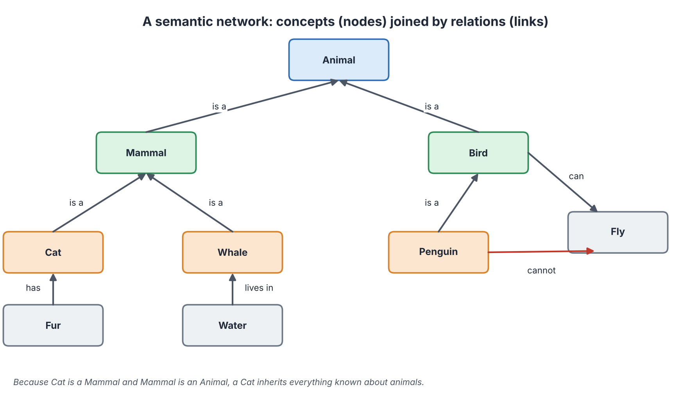
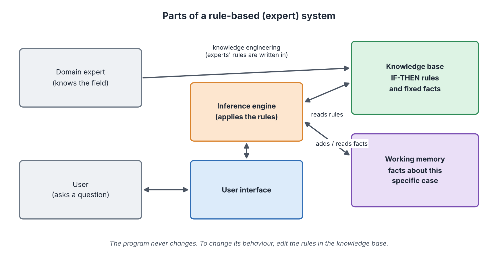
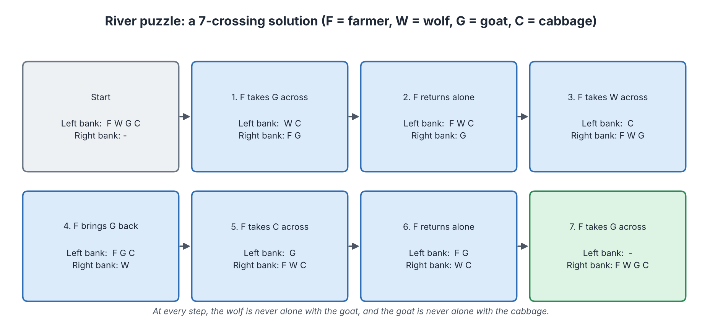
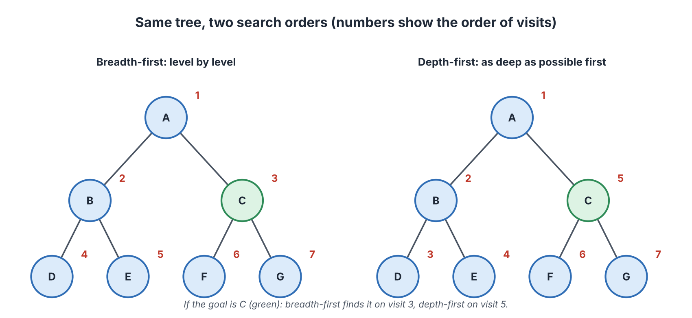
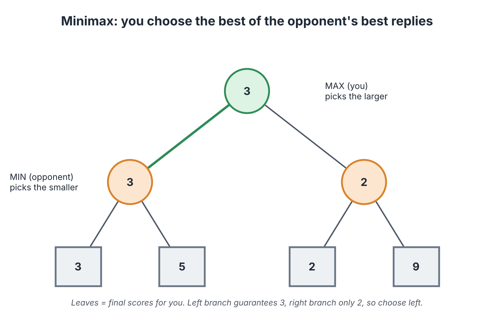

# Symbolic AI: Intelligence from Rules and Logic

**Audience:** Learners with no technical background in AI  
**Estimated time:** 3 to 4 hours (including missions)  
**Format:** Read, pause at each "Pause and predict" box, complete the two missions, then check the answer key at the end of the chapter.

---

## Table of Contents

- [Learning Outcomes](#learning-outcomes)
- [Where This Chapter Fits](#where-this-chapter-fits)
- [4.1 The Big Picture](#41-the-big-picture)
- [4.2 Logic: The Language of Rules](#42-logic-the-language-of-rules)
- [4.3 Knowledge Representation](#43-knowledge-representation)
- [4.4 Expert Systems](#44-expert-systems)
- [4.5 Search: Finding a Path to a Goal](#45-search-finding-a-path-to-a-goal)
- [4.6 Game Playing and Minimax](#46-game-playing-and-minimax)
- [4.7 Strengths, Limits and Today's Use](#47-strengths-limits-and-todays-use)
- [4.8 Mission 1: Be the Inference Engine](#48-mission-1-be-the-inference-engine)
- [4.9 Mission 2: Search and Minimax](#49-mission-2-search-and-minimax)
- [4.10 Common Misconceptions](#410-common-misconceptions)
- [4.11 Quick Check](#411-quick-check)
- [4.12 Summary, Connections and References](#412-summary-connections-and-references)
- [Answer Key](#answer-key)
- [Glossary](#glossary)
- [References](#references)

---

## Learning Outcomes

After this chapter, you should be able to:

1. Explain what symbolic AI is and how it differs from learning from data.
2. Use simple logic (AND, OR, NOT, IF-THEN) to read and write rules.
3. Describe three ways of representing knowledge: rules, semantic networks and frames.
4. Name the parts of an expert system and trace forward chaining step by step.
5. Explain state-space search and compare breadth-first and depth-first search.
6. Calculate the best move in a small game tree using minimax.
7. State the strengths and limits of symbolic AI and explain why it is still used today.

## Where This Chapter Fits

**Builds on Chapters 1 to 3.** Chapter 1 introduced the "rule or learn?" question. Chapter 3 showed the *learning* approach. This chapter shows the other classic approach: people write the knowledge down, and the computer reasons with it.

**Leads to Chapters 5 and 6.** Chapter 5 covers the connectionist approach (networks that learn). Chapter 6 covers the behaviorist approach (learning from rewards). Together, Chapters 4 to 6 are the three "schools" of AI taught in this module.

---

## 4.1 The Big Picture

### Start with a question

Imagine you give a friend a very detailed instruction manual for repairing bicycles. Your friend has never touched a bicycle, yet follows the manual step by step and fixes a flat tyre. Is your friend "intelligent"? The manual did the thinking, and your friend only followed it. **Symbolic AI is the computer version of this idea.**

### In plain words

**Symbolic AI is AI built from knowledge that people write down as symbols and rules.** A *symbol* is a name for a thing or an idea, such as `Cat`, `Mammal` or `has_fever`. The computer does not learn the rules from examples. It is *given* them, and it combines them by logic to reach conclusions.

Because the rules are written by people, this style is also called **rule-based AI**, **knowledge-based AI**, or **"good old-fashioned AI" (GOFAI)** (Haugeland, 1985).

### Short history

| Year | Event | Why it matters |
|:----:|-------|----------------|
| 1956 | *Logic Theorist* program proves mathematical theorems; the Dartmouth workshop names the field "AI" | Shows a computer can reason with symbols |
| 1976 | Newell and Simon state the **physical symbol system hypothesis**: manipulating symbols is enough for intelligence (Newell & Simon, 1976) | The core belief of this school |
| 1970s | *MYCIN* suggests treatments for blood infections using about 600 rules | A famous early expert system (Shortliffe, 1976) |
| 1980s | Companies build many commercial expert systems | The first big business wave of AI |
| Late 1980s to 1990s | Expert systems turn out costly to maintain; funding falls ("AI winter") | Shows the limits of hand-written knowledge |
| 1997 | *Deep Blue* beats world chess champion Garry Kasparov using search (Campbell et al., 2002) | Search at huge speed can beat humans in a narrow game |

### Where it sits in the big picture

Symbolic AI is the **rules-first** side of the "rule or learn?" question from Chapter 1.

| | Symbolic AI (this chapter) | Learning from data (Chapters 3 and 5) |
|---|---|---|
| Where knowledge comes from | Written by people | Found in data |
| What you can inspect | Every rule | Millions of numbers (weights) |
| Good at | Clear logic, exact procedures, explanation | Messy inputs: images, speech, language |
| Weak at | Situations nobody wrote a rule for | Explaining why it decided something |

**Analogy: an instruction manual.** The computer follows a manual written by experts.  
**Where the analogy breaks:** a human reader can notice that the manual is wrong or incomplete and improvise. A rule-based program cannot; it only does what the rules say.

---

## 4.2 Logic: The Language of Rules

### Start with a question

"If it rains and I have no umbrella, then I get wet." Can a computer check whether this sentence is true in a given situation? Yes, if we write it in a very exact form. That form is **logic**.

### In plain words

**Logic is a way of writing statements so that a computer can check them without guessing.** The simplest kind is *propositional logic*. A **proposition** is a statement that is either **true** or **false**, for example "It is raining".

### The four building blocks

| Word | Meaning | Everyday example |
|------|---------|------------------|
| **AND** | True only if both parts are true | "It rains AND I have no umbrella" |
| **OR** | True if at least one part is true | "I have a bus pass OR I have cash" |
| **NOT** | Flips true to false | "NOT raining" |
| **IF ... THEN** | If the first part is true, the second must be true | "IF raining THEN the road is wet" |

### Truth table

A *truth table* lists every possible case. Here P and Q are two statements.

| P | Q | P AND Q | P OR Q | NOT P |
|:-:|:-:|:-------:|:------:|:-----:|
| True | True | True | True | False |
| True | False | False | True | False |
| False | True | False | True | True |
| False | False | False | False | True |

### The key reasoning step: modus ponens

*Modus ponens* is Latin for "mode that affirms". The idea is simple:

1. **Rule:** IF it is raining THEN the road is wet.
2. **Fact:** It is raining.
3. **Conclusion:** The road is wet.

This one step, repeated many times, is the engine of rule-based AI.

### A stronger language: predicate logic

Propositional logic treats each sentence as a block. **Predicate logic** looks inside a sentence and talks about *things* and their *properties*. For example:

- `Cat(Tom)` means "Tom is a cat".
- `For all x: IF Cat(x) THEN Mammal(x)` means "every cat is a mammal".
- From these two, a computer concludes `Mammal(Tom)`.

> **Pause and predict.** A rule says "IF the soil is dry THEN water the plant". The fact is "the soil is wet". Can the computer conclude "do not water the plant"?
>
> **Check:** No. The rule only says what to do when the soil is dry. It says nothing about wet soil. To conclude "do not water", someone must write another rule. Computers conclude only what the rules allow.

---

## 4.3 Knowledge Representation

### Start with a question

Where does a computer "keep" what it knows? In a learning system, knowledge is hidden in numbers. In symbolic AI, it is written in a form people can read. Choosing *how* to write it is called **knowledge representation**.

### In plain words

**Knowledge representation is the way facts and rules are organised so that a computer can use them.** A good representation is clear for people and efficient for the computer.

### Three common forms

| Form | Idea | Small example |
|------|------|---------------|
| **Rules** | IF-THEN statements | IF fever AND cough THEN suspect flu |
| **Semantic network** | A map of concepts joined by relations | Cat *is a* Mammal; Mammal *is an* Animal |
| **Frame** | A form with slots to fill in | Frame *Cat*: legs = 4, covering = fur, sound = meow |

### Semantic network

*Figure 4.1: A semantic network. Source: created by our team.*

How to read Figure 4.1:

- Each box is a **concept** (called a node).
- Each arrow is a **relation** (called a link) with a label such as "is a".
- **Inheritance:** because Cat *is a* Mammal and Mammal *is an* Animal, a Cat automatically inherits what is known about animals. We do not need to write "a cat is an animal" separately.
- **Exceptions:** Birds *can* fly, but a Penguin is a Bird that *cannot*. The network records the exception on Penguin. This shows why real knowledge is untidy: almost every general rule has exceptions.

**Analogy: a family tree for ideas.** Traits pass downward from parents to children.  
**Where the analogy breaks:** in a family tree you cannot "choose" a different parent, but in a knowledge network the same concept can belong to many groups at once (a dolphin is both a Mammal and a Swimmer).

---

## 4.4 Expert Systems

### Start with a question

A rare-disease specialist cannot be in every hospital. Could we copy part of the specialist's knowledge into a program that any doctor can ask? That was the dream behind expert systems.

### In plain words

**An expert system is a program that uses rules collected from human experts to give advice in one narrow field.** It acts like a specialist you can consult on a computer.

### Parts of an expert system

*Figure 4.2: Parts of a rule-based (expert) system. Source: created by our team.*

| Part | Role | Plant-care example |
|------|------|--------------------|
| **Knowledge base** | The stored rules and fixed facts | "IF leaves yellow AND soil wet THEN overwatered" |
| **Working memory** | Facts about the current case | "Leaves yellow; soil wet" |
| **Inference engine** | The part that applies the rules to the facts | Matches rules to facts and adds conclusions |
| **User interface** | How the user asks and gets answers | A form or chat window |
| **Domain expert** | The human whose knowledge is written in | A gardener |

A key design idea: **the program never changes. To change its behaviour you edit the rules.** This makes the system easy to inspect and update, as long as the rules stay small in number.

### Two ways to reason

| Method | Starts from | Question it answers | Example |
|--------|-------------|---------------------|---------|
| **Forward chaining** | The known facts | "What follows from what I know?" | Facts: yellow leaves, wet soil. Conclude: overwatered. |
| **Backward chaining** | A goal to test | "What would have to be true for this goal?" | Goal: "overwatered?" Check: are leaves yellow? Is soil wet? |

### Worked example: forward chaining in steps

Rules:

| Rule | Condition | Conclusion |
|:----:|-----------|------------|
| R1 | Leaves yellow AND soil wet | Plant is overwatered |
| R2 | Plant is overwatered | Stop watering |
| R3 | Leaves yellow AND soil dry | Plant is underwatered |
| R4 | Plant is underwatered | Water now |

Case: leaves yellow, soil wet.

| Round | Rule checked | Do the facts match? | New fact added |
|:-----:|:------------:|:-------------------:|----------------|
| 1 | R1 | Yes (yellow, wet) | Plant is overwatered |
| 1 | R3 | No (soil is not dry) | none |
| 2 | R2 | Yes (overwatered is now a fact) | Stop watering |
| 2 | R4 | No | none |
| 3 | all | Nothing new can fire | **Stop.** Final advice: stop watering |

The engine repeats "find a rule that matches, add its conclusion" until nothing new appears. This is called *chaining* because one conclusion becomes the condition for the next rule.

### Famous examples

| System | Field | What it did |
|--------|-------|-------------|
| **DENDRAL** (1960s) | Chemistry | Inferred molecular structure from measurement data |
| **MYCIN** (1970s) | Medicine | Suggested antibiotics for blood infections; reported to match expert panels in tests, but was never used routinely in clinics (Buchanan & Shortliffe, 1984) |

### The main weakness: the knowledge bottleneck

**Knowledge engineering** is the work of interviewing experts and turning what they know into rules. It is slow and costly. Experts often cannot explain their own intuition in clear rules. And as rules grow into the thousands, they begin to conflict. This "knowledge bottleneck" is a main reason expert systems lost ground to learning from data.

---

## 4.5 Search: Finding a Path to a Goal

### Start with a question

You are in a city you do not know and need to reach a station. You try one street, hit a dead end, return, and try another. That trial-and-return process is what AI calls **search**.

### In plain words

**Search means exploring possible steps one after another until a goal is found.** To do this, a problem is described using three things:

| Term | In plain words | Puzzle example |
|------|----------------|----------------|
| **State** | One snapshot of the situation | "Farmer and goat on the right bank" |
| **Action** | A move that changes the state | "Farmer rows across with the goat" |
| **Goal** | The state we want | "Everyone on the right bank, nobody eaten" |

All possible states and moves together are called the **state space**.

### Example: the river-crossing puzzle

A farmer must carry a wolf, a goat and a cabbage across a river. The boat holds the farmer and only one item. The wolf must never be left alone with the goat, and the goat must never be left alone with the cabbage.

*Figure 4.3: A 7-crossing solution. Source: created by our team.*

Notice the clever step 4: the farmer brings the goat **back**. A search program finds such steps automatically because it tries every legal move and rejects the unsafe ones.

### Two basic search orders

*Figure 4.4: Breadth-first and depth-first search on the same tree. Source: created by our team.*

| | Breadth-first search (BFS) | Depth-first search (DFS) |
|---|---------------------------|--------------------------|
| Idea | Check everything one step away, then everything two steps away, and so on | Follow one path as deep as possible, then back up |
| Order in Figure 4.4 | A, B, C, D, E, F, G | A, B, D, E, C, F, G |
| Everyday comparison | Searching every room on the ground floor, then every room on the next floor | Opening one door and following the corridor until it ends |
| Finds the shortest path? | Yes (when each step costs the same) | Not always |
| Memory needed | Often large | Often small |

### Smarter search: heuristics

Real problems have far too many states to check all. A **heuristic** is a rule of thumb that estimates which choice is more promising. For example, when finding a route, "prefer the road that points toward the destination". The well-known **A\*** algorithm combines the cost so far with a heuristic estimate of the cost left (Hart et al., 1968).

---

## 4.6 Game Playing and Minimax

### Start with a question

When you play a board game, you think "if I move here, what will my opponent do? and then what will I do?" Computers can do the same, much faster.

### In plain words

**Minimax is a method for choosing the best move when an opponent is also trying to win.** We build a *game tree*: each branch is a possible move. At the end of each branch we write a **score** from our point of view (higher is better for us).

Two players take turns:

- **MAX** (you) always picks the **largest** score.
- **MIN** (your opponent) always picks the **smallest** score, because that is worst for you.

### Worked example

*Figure 4.5: Minimax. Source: created by our team.*

Work from the bottom up:

1. Left MIN node sees leaves 3 and 5. The opponent picks the smaller: **3**.
2. Right MIN node sees leaves 2 and 9. The opponent picks the smaller: **2**.
3. The root (MAX) compares 3 and 2 and picks the larger: **3**, so we go left.

Notice what we did: we did not hope for the 9. We assumed the opponent plays well and chose the move that gives the best *guaranteed* result.

### Making it practical

- Real games have too many moves to look at all. Chess has very roughly 35 legal moves in a typical position, so looking ahead many moves creates an enormous tree.
- **Alpha-beta pruning** skips branches that cannot change the final choice, which saves a great deal of work without changing the result.
- An **evaluation function** estimates how good a position is when the program must stop looking ahead (for example, counting piece values in chess).
- Deep Blue combined fast search, an evaluation function, and special chess hardware (Campbell et al., 2002).

---

## 4.7 Strengths, Limits and Today's Use

### Strengths

| Strength | Why it matters |
|----------|----------------|
| **Explainable** | You can show which rules led to a decision. |
| **Predictable** | The same input always gives the same output. |
| **Needs little data** | Rules come from experts, not from millions of examples. |
| **Easy to correct** | If a rule is wrong, you edit that rule. |

### Limits

| Limit | Meaning |
|-------|---------|
| **Brittleness** | The system fails sharply on a case outside its rules. |
| **Knowledge bottleneck** | Collecting and maintaining rules is slow and expensive. |
| **Common sense** | Everyday knowledge ("water is wet, cups hold liquids") is huge and hard to write down. |
| **Messy input** | Rules cannot easily read a photo or a voice recording. |
| **Uncertainty** | Basic rules are true or false; the real world is often "probably". |

### Still used today

Symbolic methods have not disappeared. You will find them in tax and legal rule checkers, configuration tools (for example, which parts fit together), scheduling, route planning and the logic inside many business systems. Researchers also combine them with neural networks in **neuro-symbolic AI**, aiming to join learning with reasoning and explanation (Garcez & Lamb, 2023). Chapter 7 shows where these methods appear in applications.

---

## 4.8 Mission 1: Be the Inference Engine

> **Goal:** act like the inference engine and trace forward chaining by hand.  
> **Preparation:** Section 4.4. Pen and 10 minutes.  
> **Task:** a plant-care helper has these rules.

| Rule | Condition | Conclusion |
|:----:|-----------|------------|
| R1 | Leaves yellow AND soil wet | Overwatered |
| R2 | Overwatered | Stop watering |
| R3 | Leaves yellow AND soil dry | Underwatered |
| R4 | Underwatered | Water now |
| R5 | Brown leaf tips AND air is dry | Mist the plant |
| R6 | Overwatered AND brown leaf tips | Check the roots for rot |

**Part A. Trace a case.** Facts: leaves yellow, soil wet, brown leaf tips, air dry. Fill in the table. (Write "none" if nothing is added.)

| Round | Rule that fires | New fact added |
|:-----:|:---------------:|----------------|
| 1 | ____ | ____ |
| 1 | ____ | ____ |
| 2 | ____ | ____ |
| 2 | ____ | ____ |
| 3 | ____ | ____ |

**Part B. Change one fact.** Now the soil is dry (everything else the same). Which rules fire and what is the final advice? ____

**Part C. Find the gap.** A user says "the leaves are yellow and the soil feels damp". Which rule fires? What does this show about symbolic AI?

> **Observe:** which new conclusions needed an earlier conclusion first?  
> **Reflect:** what did the engine do that a human might do differently? Where did you need to "think" beyond the rules?  
> **Feedback:** compare with the Answer Key (Mission 1).

---

## 4.9 Mission 2: Search and Minimax

> **Goal:** trace two search orders and compute a minimax decision.  
> **Preparation:** Sections 4.5 and 4.6. 10 to 15 minutes.

**Part A. Search order.** Use the tree in Figure 4.4 (A at the top; B and C below; D, E under B; F, G under C).

| Goal | Visit number in breadth-first | Visit number in depth-first |
|:----:|:-----------------------------:|:---------------------------:|
| D | ____ | ____ |
| C | ____ | ____ |

**Part B. Minimax.** In this small game, MAX moves first and then MIN replies. Each MIN node has two possible final scores.

| MIN node | Leaf scores | Value MIN picks |
|:--------:|:-----------:|:---------------:|
| Left | 4 and 8 | ____ |
| Right | 6 and 7 | ____ |

Which move should MAX choose, and what result is guaranteed? ____

**Part C. Think.** A friend says: "A computer can play chess perfectly by trying every possible move with minimax." Give two reasons this does not work in practice.

> **Observe:** was the largest leaf score (8) the result MAX received? Why not?  
> **Reflect:** why is "assume the opponent plays well" a sensible rule for MAX?  
> **Feedback:** compare with the Answer Key (Mission 2).

---

## 4.10 Common Misconceptions

| Misconception | Correction |
|---------------|------------|
| "Symbolic AI is outdated and no longer used." | It is still used in rule checkers, planning, scheduling and business logic, and it is being combined with learning. |
| "An expert system learns from its mistakes." | A classic expert system only changes when people edit its rules. |
| "Following rules means no intelligence is needed." | Choosing, organising and chaining rules to solve a hard problem is real problem solving, although narrow. |
| "Search tries moves at random." | Search is systematic; heuristics make it smarter, not random. |
| "Minimax means expecting the opponent to blunder." | It assumes the opponent plays their best. |

---

## 4.11 Quick Check

**Q1 (True/False).** In symbolic AI the rules are normally written by people.

**Q2 (True/False).** Forward chaining starts from a goal and works backward.

**Q3 (True/False).** Depth-first search visits all nodes at one level before moving down.

**Q4 (Multiple choice, one answer).** Which part of an expert system applies the rules to the facts?
A. Knowledge base. B. Inference engine. C. Working memory. D. User interface.

**Q5 (Multiple choice, one answer).** In minimax, what does the MIN player choose?
A. The largest score. B. A random score. C. The smallest score (worst for MAX). D. The first score.

**Q6 (Multiple choice, one answer).** Which is a known weakness of symbolic AI?
A. It cannot be explained. B. It needs millions of examples. C. It fails on cases outside its rules. D. It cannot follow logic.

**Q7 (Short answer, 3 to 4 sentences).** Explain why Penguin is a problem for the rule "Birds can fly", and what it shows about writing knowledge as rules.

---

## 4.12 Summary, Connections and References

### Key takeaways

- Symbolic AI uses symbols, logic and rules written by people.
- The basic reasoning step is modus ponens: IF A THEN B, A is true, so B is true.
- Knowledge can be kept as rules, semantic networks or frames.
- An expert system = knowledge base + working memory + inference engine + interface.
- Search explores states and actions; breadth-first and depth-first differ in order; heuristics guide the choice.
- Minimax picks the move with the best guaranteed result against a best-playing opponent.
- Strengths: explainable and predictable. Limits: brittle, costly to build, poor with messy data.

### Connections to other chapters

| Direction | Chapter | Link |
|-----------|---------|------|
| Builds on | Chapter 1 | The "rule or learn?" question |
| Builds on | Chapter 2 | Narrow, reactive AI (chess programs) |
| Builds on | Chapter 3 | Learning from data, the contrast to rules |
| Leads to | Chapter 5 | The connectionist approach: learning in networks |
| Leads to | Chapter 6 | Learning by reward instead of by rules |
| Leads to | Chapter 7 | Rule-based tools and game AI in applications |
| Leads to | Chapter 8 | Explainability and accountability |

### How this chapter will be reused

| Resource | Planned use |
|----------|-------------|
| **Study Guide** | Sections 4.1 to 4.7 are the reading text; Missions 1 and 2 are practice. |
| **Test Bank** | Forward-chaining traces, search order and minimax become exam items. |
| **PPT Slides** | The expert system diagram, the BFS/DFS trees and the minimax tree become step-by-step slides. |
| **Video Tutorial** | A video that animates a forward-chaining trace and a minimax calculation. |

---

## Answer Key

**Mission 1: Be the Inference Engine**

Part A (facts: leaves yellow, soil wet, brown leaf tips, air dry):

| Round | Rule that fires | New fact added |
|:-----:|:---------------:|----------------|
| 1 | R1 | Overwatered |
| 1 | R5 | Mist the plant |
| 2 | R2 | Stop watering |
| 2 | R6 | Check the roots for rot |
| 3 | none | none (nothing new; stop) |

(R3 and R4 never fire because the soil is not dry. Rules R2 and R6 need the fact "Overwatered", which exists only after R1 fires.)

Part B: with dry soil, R3 fires (Underwatered), then R4 fires (Water now), and R5 still fires (Mist the plant). R1, R2 and R6 do not fire. Final advice: water now and mist the plant.

Part C: no rule fires, because no rule mentions "damp". The system gives no advice. This shows **brittleness**: the system cannot handle a case that is close to, but not exactly, what the rules describe. A human would guess that "damp" is close to "wet".

**Mission 2: Search and Minimax**

Part A:

| Goal | Breadth-first | Depth-first |
|:----:|:-------------:|:-----------:|
| D | 4 | 3 |
| C | 3 | 5 |

(Breadth-first order A, B, C, D, E, F, G; depth-first order A, B, D, E, C, F, G.)

Part B: Left MIN picks min(4, 8) = **4**. Right MIN picks min(6, 7) = **6**. MAX picks the larger, 6, so MAX chooses the **right** move and is guaranteed at least **6**.

Part C: examples of good reasons: (1) the number of possible move sequences is astronomically large, so there is not enough time or memory to explore them all; (2) real programs must stop early and use an evaluation function (an estimate), so the result is not "perfect"; (3) the program only works if the game rules and scoring are fully written down.
*Observe:* No. The 8 is under the MIN node on the left, and MIN would choose 4 instead. *Reflect:* if you plan for a weaker opponent, a strong opponent will punish you; planning for the best opponent protects you.

**Quick Check**

1. **True.**
2. **False.** That is backward chaining; forward chaining starts from facts.
3. **False.** That describes breadth-first search.
4. **B.**
5. **C.**
6. **C.**
7. *Key points:* the rule says birds fly, but penguins are birds that cannot; so every general rule needs an exception; there may be many exceptions (injured birds, flightless birds); writing knowledge as rules means anticipating exceptions, which is hard and never finished.

---

## Glossary

| Term | Meaning |
|------|---------|
| A\* | A search method that combines cost so far with an estimate of cost remaining. |
| Alpha-beta pruning | A way to skip branches in a game tree that cannot change the result. |
| Backward chaining | Reasoning from a goal back to the facts needed to prove it. |
| Breadth-first search | Search that checks all nodes at one level before the next. |
| Depth-first search | Search that follows one path as deep as possible before backing up. |
| Evaluation function | An estimate of how good a position is. |
| Expert system | A program that uses expert rules to advise in a narrow field. |
| Forward chaining | Reasoning from known facts to new conclusions. |
| Frame | A structure with slots describing a concept. |
| Heuristic | A rule of thumb that guides choices. |
| Inference engine | The part that applies rules to facts. |
| Knowledge base | The stored rules and fixed facts. |
| Knowledge engineering | Turning expert knowledge into rules. |
| Minimax | A method to choose the best move against a best-playing opponent. |
| Modus ponens | If A then B; A is true; so B is true. |
| Proposition | A statement that is true or false. |
| Semantic network | A map of concepts joined by labelled relations. |
| State space | All possible states and moves of a problem. |
| Symbolic AI | AI based on symbols, logic and written rules. |

---

## References

1. Russell, S., & Norvig, P. (2021). *Artificial Intelligence: A Modern Approach* (4th ed.). Pearson. https://aima.cs.berkeley.edu/
2. Newell, A., & Simon, H. A. (1976). Computer science as empirical inquiry: Symbols and search. *Communications of the ACM, 19*(3), 113-126. https://doi.org/10.1145/360018.360022
3. Haugeland, J. (1985). *Artificial Intelligence: The Very Idea*. MIT Press. https://mitpress.mit.edu/9780262580953/artificial-intelligence/
4. Buchanan, B. G., & Shortliffe, E. H. (1984). *Rule-Based Expert Systems: The MYCIN Experiments of the Stanford Heuristic Programming Project*. Addison-Wesley. https://www.shortliffe.net/Buchanan-Shortliffe-1984/MYCIN%20Book.htm
5. Shortliffe, E. H. (1976). *Computer-Based Medical Consultations: MYCIN*. Elsevier.
6. Hart, P. E., Nilsson, N. J., & Raphael, B. (1968). A formal basis for the heuristic determination of minimum cost paths. *IEEE Transactions on Systems Science and Cybernetics, 4*(2), 100-107. https://doi.org/10.1109/TSSC.1968.300136
7. Campbell, M., Hoane, A. J., & Hsu, F. (2002). Deep Blue. *Artificial Intelligence, 134*(1-2), 57-83. https://doi.org/10.1016/S0004-3702(01)00129-1
8. Brachman, R. J., & Levesque, H. J. (2004). *Knowledge Representation and Reasoning*. Morgan Kaufmann. https://doi.org/10.1016/B978-1-55860-932-7.X5083-3
9. Garcez, A. d'A., & Lamb, L. C. (2023). Neurosymbolic AI: The 3rd wave. *Artificial Intelligence Review, 56*, 12387-12406. https://doi.org/10.1007/s10462-023-10448-w
10. Course materials: lecturer's slides, *Chapter 4: Symbolic AI* (Computer Science & AI).

> Figures 4.1 to 4.5 were created for Stage 2 by our team. The history table uses the sources above; please check page numbers when citing.

