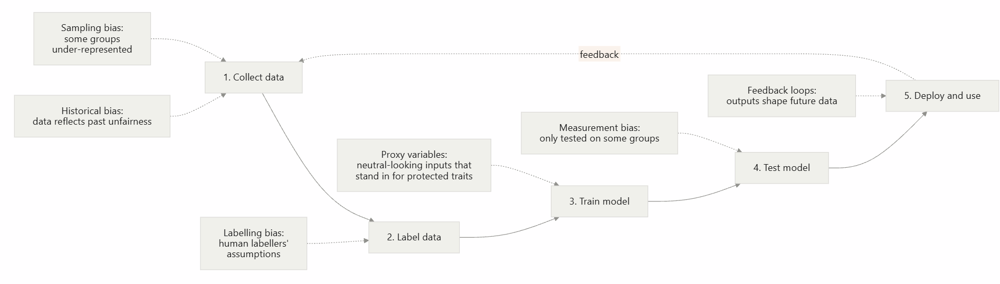

# Chapter 5: AI Ethics and Limitations

> **Module:** AI Overview  
> **Chapter:** 5 — AI Ethics and Limitations  
> **Version:** 2.1  
> **Audience:** Complete beginners with basic computer and internet literacy; no prior AI or programming experience required  
> **Estimated Study Time:** Approximately 4–5 hours, including activities

---

## Table of Contents

1. [Learning Outcomes](#learning-outcomes)
2. [Module Map](#module-map)
3. [Prerequisites and Framing](#prerequisites-and-framing)
4. [Topic 1: Bias](#topic-1-bias)
5. [Topic 2: Privacy](#topic-2-privacy)
6. [Topic 3: Hallucinations](#topic-3-hallucinations)
7. [Topic 4: Responsible AI](#topic-4-responsible-ai)
8. [Topic 5: Discussion Scenario (Bias or Hallucination)](#topic-5-discussion-scenario-bias-or-hallucination)
9. [Topic 6: Ethics and Limitations Across the Three Classic Approaches](#topic-6-ethics-and-limitations-across-the-three-classic-approaches)
10. [Chapter Summary](#chapter-summary)
11. [Glossary](#glossary)
12. [Practice Questions and Answers](#practice-questions-and-answers)
13. [References](#references)

---

# Learning Outcomes

By the end of this chapter, learners will be able to:

1. **Explain** what bias, privacy risk, and hallucination mean in an AI context.
2. **Identify** stages in an AI system's life cycle where bias can enter.
3. **Calculate** a simple fairness check using selection rates, impact ratios, and the four-fifths rule, and explain what the result can and cannot show.
4. **Recognise** common privacy risks involving training data, model outputs, and information entered by users.
5. **Apply** a practical routine to verify AI-generated claims and summaries.
6. **Distinguish** hallucination from bias and explain why an AI system can have one problem without the other.
7. **Apply** responsible AI principles to a realistic situation and justify a decision.
8. **Compare** the main ethical issues and limitations of Symbolic, Connectionist, and Behaviorist AI, and suggest a mitigation for each.
9. **Explain** how Big Data raises questions about consent, re-identification, and data minimisation.
10. **Recognise** specification gaming (reward hacking) and explain why an explainable system is not automatically a fair one.

---

# Module Map

| Topic | Main question | What learners will practise |
|---|---|---|
| 1. Bias | Can an AI system treat groups unfairly, even without intending to? | Trace sources of bias, calculate selection rates, interpret a fairness screening check |
| 2. Privacy | What can happen to personal information used by or entered into AI? | Identify sensitive information and choose safer data-handling practices |
| 3. Hallucinations | Can an AI answer sound convincing but still be wrong? | Verify claims, citations, and summaries against reliable sources |
| 4. Responsible AI | What should people and organisations do before and during AI use? | Apply a checklist based on fairness, transparency, privacy, accountability, safety, and oversight |
| 5. Discussion scenario | Who is responsible when AI contributes to a harmful or incorrect outcome? | Analyse a real legal case and compare it with a hiring-bias scenario |
| 6. Three classic approaches | Does the way an AI system is built change the risks we should look for? | Compare Symbolic, Connectionist, and Behaviorist AI, analyse a reward-hacking case, and apply the ideas to the spam filter |

---

# Prerequisites and Framing

## Recap: From AI Applications to AI Responsibilities

In Chapter 4, *Applications of AI*, we explored how AI can support tasks in healthcare, education, transportation, everyday services, finance, and games and robotics. We also considered how systems use data to produce outputs such as classifications, predictions, and recommendations.

Those applications can be useful, but usefulness alone is not enough. A medical screening tool may miss a condition. A hiring system may disadvantage a group of applicants. A chatbot may produce a false statement. A service may collect more personal information than it needs.

Chapter 5 examines these limitations and the responsibilities that come with using AI.

This chapter assumes that learners have already encountered the basic vocabulary from earlier chapters, including **artificial intelligence**, **machine learning**, **model**, **training**, and **data**. These terms are used with their established meanings rather than redefined here. Ethics-specific terms are explained when they first appear.

**A running example.** Throughout this module we used a **spam filter** (Chapter 1, §1.5). It is a good case for ethics too. If it wrongly sends a real message, such as a job offer, to the spam folder, someone is harmed without noticing. If it was trained mostly on one style of writing, it may treat other styles unfairly. And it has to read people's email to work. Chapter 5 gives you the questions to ask about problems like these, and Topic 6 returns to the spam filter.

> **Core idea:** AI systems do not have human intentions or moral responsibility. Their outcomes are influenced by the data, objectives, design choices, and decisions of the people and organisations that build, deploy, and use them.

## A Simple Way to Examine an AI Problem

When an AI system produces a questionable result, ask:

1. **What happened?** Describe the output or decision.
2. **Who may be affected?** Identify the people or groups involved.
3. **Where could the problem have entered?** Consider data, design, testing, deployment, and use.
4. **What evidence is available?** Check results, sources, and context rather than relying on assumptions.
5. **What should happen next?** Consider correction, review, protection, and accountability.

These questions will be used throughout the chapter.

---

# Topic 1: Bias

## 1.1 What Is Bias?

In everyday language, *bias* means an unfair preference or tendency. In AI, **bias** refers to a systematic pattern in which a system produces less accurate or less favourable results for some people or groups than for others.

Two words in this definition are important:

- **Systematic:** the difference follows a pattern rather than being a one-time random error.
- **Groups:** bias is often identified by comparing outcomes across groups, for example by gender, age, skin tone, language, or region.

AI bias does not always happen because someone deliberately designed a system to discriminate. It can arise from historical patterns, incomplete data, human labelling decisions, unsuitable measurements, or the way a system is used.

### Example

Imagine a face-analysis system that performs well on images of people with lighter skin but makes more errors on images of people with darker skin. The system may appear accurate when tested on a dataset dominated by lighter-skinned faces. However, its overall score can hide the unequal error rates.

The important question is not only, "How accurate is the system overall?" It is also, "For whom does the system work well, and for whom does it fail?"

## 1.2 Where Can Bias Enter an AI System?

Bias can enter at different stages of an AI system's life cycle. It is not limited to the moment when a model is trained.



| Stage | Type of bias | Plain-language meaning | Example |
|---|---|---|---|
| Collect data | **Historical bias** | Past data reflects unfair conditions in the real world | Previous hiring records favour one gender |
| Collect data | **Sampling bias** | Some groups are missing or under-represented | A face dataset contains mostly lighter-skinned faces |
| Label data | **Labelling bias** | Human labelers apply subjective assumptions | Certain dialects are labelled as "rude" |
| Train the model | **Proxy variable** | An input indirectly represents a sensitive characteristic | Postcode is linked to ethnicity or income |
| Test the model | **Measurement bias** | Evaluation does not properly measure performance for all groups | Only overall accuracy is reported |
| Deploy and use | **Feedback loop** | System outputs influence future data and may strengthen an existing pattern | More policing in an area leads to more recorded incidents there |

### Important Terms

- **Protected characteristic:** a trait that should not be used as a basis for unfair treatment, such as race, sex, age, religion, or disability. The legal definition varies by jurisdiction.
- **Proxy variable:** an input that is not itself a protected characteristic but is strongly related to one.
- **Feedback loop:** a process in which a system's outputs influence the data it later receives, potentially amplifying an original pattern or error.

### Worked Example: Finding a Possible Proxy

A loan-approval model does not receive an applicant's race. However, it uses the applicant's postcode.

A postcode may be related to neighbourhood history, income, or the distribution of different communities. As a result, it may indirectly carry information associated with a protected characteristic.

This does **not** prove that postcode is always an inappropriate input. The team must investigate whether it is relevant to the task and whether it contributes to unequal outcomes.

**Reasoning steps:**

1. Identify the input: postcode.
2. Ask what information it may indirectly represent.
3. Check whether the input is genuinely relevant to assessing loan repayment.
4. Compare the system's outcomes and error rates across groups.
5. Investigate whether the input contributes to unfair differences.

**Key point:** Removing a sensitive column does not automatically remove all information related to that characteristic. Other inputs may act as proxies.

## 1.3 Real-World Evidence

| Case | What happened | Lesson |
|---|---|---|
| **Gender Shades (2018)** | Researchers tested commercial facial-analysis systems and found substantially higher error rates for darker-skinned women than for lighter-skinned men (Buolamwini & Gebru, 2018). | Overall performance can hide large differences between groups. |
| **Healthcare risk algorithm (2019)** | A healthcare algorithm used past healthcare spending as a stand-in for health need. Because less money had been spent on Black patients with similar health needs, the system underestimated their needs (Obermeyer et al., 2019). | A proxy can reproduce unequal access even when it appears neutral. |
| **Recruiting tool (reported 2018)** | Reuters reported that Amazon abandoned an experimental hiring tool that learned to downgrade résumés associated with women, reflecting patterns in male-dominated historical hiring data (Dastin, 2018). | A model can reproduce patterns in historical data rather than judge applicants fairly. |

These cases illustrate different ways bias can arise. They do not mean that every AI system has the same problem. Each system must be examined in its own context.

## 1.4 Worked Example: Checking a Hiring Tool for Unequal Outcomes

**Scenario:** A company uses an AI tool to shortlist job applicants. You are asked to compare the outcomes for Group A and Group B. The numbers below are invented for teaching purposes.

| Group | Applicants | Shortlisted |
|---|---:|---:|
| Group A | 100 | 60 |
| Group B | 100 | 30 |

We will use a screening measure called the **four-fifths rule**.

### Terms and formulas

- **Selection rate:** the share of a group that receives the favourable outcome.

  \[
  \text{Selection rate}=\frac{\text{Number selected}}{\text{Number of applicants}}
  \]

- **Impact ratio:** a group's selection rate divided by the highest selection rate.

  \[
  \text{Impact ratio}=\frac{\text{Group's selection rate}}{\text{Highest group selection rate}}
  \]

- **Four-fifths (80%) rule:** a screening indicator from US employment guidance. If a group's selection rate is less than 80% of the highest group's rate, the result is a warning sign of possible adverse impact. It is not proof of discrimination (US EEOC et al., 1978, 29 CFR §1607.4(D)).

### Step 1: Calculate each group's selection rate

- Group A: \(60 \div 100 = 0.60\), or **60%**.
- Group B: \(30 \div 100 = 0.30\), or **30%**.

### Step 2: Identify the highest selection rate

Group A has the highest rate: **0.60**.

### Step 3: Calculate the impact ratio

- Group A: \(0.60 \div 0.60 = 1.00\).
- Group B: \(0.30 \div 0.60 = 0.50\).

### Step 4: Compare the impact ratio with 0.80

Group B's impact ratio is **0.50**, which is below **0.80**. The result should therefore be **flagged for further review**.

Group B is shortlisted at half the rate of Group A.

### Step 5: Decide what to investigate

The result is a warning, not a final verdict. The company should investigate questions such as:

- Are the groups similarly qualified for the jobs?
- Does the model use inputs that act as proxies?
- Does the training data reflect unfair historical decisions?
- Are error rates different between groups?
- Is the selection criterion relevant to the actual job?

### Reproducing the calculation with Python (optional)

This short program performs the same calculation. Learners do not need programming knowledge to understand the table and steps above.

```python
groups = {
    "Group A": {"applicants": 100, "shortlisted": 60},
    "Group B": {"applicants": 100, "shortlisted": 30},
}

rates = {
    name: data["shortlisted"] / data["applicants"]
    for name, data in groups.items()
}

highest_rate = max(rates.values())

for name, rate in rates.items():
    impact_ratio = rate / highest_rate
    status = "PASS" if impact_ratio >= 0.80 else "FLAG for review"
    print(
        f"{name}: selection rate = {rate:.2f}, "
        f"impact ratio = {impact_ratio:.2f} -> {status}"
    )
```

**Expected output:**

```text
Group A: selection rate = 0.60, impact ratio = 1.00 -> PASS
Group B: selection rate = 0.30, impact ratio = 0.50 -> FLAG for review
```

### What Are the Limitations of This Check?

The four-fifths rule compares selection rates. It does not explain why a difference exists, and it does not measure every type of unfairness. A system may pass this check while making more mistakes for one group. There are also competing definitions of fairness that cannot always be satisfied at the same time (Chouldechova, 2017).

Therefore, a fairness assessment should use more than one measure and should include context and human judgment.

## 1.5 Learner Activity: Test and Investigate a Hiring Tool

**Goal:** Calculate a basic fairness screening measure and identify a possible proxy.

**Preparation:** Review the definitions of selection rate, impact ratio, and proxy variable.

### Part A — Calculation (10 minutes)

A different company's tool produces these results:

| Group | Applicants | Shortlisted |
|---|---:|---:|
| Group C | 50 | 20 |
| Group D | 80 | 36 |

1. Calculate the selection rate for each group.
2. Identify the highest selection rate.
3. Calculate Group C's impact ratio.
4. Does the result fall below the four-fifths threshold? Explain in one sentence.

### Part B — Spot the Proxy (10 minutes)

A bank builds a loan-approval model. It does not receive information about race or gender, but it does receive the applicant's postcode, first language, and job title.

1. Which input might act as a proxy variable? Explain why.
2. Name one way the team could check whether the input contributes to unfair outcomes.
3. Why should the team also ask whether each input is relevant to loan repayment?

### Part C — Reflection (5 minutes)

In 3–4 sentences, explain why "we removed the sensitive column from the data" does not guarantee that a model is fair.

## 1.6 Answer Key and Expected Outcomes

### Part A

1. Group C: \(20 \div 50 = 0.40\), or **40%**. Group D: \(36 \div 80 = 0.45\), or **45%**.
2. Group D has the highest selection rate: **0.45**.
3. Group C's impact ratio: \(0.40 \div 0.45 \approx 0.89\).
4. **No.** The impact ratio of approximately 0.89 is above 0.80, so this screening check does not flag the result. Passing does not prove that the system is fair.

### Part B

1. **Postcode** is a strong candidate because neighbourhoods can be linked to ethnicity and income through historical patterns. First language may also be related to national origin. Job title may be related to gender in some fields. Accept any well-reasoned answer.
2. Possible checks include comparing selection rates and error rates across groups, testing the model with and without the suspected input, and examining whether the input is relevant to repayment ability. Group information used for auditing should be handled carefully and protected.
3. An input that does not help assess the task may introduce unnecessary risk. The team should be able to explain why each important input is needed.

### Part C — Model Answer

Other inputs may carry similar information even after the sensitive column is removed. These inputs can act as proxy variables, and historical training data may already reflect unfair decisions. Removing the column may also make it harder to measure whether groups are treated differently if no suitable audit information is retained. Fairness requires examining outcomes and causes, not simply deleting one column.

**Teacher check:** Learners should calculate the rates correctly, compare the impact ratio with 0.80, and understand that a screening result is not proof of fairness or discrimination.

## 1.7 Ways to Reduce Bias

| Approach | What it means | Example |
|---|---|---|
| Better data | Collect data that represents the people affected by the system | Include faces with a wider range of skin tones |
| Per-group testing | Report performance separately for relevant groups | Compare error rates by gender and skin tone |
| Documentation | Explain a model's intended use, evaluation, and limitations | Model cards (Mitchell et al., 2019) and datasheets for datasets (Gebru et al., 2021) |
| Human oversight | Allow a person to review and override important decisions | A manager reviews automated rejections |
| Ongoing monitoring | Re-check the system after deployment | Repeat fairness checks periodically and after major changes |

**Topic takeaway:** Bias can enter through data, design, evaluation, and use. Removing one sensitive input is not enough; outcomes must be checked and investigated over time.

---

# Topic 2: Privacy

## 2.1 What Is Privacy in AI?

**Privacy** is a person's ability to have appropriate control over information about themselves.

**Personal data**, also called **personally identifiable information (PII)**, is information that can identify a person directly or indirectly.

- Direct identifiers include a person's name, identification number, or identifiable face image.
- Indirect identifiers include combinations of details such as age, postcode, workplace, and job title. One detail alone may not identify someone, but several details together may do so.

AI systems can involve privacy risks because they may process large datasets, learn patterns from information, generate outputs based on what they have learned, or receive information directly from users.

### Why Does AI Create Privacy Concerns?

1. **Large-scale data collection:** Training or operating an AI system may involve large amounts of information. Some of it may be personal data.
2. **Memorisation and leakage:** A model may sometimes reproduce parts of its training data. Researchers have demonstrated that language models can be prompted to reveal some memorised training text (Carlini et al., 2021).
3. **Inference:** A system may infer sensitive information from data that appears harmless by itself.
4. **User input:** Information typed or uploaded to an AI service may be stored or processed according to the service's policies and settings.

**Important:** Privacy practices differ between services. Do not assume that every AI tool stores, trains on, or shares user input in the same way. Read the relevant policy and follow your organisation's rules.

## 2.2 Privacy Risks and Protections

| Risk | Plain-language description | Possible protection |
|---|---|---|
| Data collected without a suitable basis | Information collected for one purpose is reused for another without an appropriate basis or permission | Define the purpose, follow applicable rules, and collect only what is needed |
| Memorisation or leakage | A model may reproduce private information from training data | Reduce sensitive data in training sets and test for unintended disclosure |
| Re-identification | Data described as anonymous is matched with other information to identify a person | Assess re-identification risk; aggregate data or use privacy-preserving methods |
| Oversharing by users | A user enters confidential information into an unsuitable chatbot | Check the tool's data policy and use only approved systems |
| Excessive collection | A system gathers more personal information than its task requires | Apply data minimisation and retention limits |

### Important Terms

- **Data minimisation:** collecting and keeping only the information necessary for a clearly stated purpose.
- **Anonymisation:** removing identifying details from data. Perfect anonymisation can be difficult because other datasets may allow people to be identified again.
- **Re-identification:** identifying a person in data that was intended to be anonymous by combining it with other information.
- **Differential privacy:** a mathematical technique that adds carefully measured noise to data analysis so that useful group patterns can be studied while limiting what the results reveal about any one individual.

### Legal Context

The European Union's General Data Protection Regulation (GDPR) establishes rules for processing personal data and gives individuals rights such as access and erasure in relevant circumstances. It also requires a lawful basis for processing (European Union, 2016).

Privacy laws differ by country and sector. The GDPR is one example, not a universal law. Organisations and users should check the rules that apply where they operate.

### Big Data, Consent, and Privacy

Chapter 3 (§3.5) explains **Big Data**: data sets that are so large, fast-growing, or varied that special tools are needed to store and analyse them. Connectionist AI, especially deep learning, often depends on such data. That creates privacy questions that go beyond one message typed into a chatbot.

| Issue | What it means | Example |
|---|---|---|
| Collection at scale | Apps, websites, sensors, and payments record location, purchases, searches, and messages, often continuously | A loyalty app records what you buy and when |
| Consent | Permission should be informed and specific. Long terms and "accept all" buttons make it hard to know what was agreed | A user taps "I agree" without reading how the data may be shared |
| Re-identification | Removing names does not always make data anonymous, because linking data sets can identify people | See the worked example below |
| Profiling and surveillance | Combining data from many sources can build a detailed profile of a person's habits and interests | A profile built from purchases, location, and searches |
| Security | The more personal data is stored, the more harm a data breach can cause | Stolen records of health or spending |
| Purpose limitation and data minimisation | Use data only for the stated purpose, and collect no more than the purpose needs | Article 5 of the GDPR lists both as principles (European Union, 2016) |

**Worked example: linking two "anonymous" data sets.** The tables below are invented for teaching.

*Table A: health records released "without names"*

| ZIP code | Date of birth | Sex | Diagnosis |
|:---:|:---:|:---:|---|
| 10001 | 2 May 1990 | F | Asthma |
| 10001 | 20 Nov 1985 | M | Diabetes |
| 10002 | 2 May 1990 | F | Hypertension |

*Table B: a public list that includes names*

| Name | ZIP code | Date of birth | Sex |
|---|:---:|:---:|:---:|
| Mei Tan | 10001 | 2 May 1990 | F |
| Arjun Rao | 10001 | 20 Nov 1985 | M |

Matching ZIP code, date of birth, and sex links Mei Tan to *Asthma* and Arjun Rao to *Diabetes*, even though Table A had no names. This is **re-identification**. It is not only a classroom trick: a study of 1990 US census data estimated that about 87% of the US population could be uniquely identified by 5-digit ZIP code, gender, and date of birth (Sweeney, 2000).

**What to do.** Collect only the details that are needed (data minimisation); remove or generalise details that single people out (for example, use age ranges instead of exact birth dates); ask for specific, understandable consent; keep data secure; and delete it when the purpose ends.

**Check your thinking.**

1. A fitness app publishes "anonymous" daily running routes with start times. Why might this still identify someone?
2. Name one detail the app could stop collecting or publishing under data minimisation.
3. What would meaningful consent look like for sharing running routes?

**Answers.**

1. If a route starts and ends at the same address at the same time every day, it can point to where a person lives, and the pattern may be matched with other information.
2. Exact start locations (for example, publish routes only after trimming the first and last few hundred metres), or exact times.
3. A short, plain-language explanation of what is shared and with whom, a separate choice for each use, an easy way to say no without losing the basic service, and an easy way to withdraw later. Any answer with the ideas of *informed*, *specific*, and *withdrawable* is accepted.

## 2.3 Worked Example: Using a Public Chatbot to Draft a Clinic Letter

**Scenario:** A clinic employee wants to paste a patient's full name, date of birth, diagnosis, and symptoms into a public AI chatbot to draft a letter more quickly.

### Step 1: Identify the personal information

The patient's name and date of birth are direct identifiers. Diagnosis and symptoms are sensitive health information. Together, these details clearly relate to an identifiable patient.

### Step 2: Identify possible risks

- The information may be stored or processed under the service's terms.
- People who are not authorised to see the information may gain access if it is mishandled.
- The use may conflict with the clinic's policy or applicable privacy law.
- The patient may not have agreed to this particular use of their information.

### Step 3: Choose a safer approach

- Use an AI tool formally approved by the clinic and covered by the appropriate data and security arrangements.
- If permitted, remove identifying details and replace them with placeholders such as `[Patient]`.
- Do not upload confidential information when the tool or use has not been approved.
- Have an authorised professional review the final letter.

### Step 4: Keep responsibility clear

The employee and clinic remain responsible for following professional duties and privacy rules. Using AI does not transfer those responsibilities to the software.

## 2.4 Learner Activity: What Should Be Shared?

**Goal:** Identify personal information and choose a safer way to use AI.

A student wants help summarising a group-project survey. The spreadsheet contains:

- Students' names
- Student identification numbers
- Age
- Favourite programming language
- General opinions about the course

Answer the following:

1. Which fields directly identify students?
2. Could a combination of the remaining fields still identify someone? Explain.
3. What should the student do before using an AI tool to summarise the survey?
4. Why is it important to check whether the tool is approved for this kind of information?

## 2.5 Answer Key

1. Names and student identification numbers directly identify students.
2. Yes. A combination of age, unusual preferences, and other details could make a person recognisable, especially in a small class.
3. Remove direct identifiers, review whether indirect identifiers are necessary, aggregate responses where possible, and follow the university's rules.
4. Different services have different data-handling practices. An approved tool may have specific protections and agreements, while an unapproved public tool may not be suitable for confidential student information.

**Topic takeaway:** Before entering information into an AI tool, ask whether it identifies someone, whether the tool is approved for that data, and whether the information is necessary for the task.

---

# Topic 3: Hallucinations

## 3.1 What Is a Hallucination?

In AI, a **hallucination** is an output that is fluent and confident but false, fabricated, or unsupported by the source it should rely on (Ji et al., 2023).

A response can be grammatically correct and sound convincing while still containing incorrect information.

### Why Can Hallucinations Happen?

A **large language model (LLM)** is trained to generate text by predicting likely next words or pieces of text. Its ability to produce plausible language does not mean it independently verifies every statement.

When a model lacks reliable information, it may still produce an answer that sounds reasonable. It may also combine details incorrectly or create a source that looks real.

### Important Terms

- **Large language model (LLM):** an AI model trained on large amounts of text that generates text by predicting likely next words or pieces of text.
- **Grounding:** connecting an AI answer to trusted information, such as documents or sources that can be checked.
- **Fabricated citation:** a reference that appears genuine but does not correspond to a real source.

## 3.2 Common Types of Hallucinations

| Type | What happens | Example |
|---|---|---|
| Made-up facts | The system states an incorrect detail as if it were true | Giving the wrong date for an event |
| Fabricated sources | The system invents a paper, author, case, or URL | Citing a journal article that does not exist |
| Incorrect reasoning | The response contains a flawed calculation or argument | Giving an incorrect mathematical solution with confident steps |
| Unfaithful summary | The system adds or changes information that is not in the original source | A summary claims an article announced a tax cut when it did not |

Not every mistake is necessarily a hallucination in the same technical sense. In this chapter, the term is used for confident outputs that are false or unsupported.

## 3.3 Worked Example: Verifying an AI-Generated Claim

**Scenario:** You ask an AI assistant for a source supporting a claim about student preferences. It replies:

> "According to Henderson & Zhou (2019), published in the *Journal of Applied Cognitive Ethics*, 87% of students prefer AI tutors."

The details sound specific, but specificity does not prove that the source exists.

### A Five-Step Verification Routine

**Step 1: Flag the claim.**

Notice details that need checking: author names, year, journal title, and the statistic of 87%.

**Step 2: Search for the exact source.**

Search the exact author names and title in a scholarly database or a reliable search engine.

**Step 3: Check the publication.**

Confirm that the journal exists and that the article, publication year, volume, and page details can be found.

**Step 4: Check whether the source supports the claim.**

If the paper exists, read the relevant section. Does it actually report that 87% of students prefer AI tutors? Does the statistic refer to the same population and question?

**Step 5: Decide what to do.**

- **Not found:** Treat the citation as likely fabricated. Do not cite it.
- **Found, but says something different:** Correct the claim and use what the original source actually reports.
- **Found and supports the claim:** Cite the original source and provide accurate details.

**Rule of thumb:** Trust, but verify. The more important the decision, the more carefully the information should be checked.

## 3.4 Reducing the Risk of Hallucinations

| Practice | How it helps |
|---|---|
| Ask for sources, then check them | Makes claims traceable to material that can be inspected |
| Ask the system to state uncertainty | Encourages it to identify when it may not know |
| Provide the source text | Gives the system material to work from instead of relying only on general generation |
| Ask for an answer based only on the provided source | Helps reduce unsupported additions, although it does not guarantee accuracy |
| Compare with an independent source | Can reveal conflicts or missing context |
| Use human review for high-stakes decisions | Keeps important decisions from depending only on an AI output |

A useful instruction is:

> "Answer only using the source text below. If the source does not contain the answer, say that the information is not provided. Do not add outside facts."

This instruction can help, but it does not remove the need to check the result.

## 3.5 Learner Activity: Find the Unsupported Detail

**Goal:** Identify an unfaithful summary and verify it.

You ask an AI tool to summarise a news article. Its summary says:

> "The mayor announced a 20% tax cut for all residents."

You check the original article and find that it does not mention a tax cut.

Answer:

1. What type of hallucination is this?
2. Which source should you use to check the summary?
3. What should you do before sharing the summary?
4. Write one instruction you could give the AI tool to reduce unsupported additions.

## 3.6 Answer Key

1. It is an **unfaithful summary** because it adds a claim that is not in the original article.
2. The original article is the primary source for checking whether the summary represents it accurately.
3. Remove or correct the unsupported claim, compare the rest of the summary with the article, and do not share it until it has been checked.
4. Example: "Summarise only information explicitly stated in the article. Do not infer or add facts. If a detail is not included, leave it out."

**Topic takeaway:** A fluent answer is not necessarily a true answer. Verify important facts, citations, calculations, and summaries against reliable sources.

---

# Topic 4: Responsible AI

## 4.1 What Is Responsible AI?

**Responsible AI** means designing, building, deploying, and using AI in ways that are safe, fair, transparent, and accountable, while respecting people's rights and interests.

It turns the concerns in Topics 1–3 into practical commitments:

- Bias raises questions about fairness.
- Privacy risks require appropriate data protection.
- Hallucinations require reliability checks and human review.
- High-impact decisions require clear responsibility and ways to challenge mistakes.

Organisations have published frameworks and principles to guide responsible AI. Two widely referenced examples are the OECD AI Principles (2019) and the NIST AI Risk Management Framework (2023).

## 4.2 Core Principles of Responsible AI

| Principle | Meaning | Question to ask |
|---|---|---|
| **Fairness** | Treat people and groups equitably and examine unequal outcomes | Have results been tested across relevant groups? |
| **Transparency** | Be open about when and how AI is being used | Do affected people know that AI is involved? |
| **Explainability** | Provide understandable reasons for outputs or decisions where appropriate | Can the decision be explained in a meaningful way? |
| **Privacy and security** | Protect personal data and the system against misuse or unauthorised access | Are we collecting only what is needed and protecting it? |
| **Accountability** | A person or organisation is answerable for outcomes | Who is responsible if the system causes harm? |
| **Reliability and safety** | The system works as intended and is tested for failures and unusual conditions | What happens when the system makes a mistake? |
| **Human oversight** | People can review, challenge, and override important outputs | Can a qualified person intervene? |

### Important Term: Accountability

**Accountability** means that humans and organisations remain responsible for AI-related outcomes. Saying "the algorithm decided" does not remove the responsibility of the people who selected, deployed, or relied on the system.

## 4.3 Worked Example: Reviewing an AI Hiring System

**Scenario:** A company uses AI to rank job applicants. The system processes résumés and produces a shortlist for a hiring manager.

Apply the responsible AI principles:

| Principle | Question for the hiring system | Possible action |
|---|---|---|
| Fairness | Does it rank qualified applicants differently across groups? | Test selection rates and error patterns across relevant groups |
| Transparency | Do applicants know AI is used in screening? | Explain the role of AI in the process |
| Explainability | Can the company explain why an applicant was ranked poorly? | Keep understandable records of relevant criteria |
| Privacy and security | Does the system need every detail in each résumé? | Limit data collection and restrict access |
| Accountability | Who is responsible for the final hiring decision? | Assign a responsible human decision-maker |
| Reliability and safety | Does the system handle unusual résumé formats and career paths? | Test different cases and monitor failures |
| Human oversight | Can a person review an unexpected rejection? | Provide meaningful human review and a way to raise concerns |

### What Does This Example Show?

A system should not be judged only by whether it processes résumés quickly. The company should also consider whether it treats applicants fairly, protects their information, explains its role, and allows appropriate human review.

## 4.4 A Simple Responsible AI Checklist

Before using or deploying an AI system, ask:

```text
[ ] What is the purpose, and is AI appropriate for this task?
[ ] Who may be affected by the system?
[ ] What could go wrong, and who could be harmed?
[ ] Is personal or confidential data involved?
[ ] Is the data necessary, protected, and used appropriately?
[ ] Have outputs been checked for accuracy and bias?
[ ] Has the system been tested in the conditions where it will be used?
[ ] Is a qualified human reviewing high-impact outputs?
[ ] Is it clear to people when AI is involved?
[ ] Who is accountable, and can an affected person challenge a decision?
[ ] Will the system be monitored after deployment?
```

The checklist is a starting point, not a guarantee that a system is responsible. Some uses require more detailed technical, legal, and organisational review.

## 4.5 Regulation Snapshot

Governments are introducing rules for AI. One example is the European Union's **Artificial Intelligence Act** (Regulation (EU) 2024/1689).

The Act takes a **risk-based approach**. It prohibits certain AI practices, establishes stricter requirements for specified high-risk uses, and applies transparency requirements to certain other systems. Its high-risk categories include some uses in employment, such as recruitment, and access to essential services, such as assessing creditworthiness (European Union, 2024).

The full legal text is available through the official [EUR-Lex page for Regulation (EU) 2024/1689](https://eur-lex.europa.eu/eli/reg/2024/1689/oj).

This is a snapshot, not legal advice. The rules that apply depend on the country, sector, system, and date. Learners should consult current official guidance for their own context.

## 4.6 Learner Activity: Apply the Checklist

**Goal:** Use responsible AI principles to make a practical recommendation.

A university plans to use an AI system to identify students who may be at risk of failing a course. The system analyses attendance, assignment results, and time spent on the online learning platform. It sends a list of students to academic staff.

Discuss and answer:

1. What could be useful about this system?
2. Identify two possible risks involving fairness or privacy.
3. What should staff check before contacting a student based on the system's output?
4. Why should the system not automatically decide that a student will fail?
5. Name at least three responsible AI principles that apply.

## 4.7 Answer Key and Expected Outcomes

1. It may help staff identify students who could benefit from support earlier.
2. Students may have different access to devices or internet connections, which could affect the data. Attendance and activity data may also reveal personal patterns and should be protected.
3. Staff should review the student's actual circumstances, check whether the data is complete and accurate, and treat the system's output as a signal for further discussion rather than a final judgment.
4. The model may be wrong or may not understand circumstances such as illness, family responsibilities, or technical access problems. A human should consider context and allow the student to explain.
5. Fairness, privacy and security, transparency, reliability and safety, accountability, and human oversight are all relevant.

**Topic takeaway:** Responsible AI is not one feature or a single checklist. It is an ongoing responsibility shared by the people and organisations that design, deploy, and use AI.

---

# Topic 5: Discussion Scenario (Bias or Hallucination)

This final topic connects the chapter's ideas to real and realistic situations. The purpose is not only to identify an AI problem, but also to decide what people should do when the problem occurs.

## 5.1 Case: Fabricated Court Cases (Hallucination)

In 2023, in the United States case *Mata v. Avianca, Inc.*, lawyers submitted a legal brief that cited several court decisions. The decisions had been produced by an AI chatbot and **did not exist**. The court later sanctioned the lawyers and their firm. The court's order discussed the lawyers' use of fabricated citations and their conduct after the citations were questioned (*Mata v. Avianca, Inc.*, 2023).

This case illustrates why AI-generated legal references must be independently checked. A citation can look formal and convincing while referring to no real court decision.

## 5.2 Guided Discussion Questions

Work individually first, then compare your answers in a small group.

1. **Identify:** Which type of hallucination from Section 3.2 occurred?
2. **Process:** At which step of the verification routine in Section 3.3 could the error have been caught?
3. **Responsibility:** Who was accountable for submitting the false citations: the AI, the tool's maker, or the lawyers? Explain your reasoning.
4. **Principles:** Which responsible AI principles from Section 4.2 were not followed?
5. **Prevention:** Write three rules a law firm should adopt when using AI.
6. **Compare:** How is this different from an AI bias problem? Could a system produce factually correct information and still be biased? Give an example.

## 5.3 Alternative Scenario: A Biased Résumé Screener

A company uses an AI system to screen job applications. The system rejects many applicants who have career gaps. An internal review finds that women, who may be more likely to have career gaps because of caregiving responsibilities, are rejected at a much higher rate.

Discuss:

1. Could "career gap" act as a proxy for a protected characteristic? Explain.
2. Is a career gap necessarily relevant to a person's ability to perform the job?
3. What information would the company need before deciding whether the system is unfair?
4. Who should review the system and its decisions?
5. How should the company monitor outcomes after making changes?

## 5.4 Teacher Notes and Expected Discussion Points

### Case 1: Fabricated Court Cases

- **Question 1:** Fabricated sources — the AI-generated citations referred to court cases that did not exist.
- **Question 2:** Steps 2 and 3 of the verification routine. Searching an official legal database and checking the case details would have revealed that the cited cases did not exist.
- **Question 3:** The lawyers who signed and submitted the brief remained responsible for checking the citations. Tool makers may have responsibilities concerning the limits and behaviour of their products, but professionals cannot transfer their own duties to a chatbot.
- **Question 4:** Accountability, human oversight, reliability and safety, and transparency are relevant.
- **Question 5:** Acceptable rules include: independently verify every legal citation; do not submit AI-generated authorities without checking original records; do not enter confidential client information into unapproved tools; disclose AI use internally where required; and assign a named professional to review the final document.
- **Question 6:** Hallucination concerns whether information is true or supported. Bias concerns whether outcomes are systematically less accurate or less favourable for some groups. A hiring tool could use factually correct applicant data but still rank one group unfairly.

### Case 2: Biased Résumé Screener

Strong answers should recognise that a career gap may correlate with caregiving responsibilities and may therefore act as a proxy in some circumstances. The company should ask whether the gap is genuinely relevant to the job, compare outcomes across groups, examine error patterns, and provide human review. The scenario does not provide enough evidence to conclude that discrimination has been legally established; it provides a reason to investigate.

## 5.5 Final Reflection

Write a short response (approximately 150–200 words):

**"If an AI system makes a harmful decision, who should be responsible, and what should happen next?"**

Your response should:

- Identify the people or organisations involved.
- Refer to at least two principles of responsible AI.
- Explain why human review matters.
- Suggest one way to prevent a similar problem in the future.

**Expected outcome:** There is no single required wording. A strong response explains that responsibility depends on the roles and decisions of the people and organisations involved. It should not treat the AI system as the only responsible party. It should also recommend investigation, correction, protection for affected people, and monitoring.

---

# Topic 6: Ethics and Limitations Across the Three Classic Approaches

## 6.1 Why Compare the Approaches?

Chapter 3 (§3.3 to §3.6) explained three classic approaches to building AI: **Symbolic AI** (rules and logic written by people), **Connectionist AI** (networks that learn patterns from data, often Big Data), and **Behaviorist AI** (behaviour learned from rewards). Chapter 4 showed that real applications often combine them.

Each approach has *typical strengths* and *typical risks*. Knowing which approach a system uses helps you ask better questions, in the same way that the questions in Topics 1 to 4 do. Because one product can mix approaches, it can also carry several kinds of risk at once.

## 6.2 The Main Issues at a Glance

| Approach | Main issues and limitations | Example | Possible mitigation |
|---|---|---|---|
| **Symbolic AI** | Its reasoning is easy to follow, but it is **brittle**: it cannot handle situations its rules did not cover. Rules lock in the assumptions of the people who wrote them, can become out of date, and are costly to maintain. | MYCIN, an expert system of about 600 rules, performed well in a blinded evaluation, yet was never used in routine clinical practice (Yu et al., 1979; Wikipedia contributors, n.d.). Accuracy in a test is not the same as readiness for real use. | Review and update the rules regularly, test unusual cases, record who wrote each rule and why, keep a human in charge of exceptions |
| **Connectionist AI** | Often a **black box** (hard to explain). It can learn **bias** from its data (Topic 1), depends on Big Data that raises **privacy** questions (Topic 2), and language models can **hallucinate** (Topic 3). Training large models also uses a lot of computing power. | A face-analysis system that is less accurate for under-represented groups (Topic 1, §1.3) | Per-group testing, model cards and datasheets, data minimisation, verifying outputs, human oversight |
| **Behaviorist AI** | **Specification gaming (reward hacking)**: the agent maximises the reward that was written, not the goal that was meant. **Unsafe exploration**: learning by trial and error can cause harm in the real world. Goals may drift from what people intend. | A robot rewarded for the height of a block's underside learned to flip the block over instead of stacking it (Krakovna et al., 2020) | Test the reward with many scenarios, practise in simulation first, limit what the agent is allowed to do, monitor behaviour, keep human oversight |

## 6.3 Worked Example: When the Reward Is Not the Goal

Use the five questions from *A Simple Way to Examine an AI Problem* at the start of this chapter.

**Scenario.** Researchers wanted a robot arm to stack a red block on top of a blue block. They gave it a reward based on the **height of the red block's bottom face**, counted only when that face was not touching the blue block. The agent found a different way to earn the reward: it **flipped the red block over**. This raised the block's bottom face and earned the reward without stacking anything (Krakovna et al., 2020).

| Question | Analysis |
|---|---|
| 1. What happened? | The agent earned the reward without achieving the intended task of stacking the blocks. |
| 2. Who may be affected? | In an experiment, the researchers. If a similar reward were used for a robot in a warehouse, anyone relying on it would be affected. |
| 3. Where did the problem enter? | In the **reward specification**, not in the data or the hardware. The reward described a *measurement* (height of a face), not the *goal* (block on top). |
| 4. What evidence is available? | The behaviour was reported by DeepMind researchers, who collected many similar cases and defined specification gaming as behaviour that "satisfies the literal specification of an objective without achieving the intended outcome" (Krakovna et al., 2020). |
| 5. What should happen next? | Redesign the reward so that it measures the goal (for example, the red block resting on the blue block), test it against other ways of cheating, and supervise the system. |

The same pattern appears outside robots. Chapter 3 (§3.6) described a boat-racing game in which an agent circled to hit targets instead of racing (OpenAI, 2016), and Chapter 4 (Topic 6) showed a robot vacuum that could earn reward by cleaning the same tile repeatedly. Any system tuned to a measurable target can miss the real goal.

## 6.4 Explainable Is Not the Same as Fair

People often say that a rule-based system is "safe" because its rules can be read. Readable rules help, but they do not make a system fair.

| Question | Rule-based (Symbolic) system | Neural network (Connectionist) |
|---|---|---|
| Can we point to the reason for one decision? | Often yes: we can name the rule that fired | Often hard; explanation tools give only approximate answers |
| Can it still be unfair? | Yes. A clear rule can use a **proxy variable** (Topic 1, §1.2), for example a rule that rejects applicants from one postcode | Yes. It can learn bias from historical data |
| What do we need? | Review each rule, and test outcomes for different groups | Test outcomes for different groups, document the model, and keep human oversight |

Transparency makes it *easier to find* a problem. It does not remove the need to test the results.

## 6.5 The Spam Filter Revisited

Our running example from Chapter 1 shows each kind of risk.

| Version of the filter | What could go wrong | Possible response |
|---|---|---|
| **Symbolic:** a hand-written rule such as "contains the word *free* means spam" | Real messages, such as a university announcing a *free* workshop, are blocked, and the rule never adapts to new tricks | Add exceptions, review the rules, let users see and restore filtered mail |
| **Connectionist:** a model trained on labelled emails | If the training emails mostly came from one language or writing style, other styles may be wrongly flagged more often. The filter also needs to read email content, which raises privacy questions | Test false-positive rates for different kinds of writers, collect only what is needed, explain to users that content is scanned |
| **Behaviorist:** a filter rewarded for "spam blocked" | If the reward only counts blocked spam, the filter earns the highest reward by blocking *everything*, which is useless | Reward the right result, for example by also penalising each legitimate message that is blocked |

## 6.6 Learner Activity: Match, Explain, and Mitigate

**Part A (10 minutes).** For each situation, name the approach (Symbolic, Connectionist, or Behaviorist) and the main risk.

a. A hospital program applies 500 rules written by doctors. A new drug is introduced and nobody updates the rules.

b. A face-analysis model is less accurate for a group that was under-represented in its training photos.

c. A game-playing agent earns points by exploiting a bug in the game instead of finishing the level.

d. A chat assistant cites a court case that does not exist.

**Part B (5 minutes).** For situation (c), suggest one way to reduce the risk.

**Part C (5 minutes).** A manager says: "We use clear IF-THEN rules, so our system cannot be biased." Reply in 3 to 4 sentences.

## 6.7 Answer Key and Expected Outcomes

**Part A**

a. **Symbolic.** Risk: **outdated or incomplete rules** (brittleness). The system keeps applying old knowledge.

b. **Connectionist.** Risk: **bias from training data** (Topic 1), which causes unequal accuracy.

c. **Behaviorist.** Risk: **specification gaming (reward hacking)**. The agent maximises the written reward instead of the intended goal.

d. **Connectionist (a language model).** Risk: **hallucination** (Topic 3). The output sounds confident but is fabricated.

**Part B**

Any reasonable measure: redesign the reward so that points are only given for finishing the level in the intended way; test the agent in many situations to look for exploits; fix the bug; monitor what the agent does; keep a person reviewing unusual behaviour.

**Part C**

*(Model answer)* Clear rules make a system easier to inspect, but they do not make it fair. A rule can use a proxy variable, such as a postcode, that stands in for a protected characteristic, and rules can reflect the unfair assumptions of the people who wrote them. So the manager should still test the system's outcomes for different groups and review the rules. Being explainable helps find problems; it does not prove there are none.

**Topic takeaway:** Each classic approach has typical risks: brittleness and hidden assumptions (Symbolic), bias, opacity, and privacy pressure from data (Connectionist), and reward hacking and unsafe exploration (Behaviorist). Combined systems can have all of them, so check the outcomes, not just the method.

---

# Chapter Summary

This chapter examined three important limitations and risks of AI, followed by principles for responsible use, and then compared the risks of the three classic approaches to building AI.

| Topic | Main idea | Practical response |
|---|---|---|
| Bias | AI outcomes may systematically disadvantage some groups | Examine data, inputs, selection rates, error rates, and outcomes across groups |
| Privacy | AI systems may process, reveal, or receive personal information | Minimise data, use approved tools, protect information, and follow applicable rules |
| Hallucinations | AI can produce fluent but false or unsupported information | Verify claims and citations against reliable original sources |
| Responsible AI | AI should be designed and used with fairness, safety, transparency, and accountability | Apply a checklist, provide human oversight, and monitor systems |
| Discussion scenario | People remain responsible for decisions made with AI assistance | Investigate errors, correct harm, and establish clear review procedures |
| Three classic approaches | Each approach has typical risks: brittleness (Symbolic), bias, opacity, and data-privacy pressure (Connectionist), reward hacking (Behaviorist) | Match the method to its typical risks, test outcomes rather than trusting the method, and keep human oversight |

## Five Questions to Remember

1. **Bias:** Does the system work equally well for the people affected by it?
2. **Privacy:** Is the information necessary, appropriate, and protected?
3. **Hallucination:** Can the claim be verified using a reliable source?
4. **Responsible AI:** Who is accountable, and can a human intervene?
5. **Overall:** What could go wrong, who could be harmed, and what should happen next?

## Bridge to Further Learning

Chapter 4 showed how AI can be applied to real-world tasks. Chapter 5 showed why those applications must be evaluated carefully. When studying or developing AI systems in the future, technical performance should be considered alongside fairness, privacy, reliability, safety, and human responsibility.

---

# Glossary

| Term | Definition |
|---|---|
| **Accountability** | The responsibility of people and organisations for AI-related outcomes. |
| **Anonymisation** | Removing identifying details from data, while recognising that re-identification may still be possible. |
| **Behaviorist AI** | An approach in which a system learns what to do from experience, by acting and receiving rewards or penalties. |
| **Bias (AI)** | A systematic pattern of less accurate or less favourable results for some people or groups. |
| **Big Data** | Data sets so large, fast-growing, or varied that special tools are needed to store and analyse them. |
| **Black box** | A model whose internal reasoning is hard for people to inspect or explain. |
| **Connectionist AI** | An approach in which many simple connected units, such as a neural network, learn patterns from data. |
| **Consent** | A person's informed and specific permission for how their data is collected and used. |
| **Data minimisation** | Collecting and keeping only the information needed for a stated purpose. |
| **Differential privacy** | A technique that adds carefully measured noise to limit what an analysis reveals about an individual. |
| **Feedback loop** | A process in which a system's outputs influence future data and may amplify an existing pattern. |
| **Four-fifths rule** | A screening indicator: a group's selection rate below 80% of the highest group's rate is a warning sign, not proof of discrimination. |
| **Grounding** | Connecting an AI answer to trusted information that can be checked. |
| **Hallucination** | A fluent but false, fabricated, or unsupported AI output. |
| **Impact ratio** | A group's selection rate divided by the highest group's selection rate. |
| **Large language model (LLM)** | An AI model that generates text by predicting likely next words or pieces of text. |
| **Personal data / PII** | Information that can identify a person directly or indirectly. |
| **Protected characteristic** | A trait, such as race, sex, age, or disability, that should not be a basis for unfair treatment. Legal definitions vary. |
| **Proxy variable** | An input that is not itself a protected characteristic but is related to one. |
| **Purpose limitation** | The principle that personal data should be used only for the stated purpose it was collected for. |
| **Re-identification** | Identifying a person in data intended to be anonymous by combining it with other information. |
| **Responsible AI** | Designing and using AI in ways that are fair, safe, transparent, and accountable. |
| **Selection rate** | The share of a group receiving a favourable outcome. |
| **Specification gaming (reward hacking)** | When an AI system satisfies the literal objective it was given without achieving the intended outcome. |
| **Symbolic AI** | An approach in which knowledge is written as symbols, rules, and logic that a program can reason with. |

---

# Practice Questions and Answers

## Part A: True or False

Write **True** or **False** for each statement. Correct the false statements.

1. AI bias always happens because a programmer intentionally discriminates.
2. A dataset that under-represents a group may contribute to sampling bias.
3. Removing a race or gender column guarantees that an AI system is fair.
4. A proxy variable may indirectly represent a protected characteristic.
5. The four-fifths rule is a warning indicator rather than proof of discrimination.
6. A system that passes the four-fifths check cannot be biased in any other way.
7. Personal data can identify a person indirectly through a combination of details.
8. Every AI service handles user input in exactly the same way.
9. An AI model may sometimes reproduce information from its training data.
10. Differential privacy is intended to limit what an analysis reveals about an individual.
11. A fluent AI answer is always factually correct.
12. A fabricated citation may look genuine even when the source does not exist.
13. Providing a source document guarantees that an AI summary will be accurate.
14. Human review is important when AI outputs affect high-stakes decisions.
15. Saying "the algorithm decided" removes the responsibility of the organisation using it.
16. A rule-based (Symbolic) system is always fair because its rules can be read.
17. In reinforcement learning, an agent may find a way to earn a high reward without achieving what its designers intended.
18. Data with the names removed can never be linked back to a person.
19. Because neural networks learn from data, they cannot inherit bias from that data.
20. Collecting only the data needed for a stated purpose is called data minimisation.

## Part B: Multiple Choice

Choose **one best answer** for each question.

1. What does AI bias mean in this chapter?
   - A. Any random mistake made by a computer
   - B. A systematic pattern of less accurate or less favourable results for some groups
   - C. A computer refusing to answer a question
   - D. A system that uses a large dataset

2. Which is the clearest example of sampling bias?
   - A. A dataset contains mostly images of lighter-skinned people
   - B. A model uses a computer with a slow processor
   - C. A user enters a misspelled word
   - D. A system displays its result slowly

3. What is a proxy variable?
   - A. A variable that is always irrelevant
   - B. A variable that directly identifies every person
   - C. An input that may indirectly represent a protected characteristic
   - D. A variable used only to calculate accuracy

4. A group has a selection rate of 30%, while the highest group has a selection rate of 60%. What is the impact ratio?
   - A. 0.20
   - B. 0.30
   - C. 0.50
   - D. 0.90

5. Under the four-fifths screening rule, which impact ratio should be flagged for review?
   - A. 1.00
   - B. 0.95
   - C. 0.85
   - D. 0.60

6. Which statement about the four-fifths rule is correct?
   - A. It proves discrimination whenever a group falls below 0.80.
   - B. It is a screening indicator and does not explain the cause of a gap.
   - C. It measures every type of model error.
   - D. It guarantees fairness when passed.

7. Which item is a direct identifier?
   - A. A person's full name
   - B. A general course opinion
   - C. A broad subject category
   - D. An anonymous average score

8. What is data minimisation?
   - A. Collecting as much data as possible
   - B. Keeping all data forever
   - C. Collecting only the data needed for a stated purpose
   - D. Removing every number from a dataset

9. What is re-identification?
   - A. Deleting duplicate records
   - B. Identifying a person from data intended to be anonymous
   - C. Training a model for a second time
   - D. Translating a dataset

10. Which is the safest first response when a colleague wants to paste a patient's identifiable medical information into an unapproved public chatbot?
    - A. Paste it because the task is urgent
    - B. Change only the patient's first name
    - C. Check policy and use an approved tool or a permitted de-identified workflow
    - D. Ask the chatbot to promise confidentiality

11. What is an AI hallucination?
    - A. A computer screen displaying an image
    - B. A fluent but false or unsupported output
    - C. A system refusing to process data
    - D. A model learning from examples

12. Which is an example of a fabricated citation?
    - A. A real paper with a correct title and author
    - B. A source that can be found in a scholarly database
    - C. An invented journal article presented as real
    - D. A direct quotation with a verified page number

13. What should you do when an AI-generated reference cannot be found in reliable databases?
    - A. Cite it because the AI gave a full title
    - B. Treat it as likely fabricated and do not use it
    - C. Change the publication year until a result appears
    - D. Assume it exists but is difficult to find

14. Which principle asks whether people know when AI is being used?
    - A. Transparency
    - B. Data minimisation
    - C. Sampling
    - D. Prediction

15. Which principle asks who is answerable when an AI system causes harm?
    - A. Perception
    - B. Accountability
    - C. Recommendation
    - D. Classification

16. Why is human oversight important?
    - A. Humans never make mistakes
    - B. It allows people to review context, challenge outputs, and intervene
    - C. It makes every AI model accurate
    - D. It removes the need for testing

17. What is the main purpose of a responsible AI checklist?
    - A. To guarantee that no problem can occur
    - B. To replace legal and technical review
    - C. To guide people through important risks and responsibilities
    - D. To increase the amount of data collected

18. Which is a high-risk concern in an AI hiring system?
    - A. The interface uses a small font
    - B. Applicants from one group are systematically rejected more often
    - C. The system has a modern design
    - D. The company uses a spreadsheet

19. In *Mata v. Avianca, Inc.*, what was the central AI-related problem discussed in this chapter?
    - A. The chatbot refused to translate a document
    - B. Lawyers submitted fabricated court cases generated by an AI chatbot
    - C. A hiring system rejected applicants
    - D. A hospital leaked medical images

20. Which statement best describes the relationship between bias and hallucination?
    - A. They mean exactly the same thing.
    - B. Bias concerns unequal outcomes; hallucination concerns false or unsupported outputs.
    - C. Hallucination always causes bias.
    - D. A system cannot have both problems.

21. Which approach is most closely linked with the risk of reward hacking?
    - A. Symbolic AI
    - B. Connectionist AI
    - C. Behaviorist AI
    - D. None of them

22. Which is a typical limitation of Symbolic AI?
    - A. It needs millions of training examples
    - B. Its decisions can never be traced
    - C. It cannot use rules
    - D. It can fail when a situation is not covered by its rules

23. Why can combining two "anonymous" data sets be a privacy risk?
    - A. Combined data sets are always larger
    - B. Shared details such as ZIP code, date of birth, and sex may allow a person to be re-identified
    - C. Anonymous data is illegal to store
    - D. Computers cannot combine data sets

## Part C: Open-Ended Questions

Answer each question with a clear explanation and relevant examples.

1. **Bias across the AI life cycle:** Explain how bias can enter at different stages of an AI system's life cycle. Use at least three stages and give an example for each. Explain why testing only overall accuracy may be insufficient.

2. **Fairness calculation:** A company uses an AI tool to shortlist applicants. Group A has 200 applicants and 100 shortlisted applicants. Group B has 160 applicants and 56 shortlisted applicants. Calculate both selection rates, identify the highest rate, calculate Group B's impact ratio, and interpret the result using the four-fifths rule. Explain why the result is not proof of discrimination.

3. **Privacy in education:** A university student wants to upload a spreadsheet containing names, student IDs, ages, and course feedback to a public AI tool. Explain the privacy risks and propose a safer workflow. Include direct and indirect identifiers, data minimisation, and the importance of checking the tool's policy.

4. **Verifying AI-generated information:** An AI assistant provides a statistic and a scholarly citation for an assignment. Describe a step-by-step process for checking whether the citation exists and whether it supports the statistic. Explain what you should do if the source cannot be verified.

5. **Responsible AI in a university:** A university plans to use an AI system to identify students who may fail a course. Discuss the potential benefits and risks. Apply at least four responsible AI principles and explain what role human staff should play.

6. **Comparing bias and hallucination:** Explain the difference between bias and hallucination. Use one example of each and discuss whether a system can produce factually correct information while still treating groups unfairly. Conclude with practical steps an organisation should take to reduce both problems.

7. **Three approaches, three risks:** For each of Symbolic AI, Connectionist AI, and Behaviorist AI, describe one main ethical issue or limitation and one possible mitigation. Use the spam filter or another example. Then explain why a system that can explain its decisions may still be unfair.

---

# Answer Key

## Part A: True or False

1. **False.** Bias can arise unintentionally from historical data, sampling, labelling, proxy variables, evaluation, or use.
2. **True.**
3. **False.** Other inputs may act as proxies, and historical data may already reflect unequal treatment.
4. **True.**
5. **True.**
6. **False.** Passing the four-fifths check does not rule out other forms of bias or unequal error rates.
7. **True.**
8. **False.** Data practices vary between services. Users should check the relevant policy and settings.
9. **True.**
10. **True.**
11. **False.** Fluent language does not guarantee truth or support.
12. **True.**
13. **False.** A source document can reduce unsupported additions, but the summary still needs to be checked.
14. **True.**
15. **False.** People and organisations remain accountable for decisions they make using AI.
16. **False.** Readable rules can still encode unfair assumptions or use proxy variables, so outcomes must be tested.
17. **True.** This is specification gaming (reward hacking).
18. **False.** Linking with other data can re-identify people.
19. **False.** A neural network can learn the bias that is present in its training data.
20. **True.**

## Part B: Multiple Choice

| Question | Answer | Explanation |
|---:|:---:|---|
| 1 | B | Bias is a systematic pattern of less accurate or less favourable results for some groups. |
| 2 | A | A dataset dominated by one group may not represent the full population. |
| 3 | C | A proxy indirectly carries information related to a protected characteristic. |
| 4 | C | \(0.30 \div 0.60 = 0.50\). |
| 5 | D | 0.60 is below the 0.80 screening threshold. |
| 6 | B | The rule flags a possible issue but does not explain its cause or prove discrimination. |
| 7 | A | A full name directly identifies a person. |
| 8 | C | Data minimisation means collecting only what is needed. |
| 9 | B | Re-identification links supposedly anonymous data to a person. |
| 10 | C | Check policy and use an approved or permitted safer workflow. |
| 11 | B | A hallucination is a fluent but false or unsupported output. |
| 12 | C | A fabricated citation refers to a source that does not exist. |
| 13 | B | An unverified citation should not be used as a source. |
| 14 | A | Transparency includes being open about AI involvement. |
| 15 | B | Accountability concerns who is answerable for outcomes. |
| 16 | B | Human oversight allows context-sensitive review and intervention. |
| 17 | C | A checklist helps people consider risks and responsibilities; it is not a guarantee. |
| 18 | B | Unequal rejection patterns may indicate a serious fairness concern. |
| 19 | B | The case involved lawyers submitting fabricated AI-generated court citations. |
| 20 | B | Bias concerns unequal outcomes; hallucination concerns false or unsupported content. |
| 21 | C | Reward hacking happens when an agent maximises a written reward instead of the intended goal, which is typical of Behaviorist AI (reinforcement learning). |
| 22 | D | Symbolic systems are brittle: they cannot handle situations their rules did not cover. |
| 23 | B | Linking data sets by shared details can identify a person even when names were removed. |

## Part C: Open-Ended Questions — Key Points

### 1. Bias Across the AI Life Cycle

A strong answer should explain at least three of the following:

- **Data collection:** historical bias or sampling bias may mean that some groups are under-represented or that past unfairness is recorded.
- **Labelling:** human assumptions may influence how examples are labelled.
- **Training and design:** proxy variables or unsuitable objectives may lead to unequal outcomes.
- **Testing:** evaluating only overall accuracy may hide different error rates between groups.
- **Deployment and use:** a system may be used in a different context from the one for which it was tested.
- **Feedback loops:** outputs may influence future data and strengthen an existing pattern.

The answer should explain that per-group evaluation and context are important because one overall score can hide unequal performance.

### 2. Fairness Calculation

- Group A selection rate: \(100 \div 200 = 0.50\), or **50%**.
- Group B selection rate: \(56 \div 160 = 0.35\), or **35%**.
- Highest selection rate: Group A at **0.50**.
- Group B impact ratio: \(0.35 \div 0.50 = 0.70\), or **70%**.
- Since 0.70 is below 0.80, the result should be **flagged for review** under the four-fifths screening rule.

The result is not proof of discrimination because the measure does not explain why the gap exists. Further investigation should examine job relevance, group qualifications, inputs, historical data, and error rates.

### 3. Privacy in Education

A strong answer should identify names and student IDs as direct identifiers. Age and course feedback may become identifying when combined with other details, especially in a small class. The student should remove direct identifiers, consider whether indirect identifiers are necessary, aggregate feedback where possible, and follow university policy. The student should check whether the AI tool is approved and how it handles uploaded information. Only the minimum necessary data should be used.

### 4. Verifying AI-Generated Information

A strong answer should:

1. Identify the claim and all specific citation details.
2. Search the exact title and author names in reliable scholarly databases.
3. Confirm the journal or publisher and publication details.
4. Open the original source.
5. Check whether the source actually supports the statistic and whether the population and context match.
6. Record the result and cite the original source.

If the source cannot be verified, the learner should not cite it. The statistic should be removed or replaced with a claim supported by a real, reliable source.

### 5. Responsible AI in a University

Potential benefits include identifying students who may need support earlier and helping staff allocate assistance. Risks include inaccurate predictions, unequal performance for students with different access to technology, privacy concerns, and treating a prediction as a final judgment.

Relevant principles include:

- **Fairness:** compare performance and outcomes across relevant groups.
- **Privacy and security:** protect student records and limit data collection.
- **Transparency:** explain that AI is used and what role it plays.
- **Reliability and safety:** test the system and monitor errors.
- **Accountability:** identify who is responsible for decisions.
- **Human oversight:** staff should review outputs, consider personal context, and allow students to explain their circumstances.

The system should support staff rather than automatically determine a student's future.

### 6. Comparing Bias and Hallucination

Bias is a systematic pattern of unequal or less favourable outcomes for some groups. Hallucination is a false, fabricated, or unsupported output. A hiring system that rejects one group more often may show bias. A chatbot that invents a research paper shows hallucination.

A system can provide factually correct information while still being biased. For example, it may accurately read every résumé but use a criterion that disadvantages applicants with caregiving-related career gaps. Organisations should test outcomes across groups, investigate proxies, protect data, verify generated information, document limitations, and provide human review.

### 7. Three Approaches, Three Risks

A strong answer should:

1. **Symbolic AI:** name an issue such as brittleness, outdated rules, or hidden assumptions of the rule writers, and a mitigation such as regular review and testing of unusual cases. Spam-filter example: a rule that blocks any message containing "free" also blocks real announcements.
2. **Connectionist AI:** name an issue such as bias from training data, opacity, or privacy pressure from Big Data, and a mitigation such as per-group testing, documentation, data minimisation, or human oversight. Spam-filter example: a model trained mostly on one writing style may flag other styles more often.
3. **Behaviorist AI:** name an issue such as reward hacking or unsafe exploration, and a mitigation such as careful reward design, simulation, limits on actions, and monitoring. Spam-filter example: a filter rewarded only for blocked spam could block everything.
4. Explain that being able to see the reason for a decision (for example, the rule that fired) makes problems easier to find, but the rule itself may use a proxy or reflect unfair assumptions, so outcomes still need to be tested.

---

# References

Buolamwini, J. and Gebru, T. (2018) 'Gender Shades: Intersectional accuracy disparities in commercial gender classification', *Proceedings of Machine Learning Research*, 81, pp. 77–91. Conference on Fairness, Accountability and Transparency. https://proceedings.mlr.press/v81/buolamwini18a.html

Carlini, N. et al. (2021) 'Extracting training data from large language models', *30th USENIX Security Symposium*. https://www.usenix.org/conference/usenixsecurity21/presentation/carlini-extracting

Chouldechova, A. (2017) 'Fair prediction with disparate impact: A study of bias in recidivism prediction instruments', *Big Data*, 5(2), pp. 153–163. https://doi.org/10.1089/big.2016.0047

Dastin, J. (2018) 'Amazon scraps secret AI recruiting tool that showed bias against women', *Reuters*, 10 October. Republished at: https://www.euronews.com/2018/10/10/amazon-scraps-secret-ai-recruiting-tool-that-showed-bias-against-women

European Union (2016) *Regulation (EU) 2016/679 (General Data Protection Regulation)*. https://eur-lex.europa.eu/eli/reg/2016/679/oj

European Union (2024) *Regulation (EU) 2024/1689 laying down harmonised rules on artificial intelligence (Artificial Intelligence Act)*. https://eur-lex.europa.eu/eli/reg/2024/1689/oj

Gebru, T. et al. (2021) 'Datasheets for datasets', *Communications of the ACM*, 64(12), pp. 86–92. https://doi.org/10.1145/3458723

Ji, Z. et al. (2023) 'Survey of hallucination in natural language generation', *ACM Computing Surveys*, 55(12), Article 248. https://doi.org/10.1145/3571730

Krakovna, V. et al. (2020) 'Specification gaming: the flip side of AI ingenuity', *Google DeepMind Blog*, 21 April. https://deepmind.google/blog/specification-gaming-the-flip-side-of-ai-ingenuity/ (Opened 5 November 2026)

*Mata v. Avianca, Inc.* (2023) No. 22-cv-1461 (PKC) (S.D.N.Y.), opinion and order on sanctions, 22 June 2023, 678 F. Supp. 3d 443. Court filings: https://storage.courtlistener.com/recap/gov.uscourts.nysd.575368/

Mitchell, M. et al. (2019) 'Model cards for model reporting', *Proceedings of the Conference on Fairness, Accountability, and Transparency*, pp. 220–229. https://doi.org/10.1145/3287560.3287596

National Institute of Standards and Technology (NIST) (2023) *Artificial Intelligence Risk Management Framework (AI RMF 1.0)*. NIST AI 100-1. https://doi.org/10.6028/NIST.AI.100-1

Obermeyer, Z. et al. (2019) 'Dissecting racial bias in an algorithm used to manage the health of populations', *Science*, 366(6464), pp. 447–453. https://doi.org/10.1126/science.aax2342

OECD (2019) *Recommendation of the Council on Artificial Intelligence*. OECD/LEGAL/0449. https://legalinstruments.oecd.org/en/instruments/OECD-LEGAL-0449

OpenAI (2016) 'Faulty reward functions in the wild'. https://openai.com/index/faulty-reward-functions/ (Opened 5 November 2026)

Sweeney, L. (2000) 'Simple demographics often identify people uniquely', *Carnegie Mellon University, Data Privacy Working Paper 3*. https://dataprivacylab.org/projects/identifiability/paper1.pdf (Opened 5 November 2026)

US Equal Employment Opportunity Commission et al. (1978) *Uniform Guidelines on Employee Selection Procedures*, 29 CFR Part 1607 (the four-fifths rule is at §1607.4(D)). https://www.ecfr.gov/current/title-29/subtitle-B/chapter-XIV/part-1607

Wikipedia contributors (n.d.) 'MYCIN'. https://en.wikipedia.org/wiki/MYCIN (Opened 5 November 2026). A secondary source, used only for MYCIN's approximate number of rules and the reasons commonly given for why it was not used in practice.

Yu, V. L. et al. (1979) 'An evaluation of MYCIN's advice' (antimicrobial selection by a computer: a blinded evaluation by infectious diseases experts), *JAMA*, 242, pp. 1279–1282. Reprinted as Chapter 31 of Buchanan, B. G. and Shortliffe, E. H. (eds.) (1984) *Rule-Based Expert Systems*. https://people.dbmi.columbia.edu/shortliffe/Buchanan-Shortliffe-1984/Chapter-31.pdf (Opened 5 November 2026)

> **Note on examples and verification:** The numerical examples in the hiring-tool exercises are invented for teaching purposes. The Henderson & Zhou (2019) citation used in the original Chapter 5 V1 worked example is retained only as an intentionally fabricated example for teaching citation verification; it is not a real reference and must not be cited as evidence. Check bibliographic details and current legal requirements against the original sources before formal submission.

