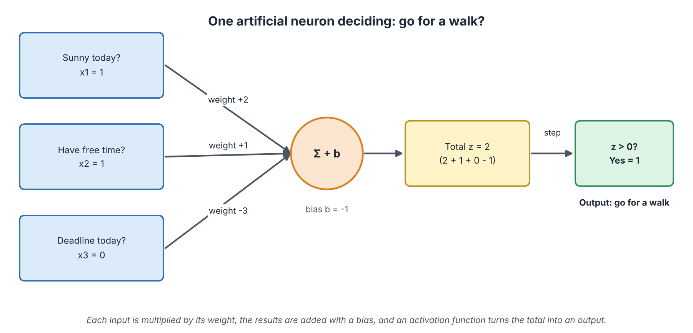
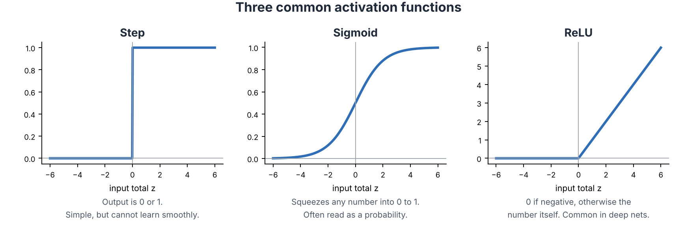
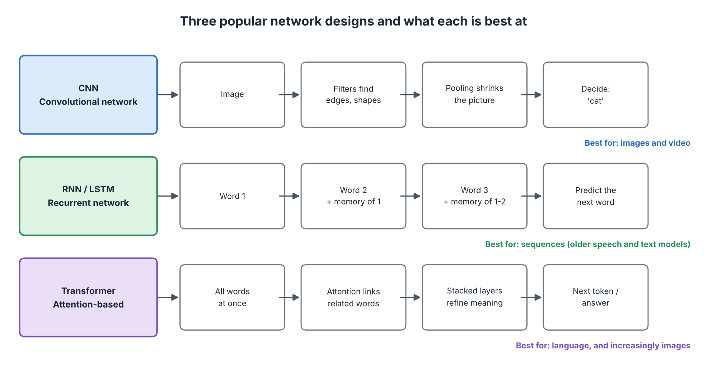
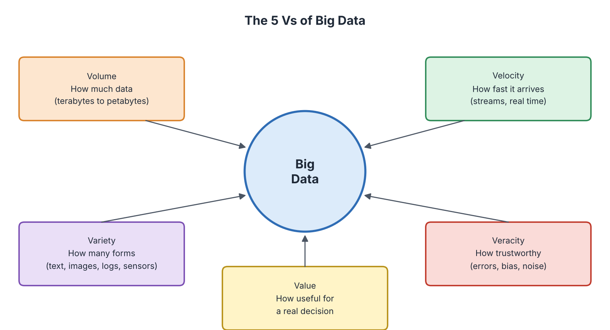
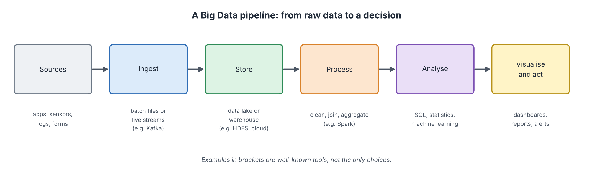
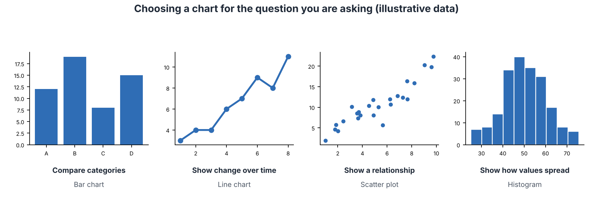

# Connectionist AI and Big Data

**Audience:** Learners with no technical background in AI  
**Estimated time:** 4 hours (including missions)  
**Format:** Read, pause at each "Pause and predict" box, complete the two missions, then check the answer key at the end of the chapter.

---

## Table of Contents

- [Learning Outcomes](#learning-outcomes)
- [Where This Chapter Fits](#where-this-chapter-fits)
- [5.1 The Big Picture](#51-the-big-picture)
- [5.2 A Single Neuron](#52-a-single-neuron)
- [5.3 Activation Functions](#53-activation-functions)
- [5.4 From One Neuron to a Network](#54-from-one-neuron-to-a-network)
- [5.5 Popular Network Designs](#55-popular-network-designs)
- [5.6 Big Data](#56-big-data)
- [5.7 Showing the Results: Choosing a Chart](#57-showing-the-results-choosing-a-chart)
- [5.8 Strengths and Limits](#58-strengths-and-limits)
- [5.9 Mission 1: Be a Neuron](#59-mission-1-be-a-neuron)
- [5.10 Mission 2: Read the Data](#510-mission-2-read-the-data)
- [5.11 Common Misconceptions](#511-common-misconceptions)
- [5.12 Quick Check](#512-quick-check)
- [5.13 Summary, Connections and References](#513-summary-connections-and-references)
- [Answer Key](#answer-key)
- [Glossary](#glossary)
- [References](#references)

---

## Learning Outcomes

After this chapter, you should be able to:

1. Explain the connectionist idea: intelligence from many simple connected units that learn.
2. Calculate the output of a single artificial neuron step by step.
3. Describe what an activation function does and compare step, sigmoid and ReLU.
4. Explain in simple words how a network learns (forward pass, error, backpropagation).
5. Compare CNNs, recurrent networks and transformers and say what each is best at.
6. Define Big Data using the 5 Vs and describe a Big Data pipeline.
7. Choose a suitable chart for a question and spot common data-quality problems.
8. Explain why the combination of data, computing power and algorithms made deep learning successful.

## Where This Chapter Fits

**Builds on Chapters 3 and 4.** Chapter 3 gave the general learning loop (predict, measure error, adjust). Chapter 4 showed AI built from written rules. This chapter shows the second school: AI built from many small units whose connections are *learned*.

**Leads to Chapters 6 to 8.** Chapter 6 adds learning from rewards. Chapter 7 shows applications that rely on networks and data. Chapter 8 discusses risks, such as biased data and unexplainable decisions.

---

## 5.1 The Big Picture

### Start with a question

A child sees a few dogs and learns the idea of "dog". No one gives the child a list of rules about ears and tails. How could a computer learn in a similar way?

### In plain words

**Connectionist AI builds intelligence from many very simple units joined together in a network.** Each unit does a tiny calculation. The *connections* between units carry strength values, called **weights**. The network "knows" things because of the values of its weights. *Learning* means adjusting those weights.

The idea is inspired by the brain, where billions of simple cells (neurons) are connected. But an artificial neural network is only a loose and simplified copy of a brain.

### Short history

| Year | Event | Why it matters |
|:----:|-------|----------------|
| 1943 | McCulloch and Pitts describe a simple mathematical neuron (McCulloch & Pitts, 1943) | First model of a neuron as a calculator |
| 1958 | Rosenblatt builds the **perceptron**, a neuron that can learn (Rosenblatt, 1958) | First learning neuron |
| 1969 | Minsky and Papert show that a single perceptron has strong limits | Interest and funding drop |
| 1986 | **Backpropagation** is popularised (Rumelhart et al., 1986) | A practical way to train networks with several layers |
| 2012 | A deep network (AlexNet) wins a major image contest by a large margin (Krizhevsky et al., 2012) | Start of the deep-learning boom |
| 2017 | The **transformer** design is introduced (Vaswani et al., 2017) | Basis of today's language AI |

### Symbolic vs connectionist

| | Symbolic AI (Chapter 4) | Connectionist AI (this chapter) |
|---|-------------------------|----------------------------------|
| Knowledge is stored as | Readable rules | Numbers (weights) |
| Comes from | People | Training data |
| Handles photos, speech | Poorly | Well |
| Can explain a decision | Easily | With difficulty |
| Typical failure | "No rule for this case" | "Confident but wrong" |

**Analogy: a team of tiny voters.** Each neuron "votes" a little, and the combined votes decide the result.  
**Where the analogy breaks:** voters in a team are independent, but neurons in a network are chained together: the output of one becomes the input of the next.

---

## 5.2 A Single Neuron

### Start with a question

How do *you* decide whether to go for a walk? You weigh several things: is it sunny, do I have time, do I have a deadline? Some matter more than others. An artificial neuron does exactly this, with numbers.

### In plain words

**An artificial neuron multiplies each input by a weight, adds everything together, adds a bias, and then decides what to output.**

### The four steps

1. **Inputs** (x): numbers describing the situation.
2. **Weights** (w): how important each input is. A negative weight pushes against.
3. **Sum with bias:** z = (w1 × x1) + (w2 × x2) + (w3 × x3) + b. The **bias** (b) is a fixed push that makes the neuron more or less eager to say "yes".
4. **Activation:** a rule that turns z into the output. Here: output 1 if z > 0, otherwise 0.

### Worked example

*Figure 5.1: One neuron deciding whether to go for a walk. Source: created by our team.*

Today: sunny (x1 = 1), have free time (x2 = 1), no deadline (x3 = 0).

| Step | Calculation | Result |
|------|-------------|:------:|
| Sunny | 2 × 1 | 2 |
| Free time | 1 × 1 | 1 |
| Deadline | -3 × 0 | 0 |
| Add them and the bias | 2 + 1 + 0 + (-1) | **z = 2** |
| Activation | z > 0 ? | **Yes, output = 1** |

If the deadline were today (x3 = 1), then z = 2 + 1 - 3 - 1 = -1, which is not greater than 0. The output becomes 0: no walk.

> **Pause and predict.** What happens if the weight on "deadline" were -1 instead of -3 and everything else stayed as above (all three inputs equal to 1)?
>
> **Check:** z = 2 + 1 - 1 - 1 = 1, which is greater than 0, so the output is 1. A smaller penalty means the deadline no longer stops the walk. *Changing weights changes behaviour. That is exactly what training does.*

---

## 5.3 Activation Functions

### Start with a question

In Section 5.2 the neuron said only "yes" or "no". Is that always what we want? Sometimes we prefer a smooth answer, like "70% sure".

### In plain words

**An activation function is the rule that turns the neuron's total z into its output.** It also adds a *bend* to the calculation. Without bends, a network of many layers would be no more powerful than a single straight-line calculation.

*Figure 5.2: Three common activation functions. Source: created by our team.*

| Function | Rule | Output range | Typical use |
|----------|------|:------------:|-------------|
| **Step** | 1 if z > 0, else 0 | 0 or 1 | Simple teaching examples |
| **Sigmoid** | Smooth S-curve | between 0 and 1 | Probability-like outputs |
| **ReLU** | 0 if z < 0, else z | 0 and above | Hidden layers of deep networks |

Examples: for z = -2, step gives 0, ReLU gives 0, and sigmoid gives about 0.12. For z = 3, step gives 1, ReLU gives 3, and sigmoid gives about 0.95.

---

## 5.4 From One Neuron to a Network

### Start with a question

One neuron can make a simple decision. How can many neurons recognise a cat in a photo?

### In plain words

**A network is neurons arranged in layers, where each layer's outputs are the next layer's inputs.** (The layout was shown in Chapter 3, Figure 3.5.)

| Layer | Job | Photo example |
|-------|-----|---------------|
| Input | Receives raw numbers | The brightness of every pixel |
| Hidden layers | Find patterns, from simple to complex | Edges, then shapes, then ears and eyes |
| Output | Gives the answer | "Cat: 0.92" |

### How a network learns

Learning repeats the loop from Chapter 3, now across many layers.

| Step | Name | Plain words |
|:----:|------|-------------|
| 1 | **Forward pass** | Send the input through the layers and get a prediction. |
| 2 | **Loss** | Compare with the right answer; compute one number for "how wrong". |
| 3 | **Backpropagation** | Work backward from the output to find how much each weight contributed to the error. |
| 4 | **Update** | Nudge each weight a little in the direction that reduces the error (gradient descent). |
| 5 | **Repeat** | Do this for many examples, many times. |

**Backpropagation in one picture:** think of a relay team that lost a race. The coach goes back along the line and asks each runner "how much did you slow us down?" and then gives each a small correction. Backpropagation does this for every weight at once.
**Where the analogy breaks:** runners are blamed by watching, but backpropagation uses exact mathematics (the chain rule from calculus) to calculate each weight's share.

> **Pause and predict.** After training, someone changes a few weights by hand at random. Will the network behave the same?
>
> **Check:** Probably not. The knowledge *is* the weights. Random changes usually make it worse, which is why trained networks should be stored carefully.

---

## 5.5 Popular Network Designs

### Start with a question

A photo is a grid. A sentence is a sequence. Should the same network design handle both? In practice, designers shape the network to fit the kind of data.

*Figure 5.3: Three popular network designs. Source: created by our team.*

| Design | Main idea | Best for | Everyday picture |
|--------|-----------|----------|------------------|
| **CNN** (convolutional neural network) | Small *filters* slide over the image to detect edges and shapes; later layers combine them | Images, video, scans | Moving a magnifying glass across a photo |
| **RNN / LSTM** (recurrent network) | Reads one item at a time and passes a *memory* to the next step | Sequences (older speech and text models) | Reading a sentence word by word and remembering earlier words |
| **Transformer** | Looks at all items at once and uses **attention** to link related ones (Chapter 3) | Language, and increasingly images | Reading the whole page and underlining the words that relate to each other |

Transformers replaced most recurrent networks for language because they can be trained in parallel on large collections of text (Vaswani et al., 2017).

### Why did deep learning take off only in the 2010s?

The basic ideas are decades old. They worked well only when three ingredients came together:

| Ingredient | What changed |
|------------|--------------|
| **Data** | The internet and sensors produced huge labelled collections (for example, millions of images). |
| **Computing power** | Graphics processors (GPUs) can do many small calculations in parallel, which fits network training. |
| **Better algorithms** | Improvements such as ReLU, better initialisation and new designs made deep networks trainable. |

This is also the link to the second half of the chapter: **modern connectionist AI runs on Big Data.**

---

## 5.6 Big Data

### Start with a question

Your phone, a bus card, an online shop and a hospital each record data all day. Put together, the amounts are too large for one ordinary computer or a spreadsheet. What do we do with it?

### In plain words

**Big Data means data so large, fast or varied that ordinary tools cannot store or process it, so special methods are needed.** The size alone is not the point. The point is that we want to find useful patterns in it.

### The 5 Vs

*Figure 5.4: The 5 Vs of Big Data. Source: created by our team.*

| V | Question it answers | Example |
|---|---------------------|---------|
| **Volume** | How much data? | Billions of online clicks stored |
| **Velocity** | How fast does it arrive? | A card payment must be checked in seconds |
| **Variety** | How many forms? | Text, images, sensor numbers and logs together |
| **Veracity** | How trustworthy is it? | Typing errors, fake accounts, bias |
| **Value** | Is it useful for a decision? | A shop learns which products sell together |

The first three Vs were described by Laney (2001); Veracity and Value were added later by practitioners. If veracity is low, the value is low. This is the "garbage in, garbage out" rule from Chapter 3 at large scale.

### How data is processed: the pipeline

*Figure 5.5: A Big Data pipeline. Source: created by our team.*

| Stage | What happens | Example tools |
|-------|--------------|---------------|
| Sources | Data is created | Apps, sensors, logs, forms |
| Ingest | Data is collected, in batches or as live streams | Kafka |
| Store | Data is saved at large scale | Data lake or warehouse; Hadoop file system; cloud storage |
| Process | Data is cleaned, joined and summarised | Spark (Zaharia et al., 2016) |
| Analyse | Questions are answered with statistics or machine learning | SQL, Python |
| Visualise and act | Results are shown and used | Dashboards, reports, alerts |

**Key idea: divide and conquer.** Instead of one giant computer, many ordinary computers each work on a slice of the data at once. The first widely known method for this was MapReduce (Dean & Ghemawat, 2004).

**Analogy: grading 10,000 exam papers.** One teacher needs weeks, but 100 teachers each grading 100 papers finish in a day, then one person adds up the scores.  
**Where the analogy breaks:** computers can fail mid-way and data must be copied to several machines, so the system must also handle breakdowns, which a group of teachers rarely needs.

### Data quality steps (the clean-up)

| Problem | Example | Common fix |
|---------|---------|------------|
| Missing values | A blank age | Remove the row or fill with a sensible value (and say so) |
| Duplicates | The same customer twice | Remove duplicates |
| Outliers | A daily sale of 210 when others are about 20 | Check the source; correct or flag it |
| Wrong format | "5/11/26" read as day-first or month-first | Standardise the format |
| Bias | One group is missing from the data | Collect more varied data; note the limits |

---

## 5.7 Showing the Results: Choosing a Chart

### Start with a question

After the analysis, someone must understand the result in a few seconds. A wrong chart can hide the message or even mislead.

### In plain words

**Choose the chart by the question you are answering.**

*Figure 5.6: Choosing a chart. The data shown is illustrative. Source: created by our team.*

| Question | Chart | Tip |
|----------|-------|-----|
| Which category is bigger? | Bar chart | Start the vertical axis at zero |
| How did it change over time? | Line chart | Keep the time spacing even |
| Are two things related? | Scatter plot | Remember: related does not mean one causes the other |
| How are values spread? | Histogram | Try different bar widths |

---

## 5.8 Strengths and Limits

### Connectionist AI

| Strength | Limit |
|----------|-------|
| Learns patterns too complex to write as rules | Needs large amounts of data and computing power |
| Works well on images, speech and text | Hard to explain ("black box") |
| Improves as data grows | Can inherit bias from data (Chapter 8) |
| Handles messy, noisy input | May be confidently wrong on unusual input |
| One method fits many tasks | Training uses considerable energy (Strubell et al., 2019) |

### Big Data

| Strength | Limit |
|----------|-------|
| Reveals patterns that small samples miss | More data does not fix bad data |
| Supports real-time decisions | Privacy and security risks grow with scale |
| Feeds machine learning | Storage and processing costs |

The two ideas strengthen each other: networks need data, and Big Data tools make the data usable. Many real systems combine them with rules from Chapter 4 (for example, a rule that blocks unsafe outputs from a network).

---

## 5.9 Mission 1: Be a Neuron

> **Goal:** compute neuron outputs by hand and see how changing weights changes decisions.  
> **Preparation:** Sections 5.2 and 5.3. Pen and 10 minutes.  
> **Task:** use the walking neuron from Figure 5.1. Weights: sunny +2, free time +1, deadline -3. Bias: -1. Output is 1 if z > 0, otherwise 0.

**Part A. Compute.** Fill in the table.

| Case | Sunny | Free time | Deadline | z = 2·sunny + 1·free - 3·deadline - 1 | Output |
|:----:|:-----:|:---------:|:--------:|:-------------------------------------:|:------:|
| a | 0 | 1 | 0 | ____ | ____ |
| b | 1 | 0 | 1 | ____ | ____ |
| c | 1 | 1 | 1 | ____ | ____ |
| d | 1 | 0 | 0 | ____ | ____ |

**Part B. Change the bias.** In case a, change the bias from -1 to 0. What are z and the output now? ____

**Part C. Change a weight.** In case c, change the deadline weight from -3 to -1 (bias back to -1). What are z and the output now? ____

**Part D. Activation functions.** Complete the table for a neuron whose total is z.

| z | Step output | ReLU output |
|:-:|:-----------:|:-----------:|
| -2 | ____ | ____ |
| 0 | ____ | ____ |
| 3 | ____ | ____ |

> **Observe:** which of the three changes (bias, weight, input) was needed to flip a "no" into a "yes"?  
> **Reflect:** a trained network has millions of weights. How is "training" similar to what you did in Parts B and C?  
> **Feedback:** compare with the Answer Key (Mission 1).

---

## 5.10 Mission 2: Read the Data

> **Goal:** link real situations to the 5 Vs, and clean and chart a small dataset.  
> **Preparation:** Sections 5.6 and 5.7. 10 to 15 minutes.

**Part A. Match the V.** Write Volume, Velocity, Variety, Veracity or Value next to each situation.

| Situation | V |
|-----------|:-:|
| A hospital collects scans, doctors' notes, lab numbers and a live heart-rate stream. | ____ |
| A bank must decide within a second whether a card payment is fraud. | ____ |
| A company stores petabytes of customer clicks. | ____ |
| A survey in which many people typed fake ages. | ____ |
| A shop finds that placing umbrellas near the door on rainy days raises sales. | ____ |

**Part B. Clean the data.** A shop recorded daily sales (in units) for one week:

| Day | Mon | Tue | Wed | Thu | Fri | Sat | Sun |
|-----|:---:|:---:|:---:|:---:|:---:|:---:|:---:|
| Sales | 20 | 22 | 21 | 23 | 210 | 25 | (blank) |

1. Which value looks suspicious, and what might have happened? ____
2. Which value is missing? ____
3. Calculate the average of the six recorded values (including 210) ____ and the average of the five values without 210 ____.
4. Which chart type would you use to show the week, and why? ____

**Part C. Think.** The suspicious value turns out to be real: a big event happened on Friday. Should you delete it? Explain in one or two sentences.

> **Observe:** how much did one value change the average?  
> **Reflect:** what does this tell you about checking veracity before analysing?  
> **Feedback:** compare with the Answer Key (Mission 2).

---

## 5.11 Common Misconceptions

| Misconception | Correction |
|---------------|------------|
| "Neural networks work like the human brain." | They are loosely inspired by the brain but are far simpler and work differently. |
| "A network stores facts in one place." | Knowledge is spread across many weights; no single weight holds one fact. |
| "More layers always means better." | Deeper networks need more data and care; they can overfit (Chapter 3). |
| "Big Data just means a lot of data." | Speed, variety and trustworthiness matter as well as size. |
| "With enough data the conclusion is always correct." | Biased or wrong data gives biased or wrong conclusions at scale. |

---

## 5.12 Quick Check

**Q1 (True/False).** In a neural network, learning means adjusting the weights.

**Q2 (True/False).** ReLU outputs a negative number when the input is negative.

**Q3 (True/False).** Veracity is about how fast data arrives.

**Q4 (Multiple choice, one answer).** A neuron has inputs 1 and 2, weights 3 and -1, and bias 0. What is z?
A. 1. B. 5. C. -1. D. 3.

**Q5 (Multiple choice, one answer).** Which design is best known for working with images?
A. CNN. B. A truth table. C. A spreadsheet. D. A search tree.

**Q6 (Multiple choice, one answer).** Which Big Data stage cleans, joins and summarises the data?
A. Ingest. B. Process. C. Visualise. D. Source.

**Q7 (Short answer, 3 to 4 sentences).** Explain why deep learning became successful in the 2010s even though the basic ideas were much older.

---

## 5.13 Summary, Connections and References

### Key takeaways

- Connectionist AI uses many simple units (neurons) joined by weights; learning means adjusting weights.
- A neuron computes z = sum of (weight × input) + bias, then applies an activation function.
- Networks learn by forward pass, loss, backpropagation, update, repeat.
- CNNs suit images, recurrent networks suit sequences, transformers suit language.
- Deep learning took off when data, computing power and algorithms came together.
- Big Data is described by the 5 Vs and handled by a pipeline from sources to decisions.
- Choose charts by the question; clean the data first.
- Limits: needs much data and energy, hard to explain, can inherit bias.

### Connections to other chapters

| Direction | Chapter | Link |
|-----------|---------|------|
| Builds on | Chapter 3 | Learning loop, gradient descent, neural network layout, attention |
| Builds on | Chapter 4 | The contrast with rule-based AI |
| Leads to | Chapter 6 | Neural networks combined with reward learning (deep reinforcement learning) |
| Leads to | Chapter 7 | Image, speech and language applications |
| Leads to | Chapter 8 | Bias in data, privacy, explainability |

### How this chapter will be reused

| Resource | Planned use |
|----------|-------------|
| **Study Guide** | Sections 5.1 to 5.8 are the reading text; Missions 1 and 2 are practice. |
| **Test Bank** | Neuron calculations, 5 Vs matching and chart selection become exam items. |
| **PPT Slides** | The neuron, activation functions, network designs and pipeline become visual slides. |
| **Video Tutorial** | A video that walks through one neuron calculation and one Big Data pipeline. |

---

## Answer Key

**Mission 1: Be a Neuron**

Part A:

| Case | Sunny | Free time | Deadline | z | Output |
|:----:|:-----:|:---------:|:--------:|:-:|:------:|
| a | 0 | 1 | 0 | 0 + 1 + 0 - 1 = **0** | **0** (0 is not greater than 0) |
| b | 1 | 0 | 1 | 2 + 0 - 3 - 1 = **-2** | **0** |
| c | 1 | 1 | 1 | 2 + 1 - 3 - 1 = **-1** | **0** |
| d | 1 | 0 | 0 | 2 + 0 + 0 - 1 = **1** | **1** |

Part B: z = 0 + 1 + 0 + 0 = **1**, output **1**. A higher bias makes the neuron more willing to say "yes".
Part C: z = 2 + 1 - 1 - 1 = **1**, output **1**. A smaller penalty on "deadline" lets the neuron say "yes" again.
Part D:

| z | Step output | ReLU output |
|:-:|:-----------:|:-----------:|
| -2 | 0 | 0 |
| 0 | 0 | 0 |
| 3 | 1 | 3 |

*Observe:* either raising the bias or reducing the size of a negative weight flipped a "no" into a "yes". *Reflect:* training also changes weights and biases, but automatically, in very small steps, over many examples.

**Mission 2: Read the Data**

Part A: Variety; Velocity; Volume; Veracity; Value.
Part B:
1. **210** looks suspicious. It is about ten times the other values, so it may be a typing error (an extra 0 on 21) or a special event.
2. **Sunday** is missing.
3. With 210: (20 + 22 + 21 + 23 + 210 + 25) / 6 = 321 / 6 = **53.5**. Without 210: (20 + 22 + 21 + 23 + 25) / 5 = 111 / 5 = **22.2**.
4. A **line chart**, because we are showing change over the days of a week.

Part C: do not delete it automatically. If the value is real, removing it would hide an important fact. The better approach is to keep it, mark it as an event day, and report averages both ways. *Observe:* one value moved the average from 22.2 to 53.5. *Reflect:* a single bad value can change a conclusion, so veracity must be checked first.

**Quick Check**

1. **True.**
2. **False.** ReLU outputs 0 for negative input.
3. **False.** That is velocity; veracity is trustworthiness.
4. **A.** z = (3 × 1) + (-1 × 2) + 0 = 1.
5. **A.**
6. **B.**
7. *Key points:* huge labelled datasets became available; GPUs made the calculations fast enough; improvements in methods (such as ReLU and new designs) made deep networks trainable; all three came together around 2012.

---

## Glossary

| Term | Meaning |
|------|---------|
| Activation function | The rule that turns a neuron's total into its output. |
| Backpropagation | Working backward through the network to find how much each weight contributed to the error. |
| Bias (in a neuron) | A fixed number added to the sum that shifts how easily the neuron says "yes". |
| Big Data | Data so large, fast or varied that special tools are needed. |
| CNN | Convolutional neural network, a design suited to images. |
| Deep learning | Machine learning using networks with many hidden layers. |
| GPU | A processor that does many small calculations in parallel. |
| Hidden layer | A layer between input and output. |
| Neuron (artificial) | A unit that sums weighted inputs and applies an activation function. |
| Pipeline | The stages that move data from source to decision. |
| ReLU | An activation function: 0 for negative input, otherwise the input. |
| Sigmoid | An S-shaped activation function with output between 0 and 1. |
| Transformer | A network design that uses attention to process all items at once. |
| Veracity | How trustworthy the data is. |
| Weight | A number showing how strong a connection is; learned during training. |

---

## References

1. Goodfellow, I., Bengio, Y., & Courville, A. (2016). *Deep Learning*. MIT Press. https://www.deeplearningbook.org/
2. McCulloch, W. S., & Pitts, W. (1943). A logical calculus of the ideas immanent in nervous activity. *Bulletin of Mathematical Biophysics, 5*, 115-133. https://doi.org/10.1007/BF02478259
3. Rosenblatt, F. (1958). The perceptron: A probabilistic model for information storage and organization in the brain. *Psychological Review, 65*(6), 386-408. https://doi.org/10.1037/h0042519
4. Rumelhart, D. E., Hinton, G. E., & Williams, R. J. (1986). Learning representations by back-propagating errors. *Nature, 323*, 533-536. https://doi.org/10.1038/323533a0
5. LeCun, Y., Bengio, Y., & Hinton, G. (2015). Deep learning. *Nature, 521*, 436-444. https://doi.org/10.1038/nature14539
6. Krizhevsky, A., Sutskever, I., & Hinton, G. E. (2012). ImageNet classification with deep convolutional neural networks. *Advances in Neural Information Processing Systems, 25*. https://papers.nips.cc/paper/2012/hash/c399862d3b9d6b76c8436e924a68c45b-Abstract.html
7. Vaswani, A., et al. (2017). Attention is all you need. *Advances in Neural Information Processing Systems, 30*. https://arxiv.org/abs/1706.03762
8. Laney, D. (2001). *3D data management: Controlling data volume, velocity and variety*. META Group research note (no stable public link; widely cited, search the title to verify).
9. Dean, J., & Ghemawat, S. (2004). MapReduce: Simplified data processing on large clusters. *OSDI '04*; also *Communications of the ACM, 51*(1), 107-113 (2008). https://doi.org/10.1145/1327452.1327492
10. Zaharia, M., et al. (2016). Apache Spark: A unified engine for big data processing. *Communications of the ACM, 59*(11), 56-65. https://doi.org/10.1145/2934664
11. Strubell, E., Ganesh, A., & McCallum, A. (2019). Energy and policy considerations for deep learning in NLP. *ACL 2019*. https://arxiv.org/abs/1906.02243
12. Nielsen, M. (2015). *Neural Networks and Deep Learning*. Determination Press. http://neuralnetworksanddeeplearning.com/
13. Course materials: lecturer's slides, *Chapter 5: Connectionist AI and Big Data Overview* (Computer Science & AI).

> Figures 5.1 to 5.6 were created for Stage 2 by our team. Sigmoid values are rounded. Reference 8 is an industry note without a stable public link; the Quality Lead should confirm how to cite it.

