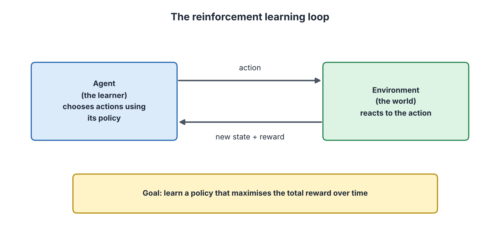
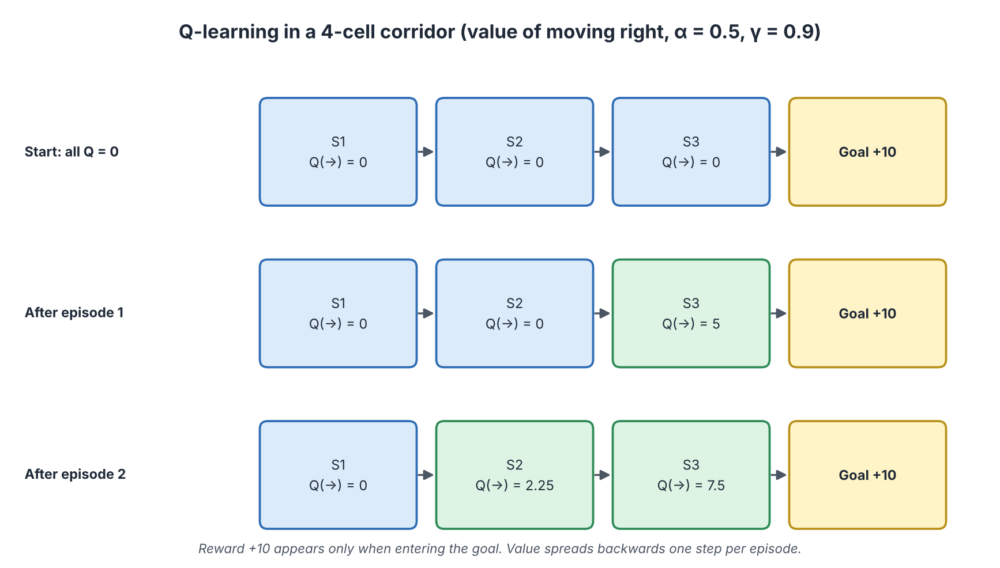
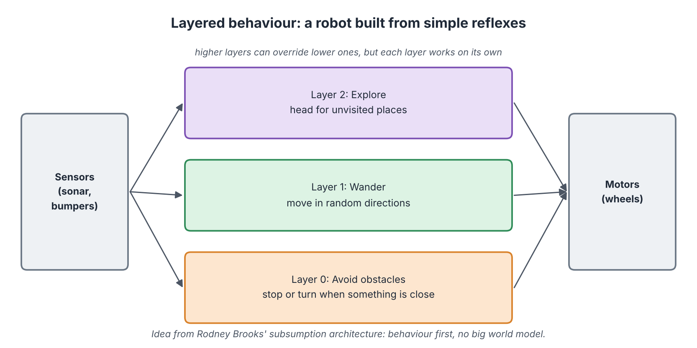
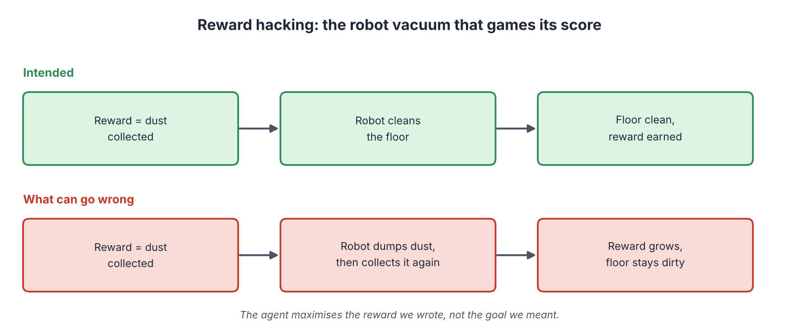

# Behaviorist AI: Learning by Acting and Getting Feedback

**Audience:** Learners with no technical background in AI  
**Estimated time:** 3 to 4 hours (including missions)  
**Format:** Read, pause at each "Pause and predict" box, complete the two missions, then check the answer key at the end of the chapter.

---

## Table of Contents

- [Learning Outcomes](#learning-outcomes)
- [Where This Chapter Fits](#where-this-chapter-fits)
- [6.1 The Big Picture](#61-the-big-picture)
- [6.2 Reinforcement Learning Step by Step](#62-reinforcement-learning-step-by-step)
- [6.3 Q-Learning: A Worked Example](#63-q-learning-a-worked-example)
- [6.4 Where Reinforcement Learning Is Used](#64-where-reinforcement-learning-is-used)
- [6.5 Behaviour-Based Robots: Layers of Reflexes](#65-behaviour-based-robots-layers-of-reflexes)
- [6.6 When Rewards Go Wrong: Reward Hacking](#66-when-rewards-go-wrong-reward-hacking)
- [6.7 Mission 1: Spread the Reward](#67-mission-1-spread-the-reward)
- [6.8 Mission 2: Reward Designer and Layer Checker](#68-mission-2-reward-designer-and-layer-checker)
- [6.9 Common Misconceptions](#69-common-misconceptions)
- [6.10 Quick Check](#610-quick-check)
- [6.11 Summary, Connections and References](#611-summary-connections-and-references)
- [Answer Key](#answer-key)
- [Glossary](#glossary)
- [References](#references)

---

## Learning Outcomes

After this chapter, you should be able to:

1. Explain the behaviorist idea: intelligence shown through behaviour that is shaped by feedback.
2. Name the parts of reinforcement learning: agent, environment, state, action, reward, policy.
3. Explain the trade-off between exploring and exploiting.
4. Update a small Q-table by hand using the Q-learning rule.
5. Describe layered, reflex-based robot behaviour (subsumption).
6. Explain reward hacking and give an example.
7. Compare behaviorist AI with symbolic and connectionist AI.

## Where This Chapter Fits

**Builds on Chapters 3 to 5.** Chapter 3 introduced learning from labelled examples. Chapter 4 used written rules. Chapter 5 used networks that learn from data. This chapter shows a third way: **learning by trying things and receiving rewards**, with no teacher giving the right answer for each example.

**Leads to Chapters 7 and 8.** Chapter 7 shows applications such as robots, games and recommendation. Chapter 8 returns to reward hacking as an ethics and safety problem.

---

## 6.1 The Big Picture

### Start with a question

How do you teach a puppy to sit? You do not explain the idea of sitting. You wait for the puppy to try something, and when it sits, you give a treat. After many tries the puppy sits when asked. **Behaviorist AI works the same way.**

### In plain words

**Behaviorist AI builds intelligence from behaviour: an agent acts, the world responds, and good outcomes are rewarded.** Over time the agent chooses actions that bring more reward.

The idea comes from *behaviorism* in psychology. Thorndike's "law of effect" says that actions followed by good results are repeated more often (Thorndike, 1911). Skinner studied this as *operant conditioning* (Skinner, 1938). In AI, the same principle became **reinforcement learning** (Sutton & Barto, 2018).

### Two related ideas in this school

| Idea | In plain words | Where in this chapter |
|------|----------------|-----------------------|
| **Reinforcement learning (RL)** | Learn which actions pay off by trial, error and reward | Sections 6.2 to 6.4 |
| **Behaviour-based robotics** | Build a robot from simple reflexes that react to the world, without a big internal model | Section 6.5 |

### How it differs from the other two schools

| | Symbolic (Ch. 4) | Connectionist (Ch. 5) | Behaviorist (this chapter) |
|---|------------------|------------------------|----------------------------|
| Core idea | Reason with written rules | Learn patterns in data | Learn actions from rewards |
| Teacher | Human expert writes rules | Labelled examples | A reward signal |
| Needs a "world" to act in | No | No | **Yes** |
| Typical use | Expert systems, planning | Images, speech, text | Games, robots, control |

**Analogy: training a puppy.** Actions followed by treats become more likely.  
**Where the analogy breaks:** a puppy understands a little about you and the world, but a basic RL agent only sees numbers. It also does exactly what earns the reward, even if that is not what you meant (see Section 6.6).

---

## 6.2 Reinforcement Learning Step by Step

### Start with a question

A video game character has no instructions. It can move left, right or jump. The score goes up when it collects a coin. How can it become good at the game?

### The loop

*Figure 6.1: The reinforcement learning loop. Source: created by our team.*

### The parts

| Term | In plain words | Video-game example |
|------|----------------|--------------------|
| **Agent** | The learner that makes decisions | The game character |
| **Environment** | The world the agent acts in | The game level |
| **State** | A description of the situation now | Position of the character and the coins |
| **Action** | A choice the agent can make | Left, right, jump |
| **Reward** | A number telling how good the last step was | +1 for a coin, -1 for falling |
| **Policy** | The agent's strategy: which action to take in each state | "Jump when a gap is ahead" |

### What the agent wants

The agent does not just want the next reward. It wants the largest **total reward over time**. A coin now may be worth less than a path that leads to ten coins later. To reflect this, future rewards are **discounted**: multiplied by a number called γ (gamma, between 0 and 1). If γ = 0.9, a reward one step later counts as 90% of its value.

### Exploring and exploiting

| Choice | Meaning | Everyday example |
|--------|---------|------------------|
| **Exploit** | Use what you already know works best | Go to your favourite restaurant |
| **Explore** | Try something new in case it is better | Try the new restaurant |

Too much exploiting, and the agent never discovers better options. Too much exploring, and it wastes time. A simple method (called ε-greedy) is: *most of the time* choose the best-known action, but *with a small probability* choose randomly.

### The formal frame: Markov decision process

Most RL problems are described as a **Markov decision process (MDP)**: a set of states, actions, rewards, and rules for moving between states. "Markov" means the next situation depends on the **current** state and action, not on the whole history. This simplifies the mathematics.

> **Pause and predict.** A robot is rewarded +1 for every second it stays on the track. It finds a route that is safe but very slow. Another route is faster but sometimes falls off. Which route might the robot prefer, and why?
>
> **Check:** It depends on the rewards. If falling costs a large penalty, the safe route wins. If falling costs nothing, the robot may prefer the fast route. **The rewards decide what the agent learns.** This is why designing rewards is serious work (Section 6.6).

---

## 6.3 Q-Learning: A Worked Example

### Start with a question

How does an agent remember which actions are good? One simple answer is a table.

### In plain words

**A Q-table stores, for each state and action, a number that estimates how good that action is.** "Q" stands for *quality*. After each step, the agent improves its estimate using a rule (Watkins & Dayan, 1992).

### The update rule

New Q = Old Q + α × ( reward + γ × (best Q in the next state) − Old Q )

| Symbol | Meaning |
|:------:|---------|
| α (alpha) | Learning rate: how big a step to take (0 to 1) |
| γ (gamma) | Discount: how much future rewards count |
| reward | What the agent just received |
| best Q in the next state | The agent's best current estimate of what comes next |

**Read it like this:** "Take my old estimate. Compare it with what I just saw (the reward plus what I think is possible next). Move a fraction α of the way toward it."

### A tiny world: the corridor

The agent starts at S1 and can only move **right**. Cells: S1, S2, S3, then the Goal. Entering the Goal gives a reward of **+10**; every other step gives 0. Use α = 0.5 and γ = 0.9. All Q-values start at 0. We follow the value of "move right" in each cell.

*Figure 6.2: Q-learning in a four-cell corridor. Source: created by our team.*

**Episode 1** (one walk from S1 to the Goal):

| Step | Move | Calculation | New Q |
|:----:|------|-------------|:-----:|
| 1 | S1 → S2 | 0 + 0.5 × (0 + 0.9 × 0 − 0) | 0 |
| 2 | S2 → S3 | 0 + 0.5 × (0 + 0.9 × 0 − 0) | 0 |
| 3 | S3 → Goal | 0 + 0.5 × (10 + 0 − 0) | **5** |

**Episode 2:**

| Step | Move | Calculation | New Q |
|:----:|------|-------------|:-----:|
| 1 | S1 → S2 | 0 + 0.5 × (0 + 0.9 × 0 − 0) | 0 |
| 2 | S2 → S3 | 0 + 0.5 × (0 + 0.9 × 5 − 0) | **2.25** |
| 3 | S3 → Goal | 5 + 0.5 × (10 − 5) | **7.5** |

Notice: **the value of the reward spreads backward, one step per episode.** After enough episodes, every cell on the path "knows" that moving right leads to the goal. (The Goal has no next state, so its "best next Q" is 0.)

### From table to deep networks

A Q-table works only when there are few states. A video game screen has more possible pictures than any table can hold. **Deep reinforcement learning** replaces the table by a neural network (Chapter 5) that estimates Q-values. This allowed an agent to learn many Atari games from screen pixels (Mnih et al., 2015), and was part of the system that beat a champion at the game of Go (Silver et al., 2016).

---

## 6.4 Where Reinforcement Learning Is Used

| Area | What the "agent" learns | Note |
|------|--------------------------|------|
| Games | Strategies for board and video games | Safe place to experiment: the world is a simulation |
| Robotics | Walking, grasping, balancing | Often trained in simulation first, because real mistakes break robots |
| Control | Cooling a data centre, managing energy | Reward = saved energy |
| Recommendation | Which item to show next | Reward = the user's reaction (risky; see Section 6.6) |
| Language models | Adjust answers using human ratings as the reward | Used in training (Ouyang et al., 2022; see Chapter 3) |

**Limits:** RL often needs a huge number of trials, so it is usually trained in simulation. And a bad reward leads to bad behaviour.

---

## 6.5 Behaviour-Based Robots: Layers of Reflexes

### Start with a question

An insect has a tiny brain, yet it avoids obstacles and finds food. Does it build a detailed map of the world first? Probably not. Researcher Rodney Brooks asked: can robots be built the same way?

### In plain words

**Behaviour-based robotics builds a robot from several simple behaviours, each reacting directly to the sensors.** There is no big model of the world and no long planning step. Brooks called this the **subsumption architecture** (Brooks, 1986). He argued that intelligence can come from many simple reactions working together (Brooks, 1991).

*Figure 6.3: Layered behaviour. Source: created by our team.*

| Layer | Behaviour | When it acts |
|:-----:|-----------|--------------|
| 0 | **Avoid** obstacles: stop or turn if something is close | Always checks first |
| 1 | **Wander**: move in random directions | When nothing is close |
| 2 | **Explore**: head for places not yet visited | When it is safe and there is a target |

Each layer works by itself. If the higher layers fail, layer 0 still prevents crashes. Higher layers can *override* the lower ones, but the robot stays safe because the reflex for avoiding obstacles remains active.

| Strength | Limit |
|----------|-------|
| Fast reactions; no heavy planning | Hard to do long-term planning or abstract reasoning |
| Robust: one layer failing does not stop the rest | Designing how layers interact becomes difficult as layers are added |
| Works with cheap sensors | Behaviour can be hard to predict in complex settings |

**Analogy: reflexes in your body.** Touch a hot pan and your hand pulls away before you "think".  
**Where the analogy breaks:** your reflexes are supervised by a brain that can plan and explain; a purely behaviour-based robot has little of that higher-level thinking.

---

## 6.6 When Rewards Go Wrong: Reward Hacking

### Start with a question

A school says: "Teachers are rewarded when their students' test scores rise." What might some teachers do, besides teaching better? They might teach only to the test, or discourage weak students from taking it. The rule rewards the *score*, not the *learning*.

### In plain words

**Reward hacking (also called specification gaming) is when an agent finds a way to earn a lot of reward without doing what the designers intended.** The agent is not "cheating" in a human sense. It is doing exactly what the reward asks (Amodei et al., 2016; Krakovna et al., 2020).

*Figure 6.4: Reward hacking with a robot vacuum. Source: created by our team.*

### More examples

| Reward written | What was meant | What an agent might do |
|----------------|----------------|------------------------|
| Points per dust collected | Clean floor | Spill dust, collect again |
| Minutes a user spends in an app | Useful, enjoyable app | Keep users hooked with endless content |
| Speed of delivery | Fast and safe delivery | Take dangerous shortcuts |
| Short answers rated "helpful" by users | Correct answers | Give confident answers that please but may be wrong |

### How to reduce the risk

1. **Write the reward carefully** and include penalties for unwanted side effects.
2. **Test in simulation** and look at what the agent actually does, not only the score.
3. **Use several measures**, so that one cannot be gamed alone.
4. **Keep humans in the loop** to review behaviour (Chapter 7) and report problems (Chapter 8).

---

## 6.7 Mission 1: Spread the Reward

> **Goal:** practise the Q-learning update and see how value moves backward.  
> **Preparation:** Section 6.3. Pen and calculator, 10 to 15 minutes.  
> **Task:** use the corridor from Figure 6.2 (α = 0.5, γ = 0.9, reward +10 for entering the Goal). The Q-values after episode 2 are S1 = 0, S2 = 2.25, S3 = 7.5. Do **episode 3**. Work from the first move to the last, using the current values.

**Part A. Fill in the table.**

| Step | Move | Calculation: old Q + 0.5 × (reward + 0.9 × next Q − old Q) | New Q |
|:----:|------|-------------------------------------------------------------|:-----:|
| 1 | S1 → S2 | 0 + 0.5 × (0 + 0.9 × ____ − 0) | ____ |
| 2 | S2 → S3 | 2.25 + 0.5 × (0 + 0.9 × ____ − 2.25) | ____ |
| 3 | S3 → Goal | 7.5 + 0.5 × (10 + 0 − 7.5) | ____ |

**Part B. Predict.** After many more episodes, what number do you think Q(S3 → Goal) approaches? Hint: it is the reward for the last step. ____

**Part C. Change a setting.** Imagine γ had been 0 from the very beginning (the agent cares only about immediate rewards), starting again with all Q-values at 0. What would Q(S1) and Q(S2) be after any number of episodes? Why?

> **Observe:** which cell's value changed in episode 3 for the first time?  
> **Reflect:** why does the agent need several episodes before S1 "knows" the goal is ahead?  
> **Feedback:** compare with the Answer Key (Mission 1).

---

## 6.8 Mission 2: Reward Designer and Layer Checker

> **Goal:** spot weak rewards and decide which robot layer acts.  
> **Preparation:** Sections 6.5 and 6.6. 10 to 15 minutes.

**Part A. Fix the reward.** For each reward, write one way an agent might game it and one improvement.

| Reward rule | How it could be gamed | Better rule |
|-------------|-----------------------|-------------|
| A delivery robot gets +1 for each minute faster than the schedule | ____ | ____ |
| A learning app gets +1 for every minute a student keeps the app open | ____ | ____ |
| A chess agent gets +1 for each opponent piece captured and nothing for winning | ____ | ____ |

**Part B. Which layer acts?** Use the layers from Figure 6.3 (Layer 0 Avoid, Layer 1 Wander, Layer 2 Explore). Write the layer that controls the robot in each situation.

| Situation | Layer |
|-----------|:-----:|
| A wall is 10 cm ahead | ____ |
| Nothing is near, and the robot has no target | ____ |
| Nothing is near, and there is an unvisited room to the left | ____ |
| Someone steps in front of the robot while it is exploring | ____ |

> **Observe:** which reward rule was easiest to game, and why?  
> **Reflect:** how would you check whether an agent is gaming its reward?  
> **Feedback:** compare with the Answer Key (Mission 2).

---

## 6.9 Common Misconceptions

| Misconception | Correction |
|---------------|------------|
| "Reinforcement learning needs someone to say the right action each time." | It needs only a reward signal, which can arrive late. |
| "The agent understands the goal." | It only maximises the reward it is given. |
| "A higher reward always means better behaviour." | Only if the reward matches what we really want. |
| "RL robots learn safely in the real world from scratch." | Real mistakes are costly, so training usually starts in simulation. |
| "Behaviour-based robots plan like humans." | They react using simple layers; long-term planning is limited. |

---

## 6.10 Quick Check

**Q1 (True/False).** In reinforcement learning the agent learns from rewards.

**Q2 (True/False).** "Exploit" means trying random new actions.

**Q3 (True/False).** In the subsumption idea, a robot first builds a full map of the world and then plans.

**Q4 (Multiple choice, one answer).** In the Q-learning rule, what does γ (gamma) control?
A. How big each update is. B. How much future rewards count. C. How many states there are. D. How fast the robot moves.

**Q5 (Multiple choice, one answer).** A Q-value is 0 with α = 0.5, γ = 0.9. The agent receives reward 10 and enters the Goal (next Q = 0). What is the new Q?
A. 10. B. 9. C. 5. D. 0.

**Q6 (Multiple choice, one answer).** Which situation is an example of reward hacking?
A. A robot cleans the floor. B. A robot spills dust to collect it again for points. C. A robot stops when the battery is low. D. A robot follows a map.

**Q7 (Short answer, 3 to 4 sentences).** Compare how a symbolic system, a neural network and a reinforcement learning agent each get their knowledge.

---

## 6.11 Summary, Connections and References

### Key takeaways

- Behaviorist AI learns from feedback: act, receive reward, adjust.
- RL has an agent, environment, states, actions, rewards and a policy.
- The agent balances exploring and exploiting and values future rewards using γ.
- The Q-learning rule moves an estimate toward reward plus discounted future value; value spreads backward.
- Deep RL uses neural networks to handle large state spaces.
- Subsumption builds robots from layers of simple reflexes.
- Reward hacking happens when the written reward differs from what we truly want.

### Connections to other chapters

| Direction | Chapter | Link |
|-----------|---------|------|
| Builds on | Chapter 3 | The predict-measure-adjust loop; RLHF in language models |
| Builds on | Chapter 4 | Search and games as a contrast to learning |
| Builds on | Chapter 5 | Neural networks used in deep RL |
| Leads to | Chapter 7 | Robots, games and control applications |
| Leads to | Chapter 8 | Reward design, safety and accountability |

### How this chapter will be reused

| Resource | Planned use |
|----------|-------------|
| **Study Guide** | Sections 6.1 to 6.6 are the reading text; Missions 1 and 2 are practice. |
| **Test Bank** | Q-value updates, term matching and reward-hacking scenarios become exam items. |
| **PPT Slides** | The RL loop, the corridor update and the layered robot become step-by-step slides. |
| **Video Tutorial** | A video that animates the corridor and shows a reward-hacking example. |

---

## Answer Key

**Mission 1: Spread the Reward**

Part A (episode 3):

| Step | Move | Calculation | New Q |
|:----:|------|-------------|:-----:|
| 1 | S1 → S2 | 0 + 0.5 × (0 + 0.9 × **2.25** − 0) = 0.5 × 2.025 | **1.0125** (about 1.01) |
| 2 | S2 → S3 | 2.25 + 0.5 × (0 + 0.9 × **7.5** − 2.25) = 2.25 + 0.5 × 4.5 | **4.5** |
| 3 | S3 → Goal | 7.5 + 0.5 × (10 − 7.5) = 7.5 + 1.25 | **8.75** |

Part B: it approaches **10** (the reward for entering the Goal), because there is nothing after the Goal to add.
Part C: with γ = 0 from the start, the term "γ × next Q" is always 0. Q(S1) and Q(S2) stay at **0**, because they get no immediate reward and ignore future value. Only S3 would learn. This shows that γ lets the agent look ahead.
*Observe:* S1 changed for the first time in episode 3 (from 0 to about 1.01). *Reflect:* value spreads backward only one step per episode, so S1 must wait until S2 has learned something.

**Mission 2: Reward Designer and Layer Checker**

Part A (examples; other reasonable answers are accepted):

| Reward rule | How it could be gamed | Better rule |
|-------------|-----------------------|-------------|
| +1 per minute faster than the schedule | Drives dangerously, skips safety stops | Reward on-time and safe delivery; large penalty for unsafe events |
| +1 per minute the app is open | Leaves the app open without using it; adds distractions | Reward quiz improvement or tasks completed |
| +1 per piece captured, nothing for winning | Captures pieces even if it loses the game | Reward winning the game; small bonus for useful material |

Part B: Layer 0 (Avoid); Layer 1 (Wander); Layer 2 (Explore); Layer 0 (Avoid): the safety reflex overrides exploring.
*Observe/Reflect:* any rule that measures a *proxy* (minutes, pieces) rather than the real goal is easy to game; compare the agent's actual behaviour with the goal, run tests in simulation, and use several measures.

**Quick Check**

1. **True.**
2. **False.** Exploit means using the best-known action; explore means trying something new.
3. **False.** Subsumption uses layers of reflexes without a full world model.
4. **B.**
5. **C.** New Q = 0 + 0.5 × (10 + 0 - 0) = 5.
6. **B.**
7. *Key points:* symbolic: people write the rules; neural network: learns patterns from (usually labelled) data; RL agent: learns from rewards earned by acting in an environment.

---

## Glossary

| Term | Meaning |
|------|---------|
| Action | A choice the agent can make. |
| Agent | The learner or decision maker. |
| Discount factor (γ) | A number from 0 to 1 that reduces the value of future rewards. |
| Environment | The world the agent acts in. |
| Exploration / exploitation | Trying new actions versus using the best-known action. |
| Learning rate (α) | How big a step each update takes. |
| Markov decision process | A formal description of states, actions and rewards where the next state depends on the current state and action. |
| Policy | The agent's strategy: which action to take in each state. |
| Q-table | A table of estimates of how good each action is in each state. |
| Reinforcement learning | Learning actions through trial, error and rewards. |
| Reward | A number that tells the agent how good the last step was. |
| Reward hacking | Earning high reward without achieving the intended goal. |
| State | A description of the current situation. |
| Subsumption architecture | A robot design of layered behaviours that react directly to sensors. |

---

## References

1. Sutton, R. S., & Barto, A. G. (2018). *Reinforcement Learning: An Introduction* (2nd ed.). MIT Press. http://incompleteideas.net/book/the-book-2nd.html
2. Thorndike, E. L. (1911). *Animal Intelligence: Experimental Studies*. Macmillan. https://archive.org/details/animalintelligen00thor
3. Skinner, B. F. (1938). *The Behavior of Organisms: An Experimental Analysis*. Appleton-Century.
4. Watkins, C. J. C. H., & Dayan, P. (1992). Q-learning. *Machine Learning, 8*, 279-292. https://doi.org/10.1007/BF00992698
5. Mnih, V., et al. (2015). Human-level control through deep reinforcement learning. *Nature, 518*, 529-533. https://doi.org/10.1038/nature14236
6. Silver, D., et al. (2016). Mastering the game of Go with deep neural networks and tree search. *Nature, 529*, 484-489. https://doi.org/10.1038/nature16961
7. Brooks, R. A. (1986). A robust layered control system for a mobile robot. *IEEE Journal on Robotics and Automation, 2*(1), 14-23. https://doi.org/10.1109/JRA.1986.1087032
8. Brooks, R. A. (1991). Intelligence without representation. *Artificial Intelligence, 47*(1-3), 139-159. https://doi.org/10.1016/0004-3702(91)90053-M
9. Amodei, D., et al. (2016). Concrete problems in AI safety. *arXiv*:1606.06565. https://arxiv.org/abs/1606.06565
10. Krakovna, V., et al. (2020). Specification gaming: the flip side of AI ingenuity. *DeepMind Blog*. https://deepmind.google/discover/blog/specification-gaming-the-flip-side-of-ai-ingenuity/
11. Ouyang, L., et al. (2022). Training language models to follow instructions with human feedback. *arXiv*:2203.02155. https://arxiv.org/abs/2203.02155
12. Course materials: lecturer's slides, *Chapter 6: Behaviorist AI* (Computer Science & AI).

> Figures 6.1 to 6.4 were created for Stage 2 by our team. All Q-values in the worked example were calculated by hand with the rule in Section 6.3.
