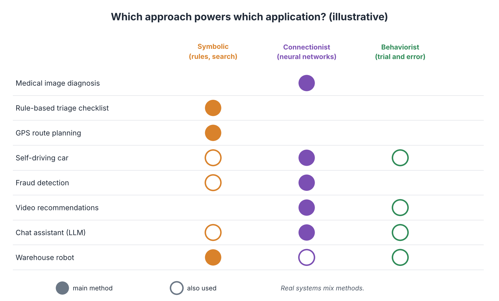
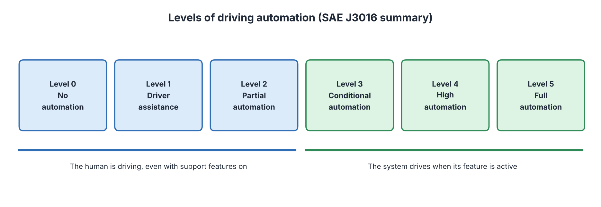
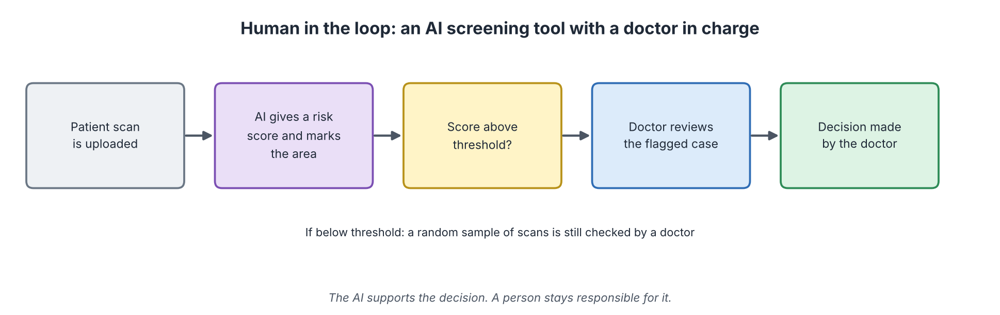

# Applications of Artificial Intelligence

**Audience:** Learners with no technical background in AI  
**Estimated time:** 3 hours (including missions)  
**Format:** Read, pause at each "Pause and predict" box, complete the two missions, then check the answer key at the end of the chapter.

---

## Table of Contents

- [Learning Outcomes](#learning-outcomes)
- [Where This Chapter Fits](#where-this-chapter-fits)
- [7.1 The Big Picture](#71-the-big-picture)
- [7.2 Healthcare](#72-healthcare)
- [7.3 Finance and Business](#73-finance-and-business)
- [7.4 Transport](#74-transport)
- [7.5 Education, Entertainment and Everyday Life](#75-education-entertainment-and-everyday-life)
- [7.6 Robotics and Manufacturing](#76-robotics-and-manufacturing)
- [7.7 Human in the Loop](#77-human-in-the-loop)
- [7.8 Five Questions Before Trusting an AI Application](#78-five-questions-before-trusting-an-ai-application)
- [7.9 Mission 1: Match the Method](#79-mission-1-match-the-method)
- [7.10 Mission 2: Set the Threshold](#710-mission-2-set-the-threshold)
- [7.11 Common Misconceptions](#711-common-misconceptions)
- [7.12 Quick Check](#712-quick-check)
- [7.13 Summary, Connections and References](#713-summary-connections-and-references)
- [Answer Key](#answer-key)
- [Glossary](#glossary)
- [References](#references)

---

## Learning Outcomes

After this chapter, you should be able to:

1. Describe how AI is used in healthcare, finance, transport, education, entertainment and robotics.
2. Match an application to the AI approach (symbolic, connectionist, behaviorist) it mainly uses, and explain that real systems mix approaches.
3. Explain the levels of driving automation.
4. Explain what "human in the loop" means and why it is used.
5. Use precision and recall from Chapter 3 to judge a screening tool and its workload.
6. Ask five practical questions before trusting an AI application.

## Where This Chapter Fits

**Builds on Chapters 1 to 6.** Chapters 1 to 3 explained what AI is and how it learns. Chapters 4 to 6 explained the three "schools". This chapter shows **where each idea is used in real life**.

**Leads to Chapter 8.** Every application here has risks, such as errors, unfair outcomes and privacy loss. Chapter 8 studies these in detail.

---

## 7.1 The Big Picture

### Start with a question

In one day you may unlock your phone with your face, get a route from a map app, see recommended videos, and receive a bank alert about a strange payment. How many different AI ideas just worked for you?

### In plain words

**An AI application is a tool that uses AI methods to do a useful job.** To choose a method, designers ask one question: *what kind of problem is this?*

| If the problem is... | Then the method is usually... | Chapter |
|----------------------|-------------------------------|:-------:|
| Clear rules and exact logic | Symbolic AI (rules, search) | 4 |
| Patterns in messy data (images, speech, text) | Connectionist AI (neural networks) | 3 and 5 |
| Learning to act and get better with feedback | Behaviorist AI (reinforcement learning) | 6 |

### Which approach powers which application?

*Figure 7.1: Which approach powers which application (illustrative). Source: created by our team.*

How to read Figure 7.1: a **filled dot** means the main method. An **open circle** means it is also used. Notice how many rows have more than one dot: **real systems mix methods.** For example, a self-driving car uses neural networks to see, rules to follow traffic laws, and learning from experience to improve its driving.

---

## 7.2 Healthcare

### Start with a question

A doctor may look at hundreds of scans a week. Tiredness can cause missed details. Can a computer help a human look more carefully?

### Uses

| Use | How AI helps | Main method |
|-----|--------------|-------------|
| **Reading medical images** | Highlights suspicious areas in scans or eye photos (Gulshan et al., 2016) | Connectionist |
| **Triage checklists** | Asks fixed questions and sorts urgency | Symbolic (rules) |
| **Drug and protein research** | Predicts the 3D shape of proteins, speeding up research (Jumper et al., 2021) | Connectionist |
| **Hospital scheduling** | Plans operating-room use | Symbolic (search and optimisation) |

### Important points

- Studies show strong results in narrow tasks, but results can differ between hospitals and patient groups (Topol, 2019). **A tool trained on one population may perform worse on another.**
- The AI usually **supports** the doctor. A person remains responsible (see Section 7.7).

---

## 7.3 Finance and Business

### Start with a question

A bank handles millions of card payments each day. A person cannot check each one. How can fraud be spotted within seconds?

### Uses

| Use | How AI helps | Main method |
|-----|--------------|-------------|
| **Fraud detection** | Flags payments that look unusual compared with a customer's normal pattern | Connectionist, plus rules |
| **Credit scoring** | Estimates the chance a loan is repaid | Statistical or neural models (high-risk in the EU; see Chapter 8) |
| **Customer service** | Chat assistants answer common questions | Connectionist (language models) |
| **Demand forecasting** | Predicts how much stock a shop will need | Connectionist or statistics |

**Link to Chapter 5:** this is Big Data at work. Velocity matters (decide in a second), and veracity matters (mistakes cost money).
**Link to Chapter 3:** fraud is rare, so *accuracy* is misleading. Banks care about **precision** (few false alarms) and **recall** (catching real fraud).

---

## 7.4 Transport

### Start with a question

A self-driving car must see, decide and act in a fraction of a second, in rain, at night, near children. How many kinds of AI does that need?

### Uses

| Use | How AI helps | Main method |
|-----|--------------|-------------|
| **Route planning** | Finds the fastest route using search (Chapter 4) with live traffic data | Symbolic (A\*-style search) |
| **Driver assistance** | Lane keeping, automatic braking | Connectionist and rules |
| **Self-driving vehicles** | Sees with cameras and sensors, predicts other road users, plans a path | All three, mixed |
| **Logistics** | Plans delivery routes and warehouse movement | Symbolic and behaviorist |

### Levels of driving automation

The standard SAE J3016 describes six levels (SAE International, 2021).

*Figure 7.2: Levels of driving automation. Source: created by our team.*

| Level | Name | Who is responsible? | Example |
|:-----:|------|---------------------|---------|
| 0 | No automation | Human | Warning sounds only |
| 1 | Driver assistance | Human | Cruise control that keeps distance |
| 2 | Partial automation | Human (must watch the road) | Steering and speed support together |
| 3 | Conditional automation | System drives, human must take over when asked | Limited highway driving |
| 4 | High automation | System, in limited areas or conditions | A robotaxi in a mapped district |
| 5 | Full automation | System, everywhere | Not generally available today |

**The most important point:** in levels 0 to 2 the human is always the driver, even when assistance features are switched on.

---

## 7.5 Education, Entertainment and Everyday Life

| Area | Example | Main method | Note |
|------|---------|-------------|------|
| **Education** | Tutoring software gives hints and adjusts difficulty (Kulik & Fletcher, 2016) | Symbolic and connectionist | Works best with a teacher's guidance |
| **Entertainment** | Video and music recommendations (Covington et al., 2016) | Connectionist, with behaviorist ideas | Can narrow what you see (see Chapter 8) |
| **Language tools** | Translation, writing help, summaries | Connectionist (language models) | Must be checked for errors (Chapter 8) |
| **Weather** | Fast forecasts learned from past data (Lam et al., 2023) | Connectionist | Complements physical models |
| **Games** | Opponents and training partners | Symbolic (search), behaviorist | Games are safe test beds |

---

## 7.6 Robotics and Manufacturing

| Use | How AI helps | Main method |
|-----|--------------|-------------|
| **Warehouse robots** | Move shelves, avoid collisions, share routes | Symbolic planning, with reflex layers (Chapter 6) |
| **Factory inspection** | Cameras spot defects | Connectionist (CNN) |
| **Robot arms** | Learn to grasp objects by practice | Behaviorist (often trained in simulation) |
| **Home robots** | Vacuuming, lawn mowing | Behaviour-based layers (Chapter 6) |

**Pattern:** robots usually need *several* kinds of intelligence at once: see (connectionist), plan (symbolic), and react or learn from experience (behaviorist).

---

## 7.7 Human in the Loop

### Start with a question

When an AI tool is right 95% of the time, who is responsible for the other 5%? If nobody is, the tool is unsafe.

### In plain words

**"Human in the loop" means a person reviews or approves important AI outputs before they take effect.** The AI supports; the person decides and is accountable.

*Figure 7.3: Human in the loop in a screening tool. Source: created by our team.*

| Design choice | Why it matters |
|---------------|----------------|
| **Threshold** | A low threshold flags more cases (fewer misses, more false alarms and more work). A high threshold flags fewer (less work, more misses). |
| **Random sample check** | Even unflagged cases are sometimes reviewed, to catch hidden failures. |
| **Override and record** | A person can reject the AI, and the decision is recorded. |
| **Clear responsibility** | One named role is accountable for the final decision. |

**Automation bias** is the habit of trusting a machine too much. People may stop checking carefully if the tool is usually right. Good design keeps the reviewer actively engaged (Chapter 8).

---

## 7.8 Five Questions Before Trusting an AI Application

| # | Question | Why |
|:-:|----------|-----|
| 1 | **What exactly was it built to do?** | Tools fail outside their purpose. |
| 2 | **What data was it trained on?** | Missing groups cause unfair or wrong results. |
| 3 | **How was it tested, and with which measures?** | Accuracy alone can mislead (Chapter 3). |
| 4 | **What happens when it is wrong, and who is harmed?** | Higher stakes mean stricter control. |
| 5 | **Who is responsible, and can a human override it?** | Accountability should be clear. |

---

## 7.9 Mission 1: Match the Method

> **Goal:** choose a suitable AI approach for a problem and explain why.  
> **Preparation:** Sections 7.1 and 7.2 to 7.6, plus Chapters 4 to 6. 10 minutes.  
> **Task:** for each application, choose the **main** method (Symbolic, Connectionist or Behaviorist) and write one reason. Then name one method that might also be used.

| # | Application | Main method | Reason | Also used? |
|:-:|-------------|:-----------:|--------|:----------:|
| 1 | A tax-rule checker that decides if a person qualifies for a deduction | ____ | ____ | ____ |
| 2 | An app that recognises plant species from a photo | ____ | ____ | ____ |
| 3 | A robot arm that learns to pick up differently shaped objects by trying many times | ____ | ____ | ____ |
| 4 | A map app finding the shortest route between two cities | ____ | ____ | ____ |
| 5 | A bank system that flags unusual card payments | ____ | ____ | ____ |

> **Observe:** for which application was it hardest to pick only one method?  
> **Reflect:** why are many real systems a mix?  
> **Feedback:** compare with the Answer Key (Mission 1).

---

## 7.10 Mission 2: Set the Threshold

> **Goal:** use precision, recall and workload to choose a threshold for a human-in-the-loop tool.  
> **Preparation:** Chapter 3 Section 3.8 and this chapter Section 7.7. Calculator, 10 to 15 minutes.  
> **Task:** a hospital tests an AI screening tool on **1,000 scans**. Of these, **50** show a real problem (5%). A doctor will review every flagged scan. The tool has two settings.

| | Setting 1 (low threshold) | Setting 2 (high threshold) |
|---|:-------------------------:|:--------------------------:|
| Real problems caught (TP) | 45 | 40 |
| Real problems missed (FN) | 5 | 10 |
| False alarms (FP) | 95 | 40 |
| Total scans flagged for a doctor | ____ | ____ |
| Precision = TP / (TP + FP) | ____ | ____ |
| Recall = TP / (TP + FN) | ____ | ____ |

**Part A.** Complete the table.

**Part B. Workload.** Without the tool, doctors review all 1,000 scans. How many fewer scans does a doctor review with Setting 1? With Setting 2? ____ and ____

**Part C. Decide.** Which setting would you choose if the problem is a serious disease that can be treated if found early? Which would you choose for a very mild condition? Give a reason for each.

**Part D. A trap.** A colleague says: "Setting 2 is better because its precision is higher." Explain why that is not the whole story.

> **Observe:** what did you gain and lose when moving from Setting 1 to Setting 2?  
> **Reflect:** who should decide the threshold: the engineers, the doctors, or both? Why?  
> **Feedback:** compare with the Answer Key (Mission 2).

---

## 7.11 Common Misconceptions

| Misconception | Correction |
|---------------|------------|
| "AI will replace doctors, drivers and teachers." | Today most systems support people in narrow tasks; people stay responsible. Jobs can still change. |
| "One AI method fits every problem." | Methods suit different problem types, and real systems mix them. |
| "If a tool works in one hospital or country, it works everywhere." | Data, people and conditions differ. Tools must be re-tested. |
| "A driver-assistance car drives itself." | At levels 0 to 2 the human is still the driver. |
| "Human in the loop makes errors impossible." | Humans can over-trust the tool (automation bias) or be overloaded. |

---

## 7.12 Quick Check

**Q1 (True/False).** Real AI systems often combine more than one approach.

**Q2 (True/False).** At SAE Level 2 the human driver can stop watching the road.

**Q3 (True/False).** A higher threshold in a screening tool normally flags fewer scans.

**Q4 (Multiple choice, one answer).** Which problem is best suited to a rule-based (symbolic) approach?
A. Recognising faces in photos. B. Checking whether a form meets clear eligibility rules. C. Transcribing speech. D. Writing a poem.

**Q5 (Multiple choice, one answer).** What is "automation bias"?
A. A bias in the training data. B. Over-trusting an automated tool. C. A robot that refuses to work. D. A faster algorithm.

**Q6 (Multiple choice, one answer).** For a rare fraud case, why is accuracy a poor measure?
A. It is hard to compute. B. A tool that flags nothing can still look very accurate. C. It cannot be used for banks. D. It is only for images.

**Q7 (Short answer, 3 to 4 sentences).** Choose one application from this chapter and explain how a human in the loop could reduce harm.

---

## 7.13 Summary, Connections and References

### Key takeaways

- Choose the AI method by the type of problem: rules, patterns in data, or learning from feedback.
- Healthcare, finance, transport, education, entertainment and robotics all use AI, usually in narrow tasks.
- Real systems mix symbolic, connectionist and behaviorist methods.
- SAE levels 0 to 2 keep the human as the driver; higher levels shift responsibility to the system under certain conditions.
- Human in the loop keeps a person accountable; thresholds trade missed cases against false alarms and workload.
- Ask five questions before trusting an AI application.

### Connections to other chapters

| Direction | Chapter | Link |
|-----------|---------|------|
| Builds on | Chapter 2 | Narrow vs general AI |
| Builds on | Chapter 3 | Precision, recall, training vs deployment |
| Builds on | Chapters 4 to 6 | The three schools applied |
| Leads to | Chapter 8 | Risks, bias, privacy, regulation |

### How this chapter will be reused

| Resource | Planned use |
|----------|-------------|
| **Study Guide** | Sections 7.1 to 7.8 are the reading text; Missions 1 and 2 are practice. |
| **Test Bank** | Method matching, SAE levels and threshold calculations become exam items. |
| **PPT Slides** | The method matrix and human-in-the-loop flow become key slides. |
| **Video Tutorial** | A video that walks through the screening-tool threshold example. |

---

## Answer Key

**Mission 1: Match the Method**

| # | Application | Main method | Reason (example) | Also used? |
|:-:|-------------|:-----------:|------------------|:----------:|
| 1 | Tax-rule checker | **Symbolic** | Clear written rules; each decision can be explained | Connectionist, to read scanned documents |
| 2 | Plant recognition from a photo | **Connectionist** | Patterns in images are too complex for hand-written rules (CNN) | Symbolic, to store plant facts |
| 3 | Robot arm learning by trying | **Behaviorist** | Learns actions from success or failure feedback | Connectionist, to see the objects |
| 4 | Route finding | **Symbolic** | A search problem over a map (A\*-style search) | Connectionist, to predict traffic |
| 5 | Unusual card payments | **Connectionist** | Learns normal patterns from large data | Symbolic, for fixed rules such as blocked countries |

(Other well-argued answers are acceptable if the reason matches the problem type.)

**Mission 2: Set the Threshold**

Part A:

| | Setting 1 | Setting 2 |
|---|:---------:|:---------:|
| TP | 45 | 40 |
| FN | 5 | 10 |
| FP | 95 | 40 |
| Total flagged | 45 + 95 = **140** | 40 + 40 = **80** |
| Precision | 45 / 140 = **32.1%** | 40 / 80 = **50%** |
| Recall | 45 / 50 = **90%** | 40 / 50 = **80%** |

Part B: 1,000 - 140 = **860** fewer scans with Setting 1; 1,000 - 80 = **920** fewer with Setting 2.
Part C: for a serious but treatable disease, choose **Setting 1**: it misses fewer real cases (5 vs 10) and the extra false alarms only cost doctors some review time. For a very mild condition, Setting 2 may be reasonable, because the cost of a miss is low and fewer false alarms save time and worry.
Part D: precision is only one part. Setting 2 misses twice as many real problems (10 vs 5), which may be the more serious harm. Both precision and recall must be read together with the cost of each kind of mistake.
*Observe:* moving to Setting 2 reduced false alarms and workload but missed more real cases. *Reflect:* both, because engineers know how the tool behaves, while doctors know what a missed case or a false alarm means for patients.

**Quick Check**

1. **True.**
2. **False.** At Level 2 the human must keep watching the road.
3. **True.**
4. **B.**
5. **B.**
6. **B.**
7. *Key points:* names a real application; describes a human step such as reviewing flagged cases, a random sample check or the right to override; connects it to a harm (for example, a missed disease or a wrongly blocked payment).

---

## Glossary

| Term | Meaning |
|------|---------|
| Automation bias | Trusting an automated tool too much. |
| Fraud detection | Finding payments or actions that look dishonest. |
| Human in the loop | A person reviews or approves AI outputs before they take effect. |
| Recommendation system | A system that suggests items a user may like. |
| SAE levels | A six-level scale (0 to 5) describing driving automation. |
| Threshold | The cut-off score above which an AI tool flags a case. |
| Triage | Sorting cases by urgency. |

---

## References

1. Russell, S., & Norvig, P. (2021). *Artificial Intelligence: A Modern Approach* (4th ed.). Pearson. https://aima.cs.berkeley.edu/
2. Stanford Institute for Human-Centered AI. *AI Index Report* (annual). https://aiindex.stanford.edu/report/
3. Gulshan, V., et al. (2016). Development and validation of a deep learning algorithm for detection of diabetic retinopathy in retinal fundus photographs. *JAMA, 316*(22), 2402-2410. https://doi.org/10.1001/jama.2016.17216
4. Topol, E. J. (2019). High-performance medicine: the convergence of human and artificial intelligence. *Nature Medicine, 25*, 44-56. https://doi.org/10.1038/s41591-018-0300-7
5. Jumper, J., et al. (2021). Highly accurate protein structure prediction with AlphaFold. *Nature, 596*, 583-589. https://doi.org/10.1038/s41586-021-03819-2
6. SAE International. (2021). *Taxonomy and Definitions for Terms Related to Driving Automation Systems for On-Road Motor Vehicles* (J3016). https://www.sae.org/standards/content/j3016_202104/
7. Kulik, J. A., & Fletcher, J. D. (2016). Effectiveness of intelligent tutoring systems: A meta-analytic review. *Review of Educational Research, 86*(1), 42-78. https://doi.org/10.3102/0034654315581420
8. Covington, P., Adams, J., & Sargin, E. (2016). Deep neural networks for YouTube recommendations. *RecSys '16*, 191-198. https://doi.org/10.1145/2959100.2959190
9. Lam, R., et al. (2023). Learning skillful medium-range global weather forecasting. *Science, 382*(6677), 1416-1421. https://doi.org/10.1126/science.adi2336
10. Course materials: lecturer's slides, Chapters 4 to 6 (Computer Science & AI).

> Figures 7.1 to 7.3 were created for Stage 2 by our team. Figure 7.1 is an illustration of typical designs, not a count of real products. The numbers in Mission 2 are invented for practice.
