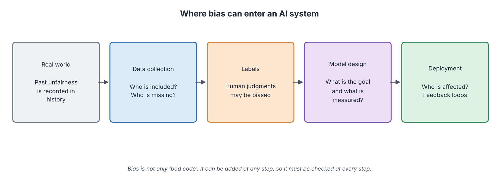
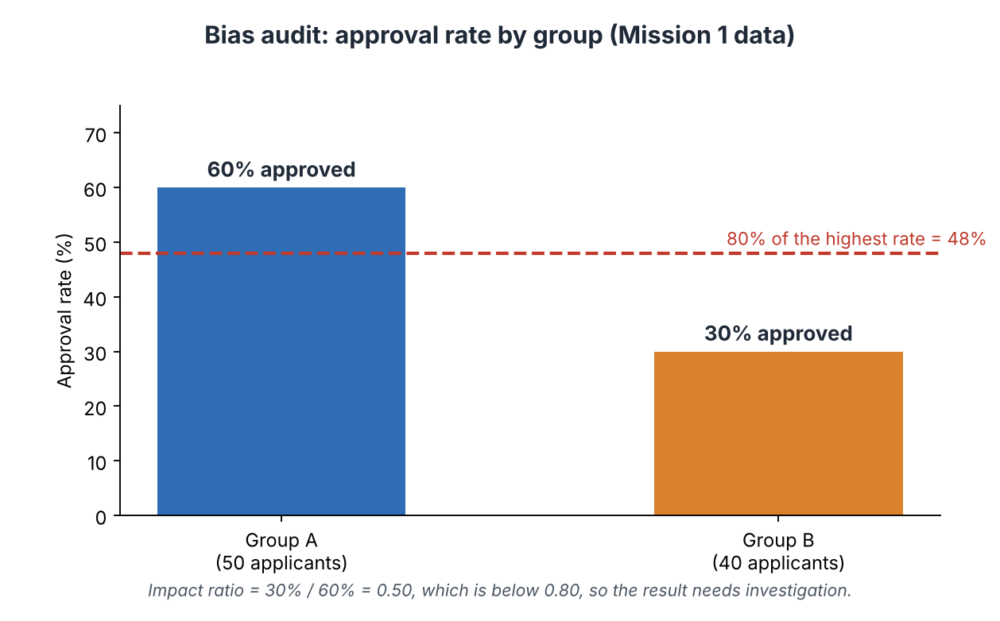
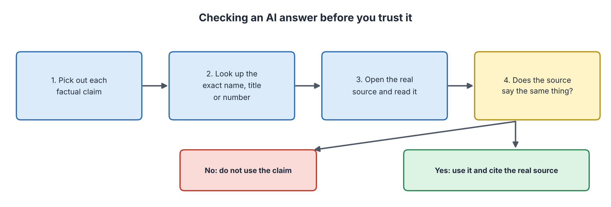

# AI Ethics, Risks and Limitations

**Audience:** Learners with no technical background in AI  
**Estimated time:** 3 to 4 hours (including missions)  
**Format:** Read, pause at each "Pause and predict" box, complete the two missions, then check the answer key at the end of the chapter.

---

## Table of Contents

- [Learning Outcomes](#learning-outcomes)
- [Where This Chapter Fits](#where-this-chapter-fits)
- [8.1 The Big Picture](#81-the-big-picture)
- [8.2 Bias and Fairness](#82-bias-and-fairness)
- [8.3 Privacy and Data Protection](#83-privacy-and-data-protection)
- [8.4 Transparency, Explainability and Accountability](#84-transparency-explainability-and-accountability)
- [8.5 Reliability: Hallucination and Other Limits](#85-reliability-hallucination-and-other-limits)
- [8.6 Safety and Misuse](#86-safety-and-misuse)
- [8.7 Rules and Frameworks](#87-rules-and-frameworks)
- [8.8 Using AI Responsibly in Your Studies](#88-using-ai-responsibly-in-your-studies)
- [8.9 Mission 1: Audit a Hiring Tool](#89-mission-1-audit-a-hiring-tool)
- [8.10 Mission 2: Verify the Claims](#810-mission-2-verify-the-claims)
- [8.11 Common Misconceptions](#811-common-misconceptions)
- [8.12 Quick Check](#812-quick-check)
- [8.13 Summary, Connections and References](#813-summary-connections-and-references)
- [Answer Key](#answer-key)
- [Glossary](#glossary)
- [References](#references)

---

## Learning Outcomes

After this chapter, you should be able to:

1. Explain where bias can enter an AI system and give an example.
2. Calculate a selection rate and an impact ratio and apply the four-fifths rule of thumb.
3. Explain basic privacy ideas: personal data, consent and data minimisation.
4. Explain why transparency, explainability and accountability matter.
5. Explain hallucination and use a four-step method to check AI claims.
6. Describe the EU AI Act risk levels and the four functions of the NIST AI Risk Management Framework.
7. Describe responsible and honest use of AI in your own studies.

## Where This Chapter Fits

**Builds on Chapters 1 to 7.** Chapter 3 introduced data quality and hallucination. Chapter 5 mentioned bias and black boxes. Chapter 6 showed reward hacking. Chapter 7 showed applications and human in the loop. This chapter brings these risks together and shows how people manage them.

**Closing chapter.** It ends the module by asking: *now that we can build AI, how should we use it?*

---

## 8.1 The Big Picture

### Start with a question

A calculator that makes a mistake affects one answer. An AI tool that makes a mistake may repeat it for millions of people, quickly, and without anyone noticing. Which one needs more care?

### In plain words

**AI ethics is the study of how to build and use AI so that it is fair, safe, respectful of people's rights, and accountable.** It matters because AI works at large scale, learns from imperfect human data, and often affects important decisions such as jobs, loans, health and safety.

### Five themes of this chapter

| Theme | Plain question |
|-------|----------------|
| **Fairness** | Does it treat groups of people justly? |
| **Privacy** | Does it protect personal information? |
| **Transparency and accountability** | Can we understand it, and who is responsible? |
| **Reliability** | Is it correct, and does it admit when it is unsure? |
| **Safety and misuse** | Can it cause harm or be used to harm? |

---

## 8.2 Bias and Fairness

### Start with a question

A company trains a tool on ten years of past hiring decisions to pick the best applicants. If past hiring favoured one group, what will the tool learn?

### In plain words

**Bias in AI means a system gives results that are systematically less favourable to some people or groups for reasons that are not fair.** Usually the computer is not "prejudiced". It copies patterns in the data and in the goals given by people.

### Where bias comes in

*Figure 8.1: Where bias can enter an AI system. Source: created by our team.*

| Step | How bias can enter | Example |
|------|--------------------|---------|
| Real world | History contains unfairness | Past hiring favoured one group |
| Data collection | Some groups are missing or under-represented | Few face photos of dark-skinned women |
| Labels | Human judgments carry bias | Past "good employee" ratings were biased |
| Model design | The goal or measure is a poor proxy | "Time at job" used as a stand-in for performance |
| Deployment | The tool is used on people unlike the training group; feedback loops grow the problem | A tool trained in one country used in another |

### Real cases

| Case | What happened | Lesson |
|------|---------------|--------|
| **Face analysis** | A study of commercial systems found much higher error rates for darker-skinned women (up to about 35%) than for lighter-skinned men (under 1%) (Buolamwini & Gebru, 2018) | Test results must be reported per group |
| **Hiring tool** | A company reportedly dropped an experimental recruiting tool that favoured male applicants because it learned from past, mostly male, hires (Dastin, 2018) | Past data can carry past unfairness |
| **Risk scores in courts** | A news investigation reported that a criminal-risk score made different kinds of errors for Black and white defendants (Angwin et al., 2016). Researchers showed that several fairness goals cannot all be met at once when groups differ in base rates (Kleinberg et al., 2017) | "Fair" has more than one meaning; people must choose and explain |

### Measuring: selection rate and the four-fifths rule

*Figure 8.2: A simple bias audit. Source: created by our team.*

| Term | Meaning | Value in Figure 8.2 |
|------|---------|---------------------|
| **Selection rate** | Share of a group that was approved | A: 30 of 50 = 60%; B: 12 of 40 = 30% |
| **Impact ratio** | Lowest selection rate divided by highest | 30% / 60% = 0.50 |
| **Four-fifths rule** | A rule of thumb used in US employment practice: a ratio below 0.80 is a warning sign that needs investigation (U.S. EEOC, 1978) | 0.50 is below 0.80, so investigate |

**Important:** the rule is a *screening* signal, not proof of fairness or of unfairness. A ratio above 0.80 does not prove the tool is fair, and one below 0.80 is a reason to look deeper at data, labels and features.

### Reducing bias

| Action | Example |
|--------|---------|
| Check representation in the data | Are all groups present in realistic numbers? |
| Test performance **per group** | Report errors for each group, not just the average |
| Remove or check **proxies** | A postcode can stand in for ethnicity or income |
| Document the model | Publish what it is for and where it fails (Mitchell et al., 2019) |
| Keep humans in the loop | Allow review and appeal (Chapter 7) |

> **Pause and predict.** A company removes the column "gender" from its data. Is the tool now guaranteed to be gender-neutral?
>
> **Check:** No. Other columns, such as "attended a women's college" or "hobby", may still reveal gender. Such columns are called *proxies*. Removing one column does not remove the pattern.

---

## 8.3 Privacy and Data Protection

### Start with a question

Your phone knows where you go, what you search and who you talk to. Who else should be allowed to know?

### In plain words

**Personal data is any information that can identify a person, alone or when combined with other data.** Examples: name, face photo, voice, location, health record.

### Key ideas

| Idea | In plain words | Example |
|------|----------------|---------|
| **Consent** | People agree knowingly before their data is used | A clear opt-in, not a hidden box |
| **Purpose limitation** | Use data only for the reason it was collected | Health data collected for care is not used for advertising |
| **Data minimisation** | Collect only what is needed | A flashlight app does not need your contacts |
| **Security** | Protect data from leaks | Encryption, access control |
| **Rights** | People can see, correct or delete their data | The right to ask a company to delete your data |

Many places have laws on these ideas. Examples: the European Union's General Data Protection Regulation (GDPR) (European Union, 2016), Indonesia's Personal Data Protection Law (Law No. 27 of 2022) and China's Personal Information Protection Law (2021). Rules differ, so always check the law that applies to you.

### Why AI makes privacy harder

- Models are trained on very large data sets that may include personal information.
- Data that looks anonymous can sometimes be matched with other data to identify people again.
- A model may reveal parts of its training data when questioned in clever ways.

**Practical rule for students:** do not paste personal, confidential or exam material into public AI tools.

---

## 8.4 Transparency, Explainability and Accountability

### Start with a question

A bank refuses your loan and says "the computer decided". Is that acceptable?

### In plain words

| Term | Meaning | Why it matters |
|------|---------|----------------|
| **Transparency** | Being open that AI is used, and how | People can object or ask questions |
| **Explainability** | Being able to say *why* the system gave a result | Errors and bias can be found and fixed |
| **Accountability** | A named person or organisation is responsible | Someone can answer for harm and correct it |

Rule-based systems (Chapter 4) are easy to explain because you can read the rules. Neural networks (Chapter 5) are harder, because the knowledge is in millions of weights. Researchers study *explainable AI* methods, but explanations of complex models are often partial. For important decisions, many rules require human review and a way to appeal.

---

## 8.5 Reliability: Hallucination and Other Limits

### Start with a question

You ask a chatbot for sources about a topic. It gives three neat references with authors, titles and years. Later you cannot find them anywhere. What happened?

### In plain words

**Hallucination is when an AI produces text that sounds right but is false or invented.** As Chapter 3 explained, a language model predicts likely next words; it does not check facts. Fluent language is not proof of truth (Ji et al., 2023).

### Other limits to remember

| Limit | Plain meaning |
|-------|---------------|
| **Brittleness** | Small, odd changes in the input can cause large errors (for example, stickers that confuse a road-sign reader). |
| **Distribution shift** | The tool fails when the real world differs from the training data. |
| **Outdated knowledge** | A model knows only what was in its training data unless it is connected to current sources. |
| **No real understanding** | Systems find patterns; whether this is "understanding" is debated. |
| **Overconfidence** | The tone of an answer may sound certain even when the answer is wrong. |

### A method for checking an AI answer

*Figure 8.3: Checking an AI answer before you trust it. Source: created by our team.*

| Step | What to do |
|:----:|------------|
| 1 | Pick out each factual claim (a name, number, date, quote or source). |
| 2 | Look up the exact name, title or number in a trusted place. |
| 3 | Open the real source and read the relevant part. |
| 4 | Compare. If the source does not say the same, do not use the claim. If it does, cite the **real** source, not the chatbot. |

---

## 8.6 Safety and Misuse

| Risk | Example | What helps |
|------|---------|------------|
| **Misinformation and deepfakes** | Fake images, voices or videos that look real | Check the source; look for labels and provenance information |
| **Cyber misuse** | AI used to write convincing scam messages | Awareness, filters, secure habits |
| **Reward hacking** | An agent finds a loophole in its goal (Chapter 6) | Careful goals, testing, oversight |
| **Over-reliance** | Staff stop thinking because the tool is "usually right" (Chapter 7) | Training, spot checks, clear responsibility |
| **Environmental cost** | Training and running large models uses energy (Strubell et al., 2019) | Efficient methods; use the right size of model |
| **Job change** | Some tasks are automated, others created | Reskilling and policy |

---

## 8.7 Rules and Frameworks

### The EU AI Act: four risk levels

The European Union adopted the AI Act in 2024. Its main idea: **the higher the risk to people, the stricter the rules** (European Union, 2024).

*Figure 8.4: The four risk levels of the EU AI Act (simplified). Source: created by our team.*

| Level | Meaning | Examples |
|-------|---------|----------|
| Unacceptable | Banned | Social scoring of people |
| High | Allowed with strict duties (risk management, data quality, human oversight, documentation) | Hiring, credit scoring, medical devices |
| Limited | Must be transparent | A chatbot must tell users it is an AI |
| Minimal | No new duties | Spam filters, video-game AI |

The Act is phased in over several years. This summary is simplified; read the official text for details.

### The NIST AI Risk Management Framework

The US National Institute of Standards and Technology published a voluntary framework with four functions (NIST, 2023):

| Function | Plain meaning |
|----------|---------------|
| **Govern** | Set policies, roles and a culture of responsibility |
| **Map** | Understand the context, purpose and who could be harmed |
| **Measure** | Test and track risks, including bias and reliability |
| **Manage** | Act on the risks: fix, limit or stop |

### Other guidance

UNESCO's *Recommendation on the Ethics of Artificial Intelligence* (2021) lists shared values such as human rights, fairness, transparency and human oversight, which many countries have endorsed.

---

## 8.8 Using AI Responsibly in Your Studies

| Good practice | Why |
|---------------|-----|
| **Follow your course rules** on AI use | Rules differ between courses. |
| **Disclose** how you used AI (tool, purpose, what you changed) | Honesty and transparency. |
| **Verify** every fact and reference | AI can hallucinate. |
| **Do not paste** private or exam material | Privacy and integrity. |
| **Keep your own thinking** | You are graded on what *you* understand. |
| **Keep a real log** | Only record what really happened. |

This is why our team keeps an **AI-use log**: an honest record of what AI was used for and how its output was checked.

---

## 8.9 Mission 1: Audit a Hiring Tool

> **Goal:** calculate selection rates and an impact ratio and think about what comes next.  
> **Preparation:** Section 8.2. Calculator, 10 to 15 minutes.  
> **Task:** an AI tool screens job applicants. Results: **Group A**: 50 applicants, 30 approved. **Group B**: 40 applicants, 12 approved.

**Part A.** Fill in the table.

| Group | Applicants | Approved | Selection rate |
|:-----:|:----------:|:--------:|:--------------:|
| A | 50 | 30 | ____ |
| B | 40 | 12 | ____ |

**Part B.** Impact ratio = lowest rate / highest rate = ____ . Is it below 0.80? ____

**Part C. Investigate.** List three places you would look to find the cause (use Figure 8.1).

**Part D. After a fix.** The company retrains the tool. Now Group B has 20 approved out of 40 (Group A unchanged). Calculate the new rate and impact ratio. ____ Does it pass the four-fifths rule? ____ Does that prove the tool is fair? Why or why not?

> **Observe:** which number alerted you first, the two rates or the ratio?  
> **Reflect:** who should decide whether the tool can be used: the engineers, the hiring managers, or both? Why?  
> **Feedback:** compare with the Answer Key (Mission 1).

---

## 8.10 Mission 2: Verify the Claims

> **Goal:** practise the four-step method on an AI-style answer.  
> **Preparation:** Sections 8.5 and 8.7, and Chapter 3. 10 to 15 minutes.  
> **Task:** below is an invented AI answer to the question "Tell me about AI risks." Check each numbered claim. (The reference in claim 2 is **invented for this exercise**.)

> 1. "The EU AI Act bans certain AI practices, such as social scoring."
> 2. "As shown in Whitfield and Armand (2019), 'The Quantum Fairness Index', published in the *Journal of Applied Cognitive Ethics*, every AI system is fair when its accuracy is above 90%."
> 3. "ChatGPT-style chatbots learn from each user's conversation in real time and permanently update themselves."
> 4. "A spam filter with 95% accuracy is always a good filter."

**Part A.** For each claim, write the check you would do (step 2 and 3 of the method), and your verdict: *Supported*, *Not supported*, or *Misleading*.

| Claim | How I would check it | Verdict |
|:-----:|----------------------|:-------:|
| 1 | ____ | ____ |
| 2 | ____ | ____ |
| 3 | ____ | ____ |
| 4 | ____ | ____ |

**Part B. Reflect.** Claim 2 sounds scientific. Which three details make it look real, and what is the one test that matters?

**Part C. Log it.** Write one honest sentence you could put in an AI-use log about how you checked this answer.

> **Observe:** which claim needed knowledge from an earlier chapter to check?  
> **Reflect:** why is a confident tone not evidence?  
> **Feedback:** compare with the Answer Key (Mission 2).

---

## 8.11 Common Misconceptions

| Misconception | Correction |
|---------------|------------|
| "A computer decision is neutral." | It reflects its data, labels and goals, which come from people. |
| "Removing the sensitive column removes bias." | Proxies can reveal the same information. |
| "If the average accuracy is high, it is fair." | A good average can hide poor results for a small group. |
| "A confident answer is a true answer." | Language models can state false things fluently. |
| "Anonymous data can never identify anyone." | It can sometimes be re-identified by combining datasets. |
| "Ethics slows down innovation, so it is optional." | Failures in fairness, privacy and safety cause harm and loss of trust, and some are regulated by law. |

---

## 8.12 Quick Check

**Q1 (True/False).** Bias can enter an AI system at several steps, not only in the code.

**Q2 (True/False).** An impact ratio above 0.80 proves that a tool is fair.

**Q3 (True/False).** In the EU AI Act, a chatbot is "unacceptable risk" and banned.

**Q4 (Multiple choice, one answer).** Which action best matches *data minimisation*?
A. Keep all data forever. B. Collect only the data needed for the purpose. C. Sell data. D. Delete the model.

**Q5 (Multiple choice, one answer).** Group A: 40 of 50 approved. Group B: 18 of 30 approved. What is the impact ratio?
A. 0.50. B. 0.60. C. 0.75. D. 0.80.

**Q6 (Multiple choice, one answer).** Which NIST function is about testing and tracking risks?
A. Govern. B. Map. C. Measure. D. Manage.

**Q7 (Short answer, 3 to 4 sentences).** Explain why an AI answer with real-looking references still needs to be checked.

---

## 8.13 Summary, Connections and References

### Key takeaways

- Bias can enter at every step: the real world, data, labels, design and deployment.
- Compare selection rates between groups; the four-fifths rule is a warning signal, not proof.
- Respect privacy: consent, purpose limitation, data minimisation, security and people's rights.
- Transparency, explainability and accountability make AI trustworthy and correctable.
- Language models can hallucinate; verify claims against real sources.
- The EU AI Act sorts systems by risk; the NIST framework has four functions: Govern, Map, Measure, Manage.
- Use AI honestly in your studies: follow rules, disclose, verify, protect privacy, keep your own thinking.

### Connections to other chapters

| Direction | Chapter | Link |
|-----------|---------|------|
| Builds on | Chapter 3 | Data quality, hallucination, metrics |
| Builds on | Chapter 4 | Rule-based systems are explainable |
| Builds on | Chapter 5 | Black-box networks, bias in Big Data, privacy |
| Builds on | Chapter 6 | Reward hacking |
| Builds on | Chapter 7 | Human in the loop, five questions |
| Leads to | Whole module | A responsible way to use everything learned |

### How this chapter will be reused

| Resource | Planned use |
|----------|-------------|
| **Study Guide** | Sections 8.1 to 8.8 are the reading text; Missions 1 and 2 are practice. |
| **Test Bank** | Impact-ratio calculations, claim-checking scenarios and the EU risk levels become exam items. |
| **PPT Slides** | The bias-sources flow, the four-fifths audit, the verification steps and the EU pyramid become slides. |
| **Video Tutorial** | A video that walks through a bias audit and the four-step claim check. |

---

## Answer Key

**Mission 1: Audit a Hiring Tool**

Part A: Group A: 30 / 50 = **60%**. Group B: 12 / 40 = **30%**.
Part B: 30% / 60% = **0.50**, which is **below 0.80**, so the tool needs investigation.
Part C (any three of): the **training data** (are there enough Group B examples?), the **labels** (were past decisions biased?), the **features** (are there proxies for group membership?), the **goal or measure** (what does "good applicant" mean?), the **deployment** (is Group B different from the training population?).
Part D: new rate for B = 20 / 40 = **50%**. Impact ratio = 50% / 60% = **0.833**, which is above 0.80, so it **passes** the rule of thumb. It does **not** prove fairness: the rule is only a screening signal; the tool may still make different *kinds* of mistakes for each group, errors may be hidden within subgroups, and other fairness measures could still fail.
*Observe/Reflect:* both groups should take part, because engineers know how the tool works, while managers and affected people know what a fair outcome means in context. Accountability should be assigned to a named role.

**Mission 2: Verify the Claims**

Part A:

| Claim | How I would check it | Verdict |
|:-----:|----------------------|:-------:|
| 1 | Open the official EU AI Act text or the European Commission's summary and look for the list of prohibited practices | **Supported** |
| 2 | Search the journal and the authors; look in a library database or Google Scholar for the exact title; the article cannot be found, and the claim contradicts Section 8.2 (accuracy alone does not show fairness) | **Not supported** (invented source; also a misleading statement) |
| 3 | Check Chapter 3, Section 3.6: deployed models are normally fixed during a chat and not retrained by it; confirm with the provider's documentation | **Not supported** |
| 4 | Check Chapter 3, Section 3.8: a filter can have high accuracy but poor recall when spam is rare | **Misleading** |

Part B: three details that make it look real: the authors' names, the year, the journal-like title and the fancy name of the index. The test that matters: **can you find the real source and does it say that?** Not finding it means do not use it.
Part C (example): "I asked an AI tool for a list of AI risks, checked each claim against the EU AI Act summary and our course chapters, found one invented reference and one false statement, and removed both."

**Quick Check**

1. **True.**
2. **False.** It is only a warning signal; a ratio above 0.80 does not prove fairness.
3. **False.** Chatbots are "limited risk" (transparency duties); they are not banned.
4. **B.**
5. **C.** Rates: A = 40/50 = 80%, B = 18/30 = 60%; 60/80 = 0.75.
6. **C.**
7. *Key points:* language models predict likely text, not verified facts; references can be invented; a reference only has value if the real source exists and says the same thing; always verify names, numbers and sources.

---

## Glossary

| Term | Meaning |
|------|---------|
| Accountability | A named person or organisation is responsible for the system and its effects. |
| Bias (in AI) | Systematically less favourable results for some groups for unfair reasons. |
| Consent | A person's informed agreement to the use of their data. |
| Data minimisation | Collecting only the data needed. |
| Distribution shift | A change between training data and real-world data. |
| Explainability | Being able to say why a system gave a result. |
| Four-fifths rule | A rule of thumb: an impact ratio below 0.80 signals a need to investigate. |
| Hallucination | Fluent but false or invented output from a language model. |
| Impact ratio | Lowest group selection rate divided by the highest. |
| Personal data | Information that can identify a person. |
| Proxy | A feature that indirectly reveals a protected characteristic. |
| Selection rate | The share of a group that receives a positive decision. |
| Transparency | Openness that AI is used and how. |

---

## References

1. Buolamwini, J., & Gebru, T. (2018). Gender Shades: Intersectional accuracy disparities in commercial gender classification. *Proceedings of Machine Learning Research, 81*, 77-91. https://proceedings.mlr.press/v81/buolamwini18a.html
2. Dastin, J. (2018, October 10). Amazon scraps secret AI recruiting tool that showed bias against women. *Reuters*. https://www.reuters.com/article/world/insight-amazon-scraps-secret-ai-recruiting-tool-that-showed-bias-against-women-idUSKCN1MK0AG/
3. Angwin, J., Larson, J., Mattu, S., & Kirchner, L. (2016). Machine bias. *ProPublica*. https://www.propublica.org/article/machine-bias-risk-assessments-in-criminal-sentencing
4. Kleinberg, J., Mullainathan, S., & Raghavan, M. (2017). Inherent trade-offs in the fair determination of risk scores. *ITCS 2017*. https://arxiv.org/abs/1609.05807
5. Mitchell, M., et al. (2019). Model cards for model reporting. *FAT\* '19*, 220-229. https://doi.org/10.1145/3287560.3287596
6. Ji, Z., et al. (2023). Survey of hallucination in natural language generation. *ACM Computing Surveys, 55*(12), 1-38. https://doi.org/10.1145/3571730
7. Strubell, E., Ganesh, A., & McCallum, A. (2019). Energy and policy considerations for deep learning in NLP. *ACL 2019*. https://arxiv.org/abs/1906.02243
8. U.S. Equal Employment Opportunity Commission et al. (1978). *Uniform Guidelines on Employee Selection Procedures*, 29 C.F.R. Part 1607. https://www.ecfr.gov/current/title-29/subtitle-B/chapter-XIV/part-1607
9. European Union. (2016). *General Data Protection Regulation* (Regulation (EU) 2016/679). https://eur-lex.europa.eu/eli/reg/2016/679/oj
10. European Union. (2024). *Artificial Intelligence Act* (Regulation (EU) 2024/1689). https://eur-lex.europa.eu/eli/reg/2024/1689/oj
11. National Institute of Standards and Technology. (2023). *Artificial Intelligence Risk Management Framework (AI RMF 1.0)*. https://doi.org/10.6028/NIST.AI.100-1
12. UNESCO. (2021). *Recommendation on the Ethics of Artificial Intelligence*. https://www.unesco.org/en/artificial-intelligence/recommendation-ethics
13. Russell, S., & Norvig, P. (2021). *Artificial Intelligence: A Modern Approach* (4th ed.). Pearson. https://aima.cs.berkeley.edu/

> Figures 8.1 to 8.4 were created for Stage 2 by our team. The EU AI Act summary is simplified. The article in Mission 2, claim 2 is invented for practice and does not exist.
