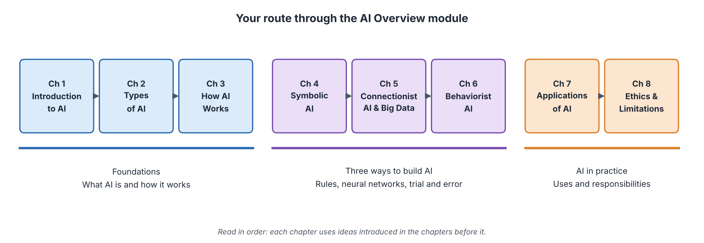

# AI Overview: Module Overview and Start Here

**Team:** BABI GULING · **Module:** AI Overview · **Version:** V3.0 (Final, Stage 3)  
**Audience:** Complete beginners, with no background in AI or programming  
**Full route:** about 21 to 30 hours · **Minimum route:** about 10 hours

---

## Table of Contents

- [Who This Module Is For](#who-this-module-is-for)
- [What You Need Before You Start](#what-you-need-before-you-start)
- [What You Will Be Able to Do](#what-you-will-be-able-to-do)
- [The Route Through the Module](#the-route-through-the-module)
- [How Every Chapter Works](#how-every-chapter-works)
- [Choose Your Route: Full or Minimum](#choose-your-route-full-or-minimum)
- [A Four-Week Study Plan](#a-four-week-study-plan)
- [How the Learning Resources Fit Together](#how-the-learning-resources-fit-together)
- [About the Test Bank](#about-the-test-bank)

---

## Who This Module Is For

This module is for **anyone who uses AI tools but has never studied how they work**. You may be a first-year student in any subject, or simply curious. You do not need to write code. Every technical term is explained in one plain sentence before its official definition.

## What You Need Before You Start

| You need | Why | Quick self-check |
|----------|-----|------------------|
| Basic computer and internet use | Some activities use free websites (each has a paper version if the site is down) | Can you open a website and type into a form? |
| School arithmetic: add, multiply, fractions and percentages | Worked examples use small calculations, for example a spam score or an accuracy percentage | What is 30 out of 40 as a percentage? *(75%)* |
| Reading English at the level of this page | All materials are in English | Can you read this table without a dictionary? |
| Pen, paper and a calculator | Missions are done on paper | — |

**You do not need:** programming, statistics, advanced mathematics or any previous AI course. Chapters 4 to 6 use simple formulas, and each formula is worked through step by step first.

## What You Will Be Able to Do

After completing this module, you should be able to:

1. Explain what AI is and how it differs from traditional programming. *(Chapter 1)*
2. Classify AI by capability, functionality, learning method and output. *(Chapter 2)*
3. Describe the AI workflow (data, algorithm, training and inference), compare supervised, unsupervised and reinforcement learning, and evaluate a model with simple measures. *(Chapter 3)*
4. Explain symbolic AI (rules and logic), connectionist AI (neural networks and Big Data) and behaviorist AI (learning from rewards), and give an example of each. *(Chapters 4, 5 and 6)*
5. Identify real-world applications of AI and the human oversight they need. *(Chapter 7)*
6. Recognise limitations and ethical concerns, including bias, privacy, transparency, hallucination, AI agents and regulation. *(Chapter 8)*

## The Route Through the Module

*Figure 0.1: The eight chapters in three parts. Source: created by our team.*

| Part | Chapter | Main question | Builds on |
|------|---------|---------------|-----------|
| **Foundations** | 1. Introduction to AI | What is AI, and how is it different from normal programs? | — |
| | 2. Types of AI | What kinds of AI exist, and which are real today? | 1 |
| | 3. How AI Works | How does a machine learn from data, and how do we know it works? | 1, 2 |
| **Three ways to build AI** | 4. Symbolic AI | Can intelligence be written as rules and logic? | 3 |
| | 5. Connectionist AI and Big Data | How do networks of simple "neurons" learn from lots of data? | 3 |
| | 6. Behaviorist AI | How can an agent learn by acting and getting rewards? | 3 |
| **AI in practice** | 7. Applications of AI | Where is AI used, and where must a human stay in control? | 4, 5, 6 |
| | 8. AI Ethics, Risks and Limitations | What can go wrong, and how do people manage it? | 1 to 7 |

Chapters 4, 5 and 6 can be studied in any order after Chapter 3. Read Chapter 8 last: it brings the risks from all earlier chapters together.

## How Every Chapter Works

Every chapter follows the same routine, so you always know what to do next.

| Step | What you do | Where it is in the chapter |
|:----:|-------------|----------------------------|
| 1. **Guess** | Answer the "Start with a question" or "Pause and predict" box *before* reading on | Start of each section |
| 2. **Read** | Read the "In plain words" sentence first, then the full explanation | Each numbered section |
| 3. **Try** | Follow the worked example with pen and paper | The worked-example section |
| 4. **Missions** | Do Mission 1 and Mission 2 (Goal, Preparation, Task, Observe, Reflect, Feedback) | Two mission sections |
| 5. **Fix** | Read "Common Misconceptions" and correct any idea you had wrong | Common Misconceptions |
| 6. **Check** | Do the Quick Check, then compare with the Answer Key | Quick Check and Answer Key |

> **Tip:** do not open the Answer Key until you have written your own answer. A wrong guess that you then correct teaches you more than a right answer you copied.

## Choose Your Route: Full or Minimum

The full route is long because every chapter has two missions and a set of extra examples. If you have less time, take the **minimum route** first and come back for the rest.

| Chapter | Full route | Minimum route: do these parts | Minimum time |
|:-------:|:----------:|-------------------------------|:------------:|
| 1 | 2–3 h | §1.1, §1.3, §1.5 (spam filter), Mission 2, Quick Check | 1 h 15 min |
| 2 | 2–3 h | §2.2, §2.3, §2.5, Mission 1, Quick Check | 1 h |
| 3 | 3–4 h | §3.1, §3.4, §3.7, §3.8, Mission 2, Quick Check | 1 h 30 min |
| 4 | 3–4 h | §4.1, §4.4, §4.6, Mission 1, Quick Check | 1 h 15 min |
| 5 | 3–4 h | §5.2, §5.4, §5.6, Mission 1, Quick Check | 1 h 15 min |
| 6 | 3–4 h | §6.2, §6.3, §6.6, Mission 1, Quick Check | 1 h 15 min |
| 7 | 2–3 h | §7.1, §7.7, §7.8, Mission 2, Quick Check | 1 h |
| 8 | 3–4.5 h | §8.2, §8.5, §8.6, Mission 1, Quick Check | 1 h 15 min |
| **Total** | **about 21–30 h** | | **about 10 h** |

After the minimum route, the Test Bank questions for each chapter (see below) tell you which sections to go back to.

## A Four-Week Study Plan

About 2.5 hours per week on the minimum route, or 6 to 8 hours per week on the full route. Each week ends with a short self-test.

| Week | Session A | Session B | End-of-week check |
|:----:|-----------|-----------|-------------------|
| 1 | Chapter 1 | Chapter 2 | Test Bank TF-01 to TF-06, MC-01 to MC-06 |
| 2 | Chapter 3 | Video 03, then redo Mission 2 of Chapter 3 | Test Bank TF-07 to TF-09, MC-07 to MC-09, OE-03 |
| 3 | Chapter 4 | Chapters 5 and 6 (one each, or split over two days) | Test Bank TF-10 to TF-18, MC-10 to MC-18 |
| 4 | Chapter 7 | Chapter 8 | Test Bank TF-19 to TF-24, MC-19 to MC-24, then one open-ended question of your choice |

## How the Learning Resources Fit Together

The same content is used in four places. Each one has a different job.

| Resource | Its job | Use it when |
|----------|---------|-------------|
| **PPT Slides** ("Babi Guling's Kitchen") | A short visual overview of each chapter, used in class | Before you read a chapter, to see the big picture |
| **Video Tutorials** (6 videos) | Watch a worked example being built step by step | After the plain-words explanation, before the missions |
| **Study Guide** ("Rebuild Bit", this content) | Learn on your own: explanations, worked examples, missions and answers | Your main learning resource |
| **Test Bank** (56 questions) | Check your understanding and find the sections to revisit | After each chapter, and before an exam |
| **Quiz game** *Escape the Spit* (optional) | Practise by playing | For extra revision |

**A recommended route for one chapter:** slides for the overview → plain-words explanation in the guide → the video for the worked example → the two missions → the Test Bank questions for that chapter.

| Video | Chapters it covers |
|-------|--------------------|
| Video 01: Introduction to AI | Chapter 1 |
| Video 02: Types of AI | Chapter 2 |
| Video 03: How AI Works | Chapter 3 |
| Video 04: Three Schools of AI | Chapters 4, 5 and 6 |
| Video 05: Applications of AI | Chapter 7 |
| Video 06: AI Ethics and Limitations | Chapter 8 |

The exact start time of each topic in each video is listed in the [Resource Mapping](../../../resource-mapping.md) and in the Video Guide.

## About the Test Bank

The Test Bank has **56 questions**: 24 True/False, 24 Multiple Choice and 8 Open-ended, with three True/False, three Multiple Choice and one Open-ended question for each chapter. Every question has a tag showing the chapter and section where the answer is taught.

> **Important:** the Test Bank is a **sample** of each chapter, not a complete test of every section. A good score shows that you understood the main ideas tested. It does not prove that you have mastered every subsection. Use the Quick Check and the missions in each chapter as well.

---

*Figure 0.1 is reused from Chapter 1. All other content in this overview was written by our team.* 
