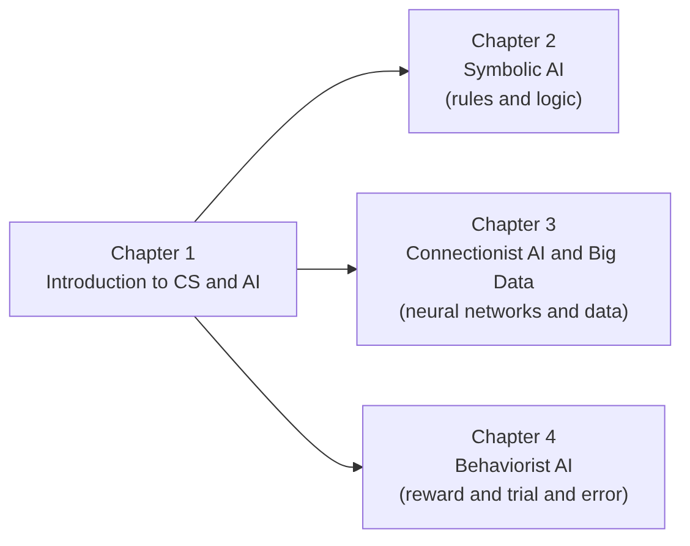
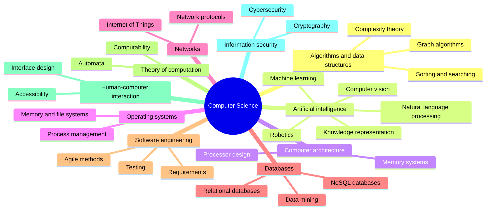
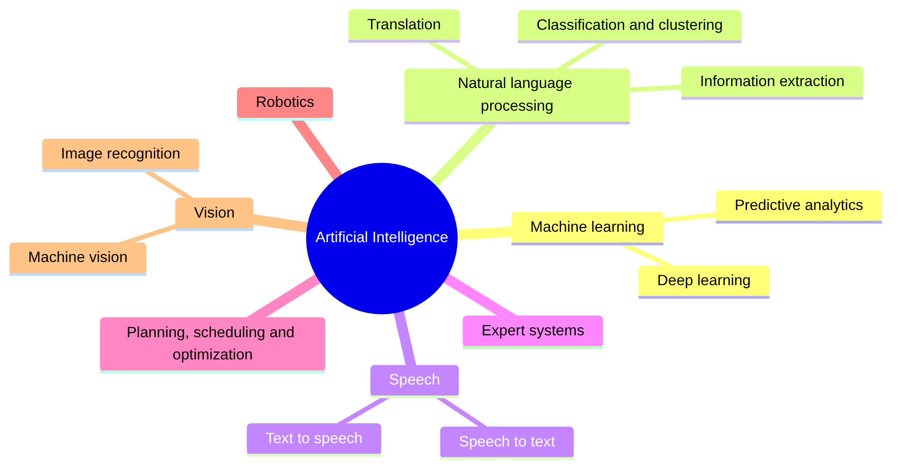
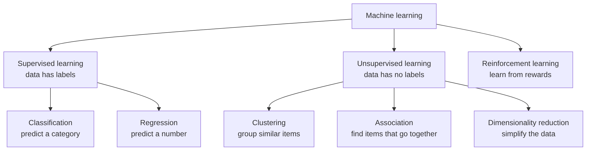

# Chapter 1: Introduction to CS and AI

> **Module:** AI Overview
> **Chapter:** 1 — Introduction to CS and AI (course Chapter 1)
> **Version:** 1.1 (Stage 1, rebuilt from the lecturer's course slides)
> **Author:** Jonathan Sugianto (proposed owner)
> **Reviewer:** Brian Djoni Suzanna
> **Audience:** Complete beginners with basic computer and internet literacy; no programming experience needed
> **Estimated study time:** about 2 hours, including activities
> **Course source:** Lecturer's slides "chap1: Intro to CS and AI". The chapter follows the slides' outline: history, definitions, main topics, and a hands-on machine-learning activity.

---

## Table of Contents

1. [Learning Outcomes](#learning-outcomes)
2. [Chapter Map](#chapter-map)
3. [Topic 1: Computer Science](#topic-1-computer-science)
4. [Topic 2: Artificial Intelligence](#topic-2-artificial-intelligence)
5. [Topic 3: Machine Learning: A First Look](#topic-3-machine-learning-a-first-look)
6. [Topic 4: Hands-On Activity: Machine Learning](#topic-4-hands-on-activity-machine-learning)
7. [Topic 5: Ask, Then Verify (Using an AI Assistant for Study)](#topic-5-ask-then-verify-using-an-ai-assistant-for-study)
8. [Key Takeaways](#key-takeaways)
9. [Practice Questions](#practice-questions)
10. [Answer Key](#answer-key)
11. [Glossary](#glossary)
12. [References](#references)

---

## Learning Outcomes

After completing this chapter, you should be able to:

1. Give two or more definitions of **Computer Science (CS)** and **Artificial Intelligence (AI)**, and explain how they differ in wording.
2. Describe the main milestones in the history of CS and of AI, using the form *year, event, people, technology*.
3. Name the main areas of CS and the main areas of AI, and explain where AI sits inside CS.
4. Describe the three families of machine learning (supervised, unsupervised, reinforcement) with one example each.
5. Explain, in your own words, how a machine learns from labelled examples, using a small hands-on activity.
6. Name the three classic approaches to AI that the next three chapters cover: Symbolic AI, Connectionist AI, and Behaviorist AI.

---

## Chapter Map



*Figure 1.1: Chapter 1 gives the shared vocabulary and history. Chapters 2 to 4 each explain one approach to building AI.*

---

## Topic 1: Computer Science

### 1.1 What Is Computer Science?

**Computer Science (CS)** is the study of computers and computation: what can be computed, how to compute it efficiently, how to build software and hardware that does it, and how people use the results.

There is no single official sentence that everyone uses. Different books and organisations stress different parts. The table shows the typical emphasis. These are summaries in simple words, not direct quotations.

| Viewpoint | What it stresses |
|---|---|
| Computation | CS studies algorithms, which are step-by-step procedures, and what problems they can solve. |
| Information | CS studies how information is represented, stored, processed, and communicated. |
| Engineering | CS studies how to design, build, and test reliable hardware and software systems. |
| Automation | CS studies which tasks can be done automatically by machines. |
| Human use | CS studies how people interact with computers and how computers affect society. |

**Try it yourself.** The lecturer's slides suggest asking an AI assistant to "list as many definitions of Computer Science as possible". Do this in Topic 5, then compare the answers with the table above.

### 1.2 A Short History of CS

The slides ask for the history as a table with the columns **Year, Key Events, Key People, Key Technologies**. Here is a starter version.

| Year | Key events | Key people | Key technologies |
|---|---|---|---|
| 1830s–1840s | Design of the Analytical Engine; the first published algorithm for it | Charles Babbage, Ada Lovelace | Mechanical computing design, punched cards |
| 1936 | A mathematical model of computation, the "Turing machine" | Alan Turing | Theory of computation |
| 1945 | Stored-program computer design described | John von Neumann and colleagues | Stored-program architecture |
| 1946 | ENIAC, an early large electronic computer, is completed | J. Presper Eckert, John Mauchly | Vacuum tubes |
| 1947 | The transistor is invented | John Bardeen, Walter Brattain, William Shockley | Transistors |
| 1957 | FORTRAN, an early high-level programming language | John Backus and team | Compilers |
| 1958–1959 | The integrated circuit | Jack Kilby, Robert Noyce | Integrated circuits |
| 1969 | ARPANET connects its first computers; Unix is started | ARPA researchers; Ken Thompson, Dennis Ritchie | Packet networks, operating systems |
| 1971 | First commercial microprocessor (Intel 4004) | Intel engineers | Microprocessors |
| 1981 | IBM Personal Computer released | IBM team | Personal computers |
| 1989–1991 | The World Wide Web | Tim Berners-Lee | HTTP, HTML, browsers |
| 2007 | Smartphones become mainstream (iPhone) | Apple team | Touch screens, mobile apps |
| 2010s | Cloud computing and large-scale data centres become common | Many companies | Cloud, GPUs |

> **Note for reviewers:** The rows are well-known facts from standard computing histories. Stage 2 should add a citation for each row.

### 1.3 Main Topics of CS

The lecturer's slides show a mind map of CS based on the **ACM classification**, the classification of computing topics by the Association for Computing Machinery. Here is a simplified version.



*Figure 1.2: A simplified map of Computer Science, following the ACM-style grouping shown in the lecturer's slides. AI is one branch among many.*

**Key idea:** AI is a **branch of CS**. It uses algorithms, data structures, databases, and computer hardware, and it also borrows from mathematics, statistics, psychology, and neuroscience.

---

## Topic 2: Artificial Intelligence

### 2.1 What Is AI?

**Artificial Intelligence (AI)** is the field of making machines do things that we normally say need intelligence, such as understanding language, recognising pictures, making plans, and learning from experience.

As with CS, there are many definitions. The slides ask you to "list as many definitions of AI as possible". Here are four common ways to define it.

| Viewpoint | Summary of the idea | Typical source |
|---|---|---|
| Making intelligent machines | AI is the science and engineering of making intelligent machines, especially intelligent computer programs. | John McCarthy, who named the field in 1955–1956 (McCarthy, 2007) |
| Acting rationally | An AI system is an *agent* that perceives its environment and chooses actions that best achieve its goals. | Russell and Norvig (textbook) |
| Machine that infers | An AI system is a machine-based system that, from the input it receives, infers how to produce outputs such as predictions, content, recommendations, or decisions. | OECD (2023) |
| Acting like a human | A machine is intelligent if a person cannot tell it apart from a human in conversation. | Alan Turing's "imitation game" (1950) |

> **Note for reviewers:** The McCarthy and OECD rows are summaries of the sources listed in the References. Check the exact wording in the originals before quoting.

**Three things to remember**

1. There is no single agreed definition, so always check which one a source is using.
2. "Intelligence" is a moving target. Tasks that once seemed to need intelligence (such as playing chess) can later feel like "just a program".
3. Today's AI is **narrow**: each system is good at specific tasks. A chess program cannot translate a letter.

### 2.2 A Short History of AI

| Year | Key events | Key people | Key technologies |
|---|---|---|---|
| 1943 | First mathematical model of an artificial neuron | Warren McCulloch, Walter Pitts | Neuron models |
| 1950 | "Computing Machinery and Intelligence" proposes the imitation game (Turing test) | Alan Turing | Idea of machine intelligence |
| 1956 | The Dartmouth summer workshop, where the term "artificial intelligence" was used | John McCarthy, Marvin Minsky, Nathaniel Rochester, Claude Shannon | Symbolic reasoning programs |
| 1958 | The perceptron, a learning neuron model | Frank Rosenblatt | Early neural networks |
| 1966 | ELIZA, a chatbot that follows keyword rules | Joseph Weizenbaum | Rule-based language processing |
| 1970s | MYCIN, an expert system for infections; first "AI winter" of reduced funding in the mid-1970s | Edward Shortliffe and colleagues | Expert systems |
| 1980s | Expert systems used by companies; backpropagation is popularised in 1986 | David Rumelhart, Geoffrey Hinton, Ronald Williams | Rule engines, multi-layer networks |
| Late 1980s–1990s | Second "AI winter"; reinforcement learning grows; TD-Gammon learns backgammon (1992) | Gerald Tesauro; Richard Sutton and others | Reinforcement learning |
| 1997 | Deep Blue beats world chess champion Garry Kasparov | IBM team | Game-tree search, special hardware |
| 2012 | AlexNet wins the ImageNet image contest by a wide margin | Alex Krizhevsky, Ilya Sutskever, Geoffrey Hinton | Deep neural networks, GPUs, big data |
| 2016 | AlphaGo beats Go champion Lee Sedol 4–1 | DeepMind team | Deep learning plus reinforcement learning |
| 2017 | The Transformer architecture | Ashish Vaswani and colleagues | Attention-based neural networks |
| 2022 | ChatGPT is released to the public | OpenAI | Large language models |

**Reading the table through the three approaches.** The history of AI is partly a story of three ideas competing and combining. This module follows them one by one.

| Approach | Core idea | Typical milestones above | Chapter |
|---|---|---|---|
| **Symbolic AI** | Intelligence comes from explicit rules, logic, and search. | Dartmouth programs, ELIZA, MYCIN, Deep Blue (search) | 2 |
| **Connectionist AI** | Intelligence comes from many simple connected units that learn from data. | McCulloch–Pitts, perceptron, backpropagation, AlexNet, Transformer | 3 |
| **Behaviorist AI** | Intelligence comes from acting, receiving rewards, and adjusting behaviour. | TD-Gammon, AlphaGo (with deep learning) | 4 |

### 2.3 The Main Areas of AI

The slides show an AI map with these areas:



*Figure 1.3: A simplified map of AI areas, following the lecturer's slides.*

Each area is a **task** (what we want the machine to do). The three approaches in this module are **methods** (how we build it). One task can be tackled by more than one method. Language translation, for example, was once done with hand-written grammar rules (Symbolic) and is now mostly done with neural networks (Connectionist).

| Area | What the machine does | Example | A method often used |
|---|---|---|---|
| Machine learning | Learns patterns from data | Predicting house prices | Connectionist and statistical methods |
| Natural language processing | Works with human language | Translation, chatbots | Symbolic rules, neural networks |
| Speech | Converts between speech and text | Voice assistants | Neural networks |
| Expert systems | Gives expert-like advice from rules | Diagnosis helper | Symbolic |
| Planning and optimization | Chooses a good sequence of actions | Delivery routes | Symbolic search, reinforcement learning |
| Robotics | Senses and acts in the physical world | Robot vacuum | Behaviorist and others |
| Vision | Understands images and video | Face unlock | Neural networks |

---

## Topic 3: Machine Learning: A First Look

**Machine learning (ML)** means that a program improves at a task by learning from data instead of following only hand-written rules. The lecturer's slides show the classic split into three families.



*Figure 1.4: Families of machine learning.*

| Family | What the data looks like | Example | Where it comes back |
|---|---|---|---|
| Supervised, classification | Examples with a category label | Email labelled *spam* or *not spam* | Chapter 3 |
| Supervised, regression | Examples with a number label | Past house sizes and prices | Chapter 3 |
| Unsupervised, clustering | Examples with no labels | Grouping customers by buying habits | Chapter 3 |
| Unsupervised, association | Shopping baskets | "People who buy bread often buy butter" | Chapter 3 |
| Reinforcement | An agent that acts and gets rewards | A program learning to play a game | Chapter 4 |

**How ML relates to the approaches.** Supervised and unsupervised learning are mostly studied inside Connectionist AI and statistics (Chapter 3). Reinforcement learning is the engine of Behaviorist AI (Chapter 4). Symbolic AI (Chapter 2) is the opposite starting point: the knowledge is written by people, not learned.

### Worked Example: Rules Versus Learning

Task: decide whether a short email is spam.

**Symbolic way (rules written by a person)**

```
IF the email contains "free money" THEN spam
IF the email contains "meeting at 3pm" THEN not spam
```

This is easy to read, but it fails on any email the author did not think of.

**Machine learning way (supervised classification)**

1. Collect 1,000 emails that people have already labelled *spam* or *not spam*.
2. Let the program find which words and patterns often appear in spam.
3. Test the program on emails it has not seen.

The learned filter can handle new emails, but it is harder to explain *why* it called one email spam. This trade-off between **explainable rules** and **flexible learning** returns in every chapter.

---

## Topic 4: Hands-On Activity: Machine Learning

The lecturer's slides include two hands-on tasks built with a block-based programming tool: **Rock Paper Scissors** and **Smart Classroom**. If your lecture uses that tool, follow your lecturer's instructions for the tool itself. The paper version below teaches the same idea without any software.

### Activity A: Rock Paper Scissors (image classification)

**Idea.** The computer looks at a camera picture of your hand and decides *rock*, *paper*, or *scissors*. It does this because you first **trained** it with labelled pictures.

**Steps in the tool (as in the slides)**

1. Create three classes (labels): *rock*, *paper*, *scissors*.
2. Take several photos of your hand for each class. These are the **training examples**.
3. Train the model.
4. Run the program. The program recognises the new picture, picks the label, and chooses the move that beats it.
5. Test with different lighting and hand positions.

**Paper version.** Imagine each photo is reduced to two numbers: *how many fingers are open* (0–5) and *how spread out they are* (low, medium, high).

| Training example | Fingers open | Spread | Label |
|---|--:|---|---|
| 1 | 0 | low | rock |
| 2 | 0 | low | rock |
| 3 | 5 | high | paper |
| 4 | 4 | high | paper |
| 5 | 2 | medium | scissors |
| 6 | 2 | medium | scissors |

New picture: **2 fingers open, medium spread.** Which label is the closest match? Compare it with each row, as a computer would.

*Expected answer:* scissors, because examples 5 and 6 match both numbers.

**Questions to discuss**

1. What happens if the new picture shows 3 fingers open? (The model has no training example for it. It must guess from the closest ones, and may be wrong.)
2. What happens if every training photo of "rock" was taken in a dark room? (The model may learn "dark means rock". This is a **biased training set**.)
3. How many photos per class are enough? (There is no fixed number. More varied examples usually help.)

### Activity B: Smart Classroom (text and command recognition)

**Idea.** You type or say a command such as "Fan on" or "Lamp off", and a program switches a virtual fan or lamp.

* In the **rule-based version**, a person writes an IF-THEN block for each exact command. You will build this in Chapter 2.
* In the **machine-learning version**, the program is trained with example sentences for each label (*fan on*, *fan off*, *lamp on*, *lamp off*) and recognises new wording. You will meet the idea again in Chapter 3.

**Task now.** Predict: will a rule that checks for the exact text "Fan on" also catch "Please turn the fan on"? Write your prediction down. You will test it in Chapter 2.

---

## Topic 5: Ask, Then Verify (Using an AI Assistant for Study)

The lecturer's slides list questions to ask an AI assistant. Use them as a study activity, with one rule: **never copy an answer without checking it.** AI assistants can make confident mistakes.

| Slide question | What to do with the answer |
|---|---|
| "Give me a list of buzzwords of the past 50 years regarding computer technology." | Check three of them in a textbook or encyclopedia. |
| "List as many definitions of Computer Science as possible." | Group the definitions into the viewpoints in Section 1.1. |
| "Use a table to list the history of CS, with columns of Year, Key Events, Key People, and Key Technologies." | Compare with Section 1.2. Mark every row that differs, and find out which is right. |
| "Generate a CS knowledge map for freshmen." | Compare with Figure 1.2. What is missing? |
| "List as many definitions of Artificial Intelligence as possible." | Compare with Section 2.1. |
| "Use a table to list the history of AI, with the same four columns." | Compare with Section 2.2. Check at least three dates. |
| "Generate an AI knowledge map for freshmen." | Compare with Figure 1.3. |

**Record your work.** For each question write down: the tool you used, the date, what you asked, and what you corrected. The team's AI-use log needs this information.

---

## Key Takeaways

* **CS** is the study of computation, information, and the systems that process them. **AI is one branch of CS.**
* There is **no single definition** of CS or AI. Read which viewpoint a source uses.
* AI history moves through three big ideas: **rules and logic** (Symbolic), **connected learning units** (Connectionist), and **learning from reward** (Behaviorist).
* AI areas (vision, language, speech, planning, robotics) are **tasks**. The three approaches are **methods**.
* Machine learning has three families: **supervised**, **unsupervised**, and **reinforcement**.
* A model learns from **examples**. Poor or biased examples lead to poor or biased results.
* Always **verify** what an AI assistant tells you.

---

## Practice Questions

### Part A: Multiple Choice

**Q1.** Which statement about AI and CS is correct?
A. AI and CS are unrelated fields.
B. AI is a branch of CS.
C. CS is a branch of AI.
D. AI only studies robots.

**Q2.** In which decade did the Dartmouth workshop use the term "artificial intelligence"?
A. 1930s
B. 1940s
C. 1950s
D. 1990s

**Q3.** Which task is an example of *supervised classification*?
A. Grouping customers with no labels
B. Labelling emails as spam or not spam using labelled examples
C. A robot learning to walk from rewards
D. Compressing a file

**Q4.** Which family of machine learning learns from rewards?
A. Supervised
B. Unsupervised
C. Reinforcement
D. Association

**Q5.** Which pair matches an approach with its core idea?
A. Symbolic AI: learning from rewards
B. Connectionist AI: explicit rules and logic
C. Behaviorist AI: acting and receiving rewards
D. Symbolic AI: neurons and weights

**Q6.** Why can a Rock Paper Scissors model fail if all "rock" photos were taken in a dark room?
A. The model may learn lighting instead of hand shape.
B. The camera breaks.
C. Rock is a hard word.
D. It cannot fail.

**Q7.** Which is a *task* (not a method)?
A. Symbolic AI
B. Image recognition
C. Connectionist AI
D. Behaviorist AI

**Q8.** What should you do with an answer from an AI assistant?
A. Copy it as it is.
B. Verify key facts with a reliable source.
C. Ignore it completely.
D. Assume it is always correct.

### Part B: Short Answer

**Q9.** Give two different definitions of AI and say how they differ.

**Q10.** Explain the difference between supervised and unsupervised learning in two sentences, with one example each.

**Q11.** In the Smart Classroom activity, why might a rule-based program fail on "Please turn the fan on"?

### Part C: Apply It

**Q12.** A school wants a system that sorts student questions into the categories *homework*, *exam*, and *other*. Would you start with hand-written rules or with machine learning? List one advantage and one disadvantage of your choice.

---

## Answer Key

| Q | Answer | Explanation |
|---|---|---|
| Q1 | B | AI is a branch of CS (Figure 1.2). |
| Q2 | C | The Dartmouth workshop took place in 1956. |
| Q3 | B | Classification with labelled examples is supervised learning. |
| Q4 | C | Reinforcement learning learns from rewards. |
| Q5 | C | Behaviorist AI is about acting and receiving rewards. Symbolic = rules; Connectionist = neurons and weights. |
| Q6 | A | The model can pick up an accidental pattern (lighting). This is a biased training set. |
| Q7 | B | Image recognition is something we want done. The others are ways to do it. |
| Q8 | B | Verify with a reliable source (Topic 5). |
| Q9 | Sample | For example: McCarthy's view (making intelligent machines) is about the goal; the OECD view (a machine that infers outputs from input) describes what the system does. Any two viewpoints from Section 2.1 with a fair comparison is correct. |
| Q10 | Sample | Supervised learning uses labelled examples, such as emails marked spam or not spam. Unsupervised learning uses unlabelled data to find structure, such as grouping customers by buying habits. |
| Q11 | Sample | The rule checks for the exact text, so different wording does not match. A learned model may handle the new wording because it has seen many example sentences. |
| Q12 | Sample | Rules: easy to explain and no training data needed, but each new wording needs a new rule. Machine learning: handles varied wording, but needs many labelled questions and is harder to explain. Either choice is correct with a fair advantage and disadvantage. |

---

## Glossary

| Term | Meaning |
|---|---|
| **Algorithm** | A step-by-step procedure for solving a problem. |
| **Artificial Intelligence (AI)** | The field of making machines perform tasks that normally need intelligence. |
| **Classification** | Predicting a category for an item. |
| **Clustering** | Grouping similar items without labels. |
| **Computer Science (CS)** | The study of computation, information, and computing systems. |
| **Label** | The correct answer attached to a training example. |
| **Machine learning (ML)** | A way for programs to improve at a task by learning from data. |
| **Regression** | Predicting a number. |
| **Reinforcement learning** | Learning to act by receiving rewards. |
| **Supervised learning** | Learning from labelled examples. |
| **Training example** | One piece of data used to teach a model. |
| **Unsupervised learning** | Finding structure in data that has no labels. |

---

## References

1. Course slides, "chap1: Intro to CS and AI", Introduction to Computer Science and Artificial Intelligence. Lecturer's course materials (no public link). Primary source for the outline, the CS and AI maps, and the hands-on activities.
2. McCarthy, J. (2007). *What is Artificial Intelligence?* Stanford University. [http://jmc.stanford.edu/artificial-intelligence/what-is-ai/](http://jmc.stanford.edu/artificial-intelligence/what-is-ai/) *(not opened; definition summarised in Section 2.1)*
3. OECD. *AI Principles* and the OECD definition of an AI system. [https://www.oecd.org/en/topics/ai-principles.html](https://www.oecd.org/en/topics/ai-principles.html) *(not opened; check the current wording of the definition)*
4. IBM. *What Is Artificial Intelligence (AI)?* [https://www.ibm.com/think/topics/artificial-intelligence](https://www.ibm.com/think/topics/artificial-intelligence) *(not opened)*
5. Russell, S., and Norvig, P. (2021). *Artificial Intelligence: A Modern Approach* (4th ed.). Pearson. [https://aima.cs.berkeley.edu/](https://aima.cs.berkeley.edu/) *(not opened)*
6. Turing, A. M. (1950). Computing Machinery and Intelligence. *Mind*, 59(236), 433–460. [https://doi.org/10.1093/mind/LIX.236.433](https://doi.org/10.1093/mind/LIX.236.433) *(not opened)*
7. Association for Computing Machinery. *ACM Computing Classification System.* [https://dl.acm.org/ccs](https://dl.acm.org/ccs) *(not opened; basis of the CS map)*

> **Link status.** Each link below was written from the publisher's or DOI address of the work. Links marked **not opened** could not be opened during this revision. The author or reviewer must click every link, confirm that it opens the right work and supports the claim it is cited for, and then change the label to "opened" with the date.
