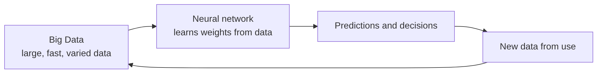
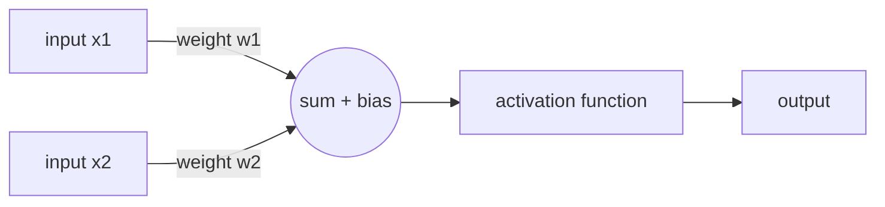
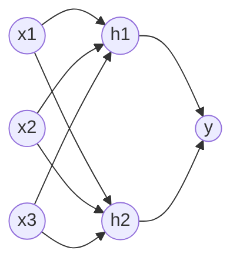
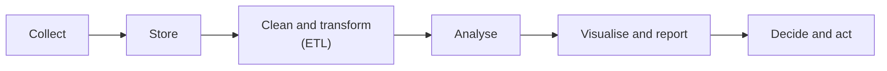
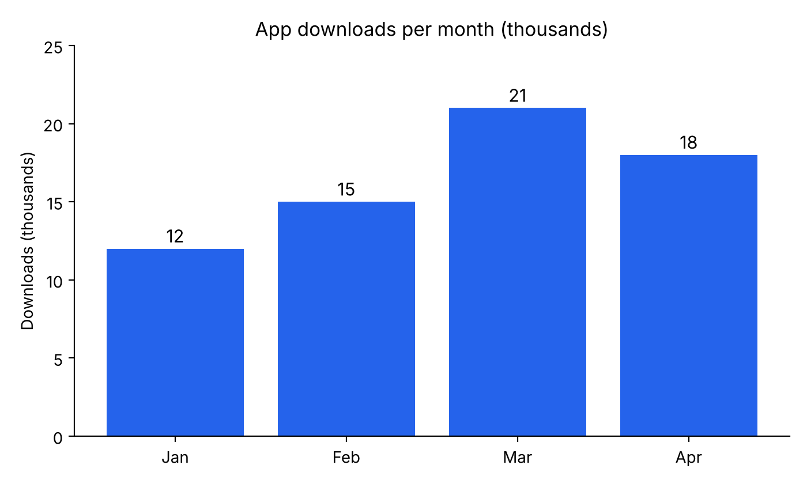

# Chapter 3: Connectionist AI and Big Data

> **Module:** AI Overview
> **Chapter:** 3 — Connectionist AI and Big Data (course Chapter 5)
> **Version:** 1.1 (Stage 1, rebuilt from the lecturer's course slides)
> **Author:** Benedict Subhata (proposed owner)
> **Reviewer:** Brian Djoni Suzanna
> **Audience:** Complete beginners with basic computer and internet literacy; no programming experience needed
> **Estimated study time:** about 3 hours, including activities
> **Course source:** Lecturer's slides "chap5: Connectionist AI and Big Data Overview". The slides list two groups of topics. This chapter covers both, in the same order.
> **Stage 1 scope:** Every topic in the lecturer's outline is explained with an example. Stage 2 will add depth, more diagrams, and a full test bank.

---

## Table of Contents

1. [Learning Outcomes](#learning-outcomes)
2. [Part A: Connectionist AI](#part-a-connectionist-ai)
3. [A1. Introduction to Connectionist AI](#a1-introduction-to-connectionist-ai)
4. [A2. Basics of Neural Networks](#a2-basics-of-neural-networks)
5. [A3. Architectures of Neural Networks](#a3-architectures-of-neural-networks)
6. [A4. Deep Learning and Advanced Concepts](#a4-deep-learning-and-advanced-concepts)
7. [A5. Key Applications of Connectionist AI](#a5-key-applications-of-connectionist-ai)
8. [A6. Ethical Considerations and Challenges](#a6-ethical-considerations-and-challenges)
9. [Part B: Big Data](#part-b-big-data)
10. [B1. Introduction to Big Data](#b1-introduction-to-big-data)
11. [B2. Big Data Technologies](#b2-big-data-technologies)
12. [B3. Data Processing and Analytics](#b3-data-processing-and-analytics)
13. [B4. Data Analysis and Visualization](#b4-data-analysis-and-visualization)
14. [B5. Big Data Use Cases](#b5-big-data-use-cases)
15. [B6. Big Data Ethics and Privacy](#b6-big-data-ethics-and-privacy)
16. [Hands-On Activities](#hands-on-activities)
17. [Key Takeaways](#key-takeaways)
18. [Practice Questions](#practice-questions)
19. [Answer Key](#answer-key)
20. [Glossary](#glossary)
21. [References](#references)

---

## Learning Outcomes

After completing this chapter, you should be able to:

1. Explain the connectionist idea: intelligence from many simple connected units that **learn from data**.
2. Describe an artificial neuron (inputs, weights, bias, activation) and compute its output.
3. Explain, in simple words, how a network learns using a loss, gradient descent, and backpropagation.
4. Name the main network architectures (feedforward, convolutional, recurrent, transformer) and what each is good for.
5. Explain deep learning, overfitting, and why deep learning needs a lot of data and computing power.
6. Describe Big Data using its Vs, name the main Big Data technologies, and explain batch and stream processing.
7. Choose a suitable chart for a simple data question.
8. Identify ethical and privacy problems in connectionist AI and Big Data, such as bias, lack of explanation, and re-identification.

*Figure 3.1: Connectionist AI and Big Data belong together. Neural networks learn from data, and their use creates more data.*

---

# Part A: Connectionist AI

## A1. Introduction to Connectionist AI

**Connectionist AI** builds intelligence from **many simple units that are connected to one another**. Each unit does a tiny calculation. The **strength of each connection**, called a **weight**, decides how much one unit influences another. The system is not given rules. It **learns the weights from examples**.

The idea is inspired, loosely, by the brain: neurons connected by synapses. Artificial neural networks are **much simpler** than a real brain. They are mathematical models, not copies of biological neurons.

**Short history**

| Year | Event |
|---|---|
| 1943 | McCulloch and Pitts propose a simple mathematical model of a neuron |
| 1958 | Frank Rosenblatt's perceptron: a neuron model that can learn |
| 1986 | Backpropagation is popularised (Rumelhart, Hinton, Williams) |
| 1989–1998 | Convolutional networks for reading handwritten digits (Yann LeCun and colleagues) |
| 2012 | AlexNet wins the ImageNet image contest by a large margin |
| 2017 | The Transformer architecture is introduced |

**Symbolic versus connectionist**

| | Symbolic AI (Chapter 2) | Connectionist AI (this chapter) |
|---|---|---|
| Where knowledge lives | Explicit rules written by people | Numbers (weights) learned from data |
| How it is built | Knowledge engineering | Training on examples |
| Strength | Explainable; works with little data | Handles messy data such as images and speech |
| Weakness | Cannot learn; brittle with uncertainty | Needs much data; hard to explain |
| Example | Rule: "IF fever AND cough THEN …" | Network that recognises a cat in a photo |

---

## A2. Basics of Neural Networks

### The artificial neuron

A neuron takes several **inputs**, multiplies each by a **weight**, adds them with a **bias**, and passes the result through an **activation function**.

*Figure 3.2: One artificial neuron.*

**z = w1 × x1 + w2 × x2 + b**, then **output = activation(z)**.

Common activation functions:

| Function | Behaviour | Typical use |
|---|---|---|
| Step | 0 below a threshold, 1 above | The first perceptron |
| Sigmoid | Smooth curve between 0 and 1 | Probabilities |
| ReLU | 0 for negative values, the value itself for positive | Hidden layers of modern networks |

**Worked example.** Inputs x1 = 1 and x2 = 0.5. Weights w1 = 0.4 and w2 = −0.2. Bias b = 0.1.

* z = 0.4 × 1 + (−0.2) × 0.5 + 0.1 = 0.4 − 0.1 + 0.1 = **0.4**
* ReLU(0.4) = **0.4**
* Sigmoid(0.4) ≈ **0.60**

### A neuron that decides: the AND perceptron

A perceptron with w1 = 1, w2 = 1, bias b = −1.5 and a step activation (output 1 if z > 0) computes **AND**.

| x1 | x2 | z = x1 + x2 − 1.5 | Output |
|:-:|:-:|--:|:-:|
| 0 | 0 | −1.5 | 0 |
| 0 | 1 | −0.5 | 0 |
| 1 | 0 | −0.5 | 0 |
| 1 | 1 | 0.5 | 1 |

Here the weights were chosen by hand. The point of a network is that training **finds good weights automatically**.

### Layers

Neurons are arranged in **layers**: an **input layer** (the data), one or more **hidden layers** (calculation), and an **output layer** (the answer).

*Figure 3.3: A small feedforward network with three inputs, two hidden neurons, and one output. Every arrow has its own weight.*

### How a network learns

1. **Forward pass.** The input goes through the layers to give a prediction.
2. **Loss.** A number says how wrong the prediction is. For a house price, the loss could be the squared difference between the predicted and the true price.
3. **Backpropagation.** The network works out how much each weight contributed to the error.
4. **Gradient descent.** Each weight is moved a small step in the direction that reduces the loss. The step size is the **learning rate**.
5. **Repeat** over many examples and many rounds (**epochs**).

**Worked example of gradient descent.** Suppose the loss is (w − 3)², so the best weight is 3. We start at w = 0 with learning rate 0.1. The slope of the loss is 2 × (w − 3).

| Step | w before | Slope 2(w − 3) | w after = w − 0.1 × slope |
|--:|--:|--:|--:|
| 1 | 0 | −6 | 0.6 |
| 2 | 0.6 | −4.8 | 1.08 |
| 3 | 1.08 | −3.84 | 1.464 |

The weight moves toward 3 in smaller and smaller steps. A real network does this for millions of weights at once.

---

## A3. Architectures of Neural Networks

An **architecture** is the way the neurons are connected. Different data call for different architectures.

| Architecture | Idea | Good for | Example |
|---|---|---|---|
| **Feedforward network (MLP)** | Layers connected in one direction | Tables of numbers, simple prediction | Predicting house prices |
| **Convolutional neural network (CNN)** | Small filters slide across the data and detect patterns such as edges and shapes | Images, video | Recognising faces or tumours in scans |
| **Recurrent neural network (RNN, LSTM)** | Passes information from one step to the next, so it has a kind of memory | Sequences such as speech and text (older approach) | Speech recognition |
| **Transformer** | Uses *attention* to decide which parts of the input matter for each part of the output | Language, and now images, audio, and more | Large language models |
| **Autoencoder** | Compresses the input and then rebuilds it | Noise removal, anomaly detection | Finding unusual machine readings |
| **Generative adversarial network (GAN)** | A generator and a discriminator compete | Creating realistic images | Synthetic faces |

**Reading the table.** You do not need to memorise every architecture. Remember the pairing: **CNN → images**, **Transformer → language**, **feedforward → tables**.

---

## A4. Deep Learning and Advanced Concepts

**Deep learning** means neural networks with **many hidden layers**. Each layer builds on the one before it. In an image network, early layers detect edges, middle layers detect shapes, and later layers detect whole objects.

### Why deep learning took off around 2012

| Ingredient | Why it mattered |
|---|---|
| **Big data** | Large labelled datasets such as ImageNet |
| **Computing power** | Graphics processing units (GPUs) made training much faster |
| **Better methods** | Improved activation functions, training tricks, and architectures |

### Advanced concepts

| Concept | Plain meaning | Why it matters |
|---|---|---|
| **Overfitting** | The model memorises the training examples and does badly on new ones | The main enemy of learning. Always test on unseen data |
| **Training, validation, and test sets** | Separate data for learning, tuning, and a final fair check | A fair estimate of how the model will behave in real use |
| **Regularisation and dropout** | Tricks that make overfitting less likely (for example, randomly switching off neurons during training) | Better results on new data |
| **Transfer learning** | Start from a model trained on a big task and adjust it to a smaller one | Saves data and time |
| **Foundation model / large language model** | A very large model trained on huge data that can be adapted to many tasks | Basis of modern chatbots |
| **Embedding** | Turning words or images into lists of numbers, so that similar items are close together | How networks "understand" meaning mathematically |

**Overfitting example.** A student memorises last year's exam answers and scores 100% on those exact questions, but only 40% on this year's different questions. A network can do the same: 99% on training data and 60% on test data means it has overfitted.

---

## A5. Key Applications of Connectionist AI

| Field | What the network does | Example |
|---|---|---|
| **Image recognition** | Classifies or locates objects in pictures | Face unlock, reading handwritten digits |
| **Medical imaging** | Marks suspicious regions in scans | Screening support for radiologists |
| **Speech** | Converts speech to text and text to speech | Voice assistants, subtitles |
| **Language translation and chat** | Reads and writes text | Online translation, chatbots |
| **Recommendation** | Predicts what you may like | Video and music suggestions |
| **Self-driving perception** | Detects cars, people, and signs in camera data | Driver-assistance systems |
| **Generative AI** | Creates images, text, and audio | Image and text generators |

**Back to the Smart Classroom.** In Chapter 2 the rule-based classroom failed on "Turn on the fan". A connectionist version is trained with many example sentences labelled *fan on*, *fan off*, *lamp on*, *lamp off*. The network learns which words and patterns go with each label, so it can handle new wording, but it can still be wrong on unusual sentences, and we cannot easily point to "the rule" that decided.

---

## A6. Ethical Considerations and Challenges

| Challenge | What can go wrong | Example |
|---|---|---|
| **Bias** | The model learns unfair patterns from unrepresentative data | A 2018 study of commercial face-analysis systems found much higher error rates for darker-skinned women than for lighter-skinned men (Buolamwini and Gebru, 2018) |
| **Lack of explanation** | We cannot easily say why the network gave an answer | A loan is refused and nobody can say why |
| **Privacy** | Training data may contain personal data that the model can leak | A model repeating private text it saw in training |
| **Reliability** | Networks can be fooled by small changes or be wrong with high confidence | A sticker on a sign changes how a vision system reads it |
| **Energy and cost** | Training large models uses a lot of electricity and hardware | Large data-centre training runs |
| **Misuse** | Synthetic images, voices, and text can mislead | Fake videos |

**Questions to ask about any connectionist system**

1. What data was it trained on, and who is missing from that data?
2. How was it tested, and on whom?
3. Can its decisions be explained well enough for the situation?
4. Who is responsible when it is wrong?
5. Is a human able to check or overrule the result?

---

# Part B: Big Data

## B1. Introduction to Big Data

**Big Data** means data that is so **large, fast, or varied** that ordinary tools cannot store or process it well. It does not mean "any big file". It is a set of challenges.

**The Vs of Big Data**

| V | Meaning | Example |
|---|---|---|
| **Volume** | A very large amount | Billions of photos |
| **Velocity** | Data arrives and changes quickly | Live payments and sensor readings |
| **Variety** | Many kinds: tables, text, images, video, sensor streams | Posts, photos, and clicks together |
| **Veracity** | Data quality and trustworthiness | Missing, wrong, or fake records |
| **Value** | Usefulness: data matters only if it helps a decision | Better recommendations or safer roads |

The first three Vs (volume, velocity, variety) are the classic description. Veracity and value are often added.

**Types of data**

| Type | Description | Example |
|---|---|---|
| Structured | Rows and columns | A bank table |
| Semi-structured | Tags or keys but no fixed table | JSON or XML files |
| Unstructured | No fixed format | Photos, audio, free text |

**Why Big Data matters for AI.** A deep network has millions of weights. To set them well it needs **many varied examples**. This is why deep learning grew together with Big Data.

---

## B2. Big Data Technologies

| Need | Technology idea | Examples |
|---|---|---|
| **Store very large data** | **Distributed file systems**: split files over many computers, keep copies | HDFS |
| **Store flexible data** | **NoSQL databases**: key-value, document, column, or graph stores | MongoDB, Cassandra, Neo4j |
| **Store for analysis** | **Data warehouse** (organised, ready for reports) and **data lake** (raw data of all kinds) | Cloud warehouses and lakes |
| **Process in parallel** | Split the work across many machines | MapReduce, Apache Spark |
| **Process live streams** | Handle events as they arrive | Apache Kafka, stream processors |
| **Rent computing** | Cloud platforms that provide storage and computing on demand | Public cloud services |

**Worked example: MapReduce word count.** Task: count words in two lines of text.

* Line 1: *ai is fun*
* Line 2: *ai is big*

**Map** (each machine handles one line and emits pairs): (ai,1) (is,1) (fun,1) | (ai,1) (is,1) (big,1)

**Shuffle** (group by word): ai → [1,1]; is → [1,1]; fun → [1]; big → [1]

**Reduce** (add up each group): **ai = 2, is = 2, fun = 1, big = 1**

With billions of lines the same recipe works, because each machine only handles its own part.

---

## B3. Data Processing and Analytics

### The data pipeline

*Figure 3.4: A typical data pipeline. ETL means extract, transform, load.*

Most of the effort goes into **cleaning**: removing duplicates, fixing wrong values, handling missing values, and putting data in one format.

### Batch versus stream processing

| | Batch | Stream |
|---|---|---|
| Data handled | A large collection at once | Events one by one, as they arrive |
| Speed of result | Minutes to hours | Seconds or less |
| Example | Monthly sales report | Flagging a suspicious card payment immediately |

### Four levels of analytics

| Level | Question | Example |
|---|---|---|
| **Descriptive** | What happened? | Sales fell 5% last month |
| **Diagnostic** | Why did it happen? | A popular item was out of stock |
| **Predictive** | What will probably happen? | Next month's demand (machine learning) |
| **Prescriptive** | What should we do? | Order 500 more units |

---

## B4. Data Analysis and Visualization

**Visualization** shows data as pictures so that people see patterns quickly. The right chart depends on the question.

| Question | Good chart | Why |
|---|---|---|
| How does a value change over time? | Line chart | Shows trends |
| How do categories compare? | Bar chart | Easy to compare lengths |
| What share does each part have of a whole? | Pie chart (few parts) or stacked bar | Shows proportions |
| Are two numbers related? | Scatter plot | Shows patterns and outliers |
| How is one number spread out? | Histogram | Shows the shape of the data |

**Worked example.** Monthly app downloads (in thousands): January 12, February 15, March 21, April 18.

*Figure 3.5: A bar chart of the example data.*

* Highest month: March (21 thousand).
* Change from January to March: 21 − 12 = 9 thousand, which is 9 ÷ 12 = 75% more.
* Change from March to April: 18 − 21 = −3 thousand, which is −3 ÷ 21 ≈ −14%.

**Rules for honest charts**

1. Start bar charts at zero. A bar chart that starts at 10 makes small differences look big.
2. Label axes and units.
3. Do not use too many colours or 3-D effects.
4. Show where the data comes from.

---

## B5. Big Data Use Cases

| Field | Use | Data used | Possible concern |
|---|---|---|---|
| **Retail and media** | Recommend products and videos | Purchase and viewing history | Profiling and manipulation |
| **Healthcare** | Spot disease patterns; support diagnosis | Records, scans, wearable data | Sensitive personal data |
| **Transport** | Predict traffic; plan routes | GPS and sensor data | Location tracking |
| **Finance** | Detect fraud in real time | Transaction streams | Wrongly blocked customers |
| **Smart cities** | Manage energy, waste, and public transport | Sensor networks | Surveillance |
| **Education** | Find students who need extra help | Quiz and attendance data | Labelling students unfairly |

**Link to the three approaches.** Fraud detection can use symbolic rules ("flag a payment above a limit"), a neural network (learned patterns), or both.

---

## B6. Big Data Ethics and Privacy

| Issue | Meaning | Example |
|---|---|---|
| **Consent** | People should know what is collected and agree to it | An app that collects location without telling users |
| **Purpose limitation** | Use data only for the stated purpose | Health data reused for advertising |
| **Anonymisation is hard** | Removing names does not always make people unidentifiable | See the example below |
| **Security** | Large collections are attractive targets | Data breaches |
| **Bias and fairness** | Data reflects past unfairness, and models copy it | A hiring model trained on past decisions |
| **Transparency and control** | People should be able to see, correct, or delete their data | Rights under privacy laws such as the EU GDPR |

**Re-identification example.** Latanya Sweeney (2000) showed that, using 1990 US census data, **87%** of the US population could be uniquely identified by just three facts: a five-digit ZIP code, gender, and date of birth. A "de-identified" dataset that still contains these three fields can often be matched with a public list (such as a voter list) to find a person.

**Good practice checklist**

1. Collect only the data you need.
2. Explain what you collect and why.
3. Remove or mask direct identifiers, and be careful with combinations of fields.
4. Protect the data (access control, encryption).
5. Delete it when it is no longer needed.
6. Check the results for unfair outcomes.

---

# Hands-On Activities

### Activity A: Compute a neuron by hand

Inputs x1 = 2 and x2 = −1. Weights w1 = 0.5 and w2 = 1. Bias b = 0.5.

1. Compute z.
2. Apply ReLU.
3. Apply a step function that outputs 1 if z > 0.

*Expected answers:* z = 0.5 × 2 + 1 × (−1) + 0.5 = **0.5**; ReLU gives **0.5**; step gives **1**.

### Activity B: Make the perceptron compute OR

Use w1 = 1, w2 = 1 and find a bias b so that the step neuron outputs 1 when *at least one* input is 1. Fill in the truth table.

*Expected answer:* any b with −1 < b ≤ 0 works, for example b = −0.5. The inputs (0,0) give z = −0.5 → 0; (0,1) and (1,0) give 0.5 → 1; (1,1) gives 1.5 → 1.

### Activity C: Smart Classroom, machine-learning version

In the block tool, switch from IF-THEN blocks to a **recognise text** block that you train with several example sentences for each label (*fan on*, *fan off*, *lamp on*, *lamp off*).

1. Test the sentences from Chapter 2, especially "Turn on the fan".
2. Find a sentence the model gets wrong. Add it as a new example with the right label and retest.
3. Compare: How many examples did you need? What did you gain compared with the rule-based version? What did you lose (explanation)?

### Activity D: Check a data claim

A news post says "87% of people can be identified from their ZIP code, gender, and birth date." Find the original study, read how it was measured (which data, which year), and decide whether the claim is accurate and complete.

---

## Key Takeaways

* **Connectionist AI** uses many simple connected units. Knowledge is stored as **weights learned from data**.
* A neuron computes **z = Σ w·x + b** and applies an **activation function**.
* Networks learn by reducing a **loss** with **gradient descent**, using **backpropagation** to find each weight's share of the error.
* **CNNs** suit images, **transformers** suit language, **feedforward networks** suit tables.
* **Deep learning** = many layers. It grew because of **big data, GPUs, and better methods**. **Overfitting** is the main risk.
* **Big Data** is described by **volume, velocity, variety** (plus veracity and value).
* Tools: **distributed storage, NoSQL, MapReduce and Spark, stream processing, cloud**.
* Choose the chart to fit the question, and keep charts honest.
* Risks: **bias, no explanation, privacy leaks, re-identification, energy use, misuse**.

---

## Practice Questions

### Part A: Multiple Choice

**Q1.** In Connectionist AI, where is the knowledge stored?
A. In hand-written IF-THEN rules
B. In the weights of the connections
C. In a table of rewards
D. In a user manual

**Q2.** A neuron has x1 = 1, x2 = 0.5, w1 = 0.4, w2 = −0.2, b = 0.1. What is z?
A. 0.4
B. 0.6
C. 0.1
D. −0.4

**Q3.** Which architecture is most suited to images?
A. CNN
B. Rule base
C. MapReduce
D. Scatter plot

**Q4.** 99% accuracy on training data and 60% on new data suggests:
A. Underfitting
B. Overfitting
C. Perfect learning
D. Too little training time only

**Q5.** Which is *not* one of the three classic Vs of Big Data?
A. Volume
B. Velocity
C. Variety
D. Vacation

**Q6.** In MapReduce word count, what does the *reduce* step do?
A. Splits text into lines
B. Adds up the counts for each word
C. Draws the chart
D. Deletes the data

**Q7.** Which analytics level answers "What should we do?"
A. Descriptive
B. Diagnostic
C. Predictive
D. Prescriptive

**Q8.** Why is removing names not always enough to protect privacy?
A. Names are not personal data.
B. Combinations such as ZIP code, gender, and birth date can identify people.
C. Computers cannot read names.
D. Privacy laws do not apply.

### Part B: Short Answer

**Q9.** Give two differences between Symbolic AI and Connectionist AI.

**Q10.** Explain gradient descent in two or three sentences.

**Q11.** Explain why Big Data and deep learning grew together.

**Q12.** A company wants to flag suspicious card payments within seconds. Should it use batch or stream processing? Explain.

### Part C: Apply It

**Q13.** A hospital trains an image network to detect a disease. Most training scans came from one hospital with one brand of scanner. Name two risks and one way to reduce each.

**Q14.** A bar chart of sales starts its vertical axis at 95 instead of 0, which makes a drop from 100 to 98 look dramatic. Explain the problem.

---

## Answer Key

| Q | Answer | Explanation |
|---|---|---|
| Q1 | B | Weights learned from data (Section A1). |
| Q2 | A | 0.4 × 1 + (−0.2) × 0.5 + 0.1 = 0.4 |
| Q3 | A | Convolutional networks detect patterns in images. |
| Q4 | B | A big gap between training and new-data performance is overfitting. |
| Q5 | D | The classic Vs are volume, velocity, and variety. |
| Q6 | B | Reduce combines the grouped counts into totals. |
| Q7 | D | Prescriptive analytics recommends actions. |
| Q8 | B | Re-identification from a few combined facts (Sweeney, 2000). |
| Q9 | Sample | Symbolic: knowledge written as rules by people; explainable; needs little data; cannot learn. Connectionist: knowledge learned as weights; hard to explain; needs a lot of data; handles messy data such as images. |
| Q10 | Sample | Gradient descent repeatedly changes each weight by a small step in the direction that lowers the loss. The learning rate sets the step size. After many steps the loss becomes small. |
| Q11 | Sample | Deep networks have millions of weights and need many examples to set them well. Big Data supplied large datasets, and GPUs supplied computing power, so training became possible. |
| Q12 | Sample | Stream processing, because the result is needed in seconds, as each payment arrives. Batch would give the answer too late. |
| Q13 | Sample | Risk 1: the model may fail on other hospitals' scanners (add data from several hospitals and test on them). Risk 2: bias toward the patient group at that hospital (check performance for different groups and add missing groups). |
| Q14 | Sample | A bar chart's bar length should show the value. Cutting the axis exaggerates a 2% drop to look like a collapse. Start at zero or use a line chart and label the axis clearly. |

---

## Glossary

| Term | Meaning |
|---|---|
| **Activation function** | The function that turns a neuron's sum into its output. |
| **Backpropagation** | The method that works out each weight's share of the error. |
| **Big Data** | Data too large, fast, or varied for ordinary tools. |
| **Bias (in a neuron)** | A number added to the weighted sum. |
| **Bias (fairness)** | Unfair patterns in data or results. |
| **CNN** | Convolutional neural network, suited to images. |
| **Data lake / warehouse** | Stores for raw data / for organised data used in reports. |
| **Deep learning** | Neural networks with many hidden layers. |
| **ETL** | Extract, transform, load: preparing data for analysis. |
| **Gradient descent** | Repeated small weight changes that reduce the loss. |
| **Loss** | A number that measures how wrong a prediction is. |
| **MapReduce** | A way to process big data in parallel by mapping then reducing. |
| **Neural network** | A model made of connected neurons arranged in layers. |
| **Overfitting** | Doing well on training data but poorly on new data. |
| **Transformer** | A network architecture based on attention, used in language models. |
| **Weight** | The strength of a connection between two neurons. |

---

## References

1. Course slides, "chap5: Connectionist AI and Big Data Overview", Introduction to Computer Science and Artificial Intelligence. Lecturer's course materials (no public link). Source of the topic outline for Part A and Part B.
2. McCulloch, W. S., and Pitts, W. (1943). A logical calculus of the ideas immanent in nervous activity. *Bulletin of Mathematical Biophysics*, 5, 115–133. [https://doi.org/10.1007/BF02478259](https://doi.org/10.1007/BF02478259) *(not opened)*
3. Rumelhart, D. E., Hinton, G. E., and Williams, R. J. (1986). Learning representations by back-propagating errors. *Nature*, 323, 533–536. [https://doi.org/10.1038/323533a0](https://doi.org/10.1038/323533a0) *(not opened)*
4. LeCun, Y., Bengio, Y., and Hinton, G. (2015). Deep learning. *Nature*, 521, 436–444. [https://doi.org/10.1038/nature14539](https://doi.org/10.1038/nature14539) *(the PubMed page was blocked by a browser check; not opened)*
5. Goodfellow, I., Bengio, Y., and Courville, A. (2016). *Deep Learning*. MIT Press. [https://www.deeplearningbook.org/](https://www.deeplearningbook.org/) *(not opened)*
6. Buolamwini, J., and Gebru, T. (2018). Gender Shades: Intersectional accuracy disparities in commercial gender classification. *Proceedings of Machine Learning Research*, 81, 77–91. [https://proceedings.mlr.press/v81/buolamwini18a.html](https://proceedings.mlr.press/v81/buolamwini18a.html) *(not opened)*
7. Sweeney, L. (2000). *Simple Demographics Often Identify People Uniquely*. Carnegie Mellon University, Data Privacy Working Paper 3. [https://dataprivacylab.org/projects/identifiability/paper1.pdf](https://dataprivacylab.org/projects/identifiability/paper1.pdf) *(not opened)*
8. Dean, J., and Ghemawat, S. (2004). MapReduce: Simplified data processing on large clusters. *OSDI '04*. [https://research.google/pubs/mapreduce-simplified-data-processing-on-large-clusters/](https://research.google/pubs/mapreduce-simplified-data-processing-on-large-clusters/) *(not opened)*
9. European Union. Regulation (EU) 2016/679 (General Data Protection Regulation). [https://eur-lex.europa.eu/eli/reg/2016/679/oj](https://eur-lex.europa.eu/eli/reg/2016/679/oj) *(not opened)*

> **Link status.** Each link below was written from the publisher's or DOI address of the work. Links marked **not opened** could not be opened during this revision. The author or reviewer must click every link, confirm that it opens the right work and supports the claim it is cited for, and then change the label to "opened" with the date.
