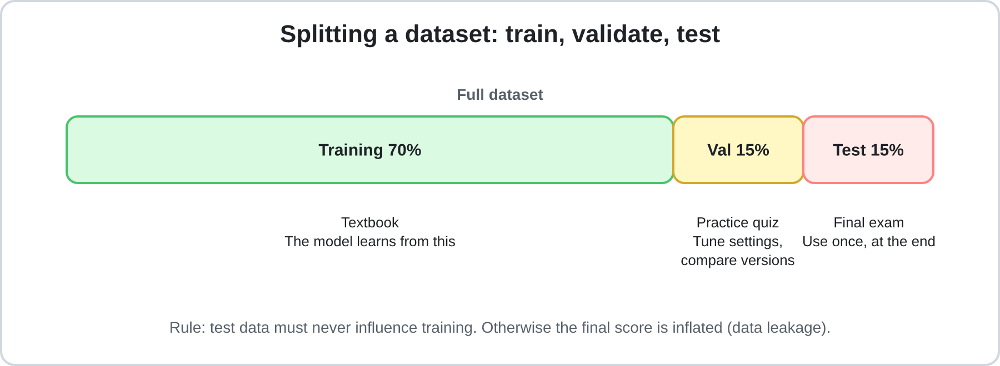
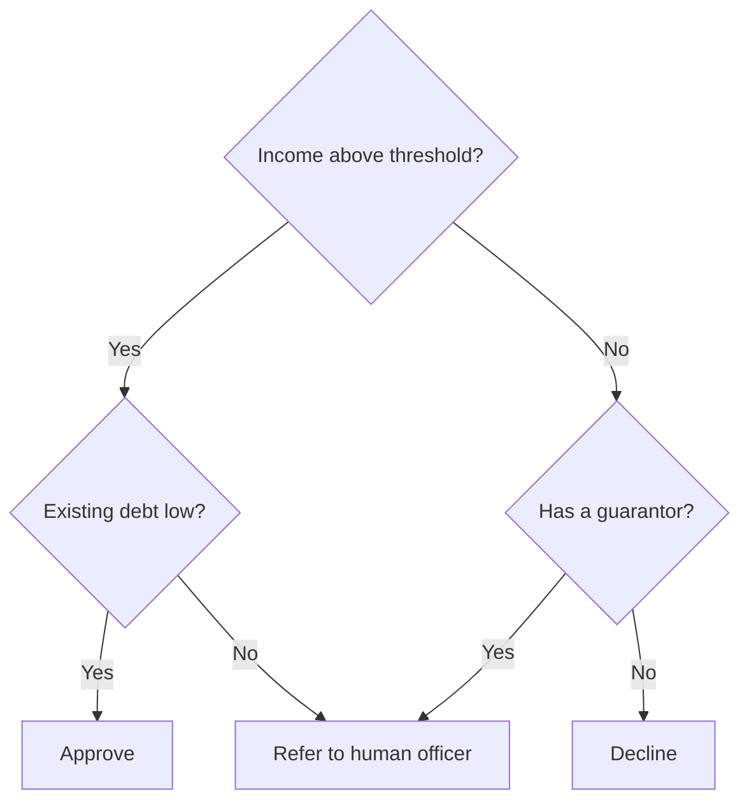
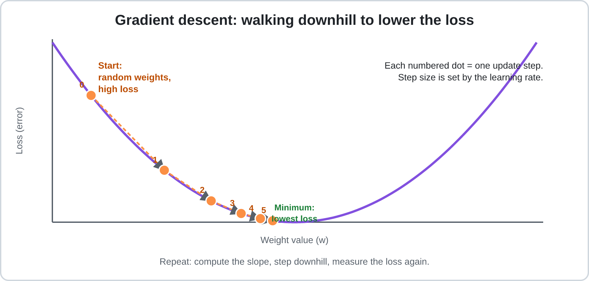
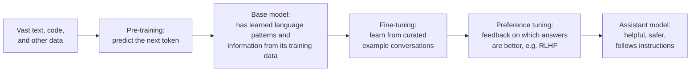
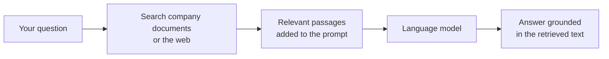
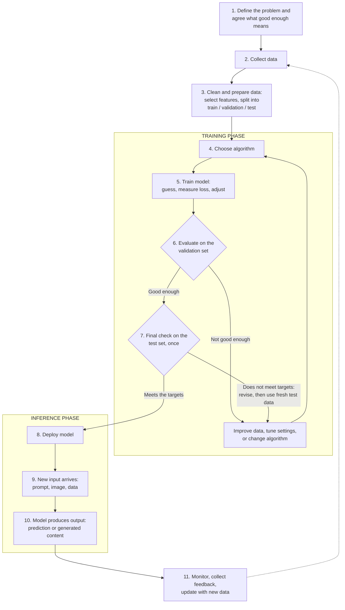

# Chapter 3: How Artificial Intelligence Works

> **Module:** AI Overview | **Level:** Beginner → Intermediate | **Estimated study time:** 90–120 minutes
> **Status:** Draft (Stage 1)

**Contents**

- [3.1 Learning Objectives](#31-learning-objectives)
- [3.2 The Big Picture](#32-the-big-picture)
- [3.3 Data: The Fuel of AI](#33-data-the-fuel-of-ai)
- [3.4 Algorithms and Models](#34-algorithms-and-models)
- [3.5 Machine Learning: Learning from Examples](#35-machine-learning-learning-from-examples)
- [3.6 Neural Networks and Deep Learning](#36-neural-networks-and-deep-learning)
- [3.7 How Modern Language AI Works](#37-how-modern-language-ai-works)
- [3.8 Training vs. Inference](#38-training-vs-inference)
- [3.9 Evaluating a Model](#39-evaluating-a-model)
- [3.10 The AI Workflow](#310-the-ai-workflow)
- [3.11 From Beginner to Expert](#311-from-beginner-to-expert)
- [3.12 Common Misconceptions](#312-common-misconceptions)
- [3.13 Key Takeaways](#313-key-takeaways)
- [3.14 Glossary](#314-glossary)
- [3.15 Self-Check Reflection](#315-self-check-reflection)
- [3.16 Practice Questions](#316-practice-questions)
- [3.17 Hands-On Activities (No Coding Required)](#317-hands-on-activities-no-coding-required)
- [3.18 Further Reading and References](#318-further-reading-and-references)

---

## 3.1 Learning Objectives

By the end of this chapter, you will be able to:

1. Explain the role of **data** in an AI system and why its quality matters.
2. Distinguish between an **algorithm** and a **model**.
3. Describe how **machine learning** learns patterns instead of following hand-written rules.
4. Explain, in plain language, how **neural networks** and **large language models** work.
5. Distinguish **training** from **inference**, and tell apart improvements that *use* an existing model (inference-time) from those that *change or create* one (training-based).
6. Read the basic **evaluation metrics** used to judge a model, and explain why deciding whether a result is "good enough" depends on the application.
7. Trace the **end-to-end workflow** of an AI system.
8. Use this understanding to **use AI tools more effectively and critically**.

**Prerequisites:** Chapter 1 (What is AI) and Chapter 2 (Types of AI). Chapter 2 classified AI by *capability* and by *functionality*. This chapter looks *inside* the machine to see how it works.

---

## 3.2 The Big Picture

Traditional software follows rules that a programmer writes by hand. Machine-learning-based AI works the other way round.


*Figure 3.1: In machine learning, you supply data and answers, and the computer discovers the rules.*

| | Traditional Programming | Machine-Learning-Based AI |
|---|---|---|
| **You provide** | Rules + Input | Data + Desired Outputs (examples) |
| **The computer produces** | Output | The rules (a *model*) |
| **Example** | "If the email contains the word 'lottery', mark as spam." | Show the system 100,000 labelled emails; it discovers what spam looks like. |
| **Handles new situations** | Only those the programmer anticipated | Can generalise to similar cases it has never seen |
| **Breaks when** | Rules are incomplete | Data is poor, biased, or outdated |

**Core idea:** Most modern AI does not get *told* how to solve a problem. It **learns patterns from data**, then applies those patterns to new situations.

Three ingredients make this possible:

```
 DATA  +  ALGORITHM  +  COMPUTING POWER  →  TRAINED MODEL
```

> **Why did AI take off in the 2010s and 2020s?** Not because of one invention, but because all three ingredients matured together: huge digital datasets (the internet, smartphones, sensors), better algorithms (deep learning, transformers), and cheap, powerful hardware (GPUs and specialised AI chips).

---

## 3.3 Data: The Fuel of AI

### What is data?

Data is any recorded information an AI system can learn from: text, images, audio, video, numbers in a spreadsheet, clicks on a website, or sensor readings.

### Types of data

| Type | Description | Examples |
|---|---|---|
| **Structured** | Organised in rows and columns | Sales tables, bank records |
| **Unstructured** | No fixed format | Emails, photos, videos, social media posts |
| **Labelled** | Each example has the correct answer attached | A photo tagged "cat" |
| **Unlabelled** | No answers attached | A pile of raw photos |

Modern large language models (LLMs) are trained mostly on huge amounts of **unstructured text**, using a trick (Section 3.7) that creates the "labels" automatically from the text itself.

### Where does training data come from?

- **Collected by the organisation:** customer records, transactions, sensor logs.
- **Public or open datasets:** government statistics, scientific datasets, benchmark collections.
- **Web-scale text and images:** large-scale collections of public content (this raises ongoing questions about copyright and consent).
- **Licensed data:** purchased or partnered content.
- **Human-labelled data:** people tag images, rate answers, or write example responses.
- **Synthetic data:** data generated by software or by another AI model, useful when real data is rare, private, or expensive, but risky if it simply repeats the original model's mistakes.

### Key terms

- **Feature:** an individual measurable input (e.g., house size, number of bedrooms).
- **Label / Target:** the answer we want the model to predict (e.g., house price).
- **Example (or sample):** one row of data: its features plus its label.

### Preparing data: the unglamorous part

Practitioners often report that preparing data takes more time than building the model. Google's Machine Learning Crash Course puts it at around 80% of the time on a typical project. [[1]](#ref-1) Typical steps:

| Step | What it means | Example |
|---|---|---|
| **Cleaning** | Fix or remove errors, duplicates, and missing values | Delete duplicate customer rows; fill in a missing age |
| **Labelling** | Attach the correct answers | Humans mark which emails are spam |
| **Feature engineering** | Create more useful inputs from raw data | Turn a date into "day of week" and "is holiday" |
| **Normalising / scaling** | Put numbers on comparable scales | Convert salary (in thousands) and age (in tens) to a common range |
| **Encoding** | Convert non-numbers into numbers | Turn the word "red" into a numeric code |
| **Splitting** | Divide data into training, validation, and test sets | See below |

### Splitting the data



*Figure 3.2: A dataset is divided so the model is graded on data it has never seen.*

| Split | Typical share | Purpose | Analogy |
|---|---|---|---|
| **Training set** | ~70–80% | The model learns from this | The textbook |
| **Validation set** | ~10–15% | Tune settings and compare versions during development. Used again and again | A practice quiz |
| **Test set** | ~10–15% | One final check of real-world performance, after all development decisions are made | The final exam |

Use the **validation set** for every decision made along the way (which algorithm, which settings, which features). Keep the **test set** untouched until the very end. If you keep adjusting the model to improve its test score, the test set quietly becomes a second validation set, and the final score will look better than real-world performance will be. If you do have to change the model after seeing the test result, collect a fresh, untouched test set for the next final check. Section 3.9 explains why. [[1]](#ref-1)

### Why data quality matters

> **"Garbage in, garbage out."** A model can only be as good as the data it learns from.

| Data problem | What goes wrong | Example |
|---|---|---|
| **Bias** | Under-represented groups get worse results | A face-recognition system trained mostly on one skin tone performs worse on others |
| **Noise and errors** | Wrong labels teach wrong patterns | Images labelled "dog" that are actually wolves |
| **Unrepresentative data** | The model fails outside the conditions it saw | A model trained on daytime photos fails at night |
| **Data leakage** | Answers slip into the inputs, so scores look better than reality | A model predicting hospital readmission accidentally sees the discharge outcome |
| **Outdated data** | The world changed since training | A pricing model trained before a market shift |
| **Too little data** | Not enough examples to learn a reliable pattern | Rare diseases with only a few hundred recorded cases |

**Data-centric thinking:** Experienced practitioners often get bigger improvements by *improving the data* (fixing labels, adding missing cases) than by switching to a fancier algorithm.

**Practical takeaway:** When an AI tool gives a poor answer, ask: *"What data was this likely trained on, and what might be missing from it?"*

---

## 3.4 Algorithms and Models

These two terms are often confused.

- **Algorithm:** a step-by-step procedure for learning or solving a problem (the *recipe*).
- **Model:** the result of running a learning algorithm on data (the *finished dish*). It is a set of learned numbers, called **parameters** or **weights**, that captures patterns.

> **Algorithm + Data → Model**

### Two basic kinds of prediction task

| Task | Question it answers | Output | Example |
|---|---|---|---|
| **Classification** | "Which category?" | A label | Spam or not spam; cat, dog, or bird |
| **Regression** | "How much?" | A number | House price; tomorrow's temperature |

Classification and regression are both **supervised learning** tasks: the model learns from examples that come with correct answers. Other approaches include **unsupervised learning** (finding structure in unlabelled data, as in clustering) and **reinforcement learning** (learning by trial and error from rewards).

### Common algorithm families

| Family | Idea in one line | Typical use | Strength | Limitation |
|---|---|---|---|---|
| **Linear / Logistic Regression** | Fit a straight line (or S-curve) to the data | Prices, yes/no outcomes | Simple, fast, easy to explain | Misses complex patterns |
| **Decision Trees** | A flowchart of yes/no questions | Loan approval, triage | Very easy to read | Can overfit |
| **Random Forests / Gradient Boosting** | Combine many trees into one stronger model | Fraud detection, tabular business data | Often best for spreadsheet-style data | Harder to explain |
| **Clustering (e.g., k-means)** | Group similar items without labels | Customer segments | Finds hidden structure | Results need human interpretation |
| **Neural Networks** | Layers of simple units that learn complex patterns | Images, speech, language | Powerful on unstructured data | Needs lots of data and computing power |
| **Transformers** *(a neural network design)* | Use "attention" to relate parts of the input | ChatGPT-style assistants, translation, many image and audio systems | Handles context very well | Very expensive to train |

### Example: a decision tree

A bank might use a simple tree to pre-screen loan applications:



*Figure 3.3: A decision tree. In real ML, the algorithm learns which questions to ask and which thresholds to use from the data.*

### Choosing an algorithm

There is **no single best algorithm**. A useful rule of thumb:

| Your situation | Good starting point |
|---|---|
| Small, structured (spreadsheet-like) data; need an explainable result | Linear/logistic regression or decision trees |
| Medium to large structured data; accuracy matters most | Gradient boosting or random forests |
| Images, audio, video, or free text | Neural networks |
| Generating or understanding natural language | Transformer-based models |

---

## 3.5 Machine Learning: Learning from Examples

**Machine learning (ML)** is the branch of AI where systems improve at a task through experience (data) rather than explicit programming.

### A worked example (simple enough to follow by hand)

**Goal:** predict a student's exam score from hours studied.

| Hours studied (feature) | Exam score (label) |
|---|---|
| 1 | 55 |
| 2 | 65 |
| 3 | 75 |

**Model:** `score = w × hours + b`, where `w` (weight) and `b` (bias) are the parameters to learn. (This `b` is a *bias parameter*, a number added to the output. It is unrelated to *bias in data* from Section 3.3, which means an unfair skew.)

1. **Start with a guess.** Set `w = 0`, `b = 0`. The model predicts 0 for everyone.
2. **Measure the error.** Compare predictions with the true scores. The number that summarises the total error is the **loss**. A common choice is *mean squared error*: the average of the squared gaps.
3. **Adjust the parameters** slightly in the direction that reduces the loss. This method is called **gradient descent**.
4. **Repeat** thousands of times. The model settles near `w ≈ 10`, `b ≈ 45`, so `score = 10 × hours + 45`.
5. **Use it on new data.** A student who studies 4 hours → predicted score **85**.

> This tiny loop (*guess → measure error → adjust → repeat*) is the logic behind even the largest AI systems. The difference is scale: today's large models have **billions of parameters** instead of two. [[1]](#ref-1) [[2]](#ref-2)

### Gradient descent in more detail



*Figure 3.4: Each numbered dot is one update step, moving toward the lowest loss.*

> *Analogy:* You are on a foggy hillside and want to reach the valley. You cannot see the bottom, but you can feel which direction slopes downward, so you take a step that way, again and again.

The figure follows a single weight `w` with loss `(w − 5)²`, a **learning rate** of 0.18, and a starting value of 0.8:

| Step | Weight w | Loss |
|---|---|---|
| 0 | 0.80 | 17.64 |
| 1 | 2.31 | 7.23 |
| 2 | 3.28 | 2.96 |
| 3 | 3.90 | 1.21 |
| 4 | 4.30 | 0.50 |
| 5 | 4.55 | 0.20 |

Notice that the steps get smaller as the slope flattens near the bottom. With this learning rate, each step removes 36% of the remaining distance to the best weight (new gap = 0.64 × old gap). The best weight is 5, where the loss reaches zero.

### Parameters vs. hyperparameters

| | Parameters (weights) | Hyperparameters |
|---|---|---|
| **Set by** | The learning process | The human (or an automated search) |
| **Examples** | The `w` and `b` above; billions of weights in an LLM | Learning rate, number of layers, number of training rounds |
| **Analogy** | What the student learns | How the student is taught (study hours, textbook choice) |

**Learning rate matters:** too large and training overshoots the minimum and becomes unstable; too small and training is painfully slow. One full pass through the training data is called an **epoch**. Models usually train for many epochs, processing data in small groups called **batches**.

### Overfitting and underfitting


*Figure 3.5: A good model captures the trend without memorising the noise.*

| Problem | Meaning | Analogy | Common fixes |
|---|---|---|---|
| **Underfitting** | Model too simple to capture the pattern | A student who barely studied | Use a more powerful model; add better features |
| **Overfitting** | Model memorises training data and fails on new data | A student who memorised past exam answers but cannot solve new questions | More diverse data; simpler model; *regularisation* (a penalty that discourages overly complex models); stop training earlier |

The **validation set** is how you catch overfitting while you are still developing: if training performance is excellent but validation performance is poor, the model has memorised rather than learned. The **test set** then gives a final, one-time confirmation (Section 3.9).

---

## 3.6 Neural Networks and Deep Learning

A **neural network** is a model made of layers of small mathematical units called "neurons". It is *loosely* inspired by the brain, but it is a mathematical tool, not a copy of one.


*Figure 3.6: Data flows left to right; every line is a weight that training adjusts.*

### What a single neuron does

Each neuron performs three simple actions:

1. **Multiplies** each input by a weight.
2. **Adds** the results together with a bias.
3. **Applies an activation function**, which decides how strongly the neuron "fires".

**Tiny numeric example:** inputs `x₁ = 2`, `x₂ = 1`; weights `0.5` and `−1`; bias `0.5`.

```
sum = (2 × 0.5) + (1 × −1) + 0.5 = 0.5
```

With the common **ReLU** activation (output the number if positive, otherwise 0), the neuron outputs **0.5**. Had the sum been −0.3, it would output 0.

Why bother with an activation function? Without it, stacking layers would still only produce straight-line relationships. Activation functions let networks learn **curved, complex patterns**.

### Layers build up understanding

In a typical image classifier (a convolutional network), the layers tend to specialise like this:

| Layer depth | What it tends to detect |
|---|---|
| Early layers | Edges, colours, simple textures |
| Middle layers | Shapes and parts (eyes, wheels, fur) |
| Late layers | Whole objects (a cat, a car) |

**Deep learning** simply means neural networks with *many* hidden layers.

### How a neural network learns

Training repeats four steps over many batches of data:

1. **Forward pass:** data flows through the network to produce a prediction.
2. **Loss:** compare the prediction with the correct answer.
3. **Backpropagation:** work backwards through the network to calculate how much each weight contributed to the error.
4. **Update:** gradient descent nudges every weight slightly to reduce the loss.

Backpropagation was popularised as a way to train multi-layer networks by Rumelhart, Hinton, and Williams in 1986. [[3]](#ref-3) For an animated walk-through of all four steps, see the 3Blue1Brown series. [[4]](#ref-4)

### Common neural network designs

| Design | Best known for |
|---|---|
| **Convolutional neural networks (CNNs)** | Image recognition, medical imaging |
| **Recurrent networks (RNNs, LSTMs)** | Older approach for sequences such as speech and text |
| **Transformers** | Language models, translation, and increasingly images, audio, and video |
| **Diffusion models** | Image and video generation (they learn to turn random noise into a clear picture step by step) |

---

## 3.7 How Modern Language AI Works

Tools such as ChatGPT, Claude, and Gemini are built on **large language models (LLMs)**. The core mechanism is easier than it sounds.


*Figure 3.7: An LLM writes by repeatedly predicting the next token.*

### Step 1: Tokens and embeddings

- Text is split into **tokens**: words or word-pieces. A rough rule for English is that 1 token ≈ ¾ of a word.
- Each token is converted into a list of numbers called an **embedding** (a *vector*). During training, the model learns these numbers so that tokens used in similar ways tend to receive similar vectors. This is how the model can work with *relationships between meanings* mathematically. [[1]](#ref-1)

> **Careful:** An embedding is not a dictionary definition. It is a learned set of numbers that is useful for the task the model was trained on. Vectors that are close together often reflect related meanings or similar usage, but not always, and the individual numbers usually have no meaning a human can read off. A token's first embedding is the same wherever it appears, but the transformer's attention layers (Step 3) then adjust each token's representation using its context. That is how "bank" in "river bank" and "bank" in "bank loan" can end up with different representations.

### Step 2: Next-token prediction (the training trick)

During training, the model reads enormous amounts of text and repeatedly tries to predict *the next token*. The correct answer is already in the text, so **no human labelling is required for this stage**. This is called **self-supervised learning**, and it is why LLMs could be trained at such a vast scale.

To predict well, the model has to pick up the regularities in its training text: grammar, many of the facts the text contains, patterns of reasoning, coding conventions, and writing styles. What it picks up is only as complete and as accurate as that text, which is one reason fluent output can still be wrong.

### Step 3: The transformer and attention


*Figure 3.8: Attention lets the model decide which earlier words matter for interpreting the current one.*

In the sentence "The animal didn't cross the street because it was tired", what does "it" refer to? Humans know instantly. The transformer's **attention mechanism** lets the model weigh how strongly each word relates to every other word, so it can resolve references and capture context across long passages. Transformers also process many tokens in parallel, which makes training on massive hardware practical. The transformer architecture, introduced by Vaswani et al. in 2017, uses attention as a core mechanism for relating different parts of an input. Combined with feed-forward layers and other components, this design underpins most modern language models. [[5]](#ref-5)

### Step 4: Generating a response

To answer a question, the model:

1. Reads your prompt as tokens.
2. Produces a probability for every possible next token.
3. **Picks one** (the choice is shaped by settings such as *temperature*).
4. Adds it to the text and repeats until the response is complete.

| Setting | Effect |
|---|---|
| **Low temperature** | Picks the most likely tokens: focused, consistent, repeatable |
| **High temperature** | Samples more widely: varied, creative, less predictable |

Temperature changes *how the model chooses* among its options. It does not make the model more knowledgeable or more accurate.

### How an LLM is built: the training pipeline



*Figure 3.9: The usual stages of building an AI assistant.*

| Stage | What happens | Result |
|---|---|---|
| **Pre-training** | Learns language patterns and the information contained in its training data by predicting the next token | A powerful but unfocused "base model". It is not yet an assistant, and what it learned is only as reliable as its data |
| **Fine-tuning** | Trained on high-quality examples of instructions and good answers | Follows instructions and holds a conversation |
| **Preference tuning (e.g., RLHF)** | Human (or AI) feedback on which answers are better steers the model | More helpful, honest, and safe behaviour |

Reinforcement learning from human feedback was shown to make a much smaller model preferred over a far larger base model in human evaluations of instruction-following. [[6]](#ref-6)

### Important properties of LLMs

- **Context window:** the maximum amount of text (prompt plus conversation plus reply) the model can consider at once. Anything outside it is effectively invisible. Context windows have grown very large, but they are still finite.
- **Knowledge cutoff:** what a model learned in training stops at the end of its training data, and it can be incomplete or wrong even before that date. Newer information can reach the model only as *input*: text in your prompt, documents you attach, or results from a tool such as web search or RAG (Section 3.8). That input is only as reliable as its source, so check it.
- **Multimodal models:** many current models accept and produce more than text, including images, audio, and sometimes video.
- **Reasoning models:** some newer models are trained to spend extra effort "thinking" through a problem step by step before answering, which often improves results on maths, coding, and logic tasks at the cost of speed and expense.
- **AI agents:** systems that wrap a model with tools (search, code execution, software controls) and let it carry out multi-step tasks, checking results along the way.

> **Important insight:** An LLM generates text that is *statistically plausible* given its training and your prompt, not text it has *verified as true*. That text is often accurate and useful, but fluent language is not proof of factual accuracy. This is why AI can sound confident and still be wrong (a "hallucination", covered in Chapter 5).

---

## 3.8 Training vs. Inference

These are the two phases of an AI model's life.


*Figure 3.10: Training changes the model. Inference only uses it.*

| | **Training** | **Inference** |
|---|---|---|
| **What happens** | The model *learns* by adjusting its parameters | The trained model is *used* to produce outputs |
| **Parameters** | Updated repeatedly | **Fixed** (frozen) |
| **Data used** | Large datasets | A single new input (your prompt, photo, etc.) |
| **Cost and time** | Very high (days to months, specialised hardware such as GPUs/TPUs) | Low per use (milliseconds to seconds), but large at scale |
| **Who does it** | AI developers and companies | Everyone who uses the AI |
| **Analogy** | A student studying for years | The graduate answering a question |

### Key points to remember

- When you chat with an AI, **it is not learning from you in real time.** Its core parameters are frozen. It only uses what is inside the current conversation (its **context window**).
- Whether a company later uses conversations to improve future models is a separate policy decision. Check the privacy settings of any tool you use.
- Some inference settings are in your control, such as **temperature**, and the *quality of your prompt*.

### Two ways to improve results

There is a simple test for any improvement technique: **did the model's weights change?**

- **No:** it is an *inference-time* improvement. You use the existing model better. Most people only ever do this.
- **Yes:** it is a *training-based* improvement. You change or create a model.

#### A. Inference-time improvements (no retraining)

From simplest to most involved:

| Technique | What it is | Best for |
|---|---|---|
| **Prompting** | Giving clear instructions, context, examples, and a desired format [[7]](#ref-7) | Almost every task; always try this first |
| **Retrieval-Augmented Generation (RAG)** | The system searches documents or the web, then hands the relevant passages to the model [[8]](#ref-8) | Up-to-date or private information; reducing made-up answers |
| **Tools and agents** | The model calls calculators, code, search, or other software | Accurate maths, data analysis, multi-step tasks |



*Figure 3.11: Retrieval-Augmented Generation (RAG), an inference-time technique. The model is given facts to work from instead of relying only on memory.*

#### B. Training-based improvements (the model changes)

| Technique | What it is | Best for |
|---|---|---|
| **Fine-tuning** | Further training of an existing model on your own examples (changes the weights) | A consistent style or specialised behaviour at scale |
| **Training from scratch** | Building a new model from raw data | Mostly large companies and research labs |

**At a glance:** inference-time methods *use* the model you already have, so the weights stay frozen. Training-based methods *change or create* a model, so the weights change.

**Rule of thumb:** work down the first table before touching the second. Fine-tuning and training cost far more time, data, and money, and a fine-tuned model must be updated again whenever the knowledge it was taught goes out of date.

---

## 3.9 Evaluating a Model

How do we know whether a model is any good? We measure it on data it was **not trained on**. Two held-out sets do two different jobs. [[1]](#ref-1)

| Data | Used for | How often |
|---|---|---|
| **Training set** | Learning: the weights change | Throughout training |
| **Validation set** | Comparing versions and tuning settings, including the decision threshold described below | Repeatedly, during development |
| **Test set** | One final, honest estimate of real-world performance | **Once**, after all development decisions are made |

**Why the separation matters.** Every time you use the same data to decide what to change, that data "wears out": the model and your choices start to fit its quirks, and scores on it become too optimistic. The validation set is expected to wear out, because you use it many times. The test set must stay fresh. If you change the model after seeing the test results, those results no longer give an unbiased estimate, so you need a new, untouched test set (more fresh data) for the next final check. [[1]](#ref-1)

The confusion matrix and metrics below are the results of that **final test**. Section 3.10 shows where it fits in the workflow.

### The confusion matrix

Take a spam filter whose final test used **1,000 emails**, of which 100 are really spam. The filter flags 90 emails as spam.

| | **Predicted: spam** | **Predicted: not spam** |
|---|---|---|
| **Actually spam (100)** | 80 (true positives) | 20 (false negatives: spam that got through) |
| **Actually not spam (900)** | 10 (false positives: good emails wrongly flagged) | 890 (true negatives) |

### Key metrics

| Metric | Question it answers | Calculation | Result |
|---|---|---|---|
| **Accuracy** | What share of all predictions were right? | (80 + 890) / 1000 | 97.0% |
| **Precision** | Of the emails flagged as spam, how many really were? | 80 / (80 + 10) | 88.9% |
| **Recall** | Of all real spam, how much did we catch? | 80 / (80 + 20) | 80.0% |
| **F1 score** | A single balance of precision and recall | 2 × (0.889 × 0.80) / (0.889 + 0.80) | 0.84 |

F1 is the *harmonic mean* of precision and recall, so it is high only when both are reasonably high. (Computed directly from the matrix: 2 × 80 / (2 × 80 + 10 + 20) = 160 / 190 ≈ 0.84.)

### Why accuracy alone can mislead

If only 10% of emails are spam, a "model" that labels *everything* as not spam scores **90% accuracy** while catching **zero** spam. Always ask which kind of mistake is more costly:

| Situation | More costly mistake | Metric to favour |
|---|---|---|
| Cancer screening | Missing a real case (false negative) | Recall |
| Spam filter | Blocking an important email (false positive) | Precision |
| Fraud detection | Depends on the cost of fraud vs. annoying customers | A balance (F1) |

### Is the result "good enough"? Metrics inform the decision

A number such as "80% recall" does not say, by itself, whether a model is ready. That depends on the application, not just the maths. Before the final test, a team should agree what *good enough* means by asking:

| Question | Spam-filter example |
|---|---|
| What does each kind of mistake cost? | A missed spam message is an annoyance. A blocked genuine email (a job offer, an invoice) may be costly. |
| What does the application require? | An email service may require that genuine mail is almost never blocked, even if more spam gets through. |
| How does it compare with the alternative? | Is it better than the current filter, or than a simple baseline? |
| What safety nets exist? | A spam folder users can check, a "not spam" button, and monitoring after launch. |

#### The decision threshold

Many classifiers first produce a score between 0 and 1 (for the spam filter, the estimated chance that an email is spam). A **classification threshold** turns that score into a yes/no decision: scores above the threshold are labelled "spam". Moving the threshold trades one kind of mistake for another. [[1]](#ref-1)

| Threshold | Effect |
|---|---|
| **Higher** (stricter, such as 0.9) | Fewer genuine emails are blocked, so precision usually rises, but more spam gets through, so recall falls |
| **Lower** (more permissive, such as 0.3) | More spam is caught, so recall rises, but more genuine emails are blocked, so precision usually falls |

A threshold of 0.5 sounds natural, but it is not automatically the best choice when one kind of mistake costs more than the other. In the example above, the filter blocked 10 genuine emails out of 900. Whether that is acceptable is a judgment call: a team might raise the threshold to protect genuine mail and accept lower recall. The threshold is a setting, so it is chosen on the **validation set**, never on the test set.

**Metrics inform the deployment decision; people make it.** The team weighs the metrics against the cost of each error, the application's requirements, and the available safety nets.

### Evaluating language models

Language-model quality is harder to score with one number. Common approaches include **benchmark tests** (standard question sets), **human evaluation** (people rate answers), and **task-specific tests** built for your own use case. Benchmark scores can be inflated if test questions leaked into training data, so for important work, **test the model on your own examples**. For a yearly overview of how model performance is measured and reported, see the Stanford AI Index. [[9]](#ref-9)

---

## 3.10 The AI Workflow

The diagram below shows the life cycle of a typical AI system.



*Figure 3.12: The AI life cycle. Steps 4 to 6 form a loop that uses the validation set; step 7 uses the test set once; step 11 feeds back to step 2.*

### Case study: an email spam filter, end to end

| Step | What happens in this example |
|---|---|
| 1. Define the problem | Automatically separate spam from genuine email (a classification task). The team agrees what "good enough" means, for example how much genuine mail may be blocked and how much spam may slip through |
| 2. Collect data | 200,000 past emails, each marked spam or not spam by users |
| 3. Prepare data | Remove duplicates; convert text to numbers; split 70/15/15 |
| 4. Choose algorithm | Start with logistic regression as a baseline, then try a neural network |
| 5. Train | The model learns which words and patterns signal spam |
| 6. Evaluate on validation data | The team checks results on the validation set, chooses the decision threshold there, and improves labels and retrains until the validation results look good enough |
| 7. Final test | The untouched test set is used once and shows 80% recall and 89% precision (the results in Section 3.9). The team compares them with the targets agreed at step 1 and the cost of each kind of error, then decides whether to deploy |
| 8. Deploy | The model is placed inside the email service |
| 9–10. Inference | Each incoming email is scored in milliseconds and filed to inbox or spam |
| 11. Monitor | Spammers change tactics (**drift**), so performance drops; new examples are collected and the model is retrained |

### Reading the diagram

- Steps 1–3 are **preparation**, often the largest share of a project's time. Step 1 includes agreeing what "good enough" will mean, *before* any results are seen.
- Steps 4–6 form a **loop** that uses the **validation set**. Models are rarely right on the first attempt.
- Step 7 is the **final exam**. The test set is used once, after development decisions are finished. If the model is revised after this result, the next final check needs fresh test data.
- Steps 9–10 are what *you* experience as a user.
- Step 11 closes the loop. Real-world conditions change (**data drift** and **concept drift**), so AI systems must be **continuously monitored and maintained**, not built once and forgotten.

---

## 3.11 From Beginner to Expert

Understanding *how* AI works directly improves *how well you use it*.

| What you now know | How it makes you a better user |
|---|---|
| AI learns from data | You understand its blind spots and biases and question outputs on topics where data may be thin. |
| LLMs predict plausible text | You **verify** facts, numbers, and citations instead of trusting fluent answers. |
| Parameters are frozen at inference | You know AI will not "remember" you across chats unless a memory feature exists, so you supply the context. |
| The context window is limited | You give clear, relevant background and avoid overloading long conversations. |
| Knowledge cutoff exists | You use search-enabled tools for recent information, and check the sources they return. |
| Temperature and prompts shape output | You adjust instructions to get consistent or creative results. |
| RAG and tools exist | You attach documents or enable tools instead of expecting the model to "just know". |
| Models need evaluation | You test AI outputs against known answers before relying on them for important work. |

### A reliable prompt structure

A well-formed prompt gives the model what it cannot guess. [[7]](#ref-7)

| Element | Question it answers | Example |
|---|---|---|
| **Role** | Who should the AI act as? | "You are an experienced statistics tutor." |
| **Context** | What is the situation? | "I'm a first-year student who knows basic algebra." |
| **Task** | What exactly should it do? | "Explain gradient descent." |
| **Format** | What should the answer look like? | "Use an everyday analogy, then a 5-step summary." |
| **Constraints** | Any limits or must-haves? | "Under 200 words; avoid jargon." |

**Weak prompt:** "Explain gradient descent."

**Stronger prompt:** "You are a patient statistics tutor. I'm a first-year student who knows basic algebra. Explain gradient descent using an everyday analogy, then summarise it in 5 steps. Keep it under 200 words and avoid jargon."

Further techniques worth practising: giving **examples** of the output you want, asking the model to **work step by step**, asking it to **state its assumptions**, and asking it to **critique and improve its own draft**.

### A verification checklist for AI output

1. **Facts and figures:** can I confirm them from a reliable source?
2. **Citations:** do the references actually exist and say what is claimed?
3. **Recency:** could this have changed since the model's training?
4. **Reasoning:** does each step follow, and does the maths check out?
5. **Bias and gaps:** whose perspective might be missing?
6. **Stakes:** if this is wrong, what is the cost? (Medical, legal, and financial decisions need qualified human review.)
7. **Privacy:** did I share anything confidential that I should not have?

### Skill ladder

| Level | Characteristics |
|---|---|
| **Beginner** | Asks simple questions; accepts answers as given |
| **Intermediate** | Writes structured prompts; gives context; checks and refines outputs; understands limitations |
| **Advanced** | Chooses the right tool or model for the task; uses documents, search, and tools to ground answers; builds repeatable workflows |
| **Expert** | Evaluates quality systematically on their own test cases; understands trade-offs of cost, accuracy, privacy, and risk; can explain *why* a model behaves as it does |

---

## 3.12 Common Misconceptions

| Misconception | Reality |
|---|---|
| "AI thinks like a human." | AI systems can perform tasks associated with human intelligence, but their behaviour does not by itself establish human-like understanding, intent, or consciousness. Under the hood, they learn statistical patterns from data and work differently from a human brain. |
| "AI looks up the answer in a database." | A trained LLM generates responses from learned patterns, unless it is explicitly connected to a search or retrieval tool. |
| "AI learns from every chat I have." | Parameters are fixed at inference. Learning happens during training, and separate policies control whether chats are ever used later. |
| "More data always means a better model." | Quality, relevance, and diversity matter as much as quantity. |
| "If AI sounds confident, it is correct." | Fluent language is not proof of factual accuracy. Always verify important claims. |
| "A bigger model is always better." | Smaller, specialised models can beat larger ones on specific tasks, and they cost less to run. |
| "AI is objective because it is maths." | Models inherit the biases and gaps in their data and in the choices people make when building them. |
| "Accuracy is the only number that matters." | Precision, recall, and the real-world cost of errors often matter more. |

---

## 3.13 Key Takeaways

1. **Data** is the raw material. Its quality sets the ceiling on performance.
2. An **algorithm** is the learning procedure. A **model** is what it produces.
3. **Machine learning** works by *guess → measure error → adjust → repeat*.
4. **Neural networks** learn layered patterns; **transformers** with attention power today's language AI.
5. **LLMs** are trained to predict the next token. They produce plausible text that is often useful and accurate but is not verified truth.
6. **Training** builds the model (expensive, done by developers). **Inference** uses it (fast, done by everyone).
7. You can improve results **without retraining** through **prompting, RAG, and tools**. Fine-tuning and training from scratch are the *training-based* options that change the model itself.
8. **Evaluate** with the right metric on data the model has never seen: tune on the validation set, test once at the end, and judge "good enough" against the cost of each kind of error.
9. Real AI systems follow a **loop**: prepare data, train, evaluate, deploy, monitor, improve.
10. Knowing these mechanics helps you **use AI more effectively and critically**.

### One-page cheat sheet

| Concept | One-line memory aid |
|---|---|
| Data | The examples the model learns from |
| Feature / Label | The inputs / the answer |
| Algorithm | The recipe |
| Model | The finished dish (learned weights) |
| Loss | How wrong the model is |
| Gradient descent | Walking downhill to reduce the loss |
| Overfitting | Memorised the exam instead of learning the subject |
| Validation set | The practice quiz: used again and again to tune |
| Test set | The final exam: used once, at the end |
| Threshold | The cut-off that turns a score into a yes or no |
| Training | Learning (weights change) |
| Inference | Using (weights frozen) |
| Token | A chunk of text |
| Attention | Deciding which words matter |
| Temperature | Randomness dial |
| Context window | The model's short-term working memory |
| RAG | Give the model the facts to read first |
| Fine-tuning | Extra training that changes the weights |
| Precision / Recall | How trustworthy the flags are / how much was caught |
| Hallucination | Fluent text that is not true |

---

## 3.14 Glossary

| Term | Definition |
|---|---|
| **Accuracy** | The share of all predictions that were correct |
| **Activation function** | A function in each neuron that decides its output strength and lets networks learn curved patterns |
| **Agent** | A system that lets a model use tools and take multiple steps to complete a task |
| **Algorithm** | A step-by-step procedure used to learn from data or solve a problem |
| **Attention** | A mechanism that lets a model weigh how strongly different parts of the input relate to each other |
| **Backpropagation** | The method of working out each weight's contribution to the error so it can be adjusted |
| **Batch** | A small group of examples processed together during training |
| **Bias (in data)** | Systematic gaps or skews that lead a model to treat some cases or groups unfairly |
| **Classification** | Predicting a category |
| **Classification threshold** | The score cut-off that turns a model's probability into a yes/no decision |
| **CNN (convolutional neural network)** | A neural network design well suited to images |
| **Concept drift** | A change in the relationship between inputs and the correct answer over time (for example, spammers adopt new tricks) |
| **Confusion matrix** | A table of true positives, false positives, true negatives, and false negatives used to evaluate a classifier |
| **Context window** | The amount of text a model can consider at one time |
| **Data drift** | A change in real-world data over time that makes a model less accurate |
| **Deep learning** | Machine learning using neural networks with many layers |
| **Diffusion model** | A generative model that learns to turn random noise into a clear image step by step |
| **Embedding** | A list of numbers (a vector) that represents a token, word, or other item. Training makes the vectors useful for the task, but they are not dictionary definitions |
| **Epoch** | One full pass through the training data |
| **F1 score** | A single score combining precision and recall (their harmonic mean) |
| **Feature** | An input variable used for prediction |
| **Fine-tuning** | Further training of an existing model on specialised examples |
| **Gradient descent** | A method that repeatedly adjusts parameters to reduce the loss |
| **Hallucination** | Fluent output that sounds confident but is false or unsupported |
| **Hyperparameter** | A setting chosen by humans before training, such as the learning rate |
| **Inference** | The phase where a trained model produces outputs for new inputs |
| **Label** | The correct answer the model tries to predict |
| **Learning rate** | How large each training update step is |
| **LLM** | Large language model: a transformer trained on massive amounts of text |
| **Loss** | A number measuring how wrong the model's predictions are |
| **Model** | The learned result of training: a set of parameters that makes predictions |
| **Multimodal model** | A model that can accept or produce more than one kind of data, such as text, images, and audio |
| **Neural network** | A model of connected layers of simple units |
| **Overfitting** | Memorising training data so that performance on new data suffers |
| **Parameter / Weight** | A number inside the model that is adjusted during training |
| **Pre-training** | The first, large-scale training stage in which a language model learns by predicting the next token |
| **Precision** | Of the items flagged positive, the share that truly were |
| **Preference tuning** | Training stage that steers a model toward answers people judge to be better (for example, RLHF) |
| **RAG** | Retrieval-Augmented Generation: giving a model retrieved documents to improve answers |
| **Reasoning model** | A model trained to work through a problem step by step before answering |
| **Recall** | Of all true positives, the share that were found |
| **Regression** | Predicting a number |
| **Regularisation** | Techniques that discourage overly complex models in order to reduce overfitting |
| **Reinforcement learning** | Learning by trial and error, guided by rewards |
| **RLHF** | Reinforcement learning from human feedback: tuning a model using people's judgments of its answers |
| **Self-supervised learning** | Learning in which the labels come from the data itself, such as the next word in a text |
| **Supervised learning** | Learning from examples that come with correct answers |
| **Temperature** | A setting controlling the randomness of generated output |
| **Test set** | Data held back and used once, after all development decisions are made, to estimate real-world performance |
| **Token** | A small chunk of text processed by a language model |
| **Training** | The phase where a model learns from data |
| **Training set** | The data a model learns from |
| **Transformer** | A neural network design that uses attention, together with feed-forward layers and other components; the basis of most modern LLMs |
| **Underfitting** | A model too simple to capture the pattern in the data |
| **Unsupervised learning** | Finding structure in data that has no labels |
| **Validation set** | Data used repeatedly during development to tune settings and compare versions |

---

## 3.15 Self-Check Reflection

Before moving on, write a short answer to each in your own words:

1. In one paragraph, explain to a friend why an AI chatbot can sound certain and still be wrong.
2. Name one situation where *improving the data* would help more than choosing a different algorithm.
3. Describe one habit from Section 3.11 that you will start using this week.

---

## 3.16 Practice Questions

Try answering each question before opening the answer.

**Q1. Which best describes the difference between an algorithm and a model?**

- A) They mean the same thing
- B) An algorithm is the learning procedure; a model is the result of applying it to data
- C) A model is the procedure; an algorithm is the data
- D) An algorithm only exists in traditional programming

<details>
<summary>Answer</summary>

**B.** The algorithm is the "recipe" for learning. Running it on data produces the model (the "finished dish").

A is wrong because the two are different things. C reverses the definitions. D is wrong because algorithms exist throughout computing, including machine learning.

</details>

**Q2. A model scores 99% on its training data but only 60% on new, unseen data. What is the most likely problem, and name two ways to address it.**

<details>
<summary>Answer</summary>

**Overfitting.** The model memorised the training data instead of learning general patterns.

Fixes include using more diverse data, simplifying the model, applying regularisation, or stopping training earlier.

</details>

**Q3. True or False: When you chat with an AI assistant, its core model is being retrained by your conversation in real time.**

<details>
<summary>Answer</summary>

**False.** During inference the parameters are frozen. The model uses your conversation only as temporary context.

Any later retraining is a separate process controlled by the developer.

</details>

**Q4. Why is the test set kept separate from the training set?**

<details>
<summary>Answer</summary>

To measure performance on data the model has **never seen**, which estimates real-world performance and reveals overfitting.

If test data leaked into training, the results would be misleadingly high (data leakage).

Note that the *validation* set is separate again: it guides development decisions, while the test set is kept for one final check.

</details>

**Q5. In your own words, explain how an LLM generates a sentence.**

<details>
<summary>Answer</summary>

The LLM splits the input into tokens, converts them to embeddings, uses its transformer layers (attention) to weigh how the tokens relate, produces probabilities for the next token, picks one, appends it, and repeats token by token until the response is complete.

</details>

**Q6. Only 10% of emails are spam. A model labels every email "not spam". What is its accuracy, and why is it useless?**

<details>
<summary>Answer</summary>

Accuracy is **90%**, but its recall for spam is **0%**: it never catches any spam.

This shows why accuracy alone can mislead when classes are imbalanced. Precision and recall give a more honest picture.

</details>

**Q7. Name three things you can do at inference time to improve an AI's answer *without* retraining the model.**

<details>
<summary>Answer</summary>

Any three of:

- write a clearer, more specific prompt;
- provide relevant background context or examples;
- use RAG or web search to supply current information;
- adjust settings such as temperature;
- connect the model to tools (calculator, code execution);
- ask for step-by-step work and then verify the output.

Fine-tuning would **not** count, because it changes the model's weights.

</details>

**Q8. A cancer-screening model has 95% accuracy but low recall. Why might this be dangerous, and which metric should the team prioritise?**

<details>
<summary>Answer</summary>

Low recall means many real cases are missed (false negatives).

Missing a cancer diagnosis is very costly, so the team should prioritise **recall**, even if it produces more false alarms that doctors then check.

</details>

**Q9. A neuron has inputs 3 and −2, weights 1 and 0.5, and bias 1. With a ReLU activation, what does it output?**

<details>
<summary>Answer</summary>

Sum = (3 × 1) + (−2 × 0.5) + 1 = 3 − 1 + 1 = **3**.

ReLU keeps positive values, so the output is **3**.

</details>

**Q10. Your company chatbot must answer questions using the latest internal policy documents, which change monthly. Would you fine-tune the model or use RAG? Explain.**

<details>
<summary>Answer</summary>

**RAG** is the better choice.

The documents change often, and RAG retrieves the current version at question time, whereas fine-tuning would need to be repeated for every update and bakes information into the weights. RAG also makes it easier to point to the source of an answer.

</details>

**Q11. During gradient descent, the loss keeps jumping up and down wildly and never settles. What hyperparameter is the most likely culprit, and how would you adjust it?**

<details>
<summary>Answer</summary>

The **learning rate** is probably too large, so each step overshoots the minimum.

Reduce it.

</details>

**Q12 (Challenge). Trace the workflow of building a model that detects defective products on a factory line. List the main steps in order (use the numbering of Figure 3.12), and name one risk at the monitoring stage.**

<details>
<summary>Answer</summary>

| Step (Figure 3.12) | What happens in this example |
|---|---|
| 1. Define the problem | Classify each product as "defective" or "normal", and agree targets (for example, catch almost all defects) |
| 2. Collect data | Thousands of product images, including rare defect types |
| 3. Clean and prepare data | Label and clean the images; split into training, validation, and test sets |
| 4. Choose algorithm | For example, a convolutional neural network |
| 5. Train model | Guess → measure loss → adjust, repeated over many batches |
| 6. Evaluate on validation data | Check held-out validation images, focusing on recall for defects; improve and retrain until good enough |
| 7. Final test | Check once on the untouched test images against the agreed targets |
| 8. Deploy model | Install on the production line |
| 9–10. Inference | A new image arrives and the model labels it in real time |
| 11. Monitor and update | Track errors, collect new examples, retrain periodically |

**Risk at monitoring:** *data drift*, such as a new lighting setup, new camera, or a changed product design that the model has never seen, causing accuracy to drop silently.

</details>

**Q13. A team keeps adjusting its model and checks the test-set score after every change, stopping when the score looks good. Why is the final test score no longer trustworthy, and what should they do instead?**

<details>
<summary>Answer</summary>

Each time the test score guides a decision, information from the test set leaks into development. The model and the team's choices start to fit that particular data, so the score becomes too optimistic about real-world performance.

Instead, use the **validation set** for all tuning and comparison, and use the **test set once**, at the end. If the model is revised after seeing the test result, collect a fresh, untouched test set for the next final check.

</details>

**Q14. A spam filter outputs a score from 0 to 1. The team raises the classification threshold from 0.5 to 0.9. What usually happens to precision and recall, and why might they make this change?**

<details>
<summary>Answer</summary>

Fewer emails are flagged as spam. Fewer genuine emails are wrongly blocked, so **precision usually rises**, but more real spam slips through, so **recall falls**.

A team might do this when blocking a genuine email is more costly than letting some spam into the inbox. Metrics do not decide this automatically: the choice depends on the cost of each error and the application's requirements.

</details>

---

## 3.17 Hands-On Activities (No Coding Required)

### Activity A: See the limits of inference

1. Open any AI chat assistant.
2. Ask a factual question about a very recent event, then ask the same question with web search enabled (if available). Compare the answers.
3. Ask the same creative request (e.g., "write a slogan for a recycling campaign") three times. Observe how the answers vary.
4. Write a 3–4 sentence reflection linking each observation to a concept from this chapter (knowledge cutoff, randomness, prompting and context).

### Activity B: Weak prompt vs. strong prompt

1. Pick a topic you are studying.
2. Ask for an explanation using a vague one-line prompt. Save the answer.
3. Rewrite the prompt using the Role, Context, Task, Format, Constraints structure (Section 3.11). Save the answer.
4. Compare the two. Which details improved the result, and why?

### Activity C: Fact-check an AI answer

1. Ask an AI assistant for three statistics and their sources on a topic you know about.
2. Use the verification checklist in Section 3.11 to check each one.
3. Record how many were fully correct, partly correct, or unverifiable. What does this tell you about how much to trust AI output?

### Activity D (Optional): Teach a tiny model

**Tool:** Google's Teachable Machine, a free, browser-based tool that trains a small image classifier from examples, with no coding and no account needed. [[10]](#ref-10) Open <https://teachablemachine.withgoogle.com/>.

**Part 1: Train a classifier (about 10 minutes)**

1. Click **Get Started**, choose **Image Project**, then **Standard image model**.
2. Rename the two classes to two clearly different objects, for example "pen" and "mug".
3. Add at least 30 example images to each class. Use **Webcam** (hold the record button) or **Upload** pictures from your device.
4. Click **Train Model** and wait for it to finish.
5. In the **Preview** panel, show each object to the camera (or upload a new picture) and watch the confidence bars.

**Part 2: Break it on purpose (about 10 minutes)**

1. **Unbalanced data:** retrain with 5 examples of one class and 50 of the other. What does the model tend to predict?
2. **Narrow data:** retrain using images of one class taken only in bright light and the other class only in dim light. Then test with the lighting swapped.
3. **Fresh test:** always test with new examples the model was **not** trained on, as in Section 3.3. How does the result compare with what you saw on the training images?

**Reflect (3–4 sentences):** link what you saw to **data quality**, **bias**, **overfitting**, and the idea of a held-out test (Sections 3.3, 3.5, and 3.9).

*Privacy tip:* images you record stay in your browser unless you choose to save or upload the project. Avoid recording other people. If a webcam is not available, use uploaded images instead. If the tool is unavailable when you read this, any other no-code, browser-based image classifier supports the same learning goals.

---

## 3.18 Further Reading and References

### References cited in this chapter

<a id="ref-1"></a>**[1]** Google for Developers. *Machine Learning Crash Course.* Free, beginner-friendly lessons covering loss, gradient descent, data splits, classification metrics, embeddings, and language models. <https://developers.google.com/machine-learning/crash-course>

- *Datasets: Dividing the original dataset* (training, validation, and test sets; why test sets "wear out"): <https://developers.google.com/machine-learning/crash-course/overfitting/dividing-datasets>
- *Thresholds and the confusion matrix* (classification thresholds and the four outcomes): <https://developers.google.com/machine-learning/crash-course/classification/thresholding>
- *Embeddings: Embedding space and static embeddings*: <https://developers.google.com/machine-learning/crash-course/embeddings/embedding-space>

<a id="ref-2"></a>**[2]** Goodfellow, I., Bengio, Y., and Courville, A. (2016). *Deep Learning.* MIT Press. Free to read online. <https://www.deeplearningbook.org/>

<a id="ref-3"></a>**[3]** Rumelhart, D. E., Hinton, G. E., and Williams, R. J. (1986). "Learning representations by back-propagating errors." *Nature*, 323, 533–536. The article itself is behind a paywall. <https://doi.org/10.1038/323533a0>

<a id="ref-4"></a>**[4]** Sanderson, G. (3Blue1Brown). *Neural Networks* (video series). Outstanding visual explanations of neural networks, gradient descent, and backpropagation. <https://www.3blue1brown.com/topics/neural-networks>

<a id="ref-5"></a>**[5]** Vaswani, A., et al. (2017). "Attention Is All You Need." The paper that introduced the transformer (advanced). <https://arxiv.org/abs/1706.03762>

<a id="ref-6"></a>**[6]** Ouyang, L., et al. (2022). "Training language models to follow instructions with human feedback." Describes the RLHF approach used to build instruction-following assistants (advanced). <https://arxiv.org/abs/2203.02155>

<a id="ref-7"></a>**[7]** Anthropic. *Prompt engineering overview.* A practical prompting guide; it points to a "Prompting best practices" page covering clarity, examples, and role prompting. Other major AI providers publish similar guides. <https://platform.claude.com/docs/en/build-with-claude/prompt-engineering/overview>

<a id="ref-8"></a>**[8]** Lewis, P., et al. (2020). "Retrieval-Augmented Generation for Knowledge-Intensive NLP Tasks." The paper that introduced RAG (advanced). <https://arxiv.org/abs/2005.11401>

<a id="ref-9"></a>**[9]** Stanford Institute for Human-Centered AI. *AI Index Report 2026* (ninth edition, published April 2026). An annual, data-rich overview of where AI stands. <https://hai.stanford.edu/ai-index/2026-ai-index-report>

<a id="ref-10"></a>**[10]** Google Creative Lab. *Teachable Machine.* A free, browser-based tool for training image, sound, and pose classifiers without code; used in Activity D. <https://teachablemachine.withgoogle.com/>

### More to explore

- **Andrew Ng, "AI for Everyone" (Coursera):** a non-technical overview of AI in practice. <https://www.coursera.org/learn/ai-for-everyone>

*Links were checked on 23 October 2026. The Nature paper is paywalled, so only its record page was confirmed. Pages, courses, and report editions change, so please re-check shortly before publication.*

---

*Previous chapter: Chapter 2, Types of Artificial Intelligence | Next chapter: Chapter 4, Applications of AI*
