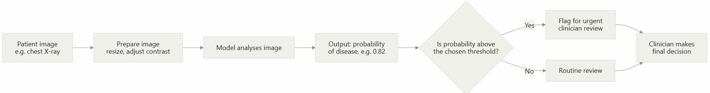

# Applications of AI

*A beginner-friendly learning module (one branch of the AI Overview course)*

**Audience:** Learners with no technical background in AI
**Estimated time:** 4 hours (including activities)
**How to use this module:** Read each topic, work through the example, try the activity questions, then click **Show answer** to check your thinking.

---

## Table of Contents

1. [Learning Outcomes](#learning-outcomes)
2. [Prerequisites and Framing](#prerequisites-and-framing)
3. [Module Map](#module-map)
4. [Applications at a Glance](#applications-at-a-glance)
5. [Topic 1: Healthcare (fully developed)](#topic-1-healthcare)
6. [Topic 2: Education](#topic-2-education)
7. [Topic 3: Transportation](#topic-3-transportation)
8. [Topic 4: Everyday Life](#topic-4-everyday-life)
9. [Topic 5: Finance and Trading](#topic-5-finance-and-trading)
10. [Cross-Topic Synthesis Activity](#cross-topic-synthesis-activity)
11. [Teacher Notes](#teacher-notes)
12. [Glossary](#glossary)
13. [References](#references)

---

## Learning Outcomes

By the end of this module, learners will be able to:

- **Describe** how AI is used in healthcare, education, transportation, everyday life, and finance.
- **Match** a real-world problem to the type of AI task it involves (for example classification, recommendation, prediction, anomaly detection).
- **Calculate and interpret** basic performance measures (sensitivity, specificity, precision) for a diagnostic AI tool.
- **Evaluate** the benefits and limits of an AI application, including who is affected if it makes a mistake.
- **Compare** applications by the level of human oversight each one needs.

## Prerequisites and Framing

This module is one branch of the wider **AI Overview** course. It assumes learners have already met the basic vocabulary from earlier chapters, so those definitions are not repeated here:

- artificial intelligence, machine learning, model, training data

Terms specific to **applications** (for example *sensitivity*, *adaptive learning*, *backtesting*) are defined where they first appear and collected in the [Glossary](#glossary). Ethical issues such as bias, privacy, and hallucination are covered in the **AI Ethics and Limitations** module; this module points to them where they matter.

> **Core idea of this module:** AI is not one tool. It is a set of techniques applied to specific problems. To judge any application, ask three questions: *What is the task? What data does it use? What happens when it is wrong?*

## Module Map

| Topic | Status in this draft | What is included |
|---|---|---|
| 1. Healthcare | **Fully developed** | Explanations, terms, pipeline diagram, worked example with code, 3-question activity, answers |
| 2. Education | Developed | Explanation, comparison table, step-by-step adaptive-learning example, activity with answer |
| 3. Transportation | Developed | Pipeline diagram, automation-levels table, classification activity with answers |
| 4. Everyday Life | Developed | Examples table, worked spam-filter scoring example, activity with answer |
| 5. Finance and Trading | Developed | Explanation, worked trading-rule example, risk discussion, activity with answer |
| Synthesis | Developed | Cross-topic comparison activity |

## Applications at a Glance

| Sector | Typical AI task | Example application | Main benefit | Main risk |
|---|---|---|---|---|
| Healthcare | Classification (sorting into categories) | Detecting disease in medical images | Earlier, more consistent detection | Missed cases, false alarms, unequal performance across patients |
| Education | Personalisation, prediction | Adaptive practice, tutoring systems | Learning matched to each student | Over-reliance, privacy of student data |
| Transportation | Perception and planning | Driver assistance, route planning | Safety and efficiency | Failures in rare or unusual situations |
| Everyday life | Recommendation, speech recognition, filtering | Streaming suggestions, voice assistants, spam filters | Convenience | Filter bubbles, data collection |
| Finance and trading | Prediction, anomaly detection | Fraud alerts, algorithmic trading | Speed and scale | Fast-moving errors, over-confidence in past patterns |

---

## Topic 1: Healthcare

### 1.1 Why healthcare?

Healthcare produces large amounts of data (scans, test results, patient records) and many decisions that depend on spotting patterns. AI is used here mainly to **support** clinicians, not replace them. Common uses include:

- **Medical imaging:** analysing X-rays, retinal photos, mammograms, and skin images.
- **Triage:** deciding which cases a doctor should look at first.
- **Administrative support:** summarising notes, scheduling, coding records.
- **Drug discovery:** predicting which molecules might work as medicines.

This topic focuses on **medical imaging classification**, because it clearly shows how an AI application is built, measured, and limited.

**Terms defined:**

- **Clinician:** a health professional who treats patients, such as a doctor or nurse.
- **Diagnosis:** deciding what condition, if any, a patient has.
- **Screening:** testing people who have **no symptoms** to find a disease early.
- **Classification:** an AI task where the model puts an input into one of several categories (for example "disease" or "no disease").
- **Clinical decision support:** software that gives clinicians information or suggestions to help them decide. The clinician makes the final decision.

### 1.2 Evidence that this works, and its limits

| Study | What it showed | Why it matters |
|---|---|---|
| Gulshan et al. (2016) | A deep learning system detected diabetic retinopathy (eye damage from diabetes) in retinal photographs with high accuracy on the test data used. | Shows AI can screen images for a specific condition. |
| Esteva et al. (2017) | A neural network classified skin lesion images, with performance comparable to dermatologists on the tested tasks. | Shows AI can match experts on a defined image task. |
| McKinney et al. (2020) | An AI system for breast cancer screening reported fewer false positives and false negatives than radiologists in the UK and US datasets studied. | Shows possible benefit in a high-volume screening setting. |

> **Important limit:** These results come from specific datasets and test conditions. Performance can drop when a tool is used on different hospitals, equipment, or patient populations (Topol, 2019). That is why evaluation and human oversight matter.

### 1.3 How a medical imaging tool works



If the diagram does not render in your viewer, read it as: **image → preparation → model → probability → threshold check → clinician decision**.

**Term defined:**

- **Threshold:** the cut-off probability above which the tool raises a flag. Lowering the threshold catches more true cases but also raises more false alarms.

### 1.4 How do we measure whether a diagnostic AI is good?

"Accuracy" alone can mislead. Healthcare uses measures based on four outcomes, usually shown in a **confusion matrix**.

**Terms defined:**

- **Confusion matrix:** a table that counts how often the tool was right or wrong, split by what was actually true.
- **True positive (TP):** the patient has the disease and the tool says "disease".
- **False negative (FN):** the patient has the disease but the tool says "no disease" (a **missed case**).
- **False positive (FP):** the patient is healthy but the tool says "disease" (a **false alarm**).
- **True negative (TN):** the patient is healthy and the tool says "no disease".
- **Prevalence:** the proportion of a population that actually has the disease.

|  | **Tool says: disease** | **Tool says: no disease** |
|---|---|---|
| **Patient has disease** | True positive (TP) | False negative (FN) |
| **Patient is healthy** | False positive (FP) | True negative (TN) |

From these four counts we calculate:

| Measure | Plain-language question | Formula |
|---|---|---|
| **Sensitivity** (also called recall) | Of the people who *have* the disease, how many did the tool catch? | TP ÷ (TP + FN) |
| **Specificity** | Of the people who are *healthy*, how many did the tool correctly clear? | TN ÷ (TN + FP) |
| **Precision** (also called positive predictive value) | When the tool says "disease", how often is it right? | TP ÷ (TP + FP) |
| **Accuracy** | Overall, how often is the tool right? | (TP + TN) ÷ total |

### 1.5 Worked example: evaluating a screening tool

**Scenario.** A hospital tests an AI tool that screens chest X-rays for a lung condition. (The numbers are invented for teaching.) The tool is used on **1,000 patients**, and **10% (100 patients)** actually have the condition.

After comparing the tool's output with confirmed diagnoses, the results are:

|  | Tool says: disease | Tool says: no disease | Total |
|---|---|---|---|
| **Has disease** | TP = 90 | FN = 10 | 100 |
| **Healthy** | FP = 45 | TN = 855 | 900 |

**Step 1: Sensitivity.** 90 ÷ (90 + 10) = 90 ÷ 100 = **0.90** (90%). The tool catches 9 of every 10 sick patients.

**Step 2: Specificity.** 855 ÷ (855 + 45) = 855 ÷ 900 = **0.95** (95%). The tool correctly clears 95 of every 100 healthy patients.

**Step 3: Precision.** 90 ÷ (90 + 45) = 90 ÷ 135 ≈ **0.667** (66.7%). When the tool flags a patient, it is right about two times in three.

**Step 4: Accuracy.** (90 + 855) ÷ 1,000 = **0.945** (94.5%).

**Step 5: Interpret.** The tool looks strong, but notice that 1 in 3 flagged patients is a false alarm. Each false alarm may cause worry and extra tests.

**Step 6: Change one thing: the population.** Now use the **same tool** (same sensitivity 0.90 and specificity 0.95) to screen **10,000 people** where only **1% (100 people)** have the condition.

- People with the disease: 100. The tool catches 90 (TP = 90, FN = 10).
- Healthy people: 9,900. The tool wrongly flags 5% of them: 9,900 × 0.05 = **495** false positives. TN = 9,405.
- Precision = 90 ÷ (90 + 495) = 90 ÷ 585 ≈ **0.154** (15.4%).

The tool did not get worse. The disease is just rarer, so a **much larger share of the flags are false alarms**. This is why screening tools need careful planning, and why a positive result is usually followed by confirmation tests.

You can reproduce both scenarios with this Python script:

```python
def metrics(tp, fn, fp, tn):
    sensitivity = tp / (tp + fn)
    specificity = tn / (tn + fp)
    precision = tp / (tp + fp)
    accuracy = (tp + tn) / (tp + fn + fp + tn)
    return sensitivity, specificity, precision, accuracy

scenarios = {
    "Scenario 1 (10% prevalence)": (90, 10, 45, 855),
    "Scenario 2 (1% prevalence)": (90, 10, 495, 9405),
}

for name, (tp, fn, fp, tn) in scenarios.items():
    s, sp, p, a = metrics(tp, fn, fp, tn)
    print(f"{name}: sensitivity={s:.4f} specificity={sp:.4f} "
          f"precision={p:.4f} accuracy={a:.4f}")
```

**Expected output:**

```text
Scenario 1 (10% prevalence): sensitivity=0.9000 specificity=0.9500 precision=0.6667 accuracy=0.9450
Scenario 2 (1% prevalence): sensitivity=0.9000 specificity=0.9500 precision=0.1538 accuracy=0.9495
```

### 1.6 Learner activity

Use the same 1,000 patients, with 100 who have the condition (10% prevalence), for all three questions.

**Question 1: Calculate.** A second tool, **Model B**, gives these results:

|  | Tool says: disease | Tool says: no disease |
|---|---|---|
| **Has disease (100)** | TP = 75 | FN = 25 |
| **Healthy (900)** | FP = 90 | TN = 810 |

Calculate sensitivity, specificity, precision, and accuracy for Model B.

<details>
<summary>Show answer to Question 1</summary>

- Sensitivity = 75 ÷ (75 + 25) = **0.75**
- Specificity = 810 ÷ (810 + 90) = 810 ÷ 900 = **0.90**
- Precision = 75 ÷ (75 + 90) = 75 ÷ 165 ≈ **0.455**
- Accuracy = (75 + 810) ÷ 1,000 = **0.885**

</details>

**Question 2: Choose.** Compare Model B with the tool from the worked example (call it Model A: sensitivity 0.90, specificity 0.95). The condition is serious and treatable if found early. Which model would you prefer for screening, and why?

<details>
<summary>Show answer to Question 2</summary>

**Model A.** It misses fewer sick patients (sensitivity 0.90 versus 0.75) and also raises fewer false alarms (specificity 0.95 versus 0.90), so it is better on both measures. A good answer also explains that in a serious, treatable condition, missed cases (false negatives) usually cost more than false alarms, so high sensitivity is especially important. Accept any well-reasoned answer that refers to the numbers.

</details>

**Question 3: Spot the trap.** A "lazy" tool simply says **"no disease" for every patient**. Calculate its accuracy and sensitivity on these 1,000 patients. What does this tell you about using accuracy alone?

<details>
<summary>Show answer to Question 3</summary>

The lazy tool gets all 900 healthy patients right (TN = 900) and misses all 100 sick patients (FN = 100, TP = 0, FP = 0).

- Accuracy = 900 ÷ 1,000 = **0.90** (90%)
- Sensitivity = 0 ÷ 100 = **0** (0%)

It looks 90% accurate while catching **no one who is sick**. Accuracy can be misleading when one group (here, healthy patients) is much larger than the other, so healthcare tools must be judged with sensitivity and specificity too. (Its precision is undefined, because the tool never says "disease" and the formula would divide by zero.)

</details>

### 1.7 Limits and responsibilities

| Issue | Explanation | Where to learn more |
|---|---|---|
| **Unequal performance** | A tool trained mostly on one patient group may perform worse on others. | AI Ethics and Limitations: Bias |
| **Patient privacy** | Medical data is highly sensitive and must be protected. | AI Ethics and Limitations: Privacy |
| **Overtrust** | Clinicians may accept the tool's output without question. | Topic 5 (Teacher Notes) |
| **Accountability** | A named clinician or organisation stays responsible for decisions. | WHO (2021) |

---

## Topic 2: Education

### 2.1 What does AI do in education?

AI in education aims to make learning more **personal**. A teacher with 30 students cannot give each one a different explanation at every moment. Software can help by adapting to each student's responses.

**Terms defined:**

- **Adaptive learning:** a system that changes the difficulty, order, or type of content based on how the learner is performing.
- **Intelligent tutoring system (ITS):** software that gives step-by-step hints and feedback on problems, somewhat like a one-to-one tutor.
- **Learning analytics:** collecting and analysing data about learners (for example time spent, mistakes made) to understand and improve learning.

**Background.** Bloom (1984) reported that students tutored one-to-one performed far better than students taught in a conventional class, which became known as the "2 sigma problem". Researchers have since studied whether software tutors can capture part of that benefit. A review by VanLehn (2011) found that well-designed intelligent tutoring systems can be nearly as effective as human tutoring in some settings, though results vary.

### 2.2 Common uses

| Use | What the AI does | Example |
|---|---|---|
| Adaptive practice | Chooses the next question based on past answers | Maths practice that gets harder as you improve |
| Tutoring and feedback | Gives hints on a step the student is stuck on | Hints on an algebra step |
| Automated marking support | Scores certain question types and flags unusual answers | Marking multiple-choice and short answers |
| Language learning | Recognises speech and corrects pronunciation | Speaking practice apps |
| Early warning | Predicts which students may struggle | Flags a student who has stopped logging in |

### 2.3 Worked example: a simple adaptive quiz

**Rule used by the system** (invented for teaching):

- Difficulty has 5 levels (1 = easiest, 5 = hardest). The student starts at level 3.
- A **correct** answer moves the next question **up one level** (maximum 5).
- A **wrong** answer moves the next question **down one level** (minimum 1).

**Student answers in order:** Correct, Correct, Correct, Wrong, Wrong.

| Question | Level of question | Result | Next level |
|---|---|---|---|
| 1 | 3 | Correct | 4 |
| 2 | 4 | Correct | 5 |
| 3 | 5 | Correct | 5 (already at maximum) |
| 4 | 5 | Wrong | 4 |
| 5 | 4 | Wrong | 3 |

**Reading the result.** The student started at level 3, climbed to the top, and then dropped back. A teacher can see where the student's comfortable level seems to sit. Real systems use more advanced statistical models, but the idea is the same: **respond to each answer by adjusting what comes next.**

### 2.4 Learner activity

A student starts at level 3 under the same rule. The student's answers are: **Correct, Wrong, Wrong, Wrong, Wrong, Wrong**.

1. Fill in the level of each question.
2. What is the level at the end, and what happens at the minimum?
3. A teacher says: "This system makes my job unnecessary." Write two sentences responding, one on what the system does well and one on what it cannot do.

<details>
<summary>Show answer</summary>

1. Question levels: Q1 = 3 (correct → 4), Q2 = 4 (wrong → 3), Q3 = 3 (wrong → 2), Q4 = 2 (wrong → 1), Q5 = 1 (wrong → stays 1, minimum), Q6 = 1 (wrong → stays 1).
2. The next level after the final answer is **1**. At the minimum the level cannot drop further, so the student stays at level 1 and a good system would flag that the student may need human help.
3. *Model answer:* The system is good at giving each student instant, personalised practice and showing patterns in their answers. It cannot judge motivation, notice a student is upset, explain an idea in a new way based on the student's life, or take responsibility for a child's wellbeing, so teachers remain essential.

</details>

**Things to watch:** Student data is sensitive (see AI Ethics: Privacy), and learners may rely on AI answers without building their own understanding. Holmes, Bialik and Fadel (2019) discuss both the promise and these concerns.

---

## Topic 3: Transportation

### 3.1 AI on the road

Transportation uses AI for several tasks, from helping drivers to planning journeys:

- **Driver assistance:** lane-keeping, adaptive cruise control, collision warning.
- **Self-driving (autonomous) vehicles:** the vehicle performs some or all of the driving.
- **Navigation and routing:** estimating arrival times and choosing routes using live traffic.
- **Fleet and logistics:** planning delivery routes and predicting maintenance needs.

**Terms defined:**

- **Autonomous vehicle:** a vehicle that can perform driving tasks without constant human control.
- **Sensor:** a device that collects information about the surroundings, such as a camera, radar (uses radio waves), or lidar (uses laser light to measure distance).
- **Geofenced area:** a mapped zone where an automated vehicle is allowed to operate.

### 3.2 How a self-driving system makes decisions


Read it as a loop that repeats many times per second: **sense → perceive → predict → plan → act**.

### 3.3 Levels of driving automation

The SAE J3016 standard describes six levels, from 0 to 5 (SAE International, 2021).

| Level | Name | Who is responsible for monitoring the road? | Example |
|---|---|---|---|
| 0 | No automation | Human | Warnings only; human does all driving |
| 1 | Driver assistance | Human | Adaptive cruise control **or** lane centering |
| 2 | Partial automation | Human (must supervise constantly) | Steering **and** speed support together |
| 3 | Conditional automation | System, but human must take over when asked | Traffic-jam driving on a motorway |
| 4 | High automation | System, within limited conditions or areas | Driverless taxi in a mapped zone |
| 5 | Full automation | System, everywhere and in all conditions | Not yet widely available |

> **Key idea:** The big jump is between **Level 2 and Level 3**. Up to Level 2 the human must always watch the road. From Level 3, the system takes on that duty in some conditions.

### 3.4 Learner activity

Assign an SAE level (0 to 5) to each scenario and give a reason.

- **(a)** A car beeps when you drift out of your lane but never steers.
- **(b)** A car holds speed, keeps a safe gap, and keeps itself centred in the lane, but you must keep your eyes on the road and hands ready.
- **(c)** In a traffic jam on a motorway, the car drives itself and you may look at your phone, but it asks you to take over when the jam clears.
- **(d)** A car with no driver picks up passengers inside a mapped city zone, and nobody needs to supervise.

<details>
<summary>Show answer</summary>

- **(a) Level 0.** It only warns; it does not control the car.
- **(b) Level 2.** Speed and steering are both supported, but the human must supervise constantly.
- **(c) Level 3.** The system handles driving in limited conditions, but the human must take over when requested.
- **(d) Level 4.** The system drives without supervision, but only inside a limited area (geofenced).

</details>

**Why rare events matter:** Driving contains millions of ordinary situations and a long tail of unusual ones (odd road works, unusual objects). A system can perform well on typical roads and still fail in a rare case, which is why testing and human oversight are central to safety.

---

## Topic 4: Everyday Life

### 4.1 AI you may use without noticing

| Everyday tool | AI task | What it uses as input |
|---|---|---|
| Video or music suggestions | **Recommendation** | What you watched, skipped, and liked, and what similar users liked (see Gomez-Uribe and Hunt, 2016) |
| Voice assistant | **Speech recognition** and language understanding | Your voice |
| Email spam filter | **Classification** (spam or not spam) | Words, sender, links in the message |
| Map and ride apps | **Prediction** (arrival time) and route planning | Live location and traffic data |
| Phone camera | **Image processing** | Photo data to adjust faces, light, and focus |
| Autocomplete and translation | **Language generation and translation** | The text you type |

**Terms defined:**

- **Recommendation system:** software that predicts what content or products you are likely to want, based on your past behaviour and on similar users.
- **Filter bubble:** a situation where recommendations mostly show you content similar to what you have already seen, narrowing what you are exposed to.

### 4.2 Worked example: how a simple spam filter scores a message

A filter can give each word a **score**: positive numbers push toward "spam", negative numbers toward "not spam". Real filters learn these scores from many examples; the scores below are invented.

| Word | Score |
|---|---|
| "free" | +2 |
| "winner" | +3 |
| "click" | +1 |
| "meeting" | −2 |
| "report" | −2 |

**Rule:** Add the scores of the words in the message. If the total is **3 or more**, mark it as spam.

**Message 1:** "You are a winner click now for a free prize"
- Matching words: winner (+3), click (+1), free (+2)
- Total = 3 + 1 + 2 = **+6** → 6 ≥ 3 → **Spam**.

**Message 2:** "Please send the report before the meeting"
- Matching words: report (−2), meeting (−2)
- Total = **−4** → below 3 → **Not spam**.

**Message 3:** "Free tickets to the team meeting"
- Matching words: free (+2), meeting (−2)
- Total = **0** → below 3 → **Not spam**.

**Reading the result.** The filter learned that *patterns of words* signal spam. It can make mistakes: a real message containing "free" and "click" might be wrongly marked as spam (a false positive, as in Topic 1).

### 4.3 Learner activity

Using the scores above, classify the message: **"Click here, free winner, report this meeting"**. Then explain what this shows about the limits of the method.

<details>
<summary>Show answer</summary>

Matching words: click (+1), free (+2), winner (+3), report (−2), meeting (−2).
Total = 1 + 2 + 3 − 2 − 2 = **+2**, which is below 3, so the filter marks it **not spam**.

*What this shows:* the filter only counts words and ignores meaning, so a spammer can add harmless words ("report", "meeting") to lower the score. Real filters use many more signals and keep updating, and they still make errors.

</details>

**Things to watch:** Everyday AI collects data about you (see AI Ethics: Privacy) and recommendation systems can shape what you see (filter bubbles).

---

## Topic 5: Finance and Trading

> **Educational note:** This section explains how AI and automated tools are used in finance. It is not investment advice. Anyone making financial decisions should consult a qualified financial professional.

### 5.1 Where AI is used in finance

| Use | What AI does | Example |
|---|---|---|
| **Fraud detection** | Spots unusual transactions (anomaly detection) | A card used in two countries within an hour triggers an alert (see Ngai et al., 2011) |
| **Credit scoring** | Estimates the chance a borrower will repay | Loan approval support |
| **Algorithmic trading** | Executes buy and sell orders using programmed rules or models | A program trades when price patterns appear |
| **Robo-advisers** | Suggest portfolios based on goals and risk tolerance | Automated investment suggestions |
| **Customer service** | Answers common questions | Banking chatbots |

**Terms defined:**

- **Anomaly detection:** finding data points that do not fit the usual pattern.
- **Algorithmic trading:** using computer programs to decide when and how to buy or sell financial assets.
- **High-frequency trading (HFT):** algorithmic trading that makes very large numbers of trades at extremely high speed.
- **Backtesting:** testing a trading rule on **past** data to see how it would have performed.
- **Overfitting:** when a model or rule fits past data so closely that it captures noise and then performs poorly on new data.
- **Moving average:** the average price over a recent number of days, used to smooth out daily ups and downs.

### 5.2 Worked example: a simple trading rule

A classic rule compares a **short-term** moving average with a **long-term** one:

- If the short-term average moves **above** the long-term average → **enter** (buy).
- If the short-term average falls **below** the long-term average → **exit** (sell).

Here we use a 2-day average (short) and a 3-day average (long) on invented daily prices.

**Assumptions (kept the same throughout this example and the activity):**

- Prices are **daily closing prices**.
- The rule is **evaluated after each day's close**, once that day's price is known.
- Because the signal only appears after the market has closed, the trade is carried out at the **next day's closing price**. (This is a simplification; real trades happen at whatever price is available when the order executes.)
- We trade **one unit**, hold only one position at a time, and ignore fees and taxes.

| Day | Closing price | 2-day average | 3-day average | Short above long? | Signal (after close) | Trade (at this day's close) |
|---|---|---|---|---|---|---|
| 1 | 10 | – | – | – | – | – |
| 2 | 11 | – | – | – | – | – |
| 3 | 12 | (11 + 12) ÷ 2 = 11.50 | (10 + 11 + 12) ÷ 3 = 11.00 | Yes | **Buy signal** | – |
| 4 | 11 | (12 + 11) ÷ 2 = 11.50 | (11 + 12 + 11) ÷ 3 ≈ 11.33 | Yes | Hold | **Buy at 11** (from the Day 3 signal) |
| 5 | 10 | (11 + 10) ÷ 2 = 10.50 | (12 + 11 + 10) ÷ 3 = 11.00 | No | **Sell signal** | – |
| 6 | 9 | (10 + 9) ÷ 2 = 9.50 | (11 + 10 + 9) ÷ 3 = 10.00 | No | Stay out | **Sell at 9** (from the Day 5 signal) |

**Result:** Bought at 11, sold at 9, giving a **loss of 2 per unit**. (If we had assumed the trades happened at the same day's close as each signal, we would have bought at 12 and sold at 10, which is also a loss of 2. The delay between signal and trade can change the result, which is why the assumption must always be stated.)

**What this teaches:**

1. The rule is purely mechanical; a computer can follow it instantly and without emotion.
2. Moving averages **lag**: they react after prices have already moved, and the trade happens after the signal, so the entry came late and the trade lost money. Assumptions about **when** the signal is evaluated and **at what price** the trade happens can change a result, so they must always be stated.
3. A rule that works on one period of past data may fail on another, which is why **backtesting** uses long and varied data and why **overfitting** is dangerous.
4. AI/machine learning models can replace the fixed rule with patterns learned from data, but the same risks apply.

### 5.3 When automation goes wrong: the 2010 Flash Crash

On 6 May 2010, US stock markets fell sharply within minutes and then largely recovered. Official investigations by US regulators found that a large automated sell order interacted with fast-reacting trading algorithms, which amplified the drop (US CFTC and SEC, 2010; Kirilenko et al., 2017).

**Lessons:**

- Automated systems can react **faster than humans can intervene**.
- Many algorithms reacting to each other can create effects no single designer intended (a **feedback loop**).
- Markets now use safeguards such as automatic trading pauses, and firms use human monitoring and "kill switches".

### 5.4 Learner activity

Using the same rule and the same assumptions as the worked example (2-day versus 3-day average; buy signal when short goes above long; signal evaluated after the close; trade at the **next day's closing price**), analyse these closing prices for days 1 to 6: **10, 9, 8, 9, 10, 11**.

1. Calculate the 2-day and 3-day averages from day 3 onwards.
2. On which day does the rule first give a "buy" signal, and at what price would the trade be carried out?
3. What does this show about the rule's timing?

<details>
<summary>Show answer</summary>

1. - Day 3: 2-day = (9 + 8) ÷ 2 = 8.50; 3-day = (10 + 9 + 8) ÷ 3 = 9.00
   - Day 4: 2-day = (8 + 9) ÷ 2 = 8.50; 3-day = (9 + 8 + 9) ÷ 3 ≈ 8.67
   - Day 5: 2-day = (9 + 10) ÷ 2 = 9.50; 3-day = (8 + 9 + 10) ÷ 3 = 9.00
   - Day 6: 2-day = (10 + 11) ÷ 2 = 10.50; 3-day = (9 + 10 + 11) ÷ 3 = 10.00
2. The short average first rises above the long average on **day 5** (9.50 > 9.00), so the buy **signal** appears after the day-5 close. Under the stated assumption, the trade is carried out at the day-6 closing price of **11**.
3. The price actually bottomed on day 3 (at 8), so the rule bought **three days after the low**, at a much higher price (11). It shows the signal **lags** the market, and the delay before the trade adds to the lag. (The rule was also still "short below long" on days 3 and 4, so it stayed out while the price fell, which is the benefit of a rule like this.)

</details>

---

## Cross-Topic Synthesis Activity

Complete the table for **three** of the five sectors, then answer the question below.

| Sector | Task type | Cost of a wrong output | Level of human oversight needed (low / medium / high) | Reason |
|---|---|---|---|---|
| Healthcare |  |  |  |  |
| Education |  |  |  |  |
| Transportation |  |  |  |  |
| Everyday life |  |  |  |  |
| Finance and trading |  |  |  |  |

**Question:** A film recommendation and a cancer screening tool both use AI to predict. Explain in 3 to 4 sentences why they should be treated differently.

<details>
<summary>Show model answers</summary>

**Sample table (accept reasoned variations):**

| Sector | Task type | Cost of a wrong output | Oversight needed | Reason |
|---|---|---|---|---|
| Healthcare | Classification | Missed disease or unnecessary treatment | **High** | Errors can seriously harm health. |
| Education | Personalisation | A student gets work that is too easy or hard | **Medium** | Errors are usually recoverable but affect learning over time. |
| Transportation | Perception and planning | Crash, injury | **High** | Safety-critical and fast-moving. |
| Everyday life | Recommendation, filtering | Wasted time, missed email | **Low** | Errors are usually minor and reversible (spam folders can be checked). |
| Finance and trading | Prediction, anomaly detection | Financial loss, market disruption | **High** (for trading), **medium** (for fraud alerts) | Losses can be large and fast. |

**Question, model answer:** Both tools make predictions, but the cost of an error differs greatly. A poor film suggestion wastes a few minutes, while a missed cancer can cost a life and a false alarm can cause distress and unnecessary procedures. Because the stakes are higher, the screening tool needs rigorous testing, careful measurement (sensitivity and specificity), and a clinician who reviews and takes responsibility for the decision. The general rule: **the higher the cost of error, the more evaluation and human oversight are needed.**

</details>

---

## Teacher Notes

- **Suggested pacing:** Healthcare (60 to 75 min), Education, Transportation, Everyday life, Finance (about 30 to 40 min each), Synthesis (20 min).
- **Common misconception (Topic 1):** Learners often assume high accuracy means a good tool. Question 3 (the "lazy" tool) and Step 6 of the worked example (changing prevalence) address this directly. Ask learners to predict the answer before revealing it.
- **Common misconception (Topic 3):** Learners confuse driver assistance (Level 2) with self-driving. Stress that at Level 2 the human is still responsible at all times.
- **Common misconception (Topic 5):** The trading rule is a fixed algorithm, not a learning model. Use it to show how automated decisions work, then discuss how machine learning would replace the fixed rule.
- **Trading assumptions (Topic 5):** Insist that learners state when the signal is evaluated and at what price the trade happens before calculating a result. Ask them to redo the worked example with trades at the same day's close and compare.
- **Extension:** Ask learners to find one current example of AI in a sector and evaluate it with the three questions from the Core idea: *What is the task? What data does it use? What happens when it is wrong?*
- **Linking to ethics:** Each topic notes where bias, privacy, or accountability issues arise. Use these as bridges to the AI Ethics and Limitations module.
- **Data note:** All patient numbers, quiz rules, spam scores, and prices are **invented for teaching**.

---

## Glossary

| Term | Definition |
|---|---|
| **Accuracy** | The share of all cases a tool gets right: (TP + TN) ÷ total. |
| **Adaptive learning** | A system that adjusts content based on a learner's performance. |
| **Algorithmic trading** | Using computer programs to decide when and how to buy or sell assets. |
| **Anomaly detection** | Finding data points that do not fit the usual pattern. |
| **Autonomous vehicle** | A vehicle able to perform driving tasks without constant human control. |
| **Backtesting** | Testing a rule or model on past data to estimate how it would have performed. |
| **Classification** | An AI task that places an input into one of several categories. |
| **Clinical decision support** | Software that helps clinicians decide; the clinician makes the final decision. |
| **Clinician** | A health professional who treats patients. |
| **Confusion matrix** | A table counting correct and incorrect outputs by true category. |
| **Diagnosis** | Deciding what condition, if any, a patient has. |
| **False negative (FN)** | A real case the tool missed. |
| **False positive (FP)** | A false alarm: the tool flags something that is not there. |
| **Filter bubble** | A narrowed range of content caused by recommendations that match past behaviour. |
| **Geofenced area** | A mapped zone where an automated vehicle may operate. |
| **High-frequency trading** | Algorithmic trading at very high speed and volume. |
| **Intelligent tutoring system** | Software that gives step-by-step hints and feedback like a tutor. |
| **Learning analytics** | Collecting and analysing learner data to improve learning. |
| **Moving average** | The average price over a recent number of days. |
| **Overfitting** | Fitting past data so closely that performance on new data is poor. |
| **Precision** | When the tool says "positive", how often it is right: TP ÷ (TP + FP). |
| **Prevalence** | The proportion of a population that has a condition. |
| **Recommendation system** | Software that predicts what content or products you are likely to want. |
| **Screening** | Testing people without symptoms to find disease early. |
| **Sensitivity** | Of the people who have the condition, the share the tool catches: TP ÷ (TP + FN). |
| **Sensor** | A device that collects information about the surroundings. |
| **Specificity** | Of the people who are healthy, the share the tool clears: TN ÷ (TN + FP). |
| **Threshold** | The cut-off probability above which a tool raises a flag. |
| **True negative (TN)** | A healthy case correctly cleared. |
| **True positive (TP)** | A real case correctly detected. |

---

## References

Bloom, B.S. (1984) 'The 2 sigma problem: The search for methods of group instruction as effective as one-to-one tutoring', *Educational Researcher*, 13(6), pp. 4-16. https://doi.org/10.3102/0013189X013006004

Esteva, A. et al. (2017) 'Dermatologist-level classification of skin cancer with deep neural networks', *Nature*, 542, pp. 115-118. https://doi.org/10.1038/nature21056

Gomez-Uribe, C.A. and Hunt, N. (2016) 'The Netflix recommender system: Algorithms, business value, and innovation', *ACM Transactions on Management Information Systems*, 6(4), Article 13. https://doi.org/10.1145/2843948

Gulshan, V. et al. (2016) 'Development and validation of a deep learning algorithm for detection of diabetic retinopathy in retinal fundus photographs', *JAMA*, 316(22), pp. 2402-2410. https://doi.org/10.1001/jama.2016.17216

Holmes, W., Bialik, M. and Fadel, C. (2019) *Artificial intelligence in education: Promises and implications for teaching and learning*. Boston: Center for Curriculum Redesign.

Kirilenko, A., Kyle, A.S., Samadi, M. and Tuzun, T. (2017) 'The Flash Crash: High-frequency trading in an electronic market', *The Journal of Finance*, 72(3), pp. 967-998. https://doi.org/10.1111/jofi.12498

McKinney, S.M. et al. (2020) 'International evaluation of an AI system for breast cancer screening', *Nature*, 577, pp. 89-94. https://doi.org/10.1038/s41586-019-1799-6

Ngai, E.W.T., Hu, Y., Wong, Y.H., Chen, Y. and Sun, X. (2011) 'The application of data mining techniques in financial fraud detection: A classification framework and an academic review of literature', *Decision Support Systems*, 50(3), pp. 559-569. https://doi.org/10.1016/j.dss.2010.08.006

SAE International (2021) *J3016: Taxonomy and definitions for terms related to driving automation systems for on-road motor vehicles*. Warrendale, PA: SAE International. https://www.sae.org/standards/content/j3016_202104/

Topol, E.J. (2019) 'High-performance medicine: the convergence of human and artificial intelligence', *Nature Medicine*, 25, pp. 44-56. https://doi.org/10.1038/s41591-018-0300-7

US Commodity Futures Trading Commission and US Securities and Exchange Commission (2010) *Findings regarding the market events of May 6, 2010: Report of the staffs of the CFTC and SEC to the Joint Advisory Committee on Emerging Regulatory Issues*. Washington, DC. https://www.sec.gov/news/studies/2010/marketevents-report.pdf

VanLehn, K. (2011) 'The relative effectiveness of human tutoring, intelligent tutoring systems, and other tutoring systems', *Educational Psychologist*, 46(4), pp. 197-221. https://doi.org/10.1080/00461520.2011.611369

World Health Organization (2021) *Ethics and governance of artificial intelligence for health: WHO guidance*. Geneva: WHO. https://www.who.int/publications/i/item/9789240029200

> **Note on examples:** All numbers in the worked examples and activities are **invented for teaching purposes**. The studies, standards, and the 2010 Flash Crash are real and cited above. Links to the original publications or standards are given where available (Holmes, Bialik and Fadel, 2019, has no link here). Please check each link and bibliographic detail against the original source before formal use.
