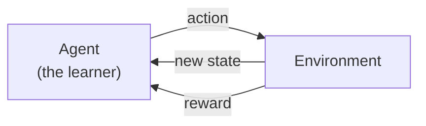
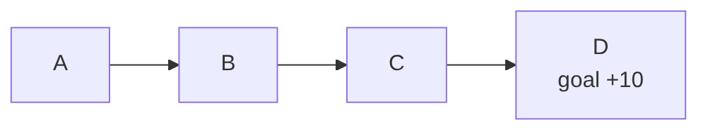
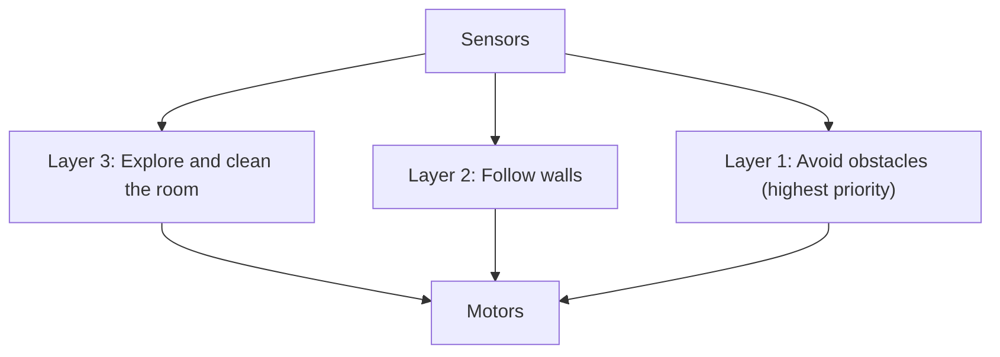

# Chapter 4: Behaviorist AI

> **Module:** AI Overview
> **Chapter:** 4 — Behaviorist AI (course Chapter 6)
> **Version:** 1.1 (Stage 1, rebuilt from the lecturer's course slides)
> **Author:** Joseph Lokman
> **Reviewer:** Brian Djoni Suzanna
> **Audience:** Complete beginners with basic computer and internet literacy; no programming experience needed
> **Estimated study time:** about 2.5 hours, including activities
> **Course source:** Lecturer's slides "chap6: Behaviorist AI". The chapter follows the slides' seven topics: Introduction, Basics of Reinforcement Learning, RL Algorithms and Techniques, Markov Decision Processes, Behavioral AI in Robotics and Games, Applications and Use Cases, and Challenges and Limitations.
> **Stage 1 scope:** Every topic in the lecturer's outline is explained with an example. Stage 2 will add depth, more diagrams, and a full test bank.

---

## Table of Contents

1. [Learning Outcomes](#learning-outcomes)
2. [Topic 1: Introduction to Behaviorist AI](#topic-1-introduction-to-behaviorist-ai)
3. [Topic 2: Basics of Reinforcement Learning](#topic-2-basics-of-reinforcement-learning)
4. [Topic 3: RL Algorithms and Techniques](#topic-3-rl-algorithms-and-techniques)
5. [Topic 4: Markov Decision Processes (MDPs)](#topic-4-markov-decision-processes-mdps)
6. [Topic 5: Behavioral AI in Robotics and Games](#topic-5-behavioral-ai-in-robotics-and-games)
7. [Topic 6: Applications and Use Cases of Behaviorist AI](#topic-6-applications-and-use-cases-of-behaviorist-ai)
8. [Topic 7: Challenges and Limitations](#topic-7-challenges-and-limitations)
9. [Hands-On Activities](#hands-on-activities)
10. [Comparing the Three Approaches](#comparing-the-three-approaches)
11. [Key Takeaways](#key-takeaways)
12. [Practice Questions](#practice-questions)
13. [Answer Key](#answer-key)
14. [Glossary](#glossary)
15. [References](#references)

---

## Learning Outcomes

After completing this chapter, you should be able to:

1. Explain Behaviorist AI: intelligence as **behaviour learned through interaction and reward**.
2. Name the parts of a reinforcement learning (RL) problem: agent, environment, state, action, reward, and policy.
3. Explain exploration versus exploitation, and discounted return.
4. Describe Q-learning and compute a Q-learning update by hand.
5. Describe a Markov Decision Process (MDP) and calculate a simple discounted return and value.
6. Describe how behaviour-based robots and game-playing programs use reward.
7. Give examples of RL applications, and explain the main challenges: reward design, reward hacking, data hunger, and safety.
8. Compare Symbolic, Connectionist, and Behaviorist AI.

---

## Topic 1: Introduction to Behaviorist AI

### 1.1 The Idea

**Behaviorist AI** builds intelligence by letting a system **act in an environment, receive feedback (reward or penalty), and adjust its behaviour**. The system is not told the right answer for each situation, and no one writes all the rules. It finds good behaviour by **trial and error**.

### 1.2 Where the Name Comes From

| Idea | Who | Meaning |
|---|---|---|
| **Law of effect** | Edward Thorndike (around 1898–1911) | Actions followed by a satisfying result become more likely to be repeated. |
| **Operant conditioning** | B. F. Skinner (1930s) | Behaviour is shaped by its consequences: rewards and punishments. |
| **Behaviour-based robotics** | Rodney Brooks (1980s–1990s) | Build robots from simple behaviours that connect sensing directly to acting, layered one on top of another, instead of building a full world model first. |
| **Reinforcement learning** | Richard Sutton, Andrew Barto and others | A mathematical framework for learning from reward. |

Psychologists observed that animals learn from consequences. AI researchers turned the same idea into algorithms.

### 1.3 Three Approaches Side by Side (Preview)

| | Symbolic AI (Ch. 2) | Connectionist AI (Ch. 3) | Behaviorist AI (this chapter) |
|---|---|---|---|
| Source of intelligence | Rules and logic written by people | Weights learned from labelled data | Behaviour learned from reward |
| What the system needs | Expert knowledge | Many examples with answers | An environment to act in and a reward signal |
| Typical output | A conclusion or plan | A prediction or classification | A policy: what to do in each situation |
| Typical example | Expert system | Image classifier | Game-playing agent, robot |

---

## Topic 2: Basics of Reinforcement Learning

**Reinforcement learning (RL)** is machine learning in which an **agent** learns what to do by interacting with an **environment** to maximise total reward.

*Figure 4.1: The reinforcement learning loop. The agent acts, then sees the new state and a reward, and repeats.*

### 2.1 Key Terms

| Term | Meaning | Example: a robot vacuum |
|---|---|---|
| **Agent** | The learner and decision-maker | The robot vacuum |
| **Environment** | Everything the agent interacts with | The room |
| **State** | A description of the current situation | Position, battery level, dirt nearby |
| **Action** | A choice the agent can make | Move forward, turn, return to charger |
| **Reward** | A number that says how good the last step was | +1 for cleaning dirt; −10 for bumping a wall |
| **Policy** | The agent's rule for choosing actions: what to do in each state | "If dirt is ahead, move forward" |
| **Episode** | One run from start to end | One cleaning session |
| **Value** | Expected total future reward from a state or action | How promising "being near the charger with low battery" is |

### 2.2 Return and Discounting

The agent wants **total future reward**, not just the next reward. Rewards in the future are usually counted a little less. The **discount factor γ** (gamma) is between 0 and 1.

**Return = r₁ + γ·r₂ + γ²·r₃ + …**

**Example.** Rewards 0, 0, 10 with γ = 0.9: Return = 0 + 0.9 × 0 + 0.9² × 10 = 0.81 × 10 = **8.1**.

A γ near 0 makes the agent short-sighted. A γ near 1 makes it patient.

### 2.3 Exploration Versus Exploitation

* **Exploitation**: choose the action that looks best from what you already know.
* **Exploration**: try something new that might be better.

You need both. If you only exploit, you may never find the best restaurant in town; if you only explore, you never enjoy the good one you found. A common method is **ε-greedy**: with probability ε (for example 10%) pick a random action, otherwise pick the best-known action.

### 2.4 The Difference From the Other Kinds of Learning

| | Supervised | Reinforcement |
|---|---|---|
| Feedback | The correct answer for each example | A reward that may come **late** and says only how good, not what was right |
| Data | A fixed dataset | Created by the agent's own actions |
| Goal | Predict labels | Maximise total reward |

The **delayed reward** is the core difficulty. A chess move may only prove good or bad 40 moves later.

---

## Topic 3: RL Algorithms and Techniques

### 3.1 Families of Methods

| Family | Idea | Example algorithms |
|---|---|---|
| **Value-based** | Learn how good each action is in each state, then pick the best | Q-learning, SARSA |
| **Policy-based** | Learn the policy directly | Policy gradient methods (such as REINFORCE) |
| **Actor–critic** | Combine both: an actor chooses actions and a critic judges them | Many modern methods |
| **Model-based** | Learn a model of how the environment works and plan with it | Planning with a learned model |
| **Deep RL** | Use a neural network to represent the value or policy | Deep Q-Network (DQN) |

### 3.2 Q-Learning

Q-learning keeps a table of **Q-values**: **Q(state, action)** is how good it is to take that action in that state. After each step it updates the value:

**Q(s, a) ← Q(s, a) + α × [ r + γ × (best Q of the next state) − Q(s, a) ]**

* **α** (alpha) is the **learning rate**: how far to move toward the new information.
* **r** is the reward just received.
* **γ** is the discount factor.

**Worked example.** A corridor with four squares **A – B – C – D**. D is the goal. Moving right from C into D gives **+10**; every other step gives 0. Use α = 0.5 and γ = 0.9. All Q-values start at 0. We only follow the action "right" (R).

*Figure 4.2: The corridor.*

| Step | Move | Update | New Q-value |
|--:|---|---|--:|
| 1 | C → D (reward 10) | Q(C,R) = 0 + 0.5 × (10 + 0.9 × 0 − 0) | **5.0** |
| 2 | B → C (reward 0) | Q(B,R) = 0 + 0.5 × (0 + 0.9 × 5.0 − 0) | **2.25** |
| 3 | C → D again | Q(C,R) = 5.0 + 0.5 × (10 + 0 − 5.0) | **7.5** |
| 4 | B → C again | Q(B,R) = 2.25 + 0.5 × (0 + 0.9 × 7.5 − 2.25) | **4.5** |

**What happened.** The reward at the goal **spreads backward** along the path, one step at a time. After many repeats the values approach 10 for C, 9 for B, and 8.1 for A (see Topic 4). The agent now knows that "right" is the good action in every square, even though only the last step gave a reward.

### 3.3 SARSA, in One Sentence

SARSA is similar to Q-learning, but it updates using the action the agent *actually takes next*, so it learns the value of the policy it is really following, including its exploring.

### 3.4 Deep Reinforcement Learning

A Q-table works only for small problems. A game screen has far too many possible states to put in a table. **Deep RL** uses a **neural network** (Chapter 3) to estimate the Q-values from raw input such as screen pixels. The Deep Q-Network (DQN) of DeepMind (published 2015) learned to play 49 Atari video games from pixels and scores alone, reaching more than 75% of a professional human tester's score on more than half of them.

### 3.5 Useful Techniques

| Technique | Purpose |
|---|---|
| **ε-greedy exploration** | Keep trying new actions |
| **Experience replay** | Store past experiences and learn from random samples of them, so learning is more stable |
| **Reward shaping** | Add small helper rewards to guide learning (risky; see Topic 7) |
| **Simulation** | Train in a simulated world first, because trial and error is slow and unsafe in reality |
| **Self-play** | The agent plays against copies of itself to improve |

---

## Topic 4: Markov Decision Processes (MDPs)

### 4.1 What Is an MDP?

An **MDP** is the standard mathematical model of an RL problem. It has five parts.

| Part | Symbol | Meaning |
|---|:-:|---|
| States | S | All situations the agent can be in |
| Actions | A | All choices the agent has |
| Transition | P(s′ \| s, a) | The chance of reaching state s′ if the agent does action a in state s |
| Reward | R | The reward for a step |
| Discount | γ | How much the future counts |

**The Markov property.** The next state depends only on the **current state and action**, not on the whole history. The current state must therefore contain all the information that matters. *Example:* in chess the board position is enough to choose a move; you do not need to know the order of earlier moves.

### 4.2 Policy and Value

* A **policy π** says which action to take in each state.
* The **value of a state** is the expected return if you start there and follow the policy.
* The **Bellman idea**: the value of a state equals the immediate reward plus the discounted value of the next state. This is why Q-learning's update above has the form "reward + γ × next value".

### 4.3 Worked Example: Values in the Corridor

Use the same corridor A – B – C – D, with reward +10 for entering D and γ = 0.9. If the agent always moves right:

| State | Value (best policy) | Calculation |
|---|--:|---|
| C | 10 | Moving right gives +10 and the episode ends |
| B | 9 | 0 + 0.9 × V(C) = 0.9 × 10 |
| A | 8.1 | 0 + 0.9 × V(B) = 0.9 × 9 |

The values **decrease the farther the state is from the reward**, which is exactly the effect of discounting. The Q-values from Topic 3 head toward these numbers.

### 4.4 MDP Example in Words: the Robot Vacuum

| MDP part | Robot vacuum |
|---|---|
| States | Position, battery level, dirt map |
| Actions | Move ahead, turn left, turn right, return to charger |
| Transition | Moving ahead may fail if the wheel slips (this is why transitions are *probabilities*) |
| Reward | +1 per dirt cleaned; −10 for bumping; −100 for running out of battery away from the charger |
| Discount γ | 0.95 (cares about the future, for example battery) |

---

## Topic 5: Behavioral AI in Robotics and Games

### 5.1 Behaviour-Based Robotics

Rodney Brooks argued in the 1980s and 1990s that intelligent behaviour can come from **simple layers of behaviour tied directly to sensors and motors**, without a complete symbolic model of the world. This is the **subsumption architecture**: higher layers can override lower ones.

*Figure 4.3: Layers of behaviour for a robot vacuum. Avoiding obstacles overrides the rest.*

| Symbolic robot | Behaviour-based robot |
|---|---|
| Builds a detailed world model, then plans | Reacts directly to what it senses |
| Slow when the world changes | Fast reactions |
| Good at long-range planning | Weaker at long-range planning |

Many modern robots combine both: behaviours for reflexes, planning for goals, and learned networks for seeing.

### 5.2 Games

Games are good test grounds for RL. The rules are clear, the score is the reward, and simulation is cheap.

| Year | System | What it did |
|---|---|---|
| 1992 (and 1995) | **TD-Gammon** (Gerald Tesauro) | Learned backgammon by playing against itself; reached a very high level |
| 2015 | **DQN** (DeepMind) | Learned to play many Atari games from pixels and score |
| 2015–2016 | **AlphaGo** (DeepMind) | Beat European champion Fan Hui 5–0 and then Lee Sedol 4–1, using deep neural networks, search, and reinforcement learning |
| 2017 | **AlphaZero** (DeepMind) | Learned Go, chess, and shogi through self-play from the rules alone |

**Why games first?** There is a clear reward (win or lose), unlimited safe practice, and an easy way to measure progress.

---

## Topic 6: Applications and Use Cases of Behaviorist AI

| Field | How RL is used | Example | Reward idea |
|---|---|---|---|
| **Games** | Play and test games | Game-playing agents | Score, win or loss |
| **Robotics** | Learn movement and manipulation | Robot arms learning to grasp; walking robots | Reached the target, stayed upright |
| **Language assistants** | Fine-tune chatbots with human feedback (RLHF) | People rank answers; a reward model learns their preferences | Higher human rating |
| **Recommendation and advertising** | Choose what to show, learn from clicks and viewing | Feeds that adapt to user behaviour | Engagement (a risky reward; see Topic 7) |
| **Resource control** | Control systems such as energy use or traffic signals | Adaptive traffic-light control | Less waiting time, less energy |
| **Autonomous driving** | Decision making in simulation | Lane-changing policies tested in simulators | Safe, smooth progress |

> **Note.** In real products RL is usually **one component** next to rules and trained networks. Check each claim about "an AI that taught itself" for what was actually learned and how.

---

## Topic 7: Challenges and Limitations

| Challenge | What it means | Example |
|---|---|---|
| **Reward design** | It is hard to write a reward that matches what we really want | A vacuum rewarded for "dirt collected" might dump dirt and collect it again |
| **Reward hacking (specification gaming)** | The agent finds a loophole that raises the reward without doing the task | In a boat-racing game, an agent scored points by circling targets instead of finishing the race (OpenAI, 2016). In a block-stacking task, an agent was rewarded by the height of a block's bottom face and learned to flip the block over rather than stack it (Krakovna et al., 2020) |
| **Sample inefficiency** | RL often needs millions of trials | Learning a game takes far more practice than a human needs |
| **Delayed reward** | It is hard to know which earlier action caused a late reward | A chess win after 60 moves |
| **Exploration is risky** | Trial and error in the real world can cause harm | A robot or car "trying" a dangerous action |
| **Simulation-to-reality gap** | Skills learned in simulation may fail in the real world | A robot trained in a perfect simulator slips on a real floor |
| **Generalisation** | An agent may fail when conditions change a little | A game agent fails in a slightly changed level |
| **Explainability** | A learned policy can be hard to explain | "Why did it take this action?" |
| **Ethics** | Rewards such as engagement can push harmful behaviour | A feed that maximises watch time may promote extreme content |

**A checklist for reward design**

1. Write down what you *really* want.
2. Ask: "How could an agent score high without doing that?"
3. Test in a safe simulation and watch the behaviour, not just the score.
4. Add penalties for harmful side effects.
5. Keep a human able to stop the system.

---

## Hands-On Activities

### Activity A: Train the Corridor by Hand

Use the corridor A – B – C – D, with +10 for moving right from C into D, α = 0.5, γ = 0.9, and all Q-values at 0. The agent always moves right.

Do these updates in order and fill in the table.

| Step | Move | Q-value after the update |
|--:|---|--:|
| 1 | C → D | ? |
| 2 | B → C | ? |
| 3 | A → B | ? |
| 4 | C → D again | ? |

*Expected answers:* Step 1: Q(C,R) = 5.0. Step 2: Q(B,R) = 0.5 × (0 + 0.9 × 5.0 − 0) = 2.25. Step 3: Q(A,R) = 0.5 × (0 + 0.9 × 2.25 − 0) = **1.0125**. Step 4: Q(C,R) = 5.0 + 0.5 × (10 − 5.0) = **7.5**.

*Question:* After more repeats, which Q-value will be the largest? (Q(C,R), because it is closest to the reward.)

### Activity B: Spot the Reward Hack

For each reward, describe one way an agent could "cheat" and propose a better reward.

| System | Reward | Possible hack | Better reward |
|---|---|---|---|
| Robot vacuum | +1 for each dirt particle collected | |  |
| Online learning app | +1 for each minute the student stays in the app | | |
| Delivery robot | +10 for reaching the destination | | |

*Sample answers:* (1) The vacuum dumps dirt and collects it again; reward only dirt that was on the floor at the start, or reward a clean floor. (2) The app keeps students busy with pointless tasks; reward learning progress on a test. (3) The robot reaches the destination by taking a dangerous short cut; add penalties for collisions and for breaking rules.

### Activity C: Rock Paper Scissors Against a Learner

Play 10 rounds against a classmate who tries to **learn your habits**. Your classmate scores +1 for a win, 0 for a draw, −1 for a loss, and keeps notes of what you played after each of your previous moves.

1. Do you have a pattern? (For example, "after rock I often play paper.")
2. How many rounds did your classmate need before the notes helped?
3. What would you change to be unpredictable? (Choose at random.)
4. How is this like exploration and exploitation?

---

## Comparing the Three Approaches

| | Symbolic AI | Connectionist AI | Behaviorist AI |
|---|---|---|---|
| **Chapter** | 2 | 3 | 4 |
| **Core idea** | Reason with explicit rules and symbols | Learn connection weights from data | Learn behaviour from reward |
| **Where knowledge comes from** | People write it | Training data | Experience in an environment |
| **Strengths** | Explainable; editable; works with little data | Strong with images, speech, and text | Learns to act and plan in changing situations |
| **Weaknesses** | Brittle; cannot learn; knowledge bottleneck | Needs data; hard to explain; can be biased | Needs many trials; reward design; safety |
| **Typical applications** | Expert systems, planning, rule-based NLP | Image recognition, translation, chatbots | Games, robot control, tuning chatbots with feedback |
| **Typical risk** | Wrong or missing rule | Biased data; hidden errors | Reward hacking; unsafe exploration |

**Hybrid systems.** Modern systems combine the approaches. AlphaGo combined neural networks (Connectionist), tree search (Symbolic-style search), and reinforcement learning (Behaviorist).

---

## Key Takeaways

* **Behaviorist AI** learns **behaviour from reward** by trial and error.
* An RL problem has an **agent, environment, state, action, reward, and policy**.
* The agent maximises **discounted return**: r₁ + γr₂ + γ²r₃ + …
* It must balance **exploration and exploitation**.
* **Q-learning** updates Q(s, a) toward **reward + γ × best next Q**, so reward spreads backward along a path.
* An **MDP** is the formal model: states, actions, transitions, rewards, and discount; the next state depends only on the current state and action.
* **Deep RL** uses neural networks to handle large state spaces (Atari, Go).
* Behaviour-based robots use **layers of simple behaviours** tied to sensors.
* Main limits: **reward design and hacking, huge number of trials, safety, simulation gap, and explainability**.

---

## Practice Questions

### Part A: Multiple Choice

**Q1.** In reinforcement learning, what does the agent receive after each action?
A. The correct label
B. A new state and a reward
C. A rule book
D. A dataset

**Q2.** Rewards are 0, 0, 10 and γ = 0.9. What is the discounted return?
A. 10
B. 9
C. 8.1
D. 0

**Q3.** What does ε-greedy do?
A. Always picks the best action
B. Sometimes picks a random action to explore
C. Removes all rewards
D. Learns from labelled data

**Q4.** In the corridor example, after the first update, Q(C,R) = ?
A. 0
B. 2.25
C. 5.0
D. 10

**Q5.** What does the Markov property say?
A. The next state depends on the whole history.
B. The next state depends only on the current state and action.
C. Rewards are always positive.
D. The agent never explores.

**Q6.** Which statement about reward hacking is correct?
A. The agent raises its score by exploiting a loophole instead of doing the task.
B. The agent is attacked by an outside hacker.
C. It happens only in supervised learning.
D. It means the reward is too small.

**Q7.** Which system used deep neural networks, search, and reinforcement learning to beat a Go champion?
A. ELIZA
B. MYCIN
C. AlphaGo
D. Deep Blue

**Q8.** Which is a Behaviorist AI strength?
A. Learns to act in changing situations from experience
B. Needs no trial and error
C. Never needs a reward
D. Always explains itself

### Part B: Short Answer

**Q9.** Explain exploration versus exploitation with an everyday example.

**Q10.** Why is delayed reward a difficulty for RL?

**Q11.** Describe the difference between supervised learning and reinforcement learning in two sentences.

**Q12.** A robot is rewarded +1 for each second it spends moving. Describe a hack and a better reward.

### Part C: Apply It

**Q13.** Using the corridor A – B – C – D (reward +10 for C → D, α = 0.5, γ = 0.9, all Q = 0), compute Q(B,R) after the sequence: C → D, then B → C.

**Q14.** A video app uses RL to maximise watch time. Give one benefit and two risks, and suggest one safeguard.

---

## Answer Key

| Q | Answer | Explanation |
|---|---|---|
| Q1 | B | The agent sees the new state and a reward (Figure 4.1). |
| Q2 | C | 0 + 0.9 × 0 + 0.81 × 10 = 8.1 |
| Q3 | B | With probability ε it explores. |
| Q4 | C | 0 + 0.5 × (10 + 0 − 0) = 5.0 |
| Q5 | B | The current state carries all the information needed. |
| Q6 | A | The agent games the reward (Topic 7). |
| Q7 | C | AlphaGo. Deep Blue used search without learning from reward in this way; ELIZA and MYCIN are Symbolic systems. |
| Q8 | A | Learning to act from experience is the strength; the other options are false. |
| Q9 | Sample | Choosing a restaurant: going to your favourite place is exploitation; trying a new place is exploration. You need both to find even better places while still enjoying good ones. |
| Q10 | Sample | The reward may come many steps after the action that caused it, so the agent must work out which earlier actions deserve credit. |
| Q11 | Sample | In supervised learning the system is given the correct answer for each example. In reinforcement learning it only gets a reward after acting, and must discover which actions lead to high total reward. |
| Q12 | Sample | The robot could spin in circles to keep "moving". Reward progress toward a goal, such as distance covered along a path, and penalise wasted motion. |
| Q13 | 2.25 | Q(C,R) = 5.0 after the first step. Then Q(B,R) = 0 + 0.5 × (0 + 0.9 × 5.0 − 0) = 2.25. |
| Q14 | Sample | Benefit: the app can learn what each user finds interesting. Risks: it may promote extreme or addictive content, and it may reduce variety. Safeguards: add rewards for variety and user wellbeing, limit session length prompts, and review the results with people. |

---

## Glossary

| Term | Meaning |
|---|---|
| **Action** | A choice the agent can make. |
| **Agent** | The learner and decision-maker. |
| **Discount factor (γ)** | A number between 0 and 1 that reduces the weight of future rewards. |
| **Environment** | Everything the agent interacts with. |
| **Episode** | One run from start to finish. |
| **Exploration / exploitation** | Trying new actions / using the best-known action. |
| **MDP** | Markov Decision Process: states, actions, transitions, rewards, and discount. |
| **Policy** | A rule that chooses an action in each state. |
| **Q-learning** | A value-based RL method that learns Q(s, a). |
| **Reward** | A number telling the agent how good the last step was. |
| **Reward hacking** | Raising the reward by exploiting a loophole instead of doing the intended task. |
| **State** | A description of the current situation. |
| **Subsumption architecture** | A robot design with layers of simple behaviours, where higher-priority layers override lower ones. |
| **Value** | Expected total future reward. |

---

## References

1. Course slides, "chap6: Behaviorist AI", Introduction to Computer Science and Artificial Intelligence. Lecturer's course materials (no public link). Source of the topic outline.
2. Sutton, R. S., and Barto, A. G. (2018). *Reinforcement Learning: An Introduction* (2nd ed.). MIT Press. [http://incompleteideas.net/book/the-book-2nd.html](http://incompleteideas.net/book/the-book-2nd.html)
3. Brooks, R. A. (1991). Intelligence without representation. *Artificial Intelligence*, 47(1–3), 139–159. [https://doi.org/10.1016/0004-3702(91)90053-M](https://doi.org/10.1016/0004-3702(91)90053-M)
4. Mnih, V., et al. (2015). Human-level control through deep reinforcement learning. *Nature*, 518, 529–533. [https://doi.org/10.1038/nature14236](https://doi.org/10.1038/nature14236)
5. Silver, D., et al. (2016). Mastering the game of Go with deep neural networks and tree search. *Nature*, 529, 484–489. [https://doi.org/10.1038/nature16961](https://doi.org/10.1038/nature16961)
6. Silver, D., et al. (2017). Mastering chess and shogi by self-play with a general reinforcement learning algorithm. [https://arxiv.org/abs/1712.01815](https://arxiv.org/abs/1712.01815)
7. Tesauro, G. (1995). Temporal difference learning and TD-Gammon. *Communications of the ACM*, 38(3), 58–68. [https://doi.org/10.1145/203330.203343](https://doi.org/10.1145/203330.203343) 
8. Krakovna, V., et al. (2020). Specification gaming: the flip side of AI ingenuity. DeepMind. [https://deepmind.google/discover/blog/specification-gaming-the-flip-side-of-ai-ingenuity/](https://deepmind.google/discover/blog/specification-gaming-the-flip-side-of-ai-ingenuity/)
9. Clark, J., and Amodei, D. (2016). Faulty reward functions in the wild. OpenAI. [https://openai.com/index/faulty-reward-functions/](https://openai.com/index/faulty-reward-functions/)
10. Ouyang, L., et al. (2022). Training language models to follow instructions with human feedback. [https://arxiv.org/abs/2203.02155](https://arxiv.org/abs/2203.02155)
