# Stage 1 Combined Learning Content

**Babi Guling – AI Overview** | Version 1.1 | 2026-11-05

This file combines the four rebuilt chapters (Chapter 1: Introduction to CS and AI; Chapter 2: Symbolic AI; Chapter 3: Connectionist AI and Big Data; Chapter 4: Behaviorist AI). Regenerate it from the final chapter files before submission. Anchors inside each chapter work only in the separate chapter files.

---

# Chapter 1: Introduction to CS and AI

> **Module:** AI Overview
> **Chapter:** 1 — Introduction to CS and AI (course Chapter 1)
> **Version:** 1.1 (Stage 1, rebuilt from the lecturer's course slides)
> **Author:** Jonathan Sugianto (proposed owner)
> **Reviewer:** Brian Djoni Suzanna
> **Audience:** Complete beginners with basic computer and internet literacy; no programming experience needed
> **Estimated study time:** about 2 hours, including activities
> **Course source:** Lecturer's slides "chap1: Intro to CS and AI". The chapter follows the slides' outline: history, definitions, main topics, and a hands-on machine-learning activity.

---

## Table of Contents

1. [Learning Outcomes](#learning-outcomes)
2. [Chapter Map](#chapter-map)
3. [Topic 1: Computer Science](#topic-1-computer-science)
4. [Topic 2: Artificial Intelligence](#topic-2-artificial-intelligence)
5. [Topic 3: Machine Learning: A First Look](#topic-3-machine-learning-a-first-look)
6. [Topic 4: Hands-On Activity: Machine Learning](#topic-4-hands-on-activity-machine-learning)
7. [Topic 5: Ask, Then Verify (Using an AI Assistant for Study)](#topic-5-ask-then-verify-using-an-ai-assistant-for-study)
8. [Key Takeaways](#key-takeaways)
9. [Practice Questions](#practice-questions)
10. [Answer Key](#answer-key)
11. [Glossary](#glossary)
12. [References](#references)

---

## Learning Outcomes

After completing this chapter, you should be able to:

1. Give two or more definitions of **Computer Science (CS)** and **Artificial Intelligence (AI)**, and explain how they differ in wording.
2. Describe the main milestones in the history of CS and of AI, using the form *year, event, people, technology*.
3. Name the main areas of CS and the main areas of AI, and explain where AI sits inside CS.
4. Describe the three families of machine learning (supervised, unsupervised, reinforcement) with one example each.
5. Explain, in your own words, how a machine learns from labelled examples, using a small hands-on activity.
6. Name the three classic approaches to AI that the next three chapters cover: Symbolic AI, Connectionist AI, and Behaviorist AI.

---

## Chapter Map

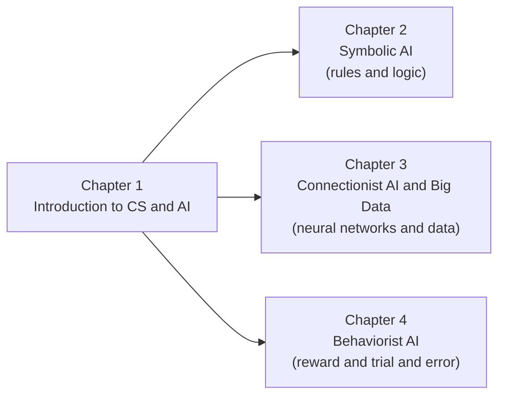

*Figure 1.1: Chapter 1 gives the shared vocabulary and history. Chapters 2 to 4 each explain one approach to building AI.*

---

## Topic 1: Computer Science

### 1.1 What Is Computer Science?

**Computer Science (CS)** is the study of computers and computation: what can be computed, how to compute it efficiently, how to build software and hardware that does it, and how people use the results.

There is no single official sentence that everyone uses. Different books and organisations stress different parts. The table shows the typical emphasis. These are summaries in simple words, not direct quotations.

| Viewpoint | What it stresses |
|---|---|
| Computation | CS studies algorithms, which are step-by-step procedures, and what problems they can solve. |
| Information | CS studies how information is represented, stored, processed, and communicated. |
| Engineering | CS studies how to design, build, and test reliable hardware and software systems. |
| Automation | CS studies which tasks can be done automatically by machines. |
| Human use | CS studies how people interact with computers and how computers affect society. |

**Try it yourself.** The lecturer's slides suggest asking an AI assistant to "list as many definitions of Computer Science as possible". Do this in Topic 5, then compare the answers with the table above.

### 1.2 A Short History of CS

The slides ask for the history as a table with the columns **Year, Key Events, Key People, Key Technologies**. Here is a starter version.

| Year | Key events | Key people | Key technologies |
|---|---|---|---|
| 1830s–1840s | Design of the Analytical Engine; the first published algorithm for it | Charles Babbage, Ada Lovelace | Mechanical computing design, punched cards |
| 1936 | A mathematical model of computation, the "Turing machine" | Alan Turing | Theory of computation |
| 1945 | Stored-program computer design described | John von Neumann and colleagues | Stored-program architecture |
| 1946 | ENIAC, an early large electronic computer, is completed | J. Presper Eckert, John Mauchly | Vacuum tubes |
| 1947 | The transistor is invented | John Bardeen, Walter Brattain, William Shockley | Transistors |
| 1957 | FORTRAN, an early high-level programming language | John Backus and team | Compilers |
| 1958–1959 | The integrated circuit | Jack Kilby, Robert Noyce | Integrated circuits |
| 1969 | ARPANET connects its first computers; Unix is started | ARPA researchers; Ken Thompson, Dennis Ritchie | Packet networks, operating systems |
| 1971 | First commercial microprocessor (Intel 4004) | Intel engineers | Microprocessors |
| 1981 | IBM Personal Computer released | IBM team | Personal computers |
| 1989–1991 | The World Wide Web | Tim Berners-Lee | HTTP, HTML, browsers |
| 2007 | Smartphones become mainstream (iPhone) | Apple team | Touch screens, mobile apps |
| 2010s | Cloud computing and large-scale data centres become common | Many companies | Cloud, GPUs |

> **Note for reviewers:** The rows are well-known facts from standard computing histories. Stage 2 should add a citation for each row.

### 1.3 Main Topics of CS

The lecturer's slides show a mind map of CS based on the **ACM classification**, the classification of computing topics by the Association for Computing Machinery. Here is a simplified version.

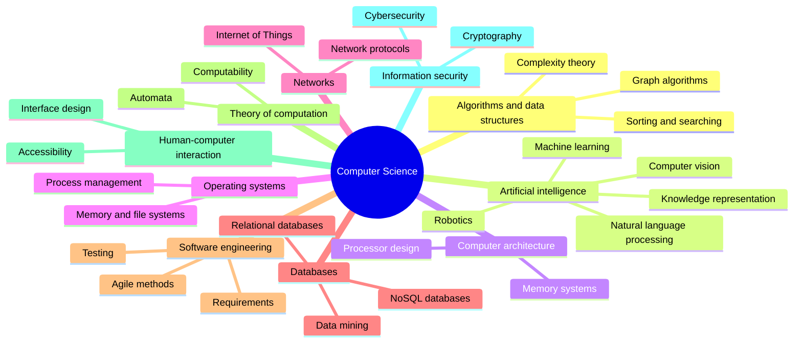

*Figure 1.2: A simplified map of Computer Science, following the ACM-style grouping shown in the lecturer's slides. AI is one branch among many.*

**Key idea:** AI is a **branch of CS**. It uses algorithms, data structures, databases, and computer hardware, and it also borrows from mathematics, statistics, psychology, and neuroscience.

---

## Topic 2: Artificial Intelligence

### 2.1 What Is AI?

**Artificial Intelligence (AI)** is the field of making machines do things that we normally say need intelligence, such as understanding language, recognising pictures, making plans, and learning from experience.

As with CS, there are many definitions. The slides ask you to "list as many definitions of AI as possible". Here are four common ways to define it.

| Viewpoint | Summary of the idea | Typical source |
|---|---|---|
| Making intelligent machines | AI is the science and engineering of making intelligent machines, especially intelligent computer programs. | John McCarthy, who named the field in 1955–1956 (McCarthy, 2007) |
| Acting rationally | An AI system is an *agent* that perceives its environment and chooses actions that best achieve its goals. | Russell and Norvig (textbook) |
| Machine that infers | An AI system is a machine-based system that, from the input it receives, infers how to produce outputs such as predictions, content, recommendations, or decisions. | OECD (2023) |
| Acting like a human | A machine is intelligent if a person cannot tell it apart from a human in conversation. | Alan Turing's "imitation game" (1950) |

> **Note for reviewers:** The McCarthy and OECD rows are summaries of the sources listed in the References. Check the exact wording in the originals before quoting.

**Three things to remember**

1. There is no single agreed definition, so always check which one a source is using.
2. "Intelligence" is a moving target. Tasks that once seemed to need intelligence (such as playing chess) can later feel like "just a program".
3. Today's AI is **narrow**: each system is good at specific tasks. A chess program cannot translate a letter.

### 2.2 A Short History of AI

| Year | Key events | Key people | Key technologies |
|---|---|---|---|
| 1943 | First mathematical model of an artificial neuron | Warren McCulloch, Walter Pitts | Neuron models |
| 1950 | "Computing Machinery and Intelligence" proposes the imitation game (Turing test) | Alan Turing | Idea of machine intelligence |
| 1956 | The Dartmouth summer workshop, where the term "artificial intelligence" was used | John McCarthy, Marvin Minsky, Nathaniel Rochester, Claude Shannon | Symbolic reasoning programs |
| 1958 | The perceptron, a learning neuron model | Frank Rosenblatt | Early neural networks |
| 1966 | ELIZA, a chatbot that follows keyword rules | Joseph Weizenbaum | Rule-based language processing |
| 1970s | MYCIN, an expert system for infections; first "AI winter" of reduced funding in the mid-1970s | Edward Shortliffe and colleagues | Expert systems |
| 1980s | Expert systems used by companies; backpropagation is popularised in 1986 | David Rumelhart, Geoffrey Hinton, Ronald Williams | Rule engines, multi-layer networks |
| Late 1980s–1990s | Second "AI winter"; reinforcement learning grows; TD-Gammon learns backgammon (1992) | Gerald Tesauro; Richard Sutton and others | Reinforcement learning |
| 1997 | Deep Blue beats world chess champion Garry Kasparov | IBM team | Game-tree search, special hardware |
| 2012 | AlexNet wins the ImageNet image contest by a wide margin | Alex Krizhevsky, Ilya Sutskever, Geoffrey Hinton | Deep neural networks, GPUs, big data |
| 2016 | AlphaGo beats Go champion Lee Sedol 4–1 | DeepMind team | Deep learning plus reinforcement learning |
| 2017 | The Transformer architecture | Ashish Vaswani and colleagues | Attention-based neural networks |
| 2022 | ChatGPT is released to the public | OpenAI | Large language models |

**Reading the table through the three approaches.** The history of AI is partly a story of three ideas competing and combining. This module follows them one by one.

| Approach | Core idea | Typical milestones above | Chapter |
|---|---|---|---|
| **Symbolic AI** | Intelligence comes from explicit rules, logic, and search. | Dartmouth programs, ELIZA, MYCIN, Deep Blue (search) | 2 |
| **Connectionist AI** | Intelligence comes from many simple connected units that learn from data. | McCulloch–Pitts, perceptron, backpropagation, AlexNet, Transformer | 3 |
| **Behaviorist AI** | Intelligence comes from acting, receiving rewards, and adjusting behaviour. | TD-Gammon, AlphaGo (with deep learning) | 4 |

### 2.3 The Main Areas of AI

The slides show an AI map with these areas:

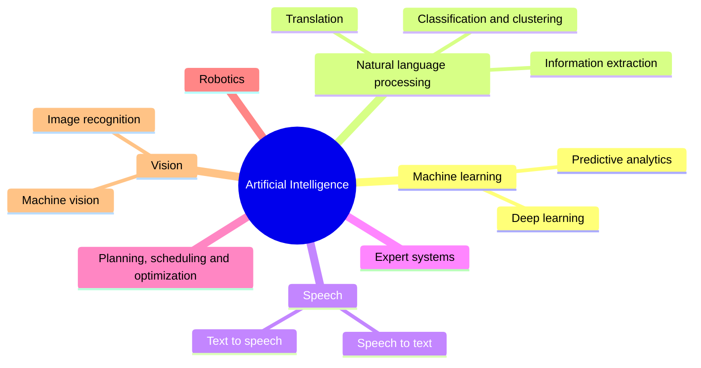

*Figure 1.3: A simplified map of AI areas, following the lecturer's slides.*

Each area is a **task** (what we want the machine to do). The three approaches in this module are **methods** (how we build it). One task can be tackled by more than one method. Language translation, for example, was once done with hand-written grammar rules (Symbolic) and is now mostly done with neural networks (Connectionist).

| Area | What the machine does | Example | A method often used |
|---|---|---|---|
| Machine learning | Learns patterns from data | Predicting house prices | Connectionist and statistical methods |
| Natural language processing | Works with human language | Translation, chatbots | Symbolic rules, neural networks |
| Speech | Converts between speech and text | Voice assistants | Neural networks |
| Expert systems | Gives expert-like advice from rules | Diagnosis helper | Symbolic |
| Planning and optimization | Chooses a good sequence of actions | Delivery routes | Symbolic search, reinforcement learning |
| Robotics | Senses and acts in the physical world | Robot vacuum | Behaviorist and others |
| Vision | Understands images and video | Face unlock | Neural networks |

---

## Topic 3: Machine Learning: A First Look

**Machine learning (ML)** means that a program improves at a task by learning from data instead of following only hand-written rules. The lecturer's slides show the classic split into three families.

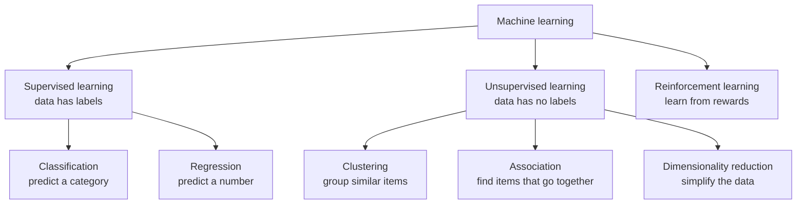

*Figure 1.4: Families of machine learning.*

| Family | What the data looks like | Example | Where it comes back |
|---|---|---|---|
| Supervised, classification | Examples with a category label | Email labelled *spam* or *not spam* | Chapter 3 |
| Supervised, regression | Examples with a number label | Past house sizes and prices | Chapter 3 |
| Unsupervised, clustering | Examples with no labels | Grouping customers by buying habits | Chapter 3 |
| Unsupervised, association | Shopping baskets | "People who buy bread often buy butter" | Chapter 3 |
| Reinforcement | An agent that acts and gets rewards | A program learning to play a game | Chapter 4 |

**How ML relates to the approaches.** Supervised and unsupervised learning are mostly studied inside Connectionist AI and statistics (Chapter 3). Reinforcement learning is the engine of Behaviorist AI (Chapter 4). Symbolic AI (Chapter 2) is the opposite starting point: the knowledge is written by people, not learned.

### Worked Example: Rules Versus Learning

Task: decide whether a short email is spam.

**Symbolic way (rules written by a person)**

```
IF the email contains "free money" THEN spam
IF the email contains "meeting at 3pm" THEN not spam
```

This is easy to read, but it fails on any email the author did not think of.

**Machine learning way (supervised classification)**

1. Collect 1,000 emails that people have already labelled *spam* or *not spam*.
2. Let the program find which words and patterns often appear in spam.
3. Test the program on emails it has not seen.

The learned filter can handle new emails, but it is harder to explain *why* it called one email spam. This trade-off between **explainable rules** and **flexible learning** returns in every chapter.

---

## Topic 4: Hands-On Activity: Machine Learning

The lecturer's slides include two hands-on tasks built with a block-based programming tool: **Rock Paper Scissors** and **Smart Classroom**. If your lecture uses that tool, follow your lecturer's instructions for the tool itself. The paper version below teaches the same idea without any software.

### Activity A: Rock Paper Scissors (image classification)

**Idea.** The computer looks at a camera picture of your hand and decides *rock*, *paper*, or *scissors*. It does this because you first **trained** it with labelled pictures.

**Steps in the tool (as in the slides)**

1. Create three classes (labels): *rock*, *paper*, *scissors*.
2. Take several photos of your hand for each class. These are the **training examples**.
3. Train the model.
4. Run the program. The program recognises the new picture, picks the label, and chooses the move that beats it.
5. Test with different lighting and hand positions.

**Paper version.** Imagine each photo is reduced to two numbers: *how many fingers are open* (0–5) and *how spread out they are* (low, medium, high).

| Training example | Fingers open | Spread | Label |
|---|--:|---|---|
| 1 | 0 | low | rock |
| 2 | 0 | low | rock |
| 3 | 5 | high | paper |
| 4 | 4 | high | paper |
| 5 | 2 | medium | scissors |
| 6 | 2 | medium | scissors |

New picture: **2 fingers open, medium spread.** Which label is the closest match? Compare it with each row, as a computer would.

*Expected answer:* scissors, because examples 5 and 6 match both numbers.

**Questions to discuss**

1. What happens if the new picture shows 3 fingers open? (The model has no training example for it. It must guess from the closest ones, and may be wrong.)
2. What happens if every training photo of "rock" was taken in a dark room? (The model may learn "dark means rock". This is a **biased training set**.)
3. How many photos per class are enough? (There is no fixed number. More varied examples usually help.)

### Activity B: Smart Classroom (text and command recognition)

**Idea.** You type or say a command such as "Fan on" or "Lamp off", and a program switches a virtual fan or lamp.

* In the **rule-based version**, a person writes an IF-THEN block for each exact command. You will build this in Chapter 2.
* In the **machine-learning version**, the program is trained with example sentences for each label (*fan on*, *fan off*, *lamp on*, *lamp off*) and recognises new wording. You will meet the idea again in Chapter 3.

**Task now.** Predict: will a rule that checks for the exact text "Fan on" also catch "Please turn the fan on"? Write your prediction down. You will test it in Chapter 2.

---

## Topic 5: Ask, Then Verify (Using an AI Assistant for Study)

The lecturer's slides list questions to ask an AI assistant. Use them as a study activity, with one rule: **never copy an answer without checking it.** AI assistants can make confident mistakes.

| Slide question | What to do with the answer |
|---|---|
| "Give me a list of buzzwords of the past 50 years regarding computer technology." | Check three of them in a textbook or encyclopedia. |
| "List as many definitions of Computer Science as possible." | Group the definitions into the viewpoints in Section 1.1. |
| "Use a table to list the history of CS, with columns of Year, Key Events, Key People, and Key Technologies." | Compare with Section 1.2. Mark every row that differs, and find out which is right. |
| "Generate a CS knowledge map for freshmen." | Compare with Figure 1.2. What is missing? |
| "List as many definitions of Artificial Intelligence as possible." | Compare with Section 2.1. |
| "Use a table to list the history of AI, with the same four columns." | Compare with Section 2.2. Check at least three dates. |
| "Generate an AI knowledge map for freshmen." | Compare with Figure 1.3. |

**Record your work.** For each question write down: the tool you used, the date, what you asked, and what you corrected. The team's AI-use log needs this information.

---

## Key Takeaways

* **CS** is the study of computation, information, and the systems that process them. **AI is one branch of CS.**
* There is **no single definition** of CS or AI. Read which viewpoint a source uses.
* AI history moves through three big ideas: **rules and logic** (Symbolic), **connected learning units** (Connectionist), and **learning from reward** (Behaviorist).
* AI areas (vision, language, speech, planning, robotics) are **tasks**. The three approaches are **methods**.
* Machine learning has three families: **supervised**, **unsupervised**, and **reinforcement**.
* A model learns from **examples**. Poor or biased examples lead to poor or biased results.
* Always **verify** what an AI assistant tells you.

---

## Practice Questions

### Part A: Multiple Choice

**Q1.** Which statement about AI and CS is correct?
A. AI and CS are unrelated fields.
B. AI is a branch of CS.
C. CS is a branch of AI.
D. AI only studies robots.

**Q2.** In which decade did the Dartmouth workshop use the term "artificial intelligence"?
A. 1930s
B. 1940s
C. 1950s
D. 1990s

**Q3.** Which task is an example of *supervised classification*?
A. Grouping customers with no labels
B. Labelling emails as spam or not spam using labelled examples
C. A robot learning to walk from rewards
D. Compressing a file

**Q4.** Which family of machine learning learns from rewards?
A. Supervised
B. Unsupervised
C. Reinforcement
D. Association

**Q5.** Which pair matches an approach with its core idea?
A. Symbolic AI: learning from rewards
B. Connectionist AI: explicit rules and logic
C. Behaviorist AI: acting and receiving rewards
D. Symbolic AI: neurons and weights

**Q6.** Why can a Rock Paper Scissors model fail if all "rock" photos were taken in a dark room?
A. The model may learn lighting instead of hand shape.
B. The camera breaks.
C. Rock is a hard word.
D. It cannot fail.

**Q7.** Which is a *task* (not a method)?
A. Symbolic AI
B. Image recognition
C. Connectionist AI
D. Behaviorist AI

**Q8.** What should you do with an answer from an AI assistant?
A. Copy it as it is.
B. Verify key facts with a reliable source.
C. Ignore it completely.
D. Assume it is always correct.

### Part B: Short Answer

**Q9.** Give two different definitions of AI and say how they differ.

**Q10.** Explain the difference between supervised and unsupervised learning in two sentences, with one example each.

**Q11.** In the Smart Classroom activity, why might a rule-based program fail on "Please turn the fan on"?

### Part C: Apply It

**Q12.** A school wants a system that sorts student questions into the categories *homework*, *exam*, and *other*. Would you start with hand-written rules or with machine learning? List one advantage and one disadvantage of your choice.

---

## Answer Key

| Q | Answer | Explanation |
|---|---|---|
| Q1 | B | AI is a branch of CS (Figure 1.2). |
| Q2 | C | The Dartmouth workshop took place in 1956. |
| Q3 | B | Classification with labelled examples is supervised learning. |
| Q4 | C | Reinforcement learning learns from rewards. |
| Q5 | C | Behaviorist AI is about acting and receiving rewards. Symbolic = rules; Connectionist = neurons and weights. |
| Q6 | A | The model can pick up an accidental pattern (lighting). This is a biased training set. |
| Q7 | B | Image recognition is something we want done. The others are ways to do it. |
| Q8 | B | Verify with a reliable source (Topic 5). |
| Q9 | Sample | For example: McCarthy's view (making intelligent machines) is about the goal; the OECD view (a machine that infers outputs from input) describes what the system does. Any two viewpoints from Section 2.1 with a fair comparison is correct. |
| Q10 | Sample | Supervised learning uses labelled examples, such as emails marked spam or not spam. Unsupervised learning uses unlabelled data to find structure, such as grouping customers by buying habits. |
| Q11 | Sample | The rule checks for the exact text, so different wording does not match. A learned model may handle the new wording because it has seen many example sentences. |
| Q12 | Sample | Rules: easy to explain and no training data needed, but each new wording needs a new rule. Machine learning: handles varied wording, but needs many labelled questions and is harder to explain. Either choice is correct with a fair advantage and disadvantage. |

---

## Glossary

| Term | Meaning |
|---|---|
| **Algorithm** | A step-by-step procedure for solving a problem. |
| **Artificial Intelligence (AI)** | The field of making machines perform tasks that normally need intelligence. |
| **Classification** | Predicting a category for an item. |
| **Clustering** | Grouping similar items without labels. |
| **Computer Science (CS)** | The study of computation, information, and computing systems. |
| **Label** | The correct answer attached to a training example. |
| **Machine learning (ML)** | A way for programs to improve at a task by learning from data. |
| **Regression** | Predicting a number. |
| **Reinforcement learning** | Learning to act by receiving rewards. |
| **Supervised learning** | Learning from labelled examples. |
| **Training example** | One piece of data used to teach a model. |
| **Unsupervised learning** | Finding structure in data that has no labels. |

---

## References

1. Course slides, "chap1: Intro to CS and AI", Introduction to Computer Science and Artificial Intelligence (lecturer's materials). Primary source for the outline, the CS and AI maps, and the hands-on activities.
2. McCarthy, J. (2007). *What is Artificial Intelligence?* Stanford University. (Definition summarised in Section 2.1; check the wording in the original.)
3. OECD (2023). Updated definition of an AI system. (Summarised in Section 2.1; check the wording in the original.)
4. Russell, S., and Norvig, P. (2021). *Artificial Intelligence: A Modern Approach* (4th ed.). Pearson. (Agent view of AI. *Not opened during this revision.*)
5. Turing, A. M. (1950). Computing Machinery and Intelligence. *Mind*, 59(236), 433–460. (*Not opened during this revision.*)
6. Association for Computing Machinery. ACM Computing Classification System. (Basis of the CS map. *Not opened during this revision.*)

> The two source lines above marked "Not opened" must be checked by the author or reviewer before submission.


---

# Chapter 2: Symbolic AI

> **Module:** AI Overview
> **Chapter:** 2 — Symbolic AI (course Chapter 4)
> **Version:** 1.1 (Stage 1, rebuilt from the lecturer's course slides)
> **Author:** Gandhi Bestin Dhammananda (proposed owner)
> **Reviewer:** Brian Djoni Suzanna
> **Audience:** Complete beginners with basic computer and internet literacy; no programming experience needed
> **Estimated study time:** about 3 hours, including activities
> **Course source:** Lecturer's slides "chap4: Symbolic AI". The chapter follows the slides' six topics: Introduction, Logic and Reasoning, Knowledge Representation, Rule-Based Systems and Expert Systems, Planning and Problem Solving, and Natural Language Processing in Symbolic AI.

---

## Table of Contents

1. [Learning Outcomes](#learning-outcomes)
2. [Topic 1: Introduction to Symbolic AI](#topic-1-introduction-to-symbolic-ai)
3. [Topic 2: Logic and Reasoning](#topic-2-logic-and-reasoning)
4. [Topic 3: Knowledge Representation](#topic-3-knowledge-representation)
5. [Topic 4: Rule-Based Systems and Expert Systems](#topic-4-rule-based-systems-and-expert-systems)
6. [Topic 5: Planning and Problem Solving](#topic-5-planning-and-problem-solving)
7. [Topic 6: Natural Language Processing in Symbolic AI](#topic-6-natural-language-processing-in-symbolic-ai)
8. [Hands-On Activity: A Rule-Based Smart Classroom](#hands-on-activity-a-rule-based-smart-classroom)
9. [Key Takeaways](#key-takeaways)
10. [Practice Questions](#practice-questions)
11. [Answer Key](#answer-key)
12. [Glossary](#glossary)
13. [References](#references)

---

## Learning Outcomes

After completing this chapter, you should be able to:

1. Define Symbolic AI (also called GOFAI) and state its main benefits and limitations.
2. Use propositional logic (AND, OR, NOT, implication) and read simple predicate-logic statements with ∀ and ∃.
3. Apply modus ponens and modus tollens to simple examples.
4. Describe five ways to represent knowledge: logic, semantic networks, frames and scripts, rules, and ontologies.
5. Explain the parts of a rule-based system and of an expert system, and trace a small rule example.
6. Describe planning as search in a state space, and trace breadth-first, depth-first, A*, and minimax on small examples.
7. Describe how rules, grammars, and logic are used for natural language processing, and explain where they fail.

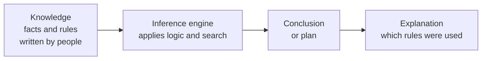

*Figure 2.1: The symbolic pipeline. People write the knowledge; the machine reasons with it.*

---

## Topic 1: Introduction to Symbolic AI

### 1.1 What Is Symbolic AI?

**Symbolic AI**, also called **Good Old-Fashioned AI (GOFAI)**, builds intelligence by manipulating **symbols** (words, labels, logical statements) with **explicit rules and logic**. Knowledge is written down in a form the computer can reason with.

The lecturer's example is a medical diagnosis rule:

```
IF   patient has a fever
AND  patient has a cough
AND  patient has difficulty breathing
THEN patient may have pneumonia
```

The system checks each condition. If all are true, it concludes "may have pneumonia". Because we can point at the exact rule that fired, we can **explain the decision**, and a person can **edit the rule** when medical knowledge changes.

> **Reading the example carefully.** The rule says *may have*, not *has*. A real medical system is a decision-support tool for doctors. It does not replace them.

### 1.2 Where Symbolic AI Is Used

The slides list four application areas: digital assistants such as Siri, medical diagnosis systems, autonomous cars, and computer vision. The table shows the symbolic part in each.

| Application | Symbolic part | Note |
|---|---|---|
| Digital assistants | Rules and grammars that interpret a command, and dialogue rules | Modern assistants combine such parts with machine-learning models (Chapter 3). |
| Medical diagnosis | Rules and knowledge bases that suggest a condition from symptoms | Classic expert systems such as MYCIN worked this way. |
| Autonomous cars | Traffic rules such as "if the light is red, stop", and route planning by search | Recognising a stop sign from a camera picture is mostly done with neural networks. |
| Computer vision | Rules that reason about what was detected (for example, "a pedestrian near a crossing means slow down") | Detecting objects in pixels is mostly done with neural networks. |

**Key point.** Most real systems are **hybrids**. The symbolic part handles *reasoning with known rules*; the learning part handles *messy sensor data*.

### 1.3 Benefits and Limitations

| Benefits | What it means |
|---|---|
| **Interpretability** | You can trace the reasoning from conclusion back to the rules. |
| **Knowledge representation** | Complex knowledge can be stored in a formal, structured way. |
| **Flexibility** | Change the rules or knowledge base and the system adapts to a new domain. |

| Limitations | What it means |
|---|---|
| **Incomplete knowledge** | The system works only if the knowledge is complete and well defined. |
| **Scalability** | The more symbols and rules, the more computing work. |
| **Uncertain or ambiguous information** | Rules need precise statements; "fairly warm" or "maybe" is hard. |
| **Limited ability to learn** | People must write and update the rules by hand. |

---

## Topic 2: Logic and Reasoning

Logic gives the computer a precise language for statements and a method to derive new statements from old ones.

### 2.1 Propositional Logic

A **proposition** is a declarative sentence that is either **true or false, but not both**.

* "The sky is blue." (a proposition)
* "It is raining." (a proposition)
* "2 + 2 = 4." (a proposition, true)
* "Close the door!" (not a proposition; it is a command)

**Boolean operators.** Take two propositions: **p** = "It is raining" and **q** = "It is windy".

| Operator | Symbol | Reads as | True when |
|---|:-:|---|---|
| AND | ∧ | p ∧ q: "raining and windy" | both p and q are true |
| OR | ∨ | p ∨ q: "raining or windy (or both)" | at least one is true |
| NOT | ¬ | ¬p: "not raining" | p is false |

**Truth table for AND, OR, and NOT**

| p | q | p ∧ q | p ∨ q | ¬p |
|:-:|:-:|:-:|:-:|:-:|
| T | T | T | T | F |
| T | F | F | T | F |
| F | T | F | T | T |
| F | F | F | F | T |

**Logical equivalences.** Two statements are equivalent when they have the same truth value in every case.

* De Morgan's laws: ¬(p ∧ q) ≡ ¬p ∨ ¬q and ¬(p ∨ q) ≡ ¬p ∧ ¬q
* Double negation: ¬(¬p) ≡ p

*Check one case.* Let p = T and q = F. Then p ∧ q = F, so ¬(p ∧ q) = T. On the other side ¬p = F and ¬q = T, so ¬p ∨ ¬q = T. Both sides agree. ✔

**Implication and biconditional**

* **p → q** reads "if p, then q". p is the **antecedent** (premise) and q is the **consequent** (conclusion).
* **p ↔ q** reads "p if and only if q": p and q have the same truth value.

| p | q | p → q | p ↔ q |
|:-:|:-:|:-:|:-:|
| T | T | T | T |
| T | F | **F** | F |
| F | T | T | F |
| F | F | T | T |

"If it is raining, then the ground is wet" is false in only one situation: it is raining and the ground is *not* wet. If it is not raining, the statement does not claim anything, so it counts as true.

**Inference rules.** These let us derive new facts.

| Rule | Form | Example |
|---|---|---|
| **Modus ponens** ("mode that affirms") | From p → q and p, conclude q | "If it rains, the ground is wet." "It rains." Therefore: "The ground is wet." |
| **Modus tollens** ("mode that denies") | From p → q and ¬q, conclude ¬p | "If it rains, the ground is wet." "The ground is not wet." Therefore: "It is not raining." |

> **Common mistake.** From p → q and **q**, you *cannot* conclude p. The ground can be wet because someone watered it.

**Why this matters in AI.** Propositional logic lets a system represent facts ("the lights are on", "the door is locked") and make inferences ("the traffic light is red" and "if red, then stop" lead to "stop the vehicle").

### 2.2 Predicate Logic (First-Order Logic)

Propositional logic treats "Socrates is a man" as one block. **Predicate logic** looks inside the sentence.

* A **predicate** is a statement with variables that is true or false depending on the values. Example: **Even(x)** is true for x = 4 and false for x = 5.
* The **universal quantifier ∀** means "for all". ∀x (Cat(x) → Mammal(x)) reads "every cat is a mammal".
* The **existential quantifier ∃** means "there exists at least one". ∃x (Prime(x) ∧ x < 10) reads "some prime number is less than 10" (true: 2, 3, 5, 7).

**Turning a sentence into logic (four steps)**

| Step | Action | Example: "Some birds can fly." |
|---|---|---|
| a | Identify the predicates | Bird(·), CanFly(·) |
| b | Introduce variables | y |
| c | Apply the quantifier | "Some" means ∃ |
| d | Write the expression | ∃y (Bird(y) ∧ CanFly(y)) |

**Connectives in predicate logic**

| Expression | Meaning |
|---|---|
| Even(x) ∧ Prime(x) | x is even and prime |
| Positive(x) ∨ Negative(x) | x is positive or negative |
| Adult(x) → CanVote(x) | if x is an adult, x can vote (in a given rule set) |
| ¬Married(x) | x is not married |
| ∀x (Even(x) → Positive(x)) | every even x is positive (false if x ranges over all integers, because −2 is even; it is true only when x ranges over positive numbers) |

> **Why the last row matters.** A logic statement is true or false *relative to a domain*. A knowledge base must say what its variables range over.

**Rules of inference with quantifiers**

| Rule | In words | Form |
|---|---|---|
| **Universal instantiation** | If it is true for all x, it is true for a particular a | from ∀x (P(x) → Q(x)) to P(a) → Q(a) |
| **Existential instantiation** | If something exists with the property, give it a *new* name c | from ∃x (P(x) ∧ Q(x)) to P(c) ∧ Q(c) |
| **Universal generalization** | If it holds for an *arbitrary* a, it holds for all | from P(a) → Q(a) to ∀x (P(x) → Q(x)) |
| **Existential generalization** | If it holds for a particular c, then something exists | from P(c) ∧ Q(c) to ∃x (P(x) ∧ Q(x)) |
| **Universal modus ponens** | From ∀x (P(x) → Q(x)) and P(a) | conclude Q(a) |
| **Universal modus tollens** | From ∀x (P(x) → Q(x)) and ¬Q(a) | conclude ¬P(a) |

**The slides ask: "Do you see anything strange for the above four rules?"** Here is the answer.

* **Existential generalization** is always safe. If c has the property, then *something* has it.
* **Universal instantiation** is always safe. What holds for everything holds for a. 
* **Existential instantiation** is safe only if the name c is **new**. We know *some* x has the property; we do not know which one. If c is already a name for something else, the step is wrong.
* **Universal generalization** is the strange one. Going from **one** example to **all** is **not valid** in general. "My cat is black" does not prove "all cats are black". The rule is valid only if a is **arbitrary**, meaning we assumed nothing special about it.

**Example of the universal rules.** Premises: ∀x (Human(x) → Mortal(x)) and Human(Socrates). Universal modus ponens gives **Mortal(Socrates)**.

---

## Topic 3: Knowledge Representation

**Knowledge representation (KR)** is the process of structuring information so that a computer program can use it to reason, solve problems, and make decisions. A system needs knowledge about the world before it can reason about it.

Why KR matters (from the slides):

1. **Reasoning.** It allows logical inference and drawing conclusions.
2. **Problem solving.** Well-organised information makes hard problems easier.
3. **Learning.** Structured knowledge can be extended and generalised.

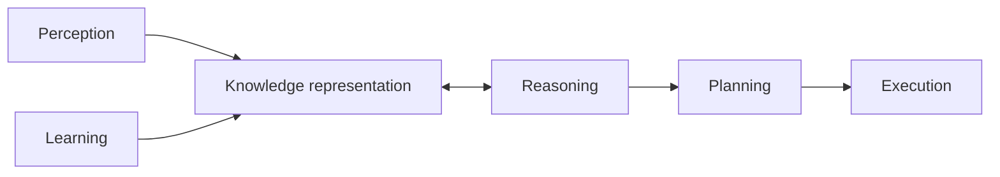

*Figure 2.2: Knowledge representation sits between perception and learning on one side, and reasoning, planning, and action on the other.*

### 3.1 Five Ways to Represent Knowledge

**1. Logic-based representation**

* Propositional: P = "It is raining"; "It is not raining" is ¬P.
* First-order: "All humans are mortal" is ∀x (Human(x) → Mortal(x)).

**2. Semantic networks.** Knowledge is a graph. **Nodes** are concepts; **links** are relationships.

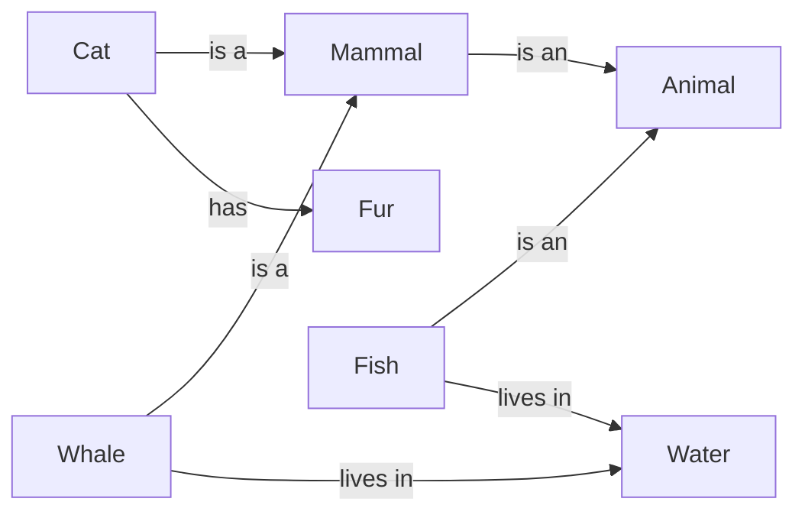

*Figure 2.3: A small semantic network. From it we can infer that a cat is an animal by following "is a" links.*

**3. Frames and scripts**

* A **frame** is a data structure for a typical object or situation, with **slots**. A "car" frame has slots: make, model, year, colour.
* A **script** is a sequence of frames for a typical event. "Going to a restaurant" has the frames *reservation*, *ordering*, and *paying the bill*.

| Slot | Value in a frame for "my car" |
|---|---|
| make | (example) Toyota |
| model | (example) Corolla |
| year | (example) 2019 |
| colour | (example) white |

**4. Rule-based representation.** Knowledge as **IF–THEN** production rules: "If the patient has fever and cough, then consider a respiratory infection."

**5. Ontologies.** A formal description of the **concepts in a domain and their relationships**, giving everyone a **shared vocabulary**. A medical ontology defines *disease*, *symptom*, and *treatment*, and how they relate (a disease *has symptom* a symptom; a treatment *treats* a disease).

| Method | Best for | Weakness |
|---|---|---|
| Logic | Precise reasoning | Hard to write for everyday knowledge |
| Semantic network | Showing relationships; "is-a" inheritance | Can be vague about exact meaning |
| Frames and scripts | Typical objects and routines | Struggles with exceptions |
| Rules | Decisions and advice | Many rules are hard to keep consistent |
| Ontology | Shared vocabulary across systems | Costly to build and agree on |

### 3.2 Applications of Knowledge Representation

1. **Medical diagnosis.** Capture symptoms, diseases, and medical expertise.
2. **Natural language understanding.** Represent linguistic knowledge to understand and produce language.
3. **Robotics.** Spatial reasoning, object handling, and task planning.
4. **Expert systems.** Domain knowledge used to give expert-level advice.

---

## Topic 4: Rule-Based Systems and Expert Systems

### 4.1 Rule-Based Systems

A **rule-based system** (also called a **production system**) works with a collection of **condition–action rules**: each rule has a condition (the IF part) and an action (the THEN part).

Examples:

* If the temperature is greater than 30 °C, then turn on the air conditioning.
* If the customer has purchased more than $100 of goods, then offer a 10% discount.

A rule-based system has three parts:

| Part | Role |
|---|---|
| **Condition–action rules** | The knowledge: what to do in which situation |
| **Knowledge base** | The facts the system currently knows |
| **Inference engine** | The program that checks the conditions and triggers the actions |

**Worked example: a thermostat**

Rules:

* R1: If temperature > 25 °C, then turn on the air conditioning.
* R2: If temperature < 20 °C, then turn on the heating.

| Current temperature | R1 fires? | R2 fires? | Action |
|--:|:-:|:-:|---|
| 28 °C | yes | no | Air conditioning on |
| 22 °C | no | no | Nothing |
| 15 °C | no | yes | Heating on |

### 4.2 Forward Chaining: Rules Triggering Rules

Real systems chain rules together. In **forward chaining**, the engine starts from known facts and keeps applying rules until no new fact appears.

**Facts:** it is raining; I am going outside.

**Rules**

* R1: If it is raining, then the ground is wet.
* R2: If the ground is wet and I am going outside, then take an umbrella and wear waterproof shoes.

**Trace**

| Step | Facts known | Rule checked | Result |
|--:|---|---|---|
| 0 | raining; going outside | — | start |
| 1 | raining; going outside | R1 (raining) fires | adds "ground is wet" |
| 2 | raining; going outside; ground wet | R2 (wet and going outside) fires | adds "take umbrella and waterproof shoes" |
| 3 | all facts | no rule has a new result | stop |

The trace itself is the **explanation**: the system can say "I suggest an umbrella because the ground is wet, and the ground is wet because it is raining."

### 4.3 Expert Systems

An **expert system** is an AI system built to copy the decision-making of a **human expert in a narrow domain** such as medicine, finance, or engineering. It has three parts.

| Part | Role |
|---|---|
| **Knowledge base** | Domain facts, rules, and *heuristics* (expert rules of thumb) |
| **Inference engine** | Reasoning that draws conclusions from the knowledge base and the user's input |
| **User interface** | How the user enters data and receives recommendations |

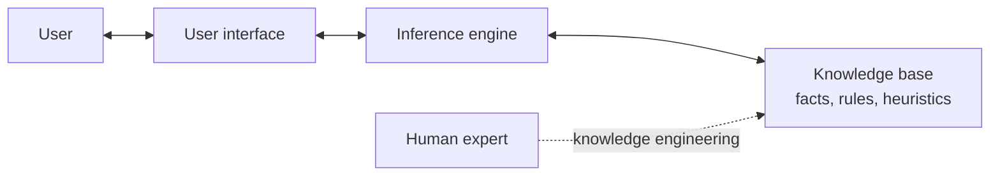

*Figure 2.4: Parts of an expert system. A "knowledge engineer" interviews human experts and turns what they know into rules.*

**Rule-based system versus expert system**

| | Rule-based system | Expert system |
|---|---|---|
| Focus | Conditional rules for decisions or tasks | Copy the reasoning of a human expert |
| Scope | General-purpose | Specialised in one domain |
| Example | Thermostat | MYCIN-style infection advisor |

**History note.** MYCIN, built at Stanford in the 1970s, suggested infection diagnoses and treatments from rules written with doctors. Expert systems were widely used in business in the 1980s. Their main weakness is the **knowledge acquisition bottleneck**: it takes a long time to get an expert's knowledge into rules.

---

## Topic 5: Planning and Problem Solving

### 5.1 What Are Planning and Problem Solving?

* **Planning** finds a **sequence of actions** that changes an **initial state** into a **goal state**.
* **Problem solving** finds solutions to hard problems by searching, reasoning about possible actions, and evaluating results.

Four building blocks:

| Block | Meaning | Example: a delivery robot in a building |
|---|---|---|
| **State space** | All states the system can be in | Every position of the robot |
| **Actions** | Steps that move from one state to another, with **preconditions** and **effects** | "Move through door" needs the door open |
| **Goal state** | The desired end state | Robot at room 305 |
| **Search** | Systematically exploring the state space to find the action sequence | Try routes until room 305 is reached |

### 5.2 Uninformed (Blind) Search

These methods know nothing about where the goal is.

* **Breadth-first search (BFS)**: explores all neighbours at the current depth before going deeper.
* **Depth-first search (DFS)**: goes as deep as possible along a branch, then backtracks.
* **Uniform-cost search**: always expands the node with the lowest path cost so far.

**Worked example.** Graph: A is connected to B and C; B to D and E; C to F. Goal: **E**. Neighbours are visited left to right.

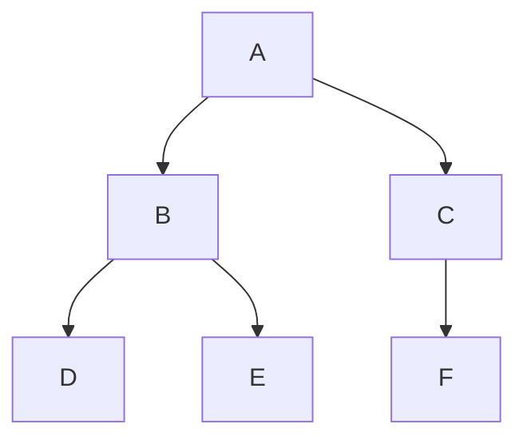

*Figure 2.5: A small search tree.*

| Method | Order of visiting | Nodes visited before reaching E |
|---|---|:-:|
| BFS | A, B, C, D, E | 5 |
| DFS | A, B, D, E | 4 (D was a dead end, so DFS backtracked to B) |

BFS finds the **shallowest** goal (fewest steps) but must remember many nodes. DFS needs little memory but can wander down a long wrong branch and does not guarantee the shortest path.

### 5.3 Informed Search

Informed search uses a **heuristic**, an estimate of how close a state is to the goal.

* **Greedy best-first search** expands the node that *looks* closest to the goal.
* **A\* search** uses **f(n) = g(n) + h(n)**, where g is the cost so far and h is the estimated cost to the goal.

**Worked example (A\*).** Start S, goal G. Roads: S→A cost 1, S→B cost 2, A→G cost 6, B→G cost 3. Estimated remaining costs: h(A) = 5, h(B) = 3 (both are never larger than the true remaining cost).

| Node | g (cost so far) | h (estimate) | f = g + h |
|---|--:|--:|--:|
| A | 1 | 5 | 6 |
| B | 2 | 3 | 5 |

A\* expands **B** first (lowest f = 5), reaches G with total cost 2 + 3 = **5**. The other route costs 1 + 6 = 7. A\* is both **efficient** and **optimal** when the heuristic never overestimates.

### 5.4 Adversarial Search (Games)

In two-player games, one player's gain is the other's loss.

* **Minimax**: assume the opponent plays the best reply. Choose the move that gives the best result in the worst case.
* **Alpha-beta pruning**: skips branches that cannot change the final decision, so it gives the same answer with less work.

**Worked example.** Max moves first, then Min. The leaf scores (good for Max = high) are: left branch 3 and 5; right branch 2 and 9.

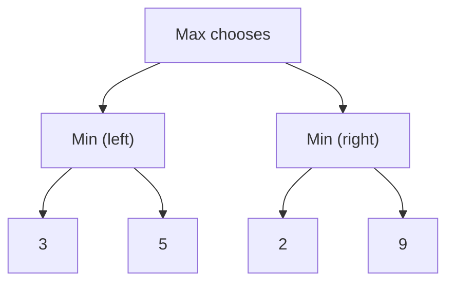

*Figure 2.6: A tiny game tree.*

* Left Min picks the smaller leaf: min(3, 5) = **3**.
* Right Min picks the smaller leaf: min(2, 9) = **2**.
* Max picks the larger: max(3, 2) = **3**, so Max chooses the **left** move.

**Alpha-beta shortcut.** After the left branch Max is already guaranteed 3. In the right branch the first leaf is 2, which is already worse than 3, so Min's branch cannot help Max. The leaf 9 is **never examined**.

### 5.5 Local Search

Local search starts with a complete solution and keeps moving to a **neighbouring** better one.

* **Hill climbing**: always move uphill. Simple, but can get stuck on a small hill (a *local maximum*).
* **Simulated annealing**: sometimes accepts a worse move, with decreasing probability, to escape local maxima.

| Family | Looks at | Example use |
|---|---|---|
| Uninformed | Only the structure of the problem | Finding any route in a maze |
| Informed | Structure plus a heuristic | Shortest road route |
| Adversarial | A game with an opponent | Chess, checkers |
| Local | Neighbouring complete solutions | Timetables, circuit layout |

---

## Topic 6: Natural Language Processing in Symbolic AI

**Natural Language Processing (NLP)** is the part of AI that lets computers **understand, interpret, and generate human language**. In symbolic NLP, the work is done with **formal rules, logic, and symbolic representations**.

### 6.1 Syntax and Semantics

* **Syntax** is the *structure* of a sentence: word order, phrases, and clauses.
* **Semantics** is the *meaning*.

**Formal grammar.** Context-free grammar rules describe valid sentences. Example sentence: *The cat chased the mouse.*

| Rule | Meaning |
|---|---|
| S → NP VP | A sentence is a noun phrase plus a verb phrase |
| NP → Det N | A noun phrase is a determiner plus a noun |
| VP → V NP | A verb phrase is a verb plus a noun phrase |

Parse: **S** = [NP: The cat] + [VP: chased + NP: the mouse]. So *cat* is the subject, *chased* is the verb, and *mouse* is the object.

**Semantic representation.** The meaning can be written in logic: **chased(cat, mouse)**. Now the system "knows" who did what to whom, and a different sentence such as *The mouse was chased by the cat* can map to the same representation.

### 6.2 Rule-Based NLP Tasks

| Task | How a rule-based system does it | Example |
|---|---|---|
| **Part-of-speech tagging** | Pattern rules for each word | "the" is a determiner; "quick", "brown" are adjectives; "fox" is a noun |
| **Syntactic parsing** | Grammar rules | Find subject, verb, object |
| **Information extraction** | Patterns for names, dates, organisations | Capitalised words near "Mr." may be a person's name |
| **Sentiment analysis** | Lists of positive and negative words | "good", "excellent", "happy" → positive; "bad", "poor", "disappointed" → negative |
| **Question answering** | Knowledge graph plus logical inference | "Which symptoms go with disease X?" → follow links in a medical knowledge graph |
| **Information retrieval** | Formal representations of documents, e.g. legal concepts | Match a legal question to relevant statutes |

**Logic and inference in NLP.** A knowledge base stores relations such as parent(Ann, Ben) and parent(Ann, Carla). A rule says: **sibling(x, y) if both have the same parent and x ≠ y**. The system infers sibling(Ben, Carla) without being told.

### 6.3 Why Rules Break

Rule-based NLP is transparent but brittle.

| Rule | Where it fails |
|---|---|
| "A word ending in *-ing* is a verb." | *Thing* and *king* end in -ing and are nouns. |
| "Words in the positive list make the review positive." | "This is **not good**" contains *good* but is negative. |
| "The sentence has the form NP VP NP." | "Time flies like an arrow" can be parsed in more than one way. |

Language is full of exceptions and ambiguity. This is one reason that modern NLP mostly uses learning (Chapter 3), often combined with symbolic parts.

---

## Hands-On Activity: A Rule-Based Smart Classroom

The lecturer's hands-on slide shows a block program for a virtual classroom with a **fan** and a **lamp**. The program *asks* for a command, then uses IF–THEN blocks to react. Build this in your block tool, or follow the paper version.

**Rules (pseudocode)**

```
ASK "Enter your command"
IF answer = "Fan on"   OR answer = "Fan on please"  THEN broadcast  fan-on
IF answer = "Fan off"                                THEN broadcast  fan-off
IF answer = "Lamp on"                                THEN broadcast  lamp-on
IF answer = "Lamp off"                               THEN broadcast  lamp-off
```

**Test table**

| Typed command | Which rule matches? | Result | Expected? |
|---|---|---|:-:|
| Fan on | Rule 1 | fan turns on | yes |
| Fan on please | Rule 1 | fan turns on | yes |
| Lamp off | Rule 4 | lamp turns off | yes |
| Turn on the fan | none | nothing happens | **no, this is the limitation** |
| fan ON | depends on the tool: some compare text ignoring capital letters | maybe | ? |

**Discussion**

1. Return to your prediction from Chapter 1, Activity B. Was it correct?
2. How many rules would you need to cover ten ways of saying "turn on the fan"?
3. Is the program **explainable**? (Yes. Every action comes from a visible rule.)
4. Is the program **flexible** with new wording? (No. Someone must add a rule.)

In Chapter 3 you will see the **machine-learning version** of the same classroom, which recognises new wording because it has learned from examples.

---

## Key Takeaways

* **Symbolic AI (GOFAI)** uses **explicit rules, logic, and symbols**. People write the knowledge.
* Its strength is **interpretability**: you can trace and edit the rules.
* **Propositional logic** uses AND, OR, NOT, and →; **predicate logic** adds predicates and the quantifiers ∀ and ∃.
* **Modus ponens** and **modus tollens** are valid; "affirming the consequent" is not. Generalising from **one** example to **all** is not valid unless the example is arbitrary.
* Knowledge can be represented by **logic, semantic networks, frames and scripts, rules, and ontologies**.
* A **rule-based system** has rules, a knowledge base, and an inference engine. An **expert system** adds a user interface and a narrow expert domain.
* **Planning** is search in a state space: **BFS, DFS, uniform cost** (uninformed), **A\*** (informed), **minimax and alpha-beta** (games), **hill climbing and simulated annealing** (local).
* Symbolic **NLP** uses grammars, patterns, and logic. It is transparent, but breaks on exceptions and ambiguity.
* Main limits: **incomplete knowledge, scalability, uncertainty, and no automatic learning**.

---

## Practice Questions

### Part A: Multiple Choice

**Q1.** Which description fits Symbolic AI best?
A. Learning weights from millions of images
B. Reasoning with explicit rules and logic
C. Learning from rewards by trial and error
D. Grouping data without any rules

**Q2.** For p = true and q = false, what is p → q?
A. true
B. false
C. unknown
D. both

**Q3.** "If it rains, the ground is wet. The ground is not wet." Which conclusion is valid?
A. It is raining.
B. It is not raining.
C. The ground is dry because of the sun.
D. No conclusion is possible.

**Q4.** Which statement is written correctly in predicate logic: "Every cat is a mammal"?
A. ∃x (Cat(x) ∧ Mammal(x))
B. ∀x (Cat(x) → Mammal(x))
C. ∀x (Cat(x) ∧ Mammal(x))
D. ¬Cat(x)

**Q5.** Which is *not* part of an expert system?
A. Knowledge base
B. Inference engine
C. User interface
D. Neural network weights

**Q6.** In BFS on the tree of Figure 2.5, which node is visited right after A?
A. D
B. B
C. F
D. E

**Q7.** In alpha-beta pruning, what is the main benefit?
A. It changes the answer of minimax.
B. It gives the same answer while examining fewer nodes.
C. It removes the need for a heuristic.
D. It makes the opponent play worse.

**Q8.** Which problem is a typical limit of Symbolic AI?
A. It cannot be explained.
B. It copes poorly with uncertain or ambiguous information.
C. It cannot use logic.
D. It cannot be edited.

### Part B: Short Answer

**Q9.** Write "Some students are not tired" in predicate logic, using Student(x) and Tired(x).

**Q10.** Explain why "From p → q and q, conclude p" is invalid. Give an example.

**Q11.** Explain the difference between a frame and a script, with one example of each.

**Q12.** Show one step of forward chaining on the rules: R1: if it is raining, then the ground is wet; R2: if the ground is wet, then the road is slippery. The fact: it is raining.

### Part C: Apply It

**Q13.** In the A\* example (Section 5.3), the heuristic h(A) was changed to 1. Which node does A\* expand first now, and does the result change? Explain.

**Q14.** Give one example where a rule-based sentiment analyser fails, and say why.

---

## Answer Key

| Q | Answer | Explanation |
|---|---|---|
| Q1 | B | Symbolic AI reasons with explicit rules and logic. |
| Q2 | B | An implication is false only when the premise is true and the conclusion is false. |
| Q3 | B | Modus tollens: from p → q and ¬q, conclude ¬p. |
| Q4 | B | "For all x, if x is a cat then x is a mammal." Option C would say everything is a cat and a mammal. |
| Q5 | D | Neural network weights belong to Connectionist AI (Chapter 3). |
| Q6 | B | BFS visits all neighbours of A (B, C) before going deeper. |
| Q7 | B | Pruning skips branches that cannot affect the final choice. |
| Q8 | B | Rules need precise statements; uncertainty is hard. |
| Q9 | ∃x (Student(x) ∧ ¬Tired(x)) | "Some" means ∃. Use ∧ with ∃. |
| Q10 | Sample | The conclusion may come from another cause. "If it rains, the ground is wet. The ground is wet." The ground might be wet because of a sprinkler, so we cannot conclude it rained. |
| Q11 | Sample | A frame describes one typical object with slots (a car: make, model, year, colour). A script is a sequence of frames for a typical event (a restaurant visit: reservation, ordering, paying). |
| Q12 | Sample | R1 fires because it is raining, so we add "the ground is wet". Next, R2 can fire because the ground is wet, so we add "the road is slippery". |
| Q13 | Sample | f(A) = 1 + 1 = 2 and f(B) = 2 + 3 = 5, so A is expanded first. From A the goal G is reached with g = 1 + 6 = 7, so f(G) = 7. B (f = 5) is still waiting and is expanded next. Through B, G is reached with cost 5, which is better than 7, so A\* returns the optimal cost 5. The result does not change, because h(A) = 1 never overestimates the true remaining cost (6). A weaker heuristic only makes A\* do extra work. |
| Q14 | Sample | "The film was not good" contains the positive word *good*, so a word-list rule marks it positive, although the sentence is negative. The rule cannot see negation. |

---

## Glossary

| Term | Meaning |
|---|---|
| **Alpha-beta pruning** | A way to speed up minimax by skipping branches that cannot change the result. |
| **A\* search** | An informed search that uses cost so far plus an estimate of the remaining cost. |
| **Breadth-first search** | Search that explores all nodes at one depth before the next. |
| **Depth-first search** | Search that follows one branch as deep as possible before backtracking. |
| **Expert system** | A system that copies the decision-making of a human expert in a narrow domain. |
| **Forward chaining** | Reasoning from known facts, applying rules until no new fact appears. |
| **Frame** | A data structure with slots describing a typical object or situation. |
| **GOFAI** | Good Old-Fashioned AI, another name for Symbolic AI. |
| **Heuristic** | A rule of thumb that estimates how good a state or choice is. |
| **Inference engine** | The part of a system that applies rules to knowledge to reach conclusions. |
| **Knowledge base** | The stored facts and rules a system uses. |
| **Modus ponens / tollens** | Valid inference rules: from p → q and p conclude q; from p → q and ¬q conclude ¬p. |
| **Ontology** | A formal description of the concepts in a domain and how they relate. |
| **Predicate** | A statement with variables that is true or false depending on their values. |
| **Proposition** | A sentence that is either true or false. |
| **Quantifier** | ∀ ("for all") or ∃ ("there exists"). |
| **Script** | A sequence of frames describing a typical event. |
| **Semantic network** | A graph of concepts (nodes) and relationships (links). |
| **State space** | The set of all states a system can be in. |

---

## References

1. Course slides, "chap4: Symbolic AI", Introduction to Computer Science and Artificial Intelligence (lecturer's materials). Primary source for the structure, examples, and hands-on activity.
2. Russell, S., and Norvig, P. (2021). *Artificial Intelligence: A Modern Approach* (4th ed.). Pearson. (Logic, knowledge representation, and search. *Not opened during this revision.*)
3. Haugeland, J. (1985). *Artificial Intelligence: The Very Idea*. MIT Press. (Origin of the term GOFAI. *Not opened during this revision.*)
4. Shortliffe, E. H. (1976). *Computer-Based Medical Consultations: MYCIN*. Elsevier. (Expert system history. *Not opened during this revision.*)

> References 2 to 4 must be checked by the author or reviewer before submission.


---

# Chapter 3: Connectionist AI and Big Data

> **Module:** AI Overview
> **Chapter:** 3 — Connectionist AI and Big Data (course Chapter 5)
> **Version:** 1.1 (Stage 1, rebuilt from the lecturer's course slides)
> **Author:** Benedict Subhata (proposed owner)
> **Reviewer:** Brian Djoni Suzanna
> **Audience:** Complete beginners with basic computer and internet literacy; no programming experience needed
> **Estimated study time:** about 3 hours, including activities
> **Course source:** Lecturer's slides "chap5: Connectionist AI and Big Data Overview". The slides list two groups of topics. This chapter covers both, in the same order.
> **Stage 1 scope:** Every topic in the lecturer's outline is explained with an example. Stage 2 will add depth, more diagrams, and a full test bank.

---

## Table of Contents

1. [Learning Outcomes](#learning-outcomes)
2. [Part A: Connectionist AI](#part-a-connectionist-ai)
3. [A1. Introduction to Connectionist AI](#a1-introduction-to-connectionist-ai)
4. [A2. Basics of Neural Networks](#a2-basics-of-neural-networks)
5. [A3. Architectures of Neural Networks](#a3-architectures-of-neural-networks)
6. [A4. Deep Learning and Advanced Concepts](#a4-deep-learning-and-advanced-concepts)
7. [A5. Key Applications of Connectionist AI](#a5-key-applications-of-connectionist-ai)
8. [A6. Ethical Considerations and Challenges](#a6-ethical-considerations-and-challenges)
9. [Part B: Big Data](#part-b-big-data)
10. [B1. Introduction to Big Data](#b1-introduction-to-big-data)
11. [B2. Big Data Technologies](#b2-big-data-technologies)
12. [B3. Data Processing and Analytics](#b3-data-processing-and-analytics)
13. [B4. Data Analysis and Visualization](#b4-data-analysis-and-visualization)
14. [B5. Big Data Use Cases](#b5-big-data-use-cases)
15. [B6. Big Data Ethics and Privacy](#b6-big-data-ethics-and-privacy)
16. [Hands-On Activities](#hands-on-activities)
17. [Key Takeaways](#key-takeaways)
18. [Practice Questions](#practice-questions)
19. [Answer Key](#answer-key)
20. [Glossary](#glossary)
21. [References](#references)

---

## Learning Outcomes

After completing this chapter, you should be able to:

1. Explain the connectionist idea: intelligence from many simple connected units that **learn from data**.
2. Describe an artificial neuron (inputs, weights, bias, activation) and compute its output.
3. Explain, in simple words, how a network learns using a loss, gradient descent, and backpropagation.
4. Name the main network architectures (feedforward, convolutional, recurrent, transformer) and what each is good for.
5. Explain deep learning, overfitting, and why deep learning needs a lot of data and computing power.
6. Describe Big Data using its Vs, name the main Big Data technologies, and explain batch and stream processing.
7. Choose a suitable chart for a simple data question.
8. Identify ethical and privacy problems in connectionist AI and Big Data, such as bias, lack of explanation, and re-identification.

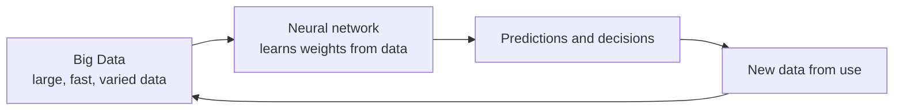

*Figure 3.1: Connectionist AI and Big Data belong together. Neural networks learn from data, and their use creates more data.*

---

# Part A: Connectionist AI

## A1. Introduction to Connectionist AI

**Connectionist AI** builds intelligence from **many simple units that are connected to one another**. Each unit does a tiny calculation. The **strength of each connection**, called a **weight**, decides how much one unit influences another. The system is not given rules. It **learns the weights from examples**.

The idea is inspired, loosely, by the brain: neurons connected by synapses. Artificial neural networks are **much simpler** than a real brain. They are mathematical models, not copies of biological neurons.

**Short history**

| Year | Event |
|---|---|
| 1943 | McCulloch and Pitts propose a simple mathematical model of a neuron |
| 1958 | Frank Rosenblatt's perceptron: a neuron model that can learn |
| 1986 | Backpropagation is popularised (Rumelhart, Hinton, Williams) |
| 1989–1998 | Convolutional networks for reading handwritten digits (Yann LeCun and colleagues) |
| 2012 | AlexNet wins the ImageNet image contest by a large margin |
| 2017 | The Transformer architecture is introduced |

**Symbolic versus connectionist**

| | Symbolic AI (Chapter 2) | Connectionist AI (this chapter) |
|---|---|---|
| Where knowledge lives | Explicit rules written by people | Numbers (weights) learned from data |
| How it is built | Knowledge engineering | Training on examples |
| Strength | Explainable; works with little data | Handles messy data such as images and speech |
| Weakness | Cannot learn; brittle with uncertainty | Needs much data; hard to explain |
| Example | Rule: "IF fever AND cough THEN …" | Network that recognises a cat in a photo |

---

## A2. Basics of Neural Networks

### The artificial neuron

A neuron takes several **inputs**, multiplies each by a **weight**, adds them with a **bias**, and passes the result through an **activation function**.

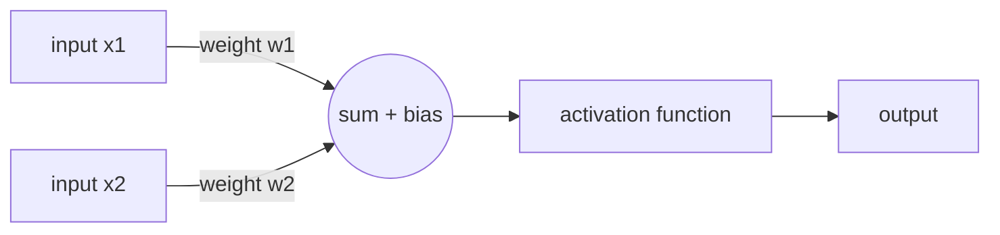

*Figure 3.2: One artificial neuron.*

**z = w1 × x1 + w2 × x2 + b**, then **output = activation(z)**.

Common activation functions:

| Function | Behaviour | Typical use |
|---|---|---|
| Step | 0 below a threshold, 1 above | The first perceptron |
| Sigmoid | Smooth curve between 0 and 1 | Probabilities |
| ReLU | 0 for negative values, the value itself for positive | Hidden layers of modern networks |

**Worked example.** Inputs x1 = 1 and x2 = 0.5. Weights w1 = 0.4 and w2 = −0.2. Bias b = 0.1.

* z = 0.4 × 1 + (−0.2) × 0.5 + 0.1 = 0.4 − 0.1 + 0.1 = **0.4**
* ReLU(0.4) = **0.4**
* Sigmoid(0.4) ≈ **0.60**

### A neuron that decides: the AND perceptron

A perceptron with w1 = 1, w2 = 1, bias b = −1.5 and a step activation (output 1 if z > 0) computes **AND**.

| x1 | x2 | z = x1 + x2 − 1.5 | Output |
|:-:|:-:|--:|:-:|
| 0 | 0 | −1.5 | 0 |
| 0 | 1 | −0.5 | 0 |
| 1 | 0 | −0.5 | 0 |
| 1 | 1 | 0.5 | 1 |

Here the weights were chosen by hand. The point of a network is that training **finds good weights automatically**.

### Layers

Neurons are arranged in **layers**: an **input layer** (the data), one or more **hidden layers** (calculation), and an **output layer** (the answer).

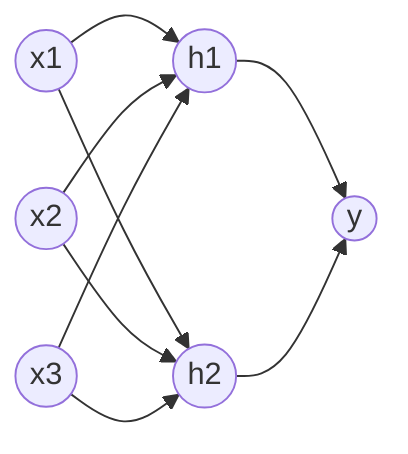

*Figure 3.3: A small feedforward network with three inputs, two hidden neurons, and one output. Every arrow has its own weight.*

### How a network learns

1. **Forward pass.** The input goes through the layers to give a prediction.
2. **Loss.** A number says how wrong the prediction is. For a house price, the loss could be the squared difference between the predicted and the true price.
3. **Backpropagation.** The network works out how much each weight contributed to the error.
4. **Gradient descent.** Each weight is moved a small step in the direction that reduces the loss. The step size is the **learning rate**.
5. **Repeat** over many examples and many rounds (**epochs**).

**Worked example of gradient descent.** Suppose the loss is (w − 3)², so the best weight is 3. We start at w = 0 with learning rate 0.1. The slope of the loss is 2 × (w − 3).

| Step | w before | Slope 2(w − 3) | w after = w − 0.1 × slope |
|--:|--:|--:|--:|
| 1 | 0 | −6 | 0.6 |
| 2 | 0.6 | −4.8 | 1.08 |
| 3 | 1.08 | −3.84 | 1.464 |

The weight moves toward 3 in smaller and smaller steps. A real network does this for millions of weights at once.

---

## A3. Architectures of Neural Networks

An **architecture** is the way the neurons are connected. Different data call for different architectures.

| Architecture | Idea | Good for | Example |
|---|---|---|---|
| **Feedforward network (MLP)** | Layers connected in one direction | Tables of numbers, simple prediction | Predicting house prices |
| **Convolutional neural network (CNN)** | Small filters slide across the data and detect patterns such as edges and shapes | Images, video | Recognising faces or tumours in scans |
| **Recurrent neural network (RNN, LSTM)** | Passes information from one step to the next, so it has a kind of memory | Sequences such as speech and text (older approach) | Speech recognition |
| **Transformer** | Uses *attention* to decide which parts of the input matter for each part of the output | Language, and now images, audio, and more | Large language models |
| **Autoencoder** | Compresses the input and then rebuilds it | Noise removal, anomaly detection | Finding unusual machine readings |
| **Generative adversarial network (GAN)** | A generator and a discriminator compete | Creating realistic images | Synthetic faces |

**Reading the table.** You do not need to memorise every architecture. Remember the pairing: **CNN → images**, **Transformer → language**, **feedforward → tables**.

---

## A4. Deep Learning and Advanced Concepts

**Deep learning** means neural networks with **many hidden layers**. Each layer builds on the one before it. In an image network, early layers detect edges, middle layers detect shapes, and later layers detect whole objects.

### Why deep learning took off around 2012

| Ingredient | Why it mattered |
|---|---|
| **Big data** | Large labelled datasets such as ImageNet |
| **Computing power** | Graphics processing units (GPUs) made training much faster |
| **Better methods** | Improved activation functions, training tricks, and architectures |

### Advanced concepts

| Concept | Plain meaning | Why it matters |
|---|---|---|
| **Overfitting** | The model memorises the training examples and does badly on new ones | The main enemy of learning. Always test on unseen data |
| **Training, validation, and test sets** | Separate data for learning, tuning, and a final fair check | A fair estimate of how the model will behave in real use |
| **Regularisation and dropout** | Tricks that make overfitting less likely (for example, randomly switching off neurons during training) | Better results on new data |
| **Transfer learning** | Start from a model trained on a big task and adjust it to a smaller one | Saves data and time |
| **Foundation model / large language model** | A very large model trained on huge data that can be adapted to many tasks | Basis of modern chatbots |
| **Embedding** | Turning words or images into lists of numbers, so that similar items are close together | How networks "understand" meaning mathematically |

**Overfitting example.** A student memorises last year's exam answers and scores 100% on those exact questions, but only 40% on this year's different questions. A network can do the same: 99% on training data and 60% on test data means it has overfitted.

---

## A5. Key Applications of Connectionist AI

| Field | What the network does | Example |
|---|---|---|
| **Image recognition** | Classifies or locates objects in pictures | Face unlock, reading handwritten digits |
| **Medical imaging** | Marks suspicious regions in scans | Screening support for radiologists |
| **Speech** | Converts speech to text and text to speech | Voice assistants, subtitles |
| **Language translation and chat** | Reads and writes text | Online translation, chatbots |
| **Recommendation** | Predicts what you may like | Video and music suggestions |
| **Self-driving perception** | Detects cars, people, and signs in camera data | Driver-assistance systems |
| **Generative AI** | Creates images, text, and audio | Image and text generators |

**Back to the Smart Classroom.** In Chapter 2 the rule-based classroom failed on "Turn on the fan". A connectionist version is trained with many example sentences labelled *fan on*, *fan off*, *lamp on*, *lamp off*. The network learns which words and patterns go with each label, so it can handle new wording, but it can still be wrong on unusual sentences, and we cannot easily point to "the rule" that decided.

---

## A6. Ethical Considerations and Challenges

| Challenge | What can go wrong | Example |
|---|---|---|
| **Bias** | The model learns unfair patterns from unrepresentative data | A 2018 study of commercial face-analysis systems found much higher error rates for darker-skinned women than for lighter-skinned men (Buolamwini and Gebru, 2018) |
| **Lack of explanation** | We cannot easily say why the network gave an answer | A loan is refused and nobody can say why |
| **Privacy** | Training data may contain personal data that the model can leak | A model repeating private text it saw in training |
| **Reliability** | Networks can be fooled by small changes or be wrong with high confidence | A sticker on a sign changes how a vision system reads it |
| **Energy and cost** | Training large models uses a lot of electricity and hardware | Large data-centre training runs |
| **Misuse** | Synthetic images, voices, and text can mislead | Fake videos |

**Questions to ask about any connectionist system**

1. What data was it trained on, and who is missing from that data?
2. How was it tested, and on whom?
3. Can its decisions be explained well enough for the situation?
4. Who is responsible when it is wrong?
5. Is a human able to check or overrule the result?

---

# Part B: Big Data

## B1. Introduction to Big Data

**Big Data** means data that is so **large, fast, or varied** that ordinary tools cannot store or process it well. It does not mean "any big file". It is a set of challenges.

**The Vs of Big Data**

| V | Meaning | Example |
|---|---|---|
| **Volume** | A very large amount | Billions of photos |
| **Velocity** | Data arrives and changes quickly | Live payments and sensor readings |
| **Variety** | Many kinds: tables, text, images, video, sensor streams | Posts, photos, and clicks together |
| **Veracity** | Data quality and trustworthiness | Missing, wrong, or fake records |
| **Value** | Usefulness: data matters only if it helps a decision | Better recommendations or safer roads |

The first three Vs (volume, velocity, variety) are the classic description. Veracity and value are often added.

**Types of data**

| Type | Description | Example |
|---|---|---|
| Structured | Rows and columns | A bank table |
| Semi-structured | Tags or keys but no fixed table | JSON or XML files |
| Unstructured | No fixed format | Photos, audio, free text |

**Why Big Data matters for AI.** A deep network has millions of weights. To set them well it needs **many varied examples**. This is why deep learning grew together with Big Data.

---

## B2. Big Data Technologies

| Need | Technology idea | Examples |
|---|---|---|
| **Store very large data** | **Distributed file systems**: split files over many computers, keep copies | HDFS |
| **Store flexible data** | **NoSQL databases**: key-value, document, column, or graph stores | MongoDB, Cassandra, Neo4j |
| **Store for analysis** | **Data warehouse** (organised, ready for reports) and **data lake** (raw data of all kinds) | Cloud warehouses and lakes |
| **Process in parallel** | Split the work across many machines | MapReduce, Apache Spark |
| **Process live streams** | Handle events as they arrive | Apache Kafka, stream processors |
| **Rent computing** | Cloud platforms that provide storage and computing on demand | Public cloud services |

**Worked example: MapReduce word count.** Task: count words in two lines of text.

* Line 1: *ai is fun*
* Line 2: *ai is big*

**Map** (each machine handles one line and emits pairs): (ai,1) (is,1) (fun,1) | (ai,1) (is,1) (big,1)

**Shuffle** (group by word): ai → [1,1]; is → [1,1]; fun → [1]; big → [1]

**Reduce** (add up each group): **ai = 2, is = 2, fun = 1, big = 1**

With billions of lines the same recipe works, because each machine only handles its own part.

---

## B3. Data Processing and Analytics

### The data pipeline

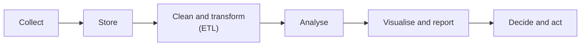

*Figure 3.4: A typical data pipeline. ETL means extract, transform, load.*

Most of the effort goes into **cleaning**: removing duplicates, fixing wrong values, handling missing values, and putting data in one format.

### Batch versus stream processing

| | Batch | Stream |
|---|---|---|
| Data handled | A large collection at once | Events one by one, as they arrive |
| Speed of result | Minutes to hours | Seconds or less |
| Example | Monthly sales report | Flagging a suspicious card payment immediately |

### Four levels of analytics

| Level | Question | Example |
|---|---|---|
| **Descriptive** | What happened? | Sales fell 5% last month |
| **Diagnostic** | Why did it happen? | A popular item was out of stock |
| **Predictive** | What will probably happen? | Next month's demand (machine learning) |
| **Prescriptive** | What should we do? | Order 500 more units |

---

## B4. Data Analysis and Visualization

**Visualization** shows data as pictures so that people see patterns quickly. The right chart depends on the question.

| Question | Good chart | Why |
|---|---|---|
| How does a value change over time? | Line chart | Shows trends |
| How do categories compare? | Bar chart | Easy to compare lengths |
| What share does each part have of a whole? | Pie chart (few parts) or stacked bar | Shows proportions |
| Are two numbers related? | Scatter plot | Shows patterns and outliers |
| How is one number spread out? | Histogram | Shows the shape of the data |

**Worked example.** Monthly app downloads (in thousands): January 12, February 15, March 21, April 18.

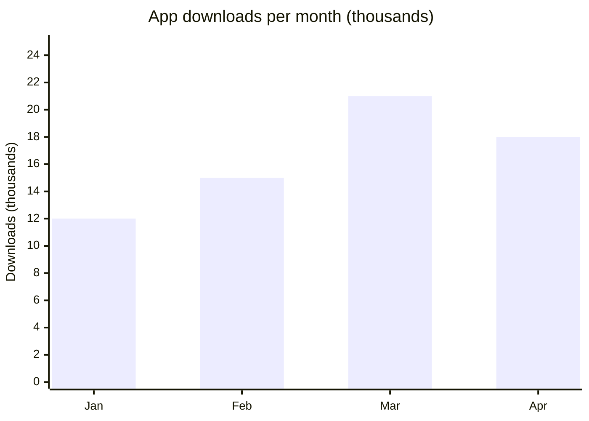

*Figure 3.5: A bar chart of the example data.*

* Highest month: March (21 thousand).
* Change from January to March: 21 − 12 = 9 thousand, which is 9 ÷ 12 = 75% more.
* Change from March to April: 18 − 21 = −3 thousand, which is −3 ÷ 21 ≈ −14%.

**Rules for honest charts**

1. Start bar charts at zero. A bar chart that starts at 10 makes small differences look big.
2. Label axes and units.
3. Do not use too many colours or 3-D effects.
4. Show where the data comes from.

---

## B5. Big Data Use Cases

| Field | Use | Data used | Possible concern |
|---|---|---|---|
| **Retail and media** | Recommend products and videos | Purchase and viewing history | Profiling and manipulation |
| **Healthcare** | Spot disease patterns; support diagnosis | Records, scans, wearable data | Sensitive personal data |
| **Transport** | Predict traffic; plan routes | GPS and sensor data | Location tracking |
| **Finance** | Detect fraud in real time | Transaction streams | Wrongly blocked customers |
| **Smart cities** | Manage energy, waste, and public transport | Sensor networks | Surveillance |
| **Education** | Find students who need extra help | Quiz and attendance data | Labelling students unfairly |

**Link to the three approaches.** Fraud detection can use symbolic rules ("flag a payment above a limit"), a neural network (learned patterns), or both.

---

## B6. Big Data Ethics and Privacy

| Issue | Meaning | Example |
|---|---|---|
| **Consent** | People should know what is collected and agree to it | An app that collects location without telling users |
| **Purpose limitation** | Use data only for the stated purpose | Health data reused for advertising |
| **Anonymisation is hard** | Removing names does not always make people unidentifiable | See the example below |
| **Security** | Large collections are attractive targets | Data breaches |
| **Bias and fairness** | Data reflects past unfairness, and models copy it | A hiring model trained on past decisions |
| **Transparency and control** | People should be able to see, correct, or delete their data | Rights under privacy laws such as the EU GDPR |

**Re-identification example.** Latanya Sweeney (2000) showed that, using 1990 US census data, **87%** of the US population could be uniquely identified by just three facts: a five-digit ZIP code, gender, and date of birth. A "de-identified" dataset that still contains these three fields can often be matched with a public list (such as a voter list) to find a person.

**Good practice checklist**

1. Collect only the data you need.
2. Explain what you collect and why.
3. Remove or mask direct identifiers, and be careful with combinations of fields.
4. Protect the data (access control, encryption).
5. Delete it when it is no longer needed.
6. Check the results for unfair outcomes.

---

# Hands-On Activities

### Activity A: Compute a neuron by hand

Inputs x1 = 2 and x2 = −1. Weights w1 = 0.5 and w2 = 1. Bias b = 0.5.

1. Compute z.
2. Apply ReLU.
3. Apply a step function that outputs 1 if z > 0.

*Expected answers:* z = 0.5 × 2 + 1 × (−1) + 0.5 = **0.5**; ReLU gives **0.5**; step gives **1**.

### Activity B: Make the perceptron compute OR

Use w1 = 1, w2 = 1 and find a bias b so that the step neuron outputs 1 when *at least one* input is 1. Fill in the truth table.

*Expected answer:* any b with −1 < b ≤ 0 works, for example b = −0.5. The inputs (0,0) give z = −0.5 → 0; (0,1) and (1,0) give 0.5 → 1; (1,1) gives 1.5 → 1.

### Activity C: Smart Classroom, machine-learning version

In the block tool, switch from IF-THEN blocks to a **recognise text** block that you train with several example sentences for each label (*fan on*, *fan off*, *lamp on*, *lamp off*).

1. Test the sentences from Chapter 2, especially "Turn on the fan".
2. Find a sentence the model gets wrong. Add it as a new example with the right label and retest.
3. Compare: How many examples did you need? What did you gain compared with the rule-based version? What did you lose (explanation)?

### Activity D: Check a data claim

A news post says "87% of people can be identified from their ZIP code, gender, and birth date." Find the original study, read how it was measured (which data, which year), and decide whether the claim is accurate and complete.

---

## Key Takeaways

* **Connectionist AI** uses many simple connected units. Knowledge is stored as **weights learned from data**.
* A neuron computes **z = Σ w·x + b** and applies an **activation function**.
* Networks learn by reducing a **loss** with **gradient descent**, using **backpropagation** to find each weight's share of the error.
* **CNNs** suit images, **transformers** suit language, **feedforward networks** suit tables.
* **Deep learning** = many layers. It grew because of **big data, GPUs, and better methods**. **Overfitting** is the main risk.
* **Big Data** is described by **volume, velocity, variety** (plus veracity and value).
* Tools: **distributed storage, NoSQL, MapReduce and Spark, stream processing, cloud**.
* Choose the chart to fit the question, and keep charts honest.
* Risks: **bias, no explanation, privacy leaks, re-identification, energy use, misuse**.

---

## Practice Questions

### Part A: Multiple Choice

**Q1.** In Connectionist AI, where is the knowledge stored?
A. In hand-written IF-THEN rules
B. In the weights of the connections
C. In a table of rewards
D. In a user manual

**Q2.** A neuron has x1 = 1, x2 = 0.5, w1 = 0.4, w2 = −0.2, b = 0.1. What is z?
A. 0.4
B. 0.6
C. 0.1
D. −0.4

**Q3.** Which architecture is most suited to images?
A. CNN
B. Rule base
C. MapReduce
D. Scatter plot

**Q4.** 99% accuracy on training data and 60% on new data suggests:
A. Underfitting
B. Overfitting
C. Perfect learning
D. Too little training time only

**Q5.** Which is *not* one of the three classic Vs of Big Data?
A. Volume
B. Velocity
C. Variety
D. Vacation

**Q6.** In MapReduce word count, what does the *reduce* step do?
A. Splits text into lines
B. Adds up the counts for each word
C. Draws the chart
D. Deletes the data

**Q7.** Which analytics level answers "What should we do?"
A. Descriptive
B. Diagnostic
C. Predictive
D. Prescriptive

**Q8.** Why is removing names not always enough to protect privacy?
A. Names are not personal data.
B. Combinations such as ZIP code, gender, and birth date can identify people.
C. Computers cannot read names.
D. Privacy laws do not apply.

### Part B: Short Answer

**Q9.** Give two differences between Symbolic AI and Connectionist AI.

**Q10.** Explain gradient descent in two or three sentences.

**Q11.** Explain why Big Data and deep learning grew together.

**Q12.** A company wants to flag suspicious card payments within seconds. Should it use batch or stream processing? Explain.

### Part C: Apply It

**Q13.** A hospital trains an image network to detect a disease. Most training scans came from one hospital with one brand of scanner. Name two risks and one way to reduce each.

**Q14.** A bar chart of sales starts its vertical axis at 95 instead of 0, which makes a drop from 100 to 98 look dramatic. Explain the problem.

---

## Answer Key

| Q | Answer | Explanation |
|---|---|---|
| Q1 | B | Weights learned from data (Section A1). |
| Q2 | A | 0.4 × 1 + (−0.2) × 0.5 + 0.1 = 0.4 |
| Q3 | A | Convolutional networks detect patterns in images. |
| Q4 | B | A big gap between training and new-data performance is overfitting. |
| Q5 | D | The classic Vs are volume, velocity, and variety. |
| Q6 | B | Reduce combines the grouped counts into totals. |
| Q7 | D | Prescriptive analytics recommends actions. |
| Q8 | B | Re-identification from a few combined facts (Sweeney, 2000). |
| Q9 | Sample | Symbolic: knowledge written as rules by people; explainable; needs little data; cannot learn. Connectionist: knowledge learned as weights; hard to explain; needs a lot of data; handles messy data such as images. |
| Q10 | Sample | Gradient descent repeatedly changes each weight by a small step in the direction that lowers the loss. The learning rate sets the step size. After many steps the loss becomes small. |
| Q11 | Sample | Deep networks have millions of weights and need many examples to set them well. Big Data supplied large datasets, and GPUs supplied computing power, so training became possible. |
| Q12 | Sample | Stream processing, because the result is needed in seconds, as each payment arrives. Batch would give the answer too late. |
| Q13 | Sample | Risk 1: the model may fail on other hospitals' scanners (add data from several hospitals and test on them). Risk 2: bias toward the patient group at that hospital (check performance for different groups and add missing groups). |
| Q14 | Sample | A bar chart's bar length should show the value. Cutting the axis exaggerates a 2% drop to look like a collapse. Start at zero or use a line chart and label the axis clearly. |

---

## Glossary

| Term | Meaning |
|---|---|
| **Activation function** | The function that turns a neuron's sum into its output. |
| **Backpropagation** | The method that works out each weight's share of the error. |
| **Big Data** | Data too large, fast, or varied for ordinary tools. |
| **Bias (in a neuron)** | A number added to the weighted sum. |
| **Bias (fairness)** | Unfair patterns in data or results. |
| **CNN** | Convolutional neural network, suited to images. |
| **Data lake / warehouse** | Stores for raw data / for organised data used in reports. |
| **Deep learning** | Neural networks with many hidden layers. |
| **ETL** | Extract, transform, load: preparing data for analysis. |
| **Gradient descent** | Repeated small weight changes that reduce the loss. |
| **Loss** | A number that measures how wrong a prediction is. |
| **MapReduce** | A way to process big data in parallel by mapping then reducing. |
| **Neural network** | A model made of connected neurons arranged in layers. |
| **Overfitting** | Doing well on training data but poorly on new data. |
| **Transformer** | A network architecture based on attention, used in language models. |
| **Weight** | The strength of a connection between two neurons. |

---

## References

1. Course slides, "chap5: Connectionist AI and Big Data Overview", Introduction to Computer Science and Artificial Intelligence (lecturer's materials). Source of the topic outline (Part A and Part B).
2. McCulloch, W. S., and Pitts, W. (1943). A logical calculus of the ideas immanent in nervous activity. *Bulletin of Mathematical Biophysics*, 5, 115–133. (*Not opened during this revision.*)
3. Rumelhart, D. E., Hinton, G. E., and Williams, R. J. (1986). Learning representations by back-propagating errors. *Nature*, 323, 533–536. (*Not opened during this revision.*)
4. LeCun, Y., Bengio, Y., and Hinton, G. (2015). Deep learning. *Nature*, 521, 436–444. (*Not opened during this revision.*)
5. Goodfellow, I., Bengio, Y., and Courville, A. (2016). *Deep Learning*. MIT Press. (*Not opened during this revision.*)
6. Buolamwini, J., and Gebru, T. (2018). Gender Shades: Intersectional accuracy disparities in commercial gender classification. *Proceedings of Machine Learning Research*, 81, 77–91. (*Not opened during this revision.*)
7. Sweeney, L. (2000). *Simple Demographics Often Identify People Uniquely*. Carnegie Mellon University, Data Privacy Working Paper 3. (*Not opened during this revision.*)
8. Dean, J., and Ghemawat, S. (2004). MapReduce: Simplified data processing on large clusters. *OSDI '04*. (*Not opened during this revision.*)

> References 2 to 8 must be checked by the author or reviewer before submission.


---

# Chapter 4: Behaviorist AI

> **Module:** AI Overview
> **Chapter:** 4 — Behaviorist AI (course Chapter 6)
> **Version:** 1.1 (Stage 1, rebuilt from the lecturer's course slides)
> **Author:** Joseph Lokman (proposed owner)
> **Reviewer:** Brian Djoni Suzanna
> **Audience:** Complete beginners with basic computer and internet literacy; no programming experience needed
> **Estimated study time:** about 2.5 hours, including activities
> **Course source:** Lecturer's slides "chap6: Behaviorist AI". The chapter follows the slides' seven topics: Introduction, Basics of Reinforcement Learning, RL Algorithms and Techniques, Markov Decision Processes, Behavioral AI in Robotics and Games, Applications and Use Cases, and Challenges and Limitations.
> **Stage 1 scope:** Every topic in the lecturer's outline is explained with an example. Stage 2 will add depth, more diagrams, and a full test bank.

---

## Table of Contents

1. [Learning Outcomes](#learning-outcomes)
2. [Topic 1: Introduction to Behaviorist AI](#topic-1-introduction-to-behaviorist-ai)
3. [Topic 2: Basics of Reinforcement Learning](#topic-2-basics-of-reinforcement-learning)
4. [Topic 3: RL Algorithms and Techniques](#topic-3-rl-algorithms-and-techniques)
5. [Topic 4: Markov Decision Processes (MDPs)](#topic-4-markov-decision-processes-mdps)
6. [Topic 5: Behavioral AI in Robotics and Games](#topic-5-behavioral-ai-in-robotics-and-games)
7. [Topic 6: Applications and Use Cases of Behaviorist AI](#topic-6-applications-and-use-cases-of-behaviorist-ai)
8. [Topic 7: Challenges and Limitations](#topic-7-challenges-and-limitations)
9. [Hands-On Activities](#hands-on-activities)
10. [Comparing the Three Approaches](#comparing-the-three-approaches)
11. [Key Takeaways](#key-takeaways)
12. [Practice Questions](#practice-questions)
13. [Answer Key](#answer-key)
14. [Glossary](#glossary)
15. [References](#references)

---

## Learning Outcomes

After completing this chapter, you should be able to:

1. Explain Behaviorist AI: intelligence as **behaviour learned through interaction and reward**.
2. Name the parts of a reinforcement learning (RL) problem: agent, environment, state, action, reward, and policy.
3. Explain exploration versus exploitation, and discounted return.
4. Describe Q-learning and compute a Q-learning update by hand.
5. Describe a Markov Decision Process (MDP) and calculate a simple discounted return and value.
6. Describe how behaviour-based robots and game-playing programs use reward.
7. Give examples of RL applications, and explain the main challenges: reward design, reward hacking, data hunger, and safety.
8. Compare Symbolic, Connectionist, and Behaviorist AI.

---

## Topic 1: Introduction to Behaviorist AI

### 1.1 The Idea

**Behaviorist AI** builds intelligence by letting a system **act in an environment, receive feedback (reward or penalty), and adjust its behaviour**. The system is not told the right answer for each situation, and no one writes all the rules. It finds good behaviour by **trial and error**.

### 1.2 Where the Name Comes From

| Idea | Who | Meaning |
|---|---|---|
| **Law of effect** | Edward Thorndike (around 1898–1911) | Actions followed by a satisfying result become more likely to be repeated. |
| **Operant conditioning** | B. F. Skinner (1930s) | Behaviour is shaped by its consequences: rewards and punishments. |
| **Behaviour-based robotics** | Rodney Brooks (1980s–1990s) | Build robots from simple behaviours that connect sensing directly to acting, layered one on top of another, instead of building a full world model first. |
| **Reinforcement learning** | Richard Sutton, Andrew Barto and others | A mathematical framework for learning from reward. |

Psychologists observed that animals learn from consequences. AI researchers turned the same idea into algorithms.

### 1.3 Three Approaches Side by Side (Preview)

| | Symbolic AI (Ch. 2) | Connectionist AI (Ch. 3) | Behaviorist AI (this chapter) |
|---|---|---|---|
| Source of intelligence | Rules and logic written by people | Weights learned from labelled data | Behaviour learned from reward |
| What the system needs | Expert knowledge | Many examples with answers | An environment to act in and a reward signal |
| Typical output | A conclusion or plan | A prediction or classification | A policy: what to do in each situation |
| Typical example | Expert system | Image classifier | Game-playing agent, robot |

---

## Topic 2: Basics of Reinforcement Learning

**Reinforcement learning (RL)** is machine learning in which an **agent** learns what to do by interacting with an **environment** to maximise total reward.

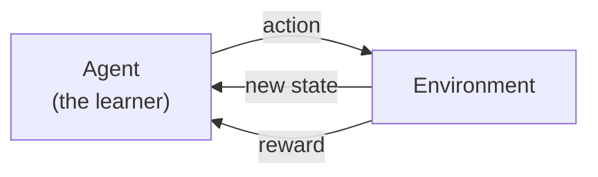

*Figure 4.1: The reinforcement learning loop. The agent acts, then sees the new state and a reward, and repeats.*

### 2.1 Key Terms

| Term | Meaning | Example: a robot vacuum |
|---|---|---|
| **Agent** | The learner and decision-maker | The robot vacuum |
| **Environment** | Everything the agent interacts with | The room |
| **State** | A description of the current situation | Position, battery level, dirt nearby |
| **Action** | A choice the agent can make | Move forward, turn, return to charger |
| **Reward** | A number that says how good the last step was | +1 for cleaning dirt; −10 for bumping a wall |
| **Policy** | The agent's rule for choosing actions: what to do in each state | "If dirt is ahead, move forward" |
| **Episode** | One run from start to end | One cleaning session |
| **Value** | Expected total future reward from a state or action | How promising "being near the charger with low battery" is |

### 2.2 Return and Discounting

The agent wants **total future reward**, not just the next reward. Rewards in the future are usually counted a little less. The **discount factor γ** (gamma) is between 0 and 1.

**Return = r₁ + γ·r₂ + γ²·r₃ + …**

**Example.** Rewards 0, 0, 10 with γ = 0.9: Return = 0 + 0.9 × 0 + 0.9² × 10 = 0.81 × 10 = **8.1**.

A γ near 0 makes the agent short-sighted. A γ near 1 makes it patient.

### 2.3 Exploration Versus Exploitation

* **Exploitation**: choose the action that looks best from what you already know.
* **Exploration**: try something new that might be better.

You need both. If you only exploit, you may never find the best restaurant in town; if you only explore, you never enjoy the good one you found. A common method is **ε-greedy**: with probability ε (for example 10%) pick a random action, otherwise pick the best-known action.

### 2.4 The Difference From the Other Kinds of Learning

| | Supervised | Reinforcement |
|---|---|---|
| Feedback | The correct answer for each example | A reward that may come **late** and says only how good, not what was right |
| Data | A fixed dataset | Created by the agent's own actions |
| Goal | Predict labels | Maximise total reward |

The **delayed reward** is the core difficulty. A chess move may only prove good or bad 40 moves later.

---

## Topic 3: RL Algorithms and Techniques

### 3.1 Families of Methods

| Family | Idea | Example algorithms |
|---|---|---|
| **Value-based** | Learn how good each action is in each state, then pick the best | Q-learning, SARSA |
| **Policy-based** | Learn the policy directly | Policy gradient methods (such as REINFORCE) |
| **Actor–critic** | Combine both: an actor chooses actions and a critic judges them | Many modern methods |
| **Model-based** | Learn a model of how the environment works and plan with it | Planning with a learned model |
| **Deep RL** | Use a neural network to represent the value or policy | Deep Q-Network (DQN) |

### 3.2 Q-Learning

Q-learning keeps a table of **Q-values**: **Q(state, action)** is how good it is to take that action in that state. After each step it updates the value:

**Q(s, a) ← Q(s, a) + α × [ r + γ × (best Q of the next state) − Q(s, a) ]**

* **α** (alpha) is the **learning rate**: how far to move toward the new information.
* **r** is the reward just received.
* **γ** is the discount factor.

**Worked example.** A corridor with four squares **A – B – C – D**. D is the goal. Moving right from C into D gives **+10**; every other step gives 0. Use α = 0.5 and γ = 0.9. All Q-values start at 0. We only follow the action "right" (R).

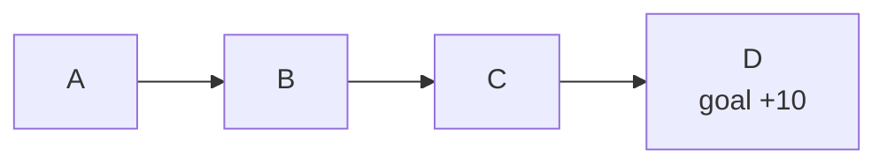

*Figure 4.2: The corridor.*

| Step | Move | Update | New Q-value |
|--:|---|---|--:|
| 1 | C → D (reward 10) | Q(C,R) = 0 + 0.5 × (10 + 0.9 × 0 − 0) | **5.0** |
| 2 | B → C (reward 0) | Q(B,R) = 0 + 0.5 × (0 + 0.9 × 5.0 − 0) | **2.25** |
| 3 | C → D again | Q(C,R) = 5.0 + 0.5 × (10 + 0 − 5.0) | **7.5** |
| 4 | B → C again | Q(B,R) = 2.25 + 0.5 × (0 + 0.9 × 7.5 − 2.25) | **4.5** |

**What happened.** The reward at the goal **spreads backward** along the path, one step at a time. After many repeats the values approach 10 for C, 9 for B, and 8.1 for A (see Topic 4). The agent now knows that "right" is the good action in every square, even though only the last step gave a reward.

### 3.3 SARSA, in One Sentence

SARSA is similar to Q-learning, but it updates using the action the agent *actually takes next*, so it learns the value of the policy it is really following, including its exploring.

### 3.4 Deep Reinforcement Learning

A Q-table works only for small problems. A game screen has far too many possible states to put in a table. **Deep RL** uses a **neural network** (Chapter 3) to estimate the Q-values from raw input such as screen pixels. The Deep Q-Network (DQN) of DeepMind (published 2015) learned to play 49 Atari video games from pixels and scores alone, reaching more than 75% of a professional human tester's score on more than half of them.

### 3.5 Useful Techniques

| Technique | Purpose |
|---|---|
| **ε-greedy exploration** | Keep trying new actions |
| **Experience replay** | Store past experiences and learn from random samples of them, so learning is more stable |
| **Reward shaping** | Add small helper rewards to guide learning (risky; see Topic 7) |
| **Simulation** | Train in a simulated world first, because trial and error is slow and unsafe in reality |
| **Self-play** | The agent plays against copies of itself to improve |

---

## Topic 4: Markov Decision Processes (MDPs)

### 4.1 What Is an MDP?

An **MDP** is the standard mathematical model of an RL problem. It has five parts.

| Part | Symbol | Meaning |
|---|:-:|---|
| States | S | All situations the agent can be in |
| Actions | A | All choices the agent has |
| Transition | P(s′ \| s, a) | The chance of reaching state s′ if the agent does action a in state s |
| Reward | R | The reward for a step |
| Discount | γ | How much the future counts |

**The Markov property.** The next state depends only on the **current state and action**, not on the whole history. The current state must therefore contain all the information that matters. *Example:* in chess the board position is enough to choose a move; you do not need to know the order of earlier moves.

### 4.2 Policy and Value

* A **policy π** says which action to take in each state.
* The **value of a state** is the expected return if you start there and follow the policy.
* The **Bellman idea**: the value of a state equals the immediate reward plus the discounted value of the next state. This is why Q-learning's update above has the form "reward + γ × next value".

### 4.3 Worked Example: Values in the Corridor

Use the same corridor A – B – C – D, with reward +10 for entering D and γ = 0.9. If the agent always moves right:

| State | Value (best policy) | Calculation |
|---|--:|---|
| C | 10 | Moving right gives +10 and the episode ends |
| B | 9 | 0 + 0.9 × V(C) = 0.9 × 10 |
| A | 8.1 | 0 + 0.9 × V(B) = 0.9 × 9 |

The values **decrease the farther the state is from the reward**, which is exactly the effect of discounting. The Q-values from Topic 3 head toward these numbers.

### 4.4 MDP Example in Words: the Robot Vacuum

| MDP part | Robot vacuum |
|---|---|
| States | Position, battery level, dirt map |
| Actions | Move ahead, turn left, turn right, return to charger |
| Transition | Moving ahead may fail if the wheel slips (this is why transitions are *probabilities*) |
| Reward | +1 per dirt cleaned; −10 for bumping; −100 for running out of battery away from the charger |
| Discount γ | 0.95 (cares about the future, for example battery) |

---

## Topic 5: Behavioral AI in Robotics and Games

### 5.1 Behaviour-Based Robotics

Rodney Brooks argued in the 1980s and 1990s that intelligent behaviour can come from **simple layers of behaviour tied directly to sensors and motors**, without a complete symbolic model of the world. This is the **subsumption architecture**: higher layers can override lower ones.

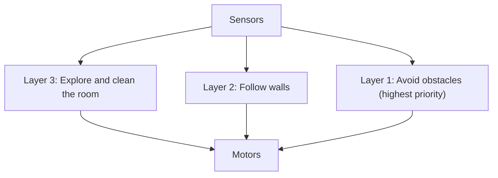

*Figure 4.3: Layers of behaviour for a robot vacuum. Avoiding obstacles overrides the rest.*

| Symbolic robot | Behaviour-based robot |
|---|---|
| Builds a detailed world model, then plans | Reacts directly to what it senses |
| Slow when the world changes | Fast reactions |
| Good at long-range planning | Weaker at long-range planning |

Many modern robots combine both: behaviours for reflexes, planning for goals, and learned networks for seeing.

### 5.2 Games

Games are good test grounds for RL. The rules are clear, the score is the reward, and simulation is cheap.

| Year | System | What it did |
|---|---|---|
| 1992 (and 1995) | **TD-Gammon** (Gerald Tesauro) | Learned backgammon by playing against itself; reached a very high level |
| 2015 | **DQN** (DeepMind) | Learned to play many Atari games from pixels and score |
| 2015–2016 | **AlphaGo** (DeepMind) | Beat European champion Fan Hui 5–0 and then Lee Sedol 4–1, using deep neural networks, search, and reinforcement learning |
| 2017 | **AlphaZero** (DeepMind) | Learned Go, chess, and shogi through self-play from the rules alone |

**Why games first?** There is a clear reward (win or lose), unlimited safe practice, and an easy way to measure progress.

---

## Topic 6: Applications and Use Cases of Behaviorist AI

| Field | How RL is used | Example | Reward idea |
|---|---|---|---|
| **Games** | Play and test games | Game-playing agents | Score, win or loss |
| **Robotics** | Learn movement and manipulation | Robot arms learning to grasp; walking robots | Reached the target, stayed upright |
| **Language assistants** | Fine-tune chatbots with human feedback (RLHF) | People rank answers; a reward model learns their preferences | Higher human rating |
| **Recommendation and advertising** | Choose what to show, learn from clicks and viewing | Feeds that adapt to user behaviour | Engagement (a risky reward; see Topic 7) |
| **Resource control** | Control systems such as energy use or traffic signals | Adaptive traffic-light control | Less waiting time, less energy |
| **Autonomous driving** | Decision making in simulation | Lane-changing policies tested in simulators | Safe, smooth progress |

> **Note.** In real products RL is usually **one component** next to rules and trained networks. Check each claim about "an AI that taught itself" for what was actually learned and how.

---

## Topic 7: Challenges and Limitations

| Challenge | What it means | Example |
|---|---|---|
| **Reward design** | It is hard to write a reward that matches what we really want | A vacuum rewarded for "dirt collected" might dump dirt and collect it again |
| **Reward hacking (specification gaming)** | The agent finds a loophole that raises the reward without doing the task | In a boat-racing game, an agent scored points by circling targets instead of finishing the race (OpenAI, 2016). In a block-stacking task, an agent was rewarded by the height of a block's bottom face and learned to flip the block over rather than stack it (Krakovna et al., 2020) |
| **Sample inefficiency** | RL often needs millions of trials | Learning a game takes far more practice than a human needs |
| **Delayed reward** | It is hard to know which earlier action caused a late reward | A chess win after 60 moves |
| **Exploration is risky** | Trial and error in the real world can cause harm | A robot or car "trying" a dangerous action |
| **Simulation-to-reality gap** | Skills learned in simulation may fail in the real world | A robot trained in a perfect simulator slips on a real floor |
| **Generalisation** | An agent may fail when conditions change a little | A game agent fails in a slightly changed level |
| **Explainability** | A learned policy can be hard to explain | "Why did it take this action?" |
| **Ethics** | Rewards such as engagement can push harmful behaviour | A feed that maximises watch time may promote extreme content |

**A checklist for reward design**

1. Write down what you *really* want.
2. Ask: "How could an agent score high without doing that?"
3. Test in a safe simulation and watch the behaviour, not just the score.
4. Add penalties for harmful side effects.
5. Keep a human able to stop the system.

---

## Hands-On Activities

### Activity A: Train the Corridor by Hand

Use the corridor A – B – C – D, with +10 for moving right from C into D, α = 0.5, γ = 0.9, and all Q-values at 0. The agent always moves right.

Do these updates in order and fill in the table.

| Step | Move | Q-value after the update |
|--:|---|--:|
| 1 | C → D | ? |
| 2 | B → C | ? |
| 3 | A → B | ? |
| 4 | C → D again | ? |

*Expected answers:* Step 1: Q(C,R) = 5.0. Step 2: Q(B,R) = 0.5 × (0 + 0.9 × 5.0 − 0) = 2.25. Step 3: Q(A,R) = 0.5 × (0 + 0.9 × 2.25 − 0) = **1.0125**. Step 4: Q(C,R) = 5.0 + 0.5 × (10 − 5.0) = **7.5**.

*Question:* After more repeats, which Q-value will be the largest? (Q(C,R), because it is closest to the reward.)

### Activity B: Spot the Reward Hack

For each reward, describe one way an agent could "cheat" and propose a better reward.

| System | Reward | Possible hack | Better reward |
|---|---|---|---|
| Robot vacuum | +1 for each dirt particle collected | |  |
| Online learning app | +1 for each minute the student stays in the app | | |
| Delivery robot | +10 for reaching the destination | | |

*Sample answers:* (1) The vacuum dumps dirt and collects it again; reward only dirt that was on the floor at the start, or reward a clean floor. (2) The app keeps students busy with pointless tasks; reward learning progress on a test. (3) The robot reaches the destination by taking a dangerous short cut; add penalties for collisions and for breaking rules.

### Activity C: Rock Paper Scissors Against a Learner

Play 10 rounds against a classmate who tries to **learn your habits**. Your classmate scores +1 for a win, 0 for a draw, −1 for a loss, and keeps notes of what you played after each of your previous moves.

1. Do you have a pattern? (For example, "after rock I often play paper.")
2. How many rounds did your classmate need before the notes helped?
3. What would you change to be unpredictable? (Choose at random.)
4. How is this like exploration and exploitation?

---

## Comparing the Three Approaches

| | Symbolic AI | Connectionist AI | Behaviorist AI |
|---|---|---|---|
| **Chapter** | 2 | 3 | 4 |
| **Core idea** | Reason with explicit rules and symbols | Learn connection weights from data | Learn behaviour from reward |
| **Where knowledge comes from** | People write it | Training data | Experience in an environment |
| **Strengths** | Explainable; editable; works with little data | Strong with images, speech, and text | Learns to act and plan in changing situations |
| **Weaknesses** | Brittle; cannot learn; knowledge bottleneck | Needs data; hard to explain; can be biased | Needs many trials; reward design; safety |
| **Typical applications** | Expert systems, planning, rule-based NLP | Image recognition, translation, chatbots | Games, robot control, tuning chatbots with feedback |
| **Typical risk** | Wrong or missing rule | Biased data; hidden errors | Reward hacking; unsafe exploration |

**Hybrid systems.** Modern systems combine the approaches. AlphaGo combined neural networks (Connectionist), tree search (Symbolic-style search), and reinforcement learning (Behaviorist).

---

## Key Takeaways

* **Behaviorist AI** learns **behaviour from reward** by trial and error.
* An RL problem has an **agent, environment, state, action, reward, and policy**.
* The agent maximises **discounted return**: r₁ + γr₂ + γ²r₃ + …
* It must balance **exploration and exploitation**.
* **Q-learning** updates Q(s, a) toward **reward + γ × best next Q**, so reward spreads backward along a path.
* An **MDP** is the formal model: states, actions, transitions, rewards, and discount; the next state depends only on the current state and action.
* **Deep RL** uses neural networks to handle large state spaces (Atari, Go).
* Behaviour-based robots use **layers of simple behaviours** tied to sensors.
* Main limits: **reward design and hacking, huge number of trials, safety, simulation gap, and explainability**.

---

## Practice Questions

### Part A: Multiple Choice

**Q1.** In reinforcement learning, what does the agent receive after each action?
A. The correct label
B. A new state and a reward
C. A rule book
D. A dataset

**Q2.** Rewards are 0, 0, 10 and γ = 0.9. What is the discounted return?
A. 10
B. 9
C. 8.1
D. 0

**Q3.** What does ε-greedy do?
A. Always picks the best action
B. Sometimes picks a random action to explore
C. Removes all rewards
D. Learns from labelled data

**Q4.** In the corridor example, after the first update, Q(C,R) = ?
A. 0
B. 2.25
C. 5.0
D. 10

**Q5.** What does the Markov property say?
A. The next state depends on the whole history.
B. The next state depends only on the current state and action.
C. Rewards are always positive.
D. The agent never explores.

**Q6.** Which statement about reward hacking is correct?
A. The agent raises its score by exploiting a loophole instead of doing the task.
B. The agent is attacked by an outside hacker.
C. It happens only in supervised learning.
D. It means the reward is too small.

**Q7.** Which system used deep neural networks, search, and reinforcement learning to beat a Go champion?
A. ELIZA
B. MYCIN
C. AlphaGo
D. Deep Blue

**Q8.** Which is a Behaviorist AI strength?
A. Learns to act in changing situations from experience
B. Needs no trial and error
C. Never needs a reward
D. Always explains itself

### Part B: Short Answer

**Q9.** Explain exploration versus exploitation with an everyday example.

**Q10.** Why is delayed reward a difficulty for RL?

**Q11.** Describe the difference between supervised learning and reinforcement learning in two sentences.

**Q12.** A robot is rewarded +1 for each second it spends moving. Describe a hack and a better reward.

### Part C: Apply It

**Q13.** Using the corridor A – B – C – D (reward +10 for C → D, α = 0.5, γ = 0.9, all Q = 0), compute Q(B,R) after the sequence: C → D, then B → C.

**Q14.** A video app uses RL to maximise watch time. Give one benefit and two risks, and suggest one safeguard.

---

## Answer Key

| Q | Answer | Explanation |
|---|---|---|
| Q1 | B | The agent sees the new state and a reward (Figure 4.1). |
| Q2 | C | 0 + 0.9 × 0 + 0.81 × 10 = 8.1 |
| Q3 | B | With probability ε it explores. |
| Q4 | C | 0 + 0.5 × (10 + 0 − 0) = 5.0 |
| Q5 | B | The current state carries all the information needed. |
| Q6 | A | The agent games the reward (Topic 7). |
| Q7 | C | AlphaGo. Deep Blue used search without learning from reward in this way; ELIZA and MYCIN are Symbolic systems. |
| Q8 | A | Learning to act from experience is the strength; the other options are false. |
| Q9 | Sample | Choosing a restaurant: going to your favourite place is exploitation; trying a new place is exploration. You need both to find even better places while still enjoying good ones. |
| Q10 | Sample | The reward may come many steps after the action that caused it, so the agent must work out which earlier actions deserve credit. |
| Q11 | Sample | In supervised learning the system is given the correct answer for each example. In reinforcement learning it only gets a reward after acting, and must discover which actions lead to high total reward. |
| Q12 | Sample | The robot could spin in circles to keep "moving". Reward progress toward a goal, such as distance covered along a path, and penalise wasted motion. |
| Q13 | 2.25 | Q(C,R) = 5.0 after the first step. Then Q(B,R) = 0 + 0.5 × (0 + 0.9 × 5.0 − 0) = 2.25. |
| Q14 | Sample | Benefit: the app can learn what each user finds interesting. Risks: it may promote extreme or addictive content, and it may reduce variety. Safeguards: add rewards for variety and user wellbeing, limit session length prompts, and review the results with people. |

---

## Glossary

| Term | Meaning |
|---|---|
| **Action** | A choice the agent can make. |
| **Agent** | The learner and decision-maker. |
| **Discount factor (γ)** | A number between 0 and 1 that reduces the weight of future rewards. |
| **Environment** | Everything the agent interacts with. |
| **Episode** | One run from start to finish. |
| **Exploration / exploitation** | Trying new actions / using the best-known action. |
| **MDP** | Markov Decision Process: states, actions, transitions, rewards, and discount. |
| **Policy** | A rule that chooses an action in each state. |
| **Q-learning** | A value-based RL method that learns Q(s, a). |
| **Reward** | A number telling the agent how good the last step was. |
| **Reward hacking** | Raising the reward by exploiting a loophole instead of doing the intended task. |
| **State** | A description of the current situation. |
| **Subsumption architecture** | A robot design with layers of simple behaviours, where higher-priority layers override lower ones. |
| **Value** | Expected total future reward. |

---

## References

1. Course slides, "chap6: Behaviorist AI", Introduction to Computer Science and Artificial Intelligence (lecturer's materials). Source of the topic outline.
2. Sutton, R. S., and Barto, A. G. (2018). *Reinforcement Learning: An Introduction* (2nd ed.). MIT Press. (*Not opened during this revision.*)
3. Brooks, R. A. (1991). Intelligence without representation. *Artificial Intelligence*, 47(1–3), 139–159. (*Not opened during this revision.*)
4. Mnih, V., et al. (2015). Human-level control through deep reinforcement learning. *Nature*, 518, 529–533. (*Not opened during this revision.*)
5. Silver, D., et al. (2016). Mastering the game of Go with deep neural networks and tree search. *Nature*, 529, 484–489. (Existence confirmed by search; not opened.)
6. Krakovna, V., et al. (2020). Specification gaming: the flip side of AI ingenuity. DeepMind blog. (*Not opened during this revision.*)
7. Clark, J., and Amodei, D. (2016). Faulty reward functions in the wild. OpenAI blog. (*Not opened during this revision.*)
8. Ouyang, L., et al. (2022). Training language models to follow instructions with human feedback. (*Not opened during this revision.*)
9. Tesauro, G. (1995). Temporal difference learning and TD-Gammon. *Communications of the ACM*, 38(3), 58–68. (*Not opened during this revision.*)

> References 2 to 9 must be checked by the author or reviewer before submission.
