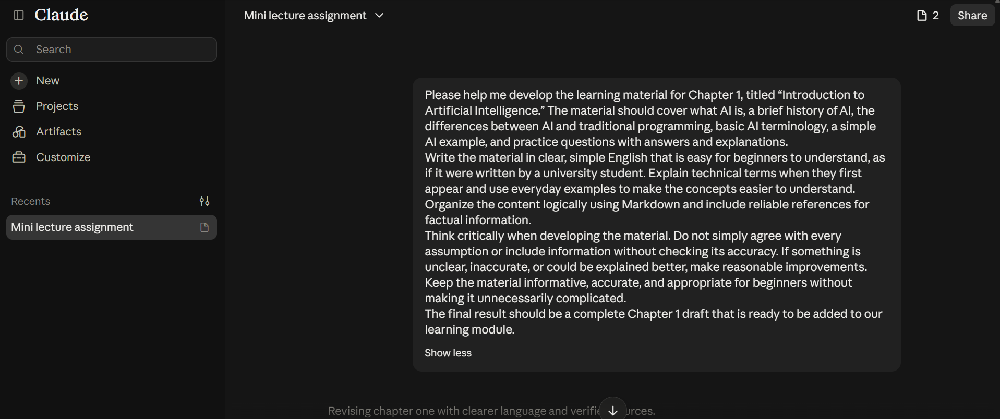
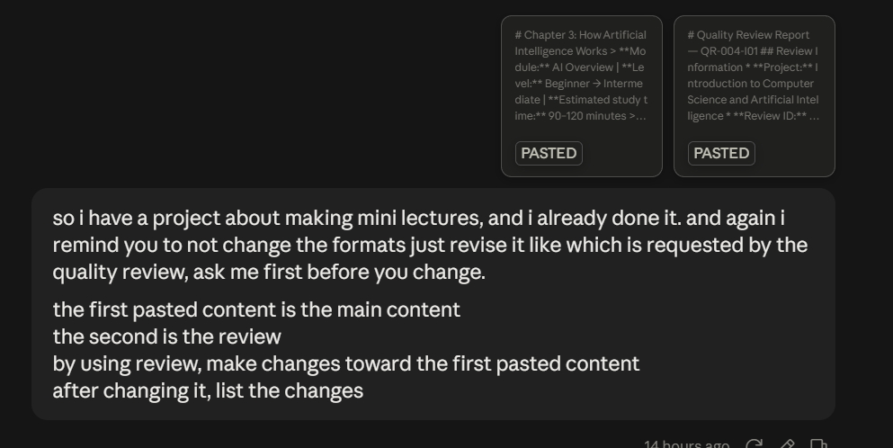
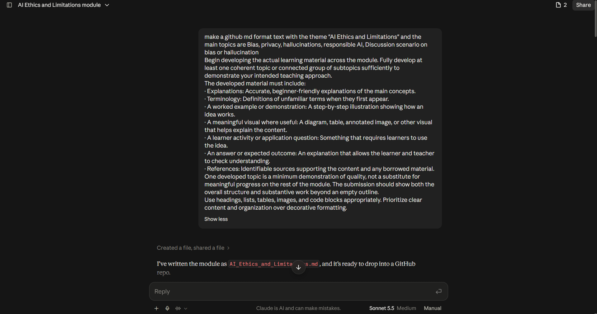
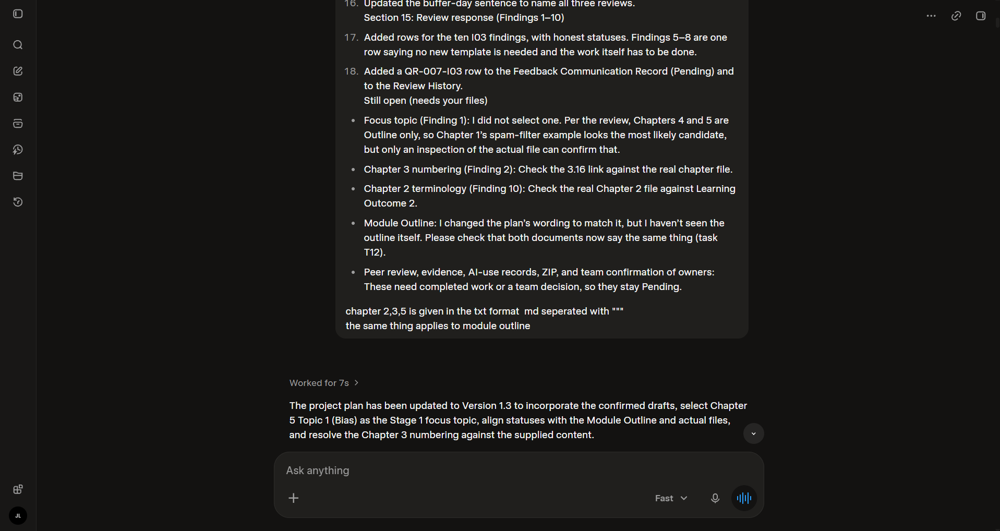

# Stage 1 — AI-Use Log

**Project:** Introduction to Computer Science and Artificial Intelligence
**Team:** BABI GULING
**Module:** AI Overview
**Stage:** Stage 1
**Last Updated:** 24 October 2026
**Document Path:** `logs/stage1-ai-use-log.md`

---

## 1. Purpose of This Log

This document records the use of AI tools by our team during Stage 1 of the AI Overview project.

We used AI tools to help us understand the assignment requirements, learn unfamiliar concepts, work with GitHub and Markdown, develop educational content, revise project documents, and plan our team's collaboration workflow.

The purpose of this log is to make our use of AI transparent and to explain how AI assistance contributed to our learning and project development.

Each entry identifies the team member, date, AI tool, purpose, use of the output, and supporting evidence where available.

Screenshots of relevant prompts and AI responses are provided as supporting evidence. AI-generated content is treated as assistance rather than automatically accepted as correct. Team members remain responsible for reviewing the content they use and checking important information before including it in the project.

---

## 2. AI Tools Used

| AI Tool | Main Purpose                                                                                                        |
| ------- | ------------------------------------------------------------------------------------------------------------------- |
| ChatGPT | Understanding assignment requirements, learning AI concepts, learning Markdown, and obtaining GitHub guidance.      |
| Claude  | Clarifying project responsibilities, supporting chapter development and revision, and planning the GitHub workflow. |
| Grok    | Assisting with the review and revision of the Project Plan.                                                         |

**Note:** The tools listed above are based on the information provided by the team members. Each member should ensure that the tool recorded in their entry matches the tool used in the original conversation.

---

## 3. Summary of AI Usage

| Entry ID | Team Member         | Date            | Purpose                                                              | AI Tool |
| -------- | ------------------- | --------------- | -------------------------------------------------------------------- | ------- |
| AI-001   | Benedict Subhata    | 16 October 2026 | Understanding the initial steps for creating a GitHub repository     | ChatGPT |
| AI-002   | Benedict Subhata    | 22 October 2026 | Understanding how Artificial Intelligence works                      | ChatGPT |
| AI-003   | Benedict Subhata    | 22 October 2026 | Learning how Markdown works on GitHub                                | ChatGPT |
| AI-004   | Jonathan Sugianto   | 22 October 2026 | Developing Chapter 1: Introduction to Artificial Intelligence        | Claude  |
| AI-005   | Jonathan Sugianto   | 22 October 2026 | Revising chapter content                                             | Claude  |
| AI-006   | Joseph Lokman       | To be confirmed | Developing Chapter 5: AI Ethics and Limitations                      | Claude  |
| AI-007   | Joseph Lokman       | 22 October 2026 | Reviewing and correcting the Project Plan                            | Grok    |
| AI-008   | Brian Djoni Suzanna | 24 October 2026 | Understanding project requirements and Quality Lead responsibilities | Claude  |
| AI-009   | Brian Djoni Suzanna | 24 October 2026 | Planning the GitHub workflow and branch structure                    | Claude  |
| AI-010   | Benedict Subhata    | 22 October 2026 | Understanding the Stage 1 assignment and required tasks              | ChatGPT |

**Date note:** AI-001 uses the date of the initial GitHub repository activity supplied by Benedict. The date for AI-006 has not yet been confirmed. The dates and purposes of all entries should be checked against the original conversations or screenshots before final submission.

---

# 4. Detailed AI Usage Records

## AI-001 — Initial GitHub Repository Setup

**Team Member:** Benedict Subhata
**Date:** 16 October 2026
**AI Tool:** ChatGPT

### Purpose

This activity took place during the initial setup of the team's GitHub project. I used guidance related to the repository setup process after signing in to GitHub and beginning to organize the project according to the professor's instructions.

As this was an early step in the project, the purpose was to understand how to get started with GitHub and establish a place where our team could organize its work.

### How AI Output Was Used

The guidance supported my understanding of the initial repository setup process and helped me become more familiar with using GitHub for the team assignment.

The repository itself and the team's subsequent work remain the responsibility of the team members.

### Verification

The repository setup and its relationship to the team assignment should be checked against the actual GitHub repository and the professor's instructions.

---

## AI-002 — Understanding How Artificial Intelligence Works

**Team Member:** Benedict Subhata
**Date:** 22 October 2026
**AI Tool:** ChatGPT

### Purpose

I used ChatGPT to explain how Artificial Intelligence works in simple language because I had limited previous experience with AI and computer science.

Before working on the AI Overview project, I wanted to understand the basic ideas behind AI rather than simply memorize technical terms.

### How AI Output Was Used

ChatGPT provided a beginner-friendly explanation of several important concepts, including:

* The relationship between Artificial Intelligence, Machine Learning, and Deep Learning.
* How training data helps a model learn patterns.
* The roles of neural networks, weights, and parameters.
* The difference between training and inference.
* How Large Language Models such as ChatGPT generate text.
* Why AI can produce incorrect or misleading answers.
* The strengths and limitations of AI systems.

The explanation helped me build a foundation for understanding the subject and the concepts discussed in the AI Overview project.

The response was used primarily for personal learning and concept clarification. Its inclusion in this log does not mean that the entire response was copied into the team's learning materials.

### Verification

The explanation was reviewed as learning assistance. Any technical claims taken from it for the team's educational materials should be checked against appropriate learning resources before publication.

---

## AI-003 — Learning Markdown in GitHub

**Team Member:** Benedict Subhata
**Date:** 22 October 2026
**AI Tool:** ChatGPT

### Purpose

I used ChatGPT to understand Markdown and how it is used on GitHub.

Since our team uses Markdown files to organize the AI Overview learning materials, I needed to learn how to format headings, lists, and other document elements correctly.

### How AI Output Was Used

ChatGPT explained the basic Markdown syntax and demonstrated how Markdown source text appears when rendered by GitHub.

The explanation covered:

* Creating headings using `#` and `##`.
* Formatting text in bold.
* Creating bullet-point and numbered lists.
* Understanding the purpose of `.md` files.
* Distinguishing Markdown formatting from programming code.

This helped me understand how to create and edit Markdown documents for the project.

### Verification

The explanation was used as introductory guidance. Markdown formatting can be checked directly by previewing the relevant file on GitHub.

---

## AI-004 — Chapter 1 Development

**Team Member:** Jonathan Sugianto
**Date:** 22 October 2026
**AI Tool:** Claude

### Purpose

Claude was used to support the development of Chapter 1, *Introduction to Artificial Intelligence*.

The purpose was to help prepare beginner-friendly educational material that introduces AI concepts in an understandable and organized way.

### How AI Output Was Used

AI assistance was used as part of the chapter-development process. The resulting material was intended to support explanations of introductory AI concepts and help organize the chapter for student learning.

The responsible author should confirm which explanations, examples, terminology, or structural suggestions from Claude were retained in the final chapter.

### Verification

The completed chapter should be reviewed for conceptual accuracy, clarity, consistency with the project outline, and appropriate references before submission.

### Evidence

---

## AI-005 — Chapter Revision

**Team Member:** Jonathan Sugianto
**Date:** 22 October 2026
**AI Tool:** Claude

### Purpose

Claude was used to assist with revising chapter content after an initial version had been prepared.

The purpose of this activity was to improve the quality and readability of the learning material rather than treat the initial draft as automatically final.

### How AI Output Was Used

AI assistance supported the chapter-revision process. Depending on the changes made, this could include improving explanations, reorganizing sections, clarifying terminology, or correcting inconsistencies.

The author should ensure that the final version reflects the actual changes made during this revision activity.

### Verification

The revised chapter should be compared with the previous version to identify the changes. The final content should also be checked for factual accuracy and consistency with the project's learning objectives.

### Evidence

---

## AI-006 — Chapter 5 Development

**Team Member:** Joseph Lokman
**Date:** To be confirmed
**AI Tool:** Claude

### Purpose

Claude was used to support the development of Chapter 5, *AI Ethics and Limitations*.

The purpose was to help prepare educational material about the ethical concerns, limitations, and responsible use of Artificial Intelligence.

### How AI Output Was Used

AI assistance supported the chapter-development process. The chapter addresses topics such as AI bias, privacy, hallucinations, and responsible AI use.

The author should confirm which parts of the chapter were directly supported by Claude and which parts were independently written, revised, or supplemented with other sources.

### Verification

The chapter should be checked to ensure that its explanations are accurate, its examples are appropriate, and its references support the claims being made.

Any AI-generated explanations should be reviewed before being retained in the final learning material.

### Evidence

---

## AI-007 — Project Plan Updates and Corrections

**Team Member:** Joseph Lokman
**Date:** 22 October 2026
**AI Tool:** Grok

### Purpose

Grok was used to assist with reviewing and improving the team's Project Plan.

The purpose was to identify possible problems in the existing document and make the plan clearer and more consistent with the team's project requirements.

### How AI Output Was Used

AI assistance supported the review and correction process. The suggestions were intended to help identify areas that might need clarification, correction, or further organization.

The responsible team member should confirm the specific corrections made to the Project Plan and ensure that the final document accurately reflects the team's actual decisions and responsibilities.

### Verification

The revised Project Plan should be compared with the previous version and checked against the professor's original instructions.

AI suggestions should not be treated as official requirements unless they are supported by the assignment instructions.

### Evidence

---

## AI-008 — Understanding Project Requirements and Quality Lead Responsibilities

**Team Member:** Brian Djoni Suzanna
**Date:** 24 October 2026
**AI Tool:** Claude

### Purpose

I used Claude to understand the Stage 1 project requirements and clarify my responsibilities as the Quality Lead.

I provided background information about the project, including the Stage 1 assignments, team responsibilities, suggested GitHub structure, and AI Overview content outline.

I then asked Claude to explain the required team deliverables and my individual responsibilities in simple language.

### Prompt

> Please explain in as much detail as possible what we must produce for the team project, and separately what I must do myself. Explain it very simply, since there is a lot involved, including branches. Tell me everything.

### How AI Output Was Used

Claude explained basic GitHub terminology, including repositories, folders, Markdown, commits, branches, pull requests, and Issues.

It also summarized the expected team deliverables and separated my responsibilities into official requirements, Quality Lead recommendations, and points requiring confirmation.

This helped me understand the project workflow and organize my own responsibilities more clearly.

### Issue Identified

Claude initially used 22 October 2026 as the current date, although the date of this activity was 24 October 2026.

This demonstrated that AI-generated context, including dates, should be checked rather than accepted automatically.

### Verification

The date discrepancy was identified and corrected.

The assignment requirements and individual responsibilities should be checked against the professor's original instructions. Recommendations generated by Claude should be distinguished from requirements explicitly stated by the professor.

---

## AI-009 — GitHub Workflow and Branch Planning

**Team Member:** Brian Djoni Suzanna
**Date:** 24 October 2026
**AI Tool:** Claude

### Purpose

I used Claude to understand how the team could organize GitHub branches and collaborate using the Option B workflow.

I wanted to understand the proposed branch structure and how it could support collaboration, review, and evidence of individual contributions.

### Prompt

> We want Option B. Please explain how the system works and create the full set of branches, meaning the branch map the professor asks for.

### How AI Output Was Used

Claude explained a possible GitHub collaboration workflow and suggested ways to organize branches and contributions.

Its suggestions included:

* Creating separate branches for individual tasks.
* Using pull requests to review proposed changes.
* Having another team member review contributions.
* Maintaining a readable commit history.
* Assigning responsibility for different files.
* Following a review process before merging changes.

Claude also stated that a branch map was not explicitly required by the professor and emphasized the importance of evidence showing actual contributions and collaboration.

These suggestions were used as planning guidance rather than automatically treated as official assignment requirements.

### Verification

The team's final workflow should be checked against the professor's actual GitHub requirements and the collaboration method the team decided to adopt.

A suggested workflow should not be described as a mandatory course requirement unless the original instructions explicitly require it.

---

## AI-010 — Understanding Stage 1 Tasks

**Team Member:** Benedict Subhata
**Date:** 22 October 2026
**AI Tool:** ChatGPT

### Purpose

I used ChatGPT to explain the Stage 1 team assignment and clarify what the team needed to produce and what I needed to do personally.

The assignment involved several deliverables and GitHub-related tasks, which were unfamiliar to me. I wanted a simpler explanation so I could understand the requirements before continuing my work.

### How AI Output Was Used

The explanation helped me understand the expected tasks and how the different parts of the assignment related to one another.

It served as guidance for organizing my work and understanding the team's responsibilities.

### Verification

The explanation should be compared with the professor's original assignment instructions to ensure that the required deliverables and individual responsibilities are represented correctly.

---

## 5. Verification and Responsible AI Use

Our team recognizes that AI-generated responses can contain factual errors, misunderstand instructions, or present suggestions as if they were official requirements.

We therefore aim to use AI responsibly through the following practices:

1. **Check assignment requirements.** Compare AI explanations of the assignment with the professor's original instructions.
2. **Review technical information.** Check important technical explanations against suitable learning resources.
3. **Review educational content.** Examine AI-assisted chapter material for accuracy, clarity, and relevance before including it in the project.
4. **Verify revisions.** Compare revised documents with earlier versions and confirm that the changes are appropriate.
5. **Record AI use.** Document significant AI-assisted activities and retain screenshots of relevant prompts and responses.
6. **Correct identified errors.** Check information such as dates, terminology, calculations, and technical claims instead of automatically accepting AI responses.
7. **Distinguish suggestions from requirements.** Treat AI-generated workflows and recommendations as suggestions unless they are confirmed by the professor's instructions.
8. **Maintain human responsibility.** Team members remain responsible for the final content, decisions, and submitted deliverables.

Verification statements in individual entries should reflect checks that were actually completed. If a check has not yet been performed, the responsible member should complete it before submission or update the entry to describe the remaining limitation accurately.

---

## 6. Final Notes

This document records ten AI-assisted activities reported by four team members during Stage 1 of the AI Overview project.

The activities cover initial GitHub setup, learning AI concepts and Markdown, developing and revising educational chapters, improving the Project Plan, clarifying Quality Lead responsibilities, and planning the GitHub collaboration workflow.

The log is intended to document how AI supported the team's learning and project development. It does not imply that all AI-generated information was accepted without review or that every suggested workflow was adopted.

Before submission, the responsible team members should confirm the dates, AI tools, actual changes made, verification steps, and evidence files associated with their entries. Any remaining uncertainty should be corrected or clearly acknowledged rather than replaced with unverified claims.

**End of Stage 1 AI-Use Log**
